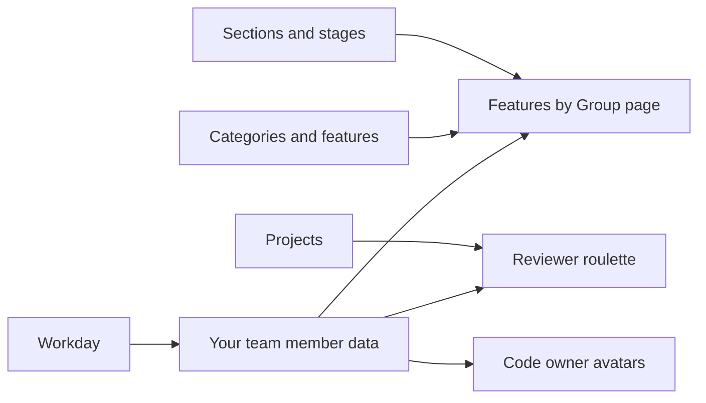

このページでは、チームメンバーデータのエントリ（[www-gitlab-com プロジェクト](https://gitlab.com/gitlab-com/www-gitlab-com)内の
自分の YAML ファイル）を確認・更新する方法と、チームのペットページに自分のペットを追加する方法を説明します。

ハンドブックについては、[ハンドブックの編集ページ](/handbook/about/editing-handbook/)を参照してください。

Workday の同期は、チームメンバーデータのエントリを毎日作成・更新します。たとえば、
[グループ別の機能](/handbook/product/categories/features/)ページには、すべてのプロダクトグループと、その Product Manager、
Engineering Manager、およびその他のカウンターパートが表示されます。これらの人はチームメンバーデータを通じて特定されるため、氏名や
GitLab ユーザー名が間違っていると、グループに表示されなくなります。[自分のエントリと他のデータとのつながり](#how-your-entry-connects-to-other-data)を参照してください。

自分のエントリに依存する Product と Engineering のワークフロー：

- **レビュアールーレット**は、`gitlab` ユーザー名と `projects` の役割から、レビュアーとメンテナーを提案します。
- **コードオーナーのレビュー：** ハンドブックのページは、`gitlab` ユーザー名を使って CODEOWNERS のユーザーを特定し、
  ページのメンテナーの氏名と写真を表示します。
- **DRI の一覧：** 固定カウンターパート、ステージとグループの表、テクニカルライティングの
  担当などのハンドブックのページは、`name`、`role`、`reports_to` に基づいてチームメンバーを表示します。
- **コミュニティ貢献のラベル：** `gitlab` が仕事で使用する GitLab アカウントと一致しない場合、マージリクエストにコミュニティ貢献のラベルが付きます。

これらのフィールドを最新の状態に保ってください。`story`、`remote_story`、ソーシャルメディアのユーザー名などのプロフィール情報は任意です。
チームデータの同期に関する現在の取り組みは、
[FY27 チームデータ同期のエピック](https://gitlab.com/groups/gitlab-com/people-group/-/work_items/118)を参照してください。

## 自分のエントリを確認・更新する {#add-yourself-to-the-team-page}

GitLab への入社 3 日目に、[同期](https://theloop.gitlab.com/site/4455aa7f-24d9-41f2-b940-467b54962e4d/page/0fa19bf4-fd6a-41b9-9316-c2dcf3add854)によって、基本的なチームメンバーデータのエントリが追加されます。内容を確認し、情報を追加してください。更新が正しく反映されない場合は、Workday の設定が正しいか確認してください。使用できるすべてのフィールドは、[チームメンバーデータのスキーマ](https://gitlab.com/gitlab-com/www-gitlab-com/-/blob/master/data/team_members/person/README.md)に記載されています。

エントリの氏名や GitLab ユーザー名が間違っている場合は、[Workday でチームデータの設定を更新](#update-your-team-data-settings-in-workday)してください。

### エントリの更新方法を選ぶ {#choose-how-to-update-your-entry}

必要であれば、`#mr-buddies` や `#handbook` の Slack チャンネルを含め、社内の誰にでも助けを求めてください。エントリを更新する方法は **4 つ**あります。

1. [Web IDE を使って GitLab.com で情報を追加する](#method-1-add-your-info-on-gitlabcom-using-web-ide)（推奨）
1. [「ウェブインターフェース」を使って GitLab.com で情報を追加する](#method-2-add-your-info-on-gitlabcom-using-the-web-interface)
1. [ローカルの Git クローンを使って情報を追加する（ターミナルと IDE を使用）](#method-3-add-your-info-using-a-local-git-clone-using-the-terminal-and-an-ide)
1. [エージェントに支援を求める](#ask-an-agent-for-help)

以下から使いやすい方法を選び、次の情報を手元に用意してください。

- オンボーディングを支援している People Operations チームメンバーの氏名。
- [写真の要件](#picture-requirements)を満たす自分の写真。
- （任意）自分の経歴や興味に関するストーリー。（他のチームメンバーのエントリを参考にしてください。）
- （任意）自分の LinkedIn / Twitter / GitLab のユーザー名。これらを追加する際は、`LinkedIn: username` のように、リンクや先頭の `@` を含めず、ユーザー名だけを記載してください。（誤った例：`LinkedIn: linkedin.com/in/username`、`LinkedIn: @username`。）
- 自分の役割への相対リンク。リンクが `https://handbook.gitlab.com/job-description-library/engineering/support-engineer/` の場合は、`/job-description-library/engineering/support-engineer/` を使用してください。他のエントリを参考にしてください。

#### 写真の要件 {#picture-requirements}

- 画像を正方形に切り抜きます。
- 最大サイズは縦横 400 ピクセルです。
- JPEG（`.jpg`）または PNG（`.png`）形式を使用します。
- ファイルサイズは 100k 未満にします。[tinyjpg.com](https://tinyjpg.com/)などで圧縮してください。
- カラーと白黒で画像を確認します（追加するのはカラー版です）。
- ファイル名は `yournameinlowercase` とし、適切な拡張子を付けます。

{}
氏名と GitLab ユーザー名は Workday から取得します。エントリの情報が間違っている場合は、Workday でも修正してください。[Workday でチームデータの設定を更新](#update-your-team-data-settings-in-workday)してください。
{}

### 方法 1：Web IDE を使って GitLab.com で情報を追加する {#method-1-add-your-info-on-gitlabcom-using-web-ide}

1. www-gitlab-com プロジェクトの [`data/team_members/person`](https://gitlab.com/gitlab-com/www-gitlab-com/-/tree/master/data/team_members/person) フォルダーを開きます。
1. 自分のスラッグの頭文字に対応するフォルダーを開き、自分のチームメンバーファイルを開きます。たとえば、スラッグが `mnohr` のチームメンバーのファイルは `m/mnohr.yml` です。ファイルを素早く見つけるには、`t` を押してファイル検索を開き、自分の名前を入力するか、プロジェクト内を GitLab ユーザー名で検索します。
   - 注記：Workday の `Export Name/Location to Team Page?` で `No` を選択した場合、`name` は役職名に置き換えられ、変更しても同期によって上書きされます。名前でファイルが見つからない場合は、代わりに GitLab ユーザー名で検索してください。これを変更するには、[Workday でチームデータの設定を更新](#update-your-team-data-settings-in-workday)してください。
1. **編集 > Web IDE で開く**を選択します。ウェブエディターが開き、チームメンバーデータのエントリが表示されます。

   

1. 正しいファイルであることを確認するため、`gitlab` の値が自分の [GitLab.com ユーザー名](/handbook/tools-and-tips/#gitlab-profile)と一致するか確認します。
1. [更新するフィールド](#fields-to-update)の説明に従って、自分の情報を更新します。
1. 写真を追加するには、[写真の要件](#picture-requirements)に従って準備します。ファイルエクスプローラーで `sites/uncategorized/source/images/team/` フォルダーを右クリックし、**アップロード**を選択して、写真を選びます。続いて、`picture: yournameinlowercase.jpg` のように、大文字と小文字を一致させて `picture` にファイル名を設定します。
1. [Web IDE を使ってハンドブックを編集する](/handbook/about/editing-handbook/#use-the-web-ide-to-edit-the-handbook)の説明に従って、変更を新しいブランチにコミットし、マージリクエストを作成します。
1. マージリクエストの説明で、変更内容とその理由を説明します。たとえば、`Update my team member data.` と記載します。
1. People Operations のオンボーディング担当チームメンバーと自分のマネージャーをレビュアーに追加します。変更をレビューした後、その人たちがマージリクエストを承認し、マージします。

### 方法 2：「ウェブインターフェース」を使って GitLab.com で情報を追加する {#method-2-add-your-info-on-gitlabcom-using-the-web-interface}

1. [GitLab.com / www-gitlab-com](https://gitlab.com/gitlab-com/www-gitlab-com/) プロジェクトに移動します。
1. 画面上部付近の赤い線の下にある `+` をクリックします。
1. `New branch` をクリックします。
1. `Branch name` には、*自分のイニシャル-team-data-update-自分の部署-日付*のように一意の名前を付け（作業用の一時的な名前なので、厳密な名前はあまり気にする必要はありません）、`Create branch` をクリックします。例：`hk-team-data-update-custsupport-feb06`
1. まず、自分の画像を追加します。左側の `Repository` をクリックします。
1. ファイルブラウザーで、`sites/uncategorized/source/images/team` に移動します。
1. ページ上部の `+` をクリックし、`Upload file` を選択して写真をアップロードします。必ず[写真の要件](#picture-requirements)に従ってください。*YourFirstName YourLastName の写真を追加*という形式のコミットメッセージを追加します。対象ブランチが、先ほど作成したブランチになっていることを確認します。`Start a new merge request with these changes` の切り替えをオフにします。`Upload file` をクリックします。
1. 次に、自分のチームメンバーデータのエントリを編集します。すべての情報はデータファイルに保存されています。`data/team_members/person/FIRST_LETTER_OF_YOUR_SLUG/SLUG_REPLACE.yml` に移動します（自分の氏名またはスラッグが記載されたファイルを探します）。
1. 該当する `yourslug.yml` ファイルに移動します。画面右上の `Edit` をクリックし、`Edit single file` を選択します。
1. [更新するフィールド](#fields-to-update)の説明に従って、自分の情報を更新します。
1. 情報を追加した後、コミットメッセージを追加し、「変更をコミット」をクリックします。「新しいマージリクエストを作成」オプションにチェックが入っている場合は、マージリクエスト（MR）が作成されます。
1. 次に、`Create merge request` ボタンをクリックし、作成したブランチを使って[マージリクエストを作成](https://docs.gitlab.com/ee/user/project/merge_requests/creating_merge_requests.html)します。作成先は [GitLab.com](https://gitlab.com/gitlab-com/www-gitlab-com)です。
1. `Create a new merge request` ページに移動したら、`Description` ボックスの `Why is this change being made?` 見出しの下で、変更内容とその理由を説明します。この MR では、たとえば `Adding my information and picture to my team member data as part of onboarding tasks.` と入力できます。この MR では、説明文の他の箇所を変更する必要はありません。
1. `Create merge request` をクリックします。
1. 新しいページの右上にある `Reviewer` の横の `edit` をクリックします。People Operations のオンボーディング担当チームメンバーと自分のマネージャーを、このマージリクエストのレビュアーに設定します。

### 方法 3：ローカルの Git クローンを使って情報を追加する（ターミナルと IDE を使用） {#method-3-add-your-info-using-a-local-git-clone-using-the-terminal-and-an-ide}

*注記：* この方法では大規模なリポジトリに対する `git clone` が必要なため、他の方法より時間がかかる場合があります。

1. [Git の利用を開始するためのドキュメント](https://docs.gitlab.com/ee/topics/git/how_to_install_git/)に従い、Git をダウンロードします。
1. 手順に従って、[SSH キー](https://docs.gitlab.com/ee/user/ssh.html)を作成・追加します。
1. [www-gitlab-com プロジェクト](https://gitlab.com/gitlab-com/www-gitlab-com)を、[コマンドラインのコマンドに関するドキュメント](https://docs.gitlab.com/ee/topics/git/commands.html#git-clone)に従い、ターミナルからクローンします。
1. これから行う変更のために、[新しいブランチを作成し、チェックアウト](https://docs.gitlab.com/ee/topics/git/branch.html)します。
1. `sites/uncategorized/source/images/team/` ディレクトリに自分の写真を追加します。必ず[写真の要件](#picture-requirements)に従ってください。
1. 好みのエディターで `data/team_members/person/FIRST_LETTER_OF_YOUR_SLUG/SLUG_REPLACE.yml` を開き、自分の氏名またはスラッグがあるファイルを探します。
1. [更新するフィールド](#fields-to-update)の説明に従って、自分の情報を更新します。
1. 編集した `data/team_members/person/FIRST_LETTER_OF_YOUR_SLUG/` 内のファイルの変更を保存します。
1. 必要に応じて、プッシュする前にローカルで変更を検証します。www-gitlab-com 開発ガイドの
   [データ変更の検証](https://gitlab.com/gitlab-com/www-gitlab-com/-/blob/master/doc/development.md#validate-data-changes)
   に従ってください。
   - 注記：[変更のレビュー](#reviewing-your-changes)で説明しているように、MR のパイプラインがファイルを自動的に検証します。
1. 準備ができたら、*FirstName LastName のチームメンバーデータを更新*というコメントを付けて、[変更をステージングし、コミット](https://docs.gitlab.com/ee/topics/git/commit.html)します。
1. [自分のブランチをプッシュ](https://docs.gitlab.com/ee/topics/git/commit.html#send-changes-to-gitlab)します。
1. 作成したブランチを使って[マージリクエストを作成](https://docs.gitlab.com/ee/user/project/merge_requests/creating_merge_requests.html)します。作成先は [GitLab.com](https://gitlab.com/gitlab-com/www-gitlab-com)とし、自分のマネージャーをレビュアーに割り当てます。

### エージェントに支援を求める {#ask-an-agent-for-help}

[GitLab Duo Agentic Chat](/handbook/about/editing-handbook/#ask-an-agent-in-gitlab)を
[www-gitlab-com プロジェクト](https://gitlab.com/gitlab-com/www-gitlab-com)で開き、
変更したい内容を説明します。例：

```text
Help me update my biography in the team member YAML data. My name is Michael Friedrich.
Here is my updated biography: <text>. Find my existing entry and show me the proposed diff.
```

氏名と経歴を自分のものに置き換えてください。エージェントに、
YAML の書式のレビュー、フィールドの重複の特定、変更案の整理を依頼することもできます。
[チームメンバーデータのスキーマ](https://gitlab.com/gitlab-com/www-gitlab-com/-/blob/master/data/team_members/person/README.md)
を参照先として使い、矛盾する値や Workday が管理するフィールドを指摘するよう依頼してください。

ドラフト MR を依頼する前に、差分を確認してください。関係のないプロフィール情報は維持し、
承認を依頼する前に、[変更のレビュー](#reviewing-your-changes)に従ってください。

### 更新するフィールド {#fields-to-update}

エントリ内の次のフィールドを確認・更新してください。[チームメンバーデータのスキーマ](https://gitlab.com/gitlab-com/www-gitlab-com/-/blob/master/data/team_members/person/README.md)には、すべてのフィールドと、
Workday の同期が管理するフィールドが記載されています。

- 必要に応じて、`name` を `FirstName LastName` または `PreferredName LastName` に更新します
- `locality` は空のままにします
- `country` は `Remote` に設定します
- `role` を確認します
- 役職名が間違っているか未入力の場合は、`job_families.yml` に移動し、`command-F`（macOS）または `ctrl-F`（nix）で自分の役職名を検索します。Web IDE では、`command-P`（macOS）または `ctrl-P`（nix）でファイルを検索できます。
- 自分の役割に職務記述へのリンクがあることを確認します。なければ、リンクを追加します。たとえば、`<a href="">Solutions Architect</a>` を `<a href="/job-description-library/sales/solutions-architect/">Solutions Architect</a>` に変更します。
- `reports_to` に、自分のマネージャーのチームメンバーデータのエントリにある `slug` の値が記載されていることを確認します。拡張子を除いたファイル名もスラッグです。つまり、`aname.yml` のスラッグは `aname` です。
- 自分がマネージャーの場合は、直属の部下の `reports_to` が自分の `slug` を参照しているか確認します。
- 現在、借り入れリクエストに基づいて別チームで働いている場合は、次のように `borrow` を追加し、`to` と `end_date` のキーを設定します。

  ```yaml
  borrow:
    to: ramya-authappan
    end_date: 2023-09-15
  ```

- `work_priorities` フィールドに、現在の業務の優先事項を次のような配列で設定します。

  ```yaml
  work_priorities:
    - Product Analytics
    - ModelOps
  ```

- プロフィール写真のファイル名を、大文字と小文字を一致させて追加します。`../gitlab-logo-extra-whitespace.png` がある場合は削除します。入力後の行は、`picture: yournameinlowercase.jpg` のようになります。
- `departments` の一覧が正しいか確認します。他のチームメンバーのものを参考にしてください。
- 自分の [`specialty`](/handbook/company/structure/#specialist)を追加します。
- 自分の [`expertise`](/handbook/company/structure/#expert)を追加します。これは HTML 形式にする必要があります。配列では正しく表示されません。
- 入力済みでも間違っているデータは更新します。

任意のプロフィール情報：

- 自分の代名詞を追加します。
- 他の人が氏名を正しく発音できるよう、フルネームの `pronunciation` の追加を検討します（たとえば、Sid Sijbrandij なら `Sid See-brandy`）。
- Twitter と GitLab のユーザー名を、先頭の `@` なしで追加します。
- Mastodon のアカウントを `mastodon.instance/@username` の形式で追加します。基本的には、プロフィールリンクから `https://` を除いたものです。
- 自分の `story` を追加します。他のチームメンバーのストーリーを参考にしてください。
- リモートワークによって[人生が大きく変わった](/handbook/company/culture/all-remote/)場合は、他のチームメンバーのリモートストーリーを[参考](https://gitlab.com/gitlab-com/marketing/corporate_marketing/corporate-marketing/uploads/8161ceac4523a9f36244f9533960ccbd/remote-story-example.png)に、自分の `remote_story` の追加を検討します

**重要：** ページの書式を崩さないよう、`tab` 文字を使用せず、行間の空白を守ってください。参照するファイル名と拡張子は大文字と小文字を区別し、ファイルが見つからない場合はパイプラインが失敗します。ファイルは空の改行で終わる必要があり、そうでない場合はパイプラインが失敗します。

## 変更のレビュー {#reviewing-your-changes}

マージリクエストで変更を検証します。

1. CI/CD パイプラインと、その中のリンタージョブを確認します。これらは、新規および変更されたファイルが、必須プロパティ、スラッグの一意性、`reports_to` が既存のチームメンバーのエントリを参照していることなど、必要なデータスキーマに一致するか確認します。
1. レビューを依頼する前に、最新のパイプラインが成功していることを確認します。
1. www-gitlab-com の MR がマージされると、ハンドブックのプロジェクトは次回のデプロイジョブで更新されたデータを取得できます。ハンドブックの MR がマージされるまでは、しばらく時間がかかることがあります。

## Workday でチームデータの設定を更新する {#update-your-team-data-settings-in-workday}

Workday の同期は、Workday の 2 つの設定からチームメンバーデータのエントリを作成・更新します。

- **GitLab ユーザー名**：エントリの `gitlab` フィールドに入力され、たとえばレビュアールーレットなどで、自分の GitLab アカウントと結び付けられます。`@` を付けずに、自分の [GitLab.com ユーザー名](/handbook/tools-and-tips/#gitlab-profile)だけを入力してください。氏名やメールアドレスは入力しないでください。
- **氏名／所在地をチームページにエクスポート**：**はい**に設定すると、同期によって氏名と所在地がエクスポートされます。それ以外の場合、エントリには氏名の代わりに役職名が表示され、`name` の手動の変更は同期によって上書きされます。

同期で正しい値が使われるよう、チームメンバーデータのエントリだけでなく、Workday の両方の設定を修正してください。

両方の設定を確認・更新するには：

1. 自分のプロフィールに移動し、**プロフィールの表示 > アクション > 追加データ > 発効日付きカスタムオブジェクトの編集**を選択します。

   

   

1. 今日の日付を選択し、追加データを編集します。
1. **GitLab ユーザー名**フォームで、`@` を付けずに GitLab ユーザー名を確認または入力し、送信します。

   

1. **送信済み**ダイアログで、もう一度**追加データの編集**を選択します。

   

1. **氏名／所在地をチームページにエクスポート**で、**はい**を選択し、送信します。

   

## 自分のエントリと他のデータとのつながり {#how-your-entry-connects-to-other-data}

自分のエントリは、
[www-gitlab-com プロジェクト](https://gitlab.com/gitlab-com/www-gitlab-com/-/tree/master/data)内にある複数のデータファイルの 1 つです。他のファイルがチームメンバーを参照し、ハンドブックのページがそれらを組み合わせます。

- `sections.yml` と `stages.yml` は、各プロダクトセクション、ステージ、グループのカウンターパートを指定します。
- `categories.yml` と `features.yml` は、各グループのプロダクトカテゴリと機能を記述します。
- `projects.yml` は、GitLab プロジェクトの一覧です。エントリの `projects` フィールドは、たとえばレビュアールーレットなどで、これらを参照します。



たとえば、[グループ別の機能](/handbook/product/categories/features/)ページは、セクション、ステージ、
カテゴリ、機能、チームメンバーデータを組み合わせます。どのファイルがどのページやツールにデータを提供するかは、
[データフローの概要](https://gitlab.com/gitlab-com/www-gitlab-com/-/blob/master/data/README.md#data-flow)を参照してください。

## チームのペットページに自分のペットを追加する {#add-your-pets-to-the-team-pets-page}

[上記の手順](#add-yourself-to-the-team-page)で学んだことを使い、[チームのペットページ](/handbook/company/team-pets/)に自分のペットを追加することを検討してください。

主な違いは、各項目の名前と場所です。

1. 写真は `petname.jpg` または `petname.png` とし、同じ[写真の要件](#picture-requirements)に従ってください。
1. 写真を `sites/uncategorized/source/images/team/pets` にアップロードします。
1. ペットの情報は、`data/pets.yml` ファイルの末尾に追加してください。
1. コミットメッセージは、`Adding my dog Gary to the Team Pets Page` のようなものにできます。
1. 自分のマネージャーをレビュアーに割り当てます。
   - マネージャーを追加した後、そのアバターに黄色い三角形の警告記号がある場合、その人は承認できますが、マージはできません。マネージャーの承認後、`#mr-buddies` Slack チャンネルに投稿し、マージを依頼してください。
