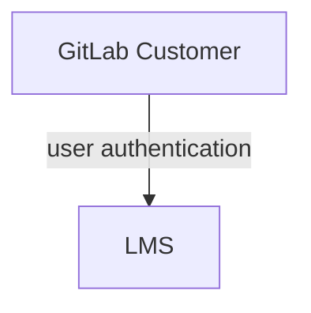

## Thought Industries LMS Tech Stack ガイド {#thought-industries-lms-tech-stack-guide}

[Tech Stack](/handbook/business-technology/tech-stack-applications/)が唯一の情報源であり、このアプリに関する詳細情報が含まれています。

### 実装 {#implementation}

Professional Services 向け LMS の実装は[複数のフェーズに分けて整理](https://gitlab.com/groups/gitlab-com/business-technology/enterprise-apps/-/epics/390#project-scope)されています。

### システム図 {#system-diagram}

Thought Industries LMS の実装は SaaS アプリであり、他の GitLab システムとは統合されていません。

### データモデル {#data-model}

データモデルは公開されておらず、LMS はクローズドシステムです。

### インテグレーション {#integrations}

Thought Industries LMS の実装はスタンドアロンの SaaS アプリであり、他の GitLab アプリとは統合されていません。

### 主要レポート / ダッシュボード {#key-reports--dashboards}

すべてのダッシュボードとレポートは LMS 自体に含まれています。別途の Sisense レポートは利用可能でなく、計画もありません。
