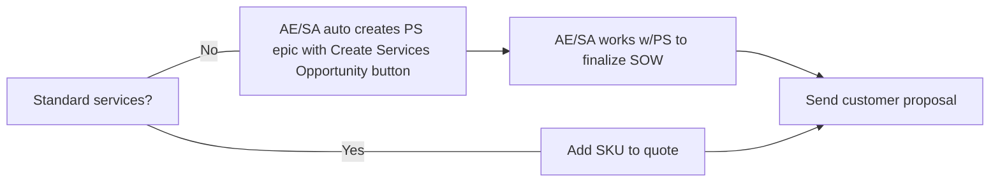

### Professional Services への問い合わせ方法 {#how-to-contact-professional-services}

GitLab において、Professional Services（PS）は [Customer Success 部門](/handbook/customer-experience/) の一部です。そのため、PS と関わる際には、[Solutions Architect（SA）](/handbook/solutions-architects/processes/#engaging-an-sa-during-the-sales-cycle) と関わるためのガイドラインに従ってください。このプロセスにより、Customer Success 部門全体としてアカウントエグゼクティブと顧客のインバウンドニーズを把握できます。

#### Slack {#slack}

PS は [#professional-services](https://gitlab.slack.com/archives/CFRLYG77X) Slack チャンネルを使用して、サービスに関する一般的な質問への回答や、PS Engagement Estimate や SOW などの PS スコープ業務の納品連絡を行います。プライベートな [#professional-services-us-pubsec](https://gitlab.slack.com/archives/C025UHLTR50/p1625778195002900) Slack チャンネルは US Public Sector のサービス向けに使用されます。[#professional-services-us-pubsec](https://gitlab.slack.com/archives/C025UHLTR50/p1625778195002900) へのアクセス権は [#professional-services](https://gitlab.slack.com/archives/CFRLYG77X) でリクエストしてください。

#### GitLab チームメンバー向けのトレーニング依頼 {#requesting-training-for-gitlab-team-members}

**チームリード向け**

社内 GitLab チームリードは、Professional Services が提供するチーム向けトレーニングセッションを依頼できます。リクエストの手順は以下のとおりです。

1. Education Services 名前空間に internal_trainer_request Issue テンプレート（または internal-team-member-training-request）を使って [新しい Issue を作成](https://gitlab.com/gitlab-com/customer-success/professional-services-group/education-services/-/issues/new?issue%5Bassignee_id%5D=&issue%5Bmilestone_id%5D=#) します。
1. Issue 説明文の Requestor Tasks を完了します。
1. PS Project Coordinator がトレーニングセッションの計画とスケジューリングのために連絡します。

**個別のチームメンバー向け**

個別の GitLab チームメンバーは、Professional Services が提供する顧客向けトレーニングセッションの聴講をリクエストできます。参加リクエストの手順は以下のとおりです。

1. Education Services 名前空間で internal-team-member-training-request テンプレートを使い、[新しい Issue を作成](https://gitlab.com/gitlab-com/customer-success/professional-services-group/education-services/-/issues/new?issue%5Bassignee_id%5D=&issue%5Bmilestone_id%5D=#) します。
1. Issue 説明文の Requestor Tasks を完了します。
1. PS Project Coordinator が日程を確認し、登録リンクを案内します。

### Sales Rep および SA 向け: Professional Services の発注方法 {#for-sales-reps-and-sas-how-to-order-professional-services}

1. Professional Services を発注するには、SAE または ISR が標準ライセンスもしくはサブスクリプションの親 Opportunity から `Create Services Opportunity` ボタンを使って [SFDC 上で子の PS Opportunity を作成](/handbook/sales/field-operations/gtm-resources/#creating-a-professional-services-opportunity) します。

1. 次のステップは、必要なサービスが標準サービスかカスタムサービスかによって異なります。

- **Standard Services（カスタマイズなし）**: 事前定義された Statement of Work（SOW）書類を伴う Professional Services SKU を用いて販売されます。これらの提供形態はカスタムスコーピングを必要とせず、SFDC 内の Zuora から直接発注されます。現在提供している標準サービスの一覧は [フルカタログ](https://about.gitlab.com/professional-services/catalog/) を参照してください。

- **Custom Services**: 標準サービスでは顧客のニーズを満たせない場合に、カスタム SOW を用いて販売されます。[地域別の Professional Services Engagement Manager](https://docs.google.com/document/d/1bdVOf3jL6aJF79qRMFLQsmMxIgQh5ZQ-WiLuNgsWB08/edit?tab=t.0#heading=h.qzgxpwqxme5) に連絡してください。上記ステップ 1 で PS Opportunity を作成すると、[Professional Services Epic](https://gitlab.com/groups/gitlab-com/customer-success/professional-services-group/-/epics?state=opened&page=1&sort=start_date_desc) と [スコーピング Issue](https://gitlab.com/gitlab-com/customer-success/professional-services-group/ww-consulting/ps-plan/-/issues/?sort=created_date&state=opened&first_page_size=100) が自動的に作成されます。Epic と Issue を使って情報を入力し、Engagement Manager と連携してください。

**Sales Rep および SA 向けプロセス**

Professional Services の販売に関する詳細は、[GitLab Professional Services の販売](/handbook/customer-experience/professional-services-engineering/selling) を参照してください。

Professional Services を顧客に対してどのようにポジショニングするかについての情報は、[Professional Services のポジショニング](/handbook/customer-experience/professional-services-engineering/positioning) を参照してください。

#### Professional Services エンゲージメント開始までのリードタイム {#lead-time-for-starting-a-professional-services-engagement}

「プロジェクトを開始するまでのリードタイムはどれくらいですか？」と聞かれることがしばしばあります。また、顧客が特定の期間内にプロジェクトを納品してほしいと希望する場合もあります。
常時多くのプロジェクトや提案が進行中である可能性があるため、エンゲージメントの優先順位付けとスケジューリングにあたっていくつかのルールがあります。

- PS Opportunity が Closed/Won となり、PS Operations チームがプロジェクトをスケジュールするまでは、いかなるエンゲージメントスケジュールもコミットできません。それより前のタイミングでスケジュールを合わせる努力はできますが、サービスエンゲージメントを契約済みの顧客に対して公平であるためには、そちらを優先する必要があります。
- 最新のリードタイムについて、より正確な見積もりが必要な場合は、[professional services Slack チャンネル](#slack) で `@ps-scheduling` グループにメンションして PS Operations チームに確認してください。
- PS Operations チームは SFDC ステージ 5 のプロジェクトをレビューします。私たちは SFDC ステージが Closed/Won となってから数日以内にプロジェクトを開始することを目指しています。

#### カスタムサービス SOW の作成と承認 {#custom-services-sow-creation-and-approval}

カスタムサービスでは、Professional Services Engagement Manager がアカウントチーム（SAE/AE、SA、CSM）と連携し、顧客とともにエンゲージメントのスコープを定めます。Engagement Manager は GitLab の社内見積もりツールである PS Compass で見積もりを作成し、アカウントチームおよび顧客とレビューしたうえで SOW を作成します。すべてのカスタム SOW は、署名のために顧客へ送付する前に PS Leadership の承認を受けます。

顧客が変更を希望する場合は、私たちの契約書および SOW 文書に修正を加えてもらうことを推奨します。顧客自身のサービス条項や SOW の使用が必要な場合は、PS チームに連絡してください。

GitLab チームメンバーは、社内ハンドブックの[特定、スコーピング、見積もり](https://internal.gitlab.com/handbook/customer-experience/professional-services/identify-scope-estimate/)および[契約と見積書作成](https://internal.gitlab.com/handbook/customer-experience/professional-services/contracting-and-quoting/)で詳細なプロセスを確認できます。

### Professional Services のスケジューリング {#scheduling-professional-services}

現在、顧客プロジェクトは Opportunity が Closed-Won となった順にスケジューリングされます。プロジェクトのスケジューリングに関する懸念は、スコーピングプロセスの Discovery フェーズで議論してください。Discovery フェーズの一環として、Project Scheduling Intake Issue を更新してください。Project Coordinator はこの情報を用いて要員配置をレビューします。リードタイムや空き状況に関する質問がある場合は、professional services Slack チャンネル（#professional-services）で @ps-scheduling グループにメンションして Engagement Manager または Project Coordinator に確認してください。
SOW／契約書の署名前に、PS Project Coordinator の確認なしにプロジェクト開始日をコミットすることは控えてください。

Opportunity が Close/Won に更新された後、次のステップは以下のとおりです。

- PS Project Coordinator が SOW と Order Form をレビューし、Kantata でプロジェクトをセットアップします。
- Project Scheduling Intake Issue で顧客連絡先の情報が提供されていない場合、PS Project Coordinator がアカウントチームに連絡します。
- PS Project Coordinator は、Opportunity の予約から営業 72 時間以内に顧客に Welcome to PS メールを送付し、アカウントチームと Professional Services リーダーを CC に入れます。
