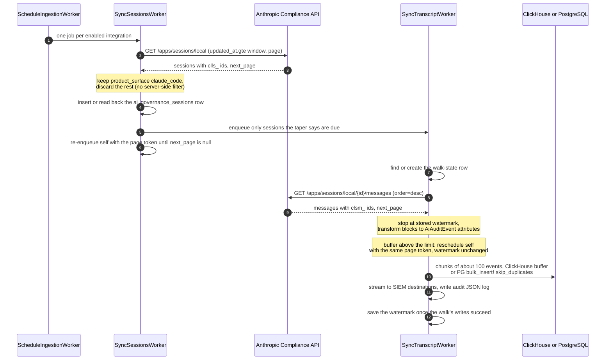
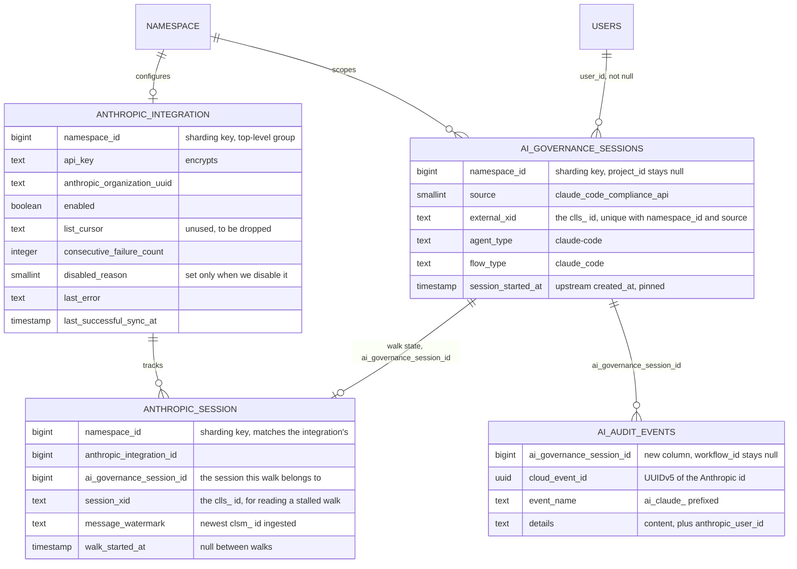

<!-- Design Documents often contain forward-looking statements -->
<!-- vale gitlab.FutureTense = NO -->



## 概要 {#summary}

Anthropic の Claude Compliance API は、Claude Code セッションのトランスクリプト — すべてのプロンプト、応答、ツール呼び出し — を Claude Enterprise 組織全体にわたって公開します。

このドキュメントでは、GitLab がそれらのセッションを取得し、GitLab Duo セッションをすでに保持しているテーブルを使って AI Governance に表示することを提案します。

| | |
| --- | --- |
| 対象 | Claude Code のローカルセッション |
| 対象外 | Cowork、リモートセッション、Activity Feed。[対象外](#non-goals)を参照 |
| 1 セッションの変換先 | `ai_governance_sessions` の 1 行。Duo Workflow 行は作成しません |
| 1 コンテンツブロック（テキスト、ツール呼び出し、ツール結果）の変換先 | `ai_claude_*` イベント名を持つ `AuditEvents::AiAuditEvent` の 1 行 |
| 関連付け先 | プロジェクトではなく最上位グループ |
| 必要なもの | 顧客の Compliance Access Key |

## 問題の説明 {#problem-statement}

Claude Code の AI ガバナンスには、開発者が送ったプロンプト、Claude の応答、その間のすべてのツール呼び出しという、エージェントが実際に行った操作を確認できることが必要です。現在 GitLab はどれも記録していないため、コンプライアンスのレビュー担当者には確認するものがありません。

### 目標 {#goals}

- 2 組目を構築せず、既存のテーブルと UI を再利用します
- 顧客の要望である、セッションとそのツール呼び出しを表示します

### 対象外 {#non-goals}

| 実施しないこと | 理由 |
| --- | --- |
| Cowork とリモートセッション | エンドポイントもパイプラインも同じです。後で追加する場合は、設計ではなくフィルターを変更します |
| Activity Feed の取り込み | メタデータのみで、セッションモデルに適合しません。`AuditEvents::AiAuditEvent` はセッションキーを必要とするため、セッションのないイベントは単に非表示になるのではなく無効です。また、`claude_chat_viewed` はセッションではないため、行を作り出さずには参照先がありません。キーのスコープを 1 つに保つことにもなります |
| 顧客側から送信するクライアント | 取り込みエンドポイントは存在しますが、プロジェクトをスコープとし、顧客が実行するエージェントが依然として必要です。[代替案](#alternative-solutions)を参照してください。`api.anthropic.com` をブロックするセルフマネージドインスタンスには、引き続き適切です |
| 削除 | `delete:compliance_user_data` は要求せず、Anthropic 側の情報は一切削除しません |

---

## 提案 {#proposal}

顧客は Compliance Access Key を作成し、GitLab に渡します。GitLab は暗号化して保存し、定期的に Anthropic をポーリングし、共有の AI セッションテーブルと監査イベントテーブルに書き込みます。

取り込みではローカルセッションを一覧取得し、`product_surface` が `claude_code` のものを残します。

残した各セッションは `ai_governance_sessions` の 1 行になります。これは、Duo と外部エージェントを問わずすべての AI セッションを保持することが[共有セッションテーブルの Issue](https://gitlab.com/gitlab-org/gitlab/-/work_items/628968#note_3857947247)で合意されたテーブルです。`duo_workflows_workflows` 行は作成しません。Compliance 由来のセッションと GitLab AI Governance（GAIG）のフック由来のセッションは、どちらも `ai_governance_sessions` 行なので、Governance ページに並んで表示されます。

## 設計と実装の詳細 {#design-and-implementation-details}

### 上流 API のインターフェース {#upstream-api-surface}

すべてのエンドポイントは `https://api.anthropic.com/v1/compliance/*` 配下にあり、`x-api-key` ヘッダーを使います。

#### キーの種類 {#key-types}

| キー | プレフィックス | ここで利用可能か |
| --- | --- | --- |
| Compliance Access Key | `sk-ant-api01-` | はい。親組織の primary owner が claude.ai で作成します |
| Console Admin API キー | `sk-ant-admin01-` | いいえ。`read:compliance_activities` に限定され、Activity Feed のみにアクセスできます |
| Claude API キー | `sk-ant-api03-` | いいえ。直ちに拒否します |

#### API スコープ {#api-scopes}

この設計で必要なのは `read:compliance_user_data` のみです。

#### 使用するエンドポイント {#endpoints-used}

| エンドポイント | 返すもの |
| --- | --- |
| `GET /apps/sessions/local` | セッションメタデータ。フィルター: `created_at.gte`、`created_at.lt`、`updated_at.gte`。`created_at` の新しい順に並びます。`limit` は最大 500 |
| `GET /apps/sessions/local/{id}/messages` | 1 つのトランスクリプト。`order=asc` または `desc`。`limit` は最大 1,000 |

1 つの親組織に対するすべてのリクエストは、すべてのキーとすべてのリンクされた組織にわたり、毎分 600 リクエストを共有します。

---

### 取り込みアーキテクチャ {#ingestion-architecture}

#### 再利用するもの {#what-we-reuse}

| コンポーネント | 既存の動作 |
| --- | --- |
| `Ai::DuoWorkflows::ProcessAuditEventsWorker` 内の書き込み経路 | ClickHouse バッファーまたは PostgreSQL の `unique_by: %i[cloud_event_id created_at]` による `bulk_insert!`、`ai_audit_events_storage_enabled` ゲート、SIEM ストリーミング、監査 JSON ログ。すでに `namespace_id` を解決します。ワーカーではなくロジックを再利用します。[イベントの書き込み方法](#how-events-are-written)を参照してください |
| `ai_governance_sessions` とその GraphQL クエリ | AI セッションごとに 1 行を保持し、Siphon（PostgreSQL の行を ClickHouse にコピーするツール）が ClickHouse に複製します。AI Governance ページは ClickHouse を読み込みます。ClickHouse のないインスタンス向けの PostgreSQL フォールバックは[レビュー中](https://gitlab.com/gitlab-org/gitlab/-/merge_requests/259922)です。Duo 行は `duo_workflows_workflows` からミラーリングし、私たちの行は直接挿入します |

書き込み経路より後には、構築が必要なものはありません。Claude セッションには Duo ワークフロー行がないため、Duo のミラーリングコードは関与しません。

タイミング上の影響が 1 つあります。`ai_governance_sessions` にはバックフィルがないため、空の状態から始まり、実際のトラフィックで埋まっていきます。その間、Duo の履歴に対するダッシュボードのソースは `duoWorkflowSessionArtifacts` のままなので、ページは 1 つの並べ替え可能なリストではなく、2 つの接続になります。Claude セッションは新しいクエリから、過去の Duo セッションは既存のクエリから取得します。テーブルに蓄積されるにつれて解消するものであり、[共有セッションテーブルの Issue](https://gitlab.com/gitlab-org/gitlab/-/work_items/628968#note_3857947247)にある Duo の非推奨化が次のマイルストーンの項目ではない理由でもあります。

#### 構築するもの {#what-we-build}

| コンポーネント | 責務 |
| --- | --- |
| `Ai::Compliance::Anthropic::Integration`（`ai_compliance_anthropic_integrations`、シャーディングキーは `namespace_id`） | 暗号化したキー、Anthropic 組織 UUID（まだ入力しません）、有効フラグ、失敗回数、最後のエラー、最後の同期成功、および GitLab 自身が連携を無効にした場合にのみ設定する `disabled_reason`。`list_cursor` 列は未使用で、後で削除できます。[エンドポイントによるページトークンの違い](#page-tokens-differ-between-the-endpoints)を参照してください |
| `Ai::Compliance::Anthropic::Session`（`ai_compliance_anthropic_sessions`、シャーディングキーは `namespace_id`） | 1 つの `clls_` セッションのトランスクリプト走査状態。ウォーターマークと `walk_started_at` を持ち、`ai_governance_sessions` 行にキーで関連付けます。名前空間は連携の名前空間と一致する必要があります。重複排除はその役割ではありません。[セッションの重複排除](#deduplicating-sessions)を参照してください |
| `Ai::Compliance::Anthropic::Client`（`ee/lib`） | `Gitlab::HTTP` を通じた HTTP、ページネーション、タイムアウト |
| `Ai::Compliance::Anthropic::ScheduleIngestionWorker`（cron） | 6 時間ごとに実行します。グループのフィーチャーフラグがオンである有効な連携ごとに、1 つの `SyncSessionsWorker` をキューに追加します |
| `SyncSessionsWorker(integration_id, page_token, params)` | セッション一覧の 1 ページを処理し、自身をキューに追加します。ページトークンとウィンドウの開始時刻をジョブ引数で引き継ぐため、1 回の走査の全ページが同じウィンドウを要求します |
| `SyncTranscriptWorker(integration_id, ai_governance_session_id, session_xid, page_token, candidate_watermark)` | 1 つのトランスクリプトの 1 ページを処理し、最新の `clsm_` ID を引き継ぎ、走査を完了したジョブが確定できるようにします。セッションの初回走査時に走査状態行を作成します。両方の ID を引き継ぎます。`session_xid` は Anthropic のトランスクリプトを指定し、`ai_governance_session_id` はイベントに付与します。ページのイベントを自身で書き込みます。[イベントの書き込み方法](#how-events-are-written)を参照してください |
| 監査イベント書き込みサービス | `ProcessAuditEventsWorker` から抽出し、イベントのリストを保存、ストリーミング、ログ記録します。`SyncTranscriptWorker` から、また Duo 向けに `ProcessAuditEventsWorker` からインラインで呼び出します。[イベントの書き込み方法](#how-events-are-written)を参照してください |
| `Ai::Compliance::Anthropic::TransformService` | メッセージとコンテンツブロックを `AiAuditEvent` 属性ハッシュに変換し、それぞれに `ai_governance_session_id` を付与して、その途中で切り詰めます。[イベント内容の切り詰め](#truncating-event-content)を参照してください |
| `Ai::Compliance::Anthropic::UserResolver` | GitLab ユーザーを検索し、グループのメンバーシップを確認します。[アイデンティティの解決](#identity-resolution)を参照してください |
| `Ai::Compliance::Anthropic::Sessions::CreateService` | `ai_governance_sessions` 行を挿入するか、既存の行を読み戻します。走査状態には触れません。[セッションの重複排除](#deduplicating-sessions)を参照してください |

#### イベントの書き込み方法 {#how-events-are-written}

トランスクリプトジョブが自身のイベントを書き込みます。`SyncTranscriptWorker` はメッセージの 1 ページを変換し、`Ai::DuoWorkflows::ProcessAuditEventsWorker` から抽出した書き込みサービスにイベントを渡します。両ワーカーがそのサービスを呼び出すため、保存ゲート、SIEM ストリーミング、監査ログは 1 つの実装を維持します。

`ProcessAuditEventsWorker` はキューに追加しません。私たちはそのワーカーの問題に取り組んでいます（[スケーリングの Issue](https://gitlab.com/gitlab-org/gitlab/-/work_items/604202)）。Claude の取り込みは集中的に発生し、[推定量](#rate-limits-and-volume)ではより大量に書き込む側になるため、インラインで書き込むことで、そのワーカーにこの負荷をかけずに済みます。イベントはジョブ引数で受け渡しません。

ドラフトの[トランスクリプト同期 MR](https://gitlab.com/gitlab-org/gitlab/-/merge_requests/261034)は、現在 `ProcessAuditEventsWorker` を 500 件ずつのバッチでキューに追加し、キューへの追加が済むとウォーターマークを保存しています。マージ前に、この設計に変更します。

| ルール | 理由 |
| --- | --- |
| ページのイベントを書き込む前に `ClickHouse::WriteBuffer.pending('ai_audit_events')` を確認します。上限を超えている場合、ウォーターマークを進めず、同じページトークンで数分後にジョブ自身を再スケジュールします | 共有バッファーで Duo のイベントの優先を維持します |
| 約 100 イベントずつのチャンクで書き込みます | 大きなイベントを含む 500 メッセージのページを、1 つの巨大な挿入にしません。イベントは約 10 KB に達する可能性があります。テキストは 500 バイト、各 `tool_result` エントリは 1,000 または 2,000 バイト、各ツール入力値は 2,000 バイトに制限しますが、キーとエントリの数に上限はありません。Anthropic の 10,000 バイトの入力上限が全体を制限します |
| 走査の書き込みが成功した後にのみウォーターマークを保存します | ページの途中で失敗すると、次の試行でそのページを再読込します。イベントは `cloud_event_id` で重複排除するため安全です。PostgreSQL には `skip_duplicates` を使う `(cloud_event_id, created_at)` 一意インデックスがあり、ClickHouse は読み取り時に重複を除外します |
| `TransformService` で切り詰めます | 行あたりのバイト数を減らします。[イベント内容の切り詰め](#truncating-event-content)を参照してください |
| バッファーの逼迫による再スケジュールをメトリクスで数えます | バッファーが満杯のままになる停滞を確認できます。12 時間のウィンドウより短い停滞は取り込みを遅らせるだけですが、長い停滞ではメッセージが失われる可能性があります。[許容するデータ損失](#accepted-data-loss)を参照してください |
| 再スケジュールしたジョブでメッセージのページトークンの期限切れ（`400`）が判明した場合、最新のページから走査を再開します | ウォーターマークが進んでいないため安全で、24 時間を超える停滞でも走査は破綻しません |

上限は調整する値であり、このドキュメントでは固定しません。

ストリーミングは変更しません。`AuditEvents::AiAuditEvents::Streamer.stream` はすでにイベントごとに 1 つの `AiAuditEventStreamingWorker` をキューに追加します。

#### イベント内容の切り詰め {#truncating-event-content}

コンプライアンス上の問いは、どのツールがどのファイルに対して実行されたかであり、その周りの文章ではありません。そのため、サイズを制限した記録を保存し、完全なトランスクリプトは Anthropic に残します。

| フィールド | 制限 |
| --- | --- |
| ツール名、および解析できた場合のツール入力のキー | 切り詰めません |
| `tool_use` の入力値 | 2,000 バイト |
| `tool_result`、成功時 | 1,000 バイト |
| `tool_result`、エラー時 | 2,000 バイト |
| ユーザーとアシスタントのテキスト | 500 バイト |

Anthropic の `tool_use_input_max_bytes` を下げると、シリアライズされたドキュメントを途中で切断して解析不能にしてしまうため、解析後に切り詰めます。また、`byteslice` ではマルチバイト文字を分断して PostgreSQL が拒否する文字列を作る可能性があるため、`truncate_bytes` で切り詰めます。

いずれにしても 2,000 バイトに切り詰め、サーバー側の最大値は文字列ごとに約 1 MiB なので、`tool_use_input_max_bytes` は引き上げず、Anthropic のデフォルトの 10,000 バイトに保ちます。すでにその上限を超える入力は、切断され解析できない状態で届くため、値の代わりにフラグ付きの生の先頭部分を保存します。ブロックの `name` は別のフィールドなので、ツールは引き続き識別できます。

切り詰めた各値にはフラグと元のバイトサイズを付けるため、短くなったコマンドを完全なコマンドと誤認することはありません。

#### 1 ジョブにつき 1 ページ {#one-page-per-job}

すべてのワーカーは 1 ページを読み、自身をキューに追加します。1 つのジョブで顧客の全データを走査してはいけません。何時間もかかり、長時間の Sidekiq ジョブを安全に再試行できないためです。

ワーカーは `concurrency_limit` で並列度を制限し、さらに `ProcessAuditEventsWorker` と同じ `defer_on_database_health_signal :gitlab_main, [:ai_audit_events]` を使います。一覧ワーカーは `retry: 0` を設定します。トランスクリプトワーカーは Sidekiq の再試行を数回保持します。イベントは `cloud_event_id` で重複排除するため安全です。失敗したトランスクリプトジョブはウォーターマークを保存しないため、再試行または次回の実行で同じメッセージを再読込します。[呼び出しが失敗した場合](#when-calls-fail)を参照してください。

#### フロー図 {#flow-diagram}



### データモデルのマッピング {#data-model-mapping}

Claude のローカルセッション（`type: compliance_local_session`、ID プレフィックス `clls_`）1 件が、`ai_governance_sessions` の 1 行になります。

| 上流のフィールド | `ai_governance_sessions` の列 | 備考 |
|---|---|---|
| `id`（`clls_...`） | `external_xid` | `namespace_id` と `source` との組み合わせで一意となり、セッションの重複を排除します。[セッションの重複排除](#deduplicating-sessions)を参照してください |
| `created_at` | `session_started_at` | 初めて確認した時点の上流の値を使い、変更しません。[開始時刻を固定する理由](#why-start-time-is-pinned)を参照してください |
| 該当なし | `source` | `claude_code_compliance_api`。既存の smallint 上の Rails 列挙型で、もう一方の Claude Code フィードである `claude_code_glab` とともに、[共有セッションテーブルの Issue](https://gitlab.com/gitlab-org/gitlab/-/work_items/628968#note_3857947247)で合意済みです。2 つのフィードは異なるアクティビティを記録するため、実時間で同じセッションにも意図的に別々の行を書き込みます |
| 該当なし | `agent_type` | `'claude-code'`。`AgentIdentity::AGENT_TYPES` に合わせます。検証するものはありません。その包含検証は、使用できない `AgentIdentity` にあるためです |
| 該当なし | `flow_type` | `'claude_code'`。デフォルトの `software_development` がここでは意味を持たない `workflow_definition` を置き換えます。`agent_type` がハイフン区切りなのに対してアンダースコア区切りなのは、それぞれ自分の列の既存値に従うためです。`workflow_definition` は snake_case で、`agent_type` は `AGENT_TYPES` と一致する必要があります |
| 該当なし | `status` | 初めて確認した時点から `finished`。ステートマシンのイベントを通さず、直接設定します。[状態が常に finished である理由](#why-status-is-always-finished)を参照してください |
| `user.email_address` | `user_id` | `null: false` のため、対応するユーザーを見つけられないセッションは保存できません。セッションごとに検索し、保存しません。[アイデンティティの解決](#identity-resolution)を参照してください |
| `organization_uuid`、`workspace_id` | 使用しません | `namespace_id` は連携レコードから取得します。[名前空間のスコープ](#namespace-scoping)を参照してください |

ローカルセッションオブジェクトが持つのは `type`、`id`、`organization_uuid`、`workspace_id`、`user`、`product_surface`、`created_at`、`updated_at` だけです。`ai_governance_sessions` は十分小さく、未使用のものはわずかです。`project_id`、`workflow_id`、`session_finished_at` は null のまま、`credits_used` と `model_used` は Duo 行でも値を設定するものがないため、デフォルト値のままにします。

読みやすいセッションラベルを持つものはありません。`ai_governance_sessions` からは `goal`、`title`、`summary` をすべて意図的に除いているため、**AI Item** にはエージェントとクライアントの種類だけを表示します。これは、そのテーブル自体のルール — 利用先ができたときに列を追加する — であり、これにより、この設計で以前必要だった 2 つの回避策、最初のユーザーメッセージを切り詰めて `goal` に入れることと、`before_create` が生のソーススラッグを表示しないよう `title` を明示的に設定することが不要になります。リストを確認するレビュー担当者は、ユーザーと開始時刻で行を区別します。プロンプト自体は、セッションドロワーの `ai_claude_user_input_received` イベントにあります。

#### 開始時刻を固定する理由 {#why-start-time-is-pinned}

`session_started_at` は開始時刻の列であり、キーセットページネーションのキーでもあります。影響は 2 つあります。

- Rails に値を設定させると、ページはセッションの実行時刻ではなく、GitLab が取り込んだ時刻を表示します
- 後の同期で更新すると、古い呼び出しが保持期限を超えるにつれて上流の `created_at` が進むため、開始時刻が毎回後ろにずれます。ページを読んでいる途中でリストの順序も変わってしまいます。これが、`ai_governance_sessions` が `updated_at` ではなく `session_started_at` でページネーションする理由です

そのため、上流の値を一度設定し、その後は更新しません。

#### 状態が常に finished である理由 {#why-status-is-always-finished}

Anthropic はローカルセッションに状態を付けません。`ai_governance_sessions.status` は Duo ステートマシンの整数値を再利用しますが、そのうち外部エージェントセッションが到達できるのは `created`、`running`、`finished`、`failed`、`stopped` だけです。セッションが直近のウィンドウから外れると、その後は何も実行されないため、そのためだけのクリーンアップジョブがなければ、後で状態を変更するタイミングがありません。

代償として、セッションがアクティブな間はイベントを追加し続けても、行は `finished` と表示します。同じ理由で `session_finished_at` も null のままなので、そこから所要時間を読み取るべきではありません。

#### エンティティ関連図 {#entity-relationship-diagram}



**スキーマの変更。** 3 つあります。2 つは私たちの新しいテーブルで、3 つ目は既存のテーブルに対する変更であり、このドキュメントではなく[共有セッションテーブルの Issue](https://gitlab.com/gitlab-org/gitlab/-/work_items/628968#note_3857947247)が担当します。

| 変更 | テーブル |
|---|---|
| `Ai::Compliance::Anthropic::Integration` 用の新しいテーブル。シャーディングキーは `namespace_id` | 新規 |
| `Ai::Compliance::Anthropic::Session` 用の新しいテーブル。シャーディングキーは `namespace_id`。トランスクリプトの走査状態を保持し、`ai_governance_sessions` 行にキーで関連付けます。[セッションの重複排除](#deduplicating-sessions)を参照してください | 新規 |
| `ai_audit_events` の `ai_governance_session_id` と、2 つのキーのどちらかを必要とするようにする `validates :workflow_id, presence: true` の緩和。マージ済み | 既存 |

`ai_governance_sessions` 自体の構築は私たちの担当ではありません。[共有セッションテーブルの Issue](https://gitlab.com/gitlab-org/gitlab/-/work_items/628968#note_3857947247)で提供され、この設計はそれを利用します。`duo_workflows_workflows` と `duo_workflow_session_artifacts` に変更はありません。

緩和した検証とともに許容し、その Issue にも明記したこととして、2 つのキーのどちらかを要求するのはモデルレベルのルールであり、対応するデータベース制約はありません。そのため、検証を迂回する一括挿入では、どちらのキーも設定されていない行を書き込めます。

#### 既存コードの変更 {#changes-to-existing-code}

これらが反映されるまで、取り込みはリリースできません。大半はマージ済みです。最新の状況は[追跡用 Issue](https://gitlab.com/gitlab-org/gitlab/-/work_items/632323)にあります。

| 変更 | 場所 | 状態 | 理由 |
| --- | --- | --- | --- |
| 挿入時に `traversal_path` を指定します | `AiAuditEvent#to_clickhouse_csv_row` | マージ済み | そうしないと、再送したイベントが二重に保存され、統合されません |
| ストリーミングするペイロードをセッションに対応させます | `AuditEvents::AiAuditEvent#target_id`、`#target_type`、`#target_details` | マージ済み | `target_type` はリテラル文字列 `'Ai::DuoWorkflows::Workflow'` で、`target_details` は `workflow_id` を埋め込んでいたため、ワークフローがない場合、顧客の SIEM は null のターゲットとテキスト `"Unknown session "` を受信していました |
| `STREAMABLE_ATTRIBUTES` に `ai_governance_session_id` を追加します | `AuditEvents::AiAuditEvent` | マージ済み | このリストは意図的に `column_names` から切り離しているため、新しい列はそれだけではストリームに届きません |
| 新しい `ai_governance_sessions` GraphQL クエリと、それを読み込むダッシュボード | AI Governance ページ | `ai_governance_sessions_api` の背後でマージ済み。[現在はデフォルトでオン](https://gitlab.com/gitlab-org/gitlab/-/merge_requests/259993) | `duoWorkflowSessionArtifacts` は私たちが書き込まないテーブルを読むため、これらのクエリなしでは私たちのセッションは表示されませんでした |
| セッションクエリの PostgreSQL フォールバック | セッションリゾルバー | [レビュー中](https://gitlab.com/gitlab-org/gitlab/-/merge_requests/259922) | そうしないと、ClickHouse のないインスタンスはセッションを表示できません |
| 書き込み経路を共有サービスに抽出します | `Ai::DuoWorkflows::ProcessAuditEventsWorker` | 計画中 | そうしないと、保存ゲート、SIEM ストリーミング、監査ログに 2 つ目の実装ができます。[イベントの書き込み方法](#how-events-are-written)を参照してください |
| 名前空間をスコープとするセッションに `web_path` とセッション ID を返します | セッション型 | 未解決 | 早期 return の 1 つが、Duo 以外のソースのセッションで両方を空にするため、Compliance セッションにはセッションリンクもセッション ID もありません。1 つの修正で両方に対応します |

残りの作業は 2 つの流れに分かれます。書き込み側は抽出する書き込みサービスです。UI ができる前に、取り込みをこのサービスに対して構築し、テストできます。読み取り側は PostgreSQL フォールバックと `web_path` で、取り込んだセッションをどこで、どのように表示するかを決めます。

`agent_type` は `ai_governance_sessions` の正式な列で、`source` はセッションドロワーがクライアントの種類として表示するものなので、どちらもワークフローからコピーしたり、定義スラッグから推測したりする必要はありません。

#### ClickHouse のソートキー {#the-clickhouse-sort-key}

ClickHouse の `ai_audit_events` は `(traversal_path, workflow_id, created_at, id)` でソートします。私たちが書き込むすべての行は `workflow_id` が null なので、名前空間内のすべての外部エージェントイベントがまとまり、セッション単位の読み取りで必要以上の範囲を走査します。

[共有セッションテーブルの Issue](https://gitlab.com/gitlab-org/gitlab/-/work_items/628968#note_3857947247)は、Claude Code の量が少ない間はこれを許容しています。このドキュメントの[量の見積もり](#rate-limits-and-volume)は、少ない量を示していません。大規模な顧客 1 社で 1 日あたり約 150 万行を生成し、そのすべてで `workflow_id` が null です。ソートキーの変更にはすべての AI 監査履歴にわたるテーブルの再構築が必要で、独自の計画が必要になるため、この判断を再検討せず、許容済みのコストを維持します。その前提は、上記の見積もりに照らして確認するべきです。再検討のきっかけは、外部エージェントセッションのセッション単位の読み取りが、クエリ時間に影響として現れることです。

#### セッションの重複排除 {#deduplicating-sessions}

取り込みでは毎回直近 12 時間のウィンドウを再読込するため、2 回の実行で同じ上流セッションを確認することがよくあります。重複は例外ではなく通常のケースです。

これは `ai_governance_sessions` が処理します。一意インデックスは `(namespace_id, source, external_xid) WHERE external_xid IS NOT NULL` で、3 つすべてを私たちが設定します。`namespace_id` は連携レコードから取得し、`source` は `claude_code_compliance_api`、`external_xid` は `clls_` ID です。`clls_` ID は Anthropic 内で一意なので、この 3 つで 1 グループ内のセッションを識別します。重複した実行では挿入に負け、既存の行を読み戻して再利用します。

グループごとに 1 つのキーであることは、`namespace_id` の一意インデックスで強制します。ただし、`anthropic_organization_uuid` はまだ入力せず一意でもないため、同じ Anthropic 組織から複数のグループに供給でき、そのセッションはグループごとに 1 回取り込まれます。ベータではこのリスクを許容します。UUID の取得と一意性の強制は後続の作業です。

このインデックスが部分インデックスなのは、Duo 行には外部 ID がないためです。また、`source` をキーに含めているのは意図的です。`glab` フィードは、実時間で同じセッションにも意図的に自身の行を書き込みます。

これがなければ、重複排除には私たち自身のテーブルが必要でした。`duo_workflow_session_artifacts.workflow_id` は `NOT NULL` のため、ワークフローができて初めて行が存在し、`duo_workflows_workflows` が強制する一意性はプロジェクトごとだけだからです — そのインデックスは `(project_id, user_id, idempotency_key) WHERE idempotency_key IS NOT NULL AND project_id IS NOT NULL` で、グループをスコープとする行には決して適用されません。`RecordNotUnique` は発生せず、両方の実行が挿入し、Governance テーブルには 1 セッションのイベントの一部をそれぞれ持つ 2 行が表示されます。

`ai_governance_sessions` は取り込みの仕組みを保持しないため、走査状態には依然として私たち自身の行が必要です。

| 列 | 目的 |
| --- | --- |
| `ai_governance_session_id` | この走査が属するセッション。トランスクリプトジョブが行を検索する際にも使います |
| `session_xid` | `clls_` ID。停滞した走査を調べる際、どの上流セッションだったかを見つけるための結合をせずに済むよう保持します。一意制約ではありません。セッションの同一性を強制する場所は `ai_governance_sessions` だけです |
| `message_watermark` | 取り込み済みの最新の `clsm_` ID |
| `walk_started_at` | トランスクリプト走査の開始時に設定し、確定時にクリアします |

`Ai::Compliance::Anthropic::Sessions::CreateService` は `ai_governance_sessions` 行だけを挿入します。トランスクリプトワーカーは、初めてセッションを走査するときに `Ai::Compliance::Anthropic::Session.find_or_create_for!` で走査状態行を作成します。2 つの走査が競合すると、先に作成した側の行を読み戻します。走査状態行がなくても問題ありません。ウォーターマークがない場合は最新メッセージからトランスクリプトを走査しますが、初回走査はもともとそうするためです。モデル検証で、行の名前空間と連携の名前空間の一致を要求します。

データ保持フレームワークが作成時から数えるため、走査状態行は作成から 30 日間保持します。このポリシーは[走査状態テーブルの MR](https://gitlab.com/gitlab-org/gitlab/-/merge_requests/254795)で宣言し、削除処理は[後続の Issue](https://gitlab.com/gitlab-org/gitlab/-/work_items/628488)で追跡します。重複排除はここにはないため、行が失われても再読込が起きるだけで、イベントは重複しません。

この再読込には、目に見える特殊なケースが 1 つあります。行の削除後に再び一覧に載ったセッション — 再びアクティブになった、またはバックフィルによるもの — は、`ai_governance_sessions` 行を維持しつつ、ウォーターマークのない新しい走査状態行を持つため、トランスクリプトを先頭から走査します。`cloud_event_id` が防ぐため重複行は保存しませんが、セッション全体を顧客の SIEM に再送します。[配信は少なくとも 1 回](#delivery-is-at-least-once)を参照してください。

### 名前空間のスコープ {#namespace-scoping}

ローカルセッションから分かるのは `organization_uuid` と、場合によっては `workspace_id` であり、実行場所についてほかの情報はありません。そのため、セッションはグループに関連付けます。

- `namespace_id` はキーを設定した最上位グループです
- `project_id` は null のままです
- `ai_governance_sessions` はこの形を想定しています。`namespace_id` は `null: false`、`project_id` は null 許容なので、グループのみの行はテーブルの通常の形です。`duo_workflows_workflows` は逆の構成で、`num_nonnulls(namespace_id, project_id) = 1` チェックがあるため、私たちの行に対するグループレベルのクエリすべてに結合が必要になるところでした
- `ai_audit_events` の `check_547b01c40f` は 2 つのうち一方だけを要求するため、イベント行もグループをスコープとする形で有効です

#### 影響 {#consequences}

| 影響 | 詳細 |
| --- | --- |
| プロジェクトは `—` と表示し、ダウンロードは非表示 | プロジェクトがない場合、リゾルバーは早期 return します。プロジェクトのない Duo Chat セッションはすでにこの表示で、イベントは表示します |
| まずセッション ID の修正が必要 | 同じ早期 return がセッション ID も空にし、Duo Chat 行でもすでに不具合になっています。すべての Compliance セッションは名前空間をスコープとするため、すべて空欄になります。[既存コードの変更](#changes-to-existing-code)の `web_path` とセッション ID の行で対応します |
| `Ai::ExternalAgents::Sessions::CreateService` は現状のままでは使用できません | プロジェクトをスコープとする `Workflow` を構築します。`glab` フィード向けに独自の `ai_governance_sessions` 経路が追加される可能性があり、2 つ目を書く前に確認する価値があります。後述します |
| `Ai::ExternalAgents::AgentIdentity` は一切使用できません | `project_id` が `NOT NULL` なので、GAIG フックセッションとは異なり、Compliance セッションにはエージェントのアイデンティティレコードがありません |

#### 認可 {#authorization}

このサービスの置き換えは差し替えであり、欠けている機能ではありません。

その `authorized?` は `current_user.can?(:create_ai_agent_session, project)` で、`current_user` はセッション自体のユーザーなので、開発者がプロジェクトに属するかを確認します。[アイデンティティの解決](#identity-resolution)のメンバーシップチェックは、グループについて同じことを確認するため、そのチェック**こそが**セッションごとの認可です。

キー設定の認可は別です。実施できるのは最上位グループの Owner だけです。

私たちの版では、`AgentIdentity.project_id` が `NOT NULL` で通過できない `valid_identity?` を除き、重複についてはプロジェクトをキーにしたワークフローのインデックスではなく、`ai_governance_sessions` の一意インデックスに依存します。

### アイデンティティの解決 {#identity-resolution}

セッションごとに GitLab ユーザーを検索し、何も保存しません。

Anthropic は安定した `user.id` での結合を推奨していますが、GitLab はその ID を見たことがないため、メールアドレスが唯一の共通キーです。毎回検索すれば追加テーブルは不要で、メールアドレス、アカウント、メンバーシップの変更を次のセッションで反映できます。

#### 検索 {#the-lookup}

| 手順 | 動作 | 理由 |
| --- | --- | --- |
| 1 | セッション一覧から `user.email_address` を読み、null なら停止します | メッセージエンドポイントではここが常に null で、一覧では削除済みのアカウントやキーが読み取れる組織の外にいるユーザーに対して null を返します |
| 2 | `User.by_any_email(email, confirmed: true)` | このフラグはデフォルトではありません。指定しないと、誰かが同僚のアドレスを未確認のプライマリーアドレスとして登録し、そのセッションを乗っ取れます |
| 3 | 一致が正確に 1 件でなければ破棄します | `by_any_email` は `ORDER BY` のない `from_union` で、`index_on_users_lower_email` は一意でないため、行の選択が非決定的になります |
| 4 | `group.member_of_self_or_descendant?(user)` を満たさなければ破棄します | そうしないと検索はインスタンス全体を対象とし、無関係な人が顧客の監査ログに現れます |
| 5 | 失敗時は理由、Anthropic の `user.id`、`clls_` ID をログに記録します | メールアドレスは記録しません。GitLab ユーザーでない人のものもよくあります |

両方の検索はインデックス検索で、本番環境のクローンで確認済みです。メンバーシップチェックはユーザーを起点にするため、名前空間が 5 つでも 6,000 でもコストは同じです。メンバーシップの結果は、1 つの `UserResolver` 内で、1 ページのジョブの間だけメモリにキャッシュします。ジョブ間では何も保持しません。

この時点での破棄はポリシー上の選択ではありません。`ai_governance_sessions.user_id` は `null: false` なので、GitLab ユーザーに解決できないセッションは一切保存できません。

#### セッションを破棄する理由 {#why-sessions-get-dropped}

各理由は、連携レコードのカウンター列ではなく、名前空間をキーとする個別の Internal Event として追跡します。合算した単一の数値では、どう対応すればよいか分かりません。`Gitlab::InternalEvents.track_event` は `namespace:` キーワードを取るため、破棄を顧客ごとに関連付けられます。GitLab.com の Prometheus メトリクスは、名前空間 ID のようなカーディナリティーの高いラベルを許可しないため、同じことができず、全体の集計値だけを提供します。その結果、データは GitLab の Snowflake ウェアハウスに入り、破棄理由は GitLab には見えても顧客の設定 UI には表示されず、この版の破棄のトリアージはサポートの支援を必要とします。カウンター列も、それ自体の問題から却下しました。人ではなくセッションを数えるため、毎日作業する契約者 1 人で数百件も増え、顧客が問題を修正してもリセットされないためです。

| 理由 | 起きたこと | 顧客ができること |
| --- | --- | --- |
| `no_anthropic_email` | Anthropic がメールアドレスを返さなかったため、検索するものがありません。Claude アカウントが削除されたか、ユーザーがキーの読み取れる組織に所属しなくなっています。`user.id` は引き続き存在します | 通常は何もありません。元従業員であることがよくあります |
| `no_gitlab_user` | そのメールアドレスを持つ GitLab アカウントがありません | 通常は何もありません。契約者、または個人アカウントです |
| `not_namespace_member` | アカウントは存在しますが、グループに所属していません | ユーザーをグループに追加します |
| `ambiguous_match` | 2 つ以上のアカウントが一致しました | 調査します。この場合、Anthropic ID だけではどのアカウントが衝突したか分からないため、一致した GitLab ユーザー ID もログに記録します。これは個人データではなく内部の整数です |

将来解消できる可能性があるのは `no_anthropic_email` だけです。Anthropic の `user.id` はアカウント削除後も残るため、まだユーザーがメンバーである間にメールアドレスと対応付けてキャッシュすれば、その後のセッションも操作主体を特定できます。それには、この版では避けているメールアドレスの保存が必要なので、後続の作業とします。

#### 出所 {#provenance}

Anthropic の `user.id` を `ai_audit_events.details` に入れるため、行には私たちが照合した人だけでなく、Anthropic が操作したと報告した人も記録します。この ID は意味を読み取れないため、メールアドレスと異なり個人データではありません。`details` にインデックスはないため、これは検索用ではなく記録です。

---

### イベントの語彙 {#event-vocabulary}

`AuditEvents::AiAuditEvent::STREAMABLE_ATTRIBUTES` にはプロバイダーフィールドがありません。Duo の名前を再利用すると、結合した `ai_governance_sessions` 行の `agent_type` 以外では、SIEM の読み手が Duo のツール呼び出しと Claude Code のものを区別できず、大半の SIEM コンシューマーはその行を見ません。そのため、プレフィックス付きの名前を追加し、スキーマを変更せずにイベント名で区別できるようにします。

| トランスクリプトの内容 | `event_name` |
| --- | --- |
| セッションを初めて確認した時点。まだ発行しません。セッション作成が初回挿入時に発行する予定です | `ai_claude_agent_session_started` |
| ユーザーの `text` コンテンツブロック | `ai_claude_user_input_received` |
| アシスタントの `text` コンテンツブロック | `ai_claude_response_received` |
| `tool_use` コンテンツブロック | `ai_claude_tool_invoked` |
| `tool_result` ブロック、`is_error: false` | `ai_claude_tool_response_received` |
| `tool_result` ブロック、`is_error: true` | `ai_claude_tool_execution_failed` |
| `provenance.type: content_unavailable` を持つメッセージ | `ai_claude_content_unavailable` |

各名前には `ee/config/audit_events/types/` 配下のレジストリ YAML と `AuditEvents::AiAuditEvent::ALLOWED_EVENT_NAMES` のエントリがあり、どちらもすでにデフォルトブランチにあります。未登録の名前は通知なく破棄するため、Duo の動作は変わりません。

#### `cloud_event_id` の構築 {#building-cloud_event_id}

`cloud_event_id` は `uuid` 列ですが、Anthropic の ID はプレフィックス付き文字列（`clsm_`、`toolu_`）で、`text` ブロックと `tool_result` ブロックには独自の ID がありません。そのため、固定の名前空間 UUID とキーから UUIDv5 を生成します。

| ブロック | キー |
| --- | --- |
| `tool_use` | `tool_use` ID |
| その他すべて | メッセージ ID と、ブロックの位置と種類 |

位置と種類により、`tool_use_id` を共有する `tool_result` ブロックと `tool_use` ブロックの衝突を防ぎます。

`created_at` は必ず上流メッセージのタイムスタンプとし、私たちの取り込み時刻にはしません。一意インデックスが `(cloud_event_id, created_at)` なので、取り込み時刻にすると、一覧を再取得するたびにすべての新しいコピーを挿入してしまいます。

### 同期戦略 {#synchronization-strategy}

#### 前方向へのカーソル走査が機能しない理由 {#why-a-forward-cursor-walk-does-not-work}

Anthropic のドキュメントが、これに直接答えています。

- ローカルセッションには `status` がないため、セッションの完了を示すものがありません
- `created_at` は、そのセッションで**まだ保持されている**最も古い呼び出しのタイムスタンプで、古い呼び出しが保持期限を超えるにつれて進みます
- 一覧は `created_at` の新しい順に並ぶため、最初に読み取った後にメッセージが追加されたセッションは、後の `created_at` ウィンドウに再び現れません

Anthropic は、最長のセッション以上の長さを持つ直近のウィンドウを再度一覧取得し、返されたトランスクリプトを再読込して、`id` で重複を排除することを勧めています。

私たちは 1 点変更してこれに従います。一覧のフィルターには `created_at` ではなく `updated_at.gte` を使います。メッセージが追加されたセッションは `updated_at` が新しくなるため、開始がどれほど前でも次回の実行で再び現れます。これにより「最長のセッション」という制限を取り除きます。実行間でカーソルを保持しないため、`created_at` の順序は問題になりません。毎回、ウィンドウ全体を最初から一覧取得します。[エンドポイントによるページトークンの違い](#page-tokens-differ-between-the-endpoints)を参照してください。

#### 直近のウィンドウ {#the-trailing-window}

コード内の定数として、`updated_at` の 12 時間を使います。

12 時間より長いセッションも対象に含まれます。セッションにメッセージが追加され続ける限り、`updated_at` はウィンドウ内にとどまります。Anthropic もセッションを破棄しません。ローカルセッションは[デフォルトで 6 年間](https://platform.claude.com/docs/en/manage-claude/compliance-sessions#retention-and-deletion)、顧客がそれより短い期間を設定した場合は、その会話保持期間だけ保持します。

制約となるのは、取り込みが停止していられる時間です。12 時間を超えて実行が 1 回も完了しないと、その空白期間中に最後のアクティビティがあったセッションは、それ以降のすべてのウィンドウの外に出てしまい、取りこぼしたことを知らせるものもありません。[許容するデータ損失](#accepted-data-loss)を参照してください。

ウィンドウの長さと再読込のコストは別の問題です。

| 設定 | 影響先 |
| --- | --- |
| ウィンドウの長さ | 一覧呼び出しの回数 |
| 頻度の段階的な引き下げ | コストの高いトランスクリプト呼び出しの回数 |

#### エンドポイントによるページトークンの違い {#page-tokens-differ-between-the-endpoints}

| エンドポイント | トークンの動作 |
| --- | --- |
| 一覧 | 古いトークンも有効ですが、保持期間の境界に照らして再確認するため、24 時間を超える走査では、保持期限を迎えようとしているセッションを通知なくスキップする可能性があります。1 回の走査の間だけジョブ引数で引き継ぎ、保存しません |
| メッセージ | その走査の最初のページから 24 時間で期限切れになり、`page` なしで再開するよう求める `400` を返します |

途中で失敗した一覧走査は再開しません。次の cron 実行で、ウィンドウを最初のページから再度一覧取得します。両方の書き込みが重複をスキップするため安全です。セッションは `ai_governance_sessions` の一意インデックス `(namespace_id, source, external_xid)` で、監査イベントは UUIDv5 の `cloud_event_id` と一意インデックス `(cloud_event_id, created_at)` で処理します。そのため、連携の `list_cursor` 列は未使用で、後で削除できます。

#### 再読込を低コストに保つ {#keeping-re-reads-cheap}

**新しい順に読み、ウォーターマークで停止します。** メッセージエンドポイントには `order=desc` を指定します。最新の `clsm_` ID は、連携行ではなく、私たちのテーブルにセッションごとに保存します。連携行に保存すると、その顧客のすべてのトランスクリプトジョブが 1 つのレコードに書き込んでしまうためです。これにより、アイドル状態のセッションのコストは 1 ページで、行は生成しません。

ウォーターマークは走査全体が完了した場合にのみ進めます。ページごとに進めると、中断した走査が最初のページより下をすべてスキップしてしまいます。新しい順に読むと、その ID は最初のページにあるため、ジョブ引数で連鎖を通じて引き継ぎ、停止地点に到達したジョブが確定します。停止地点は `next_page` が null、または ID が保存済みウォーターマークと完全に一致するメッセージです。そのメッセージが上流から消えていれば、一致するものがなく、トランスクリプト全体を再走査します。連鎖が途切れた場合は何も確定しません。Sidekiq が失敗したジョブを再試行し、それを使い切ると、まだ一覧ウィンドウ内にある場合は次の実行でセッションを再走査します。`walk_started_at` がこれを可視化します。途切れた連鎖では設定されたまま残り、24 時間後も残っているものは停滞しています。その時点ではページカーソルも期限切れになっているためです。

**セッションが静かになるにつれて間隔を延ばします。** 頻度の段階的な引き下げはセッションの経過時間ではなく、最後のメッセージを基準にします。経過時間を基準にすると、まだアクティブな長いセッションを諦めてしまいます。静かなセッションは、古さに関係なく間隔を延ばします。

| 非アクティブ時間が次の時間未満 | 最後に完了した走査から最低限待つ時間 |
| --- | --- |
| 1 時間 | 待機なし |
| 6 時間 | 1 時間 |
| 12 時間 | 3 時間 |
| それ以上 | 6 時間 |

これらは測定値ではなく、初期の推測です。完了した走査がないセッション、または走査が進行中のセッションは、常に実行対象です。

6 時間ごとの cron と 12 時間の一覧ウィンドウでは、この待機によって走査はスキップされません。実行間には約 6 時間が経過してすべての待機時間を満たし、12 時間より長く非アクティブなセッションは、そもそも一覧に載らないためです。そのため、[レート制限と量](#rate-limits-and-volume)にあるように、約 10,000 件のアクティブセッションに対して 1 日約 20,000 回のトランスクリプト呼び出しを見込みます。頻度の段階的な引き下げを維持し、[量の検証 Issue](https://gitlab.com/gitlab-org/gitlab/-/work_items/623183)で実際の量を測定した後で調整します。

#### 配信は少なくとも 1 回 {#delivery-is-at-least-once}

`cloud_event_id` が防ぐのは**行**の重複であり、**配信**の重複ではありません。ストリーミングとログ記録は重複排除しないため、再読込のたびに、そのメッセージを顧客の SIEM に再送し、監査 JSON ログに再度書き込みます。この設計は意図的に再読込するため、これは例外ではなく通常の動作です。

両方の出力先に `cloud_event_id` があるため、コンシューマーはこれで重複排除できます。これは Anthropic も自身のフィードで推奨している方法です。ログ行の重複は、[データの取り扱いと保持](#data-handling-and-retention)で述べる露出も増やします。

通常の再読込で再送するのは 1 〜 2 ページです。セッション全体を再送する唯一のケースは、[セッションの重複排除](#deduplicating-sessions)で説明した、再び一覧に載ったセッションの走査状態行が削除済みの場合です。何も破綻しませんが、SIEM の運用担当者には一部の重複ではなく全体の再送が見えるため、そのようなケースがあることは把握しておく価値があります。

---

### データの取り扱いと保持 {#data-handling-and-retention}

Anthropic は何もマスキングしません。URL、認証情報、個人データは送られたまま届き、`CLAUDE.md` やほかの指示ファイルは通常のユーザーメッセージとして届きます。

私たちはこれを保存します。Governance UI は Duo ですでに同じことをしているためです。`ai_llm_input_sent` はプロンプト全体を保持する `Prompt content` フィールドを持ちます。ツール名だけを保存すると、現状の動作ですでに露出しているものを何も保護できないまま、同じテーブルの Claude 行を Duo 行より劣ったものにしてしまいます。

| 決定事項 | 値 |
| --- | --- |
| テキストブロック | ドロワーがすでに読み込む同じフィールドに保存します |
| `tool_use_input_max_bytes` | デフォルトの 10,000 |
| `tool_result_max_bytes` | デフォルトの 10,000 |
| 保存ゲート | `resource.ai_audit_events_storage_enabled`。すでにデフォルトでオフです。制御するのは保存のみです。後述します |
| 保持期間 | `ai_governance_sessions` と `ai_audit_events` については未決定で、[セッションの保持期間 Issue](https://gitlab.com/gitlab-org/gitlab/-/work_items/630493)で追跡しています。現在の `indefinite_retention` 宣言はプレースホルダーです。[ダッシュボードのバックエンドに関する決定 Issue](https://gitlab.com/gitlab-org/gitlab/-/work_items/632557)で決定したのは、削除したワークフローのセッションを監査証跡のために保持することだけです。Claude 行は、決定された内容に従います |
| 走査状態の保持期間 | 作成から 30 日間。削除処理は[後続の Issue](https://gitlab.com/gitlab-org/gitlab/-/work_items/628488)で追跡しています。[セッションの重複排除](#deduplicating-sessions)を参照してください |
| トランスクリプト内容の保存 | [データの取り扱いに関する Issue](https://gitlab.com/gitlab-org/gitlab/-/work_items/623181)で AppSec とプライバシーの承認待ちです |

バイト数のデフォルト値は維持します。下げると `tool_use` 入力を文字列の途中で切断して JSON が壊れ、重要なものを除去しないまま、読み取れるツール入力を失うためです。

ゲートと保持ルールの組み合わせについて、明記すべき動作があります。ゲートが停止するのはイベントの保存であり、セッションの記録ではありません。そのため、ゲートがオフの名前空間は、セッション行を収集し、イベント行は収集しません。Governance ページにはドロワーが空のセッションが並びますが、SIEM ストリームは引き続きすべてを運びます。同じ設定での現在の Duo の動作と同じなので、Claude セッションがここで導入するのは新しい動作ではなく、より多くの行だけです。

### 認証情報の保存 {#credential-storage}

キーは `encrypts` マクロを通じて `ActiveRecord::Encryption` で保存時に暗号化します。

#### `ai_settings` ではなく専用のテーブルを使う理由 {#why-its-own-table-not-ai_settings}

理由は 2 つあります。

- `Ai::Setting` は `validates :organization_id, uniqueness: true` により組織ごとに 1 行と強制されるため、複数の Claude 親組織を持つ顧客のキーを保持できません
- 取り込みには、失敗回数、タイムスタンプ、最後のエラーという、キーに付随して変化する状態が必要です。これは設定ではなく同期状態であり、ポーリングのたびに 1 つの設定行に書き込むのは適切な形ではありません

#### 設定と停止 {#setup-and-shutdown}

- 最上位グループの Owner がキーを入力、置換、削除します
- 入力時、GitLab は保存前にローカルセッションエンドポイントを呼び出し、認証に失敗する、または必要なスコープを持たないキーを拒否します
- 例外: `404 Local sessions are not available.` は、キーは正常ですが、その Claude 組織で機能がオフであることを意味します。キーを保存し、連携をオフのままにして、その理由を表示します
- Owner はいつでも連携をオンまたはオフにできます
- 最初の版では、最上位の名前空間ごとにキーは 1 つです

#### 認証情報の管理 {#managing-the-credential}

設定には、ほかのグループレベルの Duo 設定に合わせて GraphQL を使います。最上位グループに対するミューテーションは 3 つです。

| ミューテーション | 効果 |
| --- | --- |
| `anthropicComplianceIntegrationCreate` | Anthropic に対してキーを検証し、保存します |
| `anthropicComplianceIntegrationUpdate` | キーを置換するか、連携をオンまたはオフにします |
| `anthropicComplianceIntegrationDelete` | キーと連携レコードを削除します |

キーは書き込み専用です。`encrypts` は保存時のキーを保護し、何もキーを返してはいけません。このキーは、GitLab が取り込むセッションだけでなく、顧客の親組織内のすべての Claude Code トランスクリプトを読み取れるためです。

状態は `Group` のフィールドを通じて読み取ります。

```graphql
anthropicComplianceIntegration {
  enabled
  disabledReason
  lastSuccessfulSyncAt
  updatedAt
}
```

キーが設定されていない場合とサブグループでは null です。ミューテーションと同じく、読み取れるのは Owner だけです。各変更の監査イベントが変更者を記録するため、ベータには「設定者」フィールドはありません。

ミューテーションはメッセージとともに型付きのエラー理由を返すため、UI は適切な修正方法を表示できます。理由は `invalid_key`、`rate_limited`、`verification_failed`、`blank_key`、`invalid_integration` です。

| 懸念事項 | 決定 |
| --- | --- |
| 認可 | 最上位グループの Owner が持つ、新しい権限を設けます。サブグループは上位を解決するのではなく拒否します。キーを設定するサービス自体は権限チェックを行わないため、各ミューテーションで確認する必要があります |
| 監査 | 各ミューテーションで監査イベントを発生させ、私たちが連携を無効にする場合も同様にします |
| 検証のタイムアウト | 作成呼び出しは Web リクエスト内で Anthropic にアクセスするため、リクエストを開いたままにせず、短いタイムアウトを設定して失敗を報告します |
| レート制限 | 作成と更新は名前空間ごと、ユーザーごとにレート制限します。これがないと GitLab が盗まれた Anthropic キーを試すためのオラクルになってしまいます |
| 削除 | 取り込み済みのセッションと監査イベントは残します。連携なしではウォーターマークに意味がないため、走査状態行は連携とともに削除します |

#### 呼び出しが失敗した場合 {#when-calls-fail}

すべての失敗を同じように扱うと、顧客に正常なキーの交換を促すことになります。

| 応答 | 意味 | 対応 |
| --- | --- | --- |
| `401`、`403` | キーが無効、失効済み、または種類が不正 | オフにし、理由を保存して表示します |
| `404 Local sessions are not available.` | キーは正常ですが、その組織で機能がオフ | オフにし、その具体的な理由を保存します |
| `429` | レート制限。顧客のほかのツールが共有枠を使ったことが原因の場合がよくあります | 次回の実行で再試行します。無効化に向けた回数には数えないため、これで連携が無効になることはありません。クライアントは `RateLimitedError` を送出します。これは `TransientError` と意図的に分けた `BackoffError` です |
| `503`、`5xx`、タイムアウト | 一時的 | `consecutive_failure_count` を増やし、しきい値でオフにし、成功時にリセットします |

一覧ワーカーは `retry: 0` を設定します。直近のウィンドウがすでに復旧を担い、失敗した実行のセッションは次回実行のウィンドウ内に残るためです。トランスクリプトジョブはまず Sidekiq で数回再試行し、その後は同じ方法で復旧します。書き込みが成功した後にのみウォーターマークを保存するためです。したがって、cron の間隔が再試行間隔であり、スケジュールはデータの新鮮さ以外にも影響します。

#### 許容するデータ損失 {#accepted-data-loss}

連携をオフにすることは、取り込みの一時停止ではなく、処理中のものにとっては終了です。連携がオフの間に最後のアクティビティがあり、その後直近のウィンドウから外れたセッションは取り込まれず、後で欠落として報告するものもありません。

セッションを取りこぼすのは、私たちが無効にした連携や顧客が無効にした連携など、取り込みがウィンドウより長く停止した場合だけです。バッファーの逼迫や書き込みの失敗がウィンドウより短い間であれば、損失は起きません。トランスクリプトジョブはウォーターマークを進めずに再スケジュールまたは再試行するため、そのメッセージを再読込します。バッファーが満杯のまま、または書き込みが失敗し続ける状態が 12 時間を超えると、静かになったセッションは一覧から外れ、未書き込みのメッセージが失われます。再スケジュールのメトリクスがそのケースを可視化します。[イベントの書き込み方法](#how-events-are-written)を参照してください。

この問題は解消せず、許容します。セッションは何年も保持する Anthropic に残っているため、再開時に追いつくためのウィンドウを広げれば見つかりますが、広げません。毎回同じ直近のウィンドウを要求し、再開を特別扱いする作業はこの版では行いません。

代わりに行うのは、空白期間を可視化することです。問題の有無にかかわらず最後の同期成功を表示するため、空のページを読むレビュー担当者は、アクティビティがないのか、取り込みがないのかを区別できます。[顧客に表示するもの](#what-the-customer-sees)を参照してください。

---

### 顧客に表示するもの {#what-the-customer-sees}

Governance ページが空の場合、誰も Claude Code を使わなかったのか、3 週間前に取り込みが停止したのかは、見た目では同じです。導かれる結論は正反対なので、連携状態は保存するだけでなく表示します。

| 表示先 | 表示内容 |
| --- | --- |
| キーを入力するグループ設定 | 有効状態、最後の同期成功、私たちがオフにした場合はその理由 |
| AI Governance ページ | 最後の同期成功、および連携がオフの場合のバナー |
| 連携を無効にしたときの監査イベント | 誰もページを開かなくても SIEM に届きます |

破棄理由は保存されたカウンターではなく Internal Events なので、ここには表示しません。そのため、`not_namespace_member` — ユーザーをグループに追加するという実際に顧客が修正できる唯一の理由 — も、この版ではセルフサービスで対応できません。[セッションを破棄する理由](#why-sessions-get-dropped)を参照してください。

無効化イベントは `AuditEvents::AiAuditEvent` ではなく、`Gitlab::Audit::Auditor` を通じた通常の監査イベントです。そのモデルは `workflow_id` または `ai_governance_session_id` というセッションキーを必要としますが、連携の無効化に対応するセッションはありません。

最後の同期成功は、問題の有無にかかわらず表示します。これにより、レビュー担当者は空のページを、取り込みがないのではなく、アクティビティがないものと解釈できます。

対応が異なるため、[呼び出しが失敗した場合](#when-calls-fail)の各理由には個別のメッセージが必要です。

| 理由 | 顧客の対応 |
| --- | --- |
| キーが無効、失効済み、または種類が不正 | 新しい Compliance Access Key を作成して入力します |
| その Claude 組織でローカルセッションが利用不可 | キーは正常なので、Anthropic に連絡します |
| 一時的な失敗の繰り返し | 再度有効にします。再びオフになる場合はチケットを起票します |

オフにされたことは、その時点まで完全に取得したことを意味しません。そのため、バナーはそれ以前をすべて記録したと示唆せず、最後に同期した時刻を報告します。[許容するデータ損失](#accepted-data-loss)を参照してください。

---

### レート制限と量 {#rate-limits-and-volume}

毎分 600 リクエストの枠は親組織に属し、顧客が Compliance API に接続するほかのすべてのツールと共有します。私たちにはそれらのツールが見えないため、枠を取り合う状態は恒久的であり、ポーリングの頻度を下げて解決するものではありません。

Claude Code 開発者 1,000 人の顧客 1 社について、開発者あたり 1 日 10 セッション、セッションあたり約 100 メッセージとした大まかな見積もりです。**いずれもまだ測定していません。**

| 数量 | 1 日あたり |
| --- | --- |
| セッション | 10,000 |
| メッセージ | 1,000,000 |
| 監査イベント行、メッセージあたり約 1.5 コンテンツブロックの場合 | 1,500,000 |
| セッション一覧呼び出し、`limit=500` で 6 時間ごとに 12 時間のウィンドウを取得 | 約 40 |
| トランスクリプト呼び出し、セッションあたり約 2 回の走査 | 約 20,000 |

#### リクエスト枠 {#request-budget}

- 1 日 20,000 回の呼び出しは毎分約 14 リクエストで、枠の約 2 パーセントです
- コストは開発者数に比例して増えるため、開発者 10,000 人なら毎分約 140 リクエストが必要ですが、それでも制限内です
- 枠は私たちに見えないツールと共有するため、計算上の余裕が実際の余裕とは限りません
- 間隔を短くすると比例してコストが増えますが、より新しいデータが必要になったときの選択肢として残します

---

### 展開 {#rollout}

テーブルとポーリングを独立して展開するため、フラグは 2 つです。

| フラグ | 制御対象 |
| --- | --- |
| `ai_governance_sessions_api`、[現在はデフォルトでオン](https://gitlab.com/gitlab-org/gitlab/-/merge_requests/259993) | ダッシュボードが読み込む `ai_governance_sessions` GraphQL クエリ |
| `claude_code_compliance_api_ingestion`、ベータフラグでデフォルトは無効、最上位グループごとに確認 | Anthropic のポーリング |

共有側のフラグがオンになるまで私たちのフラグは何も行いません。これは同じものに対する 2 つ目のスイッチではなく、依存関係です。この分離により、ダッシュボードを元に戻さずに顧客のポーリングを停止でき、GitLab に Anthropic キーを預けずに顧客が `ai_governance_sessions` を利用できます。

[対象外](#non-goals)のストリームが後で追加される場合は、それぞれに独自のフラグを設けるため、Claude Code の取り込みをオンにしても、それらの利用を顧客に同時に申し込ませることはありません。

## 代替案 {#alternative-solutions}

| 選択肢 | 判断 |
| --- | --- |
| **GitLab が取得する代わりに、顧客が送信する** | 現時点では却下していますが、以前より実現に近づいています。[`POST /api/v4/projects/:id/ai_agent/audit_events`](https://gitlab.com/gitlab-org/gitlab/-/merge_requests/249450) はすでに存在するため、取り込みエンドポイントの構築は不要になりました。ただし、プロジェクトをスコープとし、既存の `session_id` を受け取るため、送信方式にもグループをスコープとする版とセッション作成が必要で、より大きなコストは顧客が実行するエージェントです。送信フィードには、`claude_code_glab` と同じように、`ai_governance_sessions` 上で独自の `source` 値を与えます。GitLab がキーを保持せず、`api.anthropic.com` がブロックされている環境でも動作するため、選択肢として残す価値があります |
| **セッションごとに `duo_workflows_workflows` 行を作成する** | このドキュメントの当初の計画でしたが、[共有セッションテーブルの Issue](https://gitlab.com/gitlab-org/gitlab/-/work_items/628968#note_3857947247)で却下されました。`ai_audit_events.workflow_id` を満たすためだけに、フロー実行を表さない行をフロー実行テーブルに入れるもので、さらにその一意インデックスはプロジェクトをキーにするため、いずれにしても重複排除に私たち自身のテーブルが必要でした |
| **`duo_workflow_session_artifacts` の `workflow_id` を null 許容にする** | 当初それを提案した[共有セッションテーブルの Issue](https://gitlab.com/gitlab-org/gitlab/-/work_items/628968#note_3857947247)で却下されました。このテーブルは、`workflow_created_at` のような列名まで含めて `duo_workflows_workflows` の非正規化コピーなので、ワークフローを省略可能にすると、Duo ワークフローのない行に Duo の命名が残ります |
| **Anthropic ユーザー ID から GitLab ユーザーへのマップを保存する** | セッションごとにメールアドレスで検索する方式を採用し、却下しました。代償として、削除した Claude アカウントにはメールアドレスがなく、照合できません |

## 関連する作業 {#related-work}

- エピック: <https://gitlab.com/groups/gitlab-org/-/work_items/21540>
- 実装の追跡: <https://gitlab.com/gitlab-org/gitlab/-/work_items/632323>
- 共有セッションテーブル: <https://gitlab.com/gitlab-org/gitlab/-/work_items/628968#note_3857947247>
- スパイクの Issue: <https://gitlab.com/gitlab-org/gitlab/-/work_items/603764>（機密）
- 概念実証: [AI 監査イベント内の Claude コンプライアンスデータ](https://gitlab.com/gitlab-org/gitlab/-/merge_requests/246731)
- クライアントの種類の整合: <https://gitlab.com/gitlab-org/gitlab/-/work_items/617274>（機密）
- 補完する設計: [エージェントのアイデンティティ実装計画](https://gitlab.com/gitlab-com/content-sites/handbook/-/merge_requests/20111)
- 上流: [Compliance API](https://platform.claude.com/docs/en/manage-claude/compliance-api)、[セッションのトランスクリプト](https://platform.claude.com/docs/en/manage-claude/compliance-sessions)、[連携パターン](https://platform.claude.com/docs/en/manage-claude/compliance-integration-patterns)
