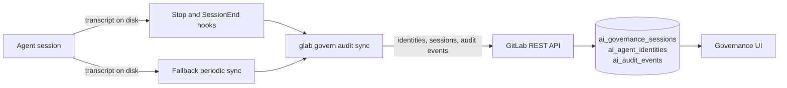
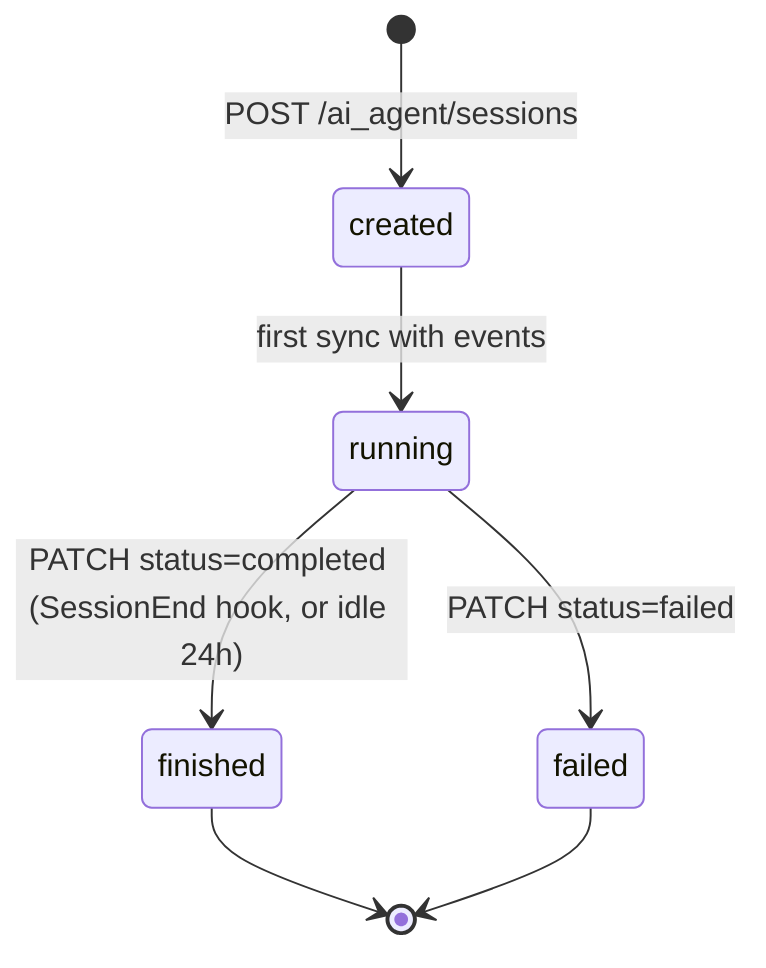
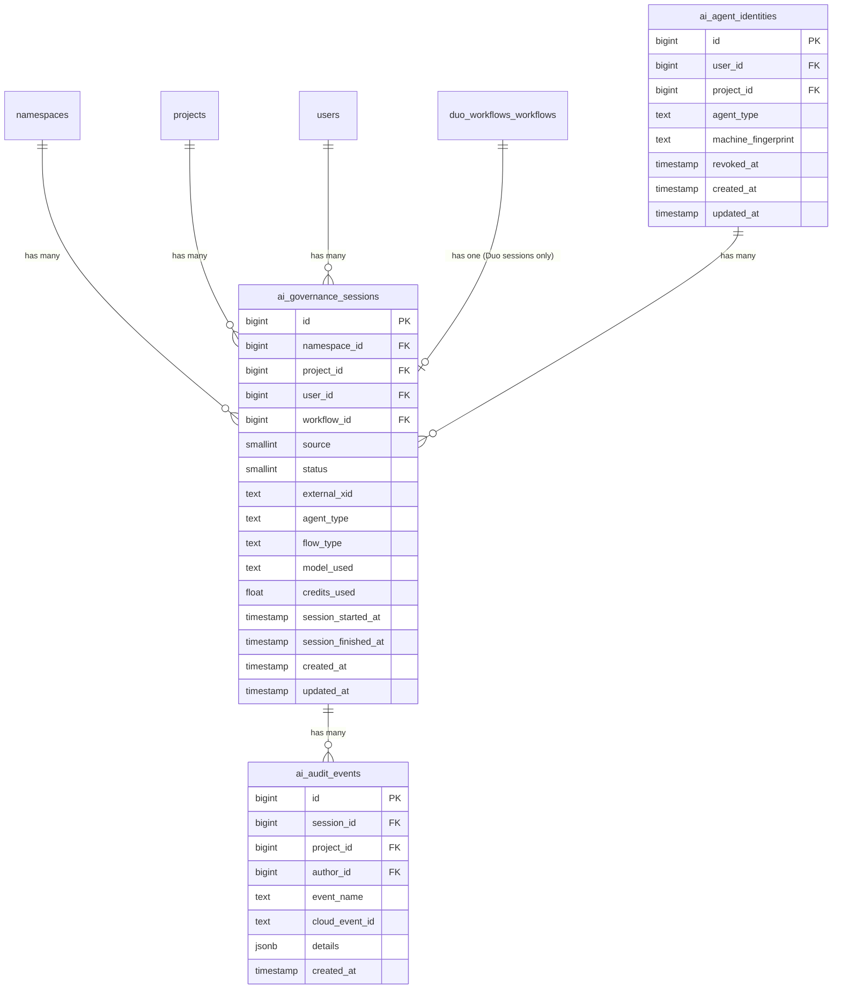
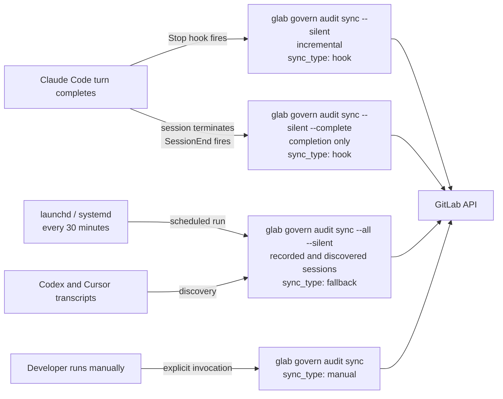



## 概要 {#summary}

このドキュメントでは、GitLab AI Governance（GAIG）の Stage 1 のバックエンドアーキテクチャを説明します。開発者へのレイテンシーの影響をゼロに保ちながら、ローカルで実行される外部エージェントのアイデンティティとセッションデータを GitLab に取り込みます。

Stage 1 は 4 つのエージェントを対象とします。Claude Code と OpenCode はフックを通じて記録します。glab がフックをインストールしない Codex と Cursor は、ローカルのトランスクリプトを走査するフォールバック定期同期ジョブで記録します。Stage 1 は、後続のすべての GAIG ステージの基盤となるデータモデル、API エンドポイント、サービスクラス、認可モデル、フックの配布戦略、同期アーキテクチャを確立します。

### External Connected Agent のアイデンティティと DAP の External Agents {#external-connected-agent-identity-and-external-agents-in-dap}

このドキュメントは、GitLab の外部で実行される External Connected Agent（ECA）を扱います。内部で実行される Duo Agent Platform（DAP）の External Agents と混同しないでください。

| | ECA のアイデンティティ（このドキュメント） | DAP の External Agents |
|---|---|---|
| 定義 | 開発者自身のマシンで実行される Claude Code などの外部エージェント | 種類が `third_party_flow` の AI Catalog 項目 |
| 実行場所 | GitLab の外部にある開発者のマシン | Docker イメージとコマンドから実行する GitLab CI/CD |
| 起動する主体 | 自身のターミナルやエディターを使う開発者 | 割り当てやメンションなどのトリガーを受けた GitLab |
| アイデンティティ | エージェントの種類、マシン、ユーザー、プロジェクトを含む `ai_agent_identities` レコード | AI Catalog 項目とそのコンシューマー |
| GitLab が認識する方法 | `glab` がエージェントのローカルトランスクリプトをアップロードします | GitLab 自体が実行するため、そのアクティビティはすでに GitLab 内にあります |

ECA のアイデンティティは、エージェント製品ではなくエージェントのインスタンスを識別します。同じ種類のエージェントでも、2 台のマシン、または 2 つのプロジェクトで使う場合は 2 つのアイデンティティになります。

この 2 つの概念は 1 つの設定を共有します。GAIG エンドポイントには `duo_external_agents_enabled` アプリケーション設定と `ai_catalog` ライセンス機能が必要です（[認可](#authorization)を参照）。そのため、DAP の External Agents を無効にすると、GAIG の記録も無効になります。

## 動機 {#motivation}

開発者は GitLab と併せて、Claude Code、OpenCode、Codex、Cursor などの外部 AI コーディングエージェントを利用することが増えています。これらのエージェントはファイルの読み書き、シェルコマンドの実行、コミットの作成、マージリクエストの作成を行いますが、GitLab はそのアクティビティを把握できません。どのエージェントが、いつ、どのプロジェクトで、誰の代理として操作したかの記録がありません。

Stage 1 はこの可視性の問題を解決します。すべてのエージェントセッションを記録し、すべてのツール呼び出しを監査イベントとして記録して、ガバナンス、コンプライアンス、操作主体の特定のために GitLab のガバナンス UI でデータを利用できるようにします。

### 目標 {#goals}

- すべての外部エージェントセッションを、実行したエージェントの種類とともに、実行先の GitLab プロジェクト、ユーザー、マシンに関連付けて記録します。
- 各プロンプト、ツール呼び出し、ツール結果、モデル応答を監査イベントとして記録し、ガバナンス UI が名前空間、プロジェクト、ユーザーで照会できるようにします。
- 開発者のエージェントセッションにレイテンシーを追加しません。アップロードはバックグラウンドで行い、ターンをブロックしません。
- 実用的な範囲で可能な限り完全に、ベストエフォートでセッションを記録します。アップロードの失敗は再試行し、フォールバック定期同期でフックが取りこぼしたセッションを拾いますが、記録には開発者のマシンで `glab` が動作していることが引き続き必要です（[フォールバック定期同期](#fallback-periodic-sync)を参照）。
- フックを提供しないエージェントも含め、Claude Code、OpenCode、Codex、Cursor に対応します。
- 個人の開発者には 1 回の `glab govern setup`、Claude Code Enterprise には管理対象設定で対応し、ほかのインフラストラクチャを不要にします。
- ガバナンスに必要な情報だけをアップロードします。`glab govern setup` はアップロードする内容を明示し、何かをインストールする前に確認を求めます。
- 後続の GAIG ステージの基盤となるデータモデル、API、認可モデルを確立します。

### 対象外 {#non-goals}

- ポリシーの強制やエージェントの操作のブロック。Stage 1 はエージェントの操作を記録し、強制は後続のステージに委ねます。
- ツール出力やモデル応答のテキストのアップロード。
- GitLab リモートを持つ Git リポジトリの外部で実行されるセッションの記録。
- Windows のサポート。フックは POSIX シェル構文を使い、フォールバック同期は launchd と systemd を使います。
- Duo セッションの書き込み。`ai_governance_sessions` テーブルは共有しますが、既存の Duo Workflows パイプラインが書き込みます。
- ガバナンス UI の設計。このドキュメントはバックエンドと CLI を扱います。

## 提案 {#proposal}

Stage 1 は 3 つの要素を追加します。

1. **開発者のマシン上での `glab` による記録。** `glab govern setup` は Claude Code の `Stop` フックと `SessionEnd` フック、およびスケジュールされたフォールバックジョブをインストールします。エージェントの各ターンの後、フックはバックグラウンドで `glab govern audit sync` を実行します。エージェントのローカルトランスクリプトの新しい部分を読み、監査イベントに変換し、エージェントが実行される Git リポジトリのプロジェクトにアップロードします。フォールバックジョブは 30 分ごとにフックが取りこぼしたものを再試行し、アイドル状態のセッションを完了させます。また、フックを提供しない Codex と Cursor のトランスクリプトを走査してセッションを検出します。
1. **プロジェクトをスコープとする REST API。** 4 つのエンドポイントでエージェントのアイデンティティを登録し、セッションを作成、完了させ、監査イベントを一括で書き込みます。各エンドポイントはべき等なので、再試行でセッションやイベントが重複することはありません。
1. **統合データモデル。** 新しい `ai_governance_sessions` テーブルは Duo と外部エージェントの両方のセッションを保持し、ガバナンス UI 向けに名前空間でシャーディングします。`ai_agent_identities` はどのエージェントがどのマシンで実行されたかを記録し、`ai_audit_events` はイベントを保持します。



利点:

- エージェント自体を変更せず、レイテンシーも追加しません。
- エージェントを傍受するのではなくトランスクリプトを読むことで、GitLab を経由しないローカルのツール呼び出しを記録します。
- 開発者は既存の `glab` 認証情報で認証し、セッションは実行先リポジトリのプロジェクトに関連付けられます。
- べき等なエンドポイントとローカルカーソルにより、すべてのアップロードを安全に再試行できます。

欠点:

- Claude Code Enterprise を除き、記録には各マシンへの `glab` のインストールと設定が必要です。
- 各エージェントのトランスクリプト形式を解析し、最新の状態に保つ必要があります。また、ほかのエージェントより記録する情報が少ないものもあります（[監査イベントの種類](#audit-event-types)を参照）。
- フックのないエージェントの同期は最大 30 分遅れます。
- `glab govern setup` でフックをインストールした開発者は、それを削除でき、Claude Code の記録は一時停止します。`glab govern doctor` はそのマシンでフックが欠けていることを報告しますが、Stage 1 は削除を防げません。

以降では、この設計を詳しく説明します。

## 中核となるデータモデル {#core-data-model}

### データベーステーブル {#database-tables}

| テーブル | 目的 |
|---|---|
| `ai_agent_identities` | 実行時のアイデンティティレコード。ユーザー、プロジェクト、マシン、エージェントの種類の組み合わせごとに 1 件 |
| `ai_governance_sessions` | Duo セッションと外部エージェントセッションの両方を扱う統合セッションレコード |
| `ai_audit_events` | Postgres と ClickHouse に保存するエージェントセッションの監査イベント |

### ai_governance_sessions {#ai_governance_sessions}

`ai_governance_sessions` は GAIG の主要なセッションテーブルです。`duo_workflows_workflows` 行が必須で、ダミーのワークフローレコードを作らずには外部エージェントセッションを表現できなかった `duo_workflow_session_artifacts` に代わるものです。

テーブルは `namespace_id` でシャーディングし、名前空間をスコープとするガバナンス UI と整合させます。

| 列 | 型 | Null | 備考 |
|---|---|---|---|
| `id` | `bigint` | 不可 | PK |
| `namespace_id` | `bigint` | 不可 | `namespaces` への FK、シャーディングキー |
| `project_id` | `bigint` | 可 | `projects` への FK、省略可能 |
| `user_id` | `bigint` | 不可 | `users` への FK |
| `workflow_id` | `bigint` | 可 | `duo_workflows_workflows` への FK、Duo セッションにのみ設定 |
| `created_at` | `timestamp` | 不可 | |
| `updated_at` | `timestamp` | 不可 | |
| `session_started_at` | `timestamp` | 不可 | エージェントセッションの開始時刻 |
| `session_finished_at` | `timestamp` | 可 | セッションの終了時刻、実行中は null |
| `credits_used` | `float` | 不可 | デフォルトは 0.0 |
| `source` | `smallint` | 不可 | 列挙型: `duo(0)`、`external(1)` |
| `status` | `smallint` | 不可 | 列挙型: `created(0)`、`running(1)`、`finished(2)`、`failed(3)` |
| `external_xid` | `text` | 可 | 外部セッション ID（例: `CLAUDE_CODE_SESSION_ID`）、最大 255 文字 |
| `agent_type` | `text` | 可 | 許可リスト: `claude-code`、`opencode`、`codex`、`cursor`、最大 50 文字 |
| `model_used` | `text` | 不可 | デフォルトは `''`、最大 255 文字 |
| `flow_type` | `text` | 可 | ワークフロー/フローの識別子、最大 255 文字 |

**チェック制約:** `num_nonnulls(workflow_id, external_xid) = 1` -- `workflow_id`（Duo セッション）と `external_xid`（外部エージェントセッション）のどちらか一方だけを設定する必要があります。これにより、データベースレベルでセッションのソースを強制します。

### インデックス {#indexes}

| インデックス | 列 | 備考 |
|---|---|---|
| `i_ai_governance_sessions_on_namespace_source_external_xid` | `(namespace_id, source, external_xid)` | `external_xid IS NOT NULL` の場合に一意。外部セッションの重複を排除します。 |
| `i_ai_governance_sessions_on_namespace_started_at_id` | `(namespace_id, session_started_at, id)` | ガバナンス UI のキーセットページネーション。 |
| `i_ai_governance_sessions_on_namespace_workflow` | `(namespace_id, workflow_id)` | `workflow_id IS NOT NULL` の場合に一意。Duo ワークフローごとに 1 行。 |
| （通常） | `project_id` | プロジェクトをスコープとするクエリ。 |
| （通常） | `user_id` | ユーザーをスコープとするクエリ。 |

### セッションのソース {#session-source}

`source` 列はセッションの発生元を区別します。

| source | 値 | 設定条件 |
|---|---|---|
| `duo` | 0 | `workflow_id` が設定されている場合 -- GitLab Duo Chat またはエージェントのセッション |
| `external` | 1 | `external_xid` が設定されている場合 -- Claude Code、OpenCode、Codex、Cursor、またはその他の外部エージェントのセッション |

GAIG Stage 1 が書き込むのは `external` セッションのみです。`duo` セッションは既存の Duo Workflows パイプラインが書き込みます。

### セッションの状態 {#session-states}



### エンティティ関連図 {#entity-relationship-diagram}



### 監査イベントの種類 {#audit-event-types}

`glab` は 5 種類のイベントを送信します。すべてのイベントの `details` には `agent_name`（セッションの `agent_type`）が含まれます。

| event_name | 用途 | details のフィールド |
|---|---|---|
| `ai_user_input_received` | ユーザーが入力したプロンプト | `input`、`input_truncated` |
| `ai_tool_invoked` | ツール呼び出し | `tool_name`、`tool_call_id`、`arguments`、`agent_initiated`、`outcome: pending` |
| `ai_tool_response_received` | 成功したツール呼び出し | `tool_call_id`、`tool_name`、`outcome`、`duration_s`、`agent_initiated` |
| `ai_tool_execution_failed` | 失敗したツール呼び出し | `tool_call_id`、`tool_name`、`outcome: error`、`error_message`（最大 255 文字）、`duration_s`、`agent_initiated` |
| `ai_llm_response_received` | モデル応答 | `model`、`input_tokens`、`output_tokens`、`cache_read_input_tokens`、`cache_creation_input_tokens` |

ツール出力とモデル応答のテキストは送信しません。

すべてのエージェントがすべての情報を記録するわけではありません。

| エージェント | 不足する情報 |
|---|---|
| OpenCode | プロンプトと応答は送信しません。ツール呼び出しの結果は、最初の同期時にその呼び出しが完了していた場合にのみ送信します。 |
| Codex | Codex はツール呼び出しが成功したかを記録しないため、すべてのツール呼び出しの結果は `completed` になります。 |
| Cursor | Cursor は結果、トークン使用量、タイムスタンプを記録しないため、トランスクリプトの最終更新時刻を時刻として、プロンプトとツール呼び出しのみを送信します。 |

### サイズと経過日数の制限 {#size-and-age-limits}

サーバーは 1 つでも無効なイベントがあるとバッチ全体を拒否するため、`glab` は送信前に各イベントにサーバーの制限を適用します。

- 8 KB を超える単一の値（プロンプトやツール引数など）は、マーカーに置き換えます。
- イベントのエンコード済み `details` がそれでも 10 KB の制限を超える場合、`arguments` を `{"omitted": "arguments exceeded size limit"}` に置き換え、`input` を空にして `input_truncated: true` を設定します。
- サーバーの 90 日制限の内側に収まるよう、89 日より古いイベントは破棄します。一度も同期されず、89 日間アクティビティがないセッションはアップロードしません。
- `started_at` はサーバーの 30 日制限内にある場合にのみ送信します。

### 監査イベントの重複排除 {#audit-event-deduplication}

`cloud_event_id` は、トランスクリプト内のイベントの発生元から決定的に導出する UUID です。`uuid.NewSHA1(NameSpaceDNS, "gaig.gitlab.com/" + key)` の `key` は、`ai_tool_invoked` ではツール呼び出し ID、ツール結果では `<tool call ID>:result`、プロンプトでは `prompt:<ID>`、モデル応答では `response:<ID>` です。`ai_audit_events` の `(cloud_event_id)` 一意制約により、バッチを再試行しても重複を防げます。

---

## エージェントのアイデンティティと登録 {#agent-identity-and-registration}

### ai_agent_identities テーブル {#ai_agent_identities-table}

| 列 | 型 | Null | 備考 |
|---|---|---|---|
| `id` | `bigint` | 不可 | PK |
| `user_id` | `bigint` | 不可 | `users` への FK |
| `project_id` | `bigint` | 不可 | `projects` への FK |
| `agent_type` | `text` | 不可 | 許可リスト: `claude-code`、`opencode`、`codex`、`cursor` |
| `machine_fingerprint` | `text` | 不可 | マシン ID の SHA-256 ハッシュ、最大 64 文字 |
| `revoked_at` | `timestamp` | 可 | 管理者による失効時に設定 |
| `created_at` | `timestamp` | 不可 | |
| `updated_at` | `timestamp` | 不可 | |

一意インデックス: `(user_id, project_id, agent_type, machine_fingerprint)`

### マシンフィンガープリント {#machine-fingerprint}

`glab` はアプリケーション固有のキーを使って、プラットフォームのマシン ID を SHA-256 でハッシュ化します。生のマシン ID は送信しません。マシン ID が利用できないプラットフォーム（`/etc/machine-id` のない CI コンテナなど）では、ホスト名をフォールバックとして使います。

アイデンティティは、TTL を 24 時間として `~/.config/glab-cli/gaig/identities/<project_id>_<agent_type>.json` にローカルキャッシュします。

### 登録 {#registration}

`agent_type` と `machine_fingerprint` を指定して `POST /api/v4/projects/:id/ai_agent/identities` を呼び出します。サーバーは `find_or_create` を実行します。アイデンティティが失効済みの場合は HTTP 403 を返します。

---

## Rails モデルとサービス層 {#rails-model-and-service-layer}

### 名前空間 {#namespace}

Stage 1 のすべてのクラスは `Ai::ExternalAgents::` と `Ai::Governance::` の下に配置します。

セッションのモデルクラスは `Ai::Governance::Session` です。

### サービスクラス {#service-classes}

| クラス | 責務 |
|---|---|
| `Ai::ExternalAgents::Identities::RegisterService` | `ai_agent_identities` レコードを検索または作成します。失効済みのアイデンティティを拒否します。 |
| `Ai::ExternalAgents::Sessions::CreateService` | `source: :external` を設定し、`external_xid` をクライアントのセッション ID に設定した新しい `ai_governance_sessions` 行を作成します。`(namespace_id, source, external_xid)` 一意インデックスで重複排除を強制します。 |
| `Ai::ExternalAgents::Sessions::CompleteService` | セッションを `finished` または `failed` に遷移させます。`session.user_id == current_user.id` を強制します。`session_finished_at` を設定します。 |
| `Ai::ExternalAgents::AuditEvents::RecordService` | 監査イベントを書き込みます。`occurred_at` の範囲（過去 90 日、未来 1 時間）を検証します。イベントごとに `details` の 10KB 制限を強制します。 |

---

## API {#api}

### エンドポイント {#endpoints}

**POST /api/v4/projects/:id/ai_agent/identities**

エージェントのアイデンティティを登録します。

| フィールド | 必須 | 備考 |
|---|---|---|
| `agent_type` | はい | 許可リスト: `claude-code`、`opencode`、`codex`、`cursor` |
| `machine_fingerprint` | はい | SHA-256 ハッシュ、最大 64 文字 |

**POST /api/v4/projects/:id/ai_agent/sessions**

セッションを作成します。この名前空間とソースに `external_xid` がすでに存在する場合は、既存のレコードを返します。

| フィールド | 必須 | 備考 |
|---|---|---|
| `agent_type` | はい | 許可リスト: `claude-code`、`opencode`、`codex`、`cursor` |
| `agent_identity_id` | はい | アイデンティティ登録時の ID |
| `sync_type` | はい | `hook`、`fallback`、または `manual` |
| `goal` | いいえ | 最大 16,384 文字 |
| `started_at` | いいえ | ISO 8601、最大で過去 30 日 |
| `idempotency_key` | いいえ | `external_xid` に対応、最大 255 文字 |
| `workflow_definition` | いいえ | `flow_type` に対応 |

**PATCH /api/v4/projects/:id/ai_agent/sessions/:session_id**

セッションを完了または失敗にします。

| フィールド | 必須 | 備考 |
|---|---|---|
| `status` | はい | `completed` または `failed` |
| `jsonl_sha256` | いいえ | トランスクリプトの SHA-256、べき等性のガード |

**POST /api/v4/projects/:id/ai_agent/audit_events**

監査イベントを一括で書き込みます。リクエストごとに最大 500 イベント、要素の総数は 5000、本文は最大 5MB です。

| フィールド | 必須 | 備考 |
|---|---|---|
| `session_id` | はい | このプロジェクトとユーザーに属する必要があります |
| `events` | はい | イベントオブジェクトの配列 |
| `events[].event_name` | はい | 定義された種類のいずれか |
| `events[].occurred_at` | いいえ | ISO 8601、最大で過去 90 日、未来 1 時間 |
| `events[].details` | いいえ | イベントごとに最大 10KB |
| `events[].cloud_event_id` | いいえ | 重複排除用の UUID |

### 認可 {#authorization}

すべてのエンドポイントで次が必要です。

1. プロジェクトの Developer ロール
1. `licensed_feature_available?(:ai_catalog)` と `duo_external_agents_enabled` アプリケーション設定
1. PAT の `api` スコープ

フィーチャーフラグ `ai_agent_session_tracking` がすべてのエンドポイントを制御します。

プロジェクトでガバナンスが有効でない場合、エンドポイントは 404 を返します。フォールバック定期同期はこれをエラーではなく想定内として扱い、`glab govern doctor` はそれらのプロジェクトを分けて一覧表示します。

あるエージェントの種類が許可リストに追加される前の GitLab インスタンスは、`agent_type` メッセージとともに 400 を返します。その場合、`glab` はそのエージェントのセッションの当該ホストへのアップロードを停止し、`glab govern doctor` が報告します。インスタンスのアップグレード後に開始するセッションはアップロードします。

### データベースシャード {#database-shard}

`ai_governance_sessions` は `gitlab_main_org` シャードに配置します。

---

## フックの設定と配布 {#hook-configuration-and-delivery}

### Claude Code から GitLab へのデータの流れ {#how-data-moves-from-claude-code-to-gitlab}

```mermaid
sequenceDiagram
    participant CC as Claude Code
    participant Stop as Stop hook (per turn)
    participant End as SessionEnd hook
    participant glab as glab govern audit sync
    participant JSONL as transcript.jsonl
    participant API as GitLab API

    CC->>Stop: turn completes
    Stop->>glab: invoke --silent &
    glab->>glab: record session metadata (project, host, transcript)
    glab->>JSONL: read new entries since cursor
    glab->>API: POST /ai_agent/sessions (first turn only)
    glab->>API: POST /ai_agent/audit_events (new events, 500 per request)
    glab->>glab: update cursor (only on success)

    CC->>End: session terminates
    End->>glab: invoke --silent --complete &
    glab->>API: PATCH /ai_agent/sessions (status=completed)
```

`~/.config/glab-cli/gaig/cursors/<session_id>` のカーソルは、最後に同期したバイトオフセットを追跡します。送信の成功を確認した場合にのみ進めるため、アップロードが失敗してもデータが恒久的に失われることを防ぎます。

プロジェクトの解決前に、フックはエージェントの種類、プロジェクトパス、ホスト、トランスクリプトのロケーターを `~/.config/glab-cli/gaig/cursors/<session_id>.meta` に書き込みます。これにより、フック内でプロジェクトの検索が失敗した場合でも、フォールバック定期同期は後でエージェントの環境や作業ディレクトリなしにセッションを再試行できます。

### フックの設定 {#hook-configuration}

`glab govern setup` がインストールするフック:

```json
{
  "hooks": {
    "Stop": [
      {
        "hooks": [
          {
            "type": "command",
            "command": "glab govern audit sync --silent >/dev/null 2>&1 &"
          }
        ]
      }
    ],
    "SessionEnd": [
      {
        "hooks": [
          {
            "type": "command",
            "command": "glab govern audit sync --silent --complete >/dev/null 2>&1 &"
          }
        ]
      }
    ]
  }
}
```

設定は、一時ファイルと名前変更を使ってアトミックに書き込みます。既存の設定キーはすべて `map[string]json.RawMessage` によるラウンドトリップで保持します。`hooks` キー内でも、グループの `matcher`、エントリの `if` や `statusMessage` など、glab がモデル化しないフィールドを保持します。これらを削除するとフックのスコープが広がるためです。フックコマンドは HTML エスケープなしで書き込むので、ファイル内で `>` と `&` が読みやすいまま残ります。

`glab govern setup --uninstall` は、ほかのすべての設定とユーザーフックを保持しながら、2 つのガバナンスフック、フォールバック定期同期ジョブ、Codex と Cursor の検出を削除します。`settings.json` を読めない場合は、確認前に警告し、残りを削除してからエラーで終了し、ファイルを修正して再実行するようユーザーに求めます。

### 既知の SessionEnd の信頼性の問題 {#known-sessionend-reliability-gaps}

`SessionEnd` は `/exit`、`/clear`、SIGKILL では発火しません。フォールバック定期同期は、セッションが 24 時間アイドル状態になった時点で完了としてマークします。

### 配布経路 {#delivery-paths}

| ユーザーグループ | フックの配布 | 開発者の操作 |
|---|---|---|
| Claude Code Enterprise | MDM 経由で配布する管理対象設定ファイル | 管理者の設定後は不要 |
| Claude Code non-Enterprise | `~/.claude/settings.json` | 1 回の `glab govern setup` |
| OpenCode | `.opencode/plugins/` にインストールするプラグイン | プラグインと `glab` のインストール |
| Codex、Cursor | フックはありません。フォールバック定期同期がトランスクリプトを走査します。 | 1 回の `glab govern setup --agents codex,cursor` |

### Windows {#windows}

Windows へのフックのインストールはサポートしません。`glab govern setup` は Windows で明確なエラーを返します。フックは `cmd.exe` や PowerShell で有効でない POSIX シェル構文を使います。フォールバック定期同期は launchd と systemd を使うため、Windows ではこちらも利用できません。

---

## 同期アーキテクチャ {#sync-architecture}

### 同期経路 {#sync-paths}



各経路はセッションの作成時にそれぞれの `sync_type` を送信します。`--all` なしで `--silent` を渡す呼び出し元はフックだけです。GitLab はセッションを作成したリクエストの値を保持します。Claude Code などフックのあるエージェントでは、`fallback` で作成されたセッションの割合が、フックが取りこぼしたセッション数を示します。検出でしか見つからない Codex と Cursor のセッションは、常に `fallback` で作成します。

### フォールバック定期同期 {#fallback-periodic-sync}

`glab govern setup` は、`glab govern audit sync --all --silent` を実行するスケジュール済みジョブをインストールします。

| プラットフォーム | ジョブ | スケジュール |
|---|---|---|
| macOS | launchd エージェント `~/Library/LaunchAgents/com.gitlab.glab-govern-audit-sync.plist` | 30 分ごと |
| Linux | systemd ユーザータイマー `~/.config/systemd/user/glab-govern-audit-sync.timer` と `.service` | 30 分ごと、および起動の 5 分後 |

ジョブは保存済みのユーザーの glab 認証情報で実行します。launchd と systemd はユーザーのシェル環境なしでジョブを起動するため、setup は使用中の glab 設定ディレクトリを `GLAB_CONFIG_DIR` としてジョブに書き込みます。ジョブは、setup を実行中のものと同じビルドなら `PATH` 上の `glab` を、そうでなければ実行中のバイナリを使います。シンボリックリンクは解決しないため、パッケージマネージャーの shim はアップグレード後も維持されます。フックのみをインストールするには `--no-fallback-sync` を渡します。

フォールバック定期同期はベストエフォートで記録の完全性を高めますが、配信を保証しません。開発者のマシンで実行するため、電源が切れている間やスリープ中は動作せず、開発者は削除もできます。実行を逃した場合は、次回に追いつきます。カーソルはディスク上にすでに存在するトランスクリプトのバイトオフセットなので、GitLab に到達できない間にローカルで何かがキューにたまるわけではありません。追いつける範囲はイベントの 89 日の経過日数制限に制約されます（[サイズと経過日数の制限](#size-and-age-limits)を参照）。それより古いアクティビティは破棄し、イベントは 500 件ずつのバッチでアップロードします。

各 `--all` 実行は次を行います。

1. `.meta` ファイルを持つすべてのセッションを、記録時のプロジェクトとホストに同期します。各プロジェクトとアイデンティティは、実行ごとに 1 回検索します。
1. `--agents` で有効にしたエージェントのトランスクリプトを走査し、セッションを検出します（[セッションの検出](#session-discovery)を参照）。
1. 実行されなかった `SessionEnd` フックの代わりに、24 時間アイドル状態になったセッションを完了としてマークします。
1. `~/.claude/settings.json` に glab の Stop フックがない間は Claude Code セッションをスキップするため、フックを削除すると一時停止します。
1. エージェントが再開できなくなったセッション、および 30 日経っても見つからないセッションのローカル状態を削除します。
1. 結果を `~/.config/glab-cli/gaig/fallback-sync-status.json` に書き込みます。同期と完了を行ったセッション、送信したイベント、一時停止中のエージェント、ガバナンスが有効でないプロジェクト、ホストが受け入れないエージェントの種類、スキップしたセッション、および最大 20 件のエラーです。

`glab govern doctor` はジョブがインストールされ読み込まれていること、実行する `glab` バイナリが存在し、`doctor` を実行中の `glab` と同じビルドであることを確認し、前回の実行結果を表示します。ジョブは setup が選んだバイナリを実行するので、`glab` のアップグレードでジョブも更新されるのは、そのバイナリがパッケージマネージャーの安定したパスにある場合だけです。`glab govern setup` を再実行するとジョブを更新します。

### セッションの検出 {#session-discovery}

Codex と Cursor には glab がインストールできるフックがありません。`glab govern setup --agents codex,cursor` で有効にすると、フォールバック定期同期がトランスクリプトを走査してセッションを検出します。

| エージェント | トランスクリプト |
|---|---|
| Codex | `~/.codex/sessions`、またはスケジュール済みジョブの環境に `CODEX_HOME` が設定されている場合は `$CODEX_HOME/sessions` |
| Cursor | `~/.cursor/projects/<workspace>/agent-transcripts/<id>/<id>.jsonl` |

検出には、そのエージェントを有効にする前のセッションも、89 日の経過日数制限内で含まれます。プロジェクトはセッションを実行したディレクトリの Git リモートから解決し、そのリモートが、ユーザーが glab でログインしている GitLab ホストにある場合にのみセッションをアップロードします。

Cursor のトランスクリプトにはワークスペース名がありますが、完全なパスはありません。ツール呼び出しが読み書きするファイルが glab の検出したワークスペースの外にある場合、または複数のディレクトリがワークスペース名に一致し、それらのファイルからどれかを判断できない場合は、誤った可能性のあるプロジェクトにアップロードせず、Cursor セッションをスキップします。

有効なエージェントは `~/.config/glab-cli/gaig/discovered-agents.json` に保存します。異なる `--agents` リストで setup を再実行すると置き換え、`--agents ""` は検出を無効にし、`--uninstall` はリセットします。すべての setup プロンプトは、同期するエージェントを明示します。

### ローカル状態 {#local-state}

| ファイル | 場所 | 目的 |
|---|---|---|
| カーソル | `~/.config/glab-cli/gaig/cursors/<session_id>` | 最後に同期したトランスクリプトの位置のバイトオフセット |
| セッションメタデータ | `~/.config/glab-cli/gaig/cursors/<session_id>.meta` | `--all` 用のエージェントの種類、プロジェクトパス、ホスト、トランスクリプトのロケーター、完了時刻 |
| アイデンティティキャッシュ | `~/.config/glab-cli/gaig/identities/<project_id>_<agent_type>.json` | キャッシュしたアイデンティティ ID、TTL は 24 時間 |
| フォールバック同期の状態 | `~/.config/glab-cli/gaig/fallback-sync-status.json` | `glab govern doctor` が表示する前回の `--all` 実行結果 |
| 検出対象のエージェント | `~/.config/glab-cli/gaig/discovered-agents.json` | `glab govern setup --agents` で有効にしたエージェント |

すべてのパスは `GLAB_CONFIG_DIR` と `XDG_CONFIG_HOME` に従います。

### 重複排除 {#deduplication}

| 層 | 仕組み | 防止するもの |
|---|---|---|
| セッションの作成 | `(namespace_id, source, external_xid)` 一意インデックス | 再試行時のセッションの重複 |
| セッションの完了 | PATCH の `jsonl_sha256` 一致チェック | 変更のないトランスクリプトの再アップロード |
| 監査イベント | `(cloud_event_id)` 一意インデックス | 再試行時のイベントの重複 |

---

## glab CLI {#glab-cli}

### コマンド一覧 {#command-surface}

```shell
glab govern setup                         install Stop and SessionEnd hooks and the fallback periodic sync
glab govern setup --no-fallback-sync      install only the hooks
glab govern setup --agents codex,cursor   also discover and sync Codex and Cursor sessions
glab govern setup --uninstall             remove the hooks, the fallback periodic sync, and discovery
glab govern doctor                        diagnose auth, glab in PATH, hooks, connectivity, and the fallback sync
glab govern audit sync                    sync the current session to GitLab
glab govern audit sync -R group/project   sync against a specific project
glab govern audit sync --silent           sync with no output (for hook use)
glab govern audit sync --complete         mark session as completed (for SessionEnd hook)
glab govern audit sync --all              sync all recorded and discovered sessions (fallback periodic sync)
```

`--yes` を渡さない限り、`setup` はアップロード内容を明示して確認を求めます。プロジェクトは現在のディレクトリの Git リモートから解決し、`-R/--repo` で上書きできます。

### エージェントの検出 {#agent-detection}

| 変数 | エージェント |
|---|---|
| `CLAUDE_CODE_SESSION_ID` | Claude Code -- `external_xid` に対応 |
| `OPENCODE_SESSION_ID` | OpenCode -- `external_xid` に対応 |

`CLAUDE_PROJECT_DIR` はフック実行時の作業ディレクトリを示します。Claude Code のトランスクリプトは `~/.claude/projects/<project hash>/<session_id>.jsonl` から読み込みます。OpenCode セッションは `opencode export` で読み込みます。スケジュール済みジョブは最小限の `PATH` で実行するため、`opencode` バイナリのパスをセッションメタデータに記録します。

Codex と Cursor はフックで検出できる環境変数を設定しません。セッションは[セッションの検出](#session-discovery)でのみ見つけ、トランスクリプトのセッション ID を `external_xid` に対応させます。

### レイテンシーゼロの要件 {#zero-latency-requirement}

`glab govern audit sync --silent` は標準出力にも標準エラー出力にも何も出力しません。両フックは `>/dev/null 2>&1 &` を使って Claude Code のプロセスグループから切り離します。

---

## 確認された不整合と既知の制限 {#identified-inconsistencies-and-known-limitations}

### 1. ベストエフォートによる完全性 {#1-best-effort-completeness}

停電やネットワーク障害などでアップロードに失敗したターンも、ディスク上のトランスクリプトには残っており、次のフックまたはフォールバック実行がアップロードします。それでも、同期前にトランスクリプトが削除された場合、次に `glab` が実行された時点で 89 日より古い場合、フォールバック定期同期のない Windows の場合、`glab` が設定されていないマシンの場合などは、アクティビティを取りこぼす可能性があります。フォールバック定期同期は意図的に一部のセッションをスキップまたは忘却することもあり（[フォールバック定期同期](#fallback-periodic-sync)と[セッションの検出](#session-discovery)を参照）、ガバナンスが有効でないプロジェクトやエージェントの種類を受け入れないホストには何も届きません（[認可](#authorization)を参照）。マシンの同期が停止しても、開発者や管理者への通知はありません。`glab govern doctor` は、開発者が実行した場合にのみ報告します。

### 2. セッションはプロジェクト単位ですが Claude Code はそうではありません {#2-sessions-are-project-scoped-but-claude-code-is-not}

開発者が 1 つのセッションで複数のリポジトリにまたがって Claude Code を実行する場合、`glab` が作業ディレクトリの git リモートから GitLab プロジェクトを解決できた場合にのみ GAIG レコードを生成します。Git リポジトリの外部にあり GitLab リモートを持たないセッションは、監査レコードを生成しません。Stage 1 の既知の制限です。

### 3. SessionEnd の信頼性の問題 {#3-sessionend-reliability-gaps}

`SessionEnd` は `/exit`、`/clear`、SIGKILL では発火しません。フォールバック定期同期は 24 時間の非アクティブ状態の後にこれらのセッションを完了としてマークするため、`session_finished_at` は最大で 1 日遅れる可能性があります。フォールバック定期同期のない Windows では、これらのセッションは `running` のまま残ります。

### 4. アイデンティティキャッシュの TTL {#4-identity-cache-ttl}

失効済みのアイデンティティがローカルで最大 24 時間利用可能なままになる場合があります。401/403 API 応答を受けた時点での能動的な無効化は、改善として計画しています。

### 5. namespace_id の解決 {#5-namespace_id-resolution}

`ai_governance_sessions` は `namespace_id` でシャーディングします。CLI は git リモートから `project_id` を解決しますが、セッションの作成には `namespace_id` も解決する必要があります。これはサーバー側で処理します。`CreateService` は `project.project_namespace_id` を通じて、`project_id` から `namespace_id` を導出します。

### 6. 検出したセッションは詳細が少なくなります {#6-discovered-sessions-have-less-detail}

Codex と Cursor のセッションはフックではなくトランスクリプトの走査で見つけるため、GitLab への到着が最大 30 分遅れます。Cursor は結果、トークン使用量、タイムスタンプを記録せず、Codex はツール呼び出しが成功したかを記録しません（[監査イベントの種類](#audit-event-types)を参照）。リポジトリを確実に特定できない Cursor セッションはスキップします。

## 代替案 {#alternative-solutions}

### 何もしない {#do-nothing}

利点: 新しいテーブル、エンドポイント、クライアントソフトウェアが不要です。

欠点: GitLab は、プロジェクト内で外部エージェントが行う操作を引き続き記録できず、顧客はエージェントのアクティビティに関するガバナンスとコンプライアンスの要件を満たせません。

### `duo_workflow_session_artifacts` を拡張する {#extend-duo_workflow_session_artifacts}

利点: 既存のテーブルと Duo Workflows パイプラインを再利用します。

欠点: すべての行に `duo_workflows_workflows` レコードが必須なので、外部セッションにはダミーのワークフローが必要になります。代わりに、新しい `ai_governance_sessions` テーブルは、ソースに対するチェック制約を使って両方の種類のセッションを保持します。

### フック内で同期的にアップロードする {#upload-synchronously-in-the-hook}

利点: バックグラウンドプロセスやローカルカーソルがなく、単純です。

欠点: エージェントは各ターンの後にアップロードを待つため、ネットワークのレイテンシーや GitLab インスタンスの利用不能が開発者の作業を遅くします。これはレイテンシーゼロの目標に反します。

### トランスクリプト全体をアップロードし、サーバーで解析する {#upload-whole-transcripts-and-parse-them-on-the-server}

利点: 同期ごとに 1 回のアップロードで済み、クライアントのリリースなしにサーバーを変更できます。

欠点: トランスクリプトには、Stage 1 が収集しないツール出力や応答テキストが含まれます。サイズが大きくなる可能性があり、サーバーはすべてのエージェントの形式を解析する必要があります。クライアントでイベントに変換すれば、アップロードを小さく保ち、ガバナンスに必要なものだけに限定できます。

### エージェント自身のテレメトリーエクスポートを使う {#use-the-agents-own-telemetry-exports}

一部のエージェントは OpenTelemetry を通じてイベントをエクスポートできます。

利点: エージェントのベンダーが保守し、トランスクリプトの解析が不要です。

欠点: すべてのエージェントが提供するわけではなく、形式も異なります。各開発者はエージェントごとにエンドポイントと認証情報を設定する必要があり、エクスポートはセッションを実行した GitLab プロジェクトを識別しません。

### フォールバック同期を設けず、フックだけに依存する {#rely-on-hooks-alone-without-a-fallback-sync}

利点: インストールと診断が必要なスケジュール済みジョブがありません。

欠点: `SessionEnd` は `/exit`、`/clear`、SIGKILL では発火しないため、セッションは `running` のまま残ります。フック内で失敗したアップロードは次のターンを待つことになり、そのターンは来ない可能性があります。また、Codex と Cursor のセッションはまったく記録されません。
