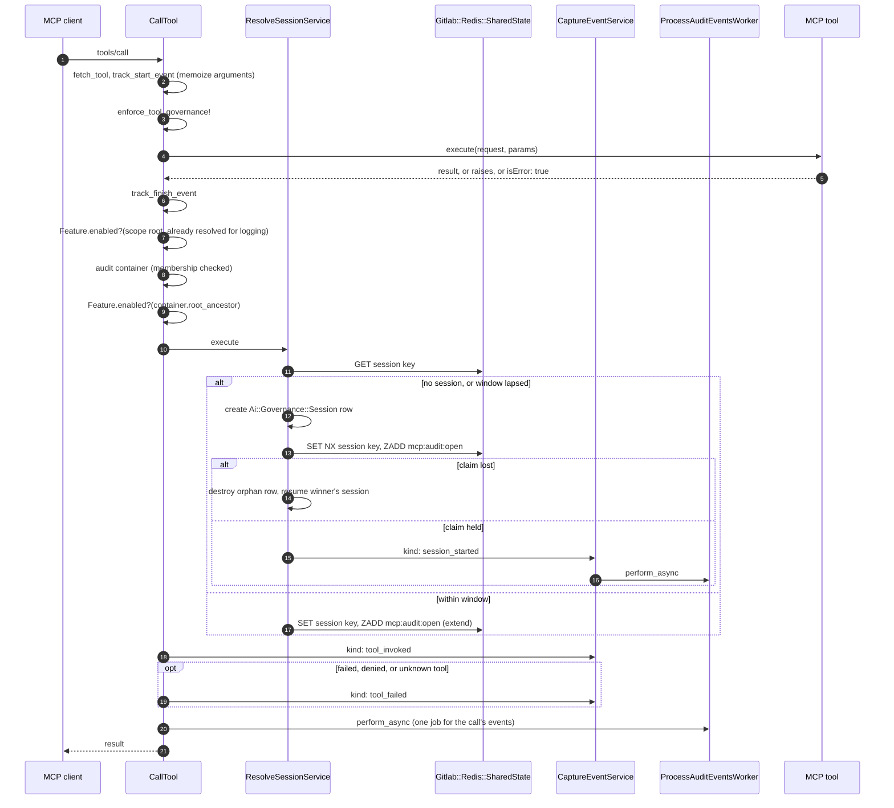
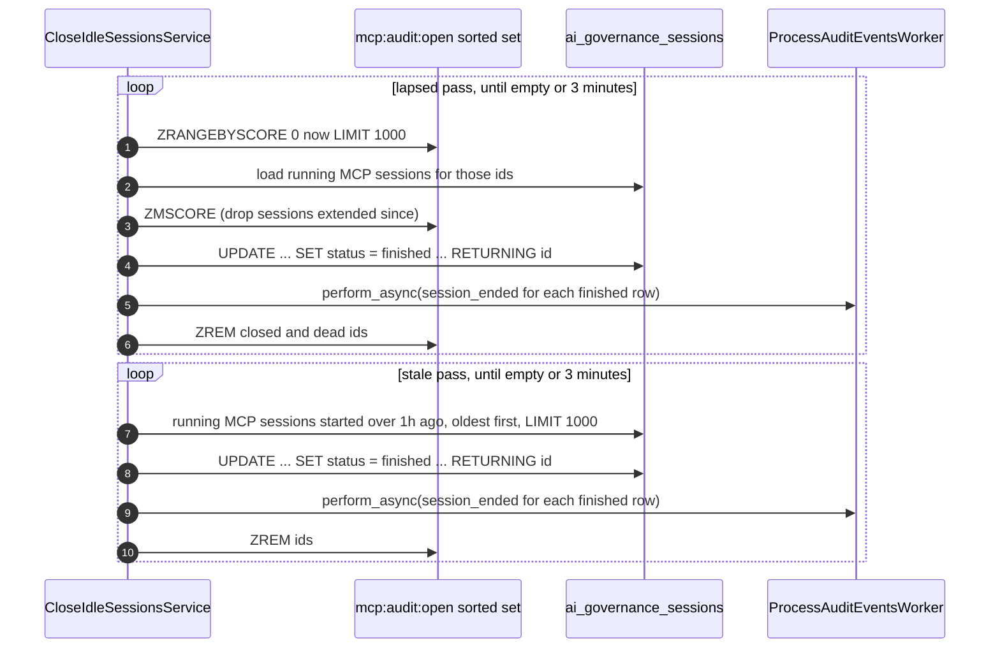
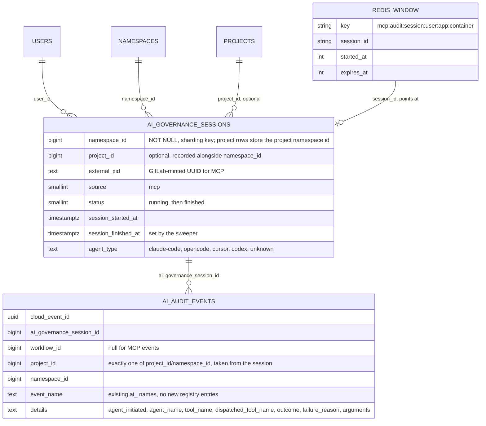

<!-- Design Documents often contain forward-looking statements -->
<!-- vale gitlab.FutureTense = NO -->



## 概要 {#summary}

現在、外部エージェントが GitLab MCP サーバー（`POST /api/v4/mcp`）を通じて行うツール呼び出しは、監査ログに記録されません。エージェントは Issue の読み取り、マージリクエストの作成、作業項目の編集ができますが、エージェントが実行したという記録はサーバー側に残りません。

このドキュメントでは、MCP ツールのディスパッチャーがすでにすべてのツールに対して呼び出している終了フックから、監査イベントを発行することを提案します。個々のツールに新たな呼び出し箇所は追加しません。推定したセッションごとに、すべての AI セッションソースで共有する `ai_governance_sessions` テーブルに 1 行を保存します。ウィンドウの期限が切れると、cron ワーカーがそのセッションを終了します。

| | |
| --- | --- |
| 対象 | GitLab MCP サーバーに登録され、単一のエントリーポイント `CallTool#invoke` を経由して実行されるすべてのツール |
| 対象外 | 独自のハンドラーを持つ Orbit MCP サーバー（`/api/v4/orbit/mcp`）と、エージェントのアイデンティティの検証。[対象外](#non-goals)を参照してください |
| 推定セッション 1 件の記録 | `source: :mcp` の `Ai::Governance::Session` 1 行 |
| ツール呼び出し 1 件の記録 | `ai_tool_invoked`。呼び出しが失敗した場合や拒否された場合は `ai_tool_execution_failed` も記録 |
| 紐付け先 | 呼び出し元がメンバーであるプロジェクトまたはグループ、いずれにも該当しない場合は呼び出し元のデフォルトの名前空間 |
| 必要な変更 | セッションのクリーンアップ処理用の部分インデックス 1 つ。その他の書き込み先はすべて、すでにマージ済みの別の変更で追加されました。[スキーマの変更](#schema-changes)を参照してください |

## 問題の説明 {#problem-statement}

[エージェントのアクションに対する MCP サーバーの監査イベント対応](https://gitlab.com/groups/gitlab-org/-/epics/22496)では、すべての MCP ツール呼び出しで監査イベントを発行することを求めています。イベントには実行主体、アクション、リソース、タイムスタンプに加え、エージェントがアクションを開始したことを示すメタデータを含めます。すべての呼び出しがすでに GitLab を経由するため、この不足を補うのにクライアント側の計装は不要です。

### 目標 {#goals}

1. 個々のツールクラスを変更せずに、すべての MCP ツール呼び出しで監査イベントを発行する
1. エージェントが開始したイベントであることを示す。これはエピックの中核要件です
1. エージェント名を取得できる場合は、ベストエフォートで記録する

### 対象外 {#non-goals}

| 対象外の作業 | 理由 |
| --- | --- |
| ポリシーの適用 | ツールの実行前に呼び出しをブロックする処理は、すでにツールルールが担っています。この設計は拒否も含めて結果を記録しますが、それ自体が呼び出しをブロックすることはありません |
| MCP 以外のエージェント通信 | GAIG のフックを起点とするセッションと Claude Compliance API は別の設計です。[関連する取り組み](#related-work)を参照してください |
| Orbit MCP サーバー | `/api/v4/orbit/mcp` は独自のツール呼び出しハンドラーを使用するため、この設計の対象外です |
| 既存パイプラインの範囲を超える ClickHouse 固有の作業 | `ProcessAuditEventsWorker` が、バッファリング、PostgreSQL へのフォールバック、保存の可否の判定をすでに行っています。この処理には手を加えません |
| エージェントのアイデンティティの検証 | エピックで対象外としています。ただし、[#617274](https://gitlab.com/gitlab-org/gitlab/-/work_items/617274)のプロジェクト横断の調整により条件が一部緩和され、3 つのクライアントタイプのプロジェクトすべてで `agent_type` を設定することになりました。この値はベストエフォートで設定します。クライアントが申告した未検証の値なので、認可には使いません。[エージェントのアイデンティティ](#agent-identity)を参照してください |

## 提案 {#proposal}

`API::Mcp::Handlers::CallTool#invoke` は、ツール呼び出しの前後で、CE の何もしない 2 つのスタブ `track_start_event` と `track_finish_event` をすでに呼び出しています。EE では、内部イベントのトラッキングのために `prepend_mod` でこれらをオーバーライドしています。監査は `track_finish_event` から実行するため、すべてのイベントに確定した結果が記録され、結果が未確定のまま残ることはありません。

すべての呼び出しで `ai_tool_invoked` を発行します。呼び出しが失敗した場合や、ツールルールによって拒否された場合は、`ai_tool_execution_failed` も発行します。ツール利用統計で集計するのは `ai_tool_invoked` だけなので、ブロックされた呼び出しも集計に含まれます。また、失敗した場合は呼び出しイベントに続いて失敗イベントが記録される Claude Compliance の形式とも一致します。

MCP にはセッション ID がないため、呼び出し元のアイデンティティ、コンテナ、スライディングウィンドウからセッションを推定し、`Ai::Governance::Session` の 1 行として保存します。`Ai::DuoWorkflows::Workflow` の行は作成せず、アーティファクトも同期しません。ウィンドウの期限が切れたセッションは cron ワーカーが終了し、`ai_agent_session_ended` を発行します。

## 暫定的な脅威モデル {#preliminary-threat-model}

各項目の詳しい内容は、それぞれのセクションに記載しています。この設計は監査のための制御機能なので、何を信頼できるかを読者が判断できるよう、ここに要点をまとめます。

1. **セキュリティ境界。** すべての判定は `CallTool#invoke` 内で、サーバー側が行います。イベントは結果が確定した時点で終了フックから発行するため、クライアントはイベントを抑止できません。コンテナは呼び出しの引数から特定して権限を確認するため、クライアントが監査ストリームを選ぶこともできません。監査処理は呼び出しをブロックしません。ブロックするかどうかはツールルールが引き続き決定します。[対象外](#non-goals)を参照してください
1. **偽装可能なエージェント名。** OAuth アプリケーション名は登録時にクライアントが申告し、GitLab は検証しません。そのため、`agent_type` は実行主体への帰属を示す情報であり、認証にはならず、認可にも使用しません。未検証の申告値とアプリケーション ID は両方とも `details` に残るため、読者は突き合わせて確認できます。[エージェントのアイデンティティ](#agent-identity)を参照してください
1. **引数の漏えい。** エージェントが送信したとおりに引数を記録するため、ツールの引数に含まれるシークレットが監査ログとすべての SIEM の送信先に届くおそれがあります。引数には `API::API::LOG_FILTERS` を適用し、10 キロバイトを超える場合や無効な UTF-8 の場合は、引数全体を破棄します。フィルターのリストは除去する範囲が広めです。この制御機能では、秘匿すべき情報が残るよりも安全です。[イベント名と詳細ペイロード](#the-event-vocabulary-and-details-payload)を参照してください
1. **別の名前空間の監査ストリームへのイベント送信。** 読み取り権限だけを確認すると、公開プロジェクトにアクセスした非メンバーのユーザー名、IP アドレス、ツールの引数が、そのプロジェクトの監査ストリームに含まれます。メンバーシップを必須とすることで、非メンバーのアクティビティはそのユーザー自身の名前空間にとどまります。[スコープの決定](#scoping)を参照してください
1. **呼び出し元が異なるセッションの混在。** ウィンドウのキーはユーザー、OAuth アプリケーション、コンテナごとに分け、`external_xid` は GitLab が発行します。呼び出し元は、別の呼び出し元のセッションに参加したり、そのセッションを指定したりできません
1. **残存リスク。通知なしに失われるイベント。** `capture_audit_events` の例外捕捉や、クリーンアップ処理でのキューへの登録の失敗で、監査ログの利用者が欠落に気付かないままイベントが失われます。現在はその件数を集計していません。[オブザーバビリティ](#observability)を参照してください
1. **残存リスク。ブロックしたグループから見えない拒否。** ツールルールが非メンバーからの呼び出しを拒否すると、呼び出し元の名前空間に監査イベントを記録します。そのため、ルールを適用したグループには拒否の記録が残りません。[スコープの決定](#scoping)を参照してください

## 設計と実装の詳細 {#design-and-implementation-details}

### 単一のエントリーポイント {#the-single-entry-point}

MCP ツール呼び出しはすべて、`lib/api/mcp/handlers/call_tool.rb` の `CallTool#invoke` を経由します。

```ruby
def invoke(request, params, current_user = nil, context: nil, tool_name_prefix: nil, client_info: nil)
  ...
  tool = fetch_tool(tool_name, request_id, current_user, params)
  track_start_event(tool_name, request_id, current_user, tool: tool, params: params)
  configure_tool_credentials(tool, current_user)
  enforce_tool_governance!(tool, tool_name, request_id, current_user, params)
  execute_tool_with_tracking(tool, request, params, tool_name, request_id, current_user)
end
```

どの処理経路も `track_finish_event` を通ります。

| 処理経路 | イベント |
| --- | --- |
| ツールが成功する | `ai_tool_invoked`、結果は `success` |
| ツールが例外を発生させる | `ai_tool_invoked` と `ai_tool_execution_failed`、結果は `error` |
| ツールが `isError: true` を返す | 同上。CE は、マージ済みの [!251428](https://gitlab.com/gitlab-org/gitlab/-/merge_requests/251428)で追加された疑似例外 `ToolResponseError` でレスポンスをラップします |
| ツールルールが呼び出しを拒否する | 同上。`failure_reason: unauthorized` を記録します。ツールは実行しません |
| ツール名が不明 | 同上。`failure_reason: not_found` を記録します |
| 呼び出しが指定したコンテナ数が上限を超えるか、1 つしか指定できないところに複数を指定する（`mcp_container_lookup_cap`） | 同上。`failure_reason: bad_request` を記録します。コンテナを特定できないため、呼び出し元のデフォルトの名前空間に記録します |

`track_start_event` では監査用の記録は行いません。`save_merge_request` など複数のツールをまとめたツールは、ディスパッチする形式に合わせて `params[:arguments]` を再代入し、後から参照すると変更後の値が得られます。そのため、ここではエージェントが送信した時点の引数をメモ化するだけです。

監査処理は例外を送出しません。`capture_audit_events` は `StandardError` を捕捉し、ツール名のタグを付けて `Gitlab::ErrorTracking` に報告します。ツール呼び出しが失敗する事態を避けるため、監査の記録に欠落が生じることを許容します。監査ログの利用者は欠落を検知できないため、[オブザーバビリティ](#observability)で説明するカウンターを提案しています。

### セッションの推定とスライディングウィンドウ {#session-inference-and-the-sliding-window}

MCP はステートレスです。セッション ID は 2026-07-28 の改訂で MCP 仕様から削除されたため、リクエストには呼び出しをまとめるための情報がありません。`Mcp::Audit::ResolveSessionService` は、`Gitlab::Redis::SharedState` に保持するスライディングウィンドウからセッションを推定します。

| 設定 | 値 | 動作 |
| --- | --- | --- |
| `IDLE_EXTENSION` | 15 分 | 呼び出すたびに有効期限を現在時刻の 15 分後まで延長 |
| `MAX_DURATION` | 30 分 | セッション開始からの絶対的な上限。延長してもこの上限を超えないため、エージェントが継続して動作すると 30 分ごとに新しいセッションへ切り替わります |
| Redis キー | `mcp:audit:session:<user_id>:<application_id or 'pat'>:<container class>:<container id>` | ユーザー、OAuth アプリケーション、コンテナの組み合わせごとに 1 ウィンドウ |
| ペイロード | JSON の `session_id`、`started_at`、`expires_at` | |
| 開いているセッションの集合 | `mcp:audit:open`。セッション ID を有効期限でスコア付けしたソート済みセット | クリーンアップ処理が読み取ります。[セッションの終了](#closing-sessions)を参照してください |

両方の期限は Ruby で評価します。Redis の TTL はクリーンアップのみに使い、期限の判定には使いません。そのため、ウィンドウの期限後もキーが残っていても、セッションが意図せず延長されることはありません。

新しいセッションは、レコードを作成してからキーを取得します。まず `Ai::Governance::Session` の行を作成し、`SET NX` で Redis キーを取得します。競合で取得できなければ、一時的に作成した孤立行を削除して、キーを取得した側のセッションを再開します。先にキーを確保する順序にすると、行を作成している間に競合した相手のツール呼び出しが監査されないままになります。`Gitlab::ExclusiveLease#in_lock` は、再試行の間にスリープし、ドキュメントでも Web サーバーのスレッドには不向きとされているため、使用しません。`ai_agent_session_started` はキーを取得してから発行するため、削除する孤立行からはイベントを発行しません。

再開時に参照したキーがすでに存在しないセッション行を指している場合は、古いキーを削除してから代わりのセッションを作成します。キーが残っていると、`SET NX` による取得がいつまでも成功しません。

### セッションの行 {#the-session-row}

`Ai::Governance::Session` モデルに対応する `ai_governance_sessions` は、[!256344](https://gitlab.com/gitlab-org/gitlab/-/merge_requests/256344)で追加されました。GitLab Duo のセッションのほか、Compliance API 経由の Claude Code、glab 経由の Claude Code、MCP というすべての外部エージェントソースで共有します。

| 列または制約 | 役割 |
| --- | --- |
| `namespace_id`、`NOT NULL` | シャーディングキー。プロジェクトをスコープとする行では、そのプロジェクトの名前空間 ID を保存します。これにより、グループ階層の検索は 1 つの `namespace_id IN (...)` で済みます。`project_id` も同時に記録します |
| `enum :source` | `gitlab_duo`、`claude_code_compliance_api`、`claude_code_glab`、`mcp` |
| `enum :status` | `Ai::DuoWorkflows::Workflow` のステートマシンと同じ値。MCP セッションには `running` または `finished` だけを使用します |
| `external_xid` | MCP 用に GitLab が発行する UUID。プロトコルにセッション識別子がないためです |
| `workflow_id` / `external_xid` の `ExactlyOnePresentValidator` | 行のソースは Duo か外部のいずれか一方です。両方またはどちらでもない状態は許可しません |
| `namespace_id` の緩い外部キー（`async_delete`） | `ai_audit_events` と同じく、名前空間を削除するとそのセッションも削除します |
| `project_id` と `user_id` に外部キーを設定しない | 監査データは、記録対象のエンティティが削除された後も残ります |
| `agent_type`、text 型、上限 50 | クライアントのスラッグ |

`external_xid` は GitLab が発行するため、`(namespace_id, source, external_xid)` の一意インデックスでは、同じウィンドウを開こうとする 2 件のリクエストの競合を検出できません。重複を排除するのは、Redis の `SET NX` によるキーの取得だけです。

Duo や glab のセッションと同様に、名前空間で `ai_audit_events_storage_enabled` が有効かどうかにかかわらず、セッション行を書き込みます。この設定はイベントの保存を制御するものです。セッションの保存には影響せず、イベントを保存しなくてもストリーミングされるイベントはセッションを参照します。件数は、30 分のウィンドウにつきユーザー、アプリケーション、コンテナの組み合わせごとに 1 行が上限です。

**保留中の変更。** 執筆時点でオープンの [!270253](https://gitlab.com/gitlab-org/gitlab/-/merge_requests/270253)（[gitlab-org/gitlab#637670](https://gitlab.com/gitlab-org/gitlab/-/work_items/637670)、機密）では、イベントを受け取る名前空間の `ai_governance_enabled` が、監査の記録処理全体を制御します。この設定はセッション行を書き込む前に確認します。プロジェクトポリシーが外部エージェントのセッションにすでに適用している判定を再利用します。この設定はデフォルトで無効です。そのため、変更がマージされると、GitLab.com で個人の名前空間にフォールバックする呼び出しではセッション行もイベントも記録されず、ストリーミングも行われません。上の段落は執筆時点の master の動作です。このマージリクエストがマージされた時点で、このドキュメントを更新します。

### エージェントのアイデンティティ {#agent-identity}

`clientInfo` は `initialize` のときに一度だけ届きます。ステートレスなプロトコルでは、後続の `tools/call` と関連付けることはできません。継続して参照できるアイデンティティはリクエスト元の OAuth アプリケーションだけであり、`Current.token_info[:token_application_id]` から読み取ります。

IDE や CLI を GitLab MCP サーバーに接続する主な方法は OAuth です。ほとんどのクライアントは RFC 7591 の動的クライアント登録（未認証の `POST /oauth/register`）を利用し、GitLab は申告された名前の先頭に `[Unverified Dynamic Application]` を付けます。パーソナルアクセストークンにはアプリケーション情報が一切含まれません。そのため、PAT を使う呼び出しはユーザーとコンテナの組み合わせごとに 1 セッションにまとめ、`unknown` として記録します。

申告された名前を次の正規表現の表と上から順に照合し、最初に一致したスラッグに変換します。

| スラッグ | パターン |
| --- | --- |
| `claude-code` | `/claude[\s_-]*code/i` |
| `opencode` | `/open[\s_-]*code/i` |
| `cursor` | `/\bcursor\b/i` |
| `codex` | `/\bcodex\b/i` |
| `unknown` | 一致するパターンがない |

短い名前の正規表現には単語境界を指定します。これがなければ、`/cursor/` は「Precursor AI」に、`/codex/` は「Codexity」にも一致するためです。`Ai::ExternalAgents::AgentIdentity::AGENT_TYPES` および glab 経由のセッションと、同じスラッグの集合を使用します。

**アプリケーション名は登録時にクライアントが申告し、GitLab は検証しません。** たとえば、opencode が「Cursor」として登録できます。このため、`agent_type` は実行主体への帰属を示す情報であり、認証にはならず、認可に使ってはいけません。申告値は `oauth_application_name` として `details` にそのまま保存し、`oauth_application_id` と比較できるようにします。

#### Duo Agent Platform のトークン {#duo-agent-platform-tokens}

Duo Agent Platform は `ai_workflows` と `mcp` のスコープを持つ複合トークンを、自身のエグゼキューターと、CI で実行する外部エージェントの両方に渡します。スコープから両者を区別できず、エピックの成功基準はすべての MCP ツール呼び出しでイベントを発行することです。そのため、これらの呼び出しも他と同様に監査し、`via: duo_agent_platform` と `token_id` のタグを付け、フィルタリングの対象にはしません。利用側では Duo Workflow Service 自身のイベントと照合できます。

### イベント名と詳細ペイロード {#the-event-vocabulary-and-details-payload}

以下の 4 つのイベント名はすでに `AuditEvents::AiAuditEvent::ALLOWED_EVENT_NAMES` と `ee/config/audit_events/types/` のレジストリに存在します。新しい名前は追加しません。

| 発行するタイミング | `event_name` |
| --- | --- |
| セッションを推定して新規作成したとき | `ai_agent_session_started` |
| すべてのツール呼び出しがそれぞれ終了したとき | `ai_tool_invoked` |
| 呼び出しが例外を発生させた場合、`isError` を返した場合、拒否された場合、または不明なツールを指定した場合 | 追加で `ai_tool_execution_failed` |
| スライディングウィンドウの期限が切れたとき | `ai_agent_session_ended` |

`Mcp::Audit::CaptureEventService` で `details` を組み立て、値が nil のキーを除外します。

| キー | 内容 |
| --- | --- |
| `mcp_server` | 定数 `'core'` |
| `agent_initiated` | 常に `true`。エピックの中核要件です |
| `agent_name` | 正規化したスラッグ |
| `oauth_application_id`、`oauth_application_name` | 加工も検証もしていない値。プレフィックスを含みます |
| `tool_name` | 呼び出し時の名前。255 文字に切り詰めます |
| `dispatched_tool_name` | 集約ツールの振り分け先のサブツール。例として、`save_merge_request` の振り分け先の `update_merge_request` |
| `outcome` | どちらのツールイベントにも `success` または `error` を設定します。呼び出しの成否に従うため、失敗した呼び出しの `ai_tool_invoked` イベントも `error` になります |
| `failure_reason` | 呼び出しの失敗理由。たとえばツールルールによる拒否では `unauthorized`、不明なツールでは `not_found` |
| `duration_s`、`error_class`、`error_message` | エラーメッセージは 255 文字に切り詰めます |
| `arguments` | 下記を参照してください |
| `via`、`token_id` | Duo Agent Platform のトークンでのみ記録します |

引数は集約ツールが書き換える前に、エージェントが送信した内容を記録します。MCP リクエストログと同じ `API::API::LOG_FILTERS` を `ActiveSupport::ParameterFilter` に適用して、リソース ID を残しつつトークンやシークレットを除去します。そのうえでサイズを制限し、JSON 形式で 10 キロバイトを超えた場合はハッシュ全体を `{ 'omitted' => 'arguments exceeded size limit' }` に置き換えます。無効な UTF-8 の場合も同様です。

既知の課題として、`LOG_FILTERS` は API リクエストログ向けに調整されており、ツールの引数に適用すると必要な情報まで除去します。実際に記録されたイベントでは、Issue の `title` が `[FILTERED]` になりました。監査専用のフィルターリストは今後の課題です。

### 監査イベントとセッションの関連付け {#linking-audit-events-to-a-session}

[!256738](https://gitlab.com/gitlab-org/gitlab/-/merge_requests/256738)で `ai_audit_events` に `ai_governance_session_id` を追加し、[!257843](https://gitlab.com/gitlab-org/gitlab/-/merge_requests/257843)で ClickHouse のテーブルと CSV 行にも追加しました。この設計のイベントではこの列を設定し、`workflow_id` は null のままにします。`AnyFieldValidator` と `check_ai_audit_event_has_workflow_or_session` は、2 つのうち少なくとも一方を必須としています。この列は `STREAMABLE_ATTRIBUTES` にも含まれるため、ストリーミングされるイベントにも含まれます（[#630097](https://gitlab.com/gitlab-org/gitlab/-/work_items/630097)）。

`ai_governance_sessions` 自体は、[!256732](https://gitlab.com/gitlab-org/gitlab/-/merge_requests/256732)で追加した Siphon 経由のレプリケーションによって、ClickHouse に `siphon_ai_governance_sessions` として複製されます。Siphon は PostgreSQL の論理レプリケーションストリームを読み取るため、クリーンアップ処理の一括 `UPDATE` も他の書き込みと同様に複製されます。

### 書き込み経路 {#the-write-path}

`CaptureEventService#execute` は、既存の `Ai::DuoWorkflows::ProcessAuditEventsWorker` に属性ハッシュを 1 つ渡します。このワーカーは、カスケードする `ai_audit_events_storage_enabled` 設定（デフォルトは **false**）の適用、ClickHouse のバッファまたは PostgreSQL の `bulk_insert!` への書き込み、SIEM へのストリーミングと `audit_json.log` への記録をすでに行っています。最大 9 回再試行し、`cloud_event_id` で重複を排除します。この設計のために下流の処理を新設することはありません。

Sidekiq は JSON ネイティブの値でないものを拒否します。そのため `job_attributes` で、型変換された 3 つの値をキューへの登録前に正規化します。`created_at` は `iso8601(6)` に変換し、`ip_address` は文字列に変換し、`details` には `as_json` を適用します。`job_attributes` を公開することで、クリーンアップ処理ではバッチ全体を 1 件のジョブとしてキューに登録でき、失敗した呼び出しの 2 つのイベントも 1 件のジョブで送信できます。

関連する [Claude Compliance API の取り込み](https://gitlab.com/gitlab-com/content-sites/handbook/-/merge_requests/20750)の設計では、この書き込み経路を `ProcessAuditEventsWorker` から共有サービスに切り出します。その変更が反映されたら、この設計の呼び出し先も変更します。MCP の処理量は実際の対話的なツール呼び出しに限られるため、既存ワーカーをそのまま再利用しても負荷は許容範囲内と見込んでいました。GitLab.com で 100% に展開すると、保存されたイベントについては見込みどおりでしたが、ワーカーにはツール呼び出し 1 回につき約 1 件のジョブが届き、その大半で何も保存しませんでした。[規模と処理容量](#scale-and-capacity)を参照してください。

### スコープの決定 {#scoping}

セッションのコンテナによって、どの顧客の監査ログと SIEM ストリームがセッションのイベントを受け取るかが決まります。そのため、テレメトリの帰属先を決める場合と異なり、権限を確認します。

ツールは `Mcp::Tools::Concerns::GovernanceContainerResolver` を通して、どの引数がコンテナを指定するかを宣言します。たとえば `get_pipeline` では `id`、`get_project` では `project_id` です。このため、テレメトリで既知の引数名に頼らず、呼び出しがアクセスしたリソースをスコープにできます。同じ特定処理をテレメトリとツールルールによるガバナンスでも共用します。結果をメモ化するため、処理は呼び出しごとに 1 回だけ実行します。`mcp_container_lookup_cap` が有効な場合、1 回の呼び出しでパスによって指定できるプロジェクトまたはグループは最大 20 件です。不明なツールでは検索しません。

`audit_session_container` で、次の順にコンテナを選びます。

1. 呼び出し元がメンバーであれば、特定したプロジェクト
2. それ以外の場合、呼び出し元がメンバーであれば、特定したグループ
3. どちらでもなければ `current_user.user_preference.duo_default_namespace_with_fallback || current_user.namespace`

**メンバーシップを確認。** 公開プロジェクトでは、サインイン済みのユーザーであれば誰でも `read_project` のチェックを通過します。読み取り権限のみを確認すると、メンバーでないユーザーのユーザー名、IP アドレス、ツールの引数がプロジェクトオーナーの監査ストリームに含まれます。メンバーシップの判定式は `max_member_access_for_user >= GUEST` です。インスタンス管理者と組織オーナーはどちらも `OWNER` として扱います。すでにリソースを管理しているため、いずれも外部のユーザーには当たりません。

フォローアップのため、この設計の影響を記録します。グループのツールルールが非メンバーからの呼び出しを拒否すると、その拒否は呼び出し元自身の名前空間に監査記録として残り、ブロックしたグループには見えません。たとえば公開を示すサフィックスを付けるなど、非メンバーのアクセス用のイベントタイプを追加する案が挙がっています。フォローアップのエピック配下の [gitlab-org/gitlab#637671](https://gitlab.com/gitlab-org/gitlab/-/work_items/637671)（機密）で追跡し、`group::ai governance` が担当します。この Issue は Backlog マイルストーンにあり、担当者は未割り当てのため、個人の DRI はまだ記録されていません。

各イベントはセッションのスコープを引き継ぎます。セッションのスコープがプロジェクトの場合は `project_id`、それ以外の場合は `namespace_id` を使用します。これにより、いずれか一方のみを要求する `check_547b01c40f` を満たし、セッション内のすべてのイベントが同じストリームに届きます。イベントのスコープに `Namespaces::ProjectNamespace` は使いません。`ai_audit_events_storage_enabled` はグループとプロジェクトにのみカスケードし、プロジェクトの名前空間をスコープとするイベントは通知なしに破棄される事例が確認されたためです。

### セッションの終了 {#closing-sessions}

MCP クライアントからは切断通知がないため、セッションが終了するのはタイムアウト時だけです。`Mcp::Audit::CloseIdleSessionsWorker` は 5 分ごとに実行され、処理を `Mcp::Audit::CloseIdleSessionsService` に委譲します。処理は 2 段階に分けて行い、3 分経過すると停止します。どちらの段階も古いセッションから読み取るため、途中で停止しても次の実行で続きから処理します。

| 処理段階 | セッションの抽出方法 | `session_finished_at` |
| --- | --- | --- |
| 期限切れ | `ZRANGEBYSCORE mcp:audit:open 0 now` で 1,000 件ずつ取得 | ウィンドウの期限が切れた時刻。ソート済みセットのスコアに当たります。クリーンアップは数分後に実行するため、実行時刻を使うとすべてのセッションの継続時間が長く見積もられます |
| 残存 | 開始から 1 時間を超えた `Ai::Governance::Session.mcp.running` を古い順に 1,000 件ずつ取得 | `session_started_at + MAX_DURATION`。現在時刻を上限とします |

残存セッションの処理は、ウィンドウを保持する Redis のデータが失われた場合の備えです。実行中の MCP セッションに限定した `session_started_at` の部分インデックスを使うため、すべてのセッションソースでテーブルの行数が増えても、インデックスは小さいままです。

各バッチで次の処理を行います。

1. 1 回の `ZMSCORE` でスコアを読み直します。範囲を読み取ってからセッションを終了するまでの間に、ツール呼び出しがウィンドウを延長する可能性があります。再び有効になったセッションを終了すると、次の呼び出しのイベントが終了済みのセッションに送られます。
1. `Ai::Governance::Session.finish_running!` から `UPDATE ... FROM (VALUES ...) ... WHERE status = running RETURNING id` を 1 文実行して、バッチのセッションを終了します。`status`、`session_finished_at`、`updated_at` を設定します。ロードバランサーは `select_*` 呼び出しをレプリカに送るため、この処理はプライマリで実行します。
1. ステートメントが実際に終了した各セッションの `ai_agent_session_ended` イベントを含む `ProcessAuditEventsWorker` ジョブを 1 件キューに登録します。延期された実行などが別の実行と重なっても、別の実行がすでに終了した行のイベントは送信しません。
1. 開いているセッションの集合から ID を削除します。`ZREM` が失われても、次の実行時に、実行中の行が残っていない ID が除去されるため、問題は解消します。キューへの登録に失敗するとイベントを復元できないため、登録を先に行います。

ステートメントは意図的に検証とコールバックを省略します。テーブルにトリガーはなく、モデルにコールバックもありません。Siphon はレプリケーションストリームから変更を複製します。ステートメントが 1 文なので、失敗しても、一部だけ終了したバッチは残りません。次の実行でバッチ全体を再試行します。

ワーカーの設定は、`CronjobQueue`（`retry: false` となり、次のスケジュール実行で再試行します）、`idempotent!`、`data_consistency :sticky`、`feature_category :audit_events`、`urgency :low`、`defer_on_database_health_signal :gitlab_main_org, [:ai_governance_sessions]` です。

### オブザーバビリティ {#observability}

監査は設計上ベストエフォートであるため、集計しなければ欠落は分かりません。現在得られるシグナルは `capture_audit_events` で例外を捕捉したときの `Gitlab::ErrorTracking` の報告だけです。この報告からは例外が発生したことは分かりますが、監査されなかった呼び出しの件数までは分かりません。クリーンアップ処理でキューへの登録が失われた場合は、シグナルが一切ありません。

残っている作業は、イベントが破棄された箇所で値を増やし、欠落箇所と例外クラスをラベルに持つカウンターの追加です。このカウンターによって、ロールアウトの基準を測定できます。

| 欠落箇所 | 値がゼロでない場合の意味 |
| --- | --- |
| `capture_audit_events` の例外捕捉 | ツール呼び出しを実行したものの、そのイベントが 1 件もキューに登録されていません |
| バッチ更新後のクリーンアップ処理でのキューへの登録 | セッションは正しく終了しましたが、その `ai_agent_session_ended` が失われています |
| 削除済みユーザーのセッション | 想定された動作です。上の 2 つの件数に含まれないよう、別に集計します |

分母はすでに存在します。同じ呼び出しについて、`capture_audit_events` より前かつその例外捕捉の範囲外で `finish_mcp_tool_call` をトラッキングしています。このため、新たな計装箇所を追加せずに、監査パイプラインに到達した呼び出しの割合を測定できます。

既知の課題として、たとえば Sidekiq 用の Redis が利用できず、更新後にキューへの登録自体が失敗すると、そのバッチの `ai_agent_session_ended` イベントは失われます。セッションは正しく終了した状態のままです。AI 監査パイプラインでは、イベントの生成元がすべて `ProcessAuditEventsWorker` を通してキューに登録するため、いずれの生成元でも同じ問題が起こります。フォローアップでは、セッションから決定論的に `cloud_event_id` を生成する案が挙がっています。これにより、イベントを安全に再発行し、下流で重複を排除できます。ユーザーが削除されたセッションは、イベントの帰属先が存在しないため、イベントを発行せずに終了します。

### 規模と処理容量 {#scale-and-capacity}

監査の記録処理では、ツール呼び出しごとに Redis の読み取りとキューへの登録を 1 回ずつ行います。ロールアウトで、この負荷は許容範囲内と確認しました。ただし、キューに登録されるジョブの規模は過小評価していました。

フラグが完全に有効になった状態で、2026-11-12 までの 24 時間に、`ProcessAuditEventsWorker` は毎秒約 21 件の新規ジョブを受信しました。これは、MCP ツール呼び出し 1 回につき約 1 件で、ロールアウト開始前の週末には毎秒 0.06 件でした。実行は毎秒約 81 回で、その 71% はデータベースの健全性を理由とする延期により、同じジョブを再実行したものです。実行中のジョブは平均 208 件、ピーク時は 4,376 件でした。同時実行数の上限を超えたジョブを待機させるキューは、2026-11-12 に約 187,000 件に達しました。保存は名前空間単位、ストリーミングは組織単位で明示的に有効にする必要があるため、保存したイベントは毎秒約 2.8 件にとどまりました。大半のバッチは組み立てられて Redis のキューに登録された後、`AuditEvents::AiAuditEvents::WriteService` によって破棄されました。ロールアウトの Issue [gitlab-org/gitlab#637966](https://gitlab.com/gitlab-org/gitlab/-/work_items/637966)で報告されています。

| 変更 | 内容 | 状態 |
| --- | --- | --- |
| [!270814](https://gitlab.com/gitlab-org/gitlab/-/merge_requests/270814) | コンテナで保存もストリーミングも有効でなければ、キューへの登録を省略します。Duo Workflow の取り込み経路で既に使われている `stored_or_streamed?` と同様の判定です。この判定はセッションを特定した後に行うため、セッション行と `ai_agent_session_started` に影響はなく、引き続き呼び出し元ごとに各ウィンドウで 1 件です | レビュー中 |
| [!267228](https://gitlab.com/gitlab-org/gitlab/-/merge_requests/267228) | 6.4 GB に達した Redis の書き込みバッファを使わず、`ai_audit_events_direct_clickhouse_insert` が有効なときに AI 監査イベントを ClickHouse に直接書き込みます。サーキットブレーカー、挿入上限、短い再試行ウィンドウを設けます | レビュー中 |
| [NATS](/handbook/engineering/architecture/design-documents/audit_events_streaming_using_nats/)を通じた監査イベントのストリーミング | MCP に限らず、パイプライン全体の長期的な対応です | 提案中 |

キューへの登録を省略すると、何も処理しないジョブはなくなりますが、ツール呼び出しの数は変わりません。保存が広く有効になると、キューへの登録頻度は元に戻ります。その段階では、上記のパイプライン側の対応によって、この設計の負荷を許容範囲内に抑えます。監査の記録処理自体には、そのための仕組みはありません。

### シーケンス {#sequence}



呼び出しが拒否された場合やツールが不明な場合は、ツールの実行前に例外を発生させますが、その前に `track_finish_event` を経由します。

cron のクリーンアップ処理は、どのリクエストからも独立して実行します。



### データモデル {#data-model}



`REDIS_WINDOW` はテーブルではありません。TTL が設定された Redis キーです。このキーによってツール呼び出しをセッションに紐付けるため、図に示しています。このキーに加え、開いているセッションの集合 `mcp:audit:open` も保持します。

`DUO_WORKFLOWS_WORKFLOWS` と `DUO_WORKFLOW_SESSION_ARTIFACTS` は意図的に図から省いています。この設計ではどちらにも書き込みません。

## スキーマの変更 {#schema-changes}

| 変更 | 追加内容 | 状態 |
| --- | --- | --- |
| [!256344](https://gitlab.com/gitlab-org/gitlab/-/merge_requests/256344) | `ai_governance_sessions` テーブル | マージ済み |
| [!256738](https://gitlab.com/gitlab-org/gitlab/-/merge_requests/256738) | `ai_audit_events` の `ai_governance_session_id` | マージ済み |
| [!256732](https://gitlab.com/gitlab-org/gitlab/-/merge_requests/256732) | ClickHouse へのテーブルのレプリケーション（`siphon_ai_governance_sessions`） | マージ済み |
| [!257843](https://gitlab.com/gitlab-org/gitlab/-/merge_requests/257843) | ClickHouse の `ai_audit_events` テーブルの `ai_governance_session_id` | マージ済み |
| [!260243](https://gitlab.com/gitlab-org/gitlab/-/merge_requests/260243) | `source = 3 AND status = 1` の行を対象とする `session_started_at` の部分インデックス `index_ai_governance_sessions_on_started_at_mcp_running` | マージ済み |

ツール呼び出しを変更する !260242 では、マイグレーションを追加しません。

## 製品上での表示と取得 {#product-visible-surfaces}

MCP セッションはガバナンスセッション API から読み取れます。GraphQL の `SessionSource` 列挙型と、外部エージェントのフィルターにはともに `mcp` が含まれます。セッションアーティファクトのエクスポートでは、`siphon_ai_governance_sessions` とその監査イベントを読み取ります。バックエンドの読み取り経路の [#630095](https://gitlab.com/gitlab-org/gitlab/-/work_items/630095)と [#630657](https://gitlab.com/gitlab-org/gitlab/-/work_items/630657)はクローズ済みです。

AI Governance ダッシュボードを新しいテーブルに移行する [#630706](https://gitlab.com/gitlab-org/gitlab/-/work_items/630706)と、ツール呼び出しカードに外部エージェントのツール呼び出し件数を含める [#630971](https://gitlab.com/gitlab-org/gitlab/-/work_items/630971)は、引き続きオープンで、この設計の担当範囲外です。

この設計では `duo_workflows_workflows` に書き込まないため、MCP セッションは `duoWorkflowWorkflows` のリストに現れず、Agent Sessions ページに未加工の `mcp` がタイトルとして表示されることもなく、`agent_identity_id` のエージェントメトリクスにも反映されません。

## ロールアウト {#rollout}

フィーチャーフラグは `mcp_session_audit_events`、マイルストーンは 19.6、担当グループは `group::ai governance`、ロールアウトの Issue は [gitlab-org/gitlab#637966](https://gitlab.com/gitlab-org/gitlab/-/work_items/637966)です。このフラグは 2026-11-09 に GitLab.com の実行主体の 100% に達しました。[!269526](https://gitlab.com/gitlab-org/gitlab/-/merge_requests/269526)で `type: wip`、`default_enabled: false` から `type: beta`、`default_enabled: true` に変更し、GitLab Self-Managed で機能を停止できる手段を残しました。

フラグは、ユーザー単位ではなく、イベントの受信先となる名前空間の最上位の親で確認します。そのため、グループで無効にすると、そのグループの全メンバーによる当該グループへの呼び出しの記録が止まり、一部のメンバーからの呼び出しだけがストリームに含まれることはありません。確認は 2 回行います。まず、ログ処理ですでに特定したスコープのルートで確認します。これにより、フラグを無効にしたインスタンスでは、メンバーシップやデフォルトの名前空間を検索しません。次に、イベントが実際に送られる名前空間で確認します。呼び出し元自身の名前空間にフォールバックする場合も含め、デフォルトでは両方の確認を通過します。

呼び出しで記録される内容は、現在 4 つの条件で決まります。

| 条件 | デフォルト | 制御する対象 |
| --- | --- | --- |
| `mcp_session_audit_events` | オン | 監査の記録処理全体。ロールアウトの段階を制御するためではなく、機能を停止するためのスイッチです |
| グループとプロジェクトにカスケードする `ai_audit_events_storage_enabled` | オフ | イベントを保存するかどうか |
| 組織に設定したストリーミング先 | なし | GitLab の外部にイベントを送信するかどうか。保存設定とは独立しています |
| [!270253](https://gitlab.com/gitlab-org/gitlab/-/merge_requests/270253)で保留中の `ai_governance_enabled` | オフ | 提案では、受信先の名前空間で AI Governance が有効でなければ、セッション行、イベント、ストリーミングをすべて省略します。[セッションの行](#the-session-row)を参照してください |

そのため、GitLab.com の大半の呼び出しはフラグの確認を通過しても、保存やストリーミングは一切行いません。この負荷については[規模と処理容量](#scale-and-capacity)で説明しています。

フラグを有効にしたため、ロールアウトの基準に代えて、フラグの削除基準を設けます。[オブザーバビリティ](#observability)で説明したイベント欠落のカウンターが、同じ呼び出しの内部イベント `finish_mcp_tool_call` と照合してゼロを維持すること、[!270814](https://gitlab.com/gitlab-org/gitlab/-/merge_requests/270814)をマージしてキューへの登録を省略するようになった後も `ProcessAuditEventsWorker` の処理レートがその水準を維持することが基準です。カウンターはまだ実装していないため、現在フラグを監視する手段はエラートラッキングとワーカーの Sidekiq メトリクスだけです。

## 検証 {#verification}

ローカルの GDK で、実際の HTTP MCP 呼び出しと opencode セッションを用いてエンドツーエンドで検証しました。ウィンドウ内でセッションが正しく作成、再開され、ツール呼び出しが監査され、イベントが `audit_json.log` とストリーミング経路に届き、`"OpenCode"` がスラッグ `"opencode"` に正規化されることを確認しました。

## 代替案 {#alternative-solutions}

| 選択肢 | 判断 |
| --- | --- |
| MCP 専用の独立したセッションテーブル | 実装していません。`ai_governance_sessions` はすべてのセッションソースで共有しており、それとは別のテーブルを用意すると、独自の読み取り経路と UI が必要になります |
| MCP リクエストからセッション ID を読み取る | 実現できません。セッション ID は 2026-07-28 の改訂で MCP 仕様から削除されました |
| `initialize` の `clientInfo` をエージェント名として信頼する | 不採用。ステートレスなプロトコルでは後続の `tools/call` に関連付けられず、OAuth アプリケーション名と同様に検証されていません |
| ツールが実行される前に `ai_tool_invoked` を発行する | 不採用。後から確定させる仕組みがないまま結果を `pending` とする必要があり、失敗時には 2 件目のイベントを発行して訂正することになります |
| 呼び出しごとに 1 件のイベントを発行し、失敗時は `ai_tool_invoked` を `ai_tool_execution_failed` に置き換える | レビューで不採用。ツール利用統計と呼び出されたツールに関する SIEM クエリは `ai_tool_invoked` のみをカウントするため、ポリシーが停止した呼び出しこそ集計されなくなります |
| 読み取り権限に基づいてセッションのスコープを決める | レビューで不採用。どの公開プロジェクトでも、非メンバーのアイデンティティと引数がプロジェクトオーナーの監査ログにストリーミングされてしまいます |
| Duo Agent Platform のトークンを対象外にする | レビューで不採用。CI では同じトークンを外部エージェントにも渡します。また、エピックはすべての MCP 呼び出しの監査を求めています。対象外にする代わりにタグを付けます |
| モデルのコールバックからセッションを終了する | 不採用。クリーンアップ処理が 1 文でバッチ全体を終了するため、コールバックを通りません。クリーンアップ処理から発行することで、イベントの発行元を一元化できます |
| プロバイダーをプレフィックスにしたイベント名 `ai_mcp_*` | 未決定。`details` にはすでに `mcp_server`、`agent_initiated`、`agent_name` があるため、SIEM の利用者は新しい名前がなくても MCP 呼び出しを識別できます。一方、イベント名は顧客向けの契約に当たり、今なら変更コストが低くても将来は高くなります。#617274 で提起されました |

## 関連する取り組み {#related-work}

1. エピック [エージェントのアクションに対する MCP サーバーの監査イベント対応](https://gitlab.com/groups/gitlab-org/-/epics/22496)
1. 実装計画 [gitlab-org/gitlab#604733](https://gitlab.com/gitlab-org/gitlab/-/work_items/604733)
1. セッションのクリーンアップ処理 [!260243](https://gitlab.com/gitlab-org/gitlab/-/merge_requests/260243)（マージ済み）
1. ツール呼び出しの監査イベント [!260242](https://gitlab.com/gitlab-org/gitlab/-/merge_requests/260242)（マージ済み）
1. フラグのデフォルトを有効にした [!269526](https://gitlab.com/gitlab-org/gitlab/-/merge_requests/269526)（マージ済み）、ロールアウトの Issue [gitlab-org/gitlab#637966](https://gitlab.com/gitlab-org/gitlab/-/work_items/637966)
1. 保存もストリーミングも行わないときにキューへの登録を省略する [!270814](https://gitlab.com/gitlab-org/gitlab/-/merge_requests/270814)（レビュー中）
1. `ai_governance_enabled` で監査の記録を制御する [!270253](https://gitlab.com/gitlab-org/gitlab/-/merge_requests/270253)（レビュー中）、[gitlab-org/gitlab#637670](https://gitlab.com/gitlab-org/gitlab/-/work_items/637670)（機密）
1. AI 監査イベントを ClickHouse に直接挿入する [!267228](https://gitlab.com/gitlab-org/gitlab/-/merge_requests/267228)（レビュー中）
1. クライアントタイプの調整 [gitlab-org/gitlab#617274](https://gitlab.com/gitlab-org/gitlab/-/work_items/617274)（機密）
1. 共有テーブルへの書き込み処理 [gitlab-org/gitlab#607926](https://gitlab.com/gitlab-org/gitlab/-/work_items/607926)
1. 関連設計の Claude Compliance API の取り込み、[handbook!20750](https://gitlab.com/gitlab-com/content-sites/handbook/-/merge_requests/20750)
1. 補完的な設計 [GAIG ステージ 1 のバックエンドアーキテクチャ](https://gitlab.com/gitlab-com/content-sites/handbook/-/merge_requests/20111)
1. ツール呼び出しのステータスレポート [!251428](https://gitlab.com/gitlab-org/gitlab/-/merge_requests/251428)（マージ済み）
1. セッションアーティファクトの `agent_type` [!252345](https://gitlab.com/gitlab-org/gitlab/-/merge_requests/252345)（マージ済み）
1. `ai_governance_sessions` テーブル [!256344](https://gitlab.com/gitlab-org/gitlab/-/merge_requests/256344)、Issue [gitlab-org/gitlab#629762](https://gitlab.com/gitlab-org/gitlab/-/work_items/629762)（マージ済み）
1. 新しいテーブルへの監査イベントの紐付け [!256738](https://gitlab.com/gitlab-org/gitlab/-/merge_requests/256738)（マージ済み）
1. 新しいテーブルの ClickHouse へのレプリケーション [!256732](https://gitlab.com/gitlab-org/gitlab/-/merge_requests/256732)（マージ済み）
1. ClickHouse の `ai_governance_session_id` [gitlab-org/gitlab#630663](https://gitlab.com/gitlab-org/gitlab/-/work_items/630663)、[!257843](https://gitlab.com/gitlab-org/gitlab/-/merge_requests/257843)（マージ済み）
1. Duo セッションの新しいテーブルへの書き込み [!256733](https://gitlab.com/gitlab-org/gitlab/-/merge_requests/256733)（マージ済み）
1. セッション情報を含むストリーミングのペイロード [gitlab-org/gitlab#630097](https://gitlab.com/gitlab-org/gitlab/-/work_items/630097)（クローズ済み）
1. 新しいテーブルを使う読み取り経路 [gitlab-org/gitlab#630095](https://gitlab.com/gitlab-org/gitlab/-/work_items/630095)（クローズ済み）、[gitlab-org/gitlab#630657](https://gitlab.com/gitlab-org/gitlab/-/work_items/630657)（クローズ済み）、[gitlab-org/gitlab#630706](https://gitlab.com/gitlab-org/gitlab/-/work_items/630706)（オープン）
1. 外部エージェントのツール呼び出し件数 [gitlab-org/gitlab#630971](https://gitlab.com/gitlab-org/gitlab/-/work_items/630971)（オープン）
1. コンテナの検索上限 [gitlab-org/gitlab#634980](https://gitlab.com/gitlab-org/gitlab/-/work_items/634980)
1. 非メンバーの呼び出しの拒否と、その拒否を記録する監査ストリーム [gitlab-org/gitlab#637671](https://gitlab.com/gitlab-org/gitlab/-/work_items/637671)（機密）、フォローアップのエピック [gitlab-org&24279](https://gitlab.com/groups/gitlab-org/-/epics/24279)（機密）配下
1. AI 監査イベントレポートの `agentType` [!254887](https://gitlab.com/gitlab-org/gitlab/-/merge_requests/254887)（マージ済み）
