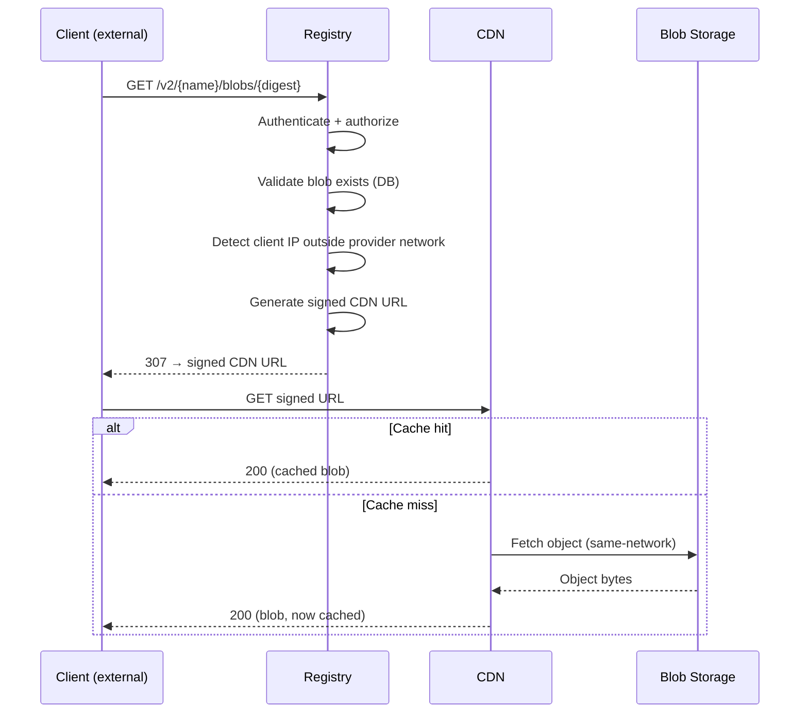
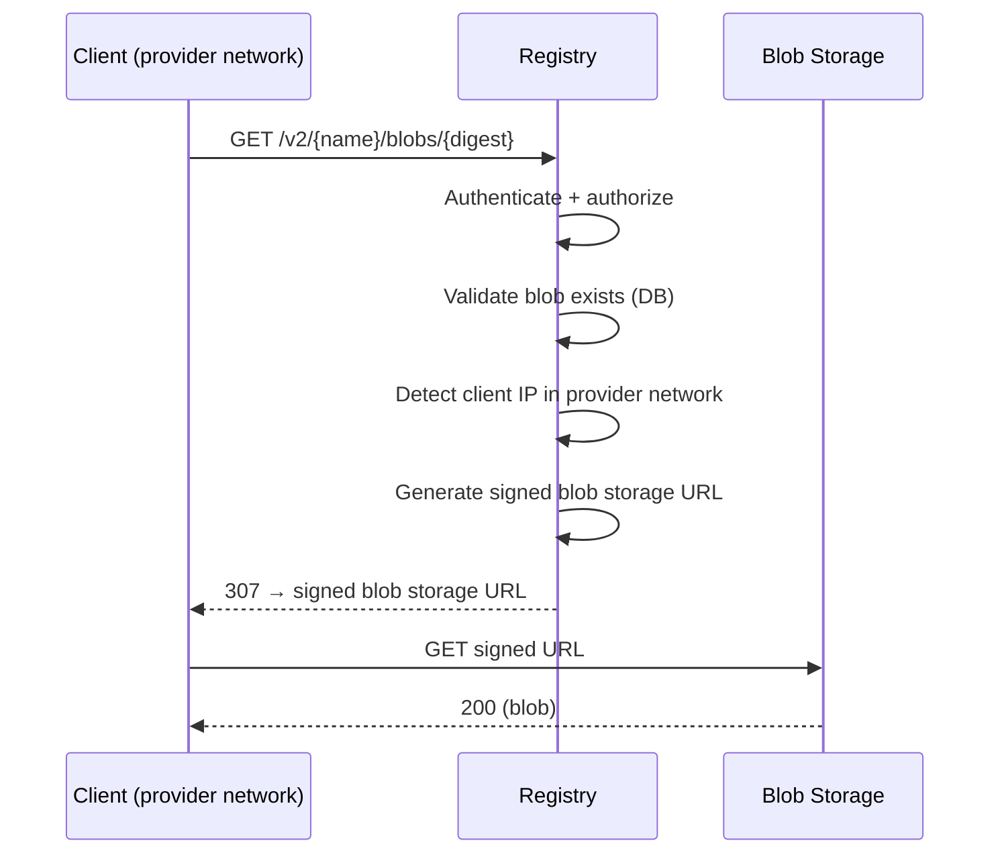
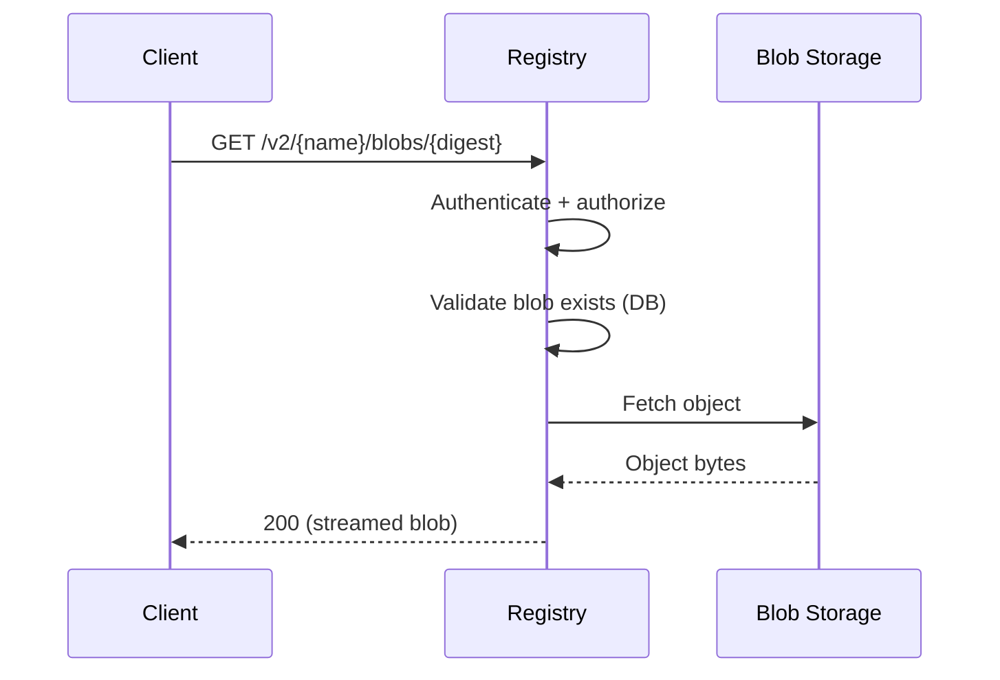

<!-- Design Documents often contain forward-looking statements -->
<!-- vale gitlab.FutureTense = NO -->

## 背景 {#context}

クライアントがアーティファクトをダウンロードする際、アプリケーションはコンテンツを配信するためにストレージバックエンドと相互作用する必要があります。デプロイメントとクライアントのネットワーク状況に応じて、アプリケーションはクライアントを事前署名付き URL を通じてストレージバックエンドにリダイレクトするか、コンテンツを直接ストリーミングします（配信モードの判断については [ADR-005](005_artifact_delivery_mode.md)を参照）。各パターンは、CDN キャッシング、URL 署名、コスト最適化、課金属性付けにそれぞれ異なる影響を持ちます。

Container Registry は、このアーキテクチャを GitLab.com で何年も運用し、月間数十ペタバイトの外向き転送（[出典](https://docs.google.com/spreadsheets/d/1mvHXxzRNQ2gVUGHtjluV1FyfXeoGA2KwihHdxbUKI-c/edit)）を、85% を超える CDN キャッシュヒット率（[出典](https://gitlab.com/gitlab-com/content-sites/handbook/-/merge_requests/17524#note_3023542021)）で処理してきました。Artifact Registry は同じアーキテクチャを採用します。

この ADR は、ストレージバックエンドとの相互作用を Artifact Registry 用のスタンドアロンのリファレンスとして形式化し、Container Registry の実装から独立した設計の単一の情報源を持つようにします。

## 決定 {#decision}

### サポートされるペアリング {#supported-pairings}

ストレージバックエンドと CDN は密結合です。CDN は同じプロバイダーの blob ストレージをフロントすることで、同一ネットワーク内のキャッシュフィル、ネイティブな署名付き URL 検証、運用上の整合性の恩恵を受けます。サポートされるペアリングは以下を満たす必要があります。

- **ネイティブな署名付き URL 検証**: CDN がエッジで署名を検証してからキャッシュから配信し、キャッシュヒット時にもプライベート blob をプライベートに保つ。
- **キャッシュキーの互換性**: 署名パラメータがキャッシュを断片化しないこと（すなわち、同じ blob に対する異なる署名付き URL が単一のキャッシュエントリを共有する）。
- **十分なキャッシュ可能最大ファイルサイズ**: コンテナイメージのレイヤーや大規模なアーティファクトは数十ギガバイトに達することがあります。最小許容上限は 50 GB（サポートされるペアリングのうち最低の [CloudFront](https://docs.aws.amazon.com/AmazonCloudFront/latest/DeveloperGuide/cloudfront-limits.html#limits-web-distributions)）です。Google Cloud CDN は最大 [100 GiB](https://docs.cloud.google.com/cdn/docs/caching#maximum-size) までサポートします。

| デプロイメント | Blob ストレージ | CDN | 署名付き URL のアルゴリズム |
| --- | --- | --- | --- |
| GitLab.com (SaaS) | GCS | Google Cloud CDN | HMAC-SHA1（CDN）、V4 HMAC-SHA256（blob ストレージ） |
| Dedicated (AWS) | S3 | CloudFront | RSA（CDN）、SigV4 HMAC-SHA256（blob ストレージ） |

Self-Managed の顧客は、各自のインフラストラクチャに一致するペアリングを構成します。サポートされるペアリング間の切り替えは設定変更です。

### 相互作用パターン {#interaction-patterns}

アプリケーションとストレージバックエンドの間には 3 つの相互作用パターンが存在します。使用されるパターンは、配信モード（[ADR-005](005_artifact_delivery_mode.md)）とクライアントのネットワークオリジンに依存します。

#### リダイレクト: 外部クライアント → CDN {#redirect-external-client--cdn}

アプリケーションは認証、検証を行い、署名付き URL を通じてクライアントを CDN にリダイレクトします。CDN は署名を検証し、ヒット時はキャッシュから配信し、ミス時は blob ストレージから取得します。

#### リダイレクト: プロバイダーネットワーク内クライアント → blob ストレージへ直接 {#redirect-provider-network-client--blob-storage-directly}

クライアントが同じクラウドプロバイダーのネットワーク内から発信されている場合、アプリケーションは CDN をバイパスして blob ストレージへ直接リダイレクトできます。これはコスト最適化です：blob ストレージからプロバイダーネットワーク内クライアントへの同一ネットワーク 外向き転送 は、CDN 経由でルーティングするよりも安価です。この最適化が価値あるかはペアリングに依存します。CDN と blob ストレージ直接配信の差が無視できる場合、ルーティングは利益なしに複雑さを増やすだけです。

#### プロキシ (CDN バイパス) {#proxy-cdn-bypassed}

プロキシモード（[ADR-005](005_artifact_delivery_mode.md)）では、アプリケーションは blob ストレージから直接 blob をストリーミングします。CDN、署名付き URL、下記のメタデータ伝播はすべてバイパスされます。アプリケーションが転送全体を観測します。

### 署名付き URL の生成 {#signed-url-generation}

アプリケーションは署名付き URL をサーバーサイドで生成します。ローカルの秘密鍵が利用可能な場合、署名はプロセス内で完結します。ローカル鍵を持たない GCS（たとえば Workload Identity）の場合、署名には外部の IAM 呼び出しが必要です。S3 の事前署名は、クレデンシャルソースにかかわらず常にプロセス内で行われます。各ペアリングは、CDN URL には CDN プロバイダーのネイティブ署名メカニズムを、直接 URL には blob ストレージプロバイダーのネイティブ署名メカニズムを使用します。CDN はコンテンツを配信する前にエッジで署名を検証し、キャッシュヒット時にもプライベート blob がプライベートのまま保たれることを保証します。

署名付き URL の有効期限は設定可能です。署名付き URL は（たとえば Redis で）キャッシュされ、高リクエストレートでの署名オーバーヘッドを削減します。キャッシュキーは blob のストレージパスとリクエストオプションから派生し、有効期限（リクエストごとに一意）は除外されます。キャッシュエントリの TTL は URL の残りの有効性からセーフティマージンを差し引いた値です。

### ダウンロードメタデータの伝播 {#download-metadata-propagation}

307 リダイレクト後、アプリケーションはダウンロードを観測できません。クライアントが転送を完了したか、何バイトが配信されたか、リクエストが失敗したかを知ることはできません。

ストレージバックエンドのアクセスログ（CDN 経由のリクエストでは CDN ログ、直接リクエストでは blob ストレージログ）が、実際の転送結果を記録します。オブジェクトパスにはパスセグメントとして `namespace_hash` が含まれるため（[ADR-008](008_content_addressable_storage.md#storage-path-strategy)）、すべてのログエントリで blob を所有する namespace を特定できます。そのため、帰属の判定にはパスのみを使用します。各署名付き URL は、次の 2 つのルールに従います。

- **URL ごとに 1 つのオブジェクト**: アプリケーションはプレフィックスではなく、オブジェクトの完全な URL に署名します。これにより、署名は `namespace_hash` を含むパス全体を対象とします。
- **パスのみによる帰属の判定**: 署名の対象外の部分はクライアントが自由に編集できるため、URL のクエリパラメータに帰属データを含めません。

新しいストレージバックエンドと CDN のペアリングは、両方のルールに従い、すべてのクライアントリクエストについてオブジェクトの完全なパスをログに記録し、オブジェクトごとに単一のキャッシュエントリを維持する必要があります。

## 結果 {#consequences}

### プラス面 {#positive}

1. **実績のあるアーキテクチャ**: Container Registry をミラーしており、GitLab.com でスケール環境において実戦投入済みです。
1. **すべてのペアリング要件を充足**: サポートされる両方のペアリングが、上記で定義したネイティブな署名付き URL 検証、キャッシュキー互換性、最大ファイルサイズの要件を満たします。
1. **リダイレクト境界を越えた帰属の判定**: 署名付きパス内の namespace が、SaaS（GCS + Google Cloud CDN）のリダイレクトモードに内在する可視性ギャップを橋渡しします。
1. **設定によるペアリング**: サポートされるペアリング間の切り替えにアプリケーションの変更は不要です。

### マイナス面 {#negative}

1. **結合されたペアリング**: CDN は blob ストレージプロバイダーに紐づけられます。実際には、デプロイメントは通常 all-GCP または all-AWS のため、これが制限になることはほぼありません。必要であればクロスプロバイダー CDN も可能です（[代替案 1](#alternative-1-cross-provider-cdn-for-example-cloudflare) 参照）。
1. **大規模運用時の CDN 配信コスト**: プロバイダーネイティブの CDN は、GiB あたりの配信料金を（階層的に）課金します。トラフィック量が大きくなると、これは大きなコスト項目になり得ます。参考として [コスト分析](https://docs.google.com/spreadsheets/d/1mvHXxzRNQ2gVUGHtjluV1FyfXeoGA2KwihHdxbUKI-c/edit)が利用可能です。

## 代替案 {#alternatives}

### 代替案 1: クロスプロバイダー CDN (例: Cloudflare) {#alternative-1-cross-provider-cdn-for-example-cloudflare}

すべての blob ストレージプロバイダーに対し単一の CDN を用い、構成の発散を削減します。Container Registry スケールでの [コスト分析](https://docs.google.com/spreadsheets/d/1mvHXxzRNQ2gVUGHtjluV1FyfXeoGA2KwihHdxbUKI-c/edit)では、Cloudflare の従量課金されない配信により、潜在的に大きなコスト削減が示されました。

[!19690](https://gitlab.com/gitlab-com/content-sites/handbook/-/merge_requests/19690)（クローズ済み）で評価されました。Cloudflare は署名付き URL 検証用のカスタムインフラ（WAF ルールまたは Worker）、手動でのキャッシュキーストリッピング、未検証のメタデータ抽出メカニズムを必要とするため、見送られました。クロスネットワークのキャッシュフィルコストは、同一ネットワークのフィルよりも大幅に高くなります。AR はゼロトラフィックから始まるため、MVP の段階で節約は大きくありません。

この代替案は閉ざされたわけではありません。将来、新しいペアリングとしてクロスプロバイダー CDN を追加できます。

### 代替案 2: CDN なし {#alternative-2-no-cdn}

CDN レイヤーなしで、ダウンロードを直接 blob ストレージにリダイレクトする方法です。トラフィック量が無視できない規模になると、CDN が blob ストレージの 外向き転送 を削減し、エッジキャッシングを通じてダウンロード遅延を改善し、可用性を高めるため、却下されました。

## 参考文献 {#references}

- [ADR-005: アーティファクトの配信モード](005_artifact_delivery_mode.md)
- [ADR-008: コンテンツアドレス可能ストレージ](008_content_addressable_storage.md)
- [Container Registry Cloud CDN ミドルウェア](https://gitlab.com/gitlab-org/container-registry/-/tree/master/registry/storage/driver/middleware/googlecdn) （リファレンス実装）
- [Container Registry CloudFront ミドルウェア](https://gitlab.com/gitlab-org/container-registry/-/tree/master/registry/storage/driver/middleware/cloudfront) （リファレンス実装）
- [Container Registry URL キャッシュミドルウェア](https://gitlab.com/gitlab-org/container-registry/-/tree/master/registry/storage/driver/middleware/urlcache) （リファレンス実装）
- [外向き転送の可視化プロトタイプ](https://gitlab.com/gitlab-org/gitlab/-/work_items/438065)
- [Cloudflare CDN のコスト分析](https://docs.google.com/spreadsheets/d/1mvHXxzRNQ2gVUGHtjluV1FyfXeoGA2KwihHdxbUKI-c/edit)
- [Cloudflare CDN の提案（クローズ済み）](https://gitlab.com/gitlab-com/content-sites/handbook/-/merge_requests/19690)
