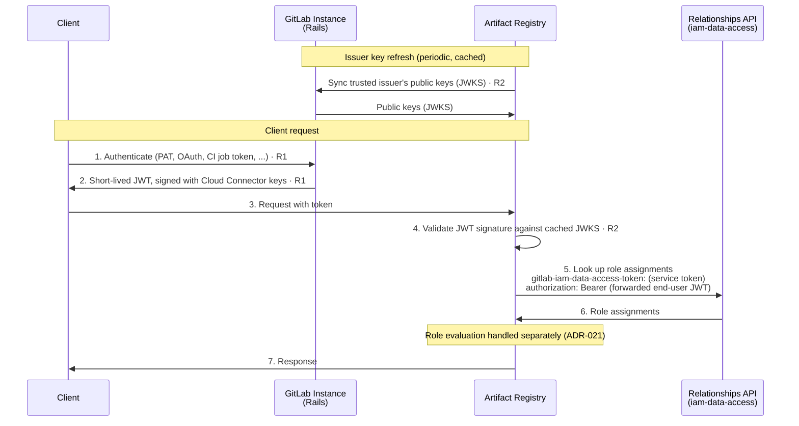

<!-- Design Documents often contain forward-looking statements -->
<!-- vale gitlab.FutureTense = NO -->

## ステータス {#status}

**提案中**

この ADR は **認証** のみを扱います。つまり、呼び出し元のアイデンティティをどう確立するかです。**認可**（ロール、ポリシー評価、ロール割り当て）は、ADR-021: 認可で別途扱われます。
<!-- TODO: link to ADR-021 once merged — https://gitlab.com/gitlab-com/content-sites/handbook/-/merge_requests/18717 -->

## コンテキスト {#context}

クライアントは、自身の GitLab Rails インスタンスが専用の API エンドポイントを通じて、または Rails 自体がユーザーに代わって動作する場合はプロセス内で発行する短命のトークンを使用して、Artifact Registry に認証します。Artifact Registry はこれらのトークンをローカルで検証し、その発行には関与しません。

Auth Platform チームとの契約は [Artifact Registry と Auth Platform のインターフェイス合意](../agreements/auth.md)であり、これは Artifact Registry が必要とするものを 6 つの要件（R1〜R6）にわたって定義します。この ADR では、その認証要件である R1（トークン交換）、R2（トークン検証）、R3（トークンペイロード）を適用します。

## 決定 {#decision}

**Artifact Registry は、GitLab Rails が専用のトークン交換 API エンドポイントを通じて、または Rails 自体がユーザーに代わって動作する場合はプロセス内で発行する短命のトークンをローカルで検証することにより、クライアントを認証します。**

### イテレーションのスコープ {#iteration-scope}

最初のイテレーションは、同一境界のトポロジー（`.com ↔ .com`、`SM ↔ SM`）を対象とします。ここでは単一のインスタンスが単一の信頼アンカーを持ちます。Rails が Cloud Connector v1 キーでトークンに署名し、`gitlab_instance_uid` はペイロードから省略されます。クロス境界のトポロジー（複数の Self-Managed インスタンスが 1 つの SaaS Artifact Registry を共有する）は、フォローアップのイテレーションです。

### 非本番開発モード {#non-production-development-mode}

上記の決定は、実際のアーティファクトを提供するすべてのデプロイメントに適用されます。Artifact Registry は**非本番開発モード**もサポートし、トークンを発行または署名する GitLab インスタンスが利用できない環境、つまりローカルチェックアウトやテスト環境でも実行できます。このモードはデフォルトでオフであり、トークン交換の設定とは排他的です。両方を設定すると、設定読み込み時に拒否されます。

このモードでは、Artifact Registry は Rails が発行したトークンではなく、開発専用の認証情報で認証します。その 2 つの特性は、上記の決定に反します。

1. **プリンシパルを確立しません。** [R3 ペイロードクレーム](#token-payload-r3)を一切持たず、`sub` も `gitlab` コンテキストもありません。そのため、この認証情報で認証されたリクエストは、サブジェクトのないアイデンティティに解決されます。
1. **短命で発行されるものではなく、長寿命で静的です。** デプロイメントの存続期間中に一度だけ設定されるため、[帰結](#consequences)に記載した、短い TTL によって漏えいしたトークンの露出を制限するという考え方は適用されません。

その帰結は記載どおり成立します。このモードでは実際のプリンシパルを受け入れず、本番データも保持しないため、なりすます対象も、アクセスできる価値のあるものもありません。この ADR が対象とするトポロジーでは、このモードは決して実行されず、それらに対する決定は変わりません。

同じ認証情報は、[GitLab Rails から Artifact Registry の内部 API へ](#gitlab-rails-to-the-artifact-registry-internal-api)の接続でも、本番デプロイメントがその接続で使うヘッダー内のサービストークンとして機能します。したがって、このモードでは、[2 つのレイヤー](#the-two-layers)に記載した、エンドユーザーから決して見えないデプロイ認証情報には該当しません。クライアント認証情報としてそれを提示する開発者は、この接続の認証情報も持っています。上記の 2 つの特性と同じ理由で、これは許容されます。それ以外の接続の仕組みは変わりません。サービストークンのレイヤーは引き続き適用され、同じ定時間比較と詳細を明かさない `401` を使用します。

このモードは、[ADR-021](021_authorization.md#non-production-development-mode)に記載した認可を強制しない構成と結び付いており、両者を個別に選択することはできません。[ADR-021](021_authorization.md#authorization-flow)は、関係のルックアップを行う前にプリンシパルのないリクエストを拒否し、識別できない呼び出し元に「存在するが禁止されている」という結果を返すことを認めません。そのため、この認証情報と認可を強制する構成を組み合わせると、ヘルスプローブは正常で設定検証も通る一方で、すべてのサーフェスのすべてのリクエストが拒否されます（[artifact-registry#982](https://gitlab.com/gitlab-org/ops/artifact-registry/-/work_items/982)）。両方を選択する単一のスイッチ（[artifact-registry#692](https://gitlab.com/gitlab-org/ops/artifact-registry/-/work_items/692)）により、その状態を単に防ぐのではなく、設定で表現できなくします。

このガードが制限するのは共存であり、デプロイではありません。トークン交換も IAM も設定していないデプロイメントはこのモードを実行でき、Artifact Registry 自身のエンドツーエンドテストクラスターでも実行しています。安全性を保つのは、実際のプリンシパルがないこと、認可を強制しないこと、そして起動時に警告をログに記録することです。

## アーキテクチャ上の制約 {#architectural-constraint}

[インターフェイス合意](../agreements/auth.md#no-callbacks-during-request-processing)からの 1 つの制約が、この決定を形作ります。

**リクエスト処理中のコールバックなし。** Artifact Registry は、**リクエストを処理している間**、GitLab インスタンスにコールバックすることは決してありません。この制約はそのインスタンスを対象とし、Artifact Registry 自体とともにデプロイおよびプロビジョニングされる依存関係は対象としません。認証のためのリモート依存性を 1 つ持っています。信頼された発行者の公開鍵を定期的に帯域外で同期することです（[トークン検証](#token-validation-r2)を参照）。しかしそれはリクエストごとではなく、リクエスト処理の外で発生します。これはクロス境界のセットアップで最も重要になります。SaaS Artifact Registry から Self-Managed インスタンスに到達できない場合があるためです（ファイアウォール、エアギャップ環境）。リクエストトークンを検証するために必要なものはすべて、トークン自体の中にあるか、すでにローカルにキャッシュされていなければなりません。これが、ローカルでステートレスな検証を最適化ではなく厳格な要件にしている理由です。

## 認証フロー {#authentication-flow}

トークンは Rails が発行し（R1）、Artifact Registry が、定期的に同期してキャッシュする信頼された発行者の公開鍵に対してローカルで検証します（R2）。以下の図は最初のイテレーションのフローを示しています。ロールルックアップが示されているのは、それが運ぶ認証情報のためだけであり、何を返すか、またそれらのロールをどのように評価するかは ADR-021 で扱います。



**凡例:**

| ステップ | 説明 |
|------|-------------|
| **発行者キーのリフレッシュ** | Artifact Registry は、事前設定された信頼された発行者の公開鍵（JWKS）を同期し、キャッシュします。同期とキャッシュは帯域外で行い、リクエスト処理中には決して行いません。 |
| **1-2** | クライアントは、（Artifact Registry を通じてではなく）自身の GitLab インスタンスから直接、短命の JWT を取得します。Artifact Registry はクライアントの長命な認証情報を決して参照しません。 |
| **3-4** | クライアントはトークンを Artifact Registry に提示し、Artifact Registry はキャッシュされた JWKS に対して署名を検証します。Rails へのコールバックは発生しません。 |
| **5-6** | Artifact Registry は relationships API を呼び出し、呼び出し元のロール割り当てを解決します。この呼び出しでは、Artifact Registry 自身のサービストークンと、変更せずに転送されるエンドユーザー JWT の 2 つの認証情報を送信します。[サービス間認証](#service-to-service-authentication)を参照してください。 |
| **7** | Artifact Registry がレスポンスを提供します。 |

## トークン発行 (R1) {#token-issuance-r1}

Rails は、クライアントの認証情報を受け付け、Artifact Registry に対して使用可能な短命のトークンを返す、専用のトークン交換 API エンドポイントを公開します。Rails 自体がユーザーに代わって動作する場合は、代わりにプロセス内で同じトークンを発行します（以下の *プロセス内での発行* を参照）。

1. **サポートされる認証情報の種類。** エンドポイントは、それぞれが `User` に解決される標準的な GitLab API の認証情報で呼び出し元を認証します。パーソナルアクセストークン（レガシーまたは粒度の細かいもの）、OAuth トークン、CI ジョブトークン、CI/CD ID トークン（以下の *CI/CD ID トークンの交換* を参照）、プロジェクト/グループアクセストークンです。**デプロイトークンは最初のイテレーションではサポートされません**。デプロイトークンは、最初のイテレーションでトークンを発行する唯一のプリンシパル型である `User` ではありません。型付けされた `sub` クレーム（[トークンペイロード](#token-payload-r3)を参照）は、後から他のプリンシパル型を受け入れられるように設計されているため、[R1](../agreements/auth.md#r1--token-exchange-service)のターゲットとして挙げられているデプロイトークンは、フォローアップとして追跡されます。
1. **クライアント側の交換。** クライアントは自身の GitLab インスタンスからトークンを取得し、それを提示します。Artifact Registry が交換を実行することは決してありません。エンドポイントは `curl`、`glab` CLI、または CI ジョブによって自動的に駆動できます。トークンは短命であるため、静的な認証情報を期待するネイティブなパッケージツール（例: Maven の `settings.xml` や npm の `.npmrc`）は、それを取得・リフレッシュするためのヘルパーツールを必要とします。Docker、Maven、npm にまたがるクライアントツールの設計は [クライアント認証情報管理の作業アイテム](https://gitlab.com/gitlab-org/gitlab/-/work_items/595150)で追跡されています。
1. **トークンの有効期間。** トークンはデフォルトの有効期間が 5 分、最大が 12 時間です。クライアントは、デフォルトより長いものを含め、1 秒から 12 時間の上限まで任意の有効期間を要求できます。クライアントが要求可能な TTL には AppSec のサインオフが必要です（[トークン交換の TTL に関する決定](https://gitlab.com/gitlab-org/gitlab/-/work_items/601469)）。この境界は、Maven/Gradle のビルドが処理の途中で期限切れにならない限りにおいて、[クライアント認証情報管理の作業アイテム](https://gitlab.com/gitlab-org/gitlab/-/work_items/595150)に文書化された委任認証レジストリの業界の前例に従います。
1. **有効化の強制。** トークン交換は、Artifact Registry を有効化していない組織に対しては失敗すべきです（R1、SHOULD）。これは可用性のゲートにすぎず、リポジトリごとの認可は Artifact Registry に留まります。このチェックは、組織レベルの有効化設定を所有する Rails 側で、トークン発行時に実行されます。アクセスは Unit Primitives やアドオンに依存しません。クレジットベースの課金モデルでは Artifact Registry アドオンが存在しないためです。Artifact Registry 側では、ネームスペースレベルでアクセスを強制します。組織 UUID であるトークンの `gitlab.origin_id` クレームは、ネームスペースの所有者アンカー（[ADR-001](001_organizations_as_anchor_point.md)）の `entity_id` と一致しなければなりません。これは組織の認識を必要としない不透明な比較です。有効化は、権限を評価するのではなくトークンの *発行* をゲートするため、[ADR-021](021_authorization.md)ではなくここに記録されます。
1. **CI/CD ID トークンの交換。** CI ジョブは、CI/CD ID トークンを認証情報として提示し、他の認証情報と同様に Bearer トークンとして送信できます。トークンには、トークン交換専用の固定された単一のオーディエンス（AppSec の確認待ちのプレースホルダーは `gitlab-token-exchange`）を含め、完全一致で照合する必要があります。これにより、別の依拠当事者向けに発行された ID トークンは交換できません。エンドポイントは依拠当事者として、インスタンスの CI JWT 署名鍵による署名、発行者、有効期限、オーディエンスを検証します。プリンシパルはジョブを実行しているユーザーであり、他のすべての認証情報と同じ状態チェック、レート制限、組織の解決を適用します。発行するトークンの TTL は、Rails がジョブのタイムアウトに設定する ID トークンの有効期限を上限とするため、トークンはジョブより長く存続できません。ID トークンの交換は毎回、その ID トークンの `jti` と `job_id` とともに監査記録に残します。ジョブトークンも引き続き並行して受け付けます。Artifact Registry が有効な組織のジョブに対するデフォルトの ID トークン発行は、[トークンペイロードの CI コンテキストのワークアイテム](https://gitlab.com/gitlab-org/gitlab/-/work_items/629690)で追跡する CI の変更です。その変更が導入されるまで、またはプロジェクトが `id_tokens:` ブロックでオプトインしない場合は、ジョブトークンの交換がビルドメタデータなしで機能します。ID トークンの交換には、GitLab on Google Cloud の統合ですでに提供済みの先例があります。

1. **プロセス内での発行。** Rails がすでにユーザーに代わって動作し、クライアントがエンドポイントを呼び出せない場合、プロセス内でトークンを発行できます。対象は、サインイン済みユーザーに代わって動作する Ruby クライアント（[ADR-014](014_frontend_to_artifact_registry.md)）と、ジョブスクリプトが認証情報を交換する前に Runner が必要とする、CI ジョブペイロード内のレジストリ認証情報です。このトークンはエンドポイントが発行するものと同じであり、発行者、鍵、クレーム、オーディエンスも同じです。そのため、Artifact Registry は変更せずに検証し、引き続き発行には関与しません。各サーフェスはエンドポイントの発行ルールを適用します。ユーザーはトークンが示す組織のメンバーであり、その組織で Artifact Registry が有効になっており、トークンの有効期間は最大 12 時間、CI ジョブのトークンはジョブのタイムアウト以下です。エンドポイントのユーザーごとのレート制限は、プロセス内での発行には適用されません。発行処理が IAM STS に移る際には、これらのサーフェスもともに移行します。

## トークン検証 (R2) {#token-validation-r2}

トークンは、GitLab インスタンスの既存の Cloud Connector キー（`CloudConnector::Keys`）で署名された JWT です。Artifact Registry は起動時に **信頼された発行者**（自身の GitLab インスタンス）が設定され、その発行者の公開鍵（JWKS）を帯域外で同期します。受信した各トークンの署名を、それらの事前取得されたキーに対して検証します。バリデーターは署名アルゴリズムも固定し、間違ったオーディエンスや過去の `exp` を持つトークンを拒否します。

キーのキャッシュとリフレッシュは、既存の Cloud Connector のアプローチに従います（[R2](../agreements/auth.md#r2--token-validation)に従う）。キーはキャッシュされ、定期的にリフレッシュされ、リフレッシュが失敗した場合は古いキーが短時間保持されるため、キープロバイダーの一時的な不調が、その他の点で有効なトークンを拒否することはありません。キーのリフレッシュに関する未解決項目については、[将来の作業 / 未解決の議論](#future-work--open-debates)を参照してください。

Cloud Connector v1 の仕組みを再利用することで、最初のイテレーションはシンプルに保たれます。新しいキー配布インフラは不要です。ターゲット状態ではキー提供は GATE に移りますが、Artifact Registry 側のアクション、すなわちキャッシュされた信頼鍵に対して署名を検証することは変わりません。

## トークンペイロード (R3) {#token-payload-r3}

トークンは、コールバックなしでリクエストを認証するのに十分な情報を運びます。この例は CI/CD ID トークンから発行されたトークンを示しており、ネストされた `gitlab.job` オブジェクトはその場合にのみ現れます。認証に関連するクレームは次のとおりです。

```json
{
  "jti": "5d250d2f-0e6c-4f7d-987b-222973bfb6af",
  "iss": "https://gitlab.example.com",
  "aud": ["gitlab-artifact-registry", "gitlab-iam-data-access"],
  "sub": "gid://gitlab/User/42",
  "iat": 1779870540,
  "nbf": 1779870540,
  "exp": 1779870840,
  "ver": 1,
  "gitlab": {
    "origin": "organization",
    "origin_id": "6f1a9c02-4b7e-4a3d-9f21-1c8b0d5e77a4",
    "local_id": 42,
    "identity_kind": "user",
    "organization_role": "owner",
    "job": {
      "project_id": 278964,
      "git_commit_sha": "e705c64cf239a2f3b0c6d1e8a9b4f5c6d7e8f9a0",
      "pipeline_id": 2870712707
    }
  }
}
```

1. `sub` — プリンシパルのアイデンティティ（R3）です。単なる数値 ID ではなく、GitLab の GlobalID（例: `gid://gitlab/User/42`）として表現します。プリンシパルの *型* をエンコードすることで、クレームの意味を変えることなく、`User` 以外のプリンシパルに拡張できます。
1. `iss` — 発行インスタンスの OIDC 発行者 URL です。情報提供のみ（ログに記録）であり、Artifact Registry はこれを検証鍵の選択に **使用しません**（[トークン検証](#token-validation-r2)を参照）。
1. `aud` — クライアントが要求したオーディエンスである `gitlab-artifact-registry` と、`gitlab-iam-data-access` の 2 つの値を含みます。2 つ目の値により、Artifact Registry は同じトークンを変更せずに relationships API へ転送できます。[サービス間認証](#service-to-service-authentication)を参照してください。
1. `ver` — トークンペイロードのスキーマバージョンです。現在は `1` であり、ペイロードの構造に破壊的変更がある場合にのみ上げます。IAM の検証器はそれ以外の値を拒否します。
1. `gitlab` — 呼び出し元のコンテキストを含むネストされたオブジェクトです。`origin`（`organization`。提供開始時の唯一の値）、`origin_id`（組織の UUID）、`local_id`（ユーザー ID）、`identity_kind`（`user`）、`organization_role`（`owner` または `member`）を含みます。
1. `gitlab.organization_role` は、認可に関するクレームを ADR-021 で扱うという以下のルールの唯一の例外です。ロール割り当てが存在する前に読み取るため、relationships API を通じて解決できません。何を認可するか、すなわち R6 のブートストラップ要件については [ADR-021](021_authorization.md)を参照してください。
1. `gitlab.job` — 交換した認証情報が CI/CD ID トークンだった場合にのみ存在します（[トークン発行](#token-issuance-r1)を参照）。`project_id`、`git_commit_sha`、`pipeline_id` を含み、それぞれ ID トークンの `job_project_id`、`sha`、`pipeline_id` クレームからコピーします。これらは、Artifact Registry のバージョンとコンテナマニフェストにあるビルドメタデータのフィールドを埋めるために存在し、認可上の意味はありません。ID トークンの交換では、ジョブのユーザー（そのビルドを実行した人。手動実行または再試行したジョブでは、パイプラインを起動したユーザーと異なる場合があります）として認証するため、`local_id` はこのビルドコンテキストとともに、引き続き実在の人物を示します。この変更は追加的なものであり、`ver` は 1 のままです。これらのクレームをまだ認識しない検証器は、問題なく無視します。利用側は、値の欠落や形式不正を「ビルドメタデータなし」として扱い、それを理由にリクエストを失敗させてはいけません。値は提示された認証情報から取得し、データベースからは決して取得しないため、ターゲット状態の `iam-sts`（ADR-016 / ADR-019）でも同じコピー処理を行います。
1. `jti`、`iat`、`nbf`、`exp` — 標準的な JWT クレーム。`exp = iat + ttl`。
1. `gitlab_instance_uid` は **現時点では省略します**。最初のイテレーションの同一境界トポロジーには単一の信頼アンカーがあるため、インスタンス識別子は不要です。クロス境界のフォローアップで初めて必要になります。
1. **ロールやその他の認可に関するクレームは、ここではなく ADR-021 で説明します。** Artifact Registry はこのトークンを使用して、呼び出し元が *誰* であるかを確立します。*何ができるか* は別途評価します。認可で *ソース認証情報の種類*（例: PAT と CI ジョブトークンの違い）も考慮する必要があるかどうかも、ADR-021 で扱います。
<!-- TODO: link to ADR-021 once merged — https://gitlab.com/gitlab-com/content-sites/handbook/-/merge_requests/18717 -->

## サービス間認証 {#service-to-service-authentication}

複数の接続を介する GitLab 自身のサービス間の呼び出しには、独自の答えが必要です。このセクションでは、まず共通パターンを示し、次に各接続が何を運ぶかを説明します。

### 2 つのレイヤー {#the-two-layers}

1. **サービストークン。** 「呼び出し元プロセスは信頼されたピアサービスか」に答えます。静的で対称な共有シークレットであり、SHA-512 ハッシュと定時間比較でチェックします。アイデンティティを含まないため、結果は受け入れまたは拒否のみです。
1. **呼び出し元のアイデンティティ。** 「この呼び出しは誰のために動作するか」に答えます。呼び出しが誰かのために動作する場合にのみ存在します。現在はエンドユーザーの JWT であり、RS256 を使用し、発行者の JWKS に対する検証に加え、発行者、オーディエンス、有効期限もチェックします。

どのレイヤーが適用されるかは接続によって異なります。エンドユーザーに代わって行われる呼び出しは両方を運びます。ユーザーによって開始されていない呼び出しには、2 番目のレイヤーで運ぶアイデンティティがないため、サービストークンだけが呼び出し元を認証します。適用されるレイヤーがどれであっても、そのすべてが必須です。いずれか 1 つでも失敗すると `Unauthenticated`（gRPC）または `401 Unauthorized`（HTTP）が返され、匿名モードはありません。サービストークンが単独で何かを認可することはありません。エンドユーザーのアイデンティティが存在する場合、認可はそのプリンシパルから派生します（[ADR-021](021_authorization.md)を参照）。

1. **認証情報名はサービスごとに異なります。** 各サービスは、受け入れるサービストークン認証情報に独自の名前を定義します。relationships API は `gitlab-iam-data-access-token` を、IAM auth サービスは `gitlab-iam-auth-token` を読み取ります。名前を分けることで、リクエストログからどの呼び出し元がどのサービスにアクセスしたかを確認できます。
1. **拒否は、一方のレイヤーでは詳細を明かさず、もう一方では構造化されます。** 拒否されたサービストークンは詳細を返さず、欠落と誤りは同じに見えます。拒否された JWT は、オーディエンスの不一致、期限切れ、鍵が見つからない、といった理由を含みます。
1. **ローテーションにダウンタイムは不要です。** 検証器は現在のトークンと次のトークンを同時に受け入れるため、切り替えを調整せずにシークレットをローテーションできます。
1. **サービストークンはデプロイ認証情報です。** 呼び出し元サービスにシークレットとしてプロビジョニングし、エンドユーザーから見えることは決してありません。[非本番開発モード](#non-production-development-mode)が唯一の例外です。
1. **ヘルスチェックは両方のレイヤーをスキップします**。これにより、Kubernetes のプローブは認証情報なしで機能します。

### Artifact Registry から relationships API へ {#artifact-registry-to-the-relationships-api}

両方のレイヤーが適用されます。これは上記フローのステップ 5〜6 です。gRPC であり、サービストークンは `gitlab-iam-data-access-token` メタデータヘッダーで、JWT は Bearer トークンとして `authorization` ヘッダーで送られます。

各側が JWT を独立して検証します。Artifact Registry は入口で自身の期待するオーディエンスに対して検証し、relationships API は自身の側でもう一度検証します。両方のサービスに同じ検証ライブラリが組み込まれています。

データパスでは、Artifact Registry は `ReadRelationships` と `LookupResources` を呼び出し、クライアント自身のトークンを変更せずに転送するため、ユーザーのアイデンティティがエンドツーエンドで流れます。これは、すべてのトークンが `gitlab-iam-data-access` オーディエンスを含むために機能します（[トークンペイロード](#token-payload-r3)を参照）。`LookupResources` がこのパスに含まれるのは、Artifact Registry がリクエストごとにその結果をすべて取得し、リポジトリ一覧の可視範囲を呼び出し元自身への権限付与に基づいて制限するためです。IAM は、`organization` を起点とするサブジェクトの ID を、転送されたトークンの `gitlab.origin_id` と `gitlab.local_id` に照合し、呼び出し元自身の組織に属するサブジェクトについてのみ、この呼び出しを許可します。

管理フローと UI フローは異なります。`LookupSubjects`、`LookupRelationships`、`WriteRelationships`、`DeleteRelationships`、`DeleteRelationshipsByFilter` は Rails GraphQL ラッパーから呼び出されます。このラッパーは Rails のトークン発行者から、独自の `gitlab-iam-data-access` スコープのトークンを要求します。

この接続で除外されるヘルス RPC は、`grpc.health.v1.Health/Check`、`Watch`、`List`、および各サービス自身の `Health` RPC です。

### GitLab Rails から Artifact Registry の内部 API へ {#gitlab-rails-to-the-artifact-registry-internal-api}

サービストークンだけが適用されます。内部 API は [ADR-009](009_api_design.md)で定義された Rails 向け HTTP サーフェスです。これには、Rails が永続化する UUID を返すネームスペース作成や、UUID をキーとするネームスペース解決などがあります。これらの呼び出しはエンドユーザーに代わって行われないため、2 番目のレイヤーで運ぶアイデンティティはありません。

この接続は gRPC ではなく HTTP なので、認証情報は gRPC メタデータではなくリクエストヘッダーで送られます。それ以外のパターンは同じです。ここでのサービストークンは暫定的なメカニズムです。方向性については [将来の作業 / 未解決の議論](#future-work--open-debates)を参照してください。

### 同じクラスター内のサービス：Kubernetes サービスアカウントトークン {#services-in-the-same-cluster-kubernetes-service-account-tokens}

Artifact Registry と同じ Kubernetes クラスターで実行されるサービスは、Rails が発行したトークンもサービストークンも使用せず、そのサービス自身として Artifact Registry を呼び出せます。この経路は開発中であり、[将来の作業 / 未解決の議論](#future-work--open-debates)に未解決項目を記載した、長期的な取り組みの最初のステップです。デフォルトではオフで、運用担当者がデプロイメントごとにオンにするスイッチで制御し、この経路を許可するルートのみが受け付けます。

1. **認証情報は、呼び出し元に投影されたサービスアカウントトークンです**。Artifact Registry のオーディエンス向けに要求し、Bearer トークンとして送信します。Artifact Registry は、エンドユーザートークンと同様に、クラスターの OIDC ディスカバリードキュメントと鍵に対して、RS256 署名、発行者、オーディエンス、有効期限をオフラインで検証します。
1. **発行者が検証器を選択します。** エンドユーザートークンも同じヘッダーで送られるため、トークンの発行者によって、どの検証を受けるかを決めます。クラスターの発行者はこの経路を、それ以外の発行者はエンドユーザーの経路を選択します。検証前に発行者を読み取るのは選択のためだけです。選択された検証器は引き続きすべてをチェックし、拒否したトークンには `401` を返し、別の経路にはフォールバックしません。
1. **アイデンティティは、SPIFFE ID として表現されるサービスアカウントです**。トークンのサブジェクトから導出します（`spiffe://<trust-domain>/ns/<namespace>/sa/<service-account>`）。そのサービスアカウントとして実行されるすべての Pod が、このアイデンティティを共有します。
1. **SPIFFE ID の許可リストが信頼境界のすべてです。** 検証済みのトークンでも、ID がリストにない場合は拒否されます。呼び出し元はエンドユーザーに代わって動作せず、組織も指定しないため、GitLab のプリンシパルは確立されません。受け入れられた呼び出し元が何を実行できるかは、[ADR-021](021_authorization.md#services-in-the-same-cluster)に記載しています。
1. **各ルートがオプトインします。** この呼び出し元を許可しないルートは、トークンにかかわらず拒否します。

## 検討した代替案 {#alternatives-considered}

この ADR は代替の認証アーキテクチャを比較検討しません。Artifact Registry 側の設計は、[Artifact Registry と Auth Platform のインターフェイス合意](../agreements/auth.md)から導かれます。Artifact Registry は R1〜R3 の要件を適用し、メカニズムはそれらをどう実装するかに関する Authentication チームの決定によって駆動されます。代替案はプラットフォーム側で評価されており（[モジュラーサービスモデルにおける認証および認可の方向性](https://gitlab.com/gitlab-org/gitlab/-/work_items/595148)を参照）、ここではスコープ外です。

唯一の例外は、Authentication チームと決定した `gitlab.job` のビルドメタデータの取得元です（[AUTH-021](https://gitlab.com/gitlab-org/architecture/auth-architecture/design-doc/-/blob/main/decisions/021-modular-service-token-payload-schema.md)の「Artifact Registry（最初の利用側）」）。交換エンドポイントは IAM STS への移行を予定していますが、IAM STS は Rails データベースから CI ジョブレコードを読み取れず、複数のパッケージクライアントは認証情報を 1 つしか送信できないため、クレームはジョブが交換時に提示する認証情報から取得する必要があります。次の 3 つの選択肢を比較検討しました。

1. **自己証明（SLSA / npm provenance）。** ジョブがメタデータとアーティファクトのダイジェストを結び付ける in-toto ステートメントを作成して署名し、Artifact Registry が検証します。これは、事実と公開されたバイト列を結び付ける唯一の選択肢であり、公開経路でのアーティファクトのすり替えが防御対象の脅威になった場合の発展経路として残ります。現時点では不採用です。すべてのパッケージフォーマットに対する公開側のツール、ステートメントのスキーマ、新しい検証経路が必要になるためです。
1. **Artifact Registry が ID トークンを 2 つ目の認証情報として検証します。** 同じ信頼できる情報源を、アクセストークンとともに提示します。Maven、npm、Docker の各クライアントは認証情報を 1 つしか送信できないため、不採用です。ID トークンを交換処理に通せば、現在と同様にトークン 1 つ、JWKS 1 つ、`pkg/userauth` を維持できます。
1. **現在はデータベース、後に JWT ジョブトークンからクレームを取得します。** 最初に提供され、その後取り消された方式です。STS は認証基盤の一部であり、個別の機能のデータベーステーブルに依存してはいけないこと、JWT ジョブトークンのロールアウトは FY28 より前には予定されていない破壊的変更であること（[JWT ジョブトークンのロールアウト状況](https://gitlab.com/gitlab-org/gitlab/-/work_items/509578#note_3892820491)）、そして汎用の発行経路に Artifact Registry 固有のクレーム構築処理が残ることを理由に、不採用です。

ID トークンは、CI ジョブがすでに保持している認証情報の中で、GitLab が署名し、3 つの事実をすべて含み、発行が他のロールアウトに依存しない唯一の認証情報です。これらのクレームは公開されたバイト列について何も証明しないため、来歴ではなくビルドメタデータと呼びます。

## 帰結 {#consequences}

### ポジティブ {#positive}

1. **リクエスト処理中は Rails の可用性に依存しません**: 検証がローカルでステートレスであるため、Artifact Registry は、発行元の GitLab インスタンスが到達不能なときでもリクエストを認証できます。
1. **短命のトークンが影響範囲を限定します**: Artifact Registry はクライアントの長命な GitLab 認証情報を決して扱わず、短命のトークンのみを扱います。そのため、漏えいしたトークンはすぐに期限切れになり、PAT のような長命な認証情報の漏えいに比べて露出範囲がはるかに小さくなります。
1. **プラットフォームの方向性と整合します**: Artifact Registry は独自のフローを維持するのではなく、[モジュラーサービスモデルにおける認証および認可の方向性](https://gitlab.com/gitlab-org/gitlab/-/work_items/595148)に従い、プラットフォームのトークン交換と検証のプリミティブを利用します。

### ネガティブ {#negative}

1. **暫定的には GitLab インスタンスへのコールバックが必要です**: トークンを検証するために、Artifact Registry は GitLab インスタンスの OIDC エンドポイントから発行者の鍵を同期する必要があります（帯域外で行い、リクエストごとには行いません）。最終状態の目標は、Artifact Registry が GitLab インスタンスへの接続に一切依存しないことです。ターゲット状態では、GATE から鍵を提供することでこれを達成します。
1. **Cloud Connector v1 の仕組みを再利用します**: 暫定状態では、ターゲットの GATE 発行鍵ではなく、既存の Cloud Connector v1 の鍵と OIDC エンドポイントに依存します。
1. **発行されたトークンは期限切れ前に失効できません**: 検証がローカルでコールバックもブロックリストもないため、発信元の認証情報が発行直後に失効されても（例: フィッシングされた PAT が 12 時間のトークンと交換される）、トークンは `exp` まで有効なままです。これは短い *デフォルト* TTL によって緩和し、ベータでは受け入れるトレードオフです。より強力な送信者バインディング（DPoP など）と鍵のローテーションを、将来の堅牢化として実施できます。 CI/CD ID トークンは、同じ露出を持つ 2 つ目の Bearer 認証情報を追加します。持ち出された ID トークンは、ジョブのタイムアウトまで、その保持者なら誰でも、別のジョブからでも交換できます。その場合、発行されたトークンは、その ID トークンのビルドメタデータを持ち、そのユーザーとして動作します。認可の範囲は、そのトークンがすでに付与する範囲を超えません。ID トークンは `CI_JOB_TOKEN` と同様にマスクおよび秘匿化し、交換のたびに監査記録を残します。STS での `jti` の単回使用の追跡と送信者バインディングにより、この問題を解消します。
1. **Artifact Registry が有効な組織のすべてのジョブは、デフォルトで ID トークンを取得します**。これは GitLab 自身が受け付ける Bearer 認証情報であり、ジョブ内のすべてのスクリプトから見える環境変数に格納します。ジョブトークンと同じマスキングとドキュメントが必要です。また、選択した変数名で `id_tokens:` ブロックをすでに宣言しているジョブと衝突する可能性があり、Self-Managed と Dedicated ではインスタンス全体に適用されます。これは [CI のアンビエント認証情報](https://gitlab.com/gitlab-org/architecture/auth-architecture/design-doc/-/blob/main/proposals/004-ambient-credentials-in-ci.md)の目標に反します。アンビエント認証情報が利用可能になれば、この経路を置き換えます。ビルドメタデータが存在するのは ID トークンが提示された場合だけなので、対象範囲はデフォルトの発行に依存します。

### 緩和策 {#mitigations}

- Artifact Registry 側の検証ロジックは、暫定とターゲットの発行者で同一です。変わるのは発行者の鍵の取得元だけであり、移行の影響範囲を限定します。

## 将来の作業 / 未解決の議論 {#future-work--open-debates}

これらは未解決の認証に関する問いであり、最初のイテレーションではスコープ外です。ほとんどはクロス境界のフォローアップとターゲット（GATE）状態の周辺に集まっています。

1. **GATE のデプロイトポロジー。** ターゲット状態では、発行者の鍵は発行インスタンス自身の OIDC/JWKS エンドポイントではなく GATE が提供します。Artifact Registry がどの GATE コンポーネントから発行者の鍵を取得するかは、まだ確定していないデプロイトポロジーによって決まります。
1. **クロス境界の発行者の鍵と `gitlab_instance_uid`。** 最初のイテレーションには単一の信頼アンカーがあるため、`gitlab_instance_uid` を省略します。クロス境界のフォローアップでは、1 つの信頼アンカーの背後に多数の Self-Managed インスタンスがあるため、トークンで発行インスタンスを識別する必要があります。`gitlab_instance_uid`（または同等のもの）の再導入と、それに伴う検証モデルの変更は未解決です。CI 固有のケース、すなわち SaaS Artifact Registry に接続するリモート Runner のための自動 `CI_JOB_TOKEN` 交換は、このフォローアップに含まれ、[リモート Runner 向け CI_JOB_TOKEN 交換の作業アイテム](https://gitlab.com/gitlab-org/gitlab/-/work_items/599087)で追跡しています。
1. **定期的な JWKS リフレッシュはまだ実装されていません。** [トークン検証 (R2)](#token-validation-r2)では望ましい状態を説明しています。現在、共有検証ライブラリは起動時に JWKS を 1 度取得するだけで、定期的なリフレッシュも古い鍵の保持も行いません。そのため、発行者の署名鍵のローテーション後に新しく署名されたトークンは、プロセスが再起動するまで拒否されます。[JWKS リフレッシュの作業アイテム](https://gitlab.com/gitlab-org/gitlab/-/work_items/616174)で追跡しています。
1. **交換時の ID トークンの単回使用。** 暫定エンドポイントは ID トークンの `jti` を追跡しません。単回使用の追跡と送信者バインディングは STS に任せます。交換用のオーディエンスの値は AppSec が確認するまでプレースホルダーです。固定された単一オーディエンスの文字列であれば、どの値でも設計を満たします。
1. **ターゲット状態のサービス認証情報。** サービストークンは暫定的なメカニズムです。方向性は、共有シークレットを相互 TLS とワークロードアイデンティティに置き換え、SPIFFE 形式の呼び出し元識別子を使用し、呼び出し元のアイデンティティを GitLab Unified Request Token（[URT](https://gitlab.com/gitlab-org/architecture/auth-architecture/design-doc/-/blob/main/glossary.md)）で伝えることです。どちらの方向性も決定されておらず、URT はまだ存在しません。相互 TLS を再検討する条件を含む、クラスター内のトランスポートセキュリティについては、[ADR-024](024_infrastructure_delivery.md#transport-security)に記載しています。
1. **クラスター内サービスの呼び出し元の組織スコープ。** 最初のステップでは、[同じクラスター内で受け入れられた](#services-in-the-same-cluster-kubernetes-service-account-tokens)サービスアカウントは、許可されたルートが到達するすべての組織で動作します。設定または署名付きクレームによって、呼び出し元をそのサービス提供先の組織に結び付ける方法は未解決です。

## 参考文献 {#references}

1. [ADR-001: アンカーポイントとしての組織](001_organizations_as_anchor_point.md)
1. ADR-021: 認可 — 認可のための対をなす ADR
<!-- TODO: link to ADR-021 once merged — https://gitlab.com/gitlab-com/content-sites/handbook/-/merge_requests/18717 -->
1. [ADR-022: ネームスペースの分離](022_namespace_decoupling.md)
1. [Artifact Registry と Auth Platform のインターフェイス合意](../agreements/auth.md) — ここで適用する R1〜R3（認証）の要件
1. [認証と認可の方向性に関する作業アイテム](https://gitlab.com/gitlab-org/gitlab/-/work_items/595148)
1. [リモートアーティファクトクライアントの認証情報管理](https://gitlab.com/gitlab-org/gitlab/-/work_items/595150)
1. [トークン交換エンドポイントの作業アイテム](https://gitlab.com/gitlab-org/gitlab/-/work_items/601475)
1. [AUTH-021: モジュラーサービスのトークンペイロードスキーマ](https://gitlab.com/gitlab-org/architecture/auth-architecture/design-doc/-/blob/main/decisions/021-modular-service-token-payload-schema.md) — `gitlab.job` オブジェクトと、Artifact Registry のソース認証情報としての ID トークン
1. [トークンペイロードの CI コンテキストのワークアイテム](https://gitlab.com/gitlab-org/gitlab/-/work_items/629690) — Artifact Registry のバージョンとマニフェストに付与するビルドメタデータ
1. [`Gitlab::Ci::JwtV2` のクレーム集合](https://gitlab.com/gitlab-org/gitlab/-/blob/master/lib/gitlab/ci/jwt_v2.rb) — `gitlab.job` にコピーする ID トークンのクレーム
1. [GATE アイデンティティフェデレーション設計ドキュメント（境界をまたぐ認証）](https://gitlab.com/gitlab-org/architecture/auth-architecture/design-doc/-/blob/main/decisions/019-gate-identity-federation.md)
1. [RFC 2119](https://www.rfc-editor.org/rfc/rfc2119) — インターフェイス合意で使用される要件レベルのキーワード
1. [OCI Distribution 仕様 - 認証](https://github.com/opencontainers/distribution-spec/blob/main/spec.md#authentication)
1. [Container Registry のトークン認証](https://docs.docker.com/registry/spec/auth/token/)
1. [IAM サービスアクセスドキュメント](https://gitlab.com/gitlab-org/auth/iam/-/blob/main/docs/service-access.md) — IAM サービスが強制する 2 つの認証レイヤー
1. [IAM relationships API](https://gitlab.com/gitlab-org/auth/iam/-/blob/main/docs/relationships-api.md) — 契約と RPC ごとのトークン要件
