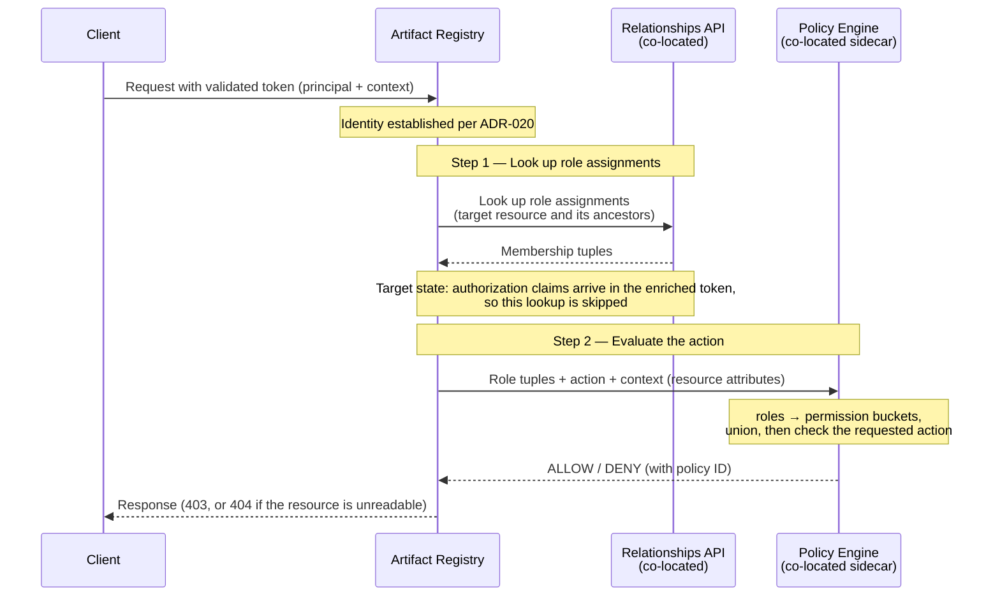

<!-- Design Documents often contain forward-looking statements -->
<!-- vale gitlab.FutureTense = NO -->

## ステータス {#status}

**提案中**

この ADR は、認証済みの呼び出し元が何を実行できるかという、**認可**だけを扱います。**認証**（呼び出し元のアイデンティティの確立、トークンの発行と検証）は、[ADR-020：認証フロー](020_authentication_flow.md)で別途扱います。

## 背景 {#context}

Artifact Registry は、GitLab Rails モノリスとは別のサテライトサービスとして動作します。[ADR-020](020_authentication_flow.md)は、リクエスト処理中に GitLab インスタンスへコールバックせず、Artifact Registry がローカルで検証する短命のトークンによって、呼び出し元のアイデンティティを確立します。この ADR は、**その呼び出し元が何を実行できるか**を決定します。

[Artifact Registry と Auth Platform のインターフェイス合意](/handbook/engineering/architecture/design-documents/artifact_registry/agreements/auth/)は、6 つの要件（R1〜R6）を定義します。ADR-020 は認証要件（R1〜R3）を適用します。この ADR は、認可要件の **R4（ポリシー評価エンジン）**、**R5（relationships API）**、**R6（ブートストラップ）** を適用します。

### 権限モデル {#the-permission-model}

操作を許可または拒否するために、Artifact Registry は 3 つの要素を評価します。

- **プリンシパル**：トークンの `sub` クレームで識別する、認証済みユーザーです（[ADR-020](020_authentication_flow.md#token-payload-r3)）。すべての認証情報の種類（パーソナル、OAuth、CI ジョブ、グループ、プロジェクトアクセストークン）は同じ `User` プリンシパルに解決されるため、**クローズドベータでは、使用した認証情報に関係なく、プリンシパルだけで認可します**。したがって、漏えいした CI ジョブトークンは、ユーザーの全権限を持ちます。トークンはデフォルトで短命であるため、クローズドベータではこのトレードオフを受け入れます。認証情報の種類によって認可を区別するかどうかは、[未解決の問い](#open-questions)です。
- **操作**：リポジトリの管理操作、またはアーティファクトの操作です（[ADR-009](009_api_design.md)）。
- **リソース**：ネームスペース（レジストリ全体。[ADR-022](022_namespace_decoupling.md)を参照）、または個別のリポジトリです。クローズドベータでは、ネームスペースは組織に 1 対 1 で対応します。

Artifact Registry は、**ロールと権限**のモデルを使用します。**ロール**は、[relationships API](#role-assignment)（R5）での割り当てを通じて、リソースのコンテキストにおける _プリンシパルの立場_ を定義します。**権限**は、 _プリンシパルが実行できること_ を定義します。各ロールは、固定の権限セットである[権限バケット](#default-permission-buckets)に対応します。必要な権限がプリンシパルの有効な権限セットに含まれる場合、操作を許可します。

### 制約 {#constraints}

3 つの制約が、この決定を形作ります。

- **デフォルトでアクセスを閉じます。** 組織（またはそのグループやプロジェクト）に所属しても、Artifact Registry へのアクセスは一切付与しません。Artifact Registry のロールを明示的に割り当てるまで、プリンシパルには権限がありません。
- **プラットフォームの所属から継承しません。** トップレベルグループとプロジェクトのロールは、プロダクト固有で独立して割り当てる Artifact Registry のロールには対応しません。
- **リクエスト処理中に GitLab インスタンスへコールバックしません。** リクエストの認可に必要なものはすべて、到達不能な可能性のある GitLab インスタンスにアクセスせずに利用できる必要があります。
  この制約の対象は _そのインスタンス_ であり、Artifact Registry 自体とともにデプロイおよびプロビジョニングされ、障害ドメインを共有する依存先（relationships API、GLAZ ポリシーエンジンサイドカー、キーバリューストア、リレーショナルデータベース）ではありません（[インターフェイス合意](/handbook/engineering/architecture/design-documents/artifact_registry/agreements/auth/#no-callbacks-during-request-processing)を参照）。
  判断に応答が必要な依存先を利用できない場合、認可は安全側に倒して拒否します。fail-open と fail-closed のどちらを最終方針にするかは、[未解決の問い](#open-questions)です。
  キャッシュは、このような依存先ではありません。失われた場合は、直接応答を解決する方式に切り替えます。

## 決定 {#decision}

**プロダクト固有の Artifact Registry ロールを定義します。Auth Platform の relationships API を通じて、ネームスペースと個別リポジトリに割り当てます。同じ場所に配置したポリシー評価エンジン（GLAZ、サイドカー）を通じて、組み込みのロールと権限の対応を使って権限を評価します。アクセスはデフォルトで閉じ、Organization Administrator にはフルアクセスをブートストラップします。**

Auth Platform は、ロール割り当て（関係）を保存し、ポリシー評価エンジンを提供します。Artifact Registry は、ロール定義と権限モデルを所有し、すべての判断を同じ場所に配置したエンジンに委ねます。

### ロール {#roles}

Artifact Registry は、プラットフォームのロールとは異なる、Artifact Registry にスコープを限定した独自の**プロダクト固有ロール**を定義します。アクセスを管理するロールは、**Artifact Admin** だけです。**Artifact Manager** は、リポジトリとアーティファクトを管理しますが、アクセスは管理しません。

これらは**ユーザーロール**であり、プラットフォームの**ユーザータイプ**（たとえば Organization Administrator や Organization Member）とは異なります。ユーザータイプが Artifact Registry のロールを意味するわけではなく、両者は独立して割り当てます（[ロール管理のワークアイテム](https://gitlab.com/gitlab-org/gitlab/-/work_items/593455)）。

Organization Administrator には、ネームスペースレベルの Artifact Admin に相当するアクセスを**ブートストラップ**します（R6）。ロール定義は、所有権の変更に合わせて維持する組織レベルの所有者関係に対し、その組織のネームスペースと配下のすべてのリポジトリへのアクセスを与えます。所有者である限り、この付与を取り消したり、権限を下げたりすることはできません。通常の関係レコードを通じて付与するため、特別な処理は不要であり、ほかの割り当てが存在する前から、Organization Administrator はリポジトリを作成し、ロールを割り当てられます。

カスタムロールは、クローズドベータの対象外です。[カスタムロール](#custom-roles)を参照してください。

### 権限 {#permissions}

すべての操作は、Artifact Registry が定義する固定セットのうち、1 つの権限を必要とします。

権限は [GitLab の権限規約](https://docs.gitlab.com/ee/development/permissions/conventions.html)に従います。すべての権限名はアクションと `resource(_subresource)` を示し、アクションは `read`、`create`、`update`、`delete` のいずれかです。この規約を適用することで、2 つの帰結が生じます。

- **可逆的な関係は、独自の動詞ではなくリソースとしてモデル化します。** 仮想リポジトリのアップストリームは `repository_upstream` です。ホスト型またはリモートのリポジトリを関連付けるときに作成し、関連付けを解除するときに削除します。
- **キャッシュは、アーティファクトの権限を再利用します。** 専用のキャッシュ権限はありません。リモートリポジトリは同じエンドポイントでキャッシュしたアーティファクトを提供するため（[ADR-009](009_api_design.md)）、閲覧とキャッシュからの削除には `read_artifact` と `delete_artifact` を使用します。

コンテナイメージのタグや npm dist-tag などのタグは、動詞に応じてアーティファクトの権限に従います。公開には、フォーマットのプロトコルが許可する再公開（Maven `SNAPSHOT` の再デプロイ、OCI タグの再 push）を含みます。専用の上書き権限はなく、上書きの防止は、提供を延期している[アクセスルール](#access-rules)の機能です。

### デフォルトの権限バケット {#default-permission-buckets}

各ロールは、固定の権限セットに対応します。割り当てる場所が変わっても、ロールが持つ権限は同じです。変わるのは _到達範囲_ であり、ネームスペースへの割り当てはレジストリ全体に、リポジトリへの割り当てはそのリポジトリだけに適用します。

各ロールは独立した権限バケットです。自身の権限だけを付与し、ロール間の階層や継承はありません。

ロール割り当ての管理は、Artifact Registry の権限ではありません。Artifact Admin だけが、この能力を持ちます（[ロール割り当て](#role-assignment)）。

### リポジトリの可視性 {#repository-visibility}

各リポジトリは、Artifact Registry のデータベースに保存する可視性レベルを持ち、外部エンティティとは同期しません。**クローズドベータは `private` のみをサポートします。** 割り当てられたロールがなければ、アクセスできません。

`internal`（組織のメンバーが読み取り可能）と `public`（未認証の呼び出し元を含む、誰でも読み取り可能）は、いずれもロールなしで読み取りを許可するため、デフォルトで閉じる制約を破ります。所属は、アクセスを _付与できる_ 相手を決めるものであり、付与そのものではありません。両方とも、[GA に延期します](#public-and-internal-visibility)。

書き込みと管理操作は、可視性に関係なく、常に割り当てられたロールの対応する権限を必要とします。

### ネームスペースレベルとリポジトリレベルのリソース {#namespace-level-and-repository-level-resources}

各権限は、操作の対象であるネームスペース、または 1 つのリポジトリに対して確認します。

- **ネームスペース**：すべての管理権限がここに結び付き、レジストリ全体に適用します。`create_repository` が作用するのはここだけであり、リポジトリレベルでは意味を持ちません。
- **リポジトリ**：`create_repository` 以外のすべての権限がここに結び付き、そのリポジトリと内容、つまり詳細、統計、設定、削除、アップストリームの関連付け、アーティファクトに適用します。

したがって、同じ権限名でも、レベルごとに異なる問いになります。`update_repository` は、ネームスペースではレジストリ全体の設定を、リポジトリではそのリポジトリ自身の設定を制御します。

### ロール割り当て {#role-assignment}

ロールは、Auth Platform の [relationships API](/handbook/engineering/architecture/design-documents/artifact_registry/agreements/auth/#r5--relationships-api)（R5）を通じて、`(subject, role, resource)` タプルとして割り当てます。subject は、トークンから解決する relationships API の [`Identity`](https://gitlab.com/gitlab-org/auth/iam/-/blob/main/docs/relationships-api.md#subject-and-identity) 型（`origin`、`origin_id`、`local_id`）であり、resource は Artifact Registry のネームスペースまたはリポジトリです。ロール割り当ては、subject を、その subject の組織内のリソースに結び付けます。

どのロールも、**2 つのリソースレベル**のどちらにも割り当てられます。

- **ネームスペース**：ロールを、レジストリ内のすべてのリポジトリに適用します。これは、管理者が数千人のユーザーに大規模にアクセスを付与するためのベースラインです。
- **リポジトリ（直接、加算的）**：ロールを、そのリポジトリだけに適用します。ネームスペースレベルの割り当ては不要であり、プリンシパルは、1 つのリポジトリだけへのアクセスを持てます。両レベルにロールがある場合、リポジトリでの有効な権限は、両者の**和集合**になります。リポジトリレベルの割り当ては、権限を増やすことだけができ、減らせません。特定のリポジトリへのアクセス制限は、[延期しています](#reductive-repository-overrides)。

**ロール割り当てを管理できるのは Artifact Admin だけ**であり、どちらのレベルでも能力は同じで、スコープだけが異なります。Artifact Manager はリポジトリを管理し、アクセスは管理しません。ロールを付与せず、アクセスルールも書き込みません。割り当ては GitLab UI の組織アクセス管理を通じて管理し、Rails がフロントエンドと API を提供し（R5）、relationships API が書き込みごとに認可します。

**各リクエストは、1 つのリソースに対して解決します。** 関係のルックアップは、リクエストの対象リソースと、その祖先（リポジトリ → ネームスペース → 組織）でフィルタリングするため、 _別の_ リポジトリへの割り当てが判断に入ることはありません。割り当ては権限を追加するだけであるため、有効なロールは、該当する中で最上位のものです。**仮想リポジトリを経由して**提供するリクエストは、**その仮想リポジトリの**割り当てに対して解決し、含まれるホスト型またはリモートのリポジトリに**直接**宛てたリクエストは、そのリポジトリの割り当てに対して解決します。したがって、仮想リポジトリのロールは、集約するコンテンツへのアクセスを、 _その仮想リポジトリを通じて提供する形で_ 許可します。これは、含まれるリポジトリの割り当てを迂回するものではなく、設計どおりです。

ロール割り当てが Artifact Registry に届く方法は、イテレーションによって異なります。

- **クローズドベータ**：トークンは認可クレームを持ちません。Artifact Registry は、relationships API からプリンシパルの割り当てを読み取り、タプルをポリシーエンジンに渡します。ルックアップは、[プロビジョニングされたキーバリューストア](/handbook/engineering/architecture/design-documents/artifact_registry/agreements/infrastructure/#isolation-levels)に、設定された短い期間キャッシュするため、フリート全体で 1 つのエントリと有効期限を共有します。キャッシュキーは、ルックアップの入力（プリンシパル、対象リソース、関係の種類）に基づくため、異なるプリンシパルやリソースに結果を再利用することはありません。ストアが失われた場合は、判断を失敗させずに、キャッシュから直接ルックアップへ切り替えます。
- **目標状態**：Auth Platform の情報付加レイヤーがロール割り当てを解決し、情報を付加したトークンに認可クレームを含めるため、ルックアップは不要です。ADR-020 がこの ADR に委ねる、これらのクレームの構造は、情報付加レイヤーの提供時に定義します。

**取り消しを含め、ロール割り当ての変更は直ちには観測されません。** 遅延は、最大でキャッシュ期間 1 回分と、relationships API 自身の書き込みから読み取りまでの遅延の合計です。書き込み後、その書き込みが読み取り可能になる前にキャッシュを埋めると、さらに期間 1 回分、古い応答を返します。relationships API の遅延は未測定のため、合計の時間枠は示していません。エントリはキーごとに期限切れとなり、キーは対象リソースを含むため、あるリソースでの拒否は、別のリソースにも取り消しが反映されたことの証明にはなりません。

### 認可フロー {#authorization-flow}

認可は、認証の後に始まります。Artifact Registry は、トークンを検証し、プリンシパルを確立済みです（[ADR-020](020_authentication_flow.md)）。その後、relationships API からプリンシパルのロール割り当てを読み取り、同じ場所に配置したポリシーエンジンサイドカーに要求されたアクションの評価を依頼します。GitLab インスタンスへコールバックすることはありません。

未認証のリクエストにはトークンがなく、拒否します。クローズドベータには public リポジトリがありません（[リポジトリの可視性](#repository-visibility)を参照）。

操作を拒否する場合のステータスコードは、プリンシパルがそのリソースの存在を知ることができるかどうかによって決まります。

- **プリンシパルがリソースを読み取れない場合**（たとえば、ロールを持たないプライベートリポジトリ）、Artifact Registry は、存在を確認させないように **404 Not Found** を返します。
- **プリンシパルがリソースを読み取れるものの、特定の操作の権限がない場合**（たとえば、ロールは持つが `delete_repository` は持たない場合）、その存在はすでに知られているため、Artifact Registry は **403 Forbidden** を返します。

どちらの場合も、拒否の原因となった権限やポリシーをレスポンスに含めません。ポリシーエンジンは、監査ログとデバッグのため、判断を決めたポリシー ID を返します（R4）。

### 一覧操作 {#list-operations}

一覧は一度に多数のリソースにまたがるため、上記の単一リソースの評価には当てはまりません。

**リポジトリ一覧（ネームスペーススコープ）。** Artifact Registry は、リポジトリごとのポリシーチェックではなく、プリンシパルのロール割り当てから判断します。

- **ネームスペースレベルのいずれかのロール**を持つプリンシパルは、そのネームスペース内の**すべての**リポジトリを一覧表示できます。すべてのロールが `read_repository` を含むため、「プリンシパルがネームスペースでロールを持つか」という問いに単純化でき、Artifact Registry は自身のデータベースからリポジトリを列挙します。
- **ネームスペースレベルのロールを持たない**プリンシパルには、**リポジトリレベルの割り当て**を持つリポジトリだけが見えます。クローズドベータでは、ロールなしで読み取りを許可する可視性レベルがないためです。Artifact Registry は、プリンシパルがどのリソースへの権限付与を持つかを relationships サービスに問い合わせ、ネームスペース内のリポジトリとの共通部分を取り、それらだけを評価します。そのため、コストはネームスペースの規模ではなく、プリンシパルへの権限付与数に比例します。このルックアップはネームスペーススコープを受け取らないため、上限を定めるのは、IAM インスタンス全体でのプリンシパルへの権限付与です。

レジストリ全体の統計表示も同じです。1 つのリポジトリではなくレジストリ全体を要約するため、ネームスペースレベルのロールが必要です。

**リポジトリ内の一覧（リポジトリスコープ）。** リポジトリの内容やサブリソースを閲覧する操作は、1 つのリポジトリを対象とするため、そのリポジトリに対する通常の個別チェックです。

ネームスペースのリポジトリ一覧では、リクエストを拒否せず、プリンシパルが読み取れないリソースを省略します。空または部分的な一覧を返し、エラーも、隠れたリソースが存在するという情報も返さず、メタデータの漏えいを防ぎます。対象リソースがすでに行を明示しているサブリソース一覧では、その行を残し、すべてのアクションを拒否します（[UI ゲーティングの権限チェック](#permission-checks-for-ui-gating)）。これは、最初の画面の体験でもあります。レジストリのナビゲーション項目は、権限チェックで制御しません（[ADR-014](014_frontend_to_artifact_registry.md)）。組織で Artifact Registry が有効であることなど、ほかのゲートは引き続き適用します。そのため、アクセスのないプリンシパルもリポジトリ一覧に到達し、空の一覧を表示されます。

### UI ゲーティングの権限チェック {#permission-checks-for-ui-gating}

フロントエンドは、ユーザーが操作を試す前に、ボタン、タブ、ルートなど、どのアクションを表示するかを知る必要があり、答えられるのは Artifact Registry だけです。Artifact Registry は、呼び出し元プリンシパルに対して、アクションごとに許可または拒否を返す**権限チェック**を公開します。チェックは権限を列挙せず、アクションを指定します。権限からアクションへの対応付けは、Artifact Registry が所有します。

判断は、オプトインで、**管理 API のドメインレスポンスに埋め込みます**。リポジトリ詳細レスポンスはそのリポジトリの判断を、リポジトリ一覧レスポンスはネームスペースと各行の判断を含み、1 ページにつき 1 回呼び出します。**埋め込み要素も、自身の判断を持てます。** これは、その要素が表すリソースについての判断です。ネームスペースの判断は、そのために作成するネームスペース詳細レスポンスに埋め込みます（[ADR-009](009_api_design.md#management-apis)）。ほかのドメイン呼び出しがないページで、ネームスペーススコープの操作機能を提供し、ネームスペースがユーザー向けエンティティになるにつれて追加的に拡張します。

各領域のアクションセットはリソースレベルに従い、OpenAPI 契約で公開します。フロントエンドは、独自にアクションを考案せず、それを読み取ります。権限の判断は、[リソースレベル](#namespace-level-and-repository-level-resources)に従います。`*_role_assignment` アクションのロール判断には、relationships API のロール割り当て書き込みルールを適用し、そのリポジトリまたはネームスペースの Artifact Admin、あるいは Organization Administrator にのみ許可します。

この契約には、4 つのルールがあります。

- **助言にとどまります。** 判断は UI の操作機能を事前に制御しますが、Artifact Registry は実際のリクエストごとに認可を行います（[認可フロー](#authorization-flow)）。古い判断によってコントロールを誤表示しても、アクセスを付与することはありません。したがって、利用側は判断をキャッシュできます。判断の対象は認可だけです。表示には、プラットフォームがキャッシュするネームスペースのステータスも必要であり（[ADR-022](022_namespace_decoupling.md)）、Artifact Registry は実リクエストで両方を適用します。
- **呼び出し元はエンドユーザーです。** プラットフォームは、現在のユーザーのトークンを取得し、そのユーザーとして管理 API を呼び出します（[ADR-020](020_authentication_flow.md)）。Artifact Registry は、ユーザーのアイデンティティを主張するサービスの呼び出し元を一切受け入れません。そのため、サービスを認証し、エンドユーザーを認証しない GitLab API の領域には判断を設けません（[ADR-009](009_api_design.md#gitlab-api)）。認証以外に権限は不要です。存在の隠蔽とデフォルト拒否によって、アクセスのない呼び出し元が、制御対象のエンドポイントで開示されない情報を知ることはないためです。
- **存在を隠します。** プリンシパルが読み取れないリポジトリには、存在しない場合と区別できない、ドメインレスポンス自身の **404 Not Found** を返します。
  ネームスペースのエンドポイントは、所有する組織の認証済みプリンシパルであれば誰にでも応答し、割り当てがなければすべてのアクションを拒否します。別の組織からの呼び出し元には、不明なスラッグと同様に 404 を返します。
  **埋め込んだ判断が、行の集合を変えることはありません。** 対象リソースのレスポンスがすでに名前を挙げているリソースは、プリンシパルが読み取れなくても、すべてのアクションを拒否する形で一覧に残します。たとえば、仮想リポジトリのアップストリーム一覧で解決する、同階層のリポジトリが該当します。
  行がすでに明示されていないすべての一覧には、引き続き[一覧操作](#list-operations)の省略ルールを適用します。
  レスポンスには許可または拒否だけを含め、判断の根拠となったポリシーや理由は含めません。
- **埋め込み、かつオプトインです。** 判断は、要求されたときだけ、制御するデータのレスポンスに含めます。そのため、両者が食い違うことはなく、何も表示しない利用側にはコストがかかりません。

サブリソース一覧は、対象リソースに対してだけアクセスを制御するため、判断には通常そのルートが行わない評価が必要ですが、ページと [ADR-004](004_data_and_application_limits.md#entity-count-limits)のエンティティ数上限によって制限されます。各行の判断は、その行自身の評価に基づきます。行の評価が失敗した場合は、黙って省略せず、リクエスト全体を失敗させます。判断に応答が必要な依存先へ到達できない場合も同様です。リクエスト内のルックアップ間の一貫性はアトミックではなく、ロール割り当てのキャッシュ期間によって制限されます。

構造は [提案 016](https://gitlab.com/gitlab-org/architecture/auth-architecture/design-doc/-/blob/main/proposals/016-batchcheck-ar-ui-authorization.md)に従います。判断をドメインレスポンスに埋め込み、その AR-GLAZ の [`BatchCheck` 契約](https://gitlab.com/gitlab-org/architecture/auth-architecture/design-doc/-/blob/main/proposals/016-batchcheck-ar-ui-authorization.md#interface)で解決します。

### 非本番の開発モード {#non-production-development-mode}

上記の決定は、実際のアーティファクトを提供するすべてのデプロイメントに適用します。ローカル開発やテスト環境向けに、Artifact Registry は**非本番の開発モード**もサポートします。その認可側の機能では、認可を強制しません。relationships API もポリシーエンジンも呼び出さず、呼び出し元が到達できるすべてのチェック、つまり[個別チェック](#authorization-flow)、[一覧のフィルタリング](#list-operations)、[UI ゲーティングの判断](#permission-checks-for-ui-gating)が許可を返します。運用担当者の明示的なオプトインを必要とし、デフォルトはオフです。設定を省略、空、無効にした場合は、強制する構成になります。

3 つのガードで制限します。

1. **IAM ブロックが設定されている場合は、設定の読み込み時に拒否します。** 強制するようプロビジョニングしたデプロイメントが、同時にオプトアウトすることはできません。
1. **このモードも IAM ブロックもない場合は、起動を失敗させます。** 認可なしでサービスを提供するのは、常に運用担当者がそれを要求した場合だけです。
1. **このモードで起動した場合、構成を WARN レベルで 1 回ログに記録します。** 強制する構成も記録するため、強制しない起動には専用の記録が残ります。

**強制しないことは、匿名アクセスではありません。** このモードは認可判断を行わないため、ロールのない呼び出し元を受け入れるように判断を拡張することはありません。認証情報を提示しないリクエストは、引き続き認証で拒否します。したがって、認可を評価しながらロールのない呼び出し元に読み取りを許可する、[延期した](#public-and-internal-visibility) `public` や `internal` レベルを再び有効にするものではありません。

この認可側のモードと、ADR-020 の認証向け[非本番開発モード](020_authentication_flow.md#non-production-development-mode)は、1 つのスイッチで選択します。その認証情報はプリンシパルを確立せず、認可を強制すると、デプロイメントが正常に見えてもすべてのリクエストを拒否してしまいます。1 つのスイッチにすることで、その状態を設定で表現できなくします。

### 同じクラスター内のサービス {#services-in-the-same-cluster}

Kubernetes サービスアカウントで認証した呼び出し元（[ADR-020](020_authentication_flow.md#services-in-the-same-cluster-kubernetes-service-account-tokens)）には、ロール割り当てがありません。それを受け入れるルートでは、ポリシーエンジンが relationships のルックアップを行わず、**対象リソースの Artifact Manager** として評価します。組織を指定しないため、許可は、そのルートが到達するすべての組織で有効です。この最初のステップは、スイッチで制御し、デフォルトはオフです。組織スコープは[未解決](020_authentication_flow.md#future-work--open-debates)です。ほかのすべてのルートは、**403 Forbidden** で拒否します。これは上記の非強制構成ではなく、強制する構成で認可を実行します。

## 後のイテレーションに延期する内容 {#deferred-to-later-iterations}

次の機能は、意図的にクローズドベータの対象外にしています。設計を記録するために文書化し、クローズドベータの顧客需要に応じて再検討します。

### Public と internal の可視性 {#public-and-internal-visibility}

クローズドベータは `private` の可視性だけをサポートします（[リポジトリの可視性](#repository-visibility)を参照）。`public`（未認証の呼び出し元を含む、誰でも読み取り可能）と `internal`（組織メンバーが読み取り可能）を再導入するには、デフォルトで閉じたまま広い読み取りアクセスを付与する方法を決める必要があるため、どちらも GA に延期します。

### アクセスを減らすリポジトリのオーバーライド {#reductive-repository-overrides}

クローズドベータのリポジトリレベルの割り当ては、**加算的（引き上げのみ）** です（[ロール割り当て](#role-assignment)を参照）。

特定のリポジトリでプリンシパルのアクセスを下げること（減算的オーバーライド）は、対象外です。ネームスペースレベルの割り当てがすべてのリポジトリへ継承されるという、GitLab 全体のロール継承と矛盾するためです。これを追加する場合、Artifact Registry は、ネームスペースとリポジトリの両レベルでプリンシパルの権限を読み取り、和集合を取る代わりに、リポジトリレベルを完全に優先して、アクセスの引き上げ _または_ 引き下げを行います。

### アクセスルール {#access-rules}

アクセスルールでは、Artifact Admin が、プリンシパルを指定せず、ネームスペース、リポジトリ、パターンに一致するアーティファクトに対して、 _どのロールがアーティファクト権限を持つか_ を制限できます。特定のアーティファクトの保護と、重複アップロードの許可または防止という 2 つの顧客ユースケースを扱います。ポリシーエンジン（R4）のユーザー定義ポリシーとしてモデル化し、組み込みのデフォルトを厳しくすることだけができ、広げることはできません。この機能とともに導入する、専用の `*_access_rule` 権限セットで管理します。提供を延期するため、クローズドベータでは、どの権限もリポジトリごとに厳しくできません。

### カスタムロール {#custom-roles}

カスタムロールは、クローズドベータから延期します。[カスタムロールのロードマップのワークアイテム](https://gitlab.com/gitlab-org/gitlab/-/work_items/590721)を参照してください。

ロールは独立した権限バケットであるため、カスタムロールは、Artifact Registry の権限の任意の組み合わせを持つ新たなバケットです（たとえば、`read_artifact` と `create_artifact` を持ち、`read_repository` は持たない「CI Publisher」ロール）。同じ relationships API で割り当て、組み込みロールと同様にアクセスルールから参照できます。

## 帰結 {#consequences}

### ポジティブ {#positive}

1. **プラットフォームの方向性と一致します。** 独自の認可システムを構築せず、Auth Platform の relationships API とポリシー評価エンジン（R4、R5）を利用し、統合の方向性に従います。
1. **自己完結した評価。** ロール割り当てを利用できれば（クローズドベータでは解決し、目標状態では情報を付加したトークンに含めます）、GitLab インスタンスへコールバックせず、Artifact Registry 自体とともにデプロイおよびプロビジョニングされた依存先で権限を判断します。
1. **権限モデルを保持し、移植できます。** 独立した権限バケットとしてのロールは、ポリシーエンジンの「deny overrides」モデルに一致し、将来の移行作業を最小限にします。

### ネガティブ {#negative}

1. **クローズドベータでのロール解決。** 情報付加レイヤーの提供までは、Artifact Registry 自身が relationships API に問い合わせてロール割り当てを解決するため、トークンのクレームを読むよりも複雑になります。
1. **オンボーディングの負担。** デフォルトで閉じるために明示的なロール割り当てが必要となり、管理作業が増えます。Organizations UI の一括割り当てワークフローで緩和します。
1. **ロールが増殖する可能性。** プロダクト固有のロールは、時間とともに多数になる可能性があります。[ロール管理のワークアイテム](https://gitlab.com/gitlab-org/gitlab/-/work_items/593455)の目指す方向に従い、Teams とグループテンプレートを拡張手段にすることで緩和します。
1. **クローズドベータでは、リポジトリごとに厳しくできません。** アクセスルールと減算的オーバーライドがないため、リポジトリでプリンシパルのアクセスを引き上げることだけができ、下げることはできません。ネームスペースレベルの割り当てはすべてのリポジトリに届き、例外を設けられません。両方とも[延期](#deferred-to-later-iterations)し、顧客需要に応じて再検討します。

## 検討した代替案 {#alternatives-considered}

### Organization Teams {#organization-teams}

[Organization Teams](https://gitlab.com/gitlab-com/content-sites/handbook/-/merge_requests/17975)は、ベースロールと任意の権限修飾子をユーザーに割り当てます。Artifact Registry は、組織ごとの Team を基本アクセスに使用し、リポジトリ単位の細かい制御にはサブチームを使うこともできます。

**現時点で採用しない理由**：Organization Teams は `proposed` の状態であり、Artifact Registry のタイムラインでは利用できません。[ロール管理のワークアイテム](https://gitlab.com/gitlab-org/gitlab/-/work_items/593455)の目指す方向に従い、Teams は将来の有力なロール割り当ての拡張手段であり続けます。relationships API を通じたロール割り当ては、その方向性と互換性があります。

### Artifact Registry 独自の認可 {#artifact-registry-native-authorization}

Artifact Registry は、Auth Platform に依存せず、自身でユーザーとリソースの関係と権限ロジックを維持することもできます。

**採用しない理由**：プラットフォームの認可システムに加えて別のシステムを導入し、統合の方向性に逆行して断片化を増やします。ユーザー管理を一から構築する必要があり、一貫しないユーザー体験を生み、後でプラットフォームに統合することも難しくなります。relationships API（R5）は、この ADR に必要なリソース単位のロール割り当てを、これらの欠点なしに提供します。

## 未解決の問い {#open-questions}

1. **relationships サービスを利用できない場合の動作。** クローズドベータでは安全側に倒して拒否（リクエストを拒否）しますが、fail-open と fail-closed の方針は最終決定中です。
1. **大規模な組織からネームスペースへの解決。** ロール割り当ては Artifact Registry のネームスペースに結び付き、クローズドベータでは組織に 1 対 1 で対応します（[ADR-022](022_namespace_decoupling.md)）。将来の組織統合により、1 つの組織の下に複数のネームスペースが置かれる場合、所有者のブートストラップや割り当ての組織スコープ不変条件など、組織全体の関心事を、複数のネームスペースにわたってどう解決するかを定義します。
1. **認証情報の種類を考慮した認可。** クローズドベータでは `User` プリンシパルだけで認可し、すべての認証情報が同じプリンシパルに解決されるため（ADR-020）、漏えいした CI ジョブトークンはユーザーの全権限を持ちます。たとえば CI ジョブトークンを公開専用にするなど、認証情報の種類で認可を制限するかどうかは、延期します。まず ADR-020 で、トークンに認証情報の種類を含める必要があるため、ADR-020 と ADR-021 の共同の後続作業になります。
1. **インターフェイス合意との整合。** [インターフェイス合意](/handbook/engineering/architecture/design-documents/artifact_registry/agreements/auth/#gitlab-role-vocabulary)は、Artifact Registry が 5 つの組み込み GitLab ロールを使い、「独自のロールを定義しない」と今も述べています。また、[コールバック禁止の制約](/handbook/engineering/architecture/design-documents/artifact_registry/agreements/auth/#no-callbacks-during-request-processing)は、同じ場所に配置したプラットフォームサービスを、到達可能性の根拠ではなく例によって除外しています。どちらも、Auth Platform チームと調整した関連更新が必要です。
1. **リポジトリ一覧の認可走査のキャッシュ。** リポジトリ一覧は各行に編集と削除のコントロールを表示するため、一覧エンドポイントは、呼び出し元が読み取れない行を隠すとともに、各行の判断も返す必要があります。呼び出し元がネームスペースまたはその組織への権限付与を持つ場合、ネームスペース内のすべてのリポジトリを評価します（[ADR-004](004_data_and_application_limits.md#entity-count-limits)のネームスペースごとのリポジトリ数上限で制限します）。そのような権限を持つ呼び出し元であれば誰でも実行でき、ページを読み込むたびに繰り返します。この走査をキャッシュしてレートを制限する方法は、未解決です（[提案 016 の未解決の問い](https://gitlab.com/gitlab-org/architecture/auth-architecture/design-doc/-/blob/main/proposals/016-batchcheck-ar-ui-authorization.md#open-questions)）。

## 参考文献 {#references}

- [ADR-001：アンカーポイントとしての組織](001_organizations_as_anchor_point.md)
- [ADR-009：API 設計](009_api_design.md) — 管理 API とクライアント API のエンドポイント
- [ADR-020：認証フロー](020_authentication_flow.md) — アイデンティティの確立とトークン検証
- [ADR-022：ネームスペースの分離](022_namespace_decoupling.md)
- [Artifact Registry と Auth Platform のインターフェイス合意](/handbook/engineering/architecture/design-documents/artifact_registry/agreements/auth/) — ここで適用する R4〜R6（認可）の要件
- [Relationships API](https://gitlab.com/gitlab-org/auth/iam/-/blob/main/docs/relationships-api.md) — IAM relationships API の契約。クローズドベータでは、リソースと祖先の直接の関係タプルを返し、ポリシーエンジンが和集合（加算的なリポジトリレベルの割り当て）として評価します
- [GitLab の権限規約](https://docs.gitlab.com/ee/development/permissions/conventions.html) — 権限が従う命名規則と CRUD 分解ルール
- [ロール管理と Artifact Registry のオンボーディング](https://gitlab.com/gitlab-org/gitlab/-/work_items/593455) — プロダクト固有ロール、デフォルト拒否、3 要素のモデル
- [提案 016：BatchCheck](https://gitlab.com/gitlab-org/architecture/auth-architecture/design-doc/-/blob/main/proposals/016-batchcheck-ar-ui-authorization.md) — 権限チェックの背後にある AR-GLAZ のバッチ評価契約と UI フロー
- [UI ゲーティングの方向性（gitlab#602144）](https://gitlab.com/gitlab-org/gitlab/-/work_items/602144#note_3532439195) — UI ゲーティングには、レジストリが答えるアクションベースのチェックを使うという合意
- [GATE 設計ドキュメント](https://gitlab.com/gitlab-org/architecture/auth-architecture/design-doc/-/blob/main/design.md) — GitLab Adaptive Trust Environment
