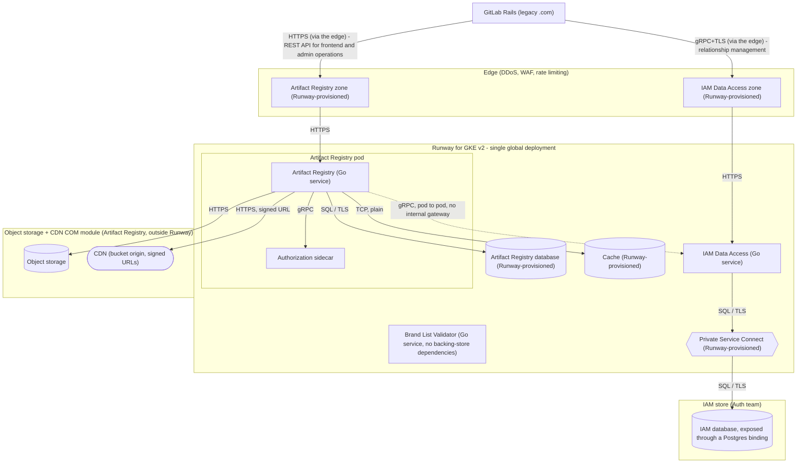

<!-- Design Documents often contain forward-looking statements -->
<!-- vale gitlab.FutureTense = NO -->

## 背景 {#context}

目標とするデプロイモデルは、Cell ベースのマルチテナントアーキテクチャです。各 Cell が、共有エッジの背後にある自己完結したリージョン内のデータプレーンとなり、Anchor Router と Anchor Topology の各サービスを通じてスラッグベースでルーティングします（[ADR-022](022_namespace_decoupling.md)）。Cell のライフサイクルは、すでに Cells と Dedicated を運用する自動化である Instrumentor が管理します。

この目標は、次の 3 つの部分がまだ進行中であるため、最初の提供時には実現できません。

1. Anchor Router と Anchor Topology の各サービスは、レジストリがルーティング先として利用できる状態ではないため、レジストリ自身のデータベースでスラッグの一意性を管理します（[ADR-022](022_namespace_decoupling.md)）。
1. レジストリを Cell 内にプロビジョニングする、Cells と Dedicated 向けの Theseus Platform Binding は、まだ準備できていません。Runway for GKE v2 は、最初に Enterprise の非 Cellular な Runway インスタンスを対象とします。
1. Cell ごとの移行とリバランスのツールは、まだ存在しません。

そのため、最初の提供には、後で解消する必要があるモデルではなく、Cellular な目標へ後から取り込めるデプロイモデルが必要です。

## 決定 {#decision}

**Artifact Registry と、その依存先である Auth コンポーネントを、GitLab の内部開発者プラットフォームである [Theseus](/handbook/engineering/architecture/design-documents/theseus_platform_vision/) の、最小限の実行可能なプラットフォームとして提供します。Runway for GKE v2 上の単一のグローバルなマルチテナントデプロイとし、すべてのバックエンドストアを Runway がプロビジョニングするか、プロダクトエンジニアリングのモジュールとして所有します。後に、すでに Cells を運用する自動化である Instrumentor を通じて Cells 内へ移行します。**

レジストリは、本番環境に向かう最初のステートフルな GitLab Module であるため、プロビジョニング、サービスバインディング、可観測性、ビルド、デリバリーといった、後続の Modular Components が再利用するプラットフォームの部分を実際に使います。
プラットフォームチームは、Cellular な目標の全体ではなく、各フェーズに必要な最小限のプラットフォームを提供するため、プロダクトとプラットフォームを並行して構築します。

### 常に満たすべき条件 {#what-must-always-hold}

| # | 制約 | 機械的に検証可能か？ |
| --- | --- | --- |
| 1 | **バックエンドストアは要求し、手動でプロビジョニングしません。** それぞれを自動化でプロビジョニングします。Platform Binding として動作する Runway が、サービスの Fairway マニフェストで宣言した内容を、生成されたサービスバインディングを通じて満たすか、COM モジュールが提供します。 | はい：サービスがアクセスするすべてのバックエンドストアを、マニフェストで宣言して Runway が提供するか、COM モジュールが提供します |
| 2 | **すべてのバックエンドストアに、明確な所有者を置きます。** Runway がプロビジョニングするか、プロダクトエンジニアリングチームが所有し、構成管理に統合した [COM（Component Ownership Model）モジュール](/handbook/engineering/infrastructure-platforms/production/component-ownership-model/)として提供します。どちらの所有者もないストアは、デプロイの選択肢に含めません。 | いいえ：所有権はプロダクトチームとプラットフォームチームの間で合意します |
| 3 | **サービスバインディングに、プロバイダー固有のインターフェースを含めません。** 同じマニフェストを、マネージドデータベース、他のプロバイダーのマネージドデータベース、運用者自身のデータベースに対して使います。ドライバーの選択はマニフェストではなくバインディングの背後に置きます。ただし、オブジェクトストレージは例外であり、制約 4 に従ってレジストリ自身がドライバーを選びます。 | はい：サービスのマニフェストに、プロバイダーやドライバーを指定しません |
| 4 | **オブジェクトストレージには、プロバイダー自身の API でアクセスします。** レジストリには、プロバイダーに依存しない抽象化では提供されない、再開可能なチャンク単位のアップロードが必要であるため、独自のクライアントを構築し、自身の設定でプロバイダー間の差を処理します。サービスバインディングは、バケットの場所と認証情報を提供しても、クライアントは提供しません。 | はい：バケットをサービスバインディングと自身の設定のどちらから取得しても、レジストリは、自ら構築したクライアントで、プロバイダー自身の API を通じてのみオブジェクトストレージにアクセスします |
| 5 | **1 つのビルドを、すべてのデプロイモデルで使います。** 配置、プロバイダー、バックエンドストアは設定だけで変わるため、同じアーティファクトが GitLab.com、Dedicated、Self-Managed で動作します。 | はい：サポートする各デプロイ環境は、設定で選択した同じビルドを実行します |
| 6 | **FIPS イメージが対象外の間は、非 FIPS イメージを使います。** その間、非 FIPS ビルドでの実行を拒否するコマンドはありません。 | はい：FIPS ビルドを条件として実行を制御するコマンドはありません |
| 7 | **エッジは、平文のリクエストをリダイレクトせずに拒否します。** | はい：公開エンドポイントへの平文のリクエストは拒否します |
| 8 | **クラスター内ホップでの TLS 提供は、各サービスの任意の能力であり、デプロイの前提ではありません。** 運用者が強制するまでは検証も任意とし、認証局を有効にしても、動作しているホップが壊れないようにします。 | はい：各ホップは、再ビルドせずに設定だけで TLS の無効と有効を切り替えて動作します |
| 9 | **内部サービス間のトラフィックは直接通信します。** レジストリは、内部ゲートウェイやロードバランサーを挟まず、Pod 間で IAM データアクセスサービスにアクセスします。 | はい：レジストリ自身がサービスを解決して接続し、経路にゲートウェイを置きません |
| 10 | **スラッグの権威を持つのは、常に 1 つだけです。** 単一のインスタンスが全員にサービスを提供する間は、レジストリのデータベースが持ち、2 つ目の Cell がネームスペースを作成できる時点から Anchor Topology が持ちます。引き継ぎ前に作成したすべてのスラッグを、先に Anchor Topology に登録します。 | いいえ：引き継ぎは 1 回限りの運用手順です |
| 11 | **顧客の移行は、使い捨ての作業ではなく、リバランスの能力です。** グローバルインスタンスから顧客を移動する際には、その後も Cells のリバランスに使うツールを使用し、そのツールが実現できる最小限の顧客に見える中断を目指します。 | いいえ |

### 誰が何を提供するか {#who-provides-what}

Runway は、データベース、キャッシュ、別のチームが所有するストアにアクセスする Private Service Connect リンクという一般的なケースをプロビジョニングし、アプリケーションは、Fairway が生成したサービスバインディングを通じて利用します。

GitLab.com では、次の 2 つを例外として、そのストアを必要とするチームが所有し、Runway の外で管理する COM モジュールにします。

- **オブジェクトストレージとその前段の CDN**。両者は強く結合しているため、1 つのモジュールにします。
- **IAM ストア**。Auth チームが所有し、Runway がプロビジョニングした Private Service Connect リンクを通じてアクセスします。

Dedicated 上の Runway など、プラットフォームがバケットをプロビジョニングする場合、サービスバインディングは、バケットの場所と、バインディングが認証情報を持つ場合はその認証情報をレジストリに渡しますが、クライアントは渡しません。このバインディングは、レジストリ自身のストレージ設定が未設定とした部分だけを補います。明示的な設定を常に優先するため、運用者はインシデント中にバインディングを上書きできます。

### 導入手順 {#adoption-path}

**Phase 1：単一のグローバルデプロイ。** レジストリは、Enterprise の非 Cellular な Runway インスタンスである Runway for GKE v2 上の、単一のグローバルデプロイとして稼働します。
マルチテナントであり、テナントはネームスペースによるパーティション分割で分離します。データベースをネームスペースでパーティション分割し（[ADR-007](007_database_schema.md)）、オブジェクトストレージのパスと重複排除は、ネームスペースごとのスコープにします（[ADR-008](008_content_addressable_storage.md)）。
Cell ごとのデプロイ、Anchor ルーティング、移行ツールはありません。
レジストリ、IAM データアクセスサービス、認可サイドカー、[ブランドリスト検証ツール](https://internal.gitlab.com/handbook/engineering/architecture/design-documents/artifact_registry/decisions/015_slug_policy/)（社内向け）の 4 つのコンポーネントをビルドし、デプロイします。

**Phase 2：Cells。** Cells と Dedicated 向けの Theseus Platform Binding ができたら、並行する Cell 基盤ではなく、Instrumentor を通じて Cell インフラの一部としてレジストリをデプロイします。
顧客をグローバルインスタンスから Cell に移行します。デフォルトでは、顧客の GitLab Cell と同じ分離境界内の Cell を選びますが、これは目安であり、厳格なルールではありません。
この時点で、制約 10 に従って、スラッグの権威を Anchor Topology に移します。

## アーキテクチャ {#architecture}

## 通信のセキュリティ {#transport-security}

クライアントとモノリスは、エッジで HTTPS を通じて両方のサービスにアクセスし、レジストリのデータベースは暗号化された接続のみを受け入れ、オブジェクトストレージと CDN は HTTPS で配信します。
クラスター内の 3 つのホップは平文です。設定でループバックのみに制限した、レジストリから認可サイドカーへの通信、レジストリから IAM データアクセスサービスへの Pod 間通信、レジストリからキャッシュへの通信です。

エッジへの平文のリクエストは、リダイレクトせずに拒否します。
リダイレクトすると、`http://` を設定したクライアントが動作してしまうため、`.repo` ファイルを読む `dnf` のように、リクエストごとに認証情報を送るクライアントは、誰も気付かないまま、毎回平文で認証情報を送信します。

GitLab.com では、3 つの平文ホップでアプリケーションレベルの TLS を使いません。
各ホップは認証され、ネットワークはプライベートであり、[プロバイダーは、自身が管理する物理的な境界を越えるトラフィックを暗号化します](https://cloud.google.com/docs/security/encryption-in-transit)。1 つの境界内では、物理的なセキュリティが代わりを担います。

Self-Managed と Dedicated では、プラットフォームによる保証を前提とせず、すべてのホップの暗号化を求める運用者もいます。
そのため、これらのホップでの TLS 提供は、各サービスの任意の能力であり、デプロイの前提ではありません。運用者がファイルベースのキーペアを用意して有効にします。
GitLab.com では無効にして稼働し、他の運用者と同様に採用する場合があります。

ワークロードアイデンティティを使う相互 TLS は、未決定の方向性です。[ADR-020](020_authentication_flow.md)の今後の作業に記録しています。
サポートするデプロイモデルでホップごとの暗号化やワークロードアイデンティティが必須になること、または認証アーキテクチャで Unified Request Token の方向性が確定することの、2 つの事象が再検討の契機になります。

## 影響 {#consequences}

### 利点 {#positive}

1. Anchor ルーティングや、Cells と Dedicated 向けの Theseus Platform Binding を**待たずにレジストリを提供できます**。
1. **実際の本番ワークロードに合わせてプラットフォームを構築します**。各能力は、それを必要とするプロダクトの直前に、次の Modular Component が再利用する形で提供します。
1. **バックエンドストアは、所有者を明確にした 1 つのプロビジョニングモデルに従います**。手動で用意するものや、所有者のないものはありません。
1. **Cellular な段階でも実績ある自動化を再利用します**。レジストリと後続の Modules に、競合する 2 つの経路ではなく、1 つのデプロイ・運用経路を提供します。
1. **移行に無駄はありません**。グローバルインスタンスから顧客を移動する能力は、Cellular アーキテクチャがいずれ必要とする、同じリバランスの能力です。

### 欠点 {#negative}

1. **Phase 1 は Cellular ではありません**。Cell ごとのデプロイ、リクエストのルーティング、移行ツールはありません。Cells は、グローバルインスタンスを通じてレジストリにアクセスし、これは一時的な状態です。Cellular インフラへの移行には、信頼する発行者の公開キーがすべての Cell に届くこと（[ADR-020](020_authentication_flow.md#authentication-flow)）と、各 Cell が relationships API を呼び出せることも必要です。
1. **テナントの分離は、1 つの共有データプレーン内のネームスペースによるパーティション分割に依存します**。Cellular モデルのより強い分離と回復力が得られるのは、Phase 2 からです。
1. **後からの移行は避けられず、遅れるほどリスクが増します。** グローバルインスタンスの垂直スケーリングは、一時的な対策であるため、成長が続くほど、最終的な移行が大きくなります。グローバルインスタンスは Google Cloud 上、Cells は AWS 上で稼働するため、移行には、顧客の利用と遅延の両方に比例する、プロバイダーをまたぐエグレスコストがかかります。移行ツールは、すべての Cellular Module に共通するインフラとして一度だけ構築するのが最善ですが、時間がかかります。最初の移行の緊急度によっては、成熟する前に使う場合があり、顧客に見える中断を数秒に抑えて移行できるようになるまでは、数分から数時間の中断が生じる場合があります。

## 検討した代替案 {#alternatives-considered}

### 何もしない：Cellular な目標が整うまで待つ {#do-nothing-wait-for-the-cellular-target}

Anchor ルーティング、Cells と Dedicated 向けの Theseus Platform Binding、Cell ごとの移行ツールがすべて整うまで、提供を待ちます。
却下理由：3 つとも進行中であり、待っても作業は減らず、プロダクトが遅れるだけです。また、プラットフォームは、自身の能力の統合を促す実際のワークロードを失います。

### レジストリ専用の並行する Cell 基盤 {#a-parallel-cellular-fabric-for-the-registry}

Instrumentor での既存の Cells と Dedicated への投資とは独立して、レジストリ専用の Cell アーキテクチャを立ち上げます。
却下理由：プラットフォームの最も複雑で高コストな部分を重複させ、デプロイと運用を分断し、Modules を Single-Tenant、Dedicated、Dedicated for Government、Self-Managed にデプロイすることを、容易にするどころか難しくします。
最も難しいコンポーネントだけを独自に Cellular にしても、フリート全体の利点を得られないまま、そのコストを払うことになります。
