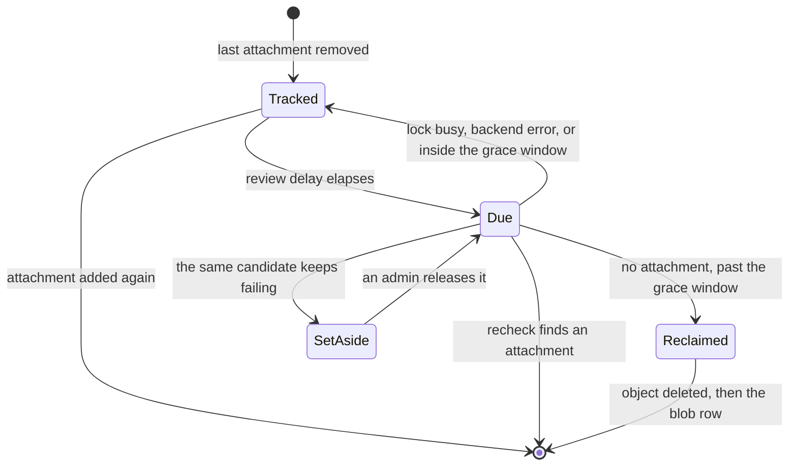

<!-- Design Documents often contain forward-looking statements -->
<!-- vale gitlab.FutureTense = NO -->

## 概要 {#summary}

クライアントがタグ、バージョン、キャッシュされたファイルを削除すると、Artifact Registry はメタデータを削除しますが、コンテンツアドレス指定された blob とそのストレージオブジェクトは残ります。
ガベージコレクション（GC）がなければ、ストレージは際限なく増加します。

Artifact Registry は、ネームスペース単位のオンライン遅延 GC によってストレージを回収します。
ネームスペース内の最後の参照が削除されると、blob は候補になります。
候補はレビュー遅延期間が経過するまで待機し、blob 行のロック下で再確認されます。その後にのみ、行より先にオブジェクトを削除します。
遅延期間中の再 push によって救済されます。
GC は保持するアーティファクトを決して判断せず、マニフェストやパッケージを読み取りません。

## 動機 {#motivation}

blob はコンテンツアドレス指定され（[ADR-008](008_content_addressable_storage.md)）、ネームスペース内で重複排除されます（[ADR-002](002_storage_deduplication_scope.md)、[ADR-022](022_namespace_decoupling.md)）。
[ADR-010](010_data_retention.md)が GC の契約を定めています。何も参照していない blob を回収し、保持するアーティファクトに関するすべての判断は、フォーマット、ライフサイクル、保持に任せます。
削除や期限切れによって参照はすでに削除されますが、それをストレージの解放につなげる仕組みがありません。

GC を難しくする特性が 2 つあり、どちらも規模には依存しません。

1. **回収によって有効なアーティファクトを壊してはなりません。** アーティファクトが参照する blob や、push がまもなく参照する blob を削除すると、永久にデータを失います。
1. **削除は元に戻せません。** GC のバグは、誰かが修復できるレコードを破損するのではありません。バイト列を破壊します。

GitLab Container Registry が本番環境における先例です。
オフラインのマークアンドスイープから、遅延付きのレビューキューを使う[オンラインモデル](https://gitlab.com/gitlab-org/container-registry/-/blob/master/docs/spec/gitlab/online-garbage-collection.md)に移行しました。これにより、blob が削除される前に再 push で救済できます。
Artifact Registry はその形を維持します。
重複排除の境界が狭いため、Container Registry に残された問題を解消できます。Container Registry はインスタンス全体で重複排除するため、push と GC の最悪の競合を解消する削除時ロックのコストが高すぎ、その競合が残っていました。

### 目標 {#goals}

1. 書き込みをブロックせず、ネームスペース内の何も参照していないすべての blob を回収します。
1. コミット済みの参照が指すオブジェクトや、進行中の push が依存するオブジェクトを決して削除しません。
1. Maven、npm、Container/OCI、ホスト型とリモートを含め、すべてのフォーマットに 1 つのメカニズムを使います。
1. オペレーターは、blob の回収を即座に停止し、キューを確認し、失敗し続ける blob に対処できます。

削除からレビュー遅延期間が経過した後にネームスペースごとの重複排除済みストレージが減少し、キューが排出され、どの pull でもオブジェクトの欠落が発生しなければ、GC が機能していると判断できます。

### 対象外 {#non-goals}

1. 保持するタグ、マニフェスト、バージョン、キャッシュされたファイルの判断。フォーマット、ライフサイクル、保持、クリーンアップポリシーが担います。保持対象のアーティファクトであり続ける、タグなしのマニフェストも含みます。
1. ソフト削除されたアーティファクトを期限切れにすることや、サイズまたは経過時間に基づくリモートキャッシュの退避。これらは参照を削除し、GC は残されたものを回収します。
1. 孤立した参照行や blob 行のないオブジェクトなど、GC がデータベースから検出できないリークの発見。[ADR-011](011_data_reconciliation.md)の照合サービスが担います。
1. ネームスペース全体のパージ。

## 提案 {#proposal}

最後の参照を削除した操作から blob が参照されていないことを把握し、ストレージを走査しないため、GC はオンラインです。
回収を削除と同時には実行せず、遅延、再確認、ロックによって再 push との競合を解消するため、遅延方式です。
重複排除がネームスペース単位であるため、GC もネームスペース単位です。すべての参照カウント、ロック、回収は 1 つのネームスペース内で完結し、グローバルな調整は不要です。

### 常に満たすべき条件 {#what-must-always-hold}

| # | 制約 | 機械的に確認可能か？ |
| --- | --- | --- |
| 1 | **参照カウントはアタッチメント数です。** ネームスペース内のどのアタッチメントも参照していない場合にのみ、blob は回収可能です。GC は参照テーブルを保持せず、到達可能性を計算せず、アーティファクトを解析しないため、細工されたマニフェストによって動作を誘導できません。 | はい：GC がアタッチメント行のみを読み取ることを確認するテスト |
| 2 | **1 つのロックがすべての競合を直列化します。** アタッチメントを追加または削除するすべての書き込みと回収は、まず blob 行をロックします。書き込みは、固定された 1 つの順序で blob 行を取得します。 | はい：ロックを取得する単一のストア以外でアタッチメントに書き込むと、ビルドチェックが失敗します |
| 3 | **ゼロへの遷移時にのみ候補を記録します。** 最後のアタッチメントを削除する際、同じトランザクション内で候補を記録します。新しいアタッチメントは、同じトランザクション内で候補を消去します。記録漏れはストレージリークを生じさせますが、早すぎる削除は決して起こしません。 | はい：ストアのテスト |
| 4 | **レビューしてから再確認します。** 候補は少なくとも 1 時間のレビュー遅延期間を待ちます。その後、クリーンアップがロック下で候補の期限が引き続き到来していることを確認し、削除前にアタッチメントを再確認します。 | はい：設定チェックとテスト |
| 5 | **新しい blob は決して回収しません。** 行の作成時刻から測定した経過時間が固定の猶予期間より短い blob は、補完スキャンで候補として記録せず、クリーンアップでも削除しません。この期間は設定変更できません。 | はい：共有定数 1 つとプロパティテスト |
| 6 | **ストレージを先に、行を後に削除します。** クリーンアップは、1 つのトランザクション内で blob 行より先にオブジェクトを削除します。クラッシュすると行と候補が残り、有効な候補によって、次のアップロードは行を信頼する前にストレージを確認します。 | はい：クラッシュ注入テスト |
| 7 | **重複排除を利用するアップロードは、回収の影響を受けた可能性のあるものを信頼しません。** アップロードが有効な候補を持つ既存の blob 行を見つけると、ロック下でストレージを再確認し、コミット時に候補を消去します。オブジェクトがなければ、ロック下で行を削除してコミットし、その後、新しい blob としてアップロードします。そのため、アップロード中にロックを保持しません。 | はい：競合テスト |
| 8 | **どの呼び出し元も無制限には待機しません。** リクエストは上限時間までロックを待ち、タイムアウトまたはデッドロック時には再試行可能な `503` を返します。クリーンアップは待機せず、再びキューに追加します。ロック下で行うすべてのストレージ呼び出しには時間制限があります。 | 一部：テスト、および本番環境でのロック待機時間のヒストグラム |
| 9 | **永続的な障害への対応には上限があります。** ストレージのエラー率が広範囲に上昇すると、失敗回数を数えずにスイープを一時停止します。他の削除が成功する中で単独で失敗する候補は、試行回数が上限に達すると、管理者が対応できるよう除外します。 | はい：テスト |
| 10 | **blob の回収は停止可能で、初期状態は無効です。** 設定によって回収を有効にし、デフォルトでは無効です。フラグサービスがある環境では、キルスイッチフラグによってもデプロイなしで停止でき、フェイルクローズします。ステージングのスイープにはこの制御を適用しません。期限切れのアップロードは blob になっておらず、救済するものがないためです。 | はい：デフォルトとフラグのテスト |

### 利点 {#pros}

1. システム全体を停止しません。GC は継続的に回収し、書き込みを決してブロックしません。
1. 1 つのロックによって、候補記録の競合、push の競合、クラッシュのケースを解消します。
1. フォーマットごとの参照追跡を行わず、すべてのフォーマットに 1 つのメカニズムを使います。
1. 上流での誤った削除は、レビュー遅延期間全体にわたって復旧可能です。
1. ネームスペース単位の境界によって、競合や誤りを 1 つのテナント内に限定します。

### 欠点 {#cons}

1. **容量の回復が遅れます。** 削除からレビュー遅延期間が経過した後にストレージが解放されるため、ユーザーとオペレーターに回収待ちの状態を示す必要があります。
1. **書き込みパス上にロックがあります。** 1 つのネームスペース内で blob を共有する 2 つの書き込みは、短時間直列化されます。実際のトラフィック下でのコストは、本番稼働まで未計測です。
1. **データ損失パスが 1 つ残ります。** 猶予期間より長くかかり、ネームスペース内に開いたアップロードセッションがない公開処理では、アタッチ前に新しい blob が回収される可能性があります。これは追跡済みで、解消するには、フォーマットが期限まで blob を保護できるようにストレージレイヤーを変更する必要があります。
1. **常に使用される blob は回収されません。** レビュー遅延期間中に最後の参照が繰り返し復活する場合、blob は残ります。これは意図した動作で、blob 1 つ分のストレージを使用し、次の push を保護します。
1. **提供開始時の唯一の安全網は補完スキャンです**。[ADR-011](011_data_reconciliation.md)で照合を延期しているためです。

## 設計と実装の詳細 {#design-and-implementation-details}

### 候補のライフサイクル {#candidate-lifecycle}

レビューキューは、ジョブバックエンドのテーブルではなく、専用テーブルです。
キューから取り出す際には、実際のアタッチメントに対して遅延を再評価する必要があり、クラッシュのマーカーとして機能するには、候補が個々のジョブ試行より長く存続する必要があります。

### ジョブ {#jobs}

GC は、[ADR-006](006_technology_stack.md)で選択したジョブバックエンド上のバックグラウンドジョブとして実行します。

1. スイープが、期限に達した候補を古い順に、上限のあるバッチでクリーンアップに渡します。
1. クリーンアップが、ロック、再確認、削除を行います。blob のバイト列を破壊する唯一のジョブです。
1. 低頻度の補完スキャンが、猶予期間より古く、アタッチメント数がゼロで、記録から漏れた blob を見つけます。
1. ステージングのスイープが、blob にならなかった期限切れアップロードのステージングオブジェクトを削除します。

### ロックの順序と競合 {#lock-order-and-contention}

削除は、アーティファクト行をロックしてから blob 行をロックします。
push はアーティファクト行がまだ存在しないため、先に blob 行を digest の昇順でロックします。
この 2 つの順序はデッドロックする可能性があり、データベースが一方を中止し、中止された側は `503` を返します。
応答後に実行するキャッシュ充填など、待機できない呼び出し元は、書き込みをスキップします。

### 運用 {#operations}

オペレーターは、キューのメトリクス、ロック待機時間、オブジェクト削除ごとのイベントを通じて GC の状態を確認します。
キューの排出停止、スイープの一時停止の継続、候補の除外、回収の急増、回収停止をアラームで監視します。
ネームスペース単位のステータスと、除外された候補およびその解除操作は、プラットフォーム専用 API で提供するため、管理者は GitLab UI から確認し、再試行できます。

### 導入 {#adoption}

1. **記録のみ。** 候補を記録し、補完スキャンを実行しますが、何も削除しません。メトリクスで再参照のタイミングを示します。
1. **再確認して破棄。** ストレージの削除以外は、クリーンアップを最初から最後まで実行します。
1. **削除。** すべての書き込みパスにロックが実装され、それを競合テストで証明し、猶予期間のテストに合格し、観測された再 push のタイミングに対してレビュー遅延を確認した場合にのみ、元に戻せない削除を有効にします。

## 代替案 {#alternative-solutions}

### 何もしない {#do-nothing}

ストレージは際限なく増加し、ユーザーはどのアーティファクトも参照していないバイト列に料金を支払います。
却下：[ADR-010](010_data_retention.md)で、レジストリがそれらを回収することを約束しています。

### オフラインのマークアンドスイープ {#offline-mark-and-sweep}

ストレージ全体を走査し、有効なメタデータから到達可能なものにマークを付け、残りを削除します。
却下：書き込みを停止しなければ、push がまもなく参照する blob を削除する危険があります。コストは変更量ではなく総ストレージ量に比例して増え、中断したスイープを正常に再開できません。

### 同期的な削除 {#synchronous-deletion}

最後の参照が削除されたときに、オブジェクトを削除します。
却下：どの規模でも、オブジェクトに依存する再 push と競合します。

### 候補記録のためのデータベーストリガー {#database-triggers-for-capture}

アタッチメントテーブルのトリガーによって候補を記録します。
却下：すべてのアタッチメント書き込みはすでに単一のストアを経由しており、そこでの候補記録はテストでき、観測でき、記録漏れはリークを生じさせるだけです。
ストアを迂回する書き込みパスが生じた場合は、再検討します。

### blob 行ではなくキュー行をロックする {#lock-the-queue-row-not-the-blob-row}

Container Registry と同様に、書き込みパスをロックなしに保ちます。
却下：blob 行は永続的な不変条件であるため、1 つのロックがすべての競合に対応します。キュー行のロックでは、push の競合とクラッシュのケースに別々の対処が必要です。

### digest に対するアドバイザリロックまたは Redis ロック {#an-advisory-or-redis-lock-on-the-digest}

却下：強制する仕組みのない追加のロック取得が必要になり、アドバイザリキーは異なる digest 間で衝突する可能性があり、Redis は元に戻せないパスに障害ドメインを追加します。
blob 行の待機がボトルネックと判明した場合は、再検討します。

### 行を先に削除し、オブジェクトを後で削除する {#delete-the-row-first-the-object-later}

メタデータの変更をコミットし、その後、帯域外でオブジェクトを削除することで、ストレージ呼び出し中にどのトランザクションもロックを保持しないようにします。
却下：ステップ間でクラッシュすると、行のないオブジェクトがリークし、GC 内のどの仕組みも検出できません。
上限を設けたロック保持が書き込みのレイテンシーに悪影響を与える場合、最初に再検討する選択肢です。

### マニフェストからレイヤーへのエッジを実体化する {#materialized-manifest-to-layer-edges}

却下：到達可能性の計算は GC の役割ではなく、マニフェストを読み取ると、細工されたマニフェストが GC の回収対象に影響を与えられるようになります。
