

このドキュメントは、Container Registry Routing Service の設計目標とアーキテクチャを概説します。

## 概要 {#overview}

Container Registry のトラフィックは、クライアントが認証情報をレジストリトークンに交換する `gitlab.com/jwt/auth` と、そのトークンを使って push と pull を行う `registry.gitlab.com` の 2 つのホスト名を通って GitLab に届きます。Cells では、どちらもリポジトリを保持するセルに到達する必要があります。このドキュメントでは、HTTP Router が、トークンリクエストの `scope` パラメータとレジストリリクエストのパス内のリポジトリから対象セルを判断する方法と、それを実現するために Topology Service、GitLab Rails、ルーターのそれぞれに必要な追加事項を説明します。

## スコープに関する判断 {#scoping-decisions}

- ルーティングの基準となるリポジトリを含まないリクエストは、トークンに基づいてルーティングします。Bearer トークンで判断し、最初の匿名の `GET /v2/` 確認リクエストなど、トークンを持たないリクエストだけが Legacy Cell にフォールバックします。これはバージョン確認（`GET /v2/`、`GET /gitlab/v1/`）とレジストリ全体のエンドポイント（`GET /v2/_catalog`、統計、バックグラウンドマイグレーション）に適用されるため、これらはセル群全体ではなく、トークンを発行したセルについて応答します。
- 判断に用いるスコープが異なるセルに解決される `/jwt/auth` リクエストは、一部だけを処理するのではなく拒否します。詳細は[*ルーティングできない場合の応答*](#the-un-routable-response)を参照してください。

## API の形式 {#api-shapes}

### gitlab.com/jwt/auth {#gitlabcomjwtauth}

レジストリがクライアントを誘導するトークンエンドポイントです。リクエストには、常にクエリ文字列内にある 0 個以上の `scope` パラメータと、任意の `Authorization: Basic` 認証情報を含めます。

| メソッド | パス | 操作 | ルーティング方法 |
| --- | --- | --- | --- |
| GET | `/jwt/auth?scope=repository:{name}:{actions}`。[RFC 6749 §3.3](https://datatracker.ietf.org/doc/html/rfc6749#section-3.3)に従い、複数のスコープはパラメータの繰り返し、または 1 つのパラメータ内のスペース区切り（`?scope=A+B`）で届きます | 1 つ以上のリポジトリ用のトークンを発行します。 | リポジトリスコープでルーティング可能 |
| GET | リポジトリスコープのない `/jwt/auth`（たとえば `offline_token=true`） | `docker login` と同様に認証だけを行います | 1) Basic トークンでルーティングします<br>2) Legacy Cell にフォールバックします |
| POST | `/jwt/auth` | `application/x-www-form-urlencoded` 本文に `scope` を含む [OAuth2 トークンエンドポイント](https://distribution.github.io/distribution/spec/auth/oauth/) | 到達しません。[`config/routes.rb`](https://gitlab.com/gitlab-org/gitlab/-/blob/master/config/routes.rb)は必ず `404` を返し、GitLab は `WWW-Authenticate` チャレンジで OAuth2 の利用を通知しません |

#### Basic トークン：`username:password` {#basic-token-usernamepassword}

パスワードには次のいずれかを使用します。

- CI ジョブトークン
- OAuth アクセストークン
- パーソナルアクセストークン
- デプロイトークン
- ステートレスアクセストークン（`glsat-`）。`duo_workflow_use_token_issuer` フィーチャーフラグの下で Duo Workflow 向けに発行します
- 通常のパスワード
  - パスワード自体はルーティングに使えませんが、一緒に渡されるログイン情報は使えます。ルーターは、`/users/sign_in` のルーティングで使うクレームと同じく、まず `username`、次に `email` としてログイン情報を検索します。Topology Service が認識していないログイン情報は Legacy Cell に到達します。既知のトークンプレフィックス、または `eyJ`（Git LFS トークンなど、プレフィックスのない JWT）で始まるパスワードを通常のパスワードとして扱うことはありません。
  - GitLab.com では通常のパスワードによる認証はすでにできないため、この分岐は `401` になるリクエストをルーティングします。[MFA の必須化](https://about.gitlab.com/blog/strengthening-gitlab-com-security-mandatory-multi-factor-authentication)により、パスワード認証を行うすべてのユーザーが Email OTP に登録されます。また、[`Gitlab::Auth#user_with_password_for_git`](https://gitlab.com/gitlab-org/gitlab/-/blob/master/lib/gitlab/auth.rb)は、`treat_email_otp_as_2fa: true` を指定して `TwoFactorAuthVerifier` を構築します。このフラグは「パスワード認証が可能なエンドポイントなどをブロックする」方法として[文書化されています](https://gitlab.com/gitlab-org/gitlab/-/blob/master/lib/gitlab/auth/two_factor_auth_verifier.rb)。そのため `MissingPersonalAccessTokenError` が発生し、`JwtController` が `401 UNAUTHORIZED` として返します。
  - それでもログイン情報によるルーティングが適切である理由は 2 つあります。`401` は*どこか*で返す必要があり、ユーザーレコード、認証ログのエントリ、ユーザーごとのレート制限カウンターを保持するのは、そのユーザーのホームセルだけです。Legacy Cell では、認識していないユーザーについて応答することになってしまいます。また、この分岐は GitLab.com 以外では引き続き使われます。Email OTP はデフォルトで無効なインスタンス設定であり、LDAP パスワードも同じ経路で認証されるため、Self-Managed と Dedicated の環境では、成功する通常のパスワードによるログインもこの経路でルーティングします。

`/jwt/auth` は Git over HTTP と同じ `Gitlab::Auth.find_for_git_client` のチェックチェーンで認証しますが、プロジェクトを渡しません。CI サービスインテグレーショントークンにはプロジェクトが必要であり、LFS トークンは Git LFS のパスでしか受け付けないため、どちらもここでは認証できません。両方ともパスワードチェックに進み、どのセルでも `401` で失敗します。これらが認証するのは Git over HTTP であり、その場合は URL 内のプロジェクトパスによってすでにリクエストがルーティングされています。

### registry.gitlab.com {#registrygitlabcom}

#### Docker / OCI Distribution API V2 — プレフィックス `/v2/` {#docker--oci-distribution-api-v2--prefix-v2}

イメージの push／pull／削除の標準プロトコルです。

| メソッド | パス | 操作 | ルーティング方法 |
| --- | --- | --- | --- |
| GET | `/v2/` | バージョン確認／認証の検証（`Gitlab-Container-Registry-Version`、`-Features`、`-Database-Enabled` ヘッダーを返します） | トークンでルーティング |
| GET, HEAD | `/v2/{name}/manifests/{reference}` | タグまたはダイジェストによるマニフェストの取得／確認 | 名前でルーティング可能 |
| PUT | `/v2/{name}/manifests/{reference}` | マニフェストの push | 名前でルーティング可能 |
| DELETE | `/v2/{name}/manifests/{reference}` | マニフェストの削除 | 名前でルーティング可能 |
| GET | `/v2/{name}/tags/list` | タグの一覧取得（`n`／`last` によるページネーション） | 名前でルーティング可能 |
| GET, HEAD | `/v2/{name}/blobs/{digest}` | blob（レイヤー）の pull／確認 | 名前でルーティング可能 |
| DELETE | `/v2/{name}/blobs/{digest}` | blob の削除 | 名前でルーティング可能 |
| POST | `/v2/{name}/blobs/uploads/` | blob のアップロード開始 | 名前でルーティング可能 |
| GET, PATCH, PUT, DELETE | `/v2/{name}/blobs/uploads/{uuid}` | アップロードの進捗確認／チャンク送信／完了／キャンセル | 名前でルーティング可能 |
| GET | `/v2/_catalog` | リポジトリの一覧取得 | トークンでルーティング |

#### GitLab Container Registry API V1 — プレフィックス `/gitlab/v1/` {#gitlab-container-registry-api-v1--prefix-gitlabv1}

GitLab 固有の拡張です。メタデータデータベースが必要です（DB が無効な場合は 404 を返します）。認可の規則は、GET/HEAD→`pull`、POST/PUT/PATCH→`push`、DELETE→`delete` です。

| メソッド | パス | 操作 | ルーティング方法 |
| --- | --- | --- | --- |
| GET | `/gitlab/v1/` | 適合性／バージョン確認 | トークンでルーティング |
| GET | `/gitlab/v1/repositories/{name}/` | リポジトリの詳細取得（サイズなど） | 名前でルーティング可能 |
| PATCH | `/gitlab/v1/repositories/{name}/` | リポジトリとそのサブリポジトリの名前変更／移動 | 名前でルーティング可能 |
| GET | `/gitlab/v1/repositories/{name}/tags/list/` | タグの一覧取得（`last`／`before` によるページネーション、並べ替え） | 名前でルーティング可能 |
| GET | `/gitlab/v1/repositories/{name}/tags/detail/{tagName}/` | 単一タグの詳細（イメージ／マニフェスト／構成／プラットフォーム） | 名前でルーティング可能 |
| GET | `/gitlab/v1/repository-paths/{name}/repositories/list/` | ベースパス配下のサブリポジトリの一覧取得 | 名前でルーティング可能 |
| GET | `/gitlab/v1/statistics/` | レジストリの統計（リリース、データベース、インポート情報） | トークンでルーティング |
| GET | `/gitlab/v1/background-migrations/` | すべてのバックグラウンドマイグレーションの一覧取得（管理用） | トークンでルーティング |
| GET | `/gitlab/v1/background-migrations/{bbmId}/` | 1 つのバックグラウンドマイグレーションの取得（管理用） | トークンでルーティング |
| POST | `/gitlab/v1/background-migrations/pause/` | すべてのバックグラウンドマイグレーションの一時停止（管理用） | トークンでルーティング |
| POST | `/gitlab/v1/background-migrations/resume/` | すべてのバックグラウンドマイグレーションの再開（管理用） | トークンでルーティング |
| POST | `/gitlab/v1/restart/{bbmId}/` | 1 つのバックグラウンドマイグレーションの再起動（管理用） | トークンでルーティング |

`registry.gitlab.com` 経由では、これらの管理エンドポイントが到達するのは 1 つのセルだけです。そのため、ここでバックグラウンドマイグレーションを一時停止すると、セル群全体ではなく 1 つのセルで停止します。Rails と運用担当者は、代わりに各セルの内部レジストリアドレス（[GitLab Rails の構成](#gitlab-rails-configuration)の `api_url`）で呼び出します。Legacy Cell のレジストリは、現在もルーターを経由する `registry.gitlab.com` でアクセスされるため、専用の内部アドレスへ移行する必要があります。

## /jwt/auth のルーティングアルゴリズム {#routing-algorithm-for-jwtauth}

すべての `/jwt/auth` リクエストは、まず `scope` パラメータによって分類し、スコープで判断できない場合にのみ認証情報へフォールバックします。

**リクエストに書き込みスコープがあればそれで判断し、なければ pull スコープで判断します。** 解決して相互に比較するのは、それらのスコープ、すなわち*判断に用いるスコープ*だけであり、それ以外は一切参照しません。書き込みスコープが優先されるのは、クライアントの*次の*リクエストの宛先リポジトリを示すためです。一緒に渡される pull スコープは、その操作のコンテキストであり、それ自体が別の宛先を示すものではありません。

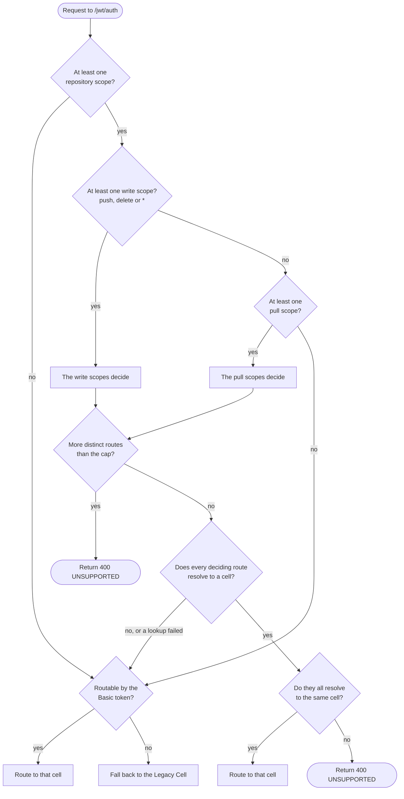

Topology Service がセルに配置したルートだけが、そのセルを指し示します。判断に用いるルートがどのセルにも解決されない場合は、他のルートが同じセルを示していてもリクエストの宛先は未決定のままです。検索の失敗時も同様であり、いずれも Legacy Cell などのアドレスで置き換えることはありません。どちらの場合も Basic トークンによる処理に進み、リポジトリスコープのないリクエストと同じ方法でルーティングします。

### ルーティングできない場合の応答 {#the-un-routable-response}

判断に用いるスコープが複数のセルに解決される場合、リクエストはまったく処理できず、ルーターは `400 UNSUPPORTED` を返します。異なるルート数の上限を超えた場合も、専用のメッセージを付けて同じ応答を返します。どちらも、スコープの集合がルーターには対応できないことを要求しているためです。

応答は、[OCI 形式のエラー本文](https://github.com/opencontainers/distribution-spec/blob/main/spec.md#error-codes)を伴う `400 Bad Request` です。

```http
HTTP/1.1 400 Bad Request
Content-Type: application/json

{
  "errors": [
    {
      "code": "UNSUPPORTED",
      "message": "a single token cannot cover repositories on different cells",
      "detail": {
        "scopes": ["repository:group-a/image:push", "repository:group-b/image:push"]
      }
    }
  ]
}
```

`UNSUPPORTED` は、処理できないのが*スコープの集合*であるという実際の状況を示します。認証情報にもユーザーの権限にも問題はありません。そのため、次の応答は適しません。

| ステータス | 適さない理由 |
| --- | --- |
| `401 UNAUTHORIZED` | トークン仕様では無効な認証情報のために予約されており、役に立たない再認証を促します。 |
| `403 DENIED` | ルーターが行っていない認可判断を行ったかのように示し、これらの応答が実際の権限エラーに紛れてしまいます。 |
| `5xx` | 一時的な障害であると示すため、成功し得ない再試行を促します。 |

応答自体には 2 つの要件があります。

- 空でない `errors` 配列とともに `Content-Type: application/json` を送信します。そうしなければ、メッセージがユーザーに届きません。
- `WWW-Authenticate` ヘッダーを付けないでください。`4xx` では、エラーではなく認証チャレンジとして解釈されます。

## フロー {#flows}

以下のフローは、Container Registry の[アップストリームのフロー](https://gitlab.com/gitlab-org/container-registry/-/tree/master/docs)に HTTP Router とセルを追加して作成しました。ルーティングに焦点を当てているため、レジストリの背後の詳細には古いものが含まれている可能性があります。

### ログイン {#login}

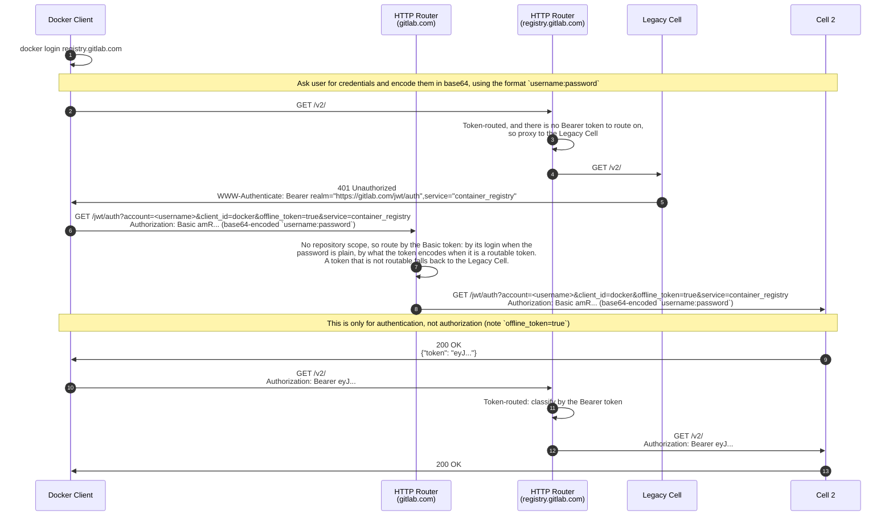

| ステップ # | メソッドとパス | 認可ヘッダー | 分類方法 |
| --- | --- | --- | --- |
| 2 | `GET /v2/` | なし | トークンでルーティングしますが、基準となるトークンがないため Legacy Cell にフォールバックします |
| 6 | `GET /jwt/auth?account=<username>&client_id=docker&offline_token=true&service=container_registry` | `Basic amR...` | リポジトリスコープなし。Basic トークンでルーティングし、通常のパスワードならログイン情報、ルーティング可能なトークンならトークンの内容を使い、それ以外は Legacy Cell に送ります |
| 10 | `GET /v2/` | `Bearer eyJ...` | トークンでルーティング。Bearer トークンで分類します |

### pull - プライベートリポジトリ - ログインなし {#pull---private-repository---without-login}

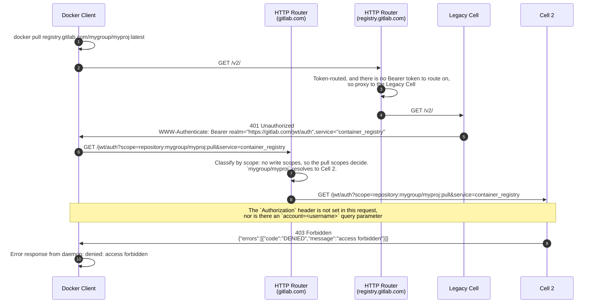

| ステップ # | メソッドとパス | 認可ヘッダー | 分類方法 |
| --- | --- | --- | --- |
| 2 | `GET /v2/` | なし | トークンでルーティングしますが、基準となるトークンがないため Legacy Cell にフォールバックします |
| 6 | `GET /jwt/auth?scope=repository:mygroup/myproj:pull&service=container_registry` | なし | スコープで分類。書き込みスコープがないため pull スコープで判断します |

### pull - プライベートリポジトリ - ログインあり {#pull---private-repository---with-login}

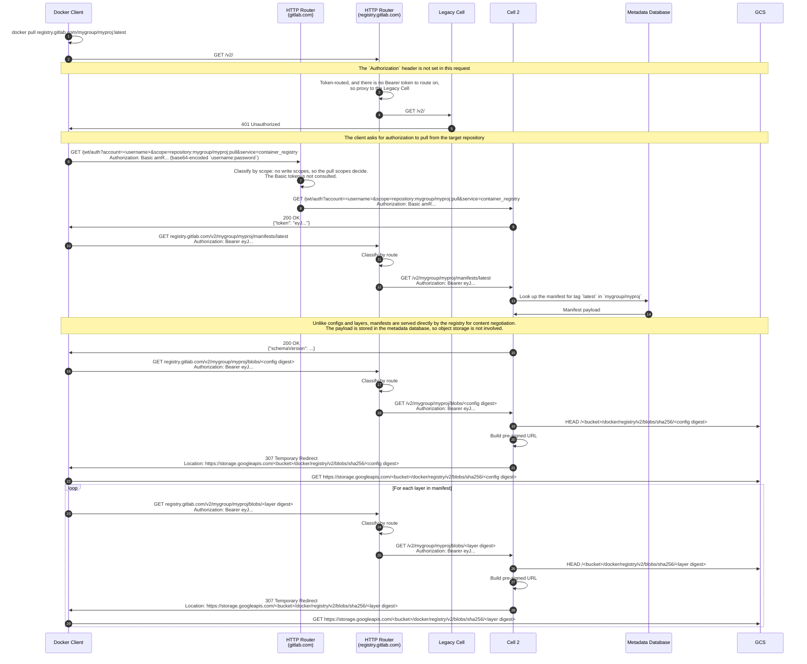

| ステップ # | メソッドとパス | 認可ヘッダー | 分類方法 |
| --- | --- | --- | --- |
| 2 | `GET /v2/` | なし | トークンでルーティングしますが、基準となるトークンがないため Legacy Cell にフォールバックします |
| 6 | `GET /jwt/auth?account=<username>&scope=repository:mygroup/myproj:pull&service=container_registry` | `Basic amR...` | スコープで分類。書き込みスコープがないため pull スコープで判断します。Basic トークンは一切参照しません |
| 10 | `GET /v2/mygroup/myproj/manifests/latest` | `Bearer eyJ...` | ルートで分類します |
| 16 | `GET /v2/mygroup/myproj/blobs/<config digest>` | `Bearer eyJ...` | ルートで分類します |
| 23 | `GET /v2/mygroup/myproj/blobs/<layer digest>`（ループ内でレイヤーごとに 1 回） | `Bearer eyJ...` | ルートで分類します |

### pull - パブリックリポジトリ - ログインなし {#pull---public-repository---without-login}

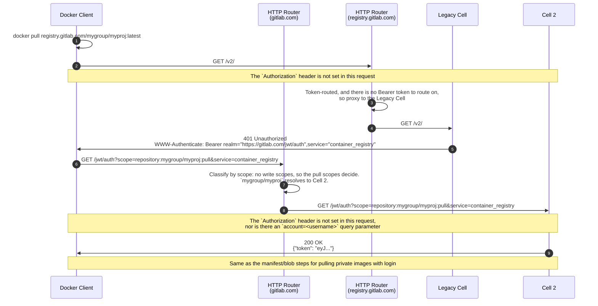

| ステップ # | メソッドとパス | 認可ヘッダー | 分類方法 |
| --- | --- | --- | --- |
| 2 | `GET /v2/` | なし | トークンでルーティングしますが、基準となるトークンがないため Legacy Cell にフォールバックします |
| 6 | `GET /jwt/auth?scope=repository:mygroup/myproj:pull&service=container_registry` | なし | スコープで分類。書き込みスコープがないため pull スコープで判断します |

### pull - パブリックリポジトリ - ログインあり {#pull---public-repository---with-login}

ログインなしの場合と同じ手順ですが、ここではステップ 6 に Basic トークンを含む認可ヘッダーと `account=<username>` クエリパラメータが含まれます。

分類方法は変わらず、pull スコープで判断し、Basic トークンは一切参照しません。[ルーティングアルゴリズム](#routing-algorithm-for-jwtauth)に従い、どのリポジトリスコープでも判断できない場合にのみ認証情報を参照しますが、`docker pull` でその状況になることはありません。

### push - プライベートリポジトリ - ログインなし {#push---private-repository---without-login}

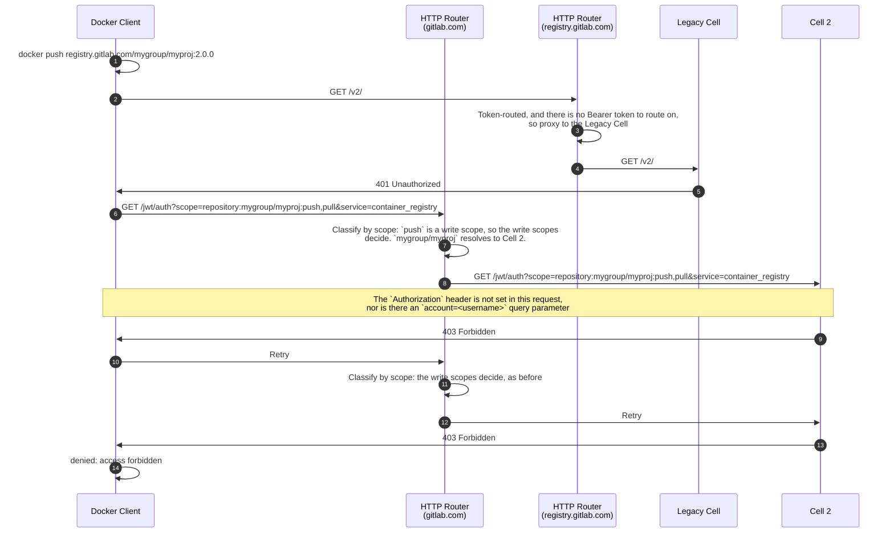

| ステップ # | メソッドとパス | 認可ヘッダー | 分類方法 |
| --- | --- | --- | --- |
| 2 | `GET /v2/` | なし | トークンでルーティングしますが、基準となるトークンがないため Legacy Cell にフォールバックします |
| 6 | `GET /jwt/auth?scope=repository:mygroup/myproj:push,pull&service=container_registry` | なし | スコープで分類。書き込みスコープで判断します（`push` が書き込みアクションです）。同じスコープ内の `pull` アクションはコンテキストであり、2 つ目の宛先ではありません |
| 10 | `GET /jwt/auth?scope=repository:mygroup/myproj:push,pull&service=container_registry`（再試行） | なし | スコープで分類。ステップ 6 と同じく書き込みスコープで判断します |

### push - プライベートリポジトリ - ログインあり {#push---private-repository---with-login}

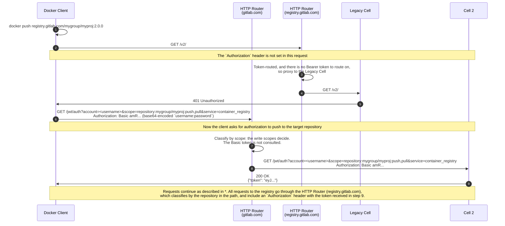

| ステップ # | メソッドとパス | 認可ヘッダー | 分類方法 |
| --- | --- | --- | --- |
| 2 | `GET /v2/` | なし | トークンでルーティングしますが、基準となるトークンがないため Legacy Cell にフォールバックします |
| 6 | `GET /jwt/auth?account=<username>&scope=repository:mygroup/myproj:push,pull&service=container_registry` | `Basic amR...` | スコープで分類。書き込みスコープで判断します（`push` が書き込みアクションです）。Basic トークンは一切参照しません |

`*` [*イメージのアップロード*](#uploading-the-image)を参照してください。

### push - パブリックリポジトリ - ログインなし {#push---public-repository---without-login}

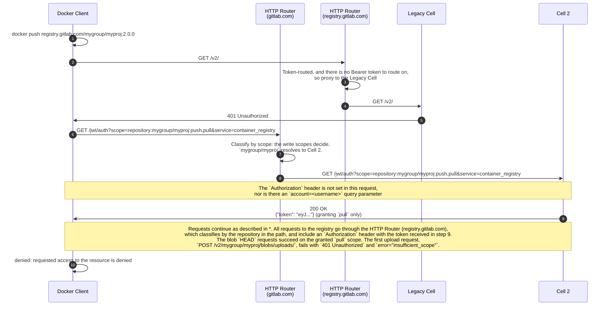

| ステップ # | メソッドとパス | 認可ヘッダー | 分類方法 |
| --- | --- | --- | --- |
| 2 | `GET /v2/` | なし | トークンでルーティングしますが、基準となるトークンがないため Legacy Cell にフォールバックします |
| 6 | `GET /jwt/auth?scope=repository:mygroup/myproj:push,pull&service=container_registry` | なし | スコープで分類。書き込みスコープで判断します（`push` が書き込みアクションです） |

Cell 2 がその後で書き込みを拒否する場合でも、書き込みスコープでルーティングを判断します。ルーティングが読み取るのは、クライアントが*要求した*スコープです。そのスコープを許可するかどうかは、1 つ下の層にあるセルが判断します。

### push - パブリックリポジトリ - ログインあり {#push---public-repository---with-login}

ログインしてプライベートリポジトリへ push する場合と同じ手順で、分類も同じです。書き込みスコープで判断します。

### イメージのアップロード {#uploading-the-image}

push フローの終点であるステップ 9 のトークン取得後に、アップロードが始まります。最初に blob、最後にマニフェストをアップロードします。どのリクエストもパス内で `mygroup/myproj` を指定するため、レジストリルーターはすべてをルートによって分類し、トークンを参照しません。

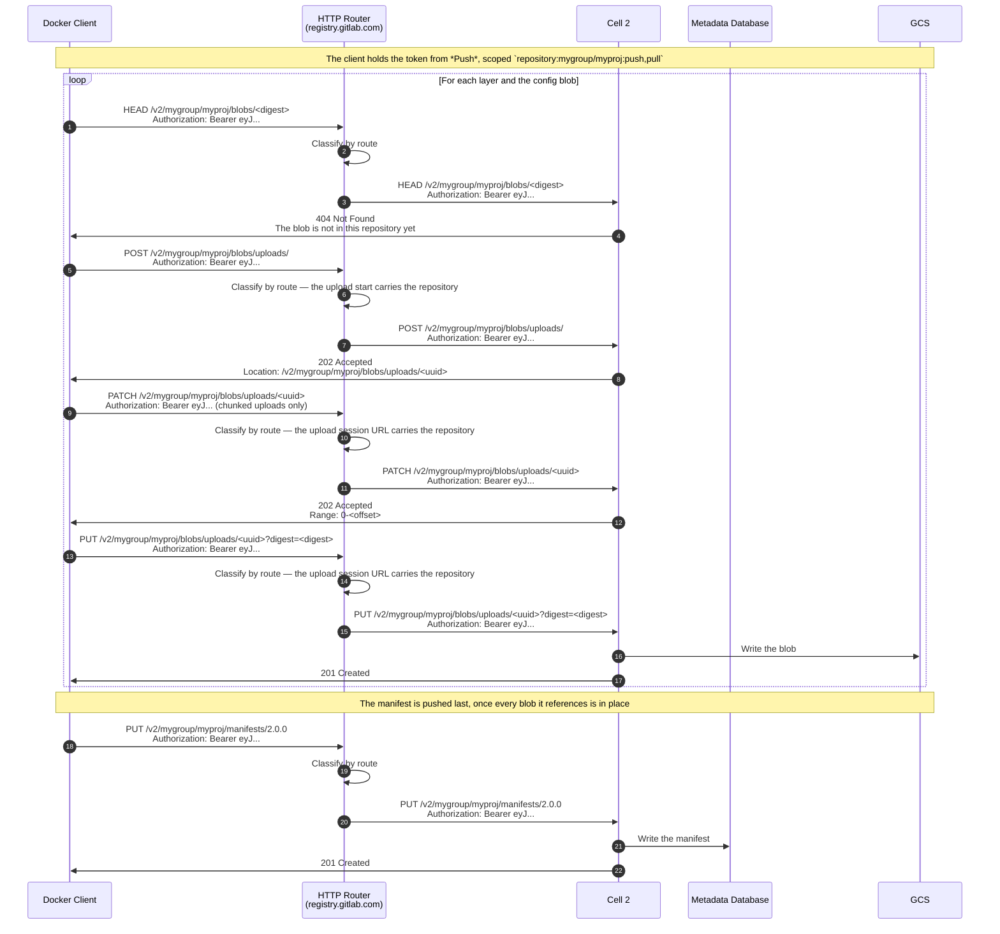

### リポジトリが同じセルにある場合のリポジトリ間 blob マウント {#cross-repository-blob-mounting-when-the-repositories-are-on-the-same-cell}

クライアントは、レイヤーのバイト列を再アップロードする代わりに、別のリポジトリからリンクするようレジストリに要求できます。`POST /v2/<target>/blobs/uploads/?mount=<digest>&from=<source>` です。クライアント自身が `from=` を指定する必要があり、レジストリ側でダイジェストによる検索は行いません。そのため、クライアントが以前にその blob を参照し、その場所を記録している場合にのみ行います（Docker と `containerd` はローカルのコンテンツストアで追跡します）。その記録がないクライアントは、通常どおりアップロードします。

マウントには `mygroup/target:push,pull` と `mygroup/source:pull` が必要なので、クライアントは **2 つ**の `scope=repository` パラメータを同時に要求します。ルーティングで重要なのはこの点であり、HTTP Router（gitlab.com）は 2 つのリポジトリを指定するリクエストを分類する必要があります。[ルーティングアルゴリズム](#routing-algorithm-for-jwtauth)は書き込みスコープだけで判断します。書き込みスコープは `mygroup/target:push,pull` だけなので、pull 専用のスコープは一切参照しません。ここでは両リポジトリが Cell 2 にあるため、マウントを処理できます。

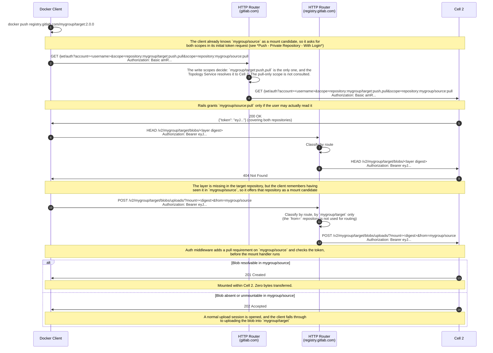

| ステップ # | メソッドとパス | 認可ヘッダー | 分類方法 |
| --- | --- | --- | --- |
| 2 | `GET /jwt/auth?account=<username>&scope=repository:mygroup/target:push,pull&scope=repository:mygroup/source:pull` | `Basic amR...` | スコープで分類。書き込みスコープは `mygroup/target:push,pull` だけなので、それで判断し、Topology Service が Cell 2 に解決します。pull 専用の `mygroup/source` スコープは参照しません |
| 6 | `HEAD /v2/mygroup/target/blobs/<layer digest>` | `Bearer eyJ...` | ルートで分類します |
| 10 | `POST /v2/mygroup/target/blobs/uploads/?mount=<digest>&from=mygroup/source` | `Bearer eyJ...` | `mygroup/target` だけを使い、ルートで分類します |

注：

- Rails がトークンに `mygroup/source:pull` を含めない場合、つまりユーザーに実際にソースへの読み取り権限がない場合、マウントは `401` を受け取ります。クライアントはマウントを断念して blob を通常どおりアップロードします。
- push の途中で初めてマウント候補を見つけるクライアントには、追加の 1 往復が発生します。マウントが `401` と、両リポジトリを指定する `WWW-Authenticate` のスコープ一覧で拒否され、クライアントはステップ 2 の 2 つのスコープをそのまま使ってトークンを再要求します。どちらの場合もルーターの分類は同じです。
- 2 つのスコープが 2 つのセルを指定していても、ここでは[ルーティングできない場合の応答](#the-un-routable-response)は発生し**ません**。そのチェックは、判断に用いるスコープの*間でのみ*行うためです。マウントの `POST` と `/jwt/auth` リクエストは、どちらもターゲットリポジトリによってルーティングされ、ソースリポジトリはいずれにも影響しません。両方が Cell 2 にある間は、その違いは表面化しません。配置が分かれる次のセクションを参照してください。

### リポジトリが異なるセルにある場合のリポジトリ間 blob マウント {#cross-repository-blob-mounting-when-the-repositories-are-on-different-cells}

ここではターゲットの `mygroup/target` が Cell 2 に、ソースの `othergroup/source` が Cell 3 にあります。Cell 2 にはソースリポジトリのレコードがなく、Cell 3 のオブジェクトストレージにもアクセスできないため、マウントが成功することはありません。このプロジェクトのスコープ内では、その制限を受け入れます。重要なのは、*どのように*失敗するかです。

ルーティングは同じセルの場合から変わりません。書き込みスコープは `mygroup/target:push,pull` だけなので、それだけで判断し、別セルのソースは判断に関与しません。不一致が表面化するのは、1 つ下の Rails の層です。Cell 2 は解決できないスコープを除外し、`mygroup/target` だけを対象とするトークンを発行するため、マウントは認可チェックに失敗します。クライアントはマウントを断念して blob を通常どおりアップロードします。つまり、**push 自体は引き続き成功し**、転送バイト数を減らす最適化だけが失われます。

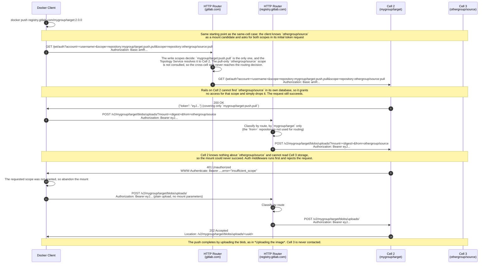

| ステップ # | メソッドとパス | 認可ヘッダー | 分類方法 |
| --- | --- | --- | --- |
| 2 | `GET /jwt/auth?account=<username>&scope=repository:mygroup/target:push,pull&scope=repository:othergroup/source:pull` | `Basic amR...` | スコープで分類。書き込みスコープは `mygroup/target:push,pull` だけなので、それで判断し、Cell 2 に解決します。pull 専用の `othergroup/source` スコープは参照しないため、2 つのセルを指定していてもリクエストは引き続きルーティング可能です |
| 6 | `POST /v2/mygroup/target/blobs/uploads/?mount=<digest>&from=othergroup/source` | `Bearer eyJ...` | `mygroup/target` だけを使い、ルートで分類します。`from=` のリポジトリはルーターから見えません |
| 11 | `POST /v2/mygroup/target/blobs/uploads/` | `Bearer eyJ...` | ルートで分類します |

注：

- ルーターはここでも前のセクションとまったく同じように動作し、ソースリポジトリが別の場所にあることを認識する必要はありません。異なるのは結果だけであり、その違いは Rails 内で生じます。
- 解決できないスコープを除外するのは Rails の通常の動作であり、Cells が追加するものではありません。[`Auth::ContainerRegistryAuthenticationService#process_repository_access`](https://gitlab.com/gitlab-org/gitlab/-/blob/master/app/services/auth/container_registry_authentication_service.rb)は、[`ContainerRegistry::Path#repository_project`](https://gitlab.com/gitlab-org/gitlab/-/blob/master/lib/container_registry/path.rb)を通じて各スコープを解決します。これはセル自身のデータベースに対する通常の `Project.where_full_path_in` クエリです。`#scopes` が `compact` によって `nil` を取り除くため、解決できたスコープを対象とするトークンとともに、引き続き `200` を返します。
- `401` に応じてトークンを再要求するクライアントは、同じトークンを受け取ります。Rails が同じ理由で解決できないスコープを除外するためです。その結果、さらに 1 往復後にマウントを断念します。
- 複数セルの混在チェックを判断に用いるスコープの間だけで行い、両種類のスコープにまたがって行わない理由はこれです。ここで[ルーティングできない場合の応答](#the-un-routable-response)を返すと、性能が低下しても動作する push が、失敗する push に変わってしまいます。
- クライアントから見ると、この失敗は、同じセル内でユーザーにソースリポジトリの読み取り権限がない場合と区別できません。

### Cell 2 のユーザーが Cell 3 のプライベートリポジトリからイメージを pull する場合 {#user-from-cell-2-pulling-an-image-from-a-private-repository-on-cell-3}

[`JwtController#authenticate_project_or_user`](https://gitlab.com/gitlab-org/gitlab/-/blob/master/app/controllers/jwt_controller.rb)では、認可より先に認証を実行します。そのため Cell 3 は、リポジトリを確認する前に、認識していない認証情報を `401 UNAUTHORIZED` で拒否します。一方、同じリポジトリを要求する匿名クライアントは、`Auth::ContainerRegistryAuthenticationService` から `403 DENIED` を受け取ります。

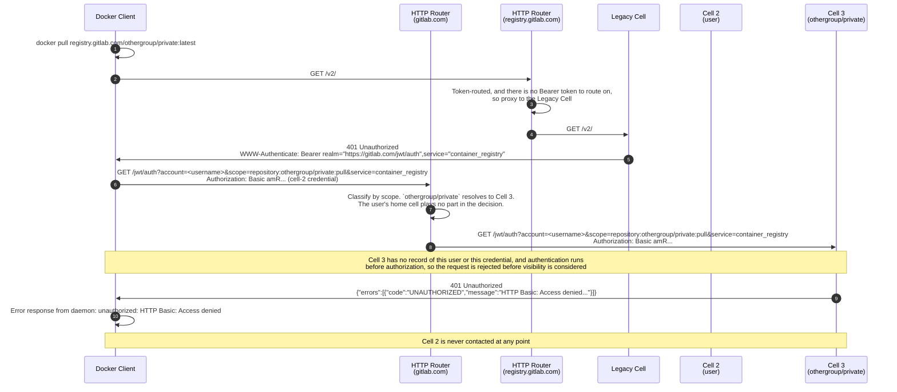

| ステップ # | メソッドとパス | 認可ヘッダー | 分類方法 |
| --- | --- | --- | --- |
| 2 | `GET /v2/` | なし | トークンでルーティングしますが、基準となるトークンがないため Legacy Cell にフォールバックします |
| 6 | `GET /jwt/auth?account=<username>&scope=repository:othergroup/private:pull&service=container_registry` | `Basic amR...` | スコープで分類。pull スコープで判断し、`othergroup/private` はユーザーのホームセルではなく Cell 3 に解決されます |

### Cell 2 のユーザーが Cell 3 のパブリックリポジトリからイメージを pull する場合 {#user-from-cell-2-pulling-an-image-from-a-public-repository-on-cell-3}

リポジトリを公開にした、同じセル間の構成です。ログアウト状態では、[*pull - パブリックリポジトリ - ログインなし*](#pull---public-repository---without-login)とまったく同じように動作するため、このセクションではログイン済みのクライアントだけを扱います。Cell 3 は、検証できない Cell 2 の認証情報を受け取ります。

現在の実装では認証を先に実行するため、可視性を参照する前に `401` を返します。つまり、**ログアウト状態では動作するパブリックイメージの pull が、ログインすると失敗します**。これは、この設計の既知の制限です。

[*GitLab - 公開で読み取り可能なリポジトリへの匿名フォールバック*](#gitlab---anonymous-fallback-for-publicly-readable-repositories)の提案により、この制限を解消できますが、その提案は暫定的なものであり、この設計で実現を確約する内容には含まれません。図では、現在返される `401` と、提案により可能になる匿名での権限付与の両方を示します。

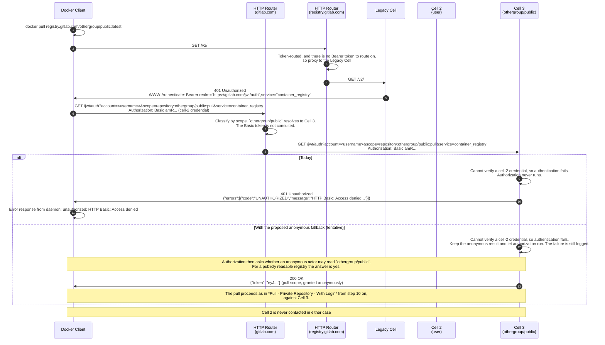

| ステップ # | メソッドとパス | 認可ヘッダー | 分類方法 |
| --- | --- | --- | --- |
| 2 | `GET /v2/` | なし | トークンでルーティングしますが、基準となるトークンがないため Legacy Cell にフォールバックします |
| 6 | `GET /jwt/auth?account=<username>&scope=repository:othergroup/public:pull&service=container_registry` | `Basic amR...` | スコープで分類。pull スコープで判断し、`othergroup/public` はユーザーのホームセルではなく Cell 3 に解決されます |

## 実装 {#implementation}

### ルーティング可能なトークン {#routable-tokens}

認証情報は、Legacy Cell へのフォールバックの直前にルーターが使う最後の判断手段です。スコープで判断できないすべての `/jwt/auth` リクエスト（[ルーティングアルゴリズム](#routing-algorithm-for-jwtauth)を参照）と、パスにリポジトリを含まないすべての `registry.gitlab.com` エンドポイントで判断に使います。ルーティング可能なトークンの形式でない認証情報はエラーにせず、通知なしで Legacy Cell にフォールバックします。有効な base64 でない Basic ヘッダーや、`username:password` の区切りがない Basic ヘッダーもこれに含まれます。一方、ルーティング可能なトークンの形式でもペイロードが壊れている認証情報は、`400` で拒否します。ペイロードが JSON でない CI ジョブトークンの場合は `500` です。これは、ルーターが `Bearer`、`PRIVATE-TOKEN`、`JOB-TOKEN` ヘッダー内の同じトークンをすでに扱っている方法に一致します。次のトークンはすべて、ルーティング可能にする必要があります。

| 認証情報 | 現在ルーティング可能か |
| --- | --- |
| CI ジョブトークン | いいえ |
| OAuth アクセストークン | いいえ |
| パーソナルアクセストークン | はい |
| デプロイトークン | いいえ |
| レジストリの Bearer トークン | いいえ |
| ステートレスアクセストークン | いいえ |

上のフローは、その目標状態を前提に描いています。Basic トークンや Bearer トークンによるルーティングのすべてのステップは、認証情報がすでにルーティング可能であると仮定しています。各行が*はい*になるまでは、ルーターがその認証情報をデコードできず、リクエストは代わりに Legacy Cell にフォールバックします。Legacy Cell は別のセルが発行した認証情報を検証できないため、そのリクエストは `401` で失敗します。各行は最適化ではなく、Legacy Cell 外のユーザーを処理するための前提条件です。

通常のパスワードは対象外なので、この表に行がありません。ルーターはパスワードをデコードせず、一緒に送信されたログイン情報によってルーティングします（[*Basic トークン：`username:password`*](#basic-token-usernamepassword)を参照）。この分岐は、表の対応状況を待つ必要がありません。

ルーティング可能なトークンであっても、HTTP Router にそれをデコードするルールが用意されて初めてルーティングできます。セル ID を含むトークンでもルールがなければ、何も含まないトークンと同じように Legacy Cell にフォールバックします。ステートレスアクセストークンが*いいえ*なのはこのためです。`c` を含んでいますが、ルーターにはまだ `glsat-` ルールがありません。このトークンは `duo_workflow_use_token_issuer` が有効な間だけ発行されるため、そのフラグのロールアウト時に対応の不足が問題になります。`/jwt/auth` で認証できる新しい認証情報を追加する場合は、必ずこの表に行を追加し、対応する HTTP Router ルールとともにリリースします。ルーティング可能になるまでは、そのプレフィックスを通常のパスワードとして扱わないためのガードにも含め、ルーターが一緒に送信されたログイン情報を検索しないようにします。

### registry.gitlab.com 専用の HTTP Router インスタンス {#a-separate-http-router-instance-for-registrygitlabcom}

`registry.gitlab.com` と `gitlab.com` は、異なるアルゴリズムで分類する異なるトラフィックを扱います。そのため、上のシーケンス図では別々のルーターとして示しています。

HTTP Router は、すでにこれをサポートしています。同じコードベースを実行する Cloudflare Workers を、それぞれ独立して複数の [Workers](https://gitlab.com/gitlab-org/cells/http-router/-/blob/main/docs/workers.md)としてデプロイし、Wrangler の構成とそれらを指す Cloudflare ルートだけを変えます。各 Worker は、1 つの環境内で 1 つのトラフィックスコープを担当します。新しい `registry` スコープには環境ごとに 1 つの Worker を用意し、本番環境では `registry.gitlab.com/*` にバインドします。この Worker がそのトラフィックを担当し、`catchall` Workers がそれ以外を担当することで、レジストリは独自のデプロイ、エラーバジェット、ダッシュボードを持てます。

分割の基準は機能領域ではなくホスト名であることに注意してください。`/jwt/auth` はレジストリフローの一部ですが、`gitlab.com` にあるため `catchall` Workers に残ります。

### HTTP Router に必要な追加事項 {#what-the-http-router-must-add}

[ルーティングアルゴリズム](#routing-algorithm-for-jwtauth)の要件は、現在の宣言的ルールセットで表現できる範囲を超えています。現在のルールは単一の `scope` パラメータに正規表現でマッチして分類しますが、このアルゴリズムでは、リクエストが持つすべてのスコープを読み、判断に用いるものを選んで、それぞれを解決する必要があります。ルールセットの上にこれを実装することも、このプロジェクトの一部です。

また、ルーターがこれまで行っていなかった処理も必要です。現在のルーターは分類とプロキシ処理を行いますが、[ルーティングできない場合の応答](#the-un-routable-response)では、どのセルにも接続せず、JSON 本文を伴う `400` を返して自らリクエストに応答します。

ただし、判断に用いるスコープの解決には Topology Service の新機能は必要ありません。`Classify` はクレームのリストを受け取りますが、それを順序付きのフォールバックチェーンとして扱い、最初に一致したクレームを返すため、1 回の呼び出しで複数のスコープを互いに独立して解決することはできません。そのためルーターは、判断に用いるスコープごとに単一クレームの `Classify` を発行し、並行して呼び出します。リクエストのスコープ数にかかわらず、実際の所要時間は 1 往復のままであり、どのセルにも解決されないスコープは、その呼び出し自体の結果として返ります。

2 つの制限によって、この並列呼び出しが増幅攻撃の経路になるのを防ぎます。`/jwt/auth` は、クライアントがトークンを*取得する*場所であるため、認証前にアクセスできます。そのため、誰でも好きな数の `scope` パラメータを含むリクエストを送信でき、放置すると、その 1 つずつがセル群全体のルーティングを支える Topology Service へのクレーム検索になります。

- **最初に重複を排除します。** スコープはリポジトリパスのトップレベルのルートで分類するため、`repository:group-a/img1:pull` と `repository:group-a/img2:pull` は、2 回ではなく 1 回の検索になります。ルーターは、判断に用いるスコープ間で*異なる*ルートを解決するため、1 つのグループから複数のイメージを pull するビルドのような通常の複数スコープのリクエストを、1 回の呼び出しにまとめられます。
- **次に、異なるルート数に上限を設け**、超えた場合は [`400 UNSUPPORTED`](#the-un-routable-response)を返します。Topology Service では、同じ理由で、公開するすべての複数クレーム用のエントリポイントにすでに上限を設けています。`Classify` は 5 個を超えるクレームのフォールバックチェーンを拒否し、`ListRecords` でもクレームの種類に同様の制限を設けています。

上限は定数ではなく、ルーターの構成に持たせます。異なるルートがすべて同じセルにあるリクエストは、正当にルーティング可能なので、上限が低すぎると実際のトラフィックを拒否してしまいます。また、現在のレジストリトラフィックからは、適切な上限は分かりません。最初は 10 としてリリースし、リクエストごとの異なるルート数をメトリクスとして出力し、その証拠に基づいて制限を厳しくします。

並列呼び出しでは、トポロジーをリクエストごとではなくルートごとに読み取るため、セル移動の前後で解決されたルートが食い違い、再試行すれば解消する `400 UNSUPPORTED` が発生することもあります。`Classify` はすでに、クレームストアを 1 回バッチ読み取りしてフォールバックチェーン全体を解決し、その後で最初の一致を選ぶルールを適用しています。そのため、クレームごとに 1 件の結果を返す RPC は、現在のストアの動作に小さな処理を追加するだけで実現でき、不一致が生じる時間差をなくして並列呼び出しを 1 回の読み取りにまとめられます。しかし、重複排除後の実際のリクエストに含まれる異なるルートは 1 つか 2 つであり、恒久的な API を追加するほどの理由にはなりません。競合や並列呼び出しの量が実際に問題になる場合に再検討します。

### Topology Service {#topology-service}

#### レジストリアドレスの構成 {#registry-address-configuration}

`registry_address` は新しいキーです。Topology Service 構成の各セルエントリに、既存の `address` に加え、そのセルのローカルレジストリのアドレスを追加します。

```toml
[[cells]]
id = 1
address = "my.cell-1.example.com"
registry_address = "registry.my.cell-1.example.com"
```

このキーは任意であり、レジストリのないセルでは未設定にします。`address` と同じく、値は任意の `:port` を伴うホストであり、構成どおりに呼び出し元へ返します。構成の検証では、未設定の値を除き、2 つのセルで同じ `registry_address` を共有することを拒否します。`address` と異なり、逆引き用のインデックスは作成し**ません**。mTLS デコーダーは `address` を通じてクライアント証明書の CN をセルのロールにマッピングします。そのロールはクレーム名前空間内の当該セルの範囲に対する書き込み権限を持つため、レジストリのホスト名を示す証明書にその権限を継承させてはいけません。`CellInfo` にも同じフィールドを追加し、`GetCells` でも公開します。

#### Classify RPC の応答 {#classify-rpc-response}

`Classify` は、解決したセルのアドレスを含む `proxy` メッセージとともに `PROXY` アクションを返します。このプロジェクトでは、どちらかのアドレスを要求する方法を追加する代わりに、そのメッセージへ **2 つ目のアドレスフィールド**を追加します。`ProxyInfo` に `registry_address` を追加し、セルの新しい構成キーから設定して、呼び出し元が必要なフィールドを読み取ります。`registry` Workers は `proxy.registry_address` を読み、Web トラフィックをルーティングするものはすべて、引き続き `proxy.address` を読みます。`ClassifyRequest` は変更しません。クレームチェーン、セッションプレフィックス、セル ID、`FIRST_CELL` のすべての `Classify` 経路でこのフィールドを設定するため、トークンによるルーティングを含め、`registry` Workers がどのようにセルを解決してもレジストリアドレスが返ります。

```proto
// The network endpoints of the target cell.
message ProxyInfo {
  // Existing field, unchanged. The address of the target cell, as a host with
  // an optional :port.
  string address = 1;

  // New. The address serving the container registry for the target cell, as
  // a host with an optional :port. Empty when the cell has no registry
  // configured — callers resolving a registry endpoint must treat an empty
  // value as a miss and must not fall back to `address`, which serves web
  // traffic on a different endpoint.
  string registry_address = 2;
}
```

レジストリには新しい検索は必要なく、検索ですでに一致したセルから別のアドレスを取り出すだけで十分です。[上記の並列呼び出し](#what-the-http-router-must-add)では、判断に用いる各スコープを単一クレームの `Classify` で解決します。これは `catchall` Workers が `/jwt/auth` に対してすでに行うクレーム検索と同じです。そのため `ClassifyRegistry` RPC を追加しても、`type`／`value` とクレームチェーンの両方を含む入力全体を重複させるだけで、新しい内容は表現しません。既存の呼び出しから 2 つ目のアドレスを取得する方法は 2 つに絞られます。`ClassifyRequest` に `target` 引数（`web` または `registry`）を追加して `proxy.address` に含めるアドレスを選ぶ方法と、2 つ目のフィールドに並べて含める方法です。次の 2 点が、2 つ目のフィールドを選ぶ決め手になります。

- **1 つのフィールドで 2 つのエンドポイントを表すと、フェイルクローズにできません。** 新しいルーターが古いサーバーにレジストリのターゲットを要求すると、引数は不明なフィールドとして無視され、レジストリアドレスという名前で *Web* アドレスが返り、どこにもログが残りません。応答で実際に採用したターゲットも返さない限り、この誤ルーティングは検出できないため、引数を使う方法でも結局は 2 つ目のフィールドが必要になります。フィールドを分けると、問題を検出するのではなく取り除けます。古いサーバーでは単に `proxy.registry_address` が存在せず、ルーターが空文字列を読み取り、リクエストはフェイルクローズで失敗します。
- **`target` はリクエスト固有の情報を持ちません。** レジストリには、`registry.gitlab.com/*` にバインドされた[専用の HTTP Router Workers](#a-separate-http-router-instance-for-registrygitlabcom)があります。そのため、これらの Workers の `Classify` 呼び出しはすべてレジストリアドレスを求め、`catchall` Workers の呼び出しはすべて Web アドレスを求めます。デプロイ全体で一定の値は、リクエストパラメータではなく構成です。

応答フィールドを使う場合に失うのは、サーバー側での未検出という結果です。`Classify` は呼び出し元がどちらのアドレスを求めているか分からないため、`registry_address` のないセルは `NotFound` ではなく、そのフィールドが空の `PROXY` を返します。成功した結果は、`NotFound` よりもおよそ 1 桁長くキャッシュされます。`ClassifyPages` は、一致したセルに `pages_address` がなければ未検出として応答しますが、それができるのは、専用 RPC なので呼び出し元がどのアドレスを求めているか分かるためです。両方を扱う RPC にはできません。代わりに、未検出の処理を呼び出し元が担います。そのため、この契約は、生成されるすべてのクライアントに引き継がれる proto のコメントに記載します。いずれかの処理が読み取る**前に**すべてのセルで `registry_address` を構成しておけば、この状況自体を防げるため、そのロールアウト手順はフィールドの追加より先に行います。

それ以外の `ClassifyPages` は現状を維持します。クレームだけのフォールバックチェーンを解決し、フラットな `pages_address` を返すため、同じ入力に対する `Classify` からの単なる取り出しではなく、すでにトラフィックを処理しています。これを `ProxyInfo` に作り替えることは、このプロジェクトに不要な変更です。ここで定める前例は今後に向けたものです。セル内の別のアドレスを追加する場合は、3 つ目の RPC ではなく `ProxyInfo` の新しいフィールドにします。

### GitLab - 公開で読み取り可能なリポジトリへの匿名フォールバック {#gitlab---anonymous-fallback-for-publicly-readable-repositories}

> **状態：暫定案。** このセクションは提案であり、この設計で実現を確約する内容ではありません。
> `JwtController` に対する概念実証でこの方法を確認した後、再検討します。それまでは、ログイン済みのユーザーが
> 別のセルからパブリックイメージを pull すると、`401` を受け取ります。

リポジトリスコープによるルーティングでは、セルが検証できない認証情報を含む `/jwt/auth` リクエストを日常的に受け取ります。認証情報がユーザーのホームセルに属するためです。`JwtController` は認可より先に認証するため、そのままではリポジトリの可視性を参照する前に `401` を返します。その結果、ログアウトしていれば問題なく取得できるパブリックイメージを、ログイン済みのユーザーが pull できなくなります。つまり、**ログインするとパブリックイメージの pull が失敗します**。[*Cell 2 のユーザーが Cell 3 のパブリックリポジトリからイメージを pull する場合*](#user-from-cell-2-pulling-an-image-from-a-public-repository-on-cell-3)を参照してください。

提案では、GitLab Rails が検証できない認証情報を匿名の結果へフォールバックさせ、公開で読み取り可能なリポジトリについては、提示された認証情報にかかわらず `pull` を許可します。匿名の経路自体はすでに存在し、どちらの可視性にも正しく応答します。パブリックリポジトリには `pull` を許可し、プライベートリポジトリには `403 DENIED` を返します。ただし、認証が先に `401` を返すため、その経路に到達しません。

注意すべき主な実装上の詳細は次のとおりです。

- **フォールバックを別のセルに属する認証情報に限定します。** *すべての*認証失敗を匿名として扱うと、すべての GitLab 環境で動作が変わります。パスワードを誤入力した場合、パブリックリポジトリでは利用可能な匿名トークンが返り、プライベートリポジトリでは現在の `401` の代わりに `403` が返るようになります。ルーティング可能な認証情報には、すでにペイロードにホームセルの ID が含まれるため、形式が正しく、別のセルで発行された認証情報の場合にのみフォールバックできます。セル ID を含めない単一セルの環境では、現在の動作を維持します。これは、対象の認証情報が[ルーティング可能なトークン](#routable-tokens)に含まれることを前提とします。
- **レート制限を引き続き適用する必要があります。** `/jwt/auth` を、制限なしに認証情報を推測する手段にしてはいけません。既存の IP 禁止と失敗の集計を、フォールバックよりも引き続き優先する必要があります。
- **認証から抜ける経路は 1 つではありません。** 失敗時の分岐は明らかですが、パーソナルアクセストークンがない場合は、代わりに例外が発生し、コントローラーがそれを同じ `401` に変換します。
- **書き込みスコープを拡大してはいけません。** 匿名の権限は読み取り専用なので、フォールバックで許可できるのは最大でも `pull` です。これは、別途強制する必要はなく、既存の認可コードによって実現されます。
- **失敗は認証ログに残します。** セルをまたぐフォールバックを、通知なしの成功として扱わず、引き続き可視化します。

### セルの構成要件 {#cell-configuration-requirements}

#### Container Registry の構成 {#container-registry-configuration}

各セルの Container Registry は次のように構成する必要があります。

1. **公開エンドポイント**：すべてのセルは公開ホストとして `registry.gitlab.com` を使用します
2. **内部通信**：各セルはセルからレジストリへの通信に内部 URL（`api_url`）を使用します
3. **セル固有のキー**：各セルは JWT トークンの検証用に独自の署名キーを持ちます
4. **内部通知**：レジストリは内部ネットワークを使用してセルの Rails に通知を送信します

#### GitLab Rails の構成 {#gitlab-rails-configuration}

GitLab Rails 側で必要な構成変更は最小限です。

```yaml
# GitLab Rails configuration for Cell
gitlab:
  registry:
    enabled: true
    host: registry.gitlab.com  # Public endpoint
    port: 443
    api_url: http://registry-cell-1.internal:5000/  # Internal registry URL
    key: /path/to/cell-1-registry.key  # Same key as registry for JWT validation
    issuer: cell-1-gitlab-issuer  # Cell-specific issuer
```

### ネットワークアーキテクチャ {#network-architecture}

HTTP Router がすべての外部ルーティングを処理し、Cells は内部ネットワークを使用します。

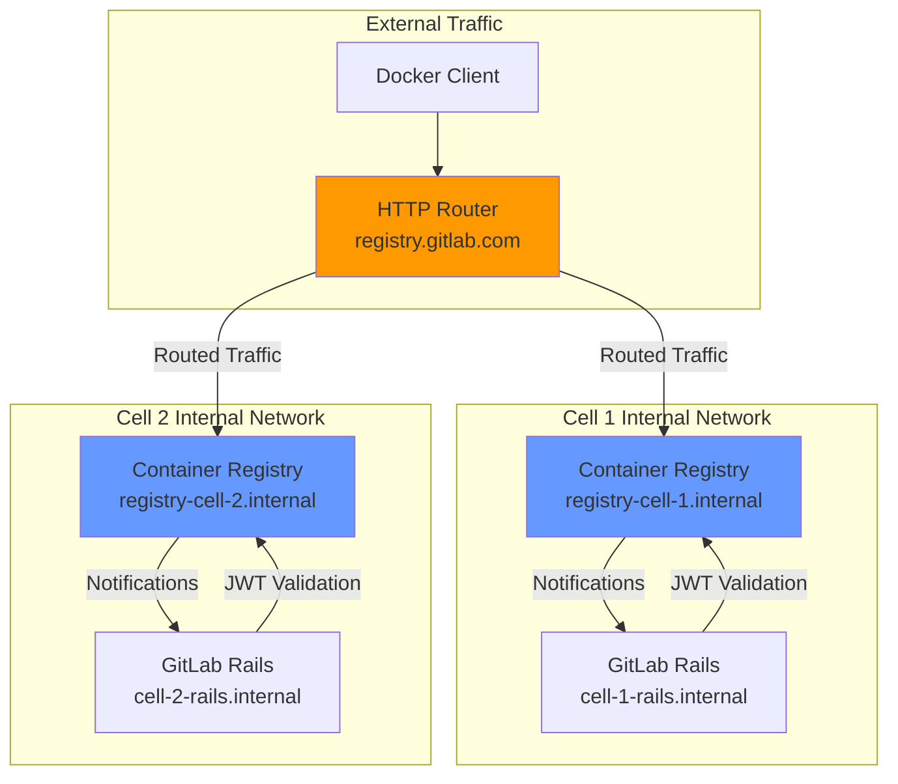

## 関連ドキュメント {#related-documents}

- [GitLab Cells のインフラストラクチャアーキテクチャ](infrastructure/_index.md)
- [HTTP Router のルート（`routes.ts`）](https://gitlab.com/gitlab-org/cells/http-router/-/blob/main/src/routes.ts)
- [HTTP Router の構成](https://gitlab.com/gitlab-org/cells/http-router/-/blob/main/docs/config.md)
- [HTTP Router のルールセット](https://gitlab.com/gitlab-org/cells/http-router/-/tree/main/config/ruleset)
- [Topology Service の実装](https://gitlab.com/gitlab-org/cells/topology-service)
- [Container Registry の認証リクエストフロー](https://gitlab.com/gitlab-org/container-registry/-/blob/master/docs/auth-request-flow.md) - 最も正確な Docker フローのドキュメント
- [Container Registry のリポジトリ間 blob マウント](https://gitlab.com/gitlab-org/container-registry/-/blob/master/docs/cross-repository-blob-mount.md)
