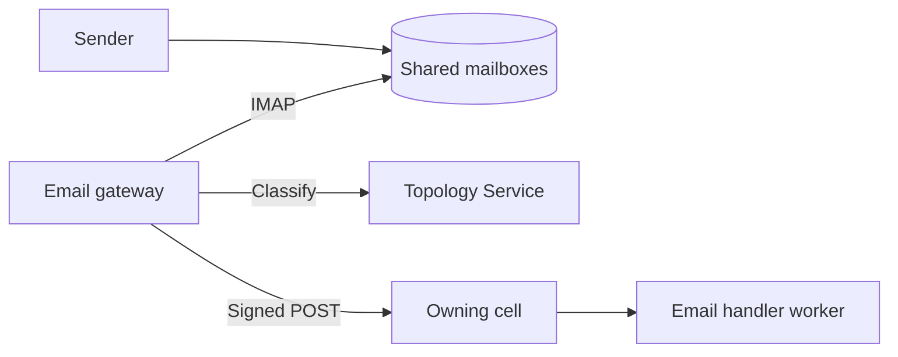

{}
このドキュメントの設計は実装済みです。メールゲートウェイサービスは GitLab.com にまだデプロイされていません。
デプロイの進捗は[作業項目 604170](https://gitlab.com/gitlab-org/gitlab/-/work_items/604170)で追跡しています。
{}

## 1. 定義 {#1-definition}

ユーザーはメールで Issue を作成し、コメントを追加し、Service Desk に問い合わせることができます。
GitLab はプロジェクト、Issue、Service Desk に、`incoming+<key>@example.com` のようにサブアドレスにキーを含む受信用メールアドレスを割り当てます。
GitLab はこのキーを使って、メールの用途を判別します。
Service Desk は、プロジェクトが設定するカスタムメールアドレスでもメールを受信できます。

GitLab.com は、`incoming_email` と `service_desk_email` として設定された 2 つの共有メールボックスから、これらのメールを読み取ります。
[`mail_room`](https://gitlab.com/gitlab-org/ruby/gems/gitlab-mail_room) がメールボックスをポーリングし、各メールを GitLab の内部 API に POST します。メールはこの API で処理します。

Cells では、メールの宛先となるプロジェクトや名前空間がどの Cell に属していても、メールはすべて同じ共有メールボックスに届きます。
1 つの Cell 内で動作する `mail_room` が処理できるのは、その Cell 上のリソース宛てのメールだけです。

## 2. データフロー {#2-data-flow}

1. メールゲートウェイは各メールボックスへの IMAP IDLE 接続を維持し、新着メールを到着時に取得します。
1. メールごとに、ゲートウェイは宛先ヘッダーからキーの候補を読み取ります。
   GitLab アプリケーションと同じ [`gitlab-email_handler`](https://gitlab.com/gitlab-org/ruby/gems/gitlab-email_handler) gem を使って、候補をオフラインで解析します。
1. ゲートウェイは、Cell を特定できるまで、候補を順に Topology Service の `Classify` RPC に渡します。
1. ゲートウェイは ES256 JWT で署名し、未加工のメールをその Cell の内部 API `/api/v4/internal/mail_room/<mailbox>` に POST します。
1. Cell は自身が保持する公開鍵で JWT を検証し、従来どおりにメールを処理します。

## 3. 設計 {#3-design}

### 全 Cell で 1 つのメールゲートウェイを使用 {#a-single-email-gateway-for-all-cells}

[メールゲートウェイ](https://gitlab.com/gitlab-org/cells/email-gateway)は Cell 群の手前で、フリート全体に対して 1 つだけ動作します。
`gitlab-mail_room` gem を使用するスタンドアロンの Ruby サービスで、Rails 環境は読み込みません。

各 Cell がチャートを個別にデプロイするため、ゲートウェイは GitLab Helm チャートに含めません。
フリート全体で共有するサービスをこのチャートに含めると、1 つを除くすべての Cell で無効化し、残った Cell から設定を読み取ることになります。これは望ましくありません。
議論については、[チャートのマージリクエスト 5384](https://gitlab.com/gitlab-org/charts/gitlab/-/merge_requests/5384)を参照してください。

### 宛先の特定 {#identifying-the-target}

`gitlab-email_handler` gem は、キーから宛先を割り出します。
次にゲートウェイが Topology Service に宛先を照会して分類します。

| メール | 宛先 |
| ----- | ------ |
| プロジェクト ID をエンコードしたキー | プロジェクト ID |
| 名前空間 ID をエンコードしたパーティション対応の返信キー | オフラインでデコードした名前空間 ID |
| プロジェクトパスを含むレガシーキー | 最上位の名前空間のルート |
| Service Desk のカスタムメールアドレス | 登録済みのカスタムメールアドレス |
| 不透明な Service Desk プロジェクトキー | 登録済みのプロジェクトキーアドレスのスラッグ |

`ServiceDeskSetting` は `custom_email` と `project_key_address_slug` を Topology Service に登録します。これにより、ゲートウェイはそれらを所有する Cell を特定できます。

### 宛先を特定できないメール {#email-that-cant-be-identified}

名前空間をエンコードしていないレガシーの返信キーなど、対応する Cell をまだ特定できないキーがあります。
ゲートウェイはデフォルトの（最初の）Cell を Topology Service に問い合わせ、これらのメールをそこに転送します。

`cell.email_forwarding.route_unidentified_to_default_cell` 設定でこのフォールバックを無効にすると、ゲートウェイはこれらのメールを破棄します。
このフォールバックは一時的なもので、すべてのキーを解決できるようになれば削除できます。

### 配信と再試行 {#delivery-and-retries}

`mail_room` は、配信が成功した場合にのみメールをメールボックスから削除します。
Cell に到達できない場合や Cell がメールを拒否した場合、ゲートウェイは失敗を報告します。メールはメールボックスに残り、その後のポーリングで配信を再試行します。
デフォルトの Cell が利用できない場合も、メールの配信を再試行します。
ゲートウェイが意図的に破棄するメールは削除します。

### 認証 {#authentication}

既存の `mail_room` は、GitLab と共有するシークレットでリクエストに署名します。
すべての Cell がシークレットを共有すると、侵害された Cell から他のすべての Cell へのリクエストを偽造できてしまいます。
そこでゲートウェイは ES256 の秘密鍵で署名し、各 Cell は対応する公開鍵だけを保持します。

JWT の `kid` ヘッダーには、鍵の [RFC 7638](https://www.rfc-editor.org/rfc/rfc7638) サムプリントが入ります。Cell はこれに一致する公開鍵を選びます。
Cell は複数の公開鍵を同時に信頼できるため、ゲートウェイが新しい鍵で署名を始める前に、その公開鍵を信頼するように設定できます。
Cell は共有シークレットと公開鍵の両方を同時に受け付けます。

GitLab チャートは `global.appConfig.incomingEmail.publicKeyFiles` で公開鍵を設定します。
詳しくは、[チャートのマージリクエスト 5408](https://gitlab.com/gitlab-org/charts/gitlab/-/merge_requests/5408)を参照してください。

### ロールアウト {#rollout}

既存の `mail_room` とゲートウェイが同じメールボックスに同時にアクセスする事態を避けるため、各メールボックスを短時間でゲートウェイへ切り替える予定です。

## 4. 評価 {#4-evaluation}

### 4.1. メリット {#41-pros}

- メールの転送先はキーで決まるため、組織が別の Cell に移動しても受信用メールアドレスは変わりません。
- GitLab.com では Cell ごとにメールボックスを用意せず、全体で 2 つのメールボックスを使用できます。
- Cell が保持するのは公開鍵だけなので、侵害された Cell から他の Cell 宛てのメールを偽造できません。
- GitLab アプリケーションとゲートウェイは同じ gem でキーを解析します。

### 4.2. デメリット {#42-cons}

- 1 つのサービスが、すべての Cell のメールを処理します。
  ゲートウェイの停止中は、復旧するまでメールがメールボックスに留まります。
- すべてのキーを解決できるようになるまでは、宛先を特定できないメールの処理はデフォルトの Cell へのフォールバックに依存します。
- キーの解析を変更するには、gem をリリースし、GitLab アプリケーションとゲートウェイの両方でバージョンを更新する必要があります。

### 4.3. 検討した代替案 {#43-alternatives-considered}

- Cell ごとにメールボックスを用意する案。
  組織が別の Cell に移動するたびに、受信用メールアドレスが変わります。
- すべての Cell の `mail_room` が共有メールボックスを読み取る案。
  すべての Cell がすべてのメールを読み取り、自身が所有するリソース宛てのメールだけを処理できます。
- GitLab チャートにサブチャートを設ける案。
  チャートは Cell ごとにデプロイするため、この案は不採用です。[全 Cell で 1 つのメールゲートウェイを使用](#a-single-email-gateway-for-all-cells)を参照してください。
- [メール取り込みの設計ドキュメント](/handbook/engineering/architecture/design-documents/email-ingestion/)で提案されているように、Sidekiq ジョブでメールを取り込む案。
  ジョブは Cell 内で動作するため、Cell ごとに実行することによる同じ問題が生じます。

## 参考資料 {#references}

- サービス [`gitlab-org/cells/email-gateway`](https://gitlab.com/gitlab-org/cells/email-gateway)
- gem [`gitlab-email_handler`](https://gitlab.com/gitlab-org/ruby/gems/gitlab-email_handler)
- エピック [Cells 1.0 がメール取り込みに与える影響](https://gitlab.com/groups/gitlab-org/-/epics/22510)
- デプロイ [作業項目 604170](https://gitlab.com/gitlab-org/gitlab/-/work_items/604170)
- 非対称鍵による JWT 検証 [マージリクエスト 242985](https://gitlab.com/gitlab-org/gitlab/-/merge_requests/242985)
- Topology Service を経由する Service Desk のプロジェクトキー [マージリクエスト 246404](https://gitlab.com/gitlab-org/gitlab/-/merge_requests/246404)
