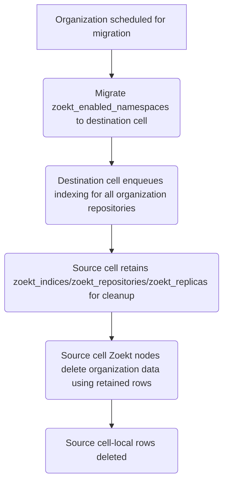

{}
このドキュメントは作成中であり、Cells の設計のごく初期の状態を
示しています。重要な側面がまだ記載されていませんが、今後追加する
予定です。これは Cells の実現可能なアーキテクチャの 1 つであり、
実装するアプローチを決定する前に、代替案と比較するつもりです。
このアプローチを実装しないと決めた場合も、その選択をしなかった理由を記録できるよう、
このドキュメントは保持します。
{}

## 1. 定義 {#1-definition}

## 2. データフロー {#2-data-flow}

## 3. 提案 {#3-proposal}

組織をあるセルから別のセルに移行するとき、Zoekt のデータは、
組織が所有するものか、セル内に限定されるものかによって、異なる方法で扱います。

### 組織が所有する有効化の状態 {#org-owned-enablement-state}

`zoekt_enabled_namespaces` テーブルは、Zoekt が有効な名前空間を記録しており、
組織が所有しています。このテーブルは、組織の他のデータとともに
移行先のセルに移行する必要があります。これにより、移動後も完全一致検索の
有効化の状態が保持されます。

### セル内に限定される Zoekt の状態 {#cell-local-zoekt-state}

特定のセル上の Zoekt の稼働状態を追跡するテーブル —
`zoekt_indices`、`zoekt_repositories`、`zoekt_replicas` を含む — は、そのセル内に限定され、
移行先のセルに移行しては**いけません**。代わりに、次のようにします。

1. 移行先のセルは、自身の Zoekt ノードを使って、組織の
   リポジトリのインデックスを最初から作成し、インデックス作成の
   進行に合わせて、これらのテーブルに新しい行を作成します。
1. 移行元のセル内に限定される行は移動後も保持し、
   クリーンアップを進めるために使用します。行自体を削除する前に、移行元のセルの Zoekt
   ノードから組織のデータを削除します。

Zoekt の組織移行戦略は、[高度な検索](advanced-search.md#organization-migration)で使用する
アプローチと似ています。組織が所有する
設定を移行先のセルに移行する一方で、セル内に限定される稼働
状態は最初から再構築し、セル間の直接的なデータ転送を避けます。

### 組織移行のワークフロー {#organization-migration-workflow}

## 4. 評価 {#4-evaluation}

### 4.1. 利点 {#41-pros}

1. セル間の Zoekt 移行を実装する必要がありません。
1. 既存のフレームワークは十分にテストされており、チームメンバーも理解しています。

### 4.2. 欠点 {#42-cons}

1. 組織によっては、インデックス作成に時間がかかりすぎる可能性があります。異なる
   組織規模でベンチマークを行う必要があります。
1. インデックス作成の完了を示す UI 表示がありません。
   レプリカの準備が整うまでは、組織の完全一致コード検索は、
   空または部分的な結果を返すのではなく、利用できない状態になります。
1. Sidekiq、Gitaly、PostgreSQL など、GitLab インスタンスに追加の負荷がかかります。
   セル内の他の Sidekiq ジョブが、インデックス作成の完了に影響します。
