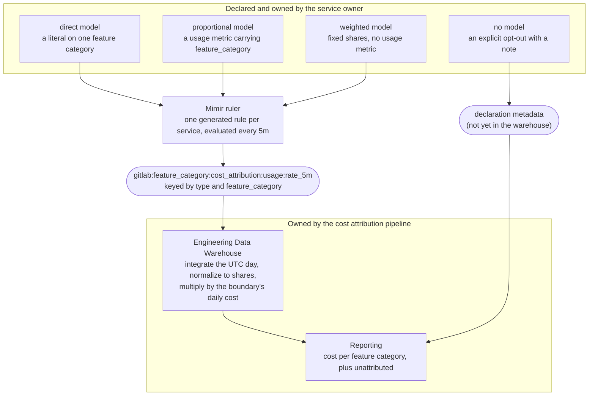



<!-- vale gitlab.FutureTense = NO -->

## 概要 {#summary}

Google Cloud と AWS の請求明細はすべて、Production Engineering が所有する BigQuery データウェアハウスである Engineering Data Warehouse に、[FOCUS 1.2 形式](https://focus.finops.org/docs/specification/v1-2/)で取り込まれます（`gitlab-infra-data.cloud_cost`）。分類ルールのセットが各明細をコストバケットに割り当てます。`service_catalog` バケット内では、GitLab サービスカタログの定義に従い、`gl_service` ラベルがコストをさらにサービス別に分けます。

この*コスト配分*のビューは、[Cloud Cost Utilization (CCU) Teamdeck](https://gitlab-com.gitlab.io/gl-infra/finops/teamdeck/cost-allocation?days=30)（GitLab チームメンバー限定）で利用できます。

これで「*このバケットのコストはいくらか？*」という質問と、サービス・チームのカタログ（[Engineering Portal](https://portal.gitlab.net/services)）および Workday を通じた「*このコストを所有するチームや部門はどこか？*」という質問には回答できます。しかし、コストを[製品の機能カテゴリ](/handbook/product/categories/)にマッピングするものがないため、「*GitLab の機能を稼働させるコストはいくらか？*」という質問には回答できません。

2026 年 10 月時点では、GCP 支出の約 75% が `gl_service` ラベルを持つ `service_catalog` バケットにあり、それより小さな割合が `networking` や `gke_cluster` などの粗いバケットに入り、少額のロングテールが未配分です。

ここで説明する*コスト帰属*の手法は、GCP コストだけを対象に、サービスコストを機能カテゴリに帰属させることに重点を置きます。
したがって、GCP 支出のうち、すでに `gl_service` ラベルが付いている部分に適用します。ラベルのカバレッジ改善は並行して進めています。

この文書では、サービスごとのコストを機能カテゴリごとのコストに変換する方法を記録します。サービスオーナーは、3 つのモデルのいずれか、または明示的な適用除外を宣言します。

1. サービス全体が 1 つの機能カテゴリに対応すると宣言します（直接モデル）。
2. 代わりに、サービスに比例モデルを宣言します。`feature_category` ラベルを持つ使用量メトリクスが、サービスの使用量のうち各機能カテゴリが日ごとに消費した割合を示します。
3. 使用量メトリクスで内訳を捉えられない場合は、加重モデルを宣言します。サービスオーナーが合意した、機能カテゴリごとの固定割合を注記とともに記録します。
4. サービスに適用できる機能カテゴリ帰属モデルがないと、その理由の注記とともに宣言します（モデルなし）。コストは未帰属のままですが、不足ではなく意図的な決定としてレポートします。

私たちは、runbooks リポジトリのメトリクスカタログで機能カテゴリ帰属モデルを表現する、宣言的な方法を導入します。サービス定義で新しい `costAttribution` フィールドを使い、サービスコストを機能カテゴリ間でどう分けるかを定義します。これは、すでに PromQL でサービスを記述している SLI や飽和点と並べて置きます。

分析側では、`sqlmesh-catalog` を使って Backstage から関連メタデータ（機能カテゴリ、サービス情報）を取り込みます。分析は、バケット別・サービス別のコスト数値を生成する既存の明細分類パイプラインの出力を基にします。得られた機能カテゴリ別コストは、日次の粒度で BigQuery に保存します。

{}
機能カテゴリのコスト数値が完全になるのは、そのカテゴリを支えるすべてのサービスに帰属モデルがある場合だけです。

したがって、カバレッジは各カテゴリの特性であり、請求全体に対する 1 つの数値ではありません。対象となる支出の割合だけを大きく示すと、真のリスクである偏りが隠れます。未対応の残りが、単一のカテゴリに集中している可能性があります。

カテゴリごとの完全性を早期に達成できるのは、カテゴリ全体が 1 サービスである直接モデルなど、限られたケースだけです。最初は、ドル金額を持つ機能カテゴリは少数で、大きな未帰属の残りがあると考えてください。これは最初のイテレーションとして許容できる結果です。学び、発展させるための枠組みを整えられます。

このため、この設計では全体的なカバレッジ目標を設定しません。
{}

## 動機 {#motivation}

この作業の背景となる概念モデルは、CCU Teamdeck の[コスト帰属の概念ページ](https://gitlab-com.gitlab.io/gl-infra/finops/teamdeck/cost-attribution)（GitLab チームメンバー限定）に、モックデータに基づく図とともに記載されています。この文書では、改めて導出しません。

この文書全体で、次の用語を使います。

| 用語                        | 意味 |
| --------------------------- | --- |
| コスト境界               | タプル `\|bucket, (labels)\|`：ルールが囲む明細の範囲。大半の境界にはラベルがありません（`\|networking, ()\|`）。`service_catalog` 内では、1 つの境界が 1 サービスです（`\|service_catalog, (gl_service: patroni)\|`）。 |
| コスト配分             | クラウド支出をコスト境界間に分配する方法。 |
| レポートのディメンション         | 利用側がコストを求める際の切り口：[`categories.yml`](https://gitlab.com/gitlab-com/www-gitlab-com/-/blob/master/data/categories.yml)の機能カテゴリ別（[製品カテゴリのページ](/handbook/product/categories/)も参照）。 |
| コスト帰属モデル      | コスト境界からレポートのディメンションへコストを移します。境界ごとに 1 つ。直接（1:1）、加重（静的な分配）、比例（統計量による分割）のいずれか。 |
| 未配分                 | 分類ルールに一致しなかったコスト（`cost_bucket IS NULL`）。帰属モデルには到達せず、何にも帰属しません。 |
| 未帰属                | 境界にモデルがないか、モデルが使用量の一部しかカバーしていないため、どのモデルでも説明されない境界内のコスト。1 つの合計としてレポートします。 |

### 目標 {#goals}

1. サービスオーナーが、メトリクスカタログで自分のサービスの機能カテゴリ帰属モデルを宣言できるようにします。
1. Backstage を機能カテゴリ一覧の唯一の情報源（SSOT）とし、Engineering Data Warehouse に取り込んで、将来的には CI 検証でも使います。この作業の開始時に Backstage は機能カテゴリを保持していなかったため、その同期の構築もプロジェクトに含めました。
1. Engineering Data Warehouse が、機能カテゴリごとの日次の実効コストを持つレポートモデルを公開し、未帰属コストを明示的にレポートします。
1. CCU Teamdeck が、そのレポートを既存の[コスト配分サンキー図](https://gitlab-com.gitlab.io/gl-infra/finops/teamdeck/cost-allocation?days=1&provider=gcp)（GitLab チームメンバー限定）、または他の適切な形式で表示します。

### 目標外のもの {#non-goals}

1. `networking` や `gke_cluster` など、バケット全体を対象とする境界の帰属。これらにはモデルを持たせるサービス定義がありません。設計上は後から追加する余地を残していますが、そのコストは未帰属のままです。
1. ラベルのカバレッジと配分データの品質の改善。いずれも帰属ではなく、ラベル付けと分類の作業です。
1. ここで規定する 3 つを超えるモデル。ウェアハウスがすでに持つデータから割合を導くモデルなど、他のモデルの余地は残しますが、直接、比例、加重モデルだけを規定します。
1. 2 つ目のレポートのディメンション。機能カテゴリだけがレポートのディメンションです。
1. SOX の対象となる売上原価（COGS）の配分。このレポートは、機能の稼働コストをエンジニアリングの観点から示すもので、財務統制ではありません。

## 提案 {#proposal}

### サービス定義の `costAttribution` フィールド {#a-costattribution-field-on-the-service-definition}

runbooks リポジトリの[メトリクスカタログ](https://gitlab.com/gitlab-com/runbooks/-/tree/master/metrics-catalog/services)には、サービスごとに 1 つの jsonnet サービス定義があります。SLI と飽和点を宣言する場所であり、`make generate` がサービスに関する PromQL を、Mimir が評価するレコーディングルールに変換する場所です。その過程で jsonnet バリデーター、ユニットテスト、レコーディングルールレジストリがチェックします。機能カテゴリ帰属モデルは、所有するチームではなくサービスの特性です。1 つのチームが、異なるモデルを持つ複数のサービスを所有し得るためです。また、サービスに関する PromQL 文がレコーディングルールになるという意味で、SLI と同種のものです。

この設計では、サービス定義に、そのサービスの帰属モデルを持つ `costAttribution` フィールドを追加します。このフィールドは省略可能です。フィールドがないサービスはモデルのない境界となり、コストは未帰属です。適用できるモデルがないと決めたオーナーは、そう明示します（[モデルなし](#no-model)を参照）。これにより、フィールドがない場合は常に、まだ誰も決めていないことを意味します。

宣言はサービスオーナーが所有し、他者の承認なしに自分のフィールドの変更をマージできます。前述の契約は、宣言に対する要件であり、レビューによる関門ではありません。慣行が新しいうちは CCU チームが宣言のレビューを支援しますが、意図的にその門番にはなりません。自分のモデルを修正するために他チームの順番待ちをしなければならないオーナーは、モデルを最新に保たなくなります。信頼性は、必須の承認者ではなく、マージ前に宣言の候補を契約に照らしてチェックするツールによって確保すべきです。メトリクスカタログは、すでにそのツールの最初の層を提供しています。存在しない SLI、未知の機能カテゴリ、サポートされていない形式を指定する宣言は、Mimir に到達する前に `make generate` で失敗します。

検証ルールや `make generate` の生成物を含む宣言の書き方は、runbooks の [`docs/metrics-catalog/cost-attribution.md`](https://gitlab.com/gitlab-com/runbooks/-/blob/master/docs/metrics-catalog/cost-attribution.md)に記載しています。この文書では、モデルとその契約を扱います。

メトリクスカタログは宣言の出発点であり、必ずしもそのまま置き続ける場所ではありません。サービスのメタデータが、Backstage モデル、最終的にはサービス自身のリポジトリへと、サービスの近くに移るにつれて、宣言も移る想定です。[Engineering Portal の設計](https://gitlab.com/gitlab-com/content-sites/handbook/-/merge_requests/21348)でその道筋を説明しています。宣言の下流にあるインターフェース、つまり記録されたメトリクスは、宣言が移動しても変わりません。

ジェネレーターも移動します。Metropolis への移行では、メトリクスカタログを同梱された jsonnet ライブラリとして使い、Custom Resources として保持するサービス定義から、サービスごとにレコーディングルールを生成します。そのため、コスト帰属のサポートも一緒に移行する必要があります。サービス定義リソースは、省略可能な `costAttribution` フィールドを持ちます。Metropolis は Self-Managed 環境にも提供できる想定ですが、そこでは GitLab.com のクラウドコストを帰属させる理由がありません。そのため、フィールドはそこでも省略可能とし、フィールドがないサービス定義からはコスト帰属ルールを生成しません。

### 直接モデル {#direct-model}

**サービスが正確に 1 つの機能カテゴリを支える**場合、サービスオーナーは直接モデルを宣言します。

```jsonnet
// metrics-catalog/services/registry.jsonnet
metricsCatalog.serviceDefinition({
  type: 'registry',
  tier: 'sv',
  costAttribution: {
    model: 'direct',
    featureCategory: 'container_registry',
  },
  // ...
})
```

### 比例モデル {#proportional-model}

**サービスが複数の機能カテゴリを支える**場合、サービスオーナーは比例モデル、つまり固定の契約に従う**使用量メトリクス**を宣言します。

宣言は、SLI が `requestRate` に使うものと同じ metrics-catalog のメトリクスオブジェクトとして、メトリクスとそのセレクターを指定し、ジェネレーターがそこから PromQL を導出します。次の 4 形式を受け付けます。

| `usage`                          | 用途                                                                                   | 記録する式                                     |
| -------------------------------- | ------------------------------------------------------------------------------------- | ------------------------------------------------------- |
| `rateMetric(counter, selector)`  | カウンター：クエリ時間、リクエスト、転送バイト数                                    | `sum by (feature_category) (rate(counter{...}[5m]))`     |
| `gaugeMetric(gauge, selector)`   | ゲージ：保存バイト数、保持オブジェクト数                                                   | `sum by (feature_category) (avg_over_time(gauge{...}[5m]))` |
| `customRateQuery(promql)`        | ラベルを導出する `label_replace` など、どちらのコンストラクターでも表せない形式 | `sum by (feature_category) (promql)`                    |
| `costAttribution.fromSLIs([..])` | エラーバジェットの基になるシグナルがコスト要因でもある場合に使う、サービス自身の SLI | `sum by (feature_category) (<the SLIs' recorded rate>)` |

記録する式を任意の時点で評価すると、`feature_category` ラベルを持つサンプルを返し、それぞれがそのサービスの**現在の使用強度**を保持します。フロー（クエリ時間、リクエスト、転送バイト数など）なら秒あたりのレート、ストックの量（保存バイト数など）ならゲージです。宣言自体がカテゴリごとに 1 サンプルへ集約する必要はありません。利用側が行います。生成されたレコーディングルールが使用量を `sum by (feature_category)` で囲むためです（次のセクションを参照）。したがって、ラベルをすでに持つカウンターを、そのセレクターとともに指定すれば、完全な宣言となります。

Mimir ruler は合計結果を 5 分ごとに記録するため、使用量メトリクスがどのような形式でも、記録されたメトリクスにはサービスと機能カテゴリの組み合わせごとに 1 系列があります。ウェアハウスは、記録された系列を正確な UTC の 1 日にわたって積分し、機能カテゴリごとに 1 日 1 つの使用量を得ます。それらを割合に正規化し、境界の日次実効コストに掛けます。

契約は、使用量メトリクスに 4 つの要件を課します。

- **カテゴリ内で加算可能であり、カテゴリ間では総量を構成すること。** 利用側が各 `feature_category` 内のサンプルを合計するため、加算可能でなければなりません。2 つの系列が同じ使用量を二重に数えてはいけません。さらに、全カテゴリを合計した結果が、その時点のサービス全体の使用量と等しくなり、各カテゴリの数値が意味のある総量の一部となる必要があります。名前の付いた機能カテゴリに割り当てられない使用量は、`feature_category` ラベルを付けないか、`feature_category=unknown` として、残余分を出力する必要があります。
- **非負であること。** メトリクスが返すすべての値は非負でなければなりません。
- **スコープを、このコスト境界だけに正確に限定すること。** メトリクスとセレクターは、指定されたコスト境界だけを対象にする必要があります。サービス定義の場合、これは正確に 1 つのサービスを意味します。
- **5 分ごとに評価できるほど低コストであること。** コストを左右するのは結果の大きさではなく、基となるメトリクスのカーディナリティです。そのため、宣言での集約よりも、対象を絞ったセレクターの方が重要です。短い範囲ウィンドウは、このために意図的に選んでいます。`fromSLIs` は、SLI の記録済みレートを読むことで、生データのスキャン自体を回避します。

具体例は、メインの Postgres クラスターである `patroni` で、その境界は `|service_catalog, (gl_service: patroni)|` です。使用量統計はクライアント側のクエリ時間で、既存の記録済み系列 `controller_action:gitlab_sql_duration_seconds_sum:rate5m` から読みます。この系列は `gitlab_sql_duration_seconds_sum` のレートを計算し、`feature_category` と `db_config_name` ラベルを保持したまま Pod 全体で合計します。

```jsonnet
// metrics-catalog/services/patroni.jsonnet
metricsCatalog.serviceDefinition({
  type: 'patroni',
  tier: 'db',
  costAttribution: {
    model: 'proportional',
    usage: customRateQuery(|||
      controller_action:gitlab_sql_duration_seconds_sum:rate5m{db_config_name=~"main(_replica)?",env="gprd"}
    |||),
    note: |||
      Client-side Rails query time as a proxy for storage and compute together,
      covering the main primary and its replicas. Under-attributes categories
      that store much and query little, and sees no non-Rails database load.
    |||,
  },
  // ...
})
```

クライアント側のクエリ時間はすでに `feature_category` ラベルを持つため、`patroni` は最初の候補に適しています。Rails の Web プロセスと Sidekiq プロセスの両方を対象とします。記録済み系列の読み取りは、全生系列を 5 分間スキャンする代わりに瞬時の検索で済み、低コスト要件を満たします。返される系列は、残りのラベルで生カウンターを分割するため、加算可能であり、ジェネレーターが合計しても二重計上しません。この例は、モデルが通常、厳密な測定ではなく近似手法であることも示します。vacuum、レプリケーション、WAL の処理は Rails から見えず、Ruby のグローバルインタープリターロックなど、クライアント側の停止時間もクエリ時間に含まれます。十分に有用な代理指標を、想定する基準としています。

メトリクスオブジェクト形式では、ジェネレーターが、ルールを記録する Mimir テナントの環境セレクターを統合します。`gitlab-gprd` なら `env="gprd"` です（後述の生成されるレコーディングルールを参照）。このスコープも、同じ意味でモデルの一部です。コスト側には環境ディメンションがないため、機能カテゴリ別の本番使用量を、非本番支出を含む境界全体のコストの代理指標とします。これは意図的です。`customRateQuery` は、記述された PromQL をそのまま受け取るため、ジェネレーターがスコープを限定できない唯一の形式です。そのため、`patroni` の宣言自体に `env="gprd"` を含めています。

スコープ要件が効いてくるのは、`db_config_name` セレクターです。`patroni` サービスはプライマリーとレプリカを含むクラスター全体ですが、`db_config_name="main"` はプライマリーのトラフィックだけを選択します。Rails が、負荷分散されたレプリカ接続に `main_replica` ラベルを付けるためです。正規表現 `main(_replica)?` は両方を対象にし、境界内に収まります。Prometheus の正規表現マッチャーは全体一致であり、他のクラスターは `ci`、`sec`、`registry` の設定名を使うためです。

セレクターに含まれないものにも注意してください。`type="patroni"` はありません。使用量メトリクスは別のサービス、この例では Rails が出力することが多いため、ジェネレーターはサービスのマッチャーを挿入しません。オーナーのセレクターと環境を合わせたものが、セレクター全体です。それでも記録済み系列のキーは宣言元のサービスです。生成されるルールは、どのサービスが使用量を出力したかに関係なく、静的ラベルとして `type: patroni` を設定します。

`web` は `fromSLIs` 形式を示します。

```jsonnet
// metrics-catalog/services/web.jsonnet
metricsCatalog.serviceDefinition({
  type: 'web',
  tier: 'sv',
  costAttribution: {
    model: 'proportional',
    usage: costAttribution.fromSLIs(['rails_request']),
    note: |||
      Provisional. Request count per feature category, from the same SLI that
      drives the web error budget. Treats every request as equal cost, so
      categories with few but slow requests are under-attributed. Replace with
      a duration-based proxy once one carries feature_category.
    |||,
  },
  // ...
})
```

メトリクスではなく SLI を指定すると、宣言には SLI と乖離し得るメトリクス名やセレクターが含まれず、生成されるルールは 5 分ごとに生メトリクスを再スキャンする代わりに、SLI の記録済み `sli_aggregations:` 系列を読みます。`fromSLIs` が指定するのは宣言元サービス自身の SLI だけで、セレクターも伴います。各 SLI 自身の `requestRate` セレクター、この例では `job="gitlab-rails",type="web"` と、テナントの環境です。`sli_aggregations:gitlab_sli_rails_request_total:rate_5m` は `web` だけでなく複数サービスについて記録されているため、これにより宣言が境界内に収まります。したがって、`fromSLIs` は独自のセレクターを取りません。別サービスの SLI や、自身の SLI のより狭い部分が必要なモデルは、`patroni` と同様に、代わりに `customRateQuery` で系列とそのセレクターを明示的に指定します。いずれの場合も、生成されるルールは宣言元サービスを静的な `type` ラベルとして持ちます。

SLI の再利用は、標準の選択ではなく判断を要します。SLI が数えるのは SLO にとって重要なもので、必ずしもコストがかかるものではありません。上記の注記はこの例の弱点を示しています。`patroni` は、クエリ時間ではなくクエリ数を数え、データベースの最大級の利用元の 1 つである Sidekiq を除外するため、SQL の SLI を意図的に再利用していません。

Runbooks の自動処理が、宣言からレコーディングルールを生成します。宣言された使用量メトリクスと、生成されたレコーディングルールのどちらも、Grafana で直接確認できます。

### 加重モデル {#weighted-model}

**使用量メトリクスで内訳を捉えられない**ものの、サービスオーナーが見積もりを説明できる場合、機能カテゴリごとの固定割合を使う加重モデルを宣言します。

```jsonnet
// metrics-catalog/services/gitaly.jsonnet (illustrative, not a shipped declaration)
metricsCatalog.serviceDefinition({
  type: 'gitaly',
  tier: 'stor',
  costAttribution: {
    model: 'weighted',
    weights: {
      source_code_management: 0.7,
      continuous_integration: 0.3,
    },
    note: |||
      Agreed with the service owner in September 2026. No usage metric
      available today separates CI fetches from user-facing repository
      access. Revisit once Gitaly RPCs carry a feature category label.
    |||,
  },
  // ...
})
```

重みは相対値であり、パーセンテージではありません。ウェアハウスは他の使用量と同様に正規化するため、非負であればよく、合計が 1 になる必要はありません。サービスの一部しか説明できないオーナーは、残りを `unknown` に割り当てます。これは名前付きカテゴリを水増しせず、未帰属の合計にまとめられます。

モデルなしの宣言と同様に、`note` は必須です。見積もりの日付と、何に置き換えるべきかを記載してください。加重モデルは、気付かれないまま古くなる唯一の宣言です。サービスが変化した後も同じ割合をレポートし続けます。最終的な落ち着き先ではなく、比例モデルに向かう一歩として扱ってください。まだ加重モデルを宣言するサービスはありません。

この例は、モデルがサービスのラベルではなく、サービスに属する理由も示します。加重モデルは、`gitaly` サービスのコストを、同名の `gitaly` 機能カテゴリに属するものと解釈せず、サービスが支える各カテゴリ間に分けます。現在、`gitaly` は `gitaly` カテゴリへの直接モデルを宣言しており、このような見積もりは、その出発点を精緻化するものです。

### モデルなし {#no-model}

サービスオーナーが、自分のサービスに**適用できる機能カテゴリ帰属モデルがない**と結論した場合、その理由の注記とともに明示的に宣言します。

```jsonnet
// metrics-catalog/services/mimir.jsonnet
metricsCatalog.serviceDefinition({
  type: 'mimir',
  tier: 'inf',
  costAttribution: {
    model: 'none',
    note: |||
      Internal monitoring infrastructure that serves engineering, not a product
      feature category. Its cost is deliberately reported as unattributed.
      Revisit if Mimir starts serving a customer-facing observability feature.
    |||,
  },
  // ...
})
```

`note` は必須です。カタログの読者に向けて判断理由を記録し、どのような条件で決定が変わるかを記載してください。現在の `none` が、後に直接モデルや比例モデルになり得るためです。

`model: none` は、フィールドがないこととは異なります。フィールドがない場合は、まだ誰も決めていないことを意味します。`none` は、オーナーが検討して、モデルを適用しないと決めたことを意味します。レポートは、この 2 つを区別する設計です（ウェアハウスのセクションを参照）。未帰属の残りを、区別のない 1 つの合計ではなく、「未対応」と「決定済み」として読めるようにします。また、これはサービスがどの製品カテゴリにも属さないことを示す正式な方法でもあります。サービスは `not_owned` 疑似カテゴリへの直接モデルを宣言できず、代わりに注記付きの `none` を宣言します。

ジェネレーターは `none` 宣言のレコーディングルールを出力しないため、この情報はメトリクスを通じて伝わりません。ウェアハウスがすでに Backstage から取り込んでいるサービス情報とともに、宣言メタデータとして到達する想定です。この経路はまだ構築されていません。構築されるまでは、ウェアハウスは `none` 宣言とフィールドの欠落を区別できず、どちらもモデルなしの未帰属としてレポートします。宣言の配置場所とウェアハウスでの読み取り方法は、[finops/team#539](https://gitlab.com/gitlab-com/gl-infra/finops/team/-/work_items/539)（社内向け）で追跡しており、宣言を Backstage へ移す [Engineering Portal の設計](https://gitlab.com/gitlab-com/content-sites/handbook/-/merge_requests/21348)で説明しています。

### 生成されるレコーディングルール {#generated-recording-rules}

runbooks プロジェクトの `make generate` は、帰属モデルを宣言するすべてのサービス定義を読み、それぞれの Mimir レコーディングルールを出力します。

ルールは、`gitlab-gprd`、`runway`、`gitlab-ops` の 3 つの Mimir テナントのいずれかに記録します。これらが合わせて、帰属対象となる本番コストを保持します。サービスは、このうち正確に 1 つに記録します。複数で実行されるサービスは、宣言の `tenant` フィールドでテナントを指定します。たとえば、`pulp` は `gitlab-ops` に記録します。

ルールは、`type` と `feature_category` をキーとする 1 つのメトリクス、`gitlab:feature_category:cost_attribution:usage:rate_5m` を記録します。各サンプルは、ある時点における 1 サービスの 1 機能カテゴリの使用量です。`rate_5m` サフィックスは、値の種類ではなく 5 分の記録間隔を示します。サンプルは、カウンターレート、ゲージ、定数のいずれに由来することもある強度で、ウェアハウスは 3 種類すべてを同様に扱います。

各サービスに、専用のルールファイル内の専用ルールグループを用意します。これは、メトリクスカタログが SLI と飽和ルールですでに使う配置で、サービス間を分離します。1 つの Mimir ルールグループ内のルールは順に評価され、間隔内に完了しないグループは次の評価がスキップされるため、グループが記録する全系列に欠落が生じます。比例モデルの宣言は、オーナーが記述し、コストに上限のない PromQL なので、1 つの高コストな宣言が別サービスのサンプルを欠落させることがあってはなりません。

メトリクス名は、runbooks が記録済み系列ですでに使う命名規則に従います。
サービスは、runbooks が慣例としてこの目的に使う `type` ラベルで識別します。

`patroni` の生成ファイルは次のようになります。

```yaml
# mimir-rules/gitlab-gprd/patroni/autogenerated-gitlab-gprd-patroni-cost-attribution-usage.yml
groups:
  - name: 'Cost attribution usage: patroni'
    interval: 5m
    rules:
      - record: gitlab:feature_category:cost_attribution:usage:rate_5m
        labels:
          type: patroni
        expr: |
          sum by (feature_category) (
            controller_action:gitlab_sql_duration_seconds_sum:rate5m{db_config_name=~"main(_replica)?",env="gprd"}
          )
```

`sum by (feature_category)` で囲む処理は、宣言ではなくジェネレーターが行います。使用量メトリクスが返すものを、カテゴリごとに 1 系列にまとめ、他のすべてのラベルを削除します。これにより、記録されたメトリクスが持つのは、ルールからの `type` ラベルとデータからの `feature_category` ラベルだけになります。契約が加算可能性を求める理由もこれです。使用量メトリクスの出力に、そのまま合計を適用します。

`fromSLIs` で宣言した `web` では、同じルールが生メトリクスではなく SLI の記録済み系列を、評価時点で読みます。コンポーネントの集約セットがソースを読むのと同じ方法です。

```yaml
      - record: gitlab:feature_category:cost_attribution:usage:rate_5m
        labels:
          type: web
        expr: |
          sum by (feature_category) (
            sli_aggregations:gitlab_sli_rails_request_total:rate_5m{env="gprd",job="gitlab-rails",type="web"}
          )
```

直接モデルでは、ジェネレーターは、宣言した機能カテゴリに対して定数を出力するレコーディングルールを追加します。コスト全体が `container_registry` に属する `registry` では、次のルールになります。

```yaml
      - record: gitlab:feature_category:cost_attribution:usage:rate_5m
        labels:
          type: registry
          feature_category: container_registry
        expr: vector(1)
```

`vector(1)` 自体はラベルを持たないため、ルールの `labels` ブロックが両方を与えます。定数の値は任意です。そのサービスにとって唯一のサンプルなので、正規化すると割合が 1 になります。したがって、3 種類のモデルすべてが 1 つのメトリクスを通じてウェアハウスに届き、定数用の別経路はありません。

加重モデルは、宣言したカテゴリごとに同じルールを設け、機能カテゴリでソートし、重みを定数としたものです。`gitaly` の例では次のようになります。

```yaml
      - record: gitlab:feature_category:cost_attribution:usage:rate_5m
        labels:
          type: gitaly
          feature_category: continuous_integration
        expr: vector(0.3)
      - record: gitlab:feature_category:cost_attribution:usage:rate_5m
        labels:
          type: gitaly
          feature_category: source_code_management
        expr: vector(0.7)
```

コストを帰属させる 3 つのモデルにとって、記録されたメトリクスが両者間のインターフェース全体です。その上流のすべてはサービスオーナーが変更でき、その下流のすべては全サービスで共通です。`none` 宣言はメトリクスを通りません。カタログのメタデータであり、ウェアハウスに到達した時点でレポートが読みます。



したがって、サービスにモデルを追加することも、モデルを採用しないことも、そのサービス定義だけの変更です。ウェアハウスの変更、新しい取り込み経路、パイプラインを所有するチームとの調整は不要です。

### 帰属モデルの形式的な定義 {#the-attribution-model-formally}

このセクションでは、記録されたメトリクスと各境界の日次コストから、ウェアハウスが何を計算するかを示します。

<p>
コスト境界を \(b\)、直接、比例、加重のいずれかのモデルを持つ境界の集合を \(\mathcal{M}\)、オーナーがモデルなしと宣言した境界の、それと交わらない集合を \(\mathcal{N}\)、UTC の 1 日を \(d\)、その日の積分を \(\int_d\) と表します。\(C_b(d)\) を、請求台帳に基づく境界の日次実効コストとします。\(L_b\) を、宣言した式がその境界について報告する <code>feature_category</code> ラベル値の集合、\(x_{\ell,b}(t)\) を、ラベル値 \(\ell\) の時点 \(t\) における使用強度とします。これは記録されたメトリクスが保持する値で、式がそのラベル値で返すサンプルの合計です。境界が一度も報告しないカテゴリについては、\(x_{\ell,b} \equiv 0\) とします。
</p>

<p>
\(L_b\) の 3 つの要素は、帰属を主張しません。
<code>unknown</code> は、トランザクションに機能カテゴリがないときに Rails が出力する値です。
<code>not_owned</code> は、その作業がどの製品グループにも属さないという意図的な表明です。
\(\varepsilon\) は、<code>feature_category</code> ラベルをまったく持たないサンプルを表す空の値で、宣言が測定したものの帰属させられなかった使用量です。
これら 3 つを \(P\) とし、その強度を合計して、帰属不能な単一の要素 \(\bot\) にまとめます。残る \(A_b\) が帰属可能な集合、\(K_b\) が割合を定義する添字の全体集合です。
</p>

<div>
\[
x_{\bot,b}(t) \;=\; \sum_{\ell \,\in\, P} x_{\ell,b}(t)
\qquad
P = \{\,\varepsilon,\ \texttt{unknown},\ \texttt{not\_owned}\,\}
\qquad
A_b = L_b \setminus P
\qquad
K_b = A_b \cup \{\bot\}
\]
</div>

1 日の累積使用量は、その強度の積分です。割合は、帰属不能の要素も含めた添字の全体集合にわたって正規化します。

<div>
\[
u_{i,b}(d) \;=\; \int_{d} x_{i,b}(t)\,\mathrm{d}t
\qquad\qquad
s_{i,b}(d) \;=\; \frac{u_{i,b}(d)}{\displaystyle\sum_{j \,\in\, K_b} u_{j,b}(d)}
\qquad\qquad i \in K_b
\]
</div>

すると、ある日の 1 つの機能カテゴリに帰属するコストは、モデルを持つすべての境界のコストを、使用量で加重して分けたものになります。

<div>
\[
\boxed{\;\;
c_i(d) \;=\; \sum_{b \,\in\, \mathcal{M}} C_b(d) \; s_{i,b}(d)
\;\;}
\]
</div>

これが、この手法のすべてです。

1. 日次の粒度が積分ウィンドウです。
1. 比例モデルが割合です。
1. 帰属は、境界のコストに対して線形です。

帰属不能な使用量は分母に加算します。
この設計では、これを機能カテゴリ間に比例配分しないことを意図的に選びます。
これにより、帰属不能な部分を可視化し、明示的に保ちます。

<p>
直接モデルは、宣言したカテゴリに対する定数式、つまり先ほどの <code>vector(1)</code> ルールとして実現します。そのため、\(L_b = \{i_b\}\)、\(s_{i_b,b}(d) = 1\) となり、どこにも特別扱いは必要ありません。加重モデルは、宣言したカテゴリごとに 1 つの定数を設ける同じ構成です。したがって、\(s_{i,b}(d)\) は宣言した重みを宣言した重みの合計で割った値となり、1 日を通して一定です。
</p>

<p>
\(\mathcal{M}\) の外にある境界は、\(\mathcal{N}\) に含まれるか、どちらの集合にも含まれないかに関係なく、割合のベクトルをまったく持ちません。
</p>

<p>
ある日の境界の使用量の合計が 0 の場合、比は未定義です。このときは \(s_{\bot,b}(d) = 1\) とする規約なので、何も生成しなかった宣言は、ゼロ除算ではなく、その日全体が未帰属であることを意味します。
</p>

モデルを持つ境界が、ある日にサンプルをまったく報告しない場合、宣言がウェアハウスに到達するまではモデルのない境界と区別できず、モデルなしの未帰属としてレポートします。

ここから保存則が導かれます。ウェアハウスはこれを日別・サービス別に検証し、帰属済み合計を、元となるサービスコストと照合します。境界内では割合が全体を網羅するため、帰属はコストを生み出したり消したりせずに移動させます。

<div>
\[
\sum_{i \,\in\, K_b} s_{i,b}(d) \;=\; 1
\qquad\Longrightarrow\qquad
\sum_{i} c_i(d) \;+\; U(d) \;=\; \sum_{\text{all } b} C_b(d)
\]
</div>

ここでの合計は、対象範囲の境界、つまり GCP の `service_catalog` バケット内のサービスにわたるもので、未帰属コストは分配せずにレポートします。その 3 つの項は、レポートで区別する 3 種類の未帰属コストで、以下の名前を持ちます。

<div>
\[
U(d) \;=\;
\underbrace{\sum_{b \,\notin\, \mathcal{M} \cup \mathcal{N}} C_b(d)}_{\texttt{unattributed\_no\_model}}
\;+\;
\underbrace{\sum_{b \,\in\, \mathcal{N}} C_b(d)}_{\texttt{unattributed\_declared}}
\;+\;
\underbrace{\sum_{b \,\in\, \mathcal{M}} C_b(d)\; s_{\bot,b}(d)}_{\texttt{unattributed\_partial}}
\]
</div>

宣言がウェアハウスに到達するまでは、最初の 2 項をまとめて `unattributed_no_model` としてレポートします。

### ウェアハウス：結果の保存とレポート {#warehouse-storing-and-reporting-the-result}

ウェアハウス側の帰属処理は、`sqlmesh-catalog` の `cloud_cost` トピックにある 3 つのモデルから成り、最初のレコーディングルールが導入された 2026-09-21 から、すべて日次で実行します。

1. **取り込み**（`raw_feature_category_usage`）。1 つ目のモデルは、3 つのテナントそれぞれから、記録されたメトリクスを 1 日 1 回読みます。UTC の 1 日が終わる午前 0 時に評価する 2 つのインスタントクエリ、`sum_over_time(...[1d] @ T)` と `count_over_time(...[1d] @ T)` を使い、`type` と `feature_category` ごとに合計します。合計値は、一定の 5 分ステップという係数を除いて、その日の積分使用量です。この係数は割合の計算で相殺されます。カウントは、その日に何回評価したかを記録し、1 日の一部しかない場合を可視化します。`T` に固定することで、クエリの実行時点に関係なく、ウィンドウは UTC の 1 日分の評価となり、再実行でも同じ回答を返します。粒度は、日付、サービス、機能カテゴリごとに 1 行です。メトリクスの `type` ラベルは、ウェアハウスの `gl_service` に対応します。これは新しい取り込み経路ではなく、ウェアハウスがすでに運用する経路の別の利用例です。`error_budget.raw_stage_group_availability` が、Mimir のレコーディングルールを毎日 BigQuery に読み込んでいます。
1. **正規化**（`fct_feature_category_usage_share`）。2 つ目のモデルは、使用量を割合に変換します。帰属不能なラベル値を 1 つの帰属不能行にまとめ、各サービス・日付の中で割り算し、割合の合計が正確に 1 になるようにします。使用量の合計が 0 の日は、その行に割合全体を与えます。
1. **コスト**（`fct_feature_category_cost`）。3 つ目のモデルは、それらの割合を、既存のバケット別・サービス別の日次コストに結合し、実効コストと請求コストのそれぞれに掛けます。粒度は `(usage_date, providername, gl_service, feature_category)` です。モデルの有無に関係なく、バケット内の全サービスを対象とします。`attribution_state` カラムは `attributed`、`unattributed_partial`、`unattributed_no_model` を持ち、未帰属コストを、気付くべき欠落ではなく読み取れる行にします。4 つ目の状態 `unattributed_declared` は、メトリクスではなくカタログメタデータの `model: none` 宣言に由来するため、そのメタデータがウェアハウスに到達するのを待っています（[モデルなし](#no-model)を参照）。

コストモデルだけが、利用側に対する安定した契約です。その背後の 2 モデルは変わる可能性があります。CCU Teamdeck はこれを読み、機能カテゴリ別のコスト帰属内訳をサンキー図として表示し、未帰属コストも併記します。機能カテゴリの表示名を追加する上位のレポートビューは、後続作業として計画しています。

取り込みモデルは測定値なので、再計算を無効化した `forward_only` とします。そうしなければ、増分モデルはロジックが変わると過去の区間を再計算するため、無関係な編集によって、すでに公開済みの日の記録メトリクスを再クエリし、公開済みの数値を変えたり、Mimir の保存期間を過ぎた系列で失敗したりします。これによって、既知の制限にある前方のみという保証が、レコーディングルールだけでなくモデルでも成立します。後続の 2 モデルは、その永続テーブルに対する算術処理であり、再計算可能なままとします。これにより、測定値に触れずに、まとめ方や除算のバグを過去分も修正できます。コストモデルは直近 7 日間も再読み込みします。その日の請求データが、後から引き続き到着するためです。

### 記録された使用量の監査 {#auditing-the-recorded-usage}

記録されたメトリクスは、パイプライン外部からの入力です。形式は前述の契約で固定されていますが、内容はサービスオーナーが記述し、ウェアハウスでは再導出できません。そのため、パイプラインは信頼できない入力として扱い、毎日監査して、指摘を数値と併せて公開します。

契約違反があっても、日次実行は止めません。不適切な宣言の修正は、メトリクスカタログでの変更であり、デプロイ日以降に効力を持ち、その宣言を所有するサービスチームに依存します。パイプラインを止めると、修正にかかる間、他の全サービスの数値も提供できなくなり、どちらにしても問題のあった日を復旧できません。数値を見えるままにして違反をレポートする方が、良いトレードオフです。その日は公開され、不備が明示され、オーナーが対処できます。まだこの方針に従っていないチェックが 1 つあります。負の使用量はまとめた後に検出されており、個々のサンプルを対象とするようになるまでは、引き続き実行をブロックします（後述の最初のチェックを参照）。

パイプライン自体の不変条件は別であり、実行を止めます。割合の合計が 1 にならない、帰属済みコストの合計がサービスコストに一致しない、サービスが複数のテナントに記録される、サンプルに `type` ラベルがない、といった場合です。これらは、1 つの宣言ではなく、パイプラインや生成ルールの不備であり、それに基づく数値はすべてのサービスで誤ることになります。

記録済み系列とカタログメタデータに対して、4 つのチェックを実行します。

1. **非負性。** 0 未満のサンプルはすべて契約違反です。現在はまとめた後の使用量をチェックし、実行をブロックします。これを個々のサンプルに移し、指摘として扱うのは後続作業です。
1. **スラッグの有効性。** 報告されるすべての `feature_category` は、`dim_feature_categories` で解決できる必要があります。2 つの疑似カテゴリは許可リストに含めます。これが、次のセクションで述べる日次監査です。
1. **存在と連続性。** 帰属モデルを宣言するサービスが、その日のサンプルをまったく報告しないか、1 日の一部しか報告しない場合は、宣言の不備、セレクターが一致しなくなったこと、ruler が評価しなかったことのいずれかです。現在は、評価回数から不完全な日を検出します。何も報告しないサービスは、宣言がウェアハウスに到達して初めて検出できます。
1. **帰属不能な割合。** サービスの帰属不能な割合が高いことは違反ではありませんが、宣言が割り当てられない使用量を測定しているシグナルです。そのため、合計にまとめるだけでなく、サービスごとにレポートします。まだ実装されていません。

指摘は、同じトピックの 4 つ目のモデルとする計画です。日付、サービス、チェックごとに 1 行の粒度で、重大度と違反値を持ちます。CCU Teamdeck がこれらを表示し、違反を、誰も疑問を持たない数値ではなく、サービスエントリから取得したオーナーのいる作業項目にします。そのモデルができるまでは、チェックをモデル自体に対する SQLMesh 監査として実行します。

ウェアハウスのチェックは、問題を 1 日遅れで見つけます。使用量メトリクスを専用の SLI で包めば、メトリクス側でリアルタイムの欠落アラートや異常検出を追加できます。これは、この設計の一部ではなく、後続作業の候補です。

### 機能カテゴリ：Backstage を唯一の情報源とする {#feature-categories-backstage-is-the-source-of-truth}

機能カテゴリの作成場所は、引き続き `gitlab-com/www-gitlab-com` の `categories.yml`（`data/categories.yml`）です。同期によって `portal.gitlab.net` の Backstage カタログへ投影し、ウェアハウスは YAML ではなく Backstage に照らして検証します。実行を妨げない監査で、毎日実際に報告されるスラッグをチェックします。runbooks では、Backstage を読めるバリデーターができるまでは、`make generate` の実行時に、`data/stages.yml` から生成した独自の機能カテゴリマップに照らして、宣言された各スラッグを検証します。

Engineering Data Warehouse では、機能カテゴリをモデル化するために、緩やかに変化するディメンション（SCD）タイプ 2 の意味論を持つディメンションテーブル `engineering_catalog.dim_feature_categories` を導入します。ソースは、既存の 2 つの Backstage ディメンションが読むものと同じ Backstage カタログ API です。

この作業の開始時に Backstage は機能カテゴリを保持していなかったため、同期はこのプロジェクトの一環として構築しました。機能カテゴリは engineering-catalog の `Domain` エンティティであり、`categories.yml` のカテゴリと、`stages.yml` の保守されているスラッグの両方を持ちます。機能カテゴリのディメンションは、`sqlmesh-catalog` が既存の 2 つの Backstage ディメンションですでに使っていた仕組みを基にしています。

## 代替案 {#alternative-solutions}

**サービス定義に単独の `featureCategory` フィールドを置く。** 却下しました。直接モデルしか表現できず、比例モデルには形式の異なる 2 つ目のフィールドが必要になります。また、「このサービスはこのカテゴリである」と読め、概念ページで禁止するリソースとラベルの混同を招きます。`gitaly` は `gl_service` でも機能カテゴリでもあり、単独のフィールドは両者を同じものとして扱うことにつながります。`costAttribution.model` の下にネストすることで、すべてのモデル種別を 1 つの形式に保ちます。

**`services/service-catalog.yml` に `cloud_cost:` キーを置く。** 最初の実装後に却下しました。サービスカタログは、Backstage から生成する形への移行途上にある所有権メタデータです。そこに PromQL 宣言を置くと、runbooks の他のすべてのレコーディングルールが通る jsonnet バリデーター、ユニットテスト、レコーディングルールレジストリ、テナント別の仕組みの外に置かれます。また、宣言を、ジェネレーターが動くまでどのツールも理解しない文字列にする必要があります。メトリクスカタログでは、使用量メトリクスは SLI を構成するものと同じオブジェクトです。そのため、宣言でサービス自身の SLI を再利用でき、生成時にチェックされ、サービスに関する他の PromQL 文と同じ場所に置けます。

**キーがないことを意図的な適用除外と扱う。** 却下しました。明示的な `none` がなければ、誰も検討していないサービスと、オーナーがモデル不採用を決めたサービスが、カタログでもレポートでも同じに見え、決定理由もどこにも記録されません。カバレッジのビューでは両者を分ける必要があります。前者は未対応の作業、後者は決着済みであり、導入を促す対象は前者だけです。必須の注記を伴う明示的な宣言にかかる手間は、オーナーにとって 1 つのマージリクエストであり、理由をサービスのそばに残せます。

**`sqlmesh-catalog` に比例モデルをハードコードする。** 却下しました。サービスオーナーのモデルが、そのサービスを所有しないチームによるウェアハウスのマージリクエストレビューを経る必要があり、2 種類のモデルを、2 つのレビュー経路を持つ 2 つのリポジトリに分けることになります。カタログでモデルを宣言するコスト（より豊富なサービス定義スキーマ）は一度だけですが、ハードコードのコストはモデルを変更するたびに発生します。

**ウェアハウス自身が各宣言クエリを実行する。** 却下しました。ウェアハウスが、自分では記述していない PromQL の実行役になり、遅いクエリ、誤ったクエリ、カーディナリティの高いクエリによって、ウェアハウスの実行が失敗または遅延します。そのデバッグは、サービスオーナーではなくウェアハウスチームが行うことになります。また、帰属モデルがデータパイプラインに直接定義されていれば、サービスオーナーが容易に変更できなくなります。

**日次のレコーディングルール。** 却下しました。`interval: 1d` は、1 日 1 サンプルを得る直接的な方法ですが、大きな欠点があります。評価時点には、グループ名のハッシュから決まる、安定しているものの任意の時刻オフセットがあるため、記録ウィンドウが、掛け合わせる請求日と一致しません。試行は 1 日 1 回なので、何らかの失敗でその日を丸ごと失います。日次ウィンドウは、生メトリクスに対するクエリ形式の中で最も高コストでもあり、すでにタイムアウトすることが分かっています。強度を記録して利用側で積分すれば、日付を正確に合わせられ、記録の試行回数も 1 回ではなく多数となり、クエリも低コストになります。

**ruler 内で割合に正規化する。** 却下しました。1 グループ内でサービスごとに 2 つのルールが必要となり、2 つ目が 1 つ目を自身の合計で割ることになります。また、監査と修正が最も難しい場所に算術処理を置くことになります。この算術処理はコスト帰属分析の中核なので、データパイプラインに置くべきです。

**機能カテゴリをリソースラベルにする。** 却下しました。共有インフラストラクチャは多数のカテゴリを同時に支え、機能の所有権はチーム間で移ります。ラベルは、誰が使ったかではなく、リソースが何であるかを表します。内訳はランタイムのテレメトリから得る必要があり、それを行うのが比例モデルです。

**未帰属の残りを比例配分する。** 却下しました。すでに帰属したものに比例して残余を分配すると、カバレッジの数値は上がる一方で、すべての数値の精度が下がります。説明できない部分が、説明できる部分を単に拡大縮小したものとは限らず、実際にはそうであることはまれだからです。この設計では、残りを明示的に未帰属のままとし、その割合を精度の指標としてレポートします。

## 既知の制限 {#known-limitations}

1. **宣言、報告、検証に使う用語は乖離し得ます。** runbooks は `stages.yml` のスラッグを受け付け、ウェアハウスは Backstage に照らして検証し、Rails は計装されたものを報告します。新しく追加されたカテゴリなど、Backstage が保持する前に Rails が報告するスラッグは帰属されますが、上流の用語が追い付くまでは日次スラッグ監査に失敗します。解決には入力側の変更が必要であり、ウェアハウスの許可リストではありません。
1. **名称変更は橋渡ししません。** ディメンションのキーはスラッグであり、13 件のカテゴリ名の変更を runbooks の `services/stage-group-mapping-crossover.jsonnet` で追跡しています。名称変更されたカテゴリは、ディメンションでは 1 行が終了して別の行が開始する形で現れます。名称変更前の履歴は、古いスラッグでレポートします。名称変更を橋渡しするには、対応マップを 2 つ目のディメンションとして取り込む必要がありますが、ここでは設計していません。
1. **2 つの疑似カテゴリ。** `not_owned` と `unknown` はテレメトリが出力し、runbooks では疑似ステージグループとして定義されています。スラッグを検証する場所では両方を許可リストに含め、レポートでは両方を未帰属に対応付けます。そのため、サービスはいずれにも直接モデルを宣言できません。ただし、加重モデルは `unknown` に残りの重みを置けます。どの製品カテゴリにも属さないサービスは、代わりに注記付きの `model: none` を宣言します。
1. **加重モデルは、劣化が表れない見積もりです。** 宣言が変わるまで割合が一定なので、古くなった加重モデルは、もはやサービスに合わない数値を確信的に報告します。必須の注記に見積もりの日付を持たせますが、レビューを強制するものはありません。
1. **バケット全体の境界はモデル化しません。** この設計は `service_catalog` バケットを対象とします。他のコストバケットにも同様の帰属をサポートする余地を残しますが、実装はしません。
1. **カテゴリごとのカバレッジは不均一です。** カテゴリの数値が完全になるのは、そのすべてのサービスがモデルを持つ場合だけで、全体的なカバレッジのしきい値は定めません。概要の注意書きを参照してください。
1. **帰属は、設計上、前方のみです。** 生成されたルールはデプロイ日からサンプルを生成するため、モデルの履歴は宣言がマージされた日から始まります。この設計は、その特性を保証に変えます。公開済みの使用割合を再計算することはありません。ドル金額は、遅れて到着する請求に伴い、コストモデルの 7 日間の遡及期間にわたって引き続き確定していきます。これは帰属の変更ではなく、コスト側の確定です。修正された宣言は、自身のデプロイ日以降の割合を変え、古い宣言の下ですでに公開した日は、公開時の値を保持します。このトレードオフは意図的であり、代償があります。宣言が誤っていた場合、その履歴は誤ったまま残ります。前述の監査がその緩和策であり、後から黙って修復するのではなく、不備のある日を数値のそばで明示します。この保証によって、ここでの Mimir の保存期間の意味も定まります。過去の日を再計算しないため、保存期間がパイプラインの何かを制限することはなく、ウェアハウスの日次数値が記録となります。Mimir の `gitlab:feature_category:cost_attribution:usage:rate_5m` の保存期間は、この設計では定めない運用パラメーターです。また、ウェアハウステーブルはいずれもパーティションを期限切れにしません。
1. **`none` 宣言は、まだレポートに表示されません。** 宣言がウェアハウスに到達しないため、`unattributed_declared` は設定されず、宣言済みの適用除外も `unattributed_no_model` として現れます。宣言をウェアハウスに届ける方法は、[finops/team#539](https://gitlab.com/gitlab-com/gl-infra/finops/team/-/work_items/539)（社内向け）で未解決です。

## 参考資料 {#references}

1. [teamdeck](https://gitlab.com/gitlab-com/gl-infra/finops/teamdeck)（社内プロジェクト）。CCU のコストダッシュボードです。[コスト帰属の概念ページ](https://gitlab-com.gitlab.io/gl-infra/finops/teamdeck/cost-attribution)（GitLab Pages、非公開、モックデータ）は、この設計が実装する概念モデルを持ちます。そのアーキテクチャ決定記録（ADR）には、サンキー図の意味論、実装済みのものと目標段階のものとの境界、機能カテゴリを唯一のレポートディメンションとする決定が記録されています。
1. [runbooks `metrics-catalog/`](https://gitlab.com/gitlab-com/runbooks/-/tree/master/metrics-catalog)。メトリクスカタログです。サービスオーナーがサービス定義上で帰属モデルを宣言する場所であり、宣言をチェックするバリデーターもここにあります。[`docs/metrics-catalog/cost-attribution.md`](https://gitlab.com/gitlab-com/runbooks/-/blob/master/docs/metrics-catalog/cost-attribution.md)に書き方を記載しています。[runbooks `services/`](https://gitlab.com/gitlab-com/runbooks/-/tree/master/services)のサービスカタログは、コスト側を分ける `gl_service` 名を提供し、チームエントリは `cloud_cost.cost_owner` を持ちます。
1. [runbooks `mimir-rules/`](https://gitlab.com/gitlab-com/runbooks/-/tree/master/mimir-rules)と、その隣にある jsonnet ジェネレーター。命名規則、生成してコミットするパターン、生成物をチェックして Mimir へデプロイする CI ジョブは、すべてここから来ています。
1. [sqlmesh-catalog](https://gitlab.com/gitlab-com/gl-infra/data/sqlmesh-catalog)（社内プロジェクト）。Engineering Data Warehouse です。この設計が基にする請求分類、機能カテゴリディメンションの手本となる既存の Backstage ディメンション、ここで追加した 3 モデル（`raw_feature_category_usage`、`fct_feature_category_usage_share`、`fct_feature_category_cost`）を持ちます。`error_budget.raw_stage_group_availability` は、Mimir のレコーディングルールを毎日 BigQuery に読み込む先行例であり、この取り込みモデルもそれに従います。
1. 機能カテゴリの用語：`www-gitlab-com` の [`data/categories.yml`](https://gitlab.com/gitlab-com/www-gitlab-com/-/blob/master/data/categories.yml)。
1. [engineering-catalog](https://gitlab.com/gitlab-com/gl-infra/engineering-catalog)。`portal.gitlab.net` の Engineering Portal にデータを供給するインポートです。ADR では独自のエンティティ種別を認めず、組織固有のデータを、スキーマ検証される `spec.gitlab` ブロックに置くことを要求しており、これが機能カテゴリ同期のエンティティモデルを形作りました。また、エンティティモデルは、現在のサービス、グループ、ステージの関係を文書化しています。製品ステージのモデル化の後続作業は [production-engineering#29522](https://gitlab.com/gitlab-com/gl-infra/production-engineering/-/work_items/29522)、Backstage からの `service-catalog.yml` 生成は [production-engineering#29526](https://gitlab.com/gitlab-com/gl-infra/production-engineering/-/work_items/29526)です。
1. 帰属の仕組みに関する Issue：[finops/team#428](https://gitlab.com/gitlab-com/gl-infra/finops/team/-/work_items/428)（社内向け）。
1. カバレッジのリスクと、初期に期待される結果（概要の注意書き）：[finops/team#474](https://gitlab.com/gitlab-com/gl-infra/finops/team/-/work_items/474)（社内向け）。finops/team#428 で提起されたカバレッジの質問への回答です。
1. このセクションの他の設計文書：[アーキテクチャ](/handbook/engineering/architecture/)。
