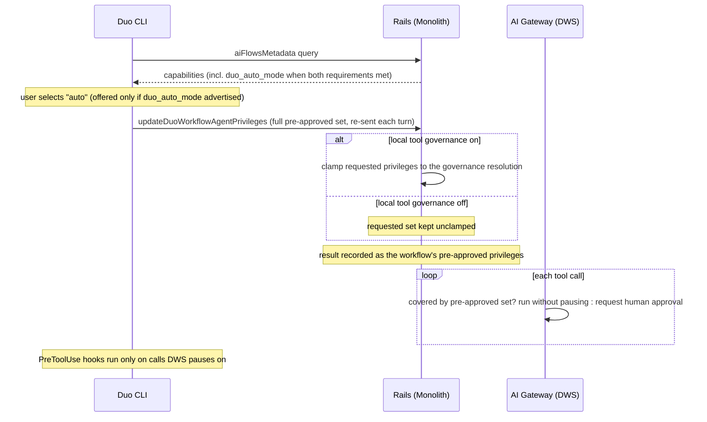



この文書は、現在の**自動モード**の概要と、CLI での動作の仕組みを説明します。セクション 1 〜 3 は、現在の動作を説明します。[§4](#4-which-ask-auto-mode-relaxes)は、自動モードが管理者のツールルールをどう扱うかについて決定したルールを記録しており、イテレーション 1 で実装します。自動モードの今後の方向性は、[§5](#5-where-this-is-heading)を参照してください。

## 1. 自動モードとは {#1-what-auto-mode-is}

自動モードは、Duo CLI の `build` と `plan` に続く 3 つ目のエージェントモードです。選択すると、管理者が自動モードを有効にし、そのツールを制限していない場合に、エージェントは呼び出しごとの承認のために停止せず、ツールを実行できます。

解決する問題：Duo のワークフローを自律的に実行させるには、ほぼすべてのツール呼び出しで承認プロンプトに応答する必要があります。それを回避する既存の方法は大まかなものです。管理者が権限グループ全体（`run_commands`、`use_git` など）を、そのグループ全体について常に許可するよう設定するか、ユーザーが `--dangerously-skip-permissions` を付けて CLI を起動します。後者は、プロセス全体に対してツール一式を事前承認し、セッションの途中でオフにできません。現在の自動モードは、実質的に、ユーザーがセッション内でオンとオフを切り替えられ、管理者が有効にした場所でのみ表示される `--dangerously-skip-permissions` です。自動モードで実行できる内容をツール単位で管理する仕組みは、イテレーション 1 で導入します（[§4](#4-which-ask-auto-mode-relaxes)を参照）。

自動モードは**ベータ版**で、**デフォルトではオフ**です。次の両方の要件を満たす場合にのみ、CLI に表示されます。

- 名前空間で `duo_auto_mode` ベータ版フィーチャーフラグが有効になっていること（ロールアウトは [`gitlab` Issue 629172](https://gitlab.com/gitlab-org/gitlab/-/issues/629172)で追跡しています）、および
- 管理者が、グループまたはプロジェクトの GitLab Duo 設定で、下位に継承される**自動モード**設定（`duo_auto_mode_enabled`）をオンにしていること。

有効にして試すには、[Duo CLI 自動モード（ベータ版）](/handbook/engineering/ai/ai-clients/developer-clients/duo-cli/auto-mode/)を参照してください。このガイドは、上記の両方の要件を満たしていることを前提にしています。

## 2. ユーザー体験 {#2-user-experience}

詳しい使用手順は、[Duo CLI 自動モード（ベータ版）](/handbook/engineering/ai/ai-clients/developer-clients/duo-cli/auto-mode/)ガイドを参照してください。この体験の背景にある設計上の選択は、次のとおりです。

- **セッション単位で、永続化しません。** 他のエージェントモードと同様に `Tab` で自動モードを選択し、セッション間では引き継ぎません。新規、再開、または `/new` のセッションは、`build` モードで開始します。
- **次のプロンプトから適用します。** CLI は、ターンごとに権限セットを再送信します（[§3](#3-how-it-works)を参照）。そのため、モード変更はキーを押した時点ではなく、次のプロンプトから適用します。
- **見た目で区別できます。** 自動モードは `&` の接頭辞付きで黄色く表示し、プロンプトの上に通知を固定するため、ユーザーは常にオンであることを認識できます。
- **対話型 CLI のみです。** ヘッドレス実行や、同じセットをすでに事前承認する `--dangerously-skip-permissions` の使用時、または ACP 経由で接続する IDE クライアントには提供しません。
- **プロンプトなしで実行するもの。** ファイル書き込みツールをすでに確認なしで実行する `build` モードに加え、自動モードでは、コマンド、Git 操作、GitLab への書き込み、MCP ツール、サブフローの開始を事前承認します。
- **引き続きプロンプトを表示するもの。** 事前承認セットに含まれないすべての呼び出しです。管理者のツールルールがそのセットを狭めるのは、ローカルツールガバナンスが有効な場合だけです（[§3](#3-how-it-works)を参照）。その場合、デフォルトか明示的かを問わず、すべての `ask` でプロンプトを表示します。イテレーション 1 で、これを変更します（[§4](#4-which-ask-auto-mode-relaxes)を参照）。

## 3. 動作の仕組み {#3-how-it-works}

現在の自動モードは、**クライアント主導で事前承認し、サーバー側で強制適用する仕組み**です。独立した自動モードの判断エンジンはありません。`build` と `plan` モードがすでに使っている権限の事前承認の仕組みを、事前承認する権限の完全なセットで再利用します。

1. **機能の通知。** CLI が接続すると、両方の要件を満たす場合に、Rails はフローメタデータ内で `duo_auto_mode` 機能を報告します（`Ai::FlowsMetadataService`。`aiFlowsMetadata` GraphQL クエリを通じて公開します）。その場合にのみ、CLI はモードの切り替え候補に `auto` を表示します。
2. **権限の送信。** `auto` を選択すると、CLI は、ヘッドレス CLI の事前承認セットを再利用し、`updateDuoWorkflowAgentPrivileges` ミューテーションを通じて、ワークフローに対する事前承認権限の完全なセットを送信します。CLI はターンごとにセットを再設定するため、モード変更は次のプロンプトから適用されます。
3. **ローカルツールガバナンスがオンの場合のみ、ガバナンスによる制限。** CLI セッションでは、トップレベルグループで `duo_workflow_local_tool_governance` フラグが有効でない限り、Rails は制限を行わず、要求されたセットをそのまま記録します。フラグがオンの場合、Rails は、要求された権限と、管理者が作成したツールガバナンスの解決結果（[ADR-009](009_ai_governance.md)）の共通部分を取り、その結果を記録します。その解決結果が事前承認するのは、ルールが `allow` に解決されるツールのみです。そのため、デフォルトか明示的かを問わず、すべての `ask` で引き続きプロンプトを表示し、自動モードが `build` に追加するものはほとんどありません。イテレーション 1 で、これを変更します（[§4](#4-which-ask-auto-mode-relaxes)を参照）。
4. **サーバー側での強制適用。** AI Gateway（DWS）は、ターンごとにワークフローの事前承認セットに従い、そのセットに含まれるツール呼び出しでは停止しません。それ以外は、Rails を通じて解決する人間による承認に回すか、エラー時にはフェイルクローズします。
5. **ローカルフック。** CLI の PreToolUse フックが実行されるのは、サーバーが停止する呼び出しのみです。事前承認された呼び出しは、承認のためにクライアントへ送り返されないため、フックからは見えません。プロンプトを表示する呼び出しでは、引き続き利用できます。

## 4. 自動モードが緩和する `ask` {#4-which-ask-auto-mode-relaxes}

このセクションは、イテレーション 1 で実装する決定を記録します。[§3](#3-how-it-works)で説明した現在の動作には、まだ含まれていません。

ローカルツールガバナンスがオンの場合、自動モードが `allow` に引き上げるのは、**デフォルト**の `ask`（管理者が設定していないツール）だけです。管理者が明示的に設定した `ask` では、引き続きプロンプトを表示し、`deny` は何によっても上書きしません。管理者向けに一文で言うと、ツールを未設定にしておくと自動モードで実行できる場合がありますが、「ask」と設定すると、常に確認を求めます。

| ツールに対する管理者のルール | 自動モード以外 | 自動モード |
| --- | --- | --- |
| なし（デフォルトの `ask`） | 確認 | 許可 |
| 明示的な `ask` | 確認 | 確認 |
| `deny` | 拒否 | 拒否 |
| `allow` | 許可 | 許可 |

GitLab の読み取りツールは、デフォルトで `ask` ではなく `allow` です。クライアントができるのは、引き続き結果を狭めることだけです。たとえば、`plan` モードでのファイル編集のように、現在のモードが要求しないツールは、そもそも提供されません。

このルールは、[`gitlab` ワークアイテム 631439](https://gitlab.com/gitlab-org/gitlab/-/work_items/631439)で決定し、[`gitlab` ワークアイテム 630345](https://gitlab.com/gitlab-org/gitlab/-/work_items/630345)によってサーバー側で実装します。取り消し可能な決定であり、見直すことができます。デフォルトの場合と明示的な場合の `ask` は、管理者には同じように見えることがあるため、自動モードの設定とツールルールの UI で、自動モードがどのルールに従うかを示す必要があります。

## 5. 今後の方向性 {#5-where-this-is-heading}

現在の自動モードは、[§3](#3-how-it-works)で説明したクライアント主導の事前承認です。後続の取り組みは、次のエピックで追跡しています。

- **イテレーション 1：制限と記録**（[`gitlab-org` ワークアイテム 23670](https://gitlab.com/groups/gitlab-org/-/work_items/23670)）では、[§4](#4-which-ask-auto-mode-relaxes)のルールに従って、ローカルの利用環境にガバナンスによる制限を適用し、自動承認された呼び出しの監査記録を追加します。
- **イテレーション 2：エージェントによる承認**（[`gitlab-org` ワークアイテム 23683](https://gitlab.com/groups/gitlab-org/-/work_items/23683)）では、自動モードがプロンプトなしで実行できる呼び出しを判断する、エージェントベースの分類器を検討します。
- **ロールアウトと進捗**は、[`gitlab-org` ワークアイテム 23697](https://gitlab.com/groups/gitlab-org/-/work_items/23697)で追跡しています。
