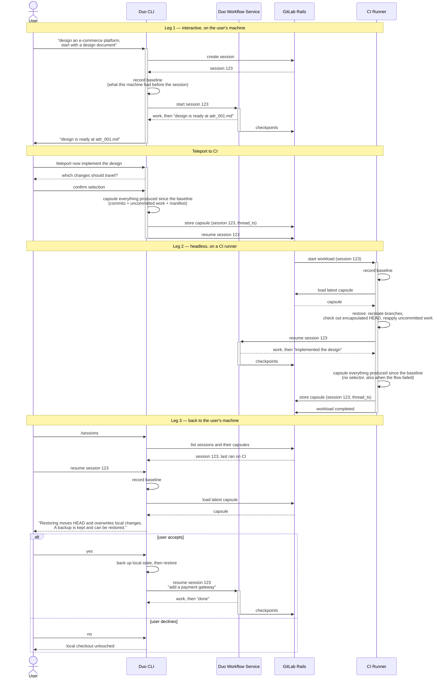



## 概要 {#summary}

このブループリントは、複数のサーフェスにまたがる DAP セッションの設計を示します。

## 課題 {#challenges}

現在、DAP セッションは開始元のサーフェスに固定されています。
たとえば、Duo CLI で開始したセッションを CI Runner のサーフェスにテレポートできません。
逆に、作業アイテムへの @ メンションでトリガーされ、CI Runner のサーフェスで実行されたセッションを、
所有者が追加の修正を加えたくても、Duo CLI で継続できません。

## 目標 {#goals}

互換性のあるサーフェス間でセッションをテレポートできるようにします。

1. Duo CLI から CI Runner へのテレポート
1. IDE Chat から CI Runner へのテレポート
1. CI Runner から Duo CLI へのテレポート
1. CI Runner から IDE Chat へのテレポート

ファイルシステムやシェルを含む、同じ水準のリソースにアクセスできる場合、
サーフェスには互換性があると見なします。この考え方では、ウェブの Agentic Chat と
CI Runner は、一方がシェルアクセスを提供し、他方は提供しないため、互換性が**ありません**。

テレポートされたセッションは、エージェントが新しいサーフェスで大きなオーバーヘッドなく作業を再開でき、
ハルシネーションのリスクも低くなるよう、十分なコンテキストを保持する必要があります。

## プロダクト上の決定 {#product-decisions}

以下の実装は、いくつかのプロダクト上の問いへの回答によって変わります。
技術的な詳細を必要としない読者が、まとめて問いを確認し、回答できるよう、ここに集めています。回答が出るまでは、
この文書は 3 列目の前提に基づいて進めます。各問いには、
その影響を検討するセクションを示しています。「決定」列には、回答が得られた時点で、
回答したレビュアーへのリンクとともに記録します。

| # | 問い | 決定 | この文書での前提 | 重要な理由 |
| --- | --- | --- | --- | --- |
| 1 | **複数レッグのテレポート。** セッションは、CLI → CI → CLI、CI → CI、2 台目のマシンなど、複数回移動する想定ですか。また、以前のレッグや分岐したチェックポイントに戻れる必要がありますか。 | はい。セッションは複数回移動できる必要があります | はい。複数レッグは対象範囲です（ユーザーストーリーだけでも 3 レッグあります）。以前のレッグや分岐したチェックポイントに戻れることは望ましいものの、必須ではありません | カプセルを組み合わせる必要があるかが決まります。1 回の引き継ぎはどの設計でも簡単です。連鎖は隠し ref では自然に扱えますが、blob ベースの方式では累積カプセルかクライアント側での再実行が必要です。「複数レッグのセッション」と「決定」の決定表で検討します |
| 2 | **レッグのカプセルを読める人。** 現在のセッションと同じく、カプセルはセッション所有者（と監査担当のロール）だけに見える必要がありますか。それとも、リポジトリを読める全員に見えても構いませんか。 | 所有者 | 未定です。両方のストアを分析します。隠し ref の分析は、リポジトリの読み取り権限を持つ人への公開が認められると仮定しています | カプセルには未 push のソースと変更のあるワークツリーが含まれます。所有者限定なら、カプセルをリポジトリに保存する方式（隠し ref）は除外されます。リポジトリの読み取り権限を持つ人への公開は、`refs/merge-requests/*` がすでに採用している範囲です。「選択肢：隠し ref」と「決定」の決定表で検討します |
| 3 | **プロジェクトのないテレポート。** グループに紐付いたセッションや、どのコンテナーにも紐付かないセッションもテレポートできる必要がありますか。 | **不要** — @aying-gl [1](https://gitlab.com/gitlab-org/modelops/applied-ml/code-suggestions/ai-assist/-/merge_requests/6673#note_3888084612)、@bastirehm [2](https://gitlab.com/gitlab-org/modelops/applied-ml/code-suggestions/ai-assist/-/merge_requests/6673#note_3893543436) | 不要です。現在、CI のレッグにはプロジェクトが必要です | 現時点では CLI ↔ IDE だけに影響します（CI のレッグにはプロジェクトが必要です）。回答が _はい_ なら、プロジェクトにスコープを限定するすべてのストアが除外されます。回答がいいえなので、この文書では全体を通じてプロジェクトがあると仮定します |
| 4 | **テレポートでフローは変えません。** セッションは 1 つのフロー設定（`developer/1.0.0`、`fix_pipeline/1.0.0`、…）を実行し、テレポートはそのセッションをサーフェス間で移動します。`developer` セッションを `fix_pipeline` セッションに変換したり、その逆を行ったりはしません。これが意図した範囲ですか。 | はい。セッションはフローに紐付いたままです | はい。セッションはそのフローを維持します。フロー間の引き継ぎは対象外です | 会話もフローも同じまま、サーフェスだけを変える純粋な移動の仕組みに保てます。フロー間の引き継ぎは、別のセッションの出力を元に新しいセッションを作る別機能であり、プロダクト側が求めない限り対象外です。「適格性」で検討します |
| 5 | **再開可能なフローだけをテレポートします。** レッグの終了後に再び人間の入力を受け取れるのは、設定に `environment: chat` または `chat-partial` を宣言するフローだけなので、テレポートはこれらに限定します。これは許容できますか。また、現在どのフローが除外されますか。 | はい。再開可能なフローだけが対象です | はい。`chat` と `chat-partial` のフローだけです | ambient フローは完了するとどのサーフェスでも再開できないため、テレポートする先がありません。この確認には、Rails がまだ永続化していないフロー単位の情報が必要です。「適格性」と「別の問題：`environment` は 2 つの異なるものを指します」で検討します |
| 6 | **前提条件としての push アクセス。** テレポートの条件として、ユーザーにプロジェクトへの push アクセス（Developer）を要求してよいですか。 | **はい、許容できます** — @bastirehm [1](https://gitlab.com/gitlab-org/modelops/applied-ml/code-suggestions/ai-assist/-/merge_requests/6673#note_3893564134)。フローの実行はすでに Developer に限定されています。@aying-gl [2](https://gitlab.com/gitlab-org/modelops/applied-ml/code-suggestions/ai-assist/-/merge_requests/6673#note_3888091670)は、これは問い 2 に包含されると提案しています | 許容できます。テレポートされたセッションはいずれにせよブランチを push することになるため、Developer アクセスを前提とします | カプセル化が push になる隠し ref には当てはまりますが、blob ベースのストアには当てはまりません。ブランチを push できないユーザーはテレポートできません。「決定」の決定表で検討します |
| 7 | **引き継ぎ時の開始元の未コミット作業の扱い。** `/teleport` の後、ユーザーのローカルチェックアウトの未コミットの変更は、そのまま残しますか、stash しますか、それともコミットしますか。 | _保留_ | そのまま残します（プロトタイプの動作）。復元ではローカルの状態をバックアップして上書きします | 引き継ぎ後にユーザーがローカルで目にする状態と、戻ったときに同じ内容と衝突するかが変わります。「複数レッグのセッション」で検討します |
| 8 | **デフォルトでのヘッドレスのカプセル化。** CI のレッグは、失敗時や、シークレットを含む可能性のあるファイルも含め、残したものすべてをセレクターなしで常にカプセル化するべきですか。 | _保留_ | はい。無視対象以外はすべて、成功時も失敗時もベストエフォートで処理します。シークレットの露出については注意点を示しますが、解決はしません | ビルド出力やシークレットのカプセル化と引き換えに、次のサーフェスが受け取れるものを最大化します。対話型のサーフェスにはファイルごとのセレクターを提供しますが、CI は確認を求められません。「サーフェス」で検討します |
| 9 | **保持するレッグの数。** 最新のものだけですか。それともセッションの期限が切れるまで（30 日間）、すべてのレッグを保持しますか。 | 期限切れまで、すべてのカプセルを保持します | セッションの期限が切れるまで（30 日間）、すべてのレッグを保持します。専用ストアは TTL まで全カプセルを保持し、隠し ref は祖先関係によって全レッグを保持します | 最新のみの保持が最も安価ですが、以前のレッグに戻ったり、分岐したチェックポイントと対応させたりできなくなります（問い 1）。「複数レッグのセッション」と「選択肢：隠し ref」で検討します |
| 10 | **プロジェクトのエクスポート/インポート（またはフォーク）後もカプセルは残りますか。** セッションのチェックポイントは残りません。インポート/エクスポートの関係ツリーに含まれないため、コピーされたプロジェクトには会話履歴がありません。それらのチェックポイントに属するワークツリーの状態も、同様に扱うべきですか。 | **いいえ** — @aying-gl [1](https://gitlab.com/gitlab-org/modelops/applied-ml/code-suggestions/ai-assist/-/merge_requests/6673#note_3888094280)、@viktomas [2](https://gitlab.com/gitlab-org/modelops/applied-ml/code-suggestions/ai-assist/-/merge_requests/6673#note_3856675817)、@pmartinsgl [3](https://gitlab.com/gitlab-org/modelops/applied-ml/code-suggestions/ai-assist/-/merge_requests/6673#note_3837532591) | いいえ。カプセルはチェックポイントに従い、移動しません。これは両ストアの既定動作であり、新しい仕組みは不要です。既存の動作を壊さないことだけが必要です（「選択肢：隠し ref」を参照） | カプセルとチェックポイントは、1 つのセッションの 2 つの構成要素です。両者が離れると、コピーされたプロジェクトに、会話が失われたカプセルが残る可能性があります。復元不能でも、開始元の未 push のソースは含まれたままです。エクスポートは Maintainer/Owner がダウンロードでき、サポートチケットにも日常的に添付されるため、これは正しさと同じくらい情報開示に関わる問いです。「選択肢：隠し ref」で検討します |

## ユーザーストーリー {#user-story}

ユーザーとして、まったく新しい EC プラットフォームを設計したいと考えています。まずは対話モードで、
大まかな設計について素早く協働したいです。アイデアや要件をエージェントと話し合い、それを
設計文書として記録したいです。私たちとエージェントの認識が一致したら、
プロセスの中でも労力のかかる部分をクラウド（CI）のサーフェスに任せ、私たちは他のタスクに集中しながら、
DAP エージェントには合意した設計に沿って作業を続けてもらいたいです。エージェントの作業が終わったら、
成果物をレビューし、認識のずれや、それによって生じた追加作業を、再び対話モードで
素早く仕上げたいです。

### シーケンス図 {#sequence-diagram}

ユーザーストーリーをシステム間のやり取りに置き換えたものです。この図は意図的に
ストアに依存しない形にしています。**store capsule** と **load capsule** は、選択した仕組みを表します。
tar のアップロードとダウンロード、またはセッション ref の `git push`/`git fetch` とレッグの登録です。
それ以外は、どちらの方式でも同じです。



## 実装 {#implementation}

### 用語 {#terminology}

文書の残りの部分では、以下の用語をここに示す一定の意味で使用します。

| 用語 | 意味 |
| --- | --- |
| **セッション** | チェックポイント履歴を持つ 1 つの DAP の会話です。Rails では `Ai::DuoWorkflows::Workflow` レコードとして永続化します。「セッション」と「ワークフロー」は同じものを指し、前者はユーザーの視点、後者は Rails の視点です。セッションは個々の実行を超えて存続します |
| **サーフェス** | セッションを実行する環境です。Duo CLI、IDE チャット、CI Runner、ウェブチャット などです。ファイルシステムとシェルという同じリソースを提供する場合、2 つのサーフェスには**互換性**があります。これにより、サーフェス間の移動に意味が生まれます |
| **レッグ** | 1 つのサーフェスでのセッションの 1 回の実行です。セッションを受け取った時点から、引き継ぐ（または停止する）時点までを指します。セッションは順序のあるレッグの列であり、ユーザーストーリーだけでも CLI → CI → CLI の 3 レッグあります。レッグは**ベースライン**の記録で始まり、最大 1 つの**カプセル**を生成して終わります |
| **テレポート** | エージェントが継続できるよう、あるサーフェスから別のサーフェスにセッションを移動することです。1 つのレッグの終了時に生成されたカプセルを、次のレッグの開始時に復元します。 |
| **ベースライン** | マシンでセッションがアクティブになったときの、ローカルの Git 状態のスナップショットです。どのブランチが存在し、どこを指していたかを記録します。「この場所での、このセッションの前」という境界を定義するため、エージェントが触れた ref を知らなくても、カプセル化でセッションが生成したものを取得でき、受信側のマシン自身の作業を除外できます。ローカルの `refs/duo-session-local/<id>/…` に記録し、GC から保護します。セッション全体を通して存続する必要があります。「ベースラインが範囲を定める対象」を参照してください |
| **境界** | セッションでカプセルを切り出す時点です。レッグの終わりであり、`thread_ts` を通じてチェックポイントと結び付きます。セッションが継続のために人間の入力を待っている場合（承認待ち、または現在の指示を完了した状態）、境界は _安定している_ と見なします。 |
| **カプセル** | レッグの終了までにセッションが生成したすべて（累積）を、別のサーフェスが復元できる形にしたものです。ベースライン以降のコミット、未コミットの（変更のある）ワークツリー、マニフェストを含みます。物理的には `git bundle` + パッチ + `manifest.json` を含む tar です。 |
| **マニフェスト** | 推測せずにカプセルを復元するためのメタデータです。スキーマのバージョン、セッション ID、`thread_ts`、どの ref が HEAD か、他にどのブランチを含むか、未コミットの変更の適用先、カプセルを切り出したときのベースラインを含みます（ベースラインはデバッグ用の参考情報にすぎず、各サーフェスは独自のベースラインを記録する必要があります） |
| **復元** | 受信側のサーフェス上でカプセルを再構築することです。コミットの fetch、ブランチの再作成、HEAD の移動、変更のあるワークツリーの再現を行います。 |
| **チェックポイント / `thread_ts`** | DWS が永続化した会話の状態です。ステップごとに 1 行あり、30 日間保持します。`thread_ts` はチェックポイントの時間順の ID です。ワークツリーと会話を対応させるため、カプセルは切り出した時点の `thread_ts` を記録します |
| **隠し ref** | `refs/heads/*` と `refs/tags/*` の外にある Git ref です。ブランチでもタグでもなく UI には表示されませんが、リポジトリ内に存在して fetch できます。GitLab はすでに `refs/merge-requests/*`、`refs/pipelines/*`、`refs/keep-around/*`、`refs/workloads/*` を使用しています。却下されたストレージ案では、`refs/duo-session/<id>` にカプセルを保持します |
| **レッグコミット** | 隠し ref のレイアウトで、カプセル**そのものとなる**合成コミットです。親 = HEAD、レッグが生成したブランチ、前のレッグコミット。ツリー = 変更のあるワークツリー。メッセージ = マニフェスト。管理専用で、チェックアウトもマージもしません |
| **フローの `environment`** と **`Workflow#environment`** | 名前は同じでも、役割が異なる 2 つの関連した概念です。フローの environment（`chat`、`chat-partial`、`ambient`）は DWS が読み込むフロー設定で宣言し、動作を決定します。`Ai::DuoWorkflows::Workflow#environment` は開始元のサーフェスを記録する Rails の enum です。「別の問題：`environment` は 2 つの異なるものを指します」を参照してください |

### 影響を受けるコンポーネント {#affected-components}

#### Rails {#rails}

##### 役割 {#role}

Rails は、レッグがカプセルを置き、次のレッグがそれを受け取る場所です。カプセル化と復元は
サーフェスで行います。Rails は、あるサーフェスが保存したものを、互換性のある他の
サーフェスが、セッションをまだ再開できる間は見つけて取得できるようにするだけです。カプセル自体とともに、
Rails はそれを可能にする少量のメタデータ、つまり、どのセッションか、どの
チェックポイント（`thread_ts`）か、どのカプセルが最新かを保持し、保存と読み取りが許可される人を制御します。

##### 要件 {#requirements}

平たく言うと、Rails が提供するストアは次の条件を満たす必要があります。

1. **どのサーフェスも保存と読み込みができます。** ノート PC の CLI、IDE、CI Runner は、すでに持っている認証情報で、
   1 つの仕組みを通じて、カプセルの書き込み**と**読み取りの両方ができる必要があります。すべての
   方向（CLI → CI、CI → CLI、CI → CI、CLI → CLI）で同じように動作させるためです。
1. **適切な人だけが読み取れます。** 現在、セッションは所有者と監査担当のロールに公開されています。
   カプセルは未 push のソースコードを含むため、所属するセッションより
   広く公開してはいけません。
1. **セッション所有者だけが書き込めます。** カプセルは、エージェントがその後シェルコマンドを実行し得る
   マシンに復元されるため、保存できる人は次のレッグで実行される内容に影響できます。
   セッションのカプセルを保存できるのは、そのセッションの所有者、または所有者に代わって動作し、
   所有者として解決され、そのことが検証された CI サービスアカウントだけです。
1. **大きなファイルをウェブプロセスに通してはいけません。** カプセルは数十 MB になる可能性があります。
   GitLab の他のすべてのファイル型と同じく、アップロードとダウンロードは Puma を迂回する必要があります。
1. **カプセルはセッションと同じ期間存続し、その後消えます。** チェックポイントは 30 日間保持します。
   それがなくなればカプセルも役に立たないため、セッションや
   プロジェクトを削除した場合も含め、確実に削除する必要があります。
1. **セッションごとに多数のレッグを扱えます。** 最新のカプセルの復元に、それより古いカプセルの
   事前取得を必要とせず、「最新」が曖昧にならないようにします。
1. **2 つのサーフェスによる同時書き込みを検出する必要があります。** 気付かないうちに「最新」が 2 つ生じてはいけません。
1. **Rails がカプセルを理解する必要はないようにします。** 内部レイアウトはクライアントの責務であり、
   Rails のリリースなしで変更できる必要があります。
1. **運用担当者が GitLab データに期待する機能を得られます。** Geo レプリケーション、バックアップ、ストレージ使用量の集計、
   そして可能な場合は push を保護するものと同じシークレットスキャンです。

##### 適格性 {#eligibility}

テレポートできるセッションを、2 つの制約で定義します（プロダクト上の決定 4 と 5）。第 1 に、テレポートで
フローは変更しません。セッションは 1 つのフロー設定を実行し、ワークフロー行の
`workflow_definition` に記録します。各レッグは、新しいサーフェスで同じフローを再開します。
`developer` → `fix_pipeline` の変換はなく、設計上も不要です。第 2 に、
下の DWS セクションで導く再開可能性の制限です。フローが再び人間の入力を受け取れる
セッション（`environment: chat` または `chat-partial`）だけを対象とします。

第 2 の制約はクライアント任せにせず、カプセルアップロードの API 境界で適用します。
これにより、使えないカプセルがストレージに入るのを防ぎ、どの
クライアントも再開可能性を自らモデル化せずに制約を知ることができます。

**プロトタイプでは、意図的にこれを実装していません。** 確認に使える唯一のフィールドが
フローを表していないため、現状それを使ってゲートを作っても、制御しているように見えるだけだからです。
これは別の問題として次のセクションに記録しています。適切な修正は、
中核となる仕組みの実証ではなく、本番運用に向けて重要になります。

Duo Workflow Service は、クライアントと Rails が使う適格性エンドポイントを公開します。https://gitlab.com/gitlab-org/modelops/applied-ml/code-suggestions/ai-assist/-/work_items/2861 を参照してください。

###### 別の問題：`environment` は 2 つの異なるものを指します {#orthogonal-environment-names-two-different-things}

関係のない 2 つの概念が同じ名前を共有しており、上記の適格性チェックは
誤った方を読み取ることになります。

- **フローの `environment`** は、DWS が読み込むフロー設定で宣言します（`chat`、`chat-partial`、
  `ambient`）。DWS は実際の動作をこれで決めます。コンポーネントは `supported_environments` を宣言し、
  人間の入力コンポーネントはこれに基づいてチャット用のバリアントを選び、MCP の自動注入は
  `chat`/`chat-partial` に限定されます。以下の DWS セクションで扱うのは、この値です。
- **`Ai::DuoWorkflows::Workflow#environment`** は、開始元のサーフェスを記録する Rails の enum（`ide`、`web`、`chat`、`chat_partial`、
  `ambient`、`external`）です。

Rails の列には 3 つの書き込み元があり、どれもフロー設定を読みません。

| 書き込み元 | 値 |
| --- | --- |
| REST での作成 | クライアントが指定した値を、そのまま渡します |
| `CreateAndStartWorkflowService` | Rails 自身の `Ai::Catalog::FoundationalFlow` 定義ファイルにハードコードした `environment`（`developer/v1` は `web` を宣言し、属性のデフォルトは `ambient` です） |
| `Ai::Catalog::ExecuteWorkflowService` | 定数 `WORKFLOW_ENVIRONMENT = 'web'` |

###### リスク：カプセルとチェックポイントの乖離（DWS のレッグシグナルで一部対処） {#risk-capsules-and-checkpoints-can-drift-apart-partially-addressed-by-the-dws-leg-signal}

カプセルと、セッションが実際にいるチェックポイントを結び付けるものはありません。そのため、セッションには
独立した 2 つの先端があります。どのサーフェスでセッションを実行してもサーバー側で進むチェックポイントの先端と、
クライアントがカプセル化を選んだときだけ移動するカプセルの境界です。カプセル化は
クライアントが開始する任意の操作なので、最新のカプセルが、会話ではすでに
通過した境界を表している可能性があります。

次のシナリオを考えます。

1. ユーザーが CI でセッションを開始します。
1. CI のレッグが終了し、チェックポイント `C1` で切り出したカプセル `P1` をアップロードします。
1. ユーザーがノート PC でセッションを復元し、会話を続けるため、チェックポイントの
   先端が `C2` に進みます。そのレッグはカプセル化せずに終了します。
1. 2 台目のマシンで、ユーザーが同じセッションを再び復元します。最新のカプセルは依然 `P1` で、
   チェックポイントの先端は `C2` です。

影響を受けるのは、2 台目のマシンのユーザーです。復元は警告なく成功し、
`C1` の境界のワークツリーを再構築する一方、エージェントは `C2` から会話を再開します。ディスク上のファイルは、
エージェントが継続していると認識する履歴より古いのに、どちらの側も
それを知らせません。

ノート PC のレッグは何も間違っていません。カプセル化は明示的に選ぶ操作であり、カプセル化せずにレッグを終了するのが
デフォルトです。そのため、明示的にカプセルを作らないレッグは、2 つの先端をさらに離していきます。

DAP が複数人で使えるようになると、乖離はより深刻になります。同じユーザーの 2 台目のマシンではなく、
2 人目のユーザーに影響し、最初の人がカプセル化せずにローカルでセッションを進めたことを知る手段がないためです。
現在、セッションは所有者にスコープを限定しています（`for_user_with_id!`）。したがって、このケースは
現時点で到達可能なものではなく、将来のものです。

カプセルレコードには、切り出したチェックポイントを記録する `thread_ts` がありますが、
整合性を保証するものではありません。プロトタイプのクライアントは、失敗してもよい専用の「最新
チェックポイント」クエリで、ベストエフォートで解決します。サーバー側でもこのフィールドは任意です。本番運用では、Rails は値を記録し、
決して導出してはいけません。レッグの終了時点について、サーバーが持つ知見は最も少ないからです。DWS はレッグの完了を通知します
（[`gitlab-org&23540`](https://gitlab.com/groups/gitlab-org/-/work_items/23540)。クライアント側では
[`gitlab-org&23543`](https://gitlab.com/groups/gitlab-org/-/work_items/23543)で利用します。この実行主体へのシグナルには、最終
チェックポイントの `thread_ts` を含めます。これにより、記録する値はクライアントの推測ではなく、DWS が保証する値になります。それでも、この値が表すのは
カプセル化時点の状態だけです。その後にチェックポイントが進むのを止めるものはありません。そのため、
`latest` の読み取り（隠し ref では `GET …/legs/latest`）では、最新のチェックポイントが
カプセルの `thread_ts` より先にあるかも報告します。

最後に、カプセルを破損させる可能性のあるレッグの同時実行を防ぐため、ロックの仕組みを導入する必要があります。

##### ストレージの選択肢 {#storage-options}

カプセルを保持し、最初の要件である「どのサーフェスも書き込みと
読み取りの両方ができる」を満たす場所は、3 つあります。

| 選択肢 | 採用 | カプセルの保存先 | 一言で表すと |
| --- | --- | --- | --- |
| 専用カプセルストア | はい | この機能が所有する新しいテーブルと、新しいオブジェクトストレージの保存先 | Rails が不透明な blob を保存、配信します |
| 隠し ref | いいえ | プロジェクト自身の Git リポジトリの `refs/duo-session/<workflow_id>` 以下 | カプセル**自体が** Git データです。すべてのサーフェスが push と fetch を行います |
| 汎用パッケージレジストリ | いいえ | プロジェクトのパッケージレジストリ内の汎用パッケージ | アップロード経路、保持、クォータを持つ既存の blob ストアを再利用します |

詳細な分析をせずに却下したもの：**CI ジョブアーティファクト**。CI のレッグにはほぼ理想的です
（Workhorse によるアップロードの高速化、`expire_in`、Geo、バックアップ、回収、使用量の集計がすべて実装済みです）が、ノート PC では
作成できず、最初の要件を満たしません。また、共有の **`uploads` バケット**。新機能での `Upload`
レコードの利用は推奨されず、ローカルパスは `public/` 以下にあります。

##### 決定 {#decision}

他の 2 案よりも優れたプライバシーを提供するため、**専用カプセルストア**を採用しました。
詳細は、こちらの[ディスカッション](https://gitlab.com/gitlab-org/modelops/applied-ml/code-suggestions/ai-assist/-/merge_requests/6673#note_3963333357)を参照してください。

レジストリは劣後していました。隠し ref より優れている点（push アクセス不要、Gitaly の ref 増加なし）は
専用ストアも同じように上回り、さらにセッション所有者にスコープを限定できないため、決定は
2 案の比較になりました。構築の労力は判断を分ける要因では**ありません**でした。どちらも、ほぼ一般的な
作業で数週間です。以下の行は、決定に影響する要素が先になるように並べています。

| 決定の判断材料 | 専用カプセルストア | 隠し ref |
| --- | --- | --- |
| カプセルを読めるのはセッション所有者（と監査担当のロール）だけでなければなりませんか。 | はい。アクセスは Rails のポリシーチェックで制御します | 発見できないという意味では、はい。名前空間を隠しますが、そのためレッグの書き込み方法の変更も必要です（「選択肢：隠し ref」を参照）。厳密に所有者限定という意味では、いいえ。リポジトリを読める人は SHA 指定の fetch を引き続き利用できます |
| push アクセスのないユーザー（Reporter、Guest）もテレポートできる必要がありますか。 | はい | いいえ。カプセル化は push なので、後から書き込みを所有者に限定しても、`push_code` が最低条件です |
| 複数レッグのセッション、チェックポイントの分岐、以前のレッグからの復元は対象ですか。 | 動作しますが、累積 bundle かクライアント側の連鎖の再実行が必要です。各レッグでアーカイブ全体を再送します | 標準で対応します。ネゴシエーション、祖先関係、1 つの ref を利用します |
| 開始元とのやり取りなしに、カプセルは自己完結しますか。 | いいえ。リモートにないコミットは取得不能な前提コミットになります。クライアントが `ls-remote` で確認し、拒否します | はい。オブジェクトは正規のストアに存在し、足りないものはネゴシエーションで取得します |
| カプセル化した内容をシークレットスキャンするべきですか。 | 新しい非同期のサブシステムが必要です。展開、スキャンに加え、同期的な拒否のタイミングがないため、隔離/通知の経路も必要です | ほぼ追加作業なしです。シークレット push 保護が、すべての push で同期的に実行され、ブロックします |
| 同時実行のレッグを検出しますか。 | 構築が必要です | 追加作業なしです。`--force-with-lease` を利用します |
| 構築、運用する必要があるもの | 新しい blob 型です。`SUPPORTED_TYPES`、Geo レプリケーター、バックアップタスク、ストレージ使用量の集計、2 段階削除の回収処理、`dependent:` 処理、書き込みがサーバー側でなければ Workhorse のルートが必要です。広範ですが、各要素は既存の型に従います | レッグのテーブル、2 つのエンドポイント、既存パターンに基づく ref クリーンアップのライフサイクルが必要です。名前空間を隠す場合は、登録済み名前空間にクライアントから push できないため、レッグの書き込み方法も変更します。範囲は狭い一方、ある点で前例が少なくなります。既存オブジェクトを固定するのでなく、まったく新しいオブジェクトを書き込む初めての隠し ref 利用なので、ref のライフサイクルと異なり、オブジェクト量は未検証です |
| エクスポート/インポートやフォーク後もカプセルは残りますか（プロダクト上の決定 10）。 | いいえ。テーブルはインポート/エクスポートの関係ツリーに含まれません | いいえ。`duo-session` を `Repository::RESERVED_REFS_NAMES` に追加しなければ、インポート後の掃除で削除されます。フォークは標準の名前空間だけをクローンします |
| 動作できなくなる条件 | オブジェクトストレージまたは Rails が停止している場合 | Gitaly が停止している場合。その時点ですでに CI のレッグもクローンできません |

決め手は最初の行でした。カプセルを所有者に限定できるのは専用ストアだけです。隠し ref が
提供するのは発見の困難さであり、機密性ではありません。リポジトリを読める人は誰でも SHA 指定の fetch を引き続き利用できます。

**選択の代償。** 隠し ref の方が堅牢な転送方式でしたが、その利点は意図的に手放しました。
`git push` はサーバーにないものだけを再送し、アトミックな ref 更新として反映され、
`--force-with-lease` で同時書き込みを拒否します。カプセルのアップロードには、これらの
性質がありません。この結果必要となる対応は、下の「構築が残っているもの」に、
新しい blob 型ごとに必要な Geo、バックアップ、使用量の集計の作業とともに記載しています。

3 つのストアすべての転送、運用コスト、堅牢性、変更のしやすさに関する
完全な 3 案比較は、
[ADR のレビューディスカッション](https://gitlab.com/gitlab-org/modelops/applied-ml/code-suggestions/ai-assist/-/merge_requests/6673)に記録しています。

##### 採用案：専用カプセルストア {#selected-option-bespoke-capsule-store}

プロトタイプ：

- CLI: [gitlab-org/editor-extensions/gitlab-lsp!3994](https://gitlab.com/gitlab-org/editor-extensions/gitlab-lsp/-/merge_requests/3994)
- Rails: [gitlab-org/gitlab!252979](https://gitlab.com/gitlab-org/gitlab/-/merge_requests/252979)
- [デモ](https://gitlab.zoom.us/rec/play/zmZsE8mtHGP7L0g6p9_tJ1TMlO23FkfuG16nvUt0QKWC3_BaS6-46-izJ_2aVpiIVk2q2GuoPvrG99X2.pMZ1-KRxY3miWEib?accessLevel=meeting&canPlayFromShare=true&from=my_recording&continueMode=true&oldStyle=true&componentName=rec-play&originRequestUrl=https%3A%2F%2Fgitlab.zoom.us%2Frec%2Fshare%2FsHFsaF9eI4t13WNZw0rrQB4HXflbRjEeOYY4IO1D16jucjdoRsHH2-kungQK4Cd_.T-6RSdsjOryCM7kL)

**Rails に新しいテーブルと新しいオブジェクトストレージの保存先を用意し、CI アーティファクトと同じように、各カプセルを不透明な
blob として保存します。これがプロトタイプで実装しているものです。**

Rails は新しい blob 型を所有します。カプセルごとに、セッション、`thread_ts`、専用の
オブジェクトストレージ保存先の blob へのポインター、保持用メタデータを含む 1 レコードを持ちます。
`Ci::JobArtifact`（`expire_at`）や `MergeRequestDiff` の外部 diff ストアと同じ、
TTL 付きアーティファクトのパターンに従います。blob は不透明で、保存と配信だけを行い、検査しません。
そのため、カプセルのレイアウトはクライアントの責務のままです。正規のリポジトリには何も
push しません。エージェントに明示的に push を指示したときだけブランチが届き、
その時点で通常のライフサイクルを持つ通常のブランチになります。

###### レコードの形態 {#record-shape}

`duo_workflow_session_capsules`:

| 列 | 型 | 注記 |
| --- | --- | --- |
| pkey: `id` | bigint | |
| `workflow_id` | bigint | `duo_workflows_workflows` への FK、`on_delete: :cascade` |
| `namespace_id` | bigint | シャーディングキー、`NOT NULL`。セッションから導出します（`namespace_id`、またはプロジェクトの `project_namespace_id`） |
| `thread_ts` | text | 境界を取得したチェックポイント |
| `file` | text | カプセル blob へのポインター |
| `file_store` | integer | ローカルまたはオブジェクトストレージ |
| `size` | bigint | |
| `expire_at` | timestamptz | 保持用メタデータ。作成時に設定します |

このテーブルのクエリで `namespace_id` は使いません。すべての読み取りは `workflow_id` を指定します。
非正規化している理由は、組織単位のテーブルには、`projects` または `namespaces` を
直接参照する null 不可のシャーディングキーが必要だからです。これにより、Org Mover は外部キーをたどらずに行を絞り込めます。

意図的に **`ref` 列を設けません**。カプセルは、含む ref の名前をマニフェストと
内部の bundle（`git bundle list-heads`）ですでに示しているため、受信側のサーフェスは
Rails の助けなしにそれを見つけられます。また、1 つの列では、
1 つの境界がまたがる複数の分岐した ref を忠実に表せません。保存すれば、
上記のベースラインの仕組みが避けようとしている、エージェントの動作の意味に関する知識を
まさに再び持ち込むことにもなります。

###### 保持 {#retention}

`expire_at` は作成時に記録し、期限切れの制御は、スケジュールされた
blob 削除に加えて、**読み取り時にも**行います。期限切れのカプセルは、blob がまだ
残っていても、一覧には表示せず、ダウンロードもできません。読み取り側で絞り込まなければ、期限切れから
回収処理の実行までの間に、チェックアウト中に消える可能性のあるカプセルをクライアントに渡してしまいます。これにより、クライアントから見えるカプセルは常に
信頼して使えるものになります。また、回収処理は純粋にストレージ領域の回収だけを扱うため、遅延や失敗が
正しさに影響しません。カプセルのアップロードには、たとえば 100 MiB の最大サイズ制限も設けるべきです。

###### ストレージの保存先 {#storage-location}

カプセルには、共有の `uploads` バケットを再利用せず、専用の
オブジェクトストレージ保存先（`duo_session_capsules`）を用意します。カプセルはリポジトリの内容を含み、ローカルの `uploads` ストレージパスは
`public/` 以下にあるため、再利用すると、公開配信されるツリー内の推測可能なパスにソースコードを置くことになります。

###### アップロードの転送 {#upload-transport}

アップロードは、GitLab が保存する他のすべてのファイル型と同様、Workhorse で高速化し、オブジェクトストレージに直接アップロードします。
ルートを Workhorse のルートテーブルに登録し、クライアントは `workhorse_authorize` から署名済み
アップロードを取得します（バイトを受け入れる前にサイズ制限も適用します）。
Rails は完成したオブジェクトだけを記録します。これは任意の選択肢ではなく、設計の一部です。プロトタイプでは、
保存と配信の契約を短時間で実証するためだけに、これを省いています。そのルートは Workhorse のテーブルになく、Rack が multipart のボディをプロセス内で解析します。

###### API {#api}

| メソッド | パス | 目的 |
| --- | --- | --- |
| POST | `/ai/duo_workflows/workflows/:workflow_id/capsules` | 境界のカプセルを保存します。multipart の `file` と、任意の `thread_ts` を渡します |
| GET | `/ai/duo_workflows/workflows/:workflow_id/capsules` | セッションのカプセルを新しい順に列挙します。必要に応じて `thread_ts` で絞り込みます |
| GET | `/ai/duo_workflows/workflows/:workflow_id/capsules/:id\|latest/download` | カプセルを取得します。`latest` は、期限切れでない最新のものに解決します |

`latest` があるのは、セッションを再開するクライアントが事前の一覧取得の往復を必要とせず、
上のシーケンス図の `/sessions` → チェックアウトのフローを 1 回のリクエストにするためです。

###### 構築が残っているもの {#what-remains-to-build}

プロトタイプがカバーするのは保存と配信だけです。却下案なら既存の GitLab の仕組みから
受け継げたすべての性質を、ここで構築する必要があります。

- 上記の直接アップロードを伴う Workhorse のルートと、
  `ObjectStoreSettings::SUPPORTED_TYPES` および統合設定（Omnibus、Charts、GDK）への型の登録。
- Geo レプリケーターと検証機能。
- バックアップタスク。
- ストレージ使用量の集計。
- オブジェクトストレージの削除失敗で blob が孤立しないようにする、2 段階削除の回収処理。
- ワークフローまたはプロジェクトの削除をカスケードしたとき、行だけでなく blob も削除するための
  `dependent:` 処理。

リポジトリへの push ではなく、不透明な blob を保存することから、3 つの不足が生じます。
どれも、採用したストアが標準では満たさない上記の要件です。

- **カプセルの内容のシークレットスキャン**（要件 9）。push はシークレット
  push 保護により同期的にスキャンされ、拒否されます。アップロードには同等の拒否のタイミングがなく、サーバー側のスキャンには
  tar の展開と、非同期での bundle とパッチの検査が必要です。これは
  「Rails がカプセルを理解する必要はない」という方針に反し、クライアントのアップロード後に拒否が発生するため、
  隔離状態と通知経路も必要になります。

  **最有力の代案は、カプセルを作る前にクライアント側でスキャンすることです。** これは、クライアントが
  同じ時点ですでに適用している 2 つのガード、前提コミットのチェックと、
  ベースラインなしでのカプセル化の拒否に合致します。その時点でいずれにせよファイルは開かれており、対話型のサーフェスは
  すでに提供するファイルごとのセレクターに結果を反映できます。未解決の点は 3 つです。確認を求められないヘッドレスの
  CI レッグがどうするか（レッグを拒否する、カプセル化してセッション内に警告する、または
  秘匿化する）、どのスキャナーとルールセットを使うか、そしてすべての
  境界で大きなワークツリーをスキャンするコストです。

  クライアント側のチェックは事故に備えた安全策であり、統制ではありません。クライアントは変更や
  クラッシュが可能で、Rails はスキャンの実施を検証できないためです。残余リスクには、2 つの事実による限界があります。
  カプセルは所有者限定で TTL が 30 日なので、すべての
  リポジトリ読者に届く push より露出範囲が狭いこと、そして `add -A` が `.gitignore` に従うため、一般的なシークレットファイルは
  カプセルに入らないことです。より深刻なリスクは、カプセルの復元で CI Runner にシークレットが配置され、ログやビルド出力に
  出る可能性があることです。
- **同時実行のレッグを検出できません**（要件 7）。2 つのサーフェスが同時にカプセル化すると、どちらも
  成功し、「最新」が 2 つ生じます。`--force-with-lease` に相当するものがないため、
  上の乖離リスクの項で触れたロックの仕組みが必要です。
- **blob とその行は、トランザクションのない 2 回の書き込みです。** blob の
  保存後に行の挿入が失敗すると、blob が孤立します。回収処理と `dependent:` 処理は、それを
  防ぐのではなく、後処理するためにあります。

プロトタイプで使用した 100 MiB という**最大カプセルサイズ**は、
任意に選んだ値です。ただし、GitLab Rails リポジトリでのカプセルサイズ（約 7 MiB）に関する[初期データ](https://gitlab.com/gitlab-org/modelops/applied-ml/code-suggestions/ai-assist/-/merge_requests/6673#note_3816302955)を収集した結果、提案した 100 MiB の制限で十分と判断しています。

##### 却下した代案 {#rejected-alternatives}

以下の選択肢、隠し ref とレジストリは却下しました。記録のため、この ADR に残しています。
却下案は、採用した[専用カプセル](#selected-option-bespoke-capsule-store)との比較として記述しています。

##### 選択肢：隠し ref {#option-hidden-refs}

プロトタイプ：

- CLI: [gitlab-org/editor-extensions/gitlab-lsp!4032](https://gitlab.com/gitlab-org/editor-extensions/gitlab-lsp/-/merge_requests/4032)
- Rails: [gitlab-org/gitlab!253973](https://gitlab.com/gitlab-org/gitlab/-/merge_requests/253973)
- [デモ](https://gitlab.zoom.us/rec/share/cbvS9EyU2KjXETD-4SI_LoMHnqN2YMPSBcvh8fSrLSq7iH42qcyBX-U_7DHOr-6R._cAtlwfukruZ0W96)

**新しいストレージは設けません。各カプセルは、プロジェクト自身のリポジトリの、セッションごとの ref の下にある合成コミットとなり、
すべてのサーフェスが通常の `git push`/`git fetch` で保存と取得を行います。**

この案は[専用カプセル](#selected-option-bespoke-capsule-store)と比較して読んでください。カプセルの内容と
マニフェストは同じまま、保存先と保存方法だけが変わります。

| 概念 | 専用カプセルストア（tar） | 隠し ref |
| --- | --- | --- |
| セッションのストレージ | `duo_workflow_session_capsules` の行 + バケット内の blob | 1 つの ref：`refs/duo-session/<workflow_id>` |
| 1 つのカプセル（1 レッグ） | tar：bundle + パッチ + `manifest.json` | その ref 上の 1 コミット |
| カプセルの内容 | bundle = 新規コミット。パッチ = 変更のあるワークツリー。マニフェスト | 親 = HEAD + ベースラインによって新規または移動済みと判定されたすべてのブランチ先端（+ 前のレッグ）。ツリー = 変更のあるワークツリー。メッセージ = マニフェスト |
| カプセル履歴、`latest` | 新しい順の行。Rails が `latest` を解決します | ref の祖先関係。`latest` は ref の先端です |
| レッグ間の前提コミット | セッションのルートに対して累積でカプセル化することで回避します。各カプセルは自己完結しますが、全レッグの作業を再送し、リモートがベースコミットを持つことに依存します | ありません。通常の fetch のネゴシエーションで、受信側にないものを送信します |
| 同時実行のレッグ | 2 つのカプセルが両方「最新」になります | `push --force-with-lease` が 2 番目の書き込みを拒否します |
| 転送 | レッグごとに tar 全体を、Workhorse 経由でオブジェクトストレージへ直接アップロードします | Workhorse → Gitaly の thin pack。サーバーにないオブジェクトだけを送ります |

動作の仕組み。カプセル化では、「クライアント」セクションで説明するベースラインの列挙を使います。レッグは 1 つの
コミットを作成します。その親は HEAD、ベースライン以降に新規作成または移動したすべてのローカルブランチ、および前の
レッグコミットです。ツリーは使い捨てインデックスからの変更のあるワークツリー（`write-tree`）で、
メッセージは、どの親が HEAD で、どれがブランチかを示すマニフェストです。このコミットを
`--force-with-lease` でセッション ref に push します。復元では ref を fetch し、先端のマニフェストを読み、
記載された各ブランチに `update-ref` を行い、レッグコミットの親のうち HEAD に対応するコミットをチェックアウトし、
`git stash` と同じ方法で変更のあるワークツリーを再現します（`checkout <leg>` の後、`reset --mixed <leg>^1`）。ファイルごとのセレクターは、
`git diff <leg>^1 <leg>` と `git restore --source=<leg> -- <paths>` です。レッグコミットは管理専用であり、
ブランチとしてチェックアウトしたり、マージしたりしません。push ルールのコミットチェック（メッセージの正規表現、コミッターのメール、
署名）はブランチとタグの ref だけに適用され、これを拒否しません（Jira のコミット検証は
すべての変更に適用されるため、確認が必要です）。

Rails が構築するもの。Rails を通過するバイトはありません。クライアントがリポジトリから
状態を探し出さなくて済み、ストアにライフサイクルを持たせるため、小さなメタデータ層を保持します。

| 要素 | 形態 |
| --- | --- |
| `duo_workflow_session_legs` | `workflow_id`（FK、カスケード）、`namespace_id`（シャーディングキー）、`leg_sha`、`parent_leg_sha`、`thread_ts`、`created_at`、`refs_deleted_at`。レッグごとに 1 行で、blob の列はありません |
| `POST /ai/duo_workflows/workflows/:id/legs` | push 成功後に、クライアントが `leg_sha` を指定して呼び出します。Rails は Gitaly を通じて、セッション ref が `leg_sha` を指し、レッグコミットの前レッグの親が最後に登録された `leg_sha` と等しいことを確認します（異なれば 409。`--force-with-lease` のサーバー側の半分です）。クライアントが渡す `thread_ts` を記録します（必須であり、このセッションのチェックポイントであることを確認します）。レッグがどのチェックポイントで終了したかを知るのはクライアントの実行主体だけなので、Rails はこれを「最新」で置き換えてはいけません。適格性ゲートを適用し、バックプレッシャーとしてセッションごとのレッグ数を制限します |
| `GET …/legs`、`GET …/legs/latest` | 一覧と、最新レッグの `leg_sha` + `thread_ts` を返し、復元を 1 回のリクエストにします。`latest` は、セッションの最新チェックポイントがレッグの `thread_ts` より先かも報告します。復元するクライアントは、後から気付くのではなく、以下の乖離を検出できます |
| クリーンアップ | ワークフローの破棄時（`DestroyWorkflowService`、行のカスケード前）と、セッションのアーカイブ時（`Workflow#archived?`、30 日）に、セッション ref を削除します。どちらも `Repository#async_delete_refs` → 永続的でリトライされる `BatchedGitRefUpdates` キューを使います。最近のセッションがあるプロジェクトの `refs/duo-session/*` を低頻度で掃除し、Rails が認識しなかった ref を回収します。各要素は既存のパターンです。`Ci::PersistentRef`（ライフサイクルに紐付いた削除）、`MergeRequest::CleanupSchedule` + `MergeRequests::CleanupRefsService`（終了状態後の TTL）、`BatchedGitRefUpdates::ProjectCleanupService`（リトライ付きの Gitaly の一括削除）です |
| リポジトリの配線 | 読み取りアクセスの決定により名前空間を隠す必要がある場合、Gitaly の許可リストか、サーバー側での書き込みのいずれかを使います（上記の読み取りアクセスの議論を参照）。なお、`duo-session` は意図的に `Repository::RESERVED_REFS_NAMES` に追加**しません**。これはインポート後に `Projects::AfterImportWorker` が保持するリストであり、カプセルはインポート後に残すべきではないためです（プロダクト上の決定 10） |

追加作業なしで得られるもの。GitLab はすでにこの形態を利用しています。DAP CI は毎回
`refs/workloads/<hex>` から実行を開始し、パイプラインは `Ci::PersistentRef` で SHA を固定します。そのため、Geo、バックアップ、
リポジトリのストレージ使用量の集計に新しいものは不要です。シークレット push 保護はすべてのレッグをスキャンします。blob を
直接取得するため、既知の制限に挙げた `.gitattributes`/CRLF のずれを解消します。
また、代案の表にある 2 つの反対理由も弱まります。「CLI がエージェントの使用した ref を知る必要がある」は
ベースラインで解決し、「合成の先端を推測で巻き戻す必要がある」は、
マニフェストが正体を明確に示すコミットには当てはまりません。

必要なコスト。カプセル化には `push_code`（Developer）が必要なため、ブランチを push できないユーザーは
セッションをテレポートできません。ref のクリーンアップは構築が必要なライフサイクルです。`Ci::PersistentRef` と `async_delete_refs` が
ひな型になります。求める水準は、DAP 自身の `refs/workloads/*` より高くなります。後者は、
`Ci::Workloads::Workload#cleanup_refs` が完了/失敗時に同期的かつベストエフォートで削除するため、
Gitaly のエラーや `created` のまま止まったワークロードで残ります。プロジェクトのエクスポート（`CreateBundle`）はすべての
ref を bundle にするため、未回収のセッション状態は、現在の `refs/keep-around` と同じようにエクスポートに含まれます（push ミラーリングには
影響しません）。カプセルはエクスポート後に残してはいけません。プロダクト上の決定 10 により、エクスポートされないセッションの
チェックポイントに従うため、コピーされたプロジェクトに復元したカプセルはいずれにせよ復元不能になります。
レッグのテーブルとチェックポイントが一緒に来ないからです。現在はすでにこの動作です。
`Projects::AfterImportWorker` が、インポート後に `Repository::RESERVED_REFS_NAMES` 以外のすべての ref を削除するためです。
このリストは**保持**リストなので、`duo-session` は意図的に追加**しない**必要があります。
将来の変更でこの掃除が不十分になった場合、`RepoSaver` を `CreateBundleFromRefList` に移行し、
`--all` の前に `--exclude=refs/duo-session/*` を付けることで、エクスポートから名前空間を直接除外できます
（この疑似オプションは `--all` より前に置かないと、黙って無視されます）。フォークには影響しません。
`CreateFork` は標準の名前空間だけをクローンします。

単一 ref と、レッグごとの ref の比較。上記の単一 ref レイアウトは octopus コミットに依存します。
1 コミットの親に複数のブランチ先端を持たせるもので、通常の Git（`commit-tree -p … -p …`）ですが、ここでは重要な役割を担います。
代案は、レッグごと、またはレッグ内のブランチごとに ref を設けることです。

| | 単一のセッション ref（octopus の連鎖） | レッグごと / ブランチごとの ref |
| --- | --- | --- |
| セッションごとの ref 数 | 1 | レッグ数 ×（1 + ブランチ数） |
| レッグ履歴 | 前レッグの親を通じた祖先関係。セッションがアーカイブされるまで、すべてのレッグを保持します | 別々の ref。「最新 K レッグを保持」するポリシーと、速やかな削除が必要です |
| `latest` の特定 | ref の先端 | 命名規則または Rails の検索による最新の ref |
| 同時実行のレッグ | `--force-with-lease` で検出します | 検出しません。「最新」のレッグが 2 つ生じます |
| セッションごとのクリーンアップ | 1 つの ref を削除します | 接頭辞で列挙し、N 個の ref を削除します |
| ref 広告の増加量 | プロジェクトごとのセッション数 | セッション数 × レッグ数 × ブランチ数 |
| 複雑さ | マニフェストが親とブランチ名を対応させます。octopus コミットは読者にとって一般的ではありません | 通常の ref で、`for-each-ref` による検査が分かりやすいです |

**未解決の問い：テレポートのカプセルを読める人。** 現在、セッションは所有者にスコープを限定しています。
`refs/` 以下のものはすべて、`refs/merge-requests/*` や
`refs/pipelines/*` と同様に、`download_code` を持つ全員が読み取れます。セッションの作業途中の状態をリポジトリ読者に公開してよいかは、プロダクト上の
決定です（問い 2）。公開してよいなら、上記のレイアウトに追加の対応は不要です。
そうでなければ、名前空間を隠す必要があります。ただし、隠すことはレッグの書き込み方法に影響します。

**プロダクトと Security stage の話し合いの後、問い 2 について、カプセルを見られるのは所有者だけとする決定が下されました。これにより、この案は不適格となりました。**

##### 選択肢：汎用パッケージレジストリ {#option-generic-package-registry}

**プロジェクトのパッケージレジストリを blob ストアとして再利用します。専用案がアップロードするものと同じ tar を、
代わりに汎用パッケージとして公開します。**

tar を汎用パッケージとして公開します（`duo-session/<id>`、バージョン = `thread_ts` またはレッグ）。対称的な方式で、
ローカルでは PAT、CI ではジョブトークンを使います。必要なものはすべて実装済みです。
Workhorse の `requestBodyUploader` による高速化、オブジェクトストレージ、Geo レプリケーション、バックアップ、クリーンアップ
ポリシー、`packages_size` の集計です。コストは技術面よりもプロダクト面にあります。カプセルが
プロジェクトのパッケージ UI に現れ、プロジェクトでレジストリを有効にする必要があり、公開には Developer が必要で、
Package group が、レジストリを blob ストアとして扱う利用者を受け入れる必要があります。

**レジストリは劣後しています。隠し ref より優れている点（push アクセス不要、
Gitaly の ref 増加なし）は専用ストアも同じように上回り、さらにセッション所有者にスコープを限定できません**

#### クライアント {#clients}

##### 役割 {#role-1}

サーフェスはレッグのライフサイクルを所有します。クライアントはレッグの開始点を記録し、終了時に
レッグが変更したものを調べ、それだけをカプセル化し、次のサーフェスではカプセルを作業可能な
チェックアウトに戻します。Rails はカプセルを一切検査しないため、このセクションのすべてはクライアントのロジックです。

##### レッグのライフサイクル {#leg-lifecycle}

| 時点 | クライアントが行うこと |
| --- | --- |
| レッグの開始。最初のレッグも含み、セッションの作成方法（TUI、`/new`、セッション切り替え、`duo run`）は問いません | セッションにまだなければ、**ベースライン**を記録します。どのローカルブランチが存在し、どこを指しているかです |
| レッグの実行中 | 何もしません。エージェントは通常の Git で作業し、クライアントはその動作を追跡しません |
| レッグの終了（`/teleport`、`duo run` の完了、ユーザーのカプセル化の要求） | セッションのルートベースラインからの変更を列挙し、それまでにセッションが生成したすべてを含むカプセルを作成、保存し、Rails に登録します。ベースラインは**保持**します |
| 別のサーフェスでの次レッグの開始 | 何かを展開する**前に**、**このマシン自身の**ベースラインを記録し（「ベースラインはプライバシーの境界です」を参照）、最新のカプセルを取得して**復元**します。まず非破壊的に処理し、続いて明示的な確認を経たステップで、ローカルの状態をバックアップして上書きします |

ベースラインの記録は、カプセル化するサーフェスだけでなく、**すべて**のサーフェスの要件です。
TUI で作成し、ヘッドレスで一度も実行しないセッションにも必要です。なければカプセル化の境界がなく、
拒否されます。プロトタイプでは「セッションがアクティブになる」時点にフックし、作成、`/new`、セッション
切り替えのすべてをカバーしています。IDE チャット にも同じフックが必要です。

##### ベースラインの列挙 {#baseline-enumeration}

**カプセル化は、レッグ開始時のローカルの Git 状態のスナップショットに依存します。
これにより、レッグ終了時の「このレッグが生成したもの」を、推測ではなく集合の差として求められます。**

**理由。** クライアントは、エージェントが何をしたかを知る必要があってはいけません。どのブランチを作成したか、
rebase、amend、merge、reset を行ったか、などです。前の状態を記録し、後の状態を列挙すれば、
エージェントの動作の意味に関する知識なしで、何をしたかにかかわらず正確な差分が得られます。これは、
サーバー側の `keep_around` ref の役割と同じです。履歴のある点を固定し、後から参照できるようにします。

**記録するもの。** ベースラインは、各レッグの開始ではなく、**セッションのルート**です。
最初にベースラインがないことを検出したレッグが書き込み、後続のすべてのレッグはそれを保持します。
ベースラインの 3 つの役割は、下の「ベースラインが範囲を定める対象」を参照してください。

```plaintext
refs/duo-session-local/<workflow_id>/baseline/heads/<branch>
refs/duo-session-local/<workflow_id>/baseline/HEAD
```

すべてのローカルブランチを、この非公開の GC 保護された名前空間にコピーします（detached 状態での開始にも対応するため、
`HEAD` も SHA としてコピーします）。列挙には接頭辞 `refs/heads/` を使い、glob の `refs/heads/*` は決して使いません。Git の
ref の glob はパス区切りで止まるため、名前にスラッシュを含むすべてのブランチが、警告なく抜け落ちます。
実際のチェックアウトでは 8 ブランチ中 2 つでした。ブランチが抜けたベースラインでは、それらがカプセルに漏れ込みます
（以下のプライバシーの境界を参照）。

ローカルの管理情報（ベースライン、`incoming/*`、`local-backup/*`）は、すべて `refs/duo-session-local/` 以下に置きます。

リモート追跡 ref は、意図的にスナップショットを取得**しません**。いずれにせよ差分から除外するため
（後述）、コピーしても利益がなく、コストだけが大きくなります。`GIT_DEPTH: 0` の CI クローンは、プロジェクトのすべての
ブランチを持ちます。gitlab-org/gitlab ではリモート追跡 ref が約 28k 個です。プロトタイプの
ref ごとに `update-ref` を 1 回行うループは、開発者のノート PC で 1 ref あたり約 6.6 ms、28k 個で約 3 分かかりました。
これが CI の各レッグの開始時**と**終了時に発生し、111 MB の loose ref ファイルが残ります。何をスナップショットにするにせよ、
1 回の `git update-ref --stdin` トランザクションで書き込むべきです。CI のレッグでは、Runner は既知のコミット（`refs/workloads/<hex>`）から開始するため、
ベースラインを 1 つの SHA にできます。

すべてのレッグを同じルートに対して範囲設定することで、カプセルが**累積**になります。各カプセルは、
前のカプセルとの差分ではなく自己完結したものになり、「複数レッグのセッション」で説明する前提コミットの連鎖を
解消します。レッグごとにベースラインを切り直すことこそが、その連鎖を生む原因です。意図した結果が 2 つあります。
カプセルはセッションの総出力量とともに大きくなり、また、アップロードに失敗したレッグも、
境界が移動しないため何も失いません。

**ベースラインが範囲を定める対象。** ベースラインには 3 つの役割があります。

| 役割 | 専用ストアにとっての意味 |
| --- | --- |
| セッションが触れたブランチを特定します | 必要です。マニフェストは、カプセルが含むすべてのブランチの名前を示します |
| 受信側のマシンの無関係な作業を除外します | 必要です。「ベースラインはプライバシーの境界です」を参照してください |
| 実際に送るコミットの集合を限定します | 必要です。bundle は単体で成り立つ必要があるため、ルートはセッションの存続期間中、固定する必要があります。これがカプセルを累積にします |

存続期間は、3 つ目の役割から決まります。ベースラインはセッション全体を通して存続する必要があります。誤っていたり、
欠けていたりすると、復元不能なカプセル（前提コミットの欠落）か、際限のない増大を生みます。

カプセルは、ネゴシエーションする push ではなく自己完結した tar なので、累積という
**意味**が、累積の**転送**も伴います。各レッグで、セッションの出力全体を再送します。その
コストを、以下の 2 つのセクションで検討します。

**レッグ終了時に導出するもの。** 純粋な Git だけで、3 つを求めます。

1. **移動したブランチと新しいブランチ** — `for-each-ref refs/heads/` をベースラインと比較し、先端が
   異なる、または元々存在しなかったすべてのブランチを求めます。これは意図的な**肯定選択**です。
   ベースライン以降に触っていないブランチはユーザー自身のものであり、完全に除外します。これが、
   カプセルに含める必要があるブランチの集合です。
1. **セッションが生成したコミット** — `rev-list <moved tips> <this session's incoming/*> HEAD --not
   --glob=<root baseline>/* --remotes <other sessions' refs>`。間違えやすい点が 3 つあります。
   `--all` を使ってはいけません。非公開の管理情報まで差分に取り込むからです。すべての除外は
   **単一の** `--not` を共有する必要があります。rev-list の `--not` は、その後すべての意味を
   **切り替える**ためです。`--not --glob=<baseline> --not --remotes` は、ベースラインを除外した後、
   リモートを再び含めてしまいます。また、管理情報の除外は、明示的に列挙した**他の**セッションだけに限定する必要があります。
   このセッション自身の名前空間全体を除外すると、累積カプセル化で以前のレッグのコミットを保持する
   `incoming/*` ref が落ち、気付かないうちに各カプセルが 1 レッグ分の作業だけに
   切り詰められます。
1. **変更のあるワークツリー** — ステージ済み、未ステージ、未追跡の変更を、使い捨てインデックスを使って取得します。
   ユーザーの実際の HEAD、インデックス、ワークツリーには一切触れません。`GIT_INDEX_FILE` に
   一時ファイルを指定し、**実際のインデックスをコピーして初期化**してから（stat キャッシュを持ち、ステージ済みの変更も
   いずれにせよ必要です）、`add -A` を実行します。代わりに `read-tree` で空のインデックスから始めると、Git は
   すべてのファイルを再ハッシュします。このリポジトリの約 110k ファイルでは、1.5 s に対して 19.4 s かかりました。`add -A` は
   `.gitignore` に従うため、以下の無視対象ファイルの制限が生じます。結果は
   `diff --cached --binary` のパッチです。

**その後。** ベースラインは削除**しません**。累積カプセル化は、セッションの存続期間を通じてベースラインが残ることに
依存します。セッションを使い終えたときに削除し、そこまで到達しなかったセッション（クラッシュ、ジョブの強制終了）の
ベースラインは TTL のフォールバックで回収するべきです。プロトタイプはまだどちらも実装しておらず、
`incoming/*` と `local-backup/*` についても同じです。

##### ベースラインはサイズの最適化だけでなく、プライバシーの境界です {#the-baseline-is-a-privacy-boundary-not-only-a-size-optimisation}

カプセルは、セッションが生成したものだけを含める必要があります。ユーザーの無関係なブランチ、たとえば
未マージの試作や途中のリファクタリングを、一緒に移動してはいけません。2 つのルールでそれらを除外しますが、
それぞれ独立して失敗する可能性があります。

1. **ベースラインは、受信側のマシン自身のものでなければなりません。** カプセルの `baselineRefs` は、
   **送信側**のサーフェスを表します。CI → CLI の移動では、CI はノート PC の非公開ブランチを知り得ないため、
   CI のベースラインを境界に採用しても、ローカルのものは何も除外されません。そのため、復元では展開の
   **前に**ローカルチェックアウトのスナップショットを取得します。展開後では、マシンの元の状態とセッションの状態を区別できません。
1. **肯定選択を行い、差し引く方法は使いません。** rev-list で含める側は、ベースライン以降に新規作成または移動した
   ブランチだけです。すべてのローカルブランチを対象にして除外に頼ると、境界が名前を示せなかったものは
   何でもカプセル化されます。だからこそ、上記の `refs/heads/*` の glob の落とし穴は、見た目の問題ではなくプライバシーの
   バグになります。

これは仮定ではなく、実測した結果です。送信側のサーフェスから境界を採用したところ、無関係なブランチを 2 つ持つノート PC 上の
CI → CLI レッグが、両方をカプセル化してアップロードしました。

##### 累積カプセルはリモートに対して自己完結するのであり、絶対的ではありません {#a-cumulative-capsule-is-self-contained-relative-to-the-remote-not-absolutely}

境界は `--remotes` を除外し、「リモート追跡 ref がこのコミットをカバーする」を「受信側が fetch できる」と
見なします。これは代替指標であり、互いに関係のない 2 つの形で破綻します。
症状も、ガードも、それぞれ異なります。

**セッション前の未 push コミット：他の場所ではカプセルを復元できません。** セッション前にローカルで作成した
コミットは、ベースラインの**下**にあり（セッションの出力ではないため、bundle から除外されます）、
リモートの**上**にあります（どのクローンも fetch できません）。その結果、受信側が到達できる場所のどこにも
存在しない前提コミットになります。未 push のコミットを持つ機能ブランチで開始したセッションは、すべて影響を受けます。
そして、それは機能ブランチの通常の状態です。

**前提コミットのチェックで防ぎます。** カプセルを返す前に、`git bundle verify` で前提コミットを列挙し、
それぞれを `ls-remote` でリモートと照合します。取得不能なものがあれば、受信側で
`Repository lacks these prerequisite commits` が出るのではなく、送信側のマシンでコミット名を示してカプセル化を
中止します。これは修正ではなくチェックです。ユーザーはブランチを push して、
再度カプセル化する必要があります。

**CI チェックアウトにはリモート追跡 ref がほとんどなく、カプセルが巨大になります。** Runner は
ワークスペースを、リモート追跡 ref ではなく隠し ref である `refs/workloads/<hex>` から作成し、
リモート ref が付くのはデフォルトブランチだけです。そのため、Runner 上の `--remotes` はほとんど何も除外しません。
CI レッグのカプセルの範囲を限定するのは、`--remotes` ではなく、セッションのベースを
直接カバーするベースラインです。

**ベースラインなしでのカプセル化を拒否して防ぎます。** ベースラインがなければ、rev-list は
`--remotes` だけにフォールバックします。CI では、少し範囲が粗いカプセルになるどころか、
ブランチの履歴全体を取り込み、サイズ上限を超えます。他に何を変えるにしても、この拒否は維持する価値があります。
境界なしで切り出したカプセルは、プライバシーの境界とブランチの選択も失っているため、
失敗がサイズだけの問題になることはありません。

どちらのガードも、代替指標を事実に変えるものではありません。いずれも修正ではなく、チェックのままです。

##### 累積カプセルには放棄した作業も含まれます {#cumulative-capsules-carry-abandoned-work}

以前のレッグのコミットは `incoming/*` を通じて到達可能なままなので、後のレッグが巻き戻したコミットも
送られます。「累積」とは、セッションが現在持っているものではなく、これまで作ったものすべてを意味します。
復元では、放棄したコミットを指すものがないため無害ですが、カプセルを読むと意外に感じられます。

##### カプセルの内容 {#capsule-contents}

論理的には、どのサーフェスも推測なしに復元できるよう、カプセルは常に同じ
3 つの要素からなります。

| 要素 | 内容 |
| --- | --- |
| マニフェスト | スキーマのバージョン、セッション ID、`thread_ts`、どの ref が HEAD か（ブランチ名、detached の場合は SHA）、含まれる他のブランチとその先端、未コミットの変更の適用先のコミット、カプセルを切り出したときのベースライン。クライアントは、スキーマのバージョンを理解できないカプセルを、推測するのではなく拒否します |
| セッションが生成したコミット | 移動した先端と、このセッションの `incoming/*` から到達でき、**ルート**ベースラインやリモートからは到達できないすべてです。つまり累積であり、このレッグだけでなく全レッグの作業です |
| 変更のあるワークツリー | ステージ済み、未ステージ、未追跡の変更を平坦化したものです（すべて未ステージで届きます） |

マニフェストは任意の管理情報ではありません。コミットの集合だけでは、どれをチェックアウトするかも、
未コミットの変更を何に適用するかも分かりません。両方を記録することで、復元は決定的になり、ベースが誤っていたら、
曖昧に変更を当てはめるのではなく、明確に失敗できます。

物理的には、カプセルは tar です。

| 要素 | 形式 |
| --- | --- |
| コンテナー | tar：`manifest.json`、`session.bundle`、`uncommitted.patch`（後ろの 2 つは任意） |
| コミット | 上記の rev-list に対する `git bundle create`。`git bundle` は空の bundle の作成を拒否するため、空なら省略します |
| 変更のあるワークツリー | 使い捨てインデックスからの、HEAD に対する `diff --cached --binary`。新しいファイルは `new file mode` のハンク、バイナリは base85 です |
| マニフェスト | `manifest.json` エントリ |
| 検査に使えるもの | `tar -tvf`、`git bundle list-heads` |

未コミットの状態は、意図的に bundle 内のコミットとして実体化**しません**。そこにある合成の先端は
匿名なので、すべての受信側が、それを認識して巻き戻す必要が生じるためです。

対話型のサーフェスが提供するファイルごとのセレクターは、パスで絞り込めるパッチに対して動作します。

##### 復元 {#restore}

**意味。**

1. **まず fetch し、何にも触れません。** コミットは、ユーザーのブランチではなく、非公開の名前空間
   （`refs/duo-session-local/<id>/incoming/*`）に入ります。
   そのため、破壊的な操作になる前に復元内容を検査できます。
1. **次に、明示的に確認されたステップを実行します。** 対話型のサーフェスは確認を求め、ヘッドレスではフラグ
   （`--checkout`）を確認と見なします。このステップは HEAD を移動し、含まれるブランチを再作成し
   （マニフェストから `update-ref`）、変更のあるワークツリーを再現します。
1. **そのステップは上書きするため、先にバックアップします。** `git checkout` と `git apply` は、上書きするのではなく
   拒否するため、ユーザーに伝えた内容と矛盾します。そのため、復元ではローカルの状態のスナップショットを取得し、
   `git stash create` を `refs/duo-session-local/<id>/local-backup/<ts>` 以下に固定し、競合する
   パスを HEAD にリセットしてから適用します。これにより「上書き」が実際に行われ、元にも戻せます。プロトタイプで
   実装済みで、内容を再び読み出すことで復旧も検証しています。復旧コマンド
   （`git stash apply <sha>`）は、ログだけでなく stdout に出すべきです。
1. **ユーザー自身のコミットを越えてブランチを移動してはいけません。** カプセル化した先端が
   ローカルブランチの子孫でない場合（`merge-base --is-ancestor` が失敗）、`checkout -B` はローカル作業を黙って破棄します。
   拒否するか、新しいブランチ名を提案します。
1. **ベースラインを記録します。** 復元は、次のレッグの開始です。

**手順。**

| ステップ | 方法 |
| --- | --- |
| fetch | `git fetch <bundle> refs/heads/*:refs/duo-session-local/<id>/incoming/heads/*`。`refs/*` は使ってはいけません。累積カプセルは前のレッグの `incoming/*` を含み、ワイルドカードで再び接頭辞の下にマッピングすると、移動のたびに 1 階層深く入れ子になるためです |
| ブランチ | マニフェストと `git bundle list-heads` から取得します |
| 変更のあるワークツリー | 未ステージで `git apply` します。失敗したら `--3way` で再試行し、移動したベースを解決しますが、適用した内容はステージされます。適用できなかったパッチはディスクに残します |
| 空のカプセル | bundle のないカプセルは、ベースコミットがすでに存在する場所だけで復元できます。事前に確認します |

##### 複数レッグのセッション {#sessions-with-multiple-legs}

セッションは 1 回の引き継ぎではありません。ユーザーストーリーだけでも CLI → CI → CLI であり、4 回目や
5 回目のレッグ、CI → CI の継続、2 台目のマシンでの同じセッションの再開を妨げるものはありません。
上記のレッグのライフサイクルが、これを扱えるようにします。開始時に 1 つのベースライン、
終了時に最大 1 つのカプセルです。以下の問いは、カプセルの組み合わせ方に関するものです。ストアはすでに対応しています
（最新のカプセルを解決します）。そのため、未解決の点はすべてクライアントの動作の意味に関わります。

**増分カプセルは前提コミットの連鎖を作ります。累積カプセル化で解決します。** **各レッグの**開始に対して
範囲設定した bundle は、前のレッグの先端を前提コミットとします。それらのコミットは一度も
push されず、作成元のチェックアウトと、前のカプセルにしか存在しません。
ユーザーストーリーをこの設計でたどると、その影響が具体的になります。

| ステップ | 結果 |
| --- | --- |
| レッグ 1、ノート PC：`feature` 上のコミット `C1..Cn`、未コミットの `U1`。カプセル `P1` = bundle（`C1..Cn`、前提コミット = origin）+ パッチ `U1` | どこでも復元できます |
| レッグ 2、新しい CI クローン：`P1` を復元、ベースライン = `Cn`、コミット `Cn+1..Cm`、`U1` は未コミットのまま。カプセル `P2` = bundle（`Cn+1..Cm`、**前提コミット `Cn`**）+ パッチ `U1 ∪ U2` | 作成されます |
| レッグ 3、同じノート PC：`latest` = `P2` を復元 | このノート PC が `Cn` を作ったために限り、fetch が成功します。その後 `checkout -B feature Cm` は**拒否します**。`U1` が、`Cn` と `Cm` の間で変更された追跡対象ファイルを変更するためです。仮に通っても、すでに `U1` を含むツリーへの `U1 ∪ U2` の `git apply` も拒否します |
| レッグ 3′、2 台目のノート PC、または新しい CI → CI クローン：`latest` = `P2` を復元 | `git fetch <bundle>` が失敗します。`Cn` は origin にも `P2` にもありません。先に `P1` を復元しない限り復元不能です。これが、累積カプセル化で解消するケースです |

つまり、増分設計が動作するのは、受信側のチェックアウトが直前のサーフェスで、
かつクリーンな場合だけです。レッグが増えるたびに、新しいチェックアウトが再実行する必要のある連鎖が長くなります。

**現在のプロトタイプは、累積でカプセル化します。** セッションごとに 1 つのルートベースラインを、その存続期間全体にわたって保持し、
すべてのレッグの範囲をそれに対して設定します。以前のレッグのコミットは `incoming/*` を通じて取り込みます。そのため、各
カプセルは自己完結し、1 回のダウンロードでどこでも復元できます。その代わり、セッションの総出力量とともに
カプセルが大きくなり、後のレッグが放棄した作業も含みます。検討したものの採用しなかった代案は、
**連鎖復元**です。増分 bundle を維持し、受信側が `git bundle verify` を実行して、
古いカプセルを再実行します。Rails の行に `parent_capsule_id` を持たせ、連鎖をタイムスタンプから
推測せず、明示します。

なお、「自己完結」は、リモートに対してのみ成り立ちます。「累積カプセルは
リモートに対して自己完結するのであり、絶対的ではありません」を参照してください。

**開始元の変更のあるワークツリーは、一切調整しません。** 未コミットの作業はパッチとして移動し、
作成した場所では未コミットのままなので、開始元には、次のカプセルが戻ったときに再適用しようとする
内容が、変更として残っています。`/teleport` が開始元の未コミットの状態をどうするか、設計では
明確な回答が必要です。そのまま残す（復元でワークツリーをリセットする）、セッション ref 以下に
stash する、またはコミットする、といった選択肢があります。引き継ぎ後にユーザーがローカルで見る状態が変わるため、
これは技術面と同じくらいプロダクト面の決定でもあります。

**復元では上書きを許可し、先にバックアップする必要があります。** 確認文は、
復元が「ローカルの未コミットの変更を上書きする可能性がある」と約束しますが、`git checkout` と `git apply` は上書きせずに
拒否します。HEAD を移動する前に、復元ではローカルの状態のスナップショットを取得するべきです。
`git stash create` を `refs/duo-session-local/<id>/local-backup/<ts>` 以下に固定するか、バックアップブランチ上にコミットし、その後
ワークツリーをカプセル化した状態にリセットします。これにより「上書き」が実際に行われ、元にも戻せます。ローカルの**コミット**は
別のケースです。カプセル化した先端がローカルブランチの子孫でなければ（`merge-base
--is-ancestor` が失敗）、`checkout -B` はユーザー自身の作業を越えて、ブランチポインターを黙って移動します。
復元ではそうする代わりに、拒否するか、新しいブランチ名を提案するべきです。

**空のカプセルを `latest` にしてはいけません。** ヘッドレスのカプセル化は、実行で何も
変更しなくてもアップロードします（マニフェストのみ）。その場合、`latest` は HEAD が以前のカプセルにあるカプセルを指し、
新しいクローンでは、何も含まないカプセルについてのメッセージとともに、ベースコミットのチェックが失敗します。
アップロードを省くか、カプセル化した HEAD を Rails の行に保存し、`latest` を、実際に
受信側を進める最新のカプセルに解決できるようにします。

##### 既知の制限 {#known-limitations}

- ステージ済みと未ステージの区別は平坦化され、すべて未ステージで届きます。
- カプセルは、後のレッグが放棄した作業も含め、セッションがこれまで生成したすべてを含みます。
- `.gitignore` で除外されたファイルは取得しないため、エージェントが作成したファイルでも、無視ルールに一致すると
  テレポート後には残りません。これは `add -A` に本質的に伴う制限です。
- パッチは `.gitattributes` の clean/smudge フィルターと CRLF 正規化を往復するため、
  受信側の設定が開始元と異なると、ずれが生じる可能性があります。変更のある
  ワークツリーをパッチで送ることに本質的に伴う制限です。却下した隠し ref のストアは blob を直接取得するため、この問題を回避していました。

##### 検討した代案 {#alternatives-considered}

| 選択肢 | 却下した理由 |
| --- | --- |
| チェックポイントごとの長期存続ブランチを、正規のリポジトリに push します | CLI がエージェントの使用した ref を知っていると仮定し、一時的な状態を通常のブランチに置いていました。最初の反対理由はベースラインで解消しますが、カプセルはセッション状態をリポジトリから完全に切り離します。採用したストアでは、構造上そうなります |
| `git format-patch` / 一連のパッチを**唯一の仕組み**にします | 線形の履歴しか扱えず、エージェントが作成する可能性のある複数/分岐ブランチ、マージ、ref の識別情報を表せません。カプセル内でもパッチを使いますが、表現すべき履歴のない未コミットの状態だけが対象です |
| bundle 内で未コミットの状態をコミットとして実体化します | bundle 内の合成の先端は匿名なので、受信側はすべて、どのコミットを巻き戻すかを知る必要があります |
| PVC / コンテナースナップショット | 移植できず、ローカルの CLI や IDE 環境に再適用できません。Git の状態をはるかに超えるものを取得します |
| `--not --remotes` を唯一の除外境界にします | 事実ではなく代替指標です。shallow clone、古いまたは存在しないリモート追跡 ref、セッション途中の fetch で破綻します。ベースラインが正確な境界です |
| サーバー側の Gitaly bundle RPC（`CreateBundleFromRefList`）を主要な仕組みにします | 正規のホスト型リポジトリだけを操作し、一度も push されていないローカルのみのブランチ/コミットは見えません |

##### サーフェス {#surfaces}

**Duo CLI（対話型）。** 組み込みのスラッシュコマンドがローカルの状態をカプセル化し、セッションを
クラウドに引き継ぎます。ユーザーが無関係なローカルの変更を持つ可能性があるため、
変更のあるワークツリーに対するファイルごとのセレクターを提供します。カプセル化は、セッションの
状態を保存する手段として、テレポートせず単独でも役立ちます。復元コマンドは、ローカルの変更がバックアップされ、上書きされると警告し、
確認を求めます。`duo session capsule`、`duo session capsules`、`duo session restore` として実装済みです。
セレクターは設計済みですが、未実装です。

**Duo CLI ヘッドレス。** セレクターなしで同じ仕組みを使い、無視対象以外のすべてをカプセル化します。
`duo run --capsule-session` として公開し、実行前にベースラインを記録し、正常完了時にカプセル化します。失敗時の調整は、より広い関連事項であり、後続の作業で扱うべきです。カプセル化はベストエフォートで、実行自体の結果を隠すことはありません。そのため、カプセル化自体の失敗は、
stderr だけでなく、セッション内にも報告する必要があります。

**IDE チャット。** 対話型 CLI と同じ仕組みに、UX の調整を加えます。エディターと共有する言語
サーバー内で実行するため、メモリ使用量はここで最も重要になります。

#### DWS {#dws}

DWS への影響は、他のコンポーネントに比べて小さくなります。

DWS が提供する必要のある要件は、2 つあります。

1. レッグの完了をクライアントに通知する新しいメッセージです。このメッセージは、レッグの実行が落ち着き、最終チェックポイントを発行した後にのみ送出するべきです。その `thread_ts` をクライアントに転送する必要があるためです。https://gitlab.com/gitlab-org/modelops/applied-ml/code-suggestions/ai-assist/-/work_items/2860 を参照してください。
1. 適格性。フローが再開可能か（environment が `chat` または `chat-partial` か）という情報を含むフロー設定を解決するのは、DWS だけです。そのため、クライアントと Rails が呼び出して、必要なときに適格性を確認できる gRPC ハンドラーを DWS が公開するべきです。https://gitlab.com/gitlab-org/modelops/applied-ml/code-suggestions/ai-assist/-/work_items/2861 を参照してください。

追加の使い勝手の改善として、追加のコンテキストエンベロープを通じて現在の実行環境を公開することも考えられます。
これにより、フローの作成者は条件式を使い、特定の種類の環境に合わせたプロンプトの部分を制御できます。
