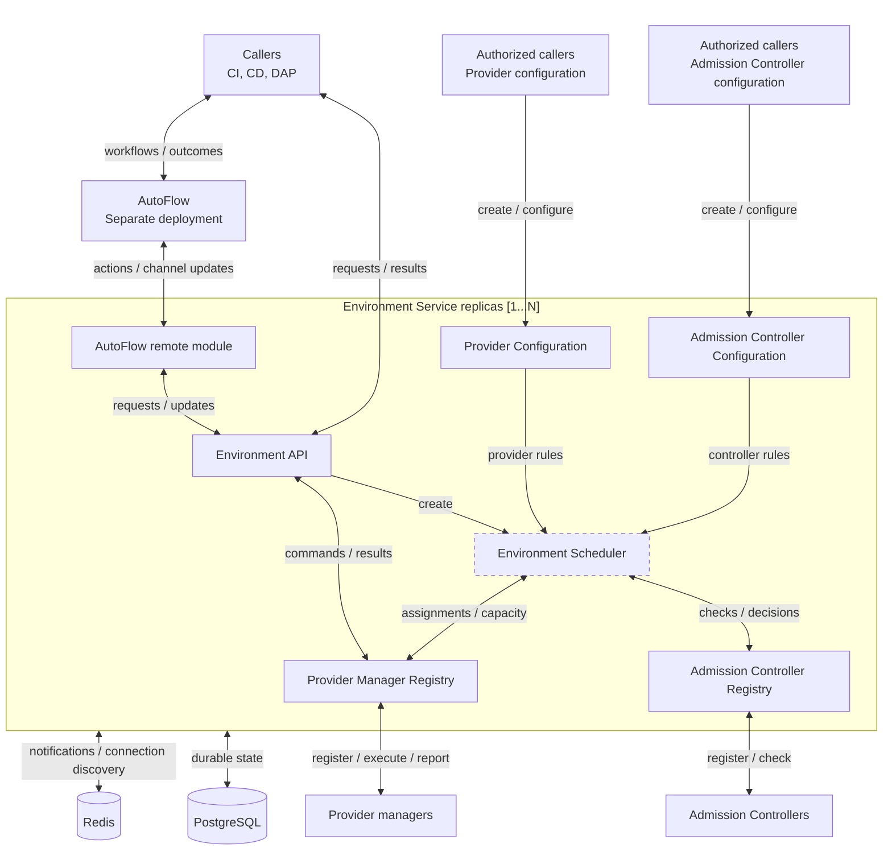
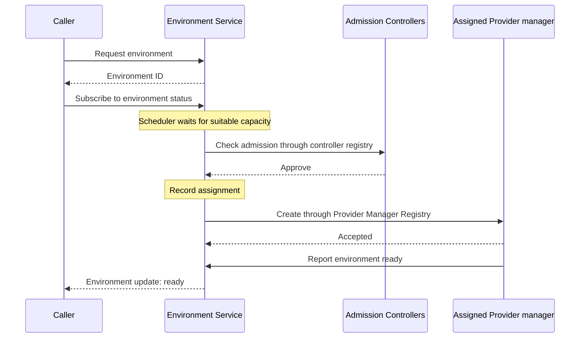
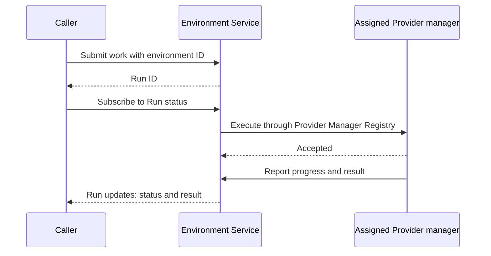
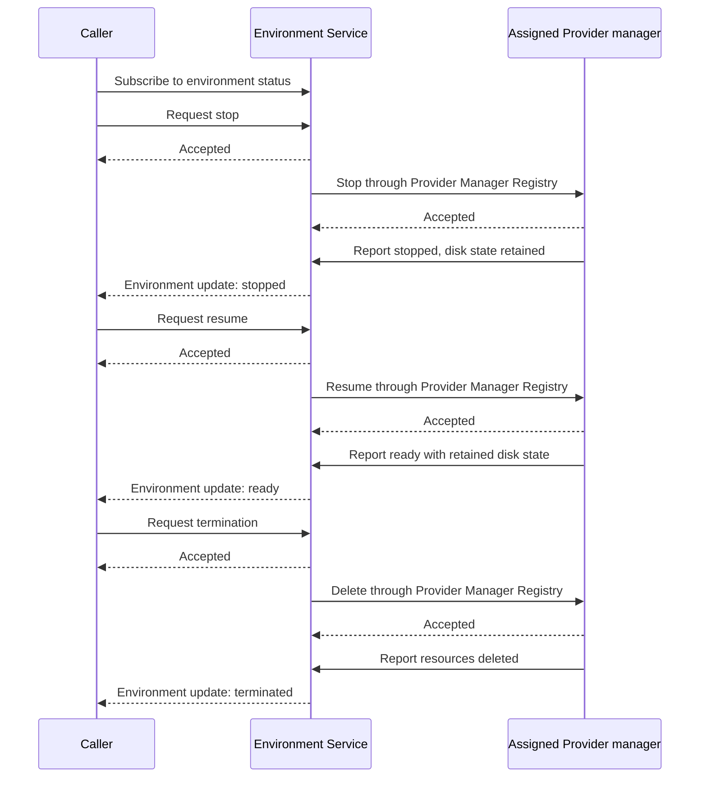
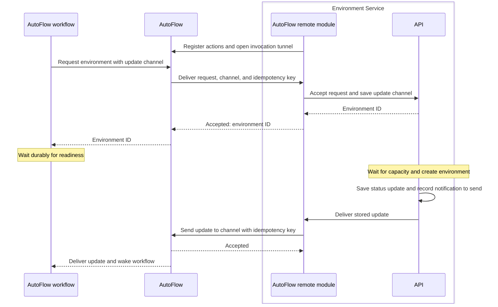
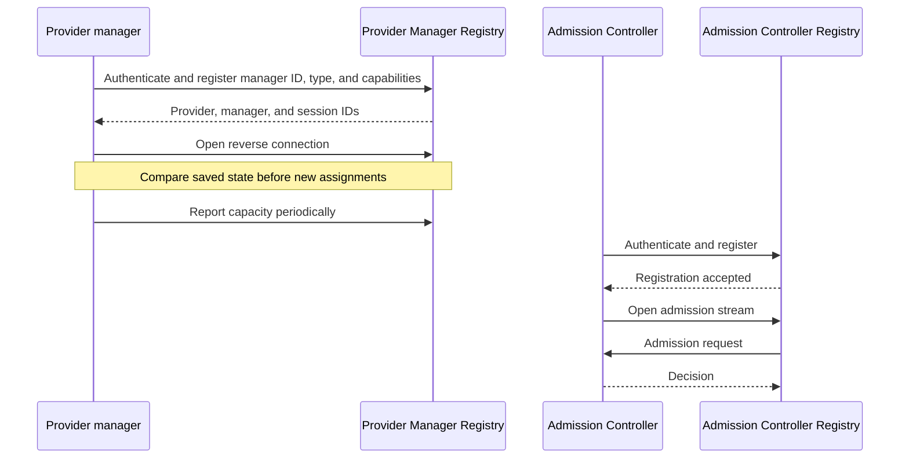



## 問題 {#problem}

Runner のコンピュートには、主に CI ジョブを通じてアクセスします。CD、AutoFlow、DAP、その他の自動化には、次のような必要が生じる場合があります。

- 同じ環境で複数の操作を実行し、操作間で状態を保持する。
- 入力待ちの間、コンピュートを稼働させ続けずに一時停止する。
- 独自の環境管理とスケジューリングを構築せずに、共有のコンピュートを使う。

これらのニーズは、1 つのジョブとともに開始し終了する環境には、うまく当てはまりません。

## Environment Service {#environment-service}

Environment Service は、CI、CD、AutoFlow、DAP、その他の自動化に、実行環境を作成し、利用する共通の方法を提供します。適切なコンピュートを選択し、そこで実行できる作業を確認し、環境の存続期間を管理して、実行状態と結果を報告します。サポートする場合は、ディスクの状態を保持したまま、環境を停止して再開できます。

ワークフローのオーケストレーションは行いません。呼び出し元のアプリケーションが、依存関係と承認を管理し、準備の整った作業を送信し、失敗した作業を再試行するかどうかを決めます。Environment Service は、コンピュートを待っているリクエストも含め、受け付けたリクエスト、環境、Run、結果を永続的に追跡します。

API は、サービス間のものです。エンドユーザーの認可は、呼び出し元のアプリケーションが処理します。Environment Service は、呼び出し元を認証し、コンピュートのマッチングや、環境、Run、設定へのアクセス時に、検証済みの呼び出し元の認可コンテキストを適用します。

## 機能要件 {#functional-requirements}

| ID | 要件 |
|---|---|
| F1 | 呼び出し元は、実行環境を作成して、その中で複数の操作を実行し、操作間でディスクの状態を保持できます。 |
| F2 | サポートする場合、呼び出し元は、環境を停止し、ディスクの状態を保持したまま、後で再開できます。 |
| F3 | 呼び出し元は、環境と実行の状態を確認し、結果を取得し、環境を終了せずに操作をキャンセルできます。 |
| F4 | サポートする場合、呼び出し元は、デバッグのために環境に対話的にアクセスできます。 |
| F5 | 作業は、必要なアドミッションチェックを受けた後、実行のニーズとアクセス制限を満たすコンピュート上でのみ実行します。 |
| F6 | 準備の整った作業は、適切な容量が利用可能になるまで待機できます。競合するリクエストは、定義されたスケジューリングポリシーに従います。呼び出し元は、待機中のリクエストをキャンセルでき、許可された待機時間が過ぎた場合は、失敗を受け取れます。 |
| F7 | 呼び出し元は、環境を終了し、保持したディスクの状態を含むリソースを削除できます。 |
| F8 | 認可された呼び出し元は、自身のコンピュートを使える作業、必要なアドミッションチェックを設定し、新しい環境の割り当てを一時停止できます。 |
| F9 | コンピュートを待っているリクエスト数と利用可能な容量を報告し、オートスケーラーが容量の追加や削減を判断できるようにします。容量がゼロでも、待機中のリクエストを確認できます。 |
| F10 | 操作の失敗には理由を付けて報告します。復旧によって結果を確定できない場合、その操作に影響がなかったとは仮定せず、失敗を報告します。 |

## 非機能要件 {#non-functional-requirements}

| ID | 要件 |
|---|---|
| NF1：永続性 | 受け付けたリクエストと保存した結果は、再起動を越えて維持しなければなりません。結果は、文書化された保持期間中、読み取れる必要があります。失われたコンピュートやディスクの状態の復旧を保証するものではありません。 |
| NF2：安全な再試行 | 文書化された再試行期間内に、応答が失われた同じリクエストを再試行しても、別の環境を作成したり、同じ操作を再び実行したりしてはいけません。応答がないことや失敗したことを理由に、実行済みの可能性がある作業を自動で再実行してはいけません。 |
| NF3：一貫した状態 | 同時のリクエストや遅延したメッセージによって、競合する割り当てを生じさせたり、終了を取り消したり、最終的な実行結果を変えたりしてはいけません。 |
| NF4：セキュリティ | 接続を認証し、環境、Run、結果、設定へのアクセスを認可します。ある環境の作業は、同じワークロード所有者に属する環境も含め、別の環境の非公開のプロセス、ディスク、認証情報にアクセスしてはいけません。通信中と保存中の認証情報と機密データを保護し、診断情報には含めません。 |
| NF5：運用上の上限 | 待機中のリクエスト、API ペイロードのサイズ、実行時間、環境の存続期間、接続に、文書化された上限を適用します。呼び出し元が終了を要求しない場合も、環境の存続期間の上限を適用する必要があります。[データ保持ポリシー](https://docs.gitlab.com/development/database/database_growth_control/data_retention_policy/)を定義して適用します。過剰な負荷は明示的に拒否し、遅いクライアントが他の作業やクリーンアップを妨げてはいけません。 |
| NF6：復旧 | 一時的な接続障害や再起動から、受け付けた作業の追跡を失ったり、実行を繰り返したりせずに復旧します。環境や実行結果を復旧できない場合は、理由を付けて失敗を報告します。 |
| NF7：可観測性 | 作業が待機中、失敗、クリーンアップ待ちとなっている理由を説明できる、十分な状態、エラー、メトリクス、診断情報を公開します。 |

## 全体的なアーキテクチャ {#high-level-architecture}

**Provider** は、アクセススコープ、マッチングルール、スケジューリングポリシーを持つ、コンピュートの供給元です。1 つの Provider の下に、**Provider manager**（略して**マネージャー**）を複数接続できます。マネージャーは、直接、または別のランタイムを通じて環境を作成し、作業を実行します。Runner manager は、その実装の 1 つです。

**Admission Controller** は、提案された配置を承認するか、その Provider を拒否するか、リクエストを拒否します。必要なチェックは割り当て前に実行します。利用できないコントローラーを、承認とみなすことはありません。

Environment Service は、Provider と Admission Controller の設定、環境の配置、環境と Run の永続的な追跡を担当します。配置後は、各環境に割り当てられた 1 つのマネージャーが、その環境の操作と実行に責任を持ちます。

### デプロイ {#deployment}

Environment Service は、独自の PostgreSQL と Redis を持ち、独自の Theseus デプロイ内で Relay モジュールとして稼働します。AutoFlow は、別のデプロイです。共有データベースやプロセス内呼び出しではなく、サービス API を通じて通信します。

Self-Managed と Dedicated のデプロイの詳細は、未定義です。

呼び出し元は、API を直接使うか、AutoFlow でワークフローを実行します。各マネージャーまたはコントローラーの接続を、一度に保持するのは 1 つのレプリカです。

スケジューラーは、初期配置の Provider とマネージャーを選択します。後続の操作は、再スケジューリングせず、Provider Manager Registry を通じて、その割り当てを使います。アドミッションチェックは、別の Admission Controller Registry を通ります。

[スケジューラーの設計](scheduler.md)では、マッチング、スケジューリング、アドミッションの判断を説明します。

## 環境の作成 {#creating-an-environment}

呼び出し元は、必要な環境と、それを使う作業を記述します。Environment Service は、配置や作成を待たずに、リクエストを永続的に受け付けて、環境 ID を返します。**受け付けは、準備完了を意味しません。** 割り当てたマネージャーが環境の準備完了を報告すると、作業を実行できます。

作成は、呼び出し元の接続や監視とは独立して続きます。監視は現在の状態から始まるため、後から開いても、保持された結果を見逃しません。

### 環境定義 {#environment-definitions}

**環境定義**は、イメージ、リソース、初期設定など、環境の作成方法を記述します。多くの環境が 1 つの定義を使えますが、各環境は、独自の ID、状態、Run を持ちます。

呼び出し元は、環境を直接記述するか、再利用可能な定義を参照できます。定義は Environment Service の外で管理でき、サービスがランタイム固有の形式を理解する必要はありません。

受け付けたリクエストの再試行には、同じバージョンの定義とアーティファクトを使います。直接指定しても定義を通じて指定しても、マッチングとアドミッションは、環境の要件を確認します。

### 環境作成のための認証情報 {#credentials-for-environment-creation}

Run が始まる前に、プライベートなイメージの取得やサービスの設定のため、マネージャーが認証情報を必要とする場合があります。これらは作成時の入力であり、環境内で実行する作業が使う認証情報とは別です。

API は、容量を待っている間の、安全な認証情報の配信、認可、更新をまだ定義していません。

### 認可されたスコープのマッチング {#authorized-scope-matching}

呼び出し元は、不透明なワークロード所有者 ID、認可されたスコープチェーン、保護された作業であるかの状態を含む、署名済みの認可コンテキストを提供します。Environment Service は、それを検証し、スコープと保護のチェックに使います。

Provider は、許可するスコープ ID のいずれかが、検証済みのチェーンに含まれる場合、スコープのチェックを通過します。Environment Service は、階層を解決せずに ID を比較します。

たとえば、`scope-p42` が所有する作業は、`[scope-p42, scope-g7, scope-o3, scope-instance]` を持つ場合があります。`scope-g7` を許可する Provider は、スコープのチェックを通過します。これらは識別子の例であり、指定された形式ではありません。

サービスは、現在の Provider ルールを適用し、配置に有効なコンテキストを要求します。期限切れや無効なコンテキストは、作成を認可できません。Admission Controller は、ポリシーのチェックを追加します。スコープと保護のチェックを置き換えるものではありません。コンテキストの更新で、別のリクエストを作成したり、配置期限をリセットしたりしてはいけません。更新と取り消しは、未解決です。

サービスは、受け付け時にワークロード所有者を記録し、その所有権に照らして、既存の環境と Run へのアクセスを確認します。Provider のスコープに一致しても、別の所有者のリソースへのアクセスが許可されるわけではありません。

#### ワークロードのコンテキスト {#workload-context}

環境仕様は、イメージやサービスなどのコンピュートを記述します。任意のワークロードコンテキストは、意図する作業を記述します。そのリポジトリ識別子は、Environment Service にとって不透明であり、アクセスを許可するものではありません。

Admission Controller は、ワークロードと検証済みの認可コンテキストの両方を受け取ります。リポジトリの詳細がない場合も含め、情報が十分かどうかを判断します。配置の承認は、後からその環境で行う別の作業を、自動的に認可するものではありません。

## 環境内での作業の実行 {#running-work-in-an-environment}

**Run** は、準備が整った環境で、割り当てたマネージャーを通じて 1 つの Function を呼び出します。新しい配置は不要です。

ユーザーのコードは、マネージャーのプロセス内ではなく、環境内で実行します。連携によっては、制限されたマネージャー側のハンドラーで入力を取得し、同じ Run の下で作業を送出する場合があります。その連携に対して認可された呼び出し元だけが、ハンドラーを呼び出せます。ユーザーの関数からは呼び出せません。

Admission Controller が承認するのは、環境の配置であり、個々の Run ではありません。送信する作業には、引き続き呼び出し元が責任を持ちます。

実行は、サブスクリプションを待ちません。サブスクライバーは、保持期間内の現在の状態と、保存された最終結果を受け取ります。

Run の完了やキャンセルで、環境は終了しません。後続の Run は、そのディスクの状態を再利用できます。キャンセルが完了するのは、その Run のすべての作業が停止し、遅延したコマンドが後から作業を開始できなくなったときだけです。失敗やタイムアウトだけでは、作業が停止した証明にはなりません。

Run が失敗しても、それだけで環境が利用不能になるわけではありません。復旧によって実行が停止したかどうかを確定できない場合、環境は新しい作業を受け付けず、クリーンアップが必要です。すでに終了が保留中の場合を除き、失敗状態になります。

## 環境の停止、再開、終了 {#stopping-resuming-and-terminating-an-environment}

**停止と再開**には、割り当てたマネージャーのサポートが必要です。停止はディスクの状態を保持し、再開は同じマネージャーを通じてそれを使います。プロセスのメモリや開いた接続が残ることは保証しません。ディスクの状態が失われた場合は、空の代替環境を作成せず、再開を失敗とします。

**終了**は、未割り当ての作成リクエストをキャンセルするか、保持したディスクの状態を含む、割り当て済みの環境とそのリソースを削除します。再利用可能な定義や共有アーティファクトは削除しません。終了後、その環境を再開することはできません。

未割り当てのリクエストは、マネージャーに連絡せずに終了できます。キャンセルと割り当てを一緒に確認し、キャンセルした作業が後から割り当てられないようにします。

作成がまだ確認されていない場合も含め、割り当てが存在すれば、終了は、そのマネージャーでのクリーンアップが確認されるまで待ちます。切断中や復旧に失敗した場合も、終了処理中のままとします。タイムアウトは、削除の証明にはなりません。

環境の存続期間の上限に達すると、同じクリーンアップのルールに従って、終了を開始します。

これらのリクエストは、完了ではなく受け付けを確認します。完了は、環境の更新で報告します。

## AutoFlow {#autoflow}

[AutoFlow](https://gitlab.com/gitlab-org/architecture/autoflow/design-doc/-/blob/main/docs/manual.md) は、複数手順の自動化を行う、永続性のあるワークフローエンジンです。ワークフローは Starlark で記述し、モジュールが提供するアクションを通じてサービスを呼び出します。AutoFlow は、アクションの結果、タイマー、受信イベントを記録し、再起動後にワークフローを再開できるようにします。ワークフローは、ワーカーを稼働させ続けずに、外部イベントや人間の入力を待てます。

### AutoFlow との連携 {#autoflow-integration}

Environment Service 内の AutoFlow リモートモジュールは、環境のライフサイクルと実行の操作を、ワークフローのアクションとして公開します。Environment API と、サービスが保存する状態を使います。

ワークフローは操作を送信し、AutoFlow のチャネルでステータス更新を待ちます。待機状態は永続化されるため、ワーカーを稼働させ続けたり、監視用の接続を維持したりする必要はありません。AutoFlow が冪等性キーを提供するため、再配信時は新たな操作を開始せず、最初の受け付け結果を返します。

`create` に渡したチャネルは、その後の停止、開始、終了を含む、環境の更新を受信します。`run` は、その Run の更新用のチャネルを指定します。モジュールは、受け付けた各リクエストとともに各チャネルを保存し、Environment Service の再起動後も含め、そのチャネルを通じて更新を送信します。

環境や Run の更新を保存するたびに、バージョンが上がります。各通知は、環境または Run、更新のバージョン、チャネルに対応する冪等性キーを持ち、再試行ではそのキーを再利用します。ワークフローはバージョンを使い、重複する更新や古い更新を無視します。AutoFlow が通知を受け付けても、ワークフローがそれを処理したことを意味しません。

保留中の通知は、受け付けられるか、定義されたポリシーに従って終了するまで保持します。AutoFlow が利用できなくても、受け付けた操作やサービス自身のクリーンアップを妨げてはいけません。通知の保持と期限切れの AutoFlow チャネルの扱いは、未解決です。

[AutoFlow モジュールガイド](https://gitlab.com/gitlab-org/cluster-integration/gitlab-agent/-/blob/master/www/autoflow/content/guides/write-a-module.md)では、リモートモジュールの認証情報をロードマップの作業に挙げています。子ワークフローからのチャネル配信も、呼び出し元が依存する前に、検証が必要です。

## 失敗と再試行 {#failures-and-retries}

リクエストの再試行は、作業をもう一度実行することとは異なります。サービスがリクエストを受け付けていても、応答を失ったために、呼び出し元が再試行する場合があります。

- 状態を変更する各リクエストは、呼び出し元が指定する識別子を持ちます。再試行期間内の繰り返しの配信には、別の操作を行わず、保存された受け付けの結果を返します。異なる引数で同じ識別子を再利用することは拒否します。
- 呼び出し元の切断やサービスの再起動があっても、受け付けたリクエストは追跡を続けます。呼び出し元は再接続し、その状態を確認できます。
- 一時的な切断中は、最後に報告された状態や保留中の遷移を保持し、割り当てたマネージャーを到達不能と表示します。応答が失われても、同じ Provider の下であっても、別のマネージャーへの割り当てを認めません。
- 復旧できない喪失は、環境では `FAILED`、Run では `FAILURE` とし、`ENVIRONMENT_LOST`、`PROVIDER_MANAGER_LOST`、`RUN_LOST` などの理由を付けます。`RUN_LOST` は、実行結果を復旧できないことを意味します。終了は、削除を確認するまで保留したままです。
- 失敗は、実行が停止したことや、外部への影響がなかったことの証明にはなりません。その作業を自動で再実行してはいけません。
- 失敗後に新しい作業を送信するかどうかは、呼び出し元が決めます。それは新しいリクエストであり、配信の再試行ではありません。

`FAILED` は、環境が利用不能で新しい作業を受け付けないことを意味し、リソースが削除されたことを意味しません。失敗した環境は、リソースが残る可能性がある間、`cleanup_pending = true` になります。サービスはクリーンアップを要求し、削除を確認するまで、割り当てと容量の予約を保持します。自動クリーンアップは、`cleanup_pending` を解除して容量を解放しますが、`FAILED` は維持します。

一方、`Terminate` リクエストは、環境を `TERMINATING` に移し、削除の確認後に、`cleanup_pending = false` の `TERMINATED` に移します。失敗した環境をすでにクリーンアップ済みなら、マネージャーによる追加のクリーンアップは不要です。どちらの経路も、保存された Run の結果を変更しません。

Run の最終結果は不変です。遅れて届いた成功が、保存された `RUN_LOST` の失敗を置き換えることはできません。遅れた環境の報告によって、失敗した環境を準備完了にすることはできませんが、リソースの削除を確認することはできます。

## 状態の所有と永続化 {#state-ownership-and-persistence}

| 所有者 | 保持する状態 |
|---|---|
| Environment Service | Provider とコントローラーの設定、受け付けたリクエストとワークロードの所有権、環境と Run の ID、Provider/マネージャーの割り当て、保留中のコマンド、要求された状態と報告された状態、バージョン付きの更新、保留中のチャネル配信、クリーンアップ状態、実行結果。 |
| Provider manager | 受け付けたコマンドの ID、割り当てた環境と Run、サービスがまだ受領を確認していない結果。 |

### リクエストと結果の保存 {#saving-requests-and-results}

サービスは、受け付けを確認する前に、各リクエストを保存します。割り当てとコマンドを配信前に記録し、復旧時にはその記録を使い、すでに失敗として確定した作業を再開しません。

Environment Service は、各チャネル通知を、その状態の更新とともに、1 つのデータベーストランザクションで保存します。リモートモジュールは、配信の進捗を別に記録するため、クラッシュ後も、更新を失ったり操作を繰り返したりせずに再試行できます。

マネージャーは、受け付けたコマンドの ID と、再起動後に自身の環境と Run を見つけるために十分な状態を保持します。Environment Service が永続的な保存を確認するまで、結果を保持します。その後は、結果のペイロードを削除しても構いませんが、再試行期間内の遅延したコマンドは、引き続き拒否する必要があります。コマンドの順序付けとリプレイ保護は未解決です。永久的な履歴は必要ありません。

### 要求された状態と報告された状態 {#requested-state-and-reported-state}

リクエストは、環境が変わったことの証明ではありません。たとえば、停止リクエストを受け付けた後、サービスは、停止が要求されたことを記録します。環境を停止済みと報告するのは、マネージャーが確認した後だけです。

切断中、サービスは、報告された状態と保留中の遷移を保持しつつ、マネージャーを到達不能と表示します。保持した状態も、その後の失敗も、利用可能であることやリソースの削除を証明しません。

### 再接続後の復旧 {#recovering-after-reconnect}

サービスは、再接続したマネージャーの環境、Run、保持された結果を、保存した割り当てと未完了の Run と照合します。そのマネージャーへの新しい割り当てと実行は、復旧を待ちます。キャンセルとクリーンアップは進められます。復旧できない作業は、再実行せずに喪失と報告します。保存した最終結果は変更しません。

## 登録、接続、健全性 {#registration-connections-and-health}

### レプリカ間の呼び出し {#calls-between-replicas}

呼び出し元は、どのレプリカにもアクセスできます。状態を変更するリクエストは、受け付け前に保存し、割り当てたマネージャーの接続を保持するレプリカが、対応するコマンドを配信します。

対話的な実行には、ライブ転送が必要です。Redis ベースの接続検出と内部 gRPC が、マネージャーの接続を保持するレプリカへストリームをルーティングします。アドミッションチェックも、同じ仕組みで接続中のコントローラーにアクセスします。

### Provider {#providers}

認可された呼び出し元が Provider を作成し、許可するスコープ ID、マッチングルール、スケジューリングポリシーを設定します。マネージャーの登録で、その設定を作成したり変更したりすることはありません。マネージャーが接続していなくても Provider の設定は残るため、待機中の需要を確認できます。

マネージャーは、安定したマネージャー ID を使って認証し、既存の Provider の下に登録します。再接続後も同じ ID を再利用し、再び認証します。報告とコマンドは、認証された登録に紐付きます。認証情報の発行とセッションの結び付けは、未解決です。

登録種別によって、マネージャーがサポートする環境仕様が決まります。Runner の登録は、Runner 仕様をサポートします。ケイパビリティは、停止/再開、対話的な実行などの任意の機能です。

各マネージャーは、Environment Service の 1 つのレプリカに向けてアウトバウンド接続を開くため、公開エンドポイントは不要です。リバース gRPC トンネルと、マネージャーが開始するコマンドストリームのどちらを使うかは、未解決です。

マネージャーが新しい割り当てを受け取るのは、Provider が許可し、接続と容量の報告が最新で、復旧が完了している場合だけです。

### Admission Controller {#admission-controllers}

Admission Controller は、マネージャーとは別に認証して登録します。Environment Service に直接、双方向のアドミッションストリームを開きます。各ストリームは、1 つのアドミッションリクエストと判断を送受信した後、閉じます。コントローラーは、新しいストリームを開き、次のチェックを待ちます。コントローラーにローカルの gRPC サーバーは不要です。

コントローラーを登録しても、どの作業を管理するかは決まりません。コントローラーの設定にあるスコープが、どのリクエストにその承認が必要かを決めます。

[スケジューラー](scheduler.md#admission-and-assignment)が、コントローラーのスコープ、強制モード、タイムアウト、判断を適用します。利用できないコントローラーから、必要な承認が得られたと推定することはありません。

## 容量 {#capacity}

マネージャーは、ホストできる環境の総数を報告します。Environment Service は、その上限と自身の割り当てを使って、マネージャーの利用可能な容量を計算し、Provider ごとに集計します。CPU、メモリ、その他のリソースは、マネージャーが内部で管理します。

- 割り当てを記録した時点で、マネージャーが作成コマンドを受信したり受け付けたりする前に容量を予約するため、別の割り当てが同じスロットを使うことはできません。
- マネージャーは、作成を受け付ける前に、自身の容量を確認します。
- リソースを作成していないことが確認された作成拒否では、予約を解放します。キャンセルされておらず、期限切れでもないリクエストは、待機に戻れる場合があります。応答がない場合、予約は解放しません。
- 削除が確認されると、環境の予約を解放します。
- 失敗しただけでは、予約を解放しません。リソースがまだ存在するか、実行が続いている可能性があります。
- 切断中や異常なマネージャーには、新しい割り当てを行いません。既存の予約は記録したままにします。

マネージャーは、リソースの作成開始前であっても、受け付けた作成コマンドを、作成中の件数に含めます。

## API {#api}

[API 仕様](api.md)は、呼び出し元の操作、Provider manager の登録とコマンド、Admission Controller のチェック、設定を定義します。

## 未解決の質問 {#open-questions}

### 実行とライフサイクル {#execution-and-lifecycle}

- マネージャーは、ローカルサーバーへのリバース gRPC トンネルと、Admission Controller のようにマネージャーが開始するストリームのどちらで、コマンドを受信すべきですか？
- 呼び出し元での受け付け後、たとえば別のライフサイクル操作が進行中であるために、マネージャーが停止や再開を拒否した場合、サービスはどう処理すべきですか？
- Run のタイムアウトは、サービスの受け付け時と実行時のどちらで開始しますか？マネージャーのコマンドには、期間と絶対期限のどちらを持たせるべきですか？再試行しても、元の上限をどう維持しますか？
- 応答を失った後、配信側はコマンドを再送すべきですか？それともマネージャーに問い合わせるべきですか？マネージャーの永久的な履歴なしに、キャンセル、終了、結果の受領確認後の、遅延したコマンドをどう拒否しますか？
- マネージャーは、Run を受け付けた後と、実行が始まった後のどちらで、受領を確認すべきですか？受け付けたものの開始していない作業は、復旧中にどう表示すべきですか？
- Run の `SUCCESS` は、Function が成功したことと、Function が失敗していても結果を伴って実行が完了したことの、どちらを意味しますか？Function のエラーとプロセスの終了コードを、どう表現すべきですか？
- 関数の参照、入力、結果を、最終的な Function API とどう整合させるべきですか？マネージャーは、サポートする組み込み機能とバージョンをどう報告すべきですか？
- Run は同時に実行できますか？実行中の Run がある場合、停止は何をすべきですか？終了や環境の期限切れによって、進行中の作業をどう停止しますか？
- 停止やキャンセルに、呼び出し元が設定できる猶予期間を設けるべきですか？満了するとどうなりますか？
- 環境がすでに停止済み、準備完了、終了済みの場合、繰り返されたライフサイクルリクエストは、どう動作すべきですか？
- ストリームが切断したり、環境が終了したりすると、Exec プロセスはどうなりますか？呼び出し元は、出力を受信し続けながら、stdin をどう閉じますか？
- 呼び出し元は、実行ログにどうアクセスすべきですか？Environment Service が提供すべきですか？それとも、既存のログサービスが保存と配信を担うべきですか？
- 停止中の環境をマネージャーの容量にどう数えるべきですか？再開は、いつ容量を待つ必要がありますか？
- 環境の存続期間には、どのような上限を適用し、いつから数え、呼び出し元は延長できますか？マネージャーが切断中の場合、コンピュートと保持ディスクの上限をどう適用しますか？

### 認可と設定 {#authorization-and-configuration}

- リクエストの待機中に、認可コンテキストをどう更新または取り消すべきですか？所有者、スコープチェーン、保護された作業、必要な連携のチェックを、受け付けたリクエストにどう結び付けますか？
- 変更されたスコープチェーンを再解釈せずに、保存したワークロード所有権を使って、後の操作をどう認可しますか？
- 呼び出し元は、受け付けた環境について、信頼できる Provider、マネージャー、配置のアイデンティティをどう取得しますか？監視の草案は、状態を報告しますが、配置の詳細は報告しません。
- 環境作成の認証情報を、どう安全に配信し、更新しますか？草案には、認証情報のフィールドや参照の契約がありません。
- 再利用可能な環境定義を、どう参照、解決、認可しますか？受け付けたリクエストや環境が依存している間、誰がそのリビジョンと共有アーティファクトを利用可能に保ちますか？
- 他の呼び出し元がサービスを採用する際、マッチングとアドミッションには、どのような追加のワークロードコンテキストが必要ですか？
- ワークロードコンテキストには、環境の要求が誰に代わって行われるかを示す主体や実行者を含めるべきですか？認証された呼び出し元サービスと、どう関係しますか？
- 環境の配置だけでなく、実行前に各 Run を検査する必要がある、必須のポリシーはありますか？
- 既存の Runner スコープのコントローラーと、その REST API を、Provider のスコープと、この設定 API にどう対応付けるべきですか？各スコープを管理できるのは誰ですか？
- 環境、マネージャー、保留中のチェックがまだ参照している場合、Provider とコントローラーの削除は、どう動作すべきですか？
- どのマネージャーの実行モードが、環境の分離要件を満たしますか？
- 呼び出し元、マネージャー、コントローラー、レプリカは、どの既存の認証の仕組みを使うべきですか？GitLab のクラスター外のマネージャーも含め、認証情報をどう発行、ローテーション、取り消しし、登録に結び付けますか？
- 登録セッション ID を、認証された呼び出しにどう結び付け、古いセッションをどう拒否しますか？古いマネージャーセッションがすでに受信したコマンドを、どう扱いますか？コントローラーのセッションは、古い判断を受け入れずに、複数の実行中インスタンスをどうサポートしますか？

### 復旧と運用上の上限 {#recovery-and-operational-limits}

- API ペイロードのサイズ、待機中のリクエスト、作成時間、Run の実行時間、データの保持に、どのような上限とデフォルト値を適用しますか？
- 呼び出し元は、同じリクエストをどれくらいの期間、再試行できますか？未完了の作業を失敗とするまでに、どれくらい復旧を続けるべきですか？終了とクリーンアップは、削除を確認するまで保留したままです。
- マネージャーが戻らず、削除を確認できないリソースを、運用者はどう扱うべきですか？
- サービスは、どのようなリクエスト量、遅延、可用性、復旧の目標に対応する必要がありますか？
- AutoFlow の通知には、どのような保持と再試行の上限を適用しますか？期限切れのチャネルをどう置き換え、別のワークフローが既存の環境や Run を購読するにはどうすればよいですか？草案は、その復旧の契約をまだ定義していません。

## 参考資料 {#references}

- [CI Environment Service](https://gitlab.com/groups/gitlab-org/primitives/-/work_items/28)
- [CI on AutoFlow](https://gitlab.com/groups/gitlab-org/primitives/-/work_items/29)
- [GitLab Runner Job Router](https://gitlab.com/groups/gitlab-org/-/work_items/19607)
- [プッシュベースのジョブディスパッチ](https://gitlab.com/groups/gitlab-org/-/work_items/21091)
- [GitLab.com とホスト型 Runner への展開](https://gitlab.com/groups/gitlab-org/-/work_items/21090)
- [Admission Controller の展開](https://gitlab.com/groups/gitlab-org/-/work_items/23398)
- [Workspaces と CI 向けのリバース gRPC トンネル](../reverse-grpc-tunnel-workspaces-and-ci/_index.md)
