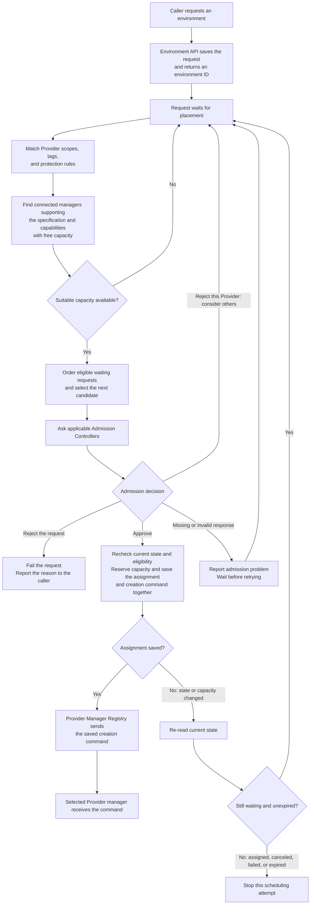



## 概要 {#overview}

**Environment Scheduler** は、[Environment Service](_index.md) の新しい環境ごとに、設定済みの Provider と、そのマネージャーの 1 つを選択します。

割り当て後、環境の操作と Run は、スケジューラーではなく Provider Manager Registry を通ります。

## リクエストが Provider に届く仕組み {#how-a-request-reaches-a-provider}

マネージャーの受け付けは、環境の準備が整ったことを意味しません。準備完了は、別途報告します。

## マッチングとスケジューリング {#matching-and-scheduling}

### マッチング {#matching}

スケジューラーは、Provider のスコープとマッチングルールを確認します。Runner 環境については、タグ、タグのない作業の受け入れ、保護も含みます。その後、要求された環境仕様と、必要なすべてのケイパビリティをサポートするマネージャーを選択します。

スケジューラーは、[検証済みの認可コンテキスト](_index.md#authorized-scope-matching)を使って、スコープと保護を確認します。Provider は、許可するスコープ ID のいずれかが、そのコンテキストのスコープチェーンに含まれる場合、スコープのチェックを通過します。

Provider は、一時停止中でないことが必要です。選択するマネージャーは、接続中、正常、復旧済みで、容量に空きがある必要があります。

接続中のマネージャーがなくても、Provider のルールに一致する場合があります。配置は、キャンセルと待機期限に従いつつ、適切なマネージャーと容量を待ちます。割り当てを記録するときも、認可が有効でなければなりません。

サービスは、リクエストの受け付けから測る、配置の最大待機時間を設定します。期限をリクエストとともに保存し、再起動、アドミッションの再試行、割り当ての試行でリセットしません。期限前に割り当てを記録できなければ、待機タイムアウトの理由を付けて、リクエストを失敗とします。この上限は、割り当て後の作成時間を制限しません。

### 待機中のリクエストの順序付け {#ordering-waiting-requests}

マッチングは、作業を実行できる場所を決めます。スケジューリングは、条件を満たすリクエストのどれを先にするかを決めます。各 Provider は、明示的なスケジューリングポリシーを持ちます。

| ポリシー | 順序 |
|---|---|
| 公平配分 | 稼働中の環境が少ない、不透明なワークロード所有者を優先し、次に古いリクエストを優先します。 |
| 古いものから | 条件を満たす最も古いリクエストを優先します。 |

候補を選択しても、他のリクエストをキューから取り除きません。それらは、割り当て、キャンセル、失敗まで、待機したままです。

停止/再開など、サポートしないケイパビリティを必要とするリクエストが、マネージャーが処理できる後続のリクエストを妨げてはいけません。

### アドミッションと割り当て {#admission-and-assignment}

コントローラーのスコープは、Environment Service が提供する特定の Provider、またはすべての Provider を選択します。適用される強制チェックは、すべて承認が必要です。ドライランのチェックは結果を記録するだけです。無効なコントローラーや、スコープのないコントローラーは、チェックを受信しません。これらの設定は、呼び出し元の認可を置き換えるものではありません。

各チェックには、サービスが設定するタイムアウトがあります。応答がない、無効、失敗した場合、リクエストは、アドミッション上の問題を理由として待機を続けます。配置期限内にチェックを再試行します。リクエストを明示的に拒否した場合はリクエストを失敗とし、Provider を拒否した場合は他の Provider を検討できます。

チェックは、提案された Provider、マネージャー、作業に適用します。割り当て前に、スケジューラーは、リクエストが待機中で期限切れでないこと、Provider とマネージャーが引き続きすべてのマッチング条件を満たすこと、認可とアドミッションが引き続き有効であること、容量に空きがあることを再確認します。キャンセルのチェックとアトミックに、割り当て、作成コマンド、予約を保存し、競合する割り当てを防ぎます。

マネージャーによる作成拒否が確認された場合、リソースを作成していないときにのみ、予約を解放します。キャンセルされておらず、期限切れでもないリクエストは、元の到着時刻と期限のまま、待機に戻れます。応答が失われた場合は、環境が存在する可能性があるため、割り当てと予約を維持します。復旧に失敗すると喪失を報告し、削除を確認するまでクリーンアップを保留したままにします。

## 需要とオートスケーリング {#demand-and-autoscaling}

スケジューラーは、Provider ごとの需要を、Environment Service の外にある**オートスケーラー**に報告します。オートスケーラーは、マネージャーのコンピュート容量、または Provider 配下のマネージャー数を変更することで、コンピュートを追加または削除します。

設定済みの Provider ごとに、次を報告します。

- 一致して待機中のリクエスト数。
- 最も古いリクエストの待機時間。
- 利用可能な容量。
- 待機中のリクエストが必要とする環境仕様とケイパビリティ。

マネージャーが接続していなくても、Provider のスコープとマッチングルールを使って需要を求めます。環境とケイパビリティの要件は、どのマネージャーが待機中の作業を処理できるかをオートスケーラーに示します。これらの件数は、潜在的な需要であり、アドミッション承認ではありません。一時停止中の Provider と、認可が期限切れのリクエストは除外します。

一致する Provider ごとに各リクエストを 1 回数えますが、Provider 全体の合計では 1 回だけ数えます。マネージャーごとに重複して数えません。待機件数は、レプリカごとではなく、サービス全体の値です。

リクエストが待機状態に入るか出るとき、Provider のルールが変わるとき、またはリクエストの検証済み認可コンテキストが変わるか期限切れになるとき、スケジューラーはマッチングと待機件数を更新します。

利用可能な容量は、Provider Manager Registry を通じたマネージャーの報告から求めます。リクエストに対する容量に含めるのは、登録種別とケイパビリティが、そのリクエストをサポートするマネージャーだけです。初回の読み込み中は、誤解を招くゼロを報告せず、需要を利用不可とします。

## 調整と復旧 {#coordination-and-recovery}

PostgreSQL は、受け付けたリクエスト、設定、割り当て、コマンド、状態の更新を保存します。スケジューラーの各レプリカは、待機中の作業のビューを構築し、そのレプリカに接続したマネージャーに対してスケジューリングします。割り当てと容量の予約は、ローカルのキューだけで決めるのではなく、共有状態に対してコミットします。

### 状態の読み込みと更新 {#loading-and-refreshing-state}

起動時に、各レプリカは、Provider と Admission Controller の設定と、待機中のリクエストを読み込みます。通知とデータベースのチェックが、読み込み中の変更を取り込みます。配置では、常に現在のレコードを再確認します。

Provider Manager Registry は、現在のマネージャー接続と容量を提供し、保存された作成コマンドを配信します。新しい作業を割り当てる前に、その[復旧の契約](_index.md#recovering-after-reconnect)を適用します。

### 信頼できる通知 {#reliable-notifications}

データベースの変更後、Redis Pub/Sub の通知が、再読み込みするレコードをレプリカに伝えます。通知はヒントです。公開の失敗やメッセージの喪失によって、受け付けたリクエストやコマンドを失ってはいけません。

定期的な、インデックスを使うデータベースのチェックで、見逃した作業を見つけ、キャンセル済みや割り当て済みのリクエストを待機キューから除去し、設定を更新します。これらのチェックは、完了済みの履歴や、通知のたびの全件再読み込みではなく、件数を制限したバッチで進行中の作業を対象にします。通知が遅延を減らし、データベースのチェックが復旧を担います。

通知の繰り返しや、データベースでの再検出では、既存のリクエストやコマンドを更新します。別のリクエストとして数えたり、別の作成を認めたりしません。

## 未解決の質問 {#open-questions}

- アドミッションの承認と拒否は、どれくらい有効ですか？どのような認可や設定の変更で、再確認が必要になりますか？
- 稼働中の環境数は、1 つの Provider と、公平配分を使うすべての Provider のどちらを対象にしますか？作成中、停止中、失敗した環境も数えますか？
- マネージャーが接続していない場合に、オートスケーラーが適切なマネージャーを選べるよう、ケイパビリティ固有の需要をどのようにまとめるべきですか？
- 同じ待機作業のために二重にスケールしないよう、複数のオートスケーラーは、重複する Provider の需要をどう利用すべきですか？
- すべてのレプリカで公平性を強制すべきですか？それとも、独立したスケジューリングによる、おおよその公平性を許容できますか？
