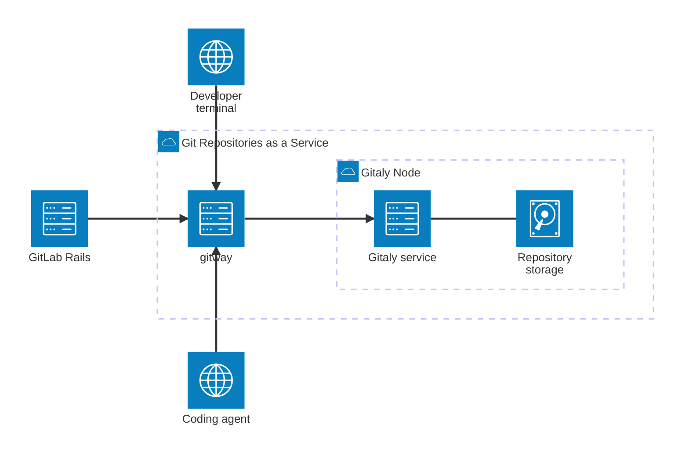
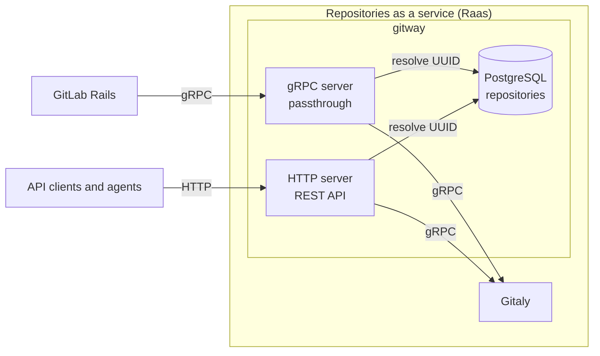
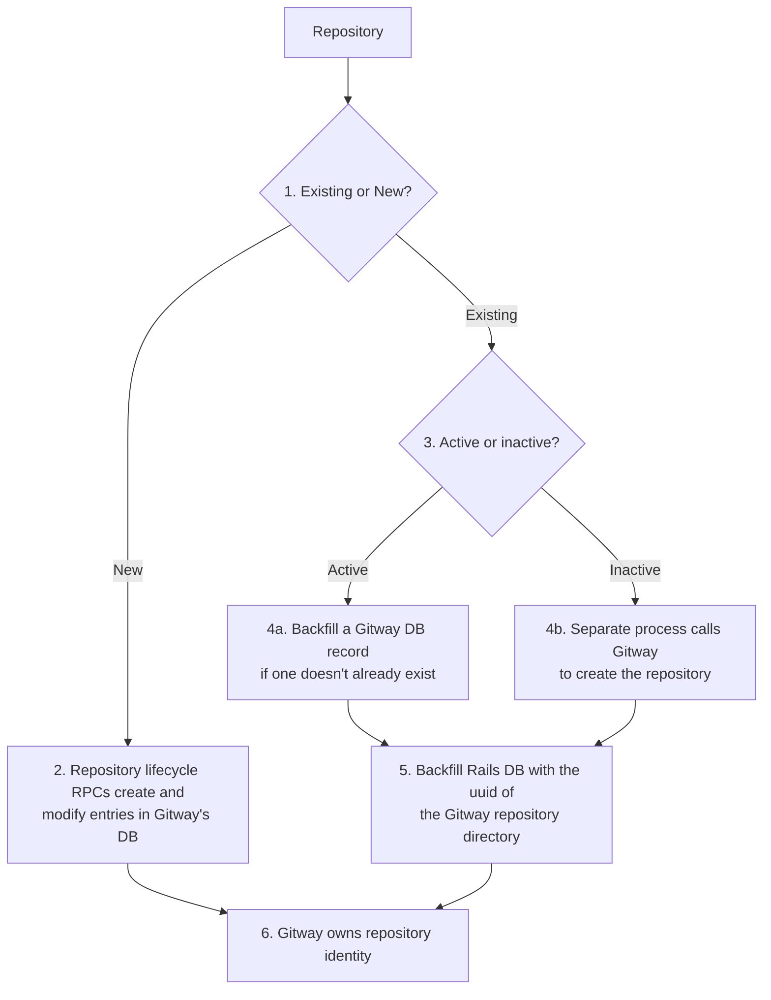
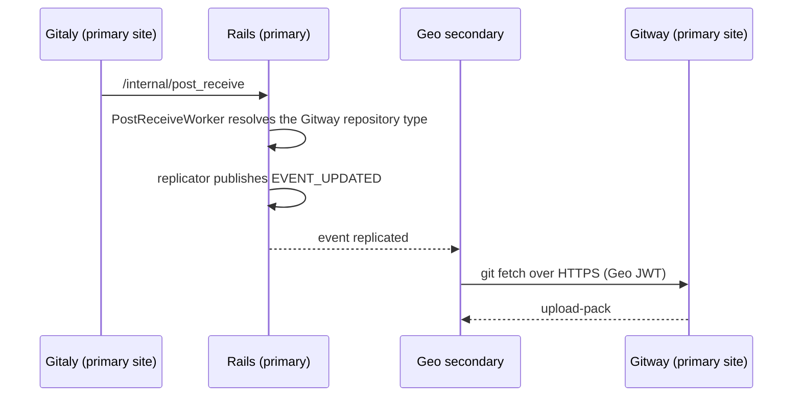



これは提案です。イテレーションを続けており、まだ確定した設計ではありません。

## 概要 {#summary}

Gitaly と GitLab Rails モノリスは互いに深く結合しています。
リポジトリデータは Gitaly に存在しますが、Rails を通じてアクセスされ、
GitLab Project の Rails モデルに結び付いています。

これが、API ファーストの Git インフラストラクチャや、エージェント規模の
ストレージの開発を妨げています。

このブループリントは、すべてのクライアントと
Gitaly の間に位置する Git ゲートウェイ、**gitway** を提案します。これにより、GitLab の Git データを「サービスとしてのリポジトリ」に変えます。
Rails モノリスのような内部クライアントも、API
クライアントやエージェントのような外部クライアントも、Gitway の
API を通じてサービスとして Git リポジトリにアクセスします。

クライアントは UUID でリポジトリを指定し、Git 操作を要求します。リポジトリの
保存、配置、レプリケーションの方法は、サービス境界の内側の実装の詳細です。



## 動機：明確な API 境界 {#motivation-clean-api-boundaries}

現在、明確なリポジトリ API 境界はありません。リポジトリという概念は
Rails と Gitaly にまたがり、壊れやすいスプリットブレイン状態を生んでいます。事実上、Rails
がリポジトリディレクトリです。さらに、Gitaly がリポジトリの保存に使用する
ディスクパスを実際に*決定*しています。このため、Git
バックエンドの発展は煩雑です。ストレージレイアウトを変更するには、Rails のコード
変更と、場合によっては移行も必要になるためです。

この結合により、Git ストレージのイテレーションが難しくなっています。
Rails と Gitaly の間の契約から、ディスクパスなどの内部の詳細が漏れ出しています。
そのため、ディスクパスを不透明なトークンとして扱い、内部の目的で
書き換えるといった、不自然な設計上の選択を迫られます。

また、オブジェクトプールのようなケースでも脆弱さを生みます。本来、ストレージの最適化は
Raas（サービスとしてのリポジトリ）だけが扱い、Rails が知る必要はないのに、
そのライフサイクルを Rails が扱っているためです。

明確な API 境界があれば、双方は API 境界の反対側の
内部実装の詳細を気にせずに、イテレーションを行い、機能を開発できます。

## 目標 {#goals}

- Rails だけでなく、あらゆるクライアントにリポジトリ操作を公開する、
  独立した Git ゲートウェイです。
- `Project` から独立した、第一級のリソースとしてアドレス指定できるリポジトリです。
- 移行作業を最小限に抑えるため、Rails が gRPC で Gitway と通信し続けられる
  gRPC パススルーから始めます。
- 移行中も、最小限の変更で既存の Rails 機能を動作させ続けます。

## 提案 {#proposal}

Gitway は「サービスとしてのリポジトリ」の API 境界となる Go サービスです。
移行作業を最小限に抑えるため、Rails は引き続き gRPC で Gitway と
通信します。他のクライアントは HTTP で Gitway と通信します。GitLab の
主要なリポジトリディレクトリとして機能します。



## 設計と実装の詳細 {#design-and-implementation-details}

### データモデル {#data-model}

Gitway が主に扱うデータモデルはリポジトリです。

|id|storage_name|name|description|owner_id|metadata|state|
|--|------------|-------------|----|-----------|--------|--------|
|9b2f4c1e-3d5a-4f88-b7c6-1a2e5d90f331|default|gitaly|Git データ向けの gRPC Go サービス|21|{"relative_path":"@hashed/ce/ea/ceead675…7b71.git"}|ready|
|1f6a8e77-0c34-4b91-8d52-6e9b4a17c5de|default|packhorse|高スループットの Git キャッシュ|21|{"relative_path":"@hashed/73/47/73475cb4…8049.git"}|deleted|
|c47e0d2a-8b19-4e6f-9a03-5f7d1c88b204|default|gitlab|GitLab は、完全なソフトウェア開発ライフサイクルのツールチェーンを提供するオープンソースの DevSecOps プラットフォームです|21|{"relative_path":"@hashed/5a/3c/5a3ca21d…721d.git"}|deleted|

### 認証 {#authentication}

Gitway は認証しません。Workhorse が引き続き Rails で認証し、
Gitway に到達するヘッダーにメタデータを渡します。Gitway は、その
メタデータヘッダーをそのまま Gitaly に渡します。

将来のイテレーションでは、Gitway が認証のために GATE と統合する可能性があります。

### 透過的な gRPC パススルー {#transparent-grpc-passthrough}

Gitway は、Rails が Gitaly と通信するための透過的な gRPC パススルーとなる
gRPC サーバーを備えます。Rails の接続先を Gitway に向ければ、単に別の Gitaly サーバーとして見えるため、
Gitway への移行作業を最小限に抑えられます。Gitway は
ヘッダーと gRPC protobuf リクエストをそのまま Gitaly に転送し、
レスポンスをプロキシして返します。

### HTTP REST API {#http-rest-api}

Gitway は、リポジトリ操作の API を公開する HTTP サーバーも
備えます。

#### リポジトリの CRUD 操作 {#repository-crud-operations}

```plaintext
POST   /v1/repositories
GET    /v1/repositories/{id}
DELETE /v1/repositories/{id}
```

`GET /v1/repositories` によるコレクションの一覧取得は、最初の
イテレーションの後に延期します。上記の各エンドポイントは、`uuid` で指定する単一のリポジトリに作用するため、
呼び出しの認可は、その 1 つのリポジトリに関する問題です。コレクションの読み取りには
そのような手掛かりがありません。誰がリポジトリを列挙できるか、
結果の範囲をどう限定するかを決める必要があります。その決定が最初のイテレーションを妨げるべきではありません。

#### リポジトリの基本操作 {#repository-primitives}

```plaintext
GET    /v1/repositories/{id}/refs
PATCH  /v1/repositories/{id}/refs/{name}
GET    /v1/repositories/{id}/blobs/{oid}
GET    /v1/repositories/{id}/trees/{ref}
...
GET    /v1/repositories/{id}/info/refs?service=git-upload-pack
POST   /v1/repositories/{id}/git-upload-pack
POST   /v1/repositories/{id}/git-receive-pack
```

リポジトリは第一級のリソースになります。`Project` 行なしで、エージェントのワークスペース、
アーティファクトストア、ドキュメントごとのリポジトリ、内部サービスの Git 基盤として
利用できます。

Rails モノリス（および他のサービスやクライアント）から見ると、
リポジトリは uuid によって一意に識別されます。

## 開発フェーズ {#development-phases}

想定している開発フェーズは次のとおりです。

### フェーズ 1：純粋な gRPC プロキシとして Gitway をデプロイ {#phase-1-deploy-gitway-as-a-pure-grpc-proxy}

最も単純な目標は、Gitaly への純粋なパススループロキシとして
Gitway を .com にデプロイすることです。Workhorse、Rails、Zoekt、その他の
クライアントと統合しますが、処理は行いません。

GitLab Saas などの既存インスタンスでは、すべてのストレージの接続先を、
gitway ノード群にリバースプロキシする gitway ロードバランサーに向けます。

変更前：

```ruby

gitlab_rails['repositories_storages'] = {
    'default'  => { 'gitaly_address' => 'tcp://gitaly1.internal:8075' },
    'storage1' => { 'gitaly_address' => 'tcp://gitaly1.internal:8075' },
    'storage2' => { 'gitaly_address' => 'tcp://gitaly2.internal:8075' },
  }

```

変更後：

```ruby

gitlab_rails['repositories_storages'] = {
    'default'  => { 'gitaly_address' => 'tcp://gitway.internal:8075' },
    'storage1' => { 'gitaly_address' => 'tcp://gitway.internal:8075' },
    'storage2' => { 'gitaly_address' => 'tcp://gitway.internal:8075' },
  }

```

### フェーズ 2：Gitway をリポジトリディレクトリにする {#phase-2-gitway-becomes-the-repository-directory}

Gitway はリポジトリディレクトリになるため、データソースを持つようになります。
保存が必要なデータの[スキーマ](#data-model)は、こちらです。

これにはデータ移行が必要ですが、できる限り遅延移行することを
目指します。

移行の両側、Rails 側と Gitway 側を
考えます。

#### Rails 側 {#rails-side}

現在、Rails データベースにはリポジトリ情報が含まれています。Rails の
`project_repositories` テーブルは次のとおりです。

| 列 | 型 |
|--------|------|
|id|bigint|
|shard_id|bigint|
|disk_path|character varying|
|project_id|bigint|
|object_format|smallint|

`project_repositories`、
`pool_repositories`、`snippet_repositories`、`group_wiki_repositories`、
`project_wiki_repositories`、`design_management_repositories` など、他にも同様のテーブルがあります。これらの
テーブルはそれぞれ、リポジトリと、Gitaly ノード上の保存場所に関する
同様の情報を含んでいます。

目標は、Rails データベースからリポジトリに関する知識を
取り除くことです。リポジトリのメタデータを含むテーブルに
`uuid` 列を追加するだけで、これを実現できると考えます。

| 列 | 型 |
|--------|------|
|id|bigint|
|shard_id|bigint|
|disk_path|character varying|
|project_id|bigint|
|object_format|smallint|
|uuid|uuid|

`uuid` 列には、遅延移行と一括移行の両方で
値を設定します。

#### Gitway 側 {#gitway-side}

Gitway 側では、アクティブなリポジトリについて、Rails からリポジトリに対する
読み取りまたは書き込みの gRPC 呼び出しを受けるたびに、Gitway の `repositories` テーブルに
行を upsert することで、*遅延*
移行を実現できます。これが「初回登録」の呼び出しで、Gitway が
データストアに新しいリポジトリ行を挿入した場合、Gitway はレスポンスヘッダーにも
メタデータとして `uuid` を挿入し、Rails は自身の `uuid` 列を
バックフィルできます。

非アクティブなリポジトリについては、プロジェクトの代わりに無害な読み取り RPC を
発行するだけで、上記のプロセスを開始できます。

#### Workhorse {#workhorse}

Workhorse は HTTP リクエストを Rails と Gitaly に転送します。
Raas（サービスとしてのリポジトリ）は Rails から独立して機能する想定なので、
Gitway に向かう HTTP リクエストが Rails を経由する必要は
ないはずです。

代わりに、Workhorse は Rails を通じて認証した後、URL の一致パターンに基づき、
HTTP リクエストを Gitway に直接ルーティングできます。

これは、クローン用の git-upload-pack リクエストを Gitaly に直接ルーティングする方法と
同様のパターンになります。

#### 移行経路 {#migration-paths}

次のフローチャートは、各種の移行経路を示します。



[4a] アクティブなリポジトリの Gitway DB レコードをバックフィルするには、Rails からの
あらゆる呼び出しでデータベースを確認し、まだレコードが存在しなければ
DB レコードを作成するだけです。`project_repositories` などの Rails DB テーブルも
バックフィルする必要があります。これには複数の方法があります。たとえば、次のような方法です。

1. Gitway が gRPC トレーラーで `uuid` フィールドを返します。Rails はこの
   `uuid` フィールドの有無を確認し、存在する場合は sidekiq ジョブを通じて
`project_repositories` などのテーブルに `uuid` を upsert します。
2. Gitway のバックグラウンドプロセスが、この `uuid` とリポジトリを指定して、Rails の新しい内部エンドポイントを
   呼び出し、適切なテーブルに
`uuid` を upsert する sidekq ジョブを開始します。

[4b] 非アクティブなリポジトリについては、[4a] を開始する別のプロセスが
必要です。おそらく、すべてのプロジェクト/リポジトリに読み取り RPC を送る方法が
最も簡単です。こうすれば、非アクティブなリポジトリ用の新しいコードパスを開発する
必要がありません。

## その他の設計上の考慮事項 {#other-design-considerations}

### Geo レプリケーション {#geo-replication}

現在、`Project` のないリポジトリは Geo から見えません。Geo の
レプリケーションチェーンのすべての接続は、Rails のコンテナーモデルをキーとしています。

- **変更イベント**は `Repositories::PostReceiveWorker` の最後で発生します。
  このワーカーは `gl_repository` からコンテナーを解決し、
  `Repository#log_geo_updated_event` を通じて対応するレプリケーターにディスパッチします。認識できない
  コンテナークラスでは例外が発生します。
- 各セカンダリのトラッキングデータベースにある**レジストリ行**は、
  `model_record_id` をキーとし、レプリケーション可能な型ごとに 1 つのテーブルがあります。
- **同期**は HTTPS 経由の `git fetch` です。プロジェクトの
  `full_path` から作成した URL を使用し、同じパスにスコープを限定した Geo JWT で認可し、
  プライマリサイトの Git HTTP の入口で終端します。

#### 新しいレプリケーション可能な型 {#a-new-replicable-type}

Gitway が所有するリポジトリは、Geo のセルフサービスフレームワークを使用します。

| 要素 | 形態 |
|-------|-------|
| Rails モデル | 新しい薄い `gitway_repositories` テーブルです。UUID、検証用の列、タイムスタンプを持ちます。プロジェクト、ルート、名前空間は持ちません。Geo がレジストリ行とイベントのキーにできるレコードを持つためだけに存在します。 |
| レプリケーター | `Geo::GitwayRepositoryReplicator` です。`remote_url` をオーバーライドして Gitway を指定し、`jwt_authentication_header` をオーバーライドして、パスではなく UUID にスコープを限定します。 |
| 変更シグナル | Gitaly の既存の post-receive コールバックを変更せずに使用します。以下を参照してください。 |
| 存在シグナル | Rails 自身が `POST /v1/repositories` と `DELETE /v1/repositories/{id}` の呼び出しを発行するため、その経路でレプリケーション可能な行を upsert するか、削除済みの印を付けます。コレクションのエンドポイントができたら、それを列挙するリコンサイラーをずれに備えた安全策とする想定です。 |
| 転送 | 変更しません。セカンダリは、Gitway がすでに公開する `info/refs` と `git-upload-pack` の基本操作を使い、プライマリから HTTPS 経由で fetch します。 |

Geo がすでに提供するその他の機能はすべて、そのまま引き継がれます。レジストリの状態、
リトライとバックオフ、ログカーソル、整合性ワーカー、同期ワーカーです。



Gitaly は現在とまったく同じように `/internal/post_receive` を呼び出し続け、
その呼び出しがキューに入れるワーカーから Geo イベントが引き続き発生します。

新しく作成されたリポジトリをコピーするため、Gitway は指定した `uuid` でリポジトリを作成する
API エンドポイントを公開します。これにより、あるセルから別のセルへの移動時に、この API を
呼び出して Gitway にリポジトリを作成させ、
移動元のセルから Git データを fetch できます。

### 組織の移行（Org Mover） {#organization-migration-org-mover}

[Org Mover](../organization-data-migration/decisions/003_org_mover_architecture.md)
は、組織をある Cell から別の Cell に移動します。現在は、Rails の
リポジトリテーブルを行ごとにコピーし、主キーを保持しながら、`shard_id` を
移動先のセルに存在するストレージに再マッピングします。

Gitway がリポジトリディレクトリになると、重要な行は Gitway の
データベースに存在するため、Org Mover は Gitway の状態もコピーする必要があります。Gitway は
セルの外部や複数セルにまたがるサービスではなく、セルの一部としてデプロイするため、各セルは
それぞれ独自の Gitway と Gitway データベースを持ち、移動では
移動元のセルの Gitway から移動先のセルの Gitway に行をコピーします。

これを実現するため、Org Mover は Rails データベースのリポジトリデータと
同様の方法を取り、代わりに Gitway データベースの行をコピーできます。その時点で
ストレージの再マッピングが必要であれば、それも実行できます。

Gitway DB の各リポジトリ行の `uuid` は、セル間で保持する
必要があります。これはシステム内の各リポジトリの一意の識別子であり、
Rails データベースなどの他のデータストアからも参照されるためです。

### Project のシャード移行 {#shard-migration-for-projects}

短期的には、Project のシャード移行は Rails を通じて機能します。一方、Gitway リポジトリの
シャード移行はサポートしません。長期的には
[新しい Git バックエンド](/handbook/engineering/architecture/design-documents/scaling-git/)により、シャード移行が不要になるためです。

[新しい Git バックエンド](/handbook/engineering/architecture/design-documents/scaling-git/)は、Gitaly をステートレスにすることを目指しています。信頼できる唯一の情報源が
オブジェクトストレージになるため、リポジトリは固定的に割り当てられることなく、
1 つ以上の Gitaly ノード上に実体化できます。これにより、シャード移行は
不要になります。
