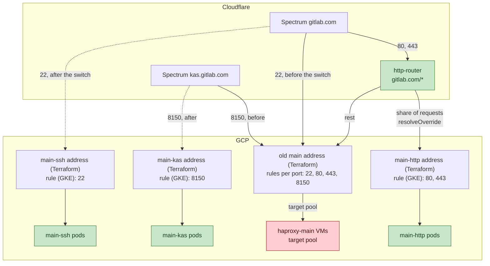
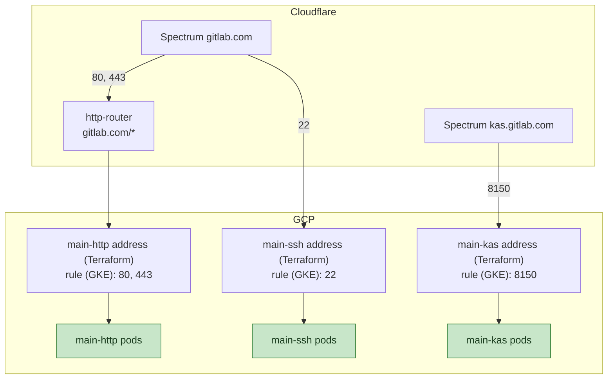
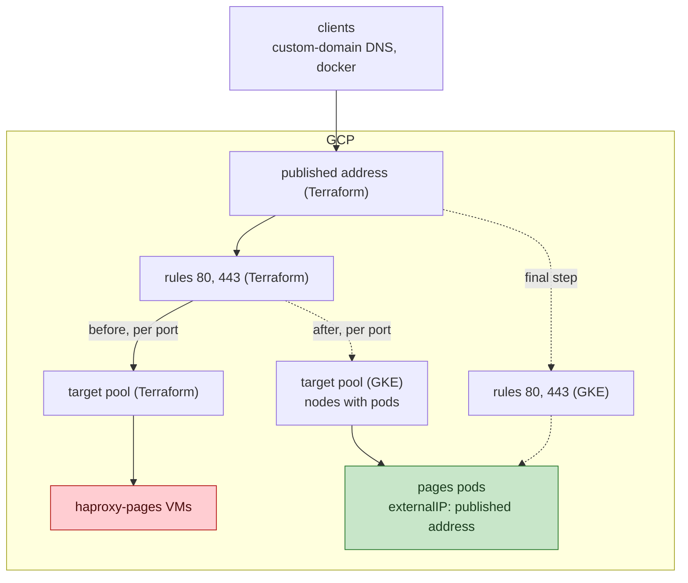
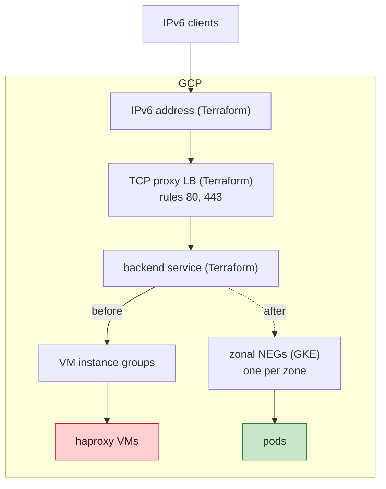
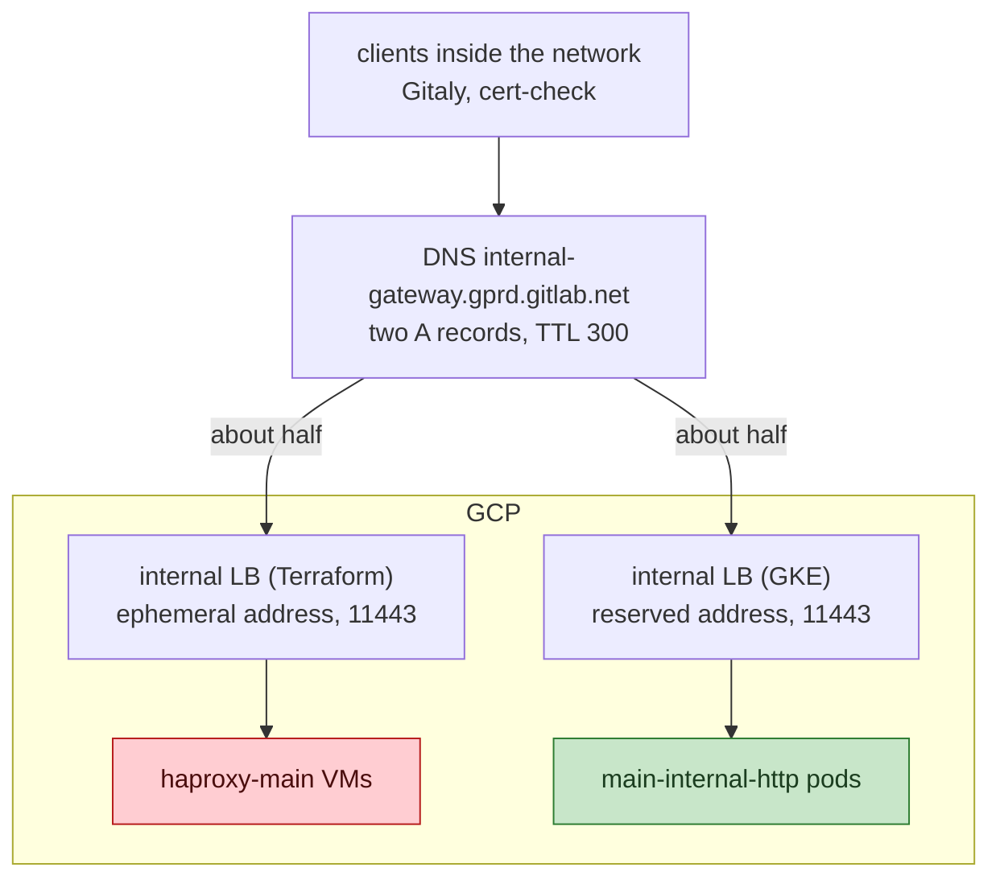

## ステータス {#status}

承認済み、進行中。

## ステークホルダー {#stakeholders}

- Networking and Incident Management：手順とそのロールバック
- Cells：http-router のルール、その設定と削除
- Delivery、特に Release managers：フリート混在期間中のカナリアの動作、作業時間帯に合わせた PCL のタイミング
- Package（registry）と Pages：アドレスの引き継ぎと、ポートごとの数秒の中断
- Environments（kas）：8150 のオリジンの切り替え
- Runners Platform：ci-gateway の DNS レコード変更

## 背景 {#context}

次の制約のもとで、VM から Pod にトラフィックを移します。

- 中断はなく、公開済みアドレスのために他の方法がない場合でも、
  数秒に抑えます。
- ロールバックは 1 つのコマンドまたは 1 つの MR のリバートで行え、VM を
  廃止するまで機能します。
- サービスごと、またはポートごとに行い、すべてを一度に移すことはありません。
- クライアントから見える変更はありません。アドレス、ホスト名、証明書、および
  HAProxy が認識するクライアントアドレスは、両側で同じです。

フリートのエントリーポイントには 4 種類あり、それぞれの前段に何があるかによって、
トラフィックをどれほど細かく分割できるかと、切り替えを行う場所が決まります。

- `gitlab.com` の HTTP は、リクエストごとにルーティングできる cells の http-router Worker を
  経由します。Worker の背後では、80 と 443 は、22 を
  `direct` ポートとして持つ同じ Spectrum アプリケーションの `http` および
  `https` ポートです。そのため、Worker によるオリジンの取得先は、単純なプロキシ付きレコードではなく、Spectrum の
  オリジンになります。
- ssh、altssh、kas は Spectrum の `direct` ポートです。1 つのポートに 1 つのオリジン
  アドレスがあり、Cloudflare 側にはリクエストごとにルーティングできるものは
  ありません。
- pages と registry のアドレスは、顧客に公開されています。カスタム
  ドメインの DNS は pages のアドレスを指し、registry のアドレスは、
  許可リスト用に GitLab.com 設定ドキュメントで公開されています。
  どちらも Cloudflare の背後にはありません。
- internal gateway の ILB と ci-gateway の ILB のクライアントは社内のものだけで、
  私たちが管理するホスト名を使います。

Terraform は、外部アドレス、DNS レコード、それらを指す Spectrum
アプリを管理します。GKE の L4 コントローラーは、各
`LoadBalancer` Service のために作成する転送ルール、
バックエンドサービス、NEG、ヘルスチェックを管理します。

## 決定 {#decision}

各リリースに独自のアドレスを用意し、Terraform で予約し、
名前で `LoadBalancer` Service に渡します。VM と Pod は、1 つの例外を除いて GCP
オブジェクトを共有しません。pages と registry には変更できない公開済み
アドレスがあるため、引き継ぎ中は転送ルールを
共有します。VM を廃止するまで、古いアドレス、転送ルール、ターゲット
プールを残し、それまではどの切り替えも
元に戻せるようにします。ただし、例外があります。pages と
registry の IPv4 の引き継ぎの最終手順で Terraform の転送ルールを削除するため、
その後のロールバックには再作成が必要です。その手順は、接続先の変更によって Pod が動作することを確認した後、
選択した時刻に最後に実施します。

別のクラスターに移すリリースには、両方を稼働させる期間のために、2 組目のアドレス
と NEG 名が必要です。アドレスが結び付くのは 1 つの
転送ルールだけで、ゾーン NEG の名前はクラスターごとではなく、プロジェクトとゾーンごとに一意である必要が
あります。2 組目は、移行後も残します。

本番トラフィックを流す前に、各リリースを、新しいアドレスを指すテスト用ホスト名の Spectrum アプリを
通じて Cloudflare からテストします。
ポートと proxy-protocol の設定は本番と同じにします。これにより、443 のオリジンプル検証と、
22 の proxy-protocol 送信元
ACL を確認できます。VM を経由する引き渡しでは、これらを確認できません。

WAF、カスタムルール、レート制限はゾーンの設定です。ルーターのオリジン
名は、リクエストが到着するゾーン内のレコードなので、ルーターを通る
経路にはそのゾーンのルールが適用されます。Worker がオリジンを取得する前に、
WAF が実行済みです。テスト用ホスト名はマネージドルールセットの対象ですが、
ホスト単位のルールは一切対象にならないため、適用されるルールは本番より少なくなります。

各エントリーポイントの仕組みは、その制約に応じて選びます。
この記録の残りの内容は、すべて次の表に基づきます。

| エントリーポイント | 制約 | 仕組み | 粒度 | 切り替えとロールバック |
|---|---|---|---|---|
| 80 と 443（`main-http`） | Cloudflare の背後にあり、http-router がすでにオリジンを選択しています | ルーターの `cf.resolveOverride`、Flagship のロールアウト率 | リクエストごと、任意の割合 | 数秒、Flagship のルール |
| 22 と kas の 8150（`main-ssh`、`main-kas`）、altssh | TCP で、ルーターからは見えません。Spectrum には、アプリごとのオリジンリストがあります | アプリのオリジンリストを `[VM, GKE]`、その後 `[GKE]` にします。手動で設定し、Terraform に記録します | 接続ごと、半分から全体へ | 数秒、API 呼び出し |
| registry と pages の IPv4 | 公開済みアドレスで、Cloudflare は使っていません | 転送ルールの接続先を Service のターゲットプールに変更し、Service の `externalIPs` にそのアドレスを指定します | ポートごとに全体かゼロか | 約 30 秒、Terraform の apply またはリバート |
| registry と pages の IPv6 | 同じアドレスをグローバル TCP プロキシで使用します | バックエンドサービスを VM のインスタンスグループから Service のゾーン NEG に切り替えます | ポートごとに全体かゼロか | ドレインを伴う apply の所要時間、リバート |
| internal gateway の 11443（`main-internal-http`） | 名前解決を行うネットワーク内のクライアントです。転送ルールのアドレスは一時的なものなので、接続先を変更しません | A レコードに、VM の ILB のアドレスに加えてリリースの内部アドレスを追加し、その後、後者だけにします | リゾルバーごとに約半分から全体へ | DNS TTL、往復それぞれ最大 5 分 |
| ci の 8989 | ILB と Runner のピアリングは別の VPC にあり、ピアリングは推移的ではないため、Pod はそこにインターフェースを持ちます（ADR 007） | A レコードに、VM の ILB のアドレスに加えて Pod のロードバランサーのアドレスを追加し、その後、後者だけにします | リゾルバーごとに約半分から全体へ | DNS TTL、往復それぞれ最大 5 分 |

ここから 2 つのルールが導かれます。移行中は常に VM への経路に到達できるため、
ロールバックは設定変更で行い、再構築は不要です。また、Terraform の apply と競合する場所でのみ、
手動で切り替えます（Spectrum の
オリジンリスト）。それ以外は、すべて Terraform で切り替えます。

移行中の `main` フリートです。http-router が HTTP を分割し、
22 と 8150 の Spectrum オリジンをポートごとに移します。

最終状態の `main` フリートです。古いアドレスと
http-router のルールを削除しています。

### `gitlab.com` の HTTP {#http-on-gitlabcom}

http-router のルールで、一定割合のリクエストを Pod に送ります。
`cf.resolveOverride` により、オリジンの取得先を、新しい
アドレスのホスト名に向けます。

- **割合だけで分割します。** 両フリートは、同じフロントエンドと
  バックエンドを生成します。パスで分割しても、異なる HAProxy を通して同じバックエンドにリクエストを
  送るだけなので、割合で分割した場合以上のことは示せません。
- **リクエストのゾーン内のホスト名。** `resolveOverride` が適用されるのは、
  上書き先のホスト名がリクエストと同じゾーンにある場合だけです。
  そのため、`gstg` では `haproxy-<release>-gke.staging.gitlab.com`、
  `gprd` では `haproxy-<release>-gke.gitlab.com` とします。新しいアドレスに対するプロキシ付き A レコードとして、
  ゾーン内の他のレコードとともに config-mgmt で管理します。
  この 2 つのゾーンでは認証付きオリジンプルが有効ですが、
  `gitlab.net` では無効なので、オリジン名にはそのゾーンを使用できません。環境ごとに、
  プロキシ付きレコード、ゾーンのエッジ証明書パックへの名前の登録、
  ゾーンを対象とする Cloudflare トークンを持つクラスター内の cert-manager issuer、
  リリース用の Vault ロールバインディングが必要です。
- **TLS は変更しません。** `Host` と SNI は `gitlab.com` のままなので、Pod は、
  443 のバインドにすでに設定されている `gitlab.com` の証明書で応答し、
  ゾーンの認証付きオリジンプルが、`verify required` が要求するクライアント証明書を
  提供します。
- **フラグで制御します。** ホスト名は Flagship のフラグの値で、
  割合はそのフラグのパーセンテージロールアウトです。Flagship はリクエストごとに
  評価します
  （[http-router!1342](https://gitlab.com/gitlab-org/cells/http-router/-/merge_requests/1342)）。
  `gstg` では、`resolveOverride` が Spectrum の `https` ホスト名のオリジン接続を
  意図どおりにリダイレクトします。
- **オリジンルールも上書きします。** `cf.resolveOverride` は、
  Cloudflare のオリジンルールの DNS 上書きより優先されます。そのため、オリジンルールが別の場所に送るパス
  （`/assets/` をバケットに送る場合など）も、代わりに Pod に送られ、
  失敗します。ルーターには、それらのパスを対象としたホストごとのパス除外リストがあり、
  割合を増やす前にゾーンのオリジンルールに基づいて設定します。
- **後片付け。** Spectrum の 443 のオリジンの移行後、ルールを
  削除します。

### ssh、kas、および Spectrum のポート {#ssh-kas-and-the-spectrum-ports}

新しいリリースのアドレスを、Spectrum の各アプリのオリジン
リストに、1 ポートずつ追加します。最初は 22 と 8150、その後、
ルーターが HTTP を移したら 80 と 443 を追加します。

- **2 エントリのリストは中間段階です。** Spectrum は、新しい接続を
  すべての `origin_direct` エントリに分散し、重みやヘルス
  チェックはありません。`[vm, gke]` なら新しい接続の半分、`[gke]` ならすべてが対象で、
  エントリを再び削除することがロールバックです。ルーターが使えない
  22 と 8150 で可能な段階的移行は、これだけです。
- **中間段階での障害。** Pod 側が停止すると、エントリを削除するまで、
  その割合の新しい接続が失敗します。
- **手動で適用し、その後記録します。** ダッシュボードのフォームはオリジンを 1 つしか受け付けず、
  他を削除してしまうため、変更には
  `glsh cloudflare-spectrum-origin` を使います。ポートが安定した後に config-mgmt の `port_ip_override` を
  更新し、Terraform の apply が
  何も変更しないようにします。手順は、
  [HAProxy のランブック](https://runbooks.gitlab.com/frontend/haproxy/#moving-a-spectrum-origin)にあります。
- **既存の接続は移動しません。** 各段階で変更するのは、新しい接続の行き先です。
  長時間のセッション、特に kas の gRPC ストリームは、
  再接続するまで VM に残るため、リクエストの割合は
  接続の割合より遅れて変化します。

### Pages と registry の IPv4 {#pages-and-registry-ipv4}

アドレスは変更できません。registry のアドレスは、顧客の許可リスト用に GitLab.com の
ドキュメントに記載され、カスタムドメインの A レコードは
pages のアドレスを指し、`gprd` ではどちらのホスト名も Cloudflare の背後にありません。
転送ルールの接続先を変更することで、ポートごとに引き継ぎます。

1. リリースの Service はターゲットプール型で、公開済み
   アドレスを `externalIP` として持ち、独自のアドレスは持ちません。GKE は、
   Pod のあるノードでターゲットプールを構築し、ノードはそのアドレス宛てのトラフィックを
   受け付けます。
1. ファイアウォールルールで、そのアドレスのリリースのポートへのトラフィックを、ノードに対して
   許可します。
1. ポートごとに、`target_pool_override` を通じて VM モジュールの転送ルールの接続先を GKE の
   プールに変更し、Terraform で適用します。いずれの
   方向でも、切り替えるポートで約 30 秒の中断が発生し、
   そのアドレスを通る確立済みの接続が切断されます。そのため、
   `gprd` の切り替えは、週末のメンテナンスとして予定します。
1. すべてのポートが Pod に移り、動作が確認されたら、Service が
   アドレスを引き継ぎ（ターゲットプール型 Service の `loadBalancerIP`）、GKE が
   独自の転送ルールを作成し、Terraform が私たちのルールを、
   プールとヘルスチェックとともに削除します。選択した時刻にもう一度中断があり、
   `gstg` では registry が 10 秒、pages が 37 秒で、IPv6 には
   影響しません。その後、`externalIPs` エントリと引き継ぎ用
   ファイアウォールルールを削除します。

VM フリートのモジュールを削除するまで、Terraform のモジュールインスタンスが、
アドレス、IPv6 ロードバランサー、ファイアウォールルール、DNS レコードを
管理し続けます。その時点で、アドレスと Spectrum
アプリを、`moved` ブロックで独立したリソースに移し、plan が
破棄する対象を、削除したモジュール内のものだけにします。また、http-router がオリジンアドレスを読み取る Vault 内の
環境の DNS シークレットを、
GKE のアドレスに更新します。

Pages の IPv4 では、Terraform のルールの接続先を VM のプールから
GKE のプールにポートごとに変更し、最後に GKE 独自のルールに移します。Registry も
同様です。

### Pages と registry の IPv6 {#pages-and-registry-ipv6}

registry と pages は IPv6 アドレスも持ち、グローバル TCP プロキシ
ロードバランサー上で、そのバックエンドサービスが VM のインスタンスグループを指しています。
バックエンドサービスは、インスタンスグループと NEG の両方を同時にバックエンドに
できないため、ポートごとに全体かゼロかで切り替えます。1 回の Terraform の apply で、
バックエンドを Pod のゾーン NEG に置き換えます（Service の
`cloud.google.com/neg` アノテーションから取得します）。古いバックエンドのドレインが終わる前に、
新しい接続は Pod に到達します。また、
Google のフロントエンドの範囲に対するファイアウォールルールで、ノードへのヘルスチェックを
許可します。IPv6 は、registry のリクエストの約 2%、
pages の 1% 未満です。

どちらのサービスも、各アドレスは 2 回の Terraform の変更で移し、両方を
適用したらフリートを廃止できます。後で
GKE クラスター間を移すときは、バックエンドサービスが両方のクラスターの NEG を
同時に受け付けるため、IPv6 では段階的に移行できます。IPv4 では、
前と同じく転送ルールごとにプールを切り替えます。

Pages の IPv6 で、バックエンドサービスを VM のインスタンス
グループから Pod の NEG に切り替えた状態です。Registry も同様です。

### 内部ゲートウェイ {#internal-gateway}

クライアントはネットワーク内にあり、
`internal-gateway.gprd.gitlab.net` を名前解決します。VM 側は、一時的なアドレスを持つ内部ロード
バランサーなので、接続先を変更する転送ルールは
ありません。VM のロードバランサーは、22、80、443、11443 を転送しますが、
トラフィックがあるのは 11443 だけなので、リリースは 11443 を処理します。`main-internal-http` リリースには予約済みの
内部アドレスがあり、A レコードに VM の ILB のアドレスと並べて
追加し、VM のアドレスを削除した後はそれだけにします。各リゾルバーはどちらかを選ぶため、
最初の段階ではクライアントの約半分が移り、ロールバックは
そのレコードを再び削除することで行います。TTL は、往復それぞれ 300 秒です。内部
ゲートウェイは、`main` の公開ポートの後に移します。

移行中の内部ゲートウェイです。DNS に両方のレコードがあります。

### Private Service Connect 経由の Relay {#relay-over-private-service-connect}

ci プロジェクトの Runner managers は、`haproxy-main` VM の前段にある内部ロードバランサーの
PSC サービスアタッチメントを通じて、
Relay 用に kas に到達します。`main-internal-kas` リリースには、
まだ何も接続されていない独自の内部ロードバランサーがあります。アタッチメントの
ターゲットは変更できないため、リリースの転送ルールに 2 つ目のアタッチメントを作成し、ci プロジェクトに
新しいコンシューマーエンドポイントを作成し、
Runner managers を新しいエンドポイントに切り替えてから、VM の
アタッチメントとロードバランサーを削除します。ロールバックは、両方のアタッチメントが存在する間に
Runner managers を元に戻すことで行います。これは `gstg` と
`gprd` で同じで、`gstg` では最後に移すエントリーポイントです。

### ci-gateway {#ci-gateway}

Runner は、一貫して `us-east1.ci-gateway.int.<env>.gitlab.net` を使います。内部
ゲートウェイと同様に、レコードに Pod のロードバランサーのアドレスを
VM の ILB のアドレスと並べて追加し、その後、VM のアドレスを削除します。Runner の設定は
変更しません。Pod が `ci-gateway` VPC にインターフェースを持つ方法は、
ADR 007 で説明します。

## 影響 {#consequences}

- Terraform は、GKE が作成するリソースを 3 か所で参照します。
  pages と registry の IPv4 の転送ルールは、引き継ぎ中に GKE のターゲットプールを
  指します。プール名は Service に由来するため、
  引き継ぎ中に Service を再作成した場合は、上書き設定の更新が必要です。
  pages と registry の IPv6 のバックエンドサービスは、以後、恒久的に Pod の NEG を
  指します。`main-internal-kas` 用の PSC
  アタッチメント（ADR 003）は、Relay の移行後、
  恒久的に Service の転送ルールを指します。それ以外では、両側で何も
  共有しないため、`ignore_changes` や ArgoCD の同期の一時停止はありません。
- http-router のアップストリーム取得には、従来のセル用にフラグで制御する `resolveOverride` が
  あります。
  dns-record モジュールの変更は不要です。
- Pod のオリジンが失敗しても、フォールバックしません。フラグを変更するまで、その割合のリクエストが失敗し、
  ロールバックにかかる時間はフラグの伝播
  時間です。上書きなしで再試行すると、
  割合が小さい場合に Pod の障害を隠してしまうため、行いません。
- リクエスト単位の分割は、HAProxy 側では安全です。クライアントのリクエストが VM と Pod に交互に送られると、
  2 つの仕組みが壊れる可能性があります。クライアントをサーバーに固定する
  `websockets` バックエンドのセッション Cookie と、
  カナリアのルーティングです。Cookie はサーバー名を保持し、
  VM と Pod のそのバックエンドではサーバー名が同じなので、
  Cookie は両方で有効です。カナリアのルーティングは、同じルールにより、
  両側で Cookie からリクエストごとに決定します。
- http-router の Cloudflare Worker のログは、`gprd` で 1% をサンプリング
  します。BigQuery の HAProxy のログはサンプリングしていないため、
  ロールアウトはそちらで監視します。
- オリジンのホスト名は公開 DNS レコードなので、誰でも
  `https://haproxy-main-http-gke.gitlab.com/` に直接リクエストを送れます。Pod は、
  それを `gitlab.com` として処理しますが、`gitlab.com` のホスト名に一致する WAF ルールやレート
  制限は適用されません。
  `Host` ヘッダーがオリジンのホスト名であるリクエストは、WAF ルールで
  すべてブロックします。`resolveOverride` が変更するのは、
  リクエストの送信先アドレスであり、`Host` ヘッダーは
  `gitlab.com` のままなので、ルーターのトラフィックには影響しません。
- GKE では、CVE-2020-8554 のため、Service の `externalIPs` はデフォルトで
  拒否されます。許可するには、クラスターごとに約 15 分のコントロールプレーンの
  更新が必要です。最初の引き継ぎ前に実施し、
  クラスター内で `externalIP` を指定する Service がなくなったら、再びオフにします。
- ファイアウォールルールや NetworkPolicy で HAProxy の VM のサブネットを許可している
  バックエンドには、クラスターの Pod の範囲を追加する必要があります。クラスターでの最初の
  リリース前に、サブネット名とアドレスを使って config-mgmt、
  argocd/apps、k8s-workloads 内で該当ルールを探し、
  トラフィックを移す前に、Pod と VM のバックエンドの状態を
  比較します。
- 常にロールバックできるよう、VM フリートは、
  廃止するまでフル容量で稼働させます。

## 検討した代替案 {#alternatives-considered}

### Spectrum のポートでも転送ルールの接続先を変更する {#retargeting-the-forwarding-rules-for-the-spectrum-ports-too}

pages と registry で行うことを、`main` のアドレスにも適用します。各ポートの
転送ルールの接続先を、VM のターゲットプールから GKE のターゲットプールに変更します。
動作はしますが、避けられる場合は Terraform と GKE が同じ
オブジェクトを管理すべきではなく、ここでは避けられるため、採用しません。
`main` のアドレスを移行後も同じにする必要はなく、Cloudflare だけが
そこに接続し、Spectrum のオリジン変更もポートごとの切り替え
だからです。pages と registry は、アドレスを変更できないため、
例外です。

### 1 段階でアドレスを引き継ぐ {#handing-the-address-over-in-one-step}

Service に公開済みアドレスを指定し、Terraform の転送
ルールを削除して、GKE に独自のルールを作成させます。すべてのポートが一度に移り、
GKE がアドレスをバインドしてヘルスチェックが立ち上がるまでの 10 〜 40 秒間、
アドレスに到達できず、
ロールバックには Terraform のルールの再作成が必要で数分かかるため、トラフィックを移す方法としては採用しません。
代わりに、すべてのポートが Pod に移り、接続先の変更によって動作を確認できた後の、
IPv4 の引き継ぎの最終手順とします。

### 既存のロードバランサーの背後でホストネットワークを使う Pod {#pods-on-the-host-network-behind-the-existing-load-balancer}

Pod を `hostNetwork` で実行し、既存のロードバランサーに、
VM のインスタンスグループと並べて GKE ノードのインスタンスグループを追加します。
中断はなく、ノードごとに段階的に移行できます。採用しない理由は、
`hostNetwork` の Pod がノードのポートにバインドするため、ノードごとに 1 つの Pod となり、
Service とネットワークポリシーがなく、通常の Deployment のノードドレインやアップグレードの動作が
適用されなくなるためです。リリースは、意図的に `LoadBalancer` Service の背後の通常の
Deployment としています。2 つのフリート用にチャートの別の
バリエーションを作ると、その方針を崩します。

### ssh 用の Socket Workers {#socket-workers-for-ssh}

プライベートベータ版の Cloudflare の
[Workers への受信 TCP 接続](https://blog.cloudflare.com/grpc-workers/)と、
送信側の
[`connect()` API](https://developers.cloudflare.com/workers/runtime-apis/tcp-sockets/)を組み合わせると、
http-router が HTTP に提供するのと同じ接続単位の分割を、
ssh と kas に提供できます。ssh の経路にベータ版の機能を
入れることになり、また、PROXY プロトコルヘッダー用にクライアントアドレスを Worker に渡すこと、
Cloudflare の公開範囲からの送信、
Worker の isolate より長く続く接続が必要になるため、採用しません。
将来、プログラム可能な TCP ingress が必要になった場合は、検討する価値があります。

### VM を経由する重み付きの引き渡し {#weighted-handoff-through-the-vms}

VM の各バックエンドに、Pod のロードバランサーをサーバーとして追加し、
エージェントを通じて重みを上げます。これは、追跡用の
Issue で提案されていた方法です。すべてのプロトコルで、サービスごとに機能し、即時に
ロールバックでき、Cloudflare や GCP の変更も不要です。2 つの理由で採用しません。
HAProxy の前に HAProxy を配置するため、リクエストごとに追加の
ホップが発生し、両フリートを常時フル容量で稼働させる必要があり、
運用もデバッグもされたことがない構成になります。また、リスクを分散する代わりに、最後に先送り
します。VM は、転送前に TLS を終端し、オリジンプル
証明書を検証し、PROXY プロトコルヘッダーを読み取るため、
Pod の設定のそれらの部分には、最終的な切り替えまでトラフィックが流れません。
そのときに、トラフィックが流れたことのないすべての部分に一度にトラフィックが流れ込みます。直接の切り替えなら、
最初の接続から Pod の設定全体を検証できます。

### HTTP にも Spectrum のオリジンリストを使う {#spectrum-origin-list-for-http-as-well}

22 と 8150 に使う 2 エントリのオリジンリストは、443 でも機能します。
新しい接続を半分に分けるだけで重みやヘルスチェックがなく、
http-router なら HTTP をリクエスト単位の割合で分割し、
フラグの変更でロールバックできるため、採用しません。

### 同じアドレスの 1 つの GCP ロードバランサーに VM と Pod を混在させる {#same-address-mix-of-vms-and-pods-in-one-gcp-load-balancer}

VM と Pod を同じロードバランサーの背後に配置し、両者間で
重みを移します。この構成を実現するロードバランサーが GCP にはないため、採用しません。
ターゲットプールが受け付けるのは VM のみで、バックエンドサービスはインスタンスグループか
NEG のいずれかしか受け付けず、GKE は既存のバックエンドサービスに
参加するのではなく独自に作成します。実現するには、`hostNetwork` の
Pod（前述）か、VM とノードの NEG を維持する独自のコントローラーが
必要です。VM の廃止とともに終わる状態のために、数週間の
作業が必要になります。

### Cloudflare Load Balancer、Workers のルーティングコード、registry の DNS {#cloudflare-load-balancer-workers-routing-code-dns-for-registry}

トラフィックを分割する方法は、他に 3 つあります。Spectrum のオリジンに Cloudflare Load Balancer を
使う方法は、Spectrum のオリジンリストで同じ分割ができるのに、
数週間の利用のためにプロダクトを採用して費用を払うことになるため、
採用しません。Worker に新しいルーティングコードを入れる方法は、
すべての gitlab.com リクエストの経路に新しいロジックを加えることになるため、採用しません。http-router の
フラグなら、すでに実行されている Worker への小さな変更で済みます。
DNS を通じて `registry.gitlab.com` や `*.gitlab.io` を新しいアドレスに移す方法は、
顧客がそれらのアドレスを許可リストに登録し、自分たちの
レコードで参照しているため、また、リゾルバーのキャッシュを伴う DNS ラウンドロビンは、
上記のどの仕組みよりも適用とロールバックが
遅いため、採用しません。

### 内部ゲートウェイの新しいホスト名 {#a-new-hostname-for-the-internal-gateway}

`main-internal-http` リリースに独自のホスト名を付け、
既存のレコードにアドレスを追加する代わりに、クライアントを 1 つずつそこに向けます。
移行はリゾルバーごとではなくクライアントごとになり、
ロールバックはそのクライアントの設定で行います。クライアントを複数のチームが管理し、
完全な一覧が不明で、既存の名前が
証明書やファイアウォールルールに含まれているため、採用しません。2 つ目の A レコードなら、
クライアントに一切手を加えずに、すべてを移せます。
