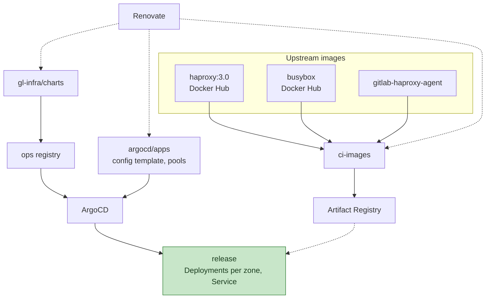

## ステータス {#status}

承認済み、進行中。

## ステークホルダー {#stakeholders}

- Networking and Incident Management：チャート、イメージ、
  サービス、設定の移植。3 つすべてのリポジトリの `CODEOWNERS` エントリに、
  このチームを指定しています。
- Fleet Management：チャートとサービスが従う規約

## 背景 {#context}

HAProxy の設定は、
[gitlab-haproxy クックブック](https://gitlab.com/gitlab-cookbooks/gitlab-haproxy)が
Chef ロールの JSON から生成します。ゾーンごとのバックエンドの順序、
`agent-check` 行を含むサーバー一覧、カナリアの重み、ACL とマップファイルを、
3 種類（main、registry、pages）と 3 つの環境にわたって生成します。
[Runner managers の移行](/handbook/engineering/architecture/design-documents/runner_managers_kubernetes/)では、
このようなワークロードのためのパターンを定義しました。

- グローバル、環境、シャード、クラスターの順で値を重ねる
  [argocd/apps](https://gitlab.com/gitlab-com/gl-infra/argocd/apps) サービス
- アップストリームのチャート、または要件を満たすアップストリームのチャートがない場合は
  [gl-infra/charts](https://gitlab.com/gitlab-com/gl-infra/charts) 内の
  チャート
- [gl-infra/ci-images](https://gitlab.com/gitlab-com/gl-infra/ci-images)
  でビルドし、Artifact Registry に公開する
  イメージ
- バージョン管理に Renovate を使用

## 決定 {#decision}

チャートは、gl-infra/charts 内の `gitlab/haproxy` です。その場所の他のチャートと同じように、
ops レジストリに公開します。チャート名、argocd/apps のパス、名前空間、ノードプールの
ラベルは `haproxy` です。`ci` リリースのプールには、`haproxy-ci` というラベルを付けます
（ADR 007）。メトリクスカタログのサービスは、
引き続き `frontend` です（ADR 006）。

### チャートが生成するもの {#what-the-chart-renders}

- ゾーンごと：Deployment、CPU とメモリに基づく HPA、および
  PodDisruptionBudget。
- リリースごと：1 つの `LoadBalancer` Service、PodMonitor、フリートの証明書で対象としていないホスト名のための cert-manager の
  Certificates、マウントされた Secret が
  変更されたときに Pod をローリング更新する Reloader のアノテーション、および HTTP エラーページ。
- サイドカーとしてエージェントを配置します。Renovate が更新できるよう、イメージタグは値として
  指定します。
- チェック用フロントエンドを無効にし、ロードバランサーの
  ヘルスチェックがそれを検知するのを待ってから、ソフトストップのために `SIGUSR1` を送る
  preStop フック。終了猶予期間は、`hard-stop-after 30m` をカバーします
  （ADR 008）。

### 設定の配置場所 {#where-the-config-lives}

チャートは、`tpl` を通じて設定を 1 つの文字列として受け取ります。テンプレート
とパラメーターは argocd/apps の値です。クックブックの
テンプレートからセクションごとに移植し、VM の設定との差分を
比較しました。VM を廃止するまでは、設定は VM 用の
クックブックと Pod 用の argocd/apps の 2 か所に存在し、一方への変更は
他方にも反映する必要があります。生成された 2 つの設定の差分で、
乖離を検出します。生成された設定は ConfigMap に書き込みます。Pod テンプレートのチェックサム
アノテーションにより、設定変更はローリングデプロイになります
（ADR 008）。レビュー時の確認対象は、MR 内の生成結果の差分です。
HAProxy が受け付けない設定では startup probe が失敗し、
古い Pod が引き続きトラフィックを処理する状態でロールアウトが停止します。

Cloudflare のオリジンプル CA は、公開 CA で、現在はクックブックのファイルです。
チャートに含め、設定用 ConfigMap に書き込みます。

### コンテナ向けに変更する設定 {#what-changes-in-the-config-for-a-container}

- カーネルは、2 つの例外を除きデフォルト設定で実行します。VM では、Cloudflare が前段に配置される以前からの
  12 個ほどの `net.*` sysctl を設定しています。
  それぞれが何を変えたのか、記録がありません。ソケットバッファーの
  最大値はノードプールで設定します。listen backlog の sysctl
  （`somaxconn`、`tcp_max_syn_backlog`）は、Pod の sysctl とします。Pod の
  ネットワーク名前空間のデフォルト値 1024 によって、各リスナーのバックログが 1024 に制限されるためです。
  VM では 50000 です。Dataplane V2 クラスターでは輻輳制御を設定できないため、
  Cloudflare の背後では、BBR ではなく cubic を使用します。
  それ以外は、負荷をかけた `gstg` で差が確認された場合にのみ
  追加します。
- HAProxy は、`daemon` や `chroot` を使わずに非 root で実行し、IPv4
  のみにバインドします。VM はすべてのポートで IPv6 バインドを生成しますが、グローバル
  IPv6 アドレスがなく、すべてのバックエンドが IPv4 のため、現在それらのバインドには
  トラフィックがありません。Pages の IPv6 は、引き続き TCP プロキシ LB が処理し、
  IPv4 で Pod に接続します。
- `stats auth` と `stats admin` を削除します。stats ポートに到達できるのは
  クラスター内部のみであり、いずれにしても agent-check のコントロールプレーンが、
  次のチェック時に管理操作を上書きします。レジストリの
  `peers` セクションを削除します。VM はローカルノードだけでこれを生成するため、
  何もレプリケーションしていません。
- `check_http`、`check_https`、`check_ssh` の監視用フロントエンドを、
  readiness probe と preStop のドレイン対象にします。kas の
  リリースには、`nbsrv(kas)` を見る新しい `check_kas` を追加します。VM のロード
  バランサーのチェックは `/-/available-http` を見ています。
- Chef から引き継いだ、効果のない設定を削除します。根拠は MR にあります。VM が一度も
  ネゴシエーションしていないバインド上の `tfo`、`kas` と `ssh` の
  フロントエンド内の未使用の `stick-table`、
  2 つ目の stats バインドです。

### イメージ {#images}

ci-images は 3 つのイメージをビルドします。他のフリートのイメージと同様に、Artifact Registry に
公開し、そこからプルします。

- `haproxy` は、公式の `haproxy:3.0` イメージに何も追加せずにラップします。
  公式イメージには Prometheus エクスポーター、Lua、OpenSSL が
  組み込まれており、preStop フック用の `socat` も含まれています。VM が
  3.0 LTS ブランチを使用しているため、Pod でも同じものを使用し、プラットフォームとバージョンを
  一度に変更しないようにします。3.0 には、リクエストログで使用する JSON ログのエンコード機能があります
  （ADR 006）。`init-state` の導入は
  3.1 のため、startup probe には引き続き初期遅延が必要です
  （ADR 008）。Renovate は、3.0 の範囲内でタグを更新します。
  後で 3.2 より新しいバージョンに移行する場合、`ssh` と `kas` のフロントエンドの名前変更が必要です。
  3.3 はフロントエンドとバックエンドが同じ名前であることを認めず、そのバックエンド
  名はダッシュボードと agent-check のキーに含まれています。公式
  イメージは Debian 上でビルドされており、VM の PPA ビルドよりも新しい OpenSSL を使用しています。
  `gstg` での TLS の比較で、その差を確認します。
- `gitlab-haproxy-agent` は、エージェントのプロジェクトが公開するイメージをラップし、
  サイドカーも Artifact Registry から取得するようにします。VM と同じ
  バイナリです。同じノード上の Consul クライアントとは、
  `localhost` ではなくノードのアドレスを通じて通信します。
- `haproxy-init` は、Pod の init コンテナ用イメージです。現在は、
  公式の `busybox` イメージに何も追加せずにラップしています。`ci`
  リリースは、その `ip` を使用して 2 つ目のインターフェースのルートを追加します
  （ADR 007）。

## 影響 {#consequences}

- クックブックのテンプレートを argocd/apps の値に段階的に
  移植し、両方のフリートが存在する間は、2 つの生成結果を行ごとに
  比較できます。
- 各リリースは、シャードの値に独自の設定テンプレートを持ちます。
  バックエンドプール、ホスト名、スレッド数、リソースは環境の
  値です。ログ形式と Cloudflare の範囲は、グローバルの値です。
  バックエンドを変更する場合、リリースごとに 1 か所を編集します。
- 実行時に Docker Hub や `registry.gitlab.com` からプルすることはありません。
- クライアントアドレスの処理は、Pod から実際の送信元
  アドレスが見えることに依存します。80 と 443 では `CF-Connecting-IP` に基づく `set-src`、
  22 と 8150 では `expect-proxy` を使います。パススルー NLB の
  `externalTrafficPolicy: Local` によって、これを実現します。

## 検討した代替案 {#alternatives-considered}

### アップストリームの haproxytech/haproxy チャート {#upstream-haproxytechhaproxy-chart}

[haproxytech/haproxy チャート](https://github.com/haproxytech/helm-charts/tree/main/haproxy)は、
`config: |` の文字列から 1 つの HAProxy Deployment または DaemonSet を実行します。
マップファイル用の `includes`、`sidecarContainers`、`initContainers`、
`extraVolumes`、HPA または KEDA、PDB、`LoadBalancer` Service、
ServiceMonitor を備えています。私たちのものと同様に、設定を文字列で受け取ります。
生成する Kubernetes オブジェクトがリリースに合わないため、
採用しません。

- 1 つの Deployment と、その Deployment の Pod を選択する 1 つの Service を
  生成します。リリースには、1 つの Service の背後に、ゾーンごとに 1 つ、計 3 つの Deployment が
  必要です。
- サイドカーは、コンテナ仕様をそのまま値に貼り付け、リリースごとに繰り返し
  記載します。Renovate が更新できるイメージタグはありません。
- preStop のドレインシーケンスがありません。追加するには、別のチャートでチャートをラップする
  必要があり、その時点で、ラッパー自体がチャートになります。

### Docker Hub から公式イメージを直接取得 {#official-image-straight-from-docker-hub}

何もビルドする必要はありません。採用しない理由は、HPA やノードの
入れ替わりに伴うすべてのプルが Docker Hub の可用性とレート制限に依存し、Wiz が
イメージをスキャンせず、GKE のイメージストリーミングは Artifact Registry 内のイメージでしか
機能しないためです。ラップする場合は、小さな Dockerfile と、更新を維持するイメージがもう 1 つ
必要になります。

### エージェントのイメージを独自のレジストリから取得 {#agent-image-from-its-own-registry}

エージェントのプロジェクトは、goreleaser を通じて `registry.gitlab.com` に独自のイメージを
公開しています。そのままで動作します。他のすべての
ワークロードのイメージが Artifact Registry から取得され、argocd/apps の値も
それを前提としているため、採用しません。ci-images のラッパーなら、そのパターンに従えます。
