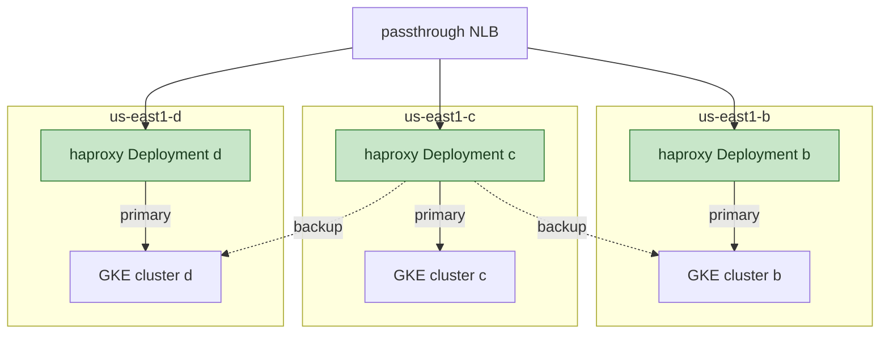

## ステータス {#status}

承認済み、進行中です。

## ステークホルダー {#stakeholders}

- Networking and Incident Management
- Fleet Management：統合先のクラスターによって、後からどの代替案が実現可能になるかが決まります

## 背景 {#context}

各 VM は、自身のゾーン内の GKE クラスターにトラフィックを送り、
他の 2 つのゾーンを `backup` として扱います。クックブックは、GCE メタデータからノードのゾーンを読み取り、
ロールの JSON から対応するサーバーリストを選択します。
ゾーンをまたぐトラフィックには課金が発生し、レイテンシーも増えます。この方法によって、ゾーン間トラフィックを
フェイルオーバー時に限定しており、Pod も同様に動作する必要があります。

アプリケーションのバックエンドは、各ゾーンに 1 つずつある 3 つのゾーン GKE クラスターの ILB です。
HAProxy の Pod にとって、すべてのバックエンドは自身のクラスターの外部アドレスであり、
Kubernetes 自体のゾーンを考慮したルーティングは適用されません。GKE の
L4 コントローラーは、1 つのクラスター内の Service ごとに 1 つのバックエンドサービスを作成し、
3 つすべてのゾーンにまたがる単一のバックエンドサービスも存在しません。
クラスターの統合
（[production-engineering#29065](https://gitlab.com/gitlab-com/gl-infra/production-engineering/-/work_items/29065)）によって、
アプリケーションがリージョンクラスターで稼働するようになれば、この両方が変わります。

## 決定 {#decision}

リリースごと、ゾーンごとに 1 つの Deployment を作成します。各 Deployment は
`nodeSelector` によってゾーンに固定し、そのゾーンのサーバーをプライマリ、
他の 2 つのゾーンを `backup` としてレンダリングします。バックアップの接続線はゾーン c についてのみ示しています。b と d も
同様です。

チャートはゾーンのリストを値として受け取ります。クラスターの統合によって
以下の代替案のいずれかが利用可能になった場合、チャートを変更せずに、
1 リリースを 1 つの Deployment にも 3 つの Deployment にもできます。

ノードプールは、各ゾーンに最低 1 ノードを持ちます
（[ADR 003](003_release_topology.md)）。ソフトな分散制約では、
プールをゼロからスケールアップできないためです。Pod が Pending になるのは、
既存のどのノードにもその Pod を配置する余地がない場合だけです。ハードな分散制約では、
リソース在庫が不足するゾーンでロールアウトがブロックされます。分散制約を使用する場合は、
ソフトな制約とします。

## 結果 {#consequences}

- 現在の仕組みを移植するもので、この移行独自の
  チャートと値だけに依存します。
- レンダリングされた設定をゾーンごとにレビューできます。ゾーンのドレインは、
  1 つの Deployment をスケールダウンすることで行います。これは現在のゾーン単位のドレイン
  ワークフローと一致します。
- リリースごとに 1 つではなく、3 つの Deployment と 3 つの HPA を使用します。
- ゾーンが失われた場合は、残りの 2 つのゾーンをスケールアップし、
  プロビジョニングもブートストラップも行いません。停止したゾーンのバックエンドは
  `backup` サーバーが処理します。これは HAProxy のゲームデーが
  対象としている障害であり、もはや再構築は必要ありません。

## 検討した代替案 {#alternatives-considered}

### 起動時に自身のゾーンを検出する単一の Deployment {#one-deployment-that-discovers-its-zone-at-startup}

init コンテナがメタデータサーバーからゾーンを読み取り、
設定をレンダリングします。リリースごとに 1 つの HPA を使用し、`topologySpreadConstraints` でゾーン間の
バランスを取ります。レンダリングされた設定をゾーンごとにレビューできなくなり、
1 つの Deployment のスケールダウンではゾーンをドレインできないため、却下しました。

### HAProxy とバックエンドの間にゾーンアフィニティを持つリージョン ILB {#regional-ilbs-with-zonal-affinity-between-haproxy-and-the-backends}

GCP の内部パススルーロードバランサーは、クライアントのゾーン内のバックエンドを
優先し、そのゾーンが異常な場合や容量不足の場合は、他のゾーンにトラフィックを振り分けられます。
私たちはすでに `haproxy-ci` の前段で、
`regional-internal-lb-zonal-affinity` モジュールを通じてこれを使用しています。
各アプリケーションバックエンドにこのような ILB を 1 つずつ配置すれば、HAProxy が必要とするのはバックエンドごとに 1 行のサーバー定義だけで、
プライマリとバックアップの順序づけは不要です。そうすれば、設定は
すべてのゾーンで同じになり、リリースごとに 1 つの Deployment で十分になります。

すべてのゾーンにまたがる単一のバックエンドサービスが必要なため、却下しました。
GKE の L4 コントローラーがそれを作成するのは 1 つのクラスター内の Service に対してだけであり、
アプリケーションが 3 つのゾーンクラスター上にある現状では、そのような
Service は存在しません。アプリケーションがリージョンクラスターで稼働するようになれば、これ、または
Kubernetes のトポロジーを考慮したルーティング（後述）によって、ゾーンごとの
Deployment をリリースごとに 1 つの Deployment に置き換えられます。これは別の決定として扱います。

### Kubernetes のトポロジーを考慮したルーティング {#kubernetes-topology-aware-routing}

Service の `trafficDistribution: PreferClose`（または以前の
トポロジーを考慮したヒント）は、クライアント Pod から同じゾーン内の
エンドポイントにトラフィックを送り、存在しない場合は他のゾーンにフォールバックします。
同じクラスター内の Pod と Service の間でしか機能せず、
HAProxy のバックエンドは他のクラスターの ILB であるため、却下しました。

HAProxy とアプリケーションが同じリージョンクラスターを共有するようになれば、HAProxy は
クラスター内の Service を直接接続先とすることができ、Kubernetes が
ゾーン内へのトラフィックの局所化を提供します。ILB の経由も、
HAProxy 設定内でのゾーンの順序づけも不要です。これは 4 つの選択肢の中で最もシンプルで、
ゾーンアフィニティを持つ ILB より先に評価すべき選択肢です。
