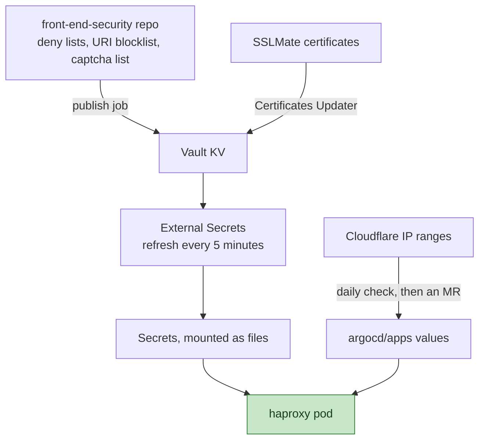

## ステータス {#status}

承認済み、進行中です。

## ステークホルダー {#stakeholders}

- Networking and Incident Management
- Security（SIRT、anti-abuse）：`front-end-security` の公開ジョブ
- Fleet Management：Vault のパスと External Secrets

## 背景 {#context}

HAProxy は、レンダリングされた設定以外のファイルにも依存します。VM 上では、
次のファイルです。

- SSLMate を通じて発行する TLS 証明書。鍵は
  Vault に保存し、Certificates Updater が証明書を更新します。
- Cloudflare の origin-pull CA。クックブックのファイルです。
- `front-end-security` リポジトリの拒否リストと、
  `recaptcha` リポジトリの CAPTCHA リスト。
- URL で取得する Cloudflare の IP 範囲。
- chef-repo のロール JSON にインラインで記述された、インシデントごとの拒否ルールと URI ブロックリスト。

VM 上では、Chef がクローンと IP 範囲を 30 分ごとに
更新します。GKE クラスターでは、Vault に接続する External Secrets と、
DNS-01 チャレンジを使用する cert-manager がすでに稼働しており、Pod は
代わりにそれらを利用できます。

## 決定 {#decision}

HAProxy がディスクから読み取るもののうち、非公開のものや独立して変更されるものはすべて、
Vault から External Secrets を通じて取得し、ファイルとしてマウントします。
それ以外はすべて、argocd/apps のチャート値として定義できます。

- リスト：`front-end-security` にすべてのリストを置き、そのレビューの流れも同リポジトリにまとめます。
  移動した CAPTCHA リストとインシデントごとの拒否ルールも
  含まれます。デフォルトブランチの `publish` ジョブが、
  これらを 1 つの Vault KV エントリに書き込みます。各リリースは、External Secret を通じて
  そこからマウントします。
- Cloudflare の IP 範囲：1 つのチャート値とし、
  設定が読み取るリストファイルと、すべての Service の `loadBalancerSourceRanges` にレンダリングします。
  Secret から後者に値を渡すことはできません。argocd/apps の日次 CI ジョブが、
  その値を Cloudflare API と比較し、異なっていれば失敗します。
  修正は MR で行います。IP 範囲が変わることはまれで、Cloudflare は
  追加を事前に告知します。
- `loadBalancerSourceRanges` は、22 と 8150 への接続を制御します。
  VM で接続元をチェックするのは 443 だけです。ファイアウォールでは 22 と
  8150 が開いており、`expect-proxy` は PROXY
  ヘッダーを読み取るかどうかを決めるだけです。オリジンアドレスへの直接接続は
  Spectrum を迂回します。これは以前から存在する問題で、Spectrum の
  所有者に別途提起しています。Pod には Cloudflare だけが接続できます。
- origin-pull CA：公開 CA であり、チャートに同梱します
  （[ADR 002](002_chart_and_images.md)）。
- 証明書：Pod は VM と同じ SSLMate 証明書を使用し、
  External Secret を通じて同じ Vault シークレットから読み取ります。
  Pod 専用のリリースごとのオリジンホスト名には、
  Let's Encrypt から cert-manager で取得した証明書を使用します。すべてを
  cert-manager に移すのは、VM の廃止後に行う後続作業です。

## 結果 {#consequences}

- 証明書、認証情報、リストを単一の仕組みで配布します。
  追加のサイドカーイメージも、Pod 内のデプロイトークンも、ディスク上の `.git`
  ディレクトリも不要です。
- External Secrets は 5 分ごとに Secret を更新し、その後 Reloader が
  すべてのリリースをロールアウトします。すべてのリリースがリストをマウントしているためです
  （ADR 008）。`front-end-security` へのマージは、
  約 10 分以内に Pod に反映されます。VM 上では 30 分ごとの収束処理でした。
  geoblock ボットは週 1 回程度マージします。
- リストの配布は切り替えの前提条件です。公開ジョブが
  用意されるまでは、`gstg` の Pod は空のリストで稼働していました。つまり、拒否リストも、
  URI ブロックリストも、CAPTCHA リストもありませんでした。
- 起動する Pod が必要とするのは Secret だけであり、運用用の Git
  ミラーや cloudflare.com へのアクセスは不要です。

## 検討した代替案 {#alternatives-considered}

### git-sync サイドカーと init コンテナ {#git-sync-sidecars-and-an-init-container}

2 つのリポジトリ用の git-sync サイドカーと、
Cloudflare の IP 範囲を URL で取得する init コンテナを使用する方法で、
Chef の動作と直接対応します。同じファイルを取得するために、
イメージが 2 つ増え、Pod 内にデプロイトークンが必要になり、
起動時にクラスター外のホストに依存するため、却下しました。

### 移行中の公開名への cert-manager の使用 {#cert-manager-for-the-public-names-during-the-migration}

技術的には準備ができています。DNS-01 を使用する cert-manager がクラスター上にあり、
すべての名前が公開ゾーンにあります。移行時は、両方のフリートが稼働している間に
同じ証明書を提示し、両者の
TLS 比較で変動要因を 1 つにするため、却下しました。

### チャート値としてのリスト {#lists-as-chart-values}

argocd/apps は公開リポジトリですが、`front-end-security` と
chef-repo は非公開です。拒否リスト、
CAPTCHA リスト、インシデントごとのルールを値に入れると、
ブロック対象のすべてのアドレス、ユーザーエージェント、パスが公開され、すべての変更が
ローリングデプロイになり、レビューの場所も Security チームの
リポジトリから移ってしまうため、却下しました。
