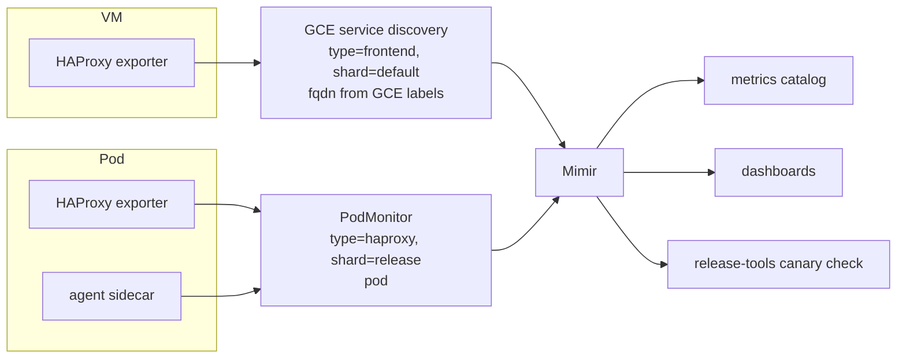
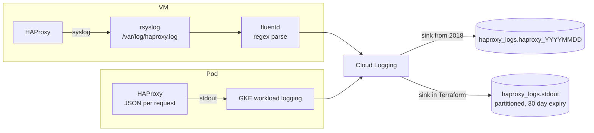

## ステータス {#status}

承認済み、進行中。

## ステークホルダー {#stakeholders}

- Networking and Incident Management
- Observability：メトリクスカタログの `haproxy` サービス、PodMonitor、ログ形式、Cloud Logging シンク
- Delivery：`canary up` 昇格チェック
- Cloud cost utilization：`gl_service` ラベルと `gl_shard` ラベル、および `haproxy` の機能カテゴリモデル
- HAProxy の BigQuery テーブルの利用者

## 背景 {#context}

### メトリクス {#metrics}

VM は `prometheus-scrape-configs` サービスの GCE サービスディスカバリーを通じてスクレイプされます。このサービスは、GCE ラベルから `type=frontend`、`tier=lb`、`stage=main`、`shard=default`、`environment`、`fqdn` を追加し、エクスポーターの `proxy` ラベルを、メトリクス名に応じて `frontend` または `backend` に書き換えます。メトリクスカタログの `frontend` サービスとダッシュボードは、これらのラベルで選択します。

### ログ {#logs}

HAProxy は journal にログを出力し、rsyslog が `/var/log/haproxy.log` に書き込み、fluentd がその末尾を追跡して各行を正規表現でフィールドに解析し、Cloud Logging に送信します。2018 年からある Terraform 管理外の Cloud Logging シンクが、`gstg` と `gprd` の BigQuery の `haproxy_logs` データセットに、シャード化した `haproxy_YYYYMMDD` テーブルとしてエクスポートします。ログは BigQuery にのみ存在し、Elasticsearch にはありません。GKE ワークロードロギングは有効です。Pod の stdout は、Cloud Logging で `k8s_container` として扱われます。

### コストの帰属 {#cost-attribution}

VM には GCP ラベル `gl_service=frontend` が設定され、請求データのエクスポートでは、そのコストがこのラベルに帰属します。`frontend` は GitLab.com で最も大きなコスト項目の 1 つで、その大半はピアリング経由のネットワーク送信データ転送です。[クラウドコスト帰属の設計](/handbook/engineering/architecture/design-documents/cloud_cost_attribution/)では、メトリクスカタログ内のサービスで宣言した使用量メトリクスに基づいて、各 `gl_service` をさらに機能カテゴリ別に分割します。そのメトリクスの `type` ラベルが `gl_service` に対応します。コストチームは、`registry` 用の HAProxy のコストを `registry` に帰属させるため、リリースごとに 1 つの `gl_service` を設けるよう求めました。

## 決定 {#decision}

### ラベル {#labels}

Pod は、リリースごとに 1 つのシャードを持つ独自の `haproxy` サービスとします。ラベルは `type=haproxy`、`tier=lb`、`stage=main`、`shard=<release>`（`main-http`、`main-ssh`、`main-kas`、`main-internal-http`、`main-internal-kas`、`registry`、`pages`、`ci`）です。同じ値を、Pod に `gl_service=haproxy` と `gl_shard=<release>` として設定します。`gl_shard` は新しいラベルです。`ci` 環境の Runner のシャードにはすでに設定されており、いずれの場合も Pod ラベル `shard` は請求データのエクスポートに `k8s-label/shard` として入ります。

VM は廃止されるまで `frontend` サービスのままです。2 つのサーバー群は `type` で区別します。両方の `backend` ラベルと `frontend` ラベルの値は同じなので、パネルでバックエンドごとに並べて表示できます。

### メトリクス {#metrics-1}

PodMonitor は、`backend` と `frontend` を含め、VM のスクレイプ設定が VM の系列に付けるのと同じラベルを Pod の系列に付けます。唯一の違いはインスタンスラベルで、`fqdn` の代わりに `pod` を使用します。メトリクスカタログの `haproxy` サービスは、シャードごとに `frontend` と同じ SLI を持ち、Pod の Deployment、HPA、ノードプールを追跡します。

### ログ {#logs-1}

HAProxy は、現在 fluentd の正規表現が抽出するフィールドにリクエストのタイマー、TLS の詳細、Pod 名を加え、リクエストごとに 1 つの JSON オブジェクトを stdout に書き込みます。Terraform で環境ごとに管理する Cloud Logging シンクが、VM のテーブルと並ぶ `haproxy_logs` データセット内のパーティション分割テーブルに書き込みます。ログは Elasticsearch に取り込みません。これは、主にコストを理由に選択した現在の状態と同じです。

### コストの帰属 {#cost-attribution-1}

GKE のコスト配分は、ノードのコスト（リソースリクエストに基づく vCPU、RAM、ディスク）を、クラスター、名前空間、ワークロード名、および `k8s-label/<key>` 形式のすべての Pod ラベルとともに、請求データのエクスポートに書き込みます。サーバー群のコンピューティングコストは、`gl_service=haproxy` という 1 つの項目になり、`gl_shard` によってリリースごとに分割されます。

ネットワーク送信は、コスト配分の対象 SKU に含まれません。コスト帰属の設計で説明しているとおり、`haproxy` 項目全体の機能カテゴリ別の分割は、`haproxy` サービスで宣言した使用量メトリクスに基づきます。そのメトリクスは、両方のサーバー群が出力するバックエンドごとの送信バイト数（`haproxy_backend_bytes_out_total`）です。どのバックエンドをどの機能カテゴリに対応させるかはコストチームと決めるもので、この記録の対象外です。

## 影響 {#consequences}

### ラベル {#labels-1}

- チャートが `type` と `gl_service` を設定し、リリースの値が `shard` と `gl_shard` を設定します。この変更のロールアウト時に、`gstg` の Pod は `type=frontend` から `type=haproxy` に変わり、その系列は `frontend` サービスから `haproxy` に移ります。
- コスト配分データは、ラベルが存在し始めてから約 3 日後以降、詳細な請求データのエクスポートにのみ含まれ、過去のデータへの遡及適用はありません。

### メトリクス {#metrics-2}

- 統計 UI：Pod ごとに `kubectl port-forward` で 7331 に接続します。UI は同じで、認証情報は不要です（[ADR 002](002_chart_and_images.md)）。ノードへの `ssh` と `hatop` の代わりに、`socat` と `show stat` を使用する `kubectl exec` を使います。ソケットを通じた手動の状態変更は、VM と同様、次のエージェントチェックで上書きされます。

### ログ {#logs-2}

- VM の廃止後は、fluentd の正規表現と rsyslog のステップがなくなります。
- HAProxy のログをクエリする場所は、引き続き BigQuery だけです。

## 検討した代替案 {#alternatives-considered}

### Pod を `frontend` に残す {#keep-the-pods-in-frontend}

最初の計画では、Pod に VM のラベルセットである `type=frontend` と `shard=default` を設定し、両方のサーバー群を 1 つのサービスにします。`frontend` はロードバランサーの名前として紛らわしく、稼働中のサービスの名前を変更せずに変えられる唯一の機会がこの移行であるため、却下しました。また、カタログ内で両方のサーバー群を区別できなくなります。

### リリースごとに 1 つのサービスを設ける {#one-service-per-release}

コストチームの当初の要望どおり、リリースごとに `gl_service` と `type` を設け、`haproxy-main-http` などの値を設定し、それぞれにカタログのエントリを用意します。1 つのソフトウェアに対して 8 つのサービス、8 組の SLI、8 組のダッシュボードが必要になる一方、`shard` を使えば 1 つのサービスの下でコストチームに同じ内訳を提供できるため、却下しました。

### vector-agent を通じてログを PubSub に送信する {#ship-logs-through-vector-agent-to-pubsub}

クラスターでは、他のコンテナのログを PubSub トピックへ、さらに Elasticsearch へルーティングするプリセットを持つ `vector-agent` が稼働しています。`haproxy` プリセットを追加すると、その経路に gitlab.com のリクエストごとに 1 行が流れますが、経路上のどの要素もその量に対応する規模にはなっていません。現在の経路は、BigQuery シンクを持つ Cloud Logging であり、Pod の stdout はすでにそこに送られています。

### fluentd の解析を維持する {#keep-the-fluentd-parsing}

fluentd のサイドカーで共有ファイルの末尾を追跡し、既存の正規表現で解析すれば、HAProxy の設定に手を加えずに BigQuery のスキーマを維持できます。正規表現は壊れやすく読みにくいうえ、HAProxy 自体でフィールドを出力できるため、却下しました。これは正規表現を取り除く機会です。また、この方法では Pod ごとにコンテナがもう 1 つ増えます。

## 参考資料 {#references}

- [GKE のコスト配分](https://docs.cloud.google.com/kubernetes-engine/docs/how-to/cost-allocations)
