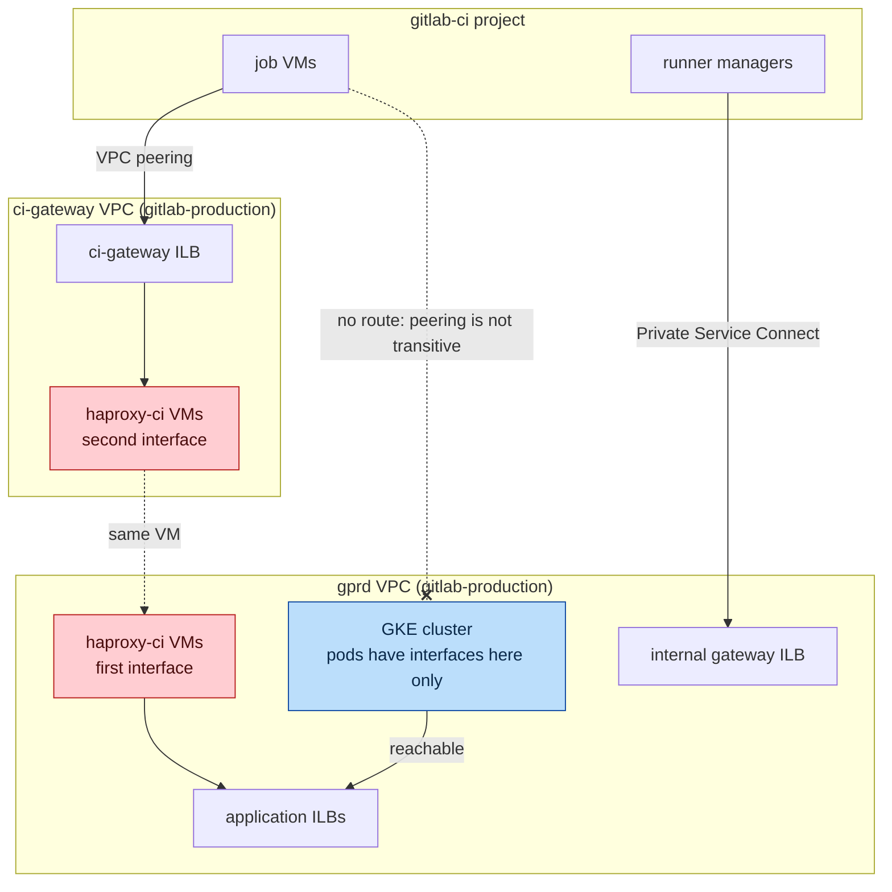
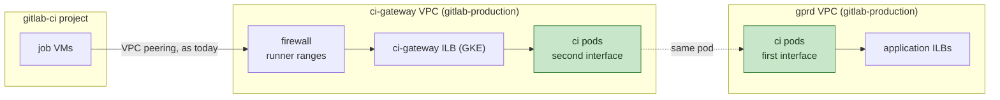

## ステータス {#status}

承認済み、進行中です。

`gstg` で稼働しており、Pod がジョブ VM の ci-gateway トラフィックを処理しています。

## ステークホルダー {#stakeholders}

- Networking and Incident Management
- Runners Platform: ci-gateway のクライアントと Runner の送信ファイアウォール
- Fleet Management: Dataplane V2 クラスターでのマルチネットワークと、2 つ目のネットワークを持つノードプール

## 背景 {#context}

`gitlab-ci` プロジェクト内のジョブ VM は、`us-east1.ci-gateway.int.gprd.gitlab.net` を通じて git リポジトリを取得し、アーティファクトをアップロードします。このホスト名は、`gitlab-production` 内の専用の `ci-gateway` VPC にある ILB に解決され、ジョブ VM のネットワークはこの VPC とピアリングしています。`haproxy-ci` VM は、その VPC と `gprd` VPC にそれぞれ 1 つのインターフェースを持ち、両者の間でルーティングを行います。Runner マネージャーは、もはや ci-gateway を使用していません。API と kas には、Private Service Connect エンドポイントを通じて接続します（[ADR 001](001_traffic_cutover.md)）。

切り替えは DNS の変更で行います。ホスト名を Pod のロードバランサーのアドレスに向けます（[ADR 001](001_traffic_cutover.md)）。これを機能させるには、ジョブ VM がルーティングできるネットワークに Pod のロードバランサーを配置する必要があります。この決定記録では、その配置方法を決めます。

## 決定 {#decision}

`ci` Pod に、VM と同様に `ci-gateway` VPC 内の 2 つ目のインターフェースを持たせます。これは [GKE のマルチネットワーク](https://docs.cloud.google.com/kubernetes-engine/docs/how-to/setup-multinetwork-support-for-pods)によって実現します。`haproxy-ci` ノードプールは `ci-gateway` 内にインターフェースを持ち、各 Pod はそのサブネット上の Pod アドレス範囲からアドレスを取得し、そのネットワーク上の Service が同じ場所に内部ロードバランサーを提供します。既存のホスト名は、そのロードバランサーを指します。

- Runner ネットワーク、ピアリング、および Runner ネットワークと `gprd` の間の分離は、現状のままです。Pod からは Runner のアドレスが見え、フロントエンドの `src` ACL は変更しません。
- Runner の送信ファイアウォールでは、VM のサブネットに加えて、`ci-gateway` 内の GKE サブネットを許可します。
- マルチネットワークの Service には Dataplane V2 が必要ですが、レガシークラスター（`gprd-gitlab-gke`）にはなく、切り替えることもできません。`ci` リリースは、各環境の新しいクラスター上に構築します（[ADR 003](003_release_topology.md)）。

## 影響 {#consequences}

- チャートは、2 つ目のインターフェースの構成を生成します。2 つのインターフェース用の Pod アノテーション、2 つ目の Pod アドレス範囲からのトラフィックが 2 つ目のインターフェースを通って出ていくようにルーティングテーブルを追加する init コンテナー、ネットワークを選択する Service です。Service は `externalTrafficPolicy: Local` を持つ 1 つの内部 `LoadBalancer` であり、GKE はセカンダリネットワークでこの設定を必要とします。
- `Network` オブジェクトは、クラスターごとに 1 つの独立した argocd/apps サービスであり、不変です。プールのネットワークは、作成時に固定されます。
- インシデント対応時には、Pod の 2 つのインターフェースとルーティングテーブルを考慮する必要があります。また、`ci-gateway` サブネット上に 2 つ目の Pod アドレス範囲があり、バックエンドの許可リストでは、クラスターの Pod アドレス範囲に加えてこれを含める必要があります（[ADR 001](001_traffic_cutover.md)）。
- 切り替えは DNS レコードの変更で行い、Runner の設定は変更しません。レガシーのゾーン ILB とホスト名は再作成しません。2 つのインターフェースを持つ VM とマルチ NIC のルーティングレシピは、VM 群とともに削除します。
- `ci` リリースは、VM のフロントエンドと同様に、git の取得、トレースとアーティファクトのためのジョブ API 呼び出し、リダイレクトについて、ジョブ VM からのリクエストを処理します。

## 検討した代替案 {#alternatives-considered}

### Runner ネットワークと gprd をピアリングする {#peer-the-runner-networks-with-gprd}

Runner マネージャーがある `ci` VPC と同様に、一時的なジョブ VM のネットワークを `gprd` と直接ピアリングし、`gprd` 内の Pod の前段に ci-gateway ILB を置きます。2 つ目のインターフェースも GKE の新しい機能も不要になり、`ci-gateway` VPC は削除します。現在、ジョブ VM のネットワークから到達できる `gitlab-production` 内のアドレスは 1 つだけですが、`gprd` とピアリングすると、ファイアウォールルールだけを境界として、そこにある任意の内部アドレスにルーティングできるため、却下しました。ジョブ VM では顧客のコードが実行されます。これが許容できるかどうかは Runners Platform が判断することであり、この移行はその判断に依存しません。

### ci-gateway と gprd をピアリングする {#peer-ci-gateway-with-gprd}

Runner VPC と `ci-gateway` の間のピアリングと、`ci-gateway` と `gprd` の間のピアリングは別々であり、ピアリングは推移的ではないため、この方法は機能せず、却下しました。

### ci-gateway VPC 内にノードを置く GKE クラスター {#a-gke-cluster-with-nodes-in-the-ci-gateway-vpc}

ノードプールは VPC をまたげません。この案では、`ci-gateway` に別のクラスターを置き、Pod がアプリケーションのバックエンドに到達できるよう、`ci-gateway` から `gprd` へのピアリングも行います。現在とまったく同じ分離を保てます。1 つのリリースのために、クラスター独自のエージェント用 Consul アクセス、監視、ArgoCD 登録、ノードプールが必要になり、クラスター統合にも反するため、却下しました。

### Private Service Connect {#private-service-connect}

2 つ目のインターフェースの代わりに、PSC を `ci-gateway` VPC への経路として使用します。`ci` リリースの ILB をサービスアタッチメントとして公開し、`ci-gateway` VPC 内の内部 TCP プロキシロードバランサーが、PSC NEG をバックエンドとして使用します。PROXY プロトコルを送信して、Pod からジョブ VM のアドレスが見えるようにします。この方法は機能し、Runner 側の対応は不要です。PSC とプロキシはそれぞれ GB 単位で課金され、`ci` はジョブアーティファクトと git の取得を処理するため、却下しました。API と kas 用の Runner マネージャーの PSC エンドポイントは、トラフィックがはるかに少ない別の経路であり、そのまま残します。

### haproxy-ci を VM 上に残す {#leave-haproxy-ci-on-vms}

単一の目的と限定されたインターフェースを持つ 9 台の VM を、Envoy Gateway の移行対象になるまで Chef 上に残すこともできます。1 つのリリースのために、VM 群の Chef ロール、パッチ適用、マルチ NIC のルーティングレシピを維持することになるため、却下しました。

## 参考資料 {#references}

- [Pod 向けの GKE マルチネットワークサポート](https://docs.cloud.google.com/kubernetes-engine/docs/how-to/setup-multinetwork-support-for-pods)
