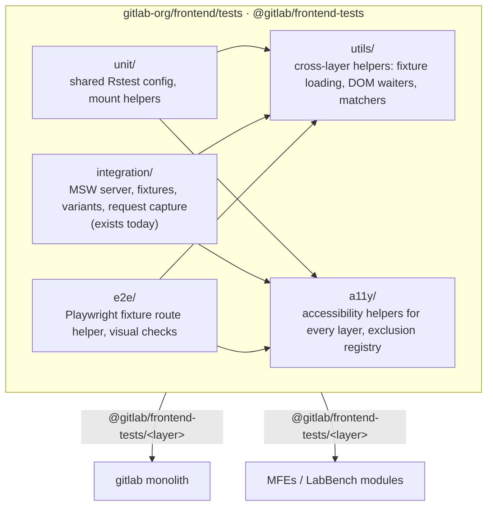

## 改訂 {#amendments}

- **2026-11-18。** 後続の ADR に合わせ、Module Federation の互換性とブラウザー駆動テストの各セクション、
  パッケージの設定、決定、結果を改訂します。
  - マウント契約は、モノリスの CI アーティファクトとしてではなく、`@gitlab/mfe-shell/contract` に同梱して提供します
    （[ADR 006](006_mount_contract.md)）。
  - すべてのテストは、手作業で設定したフェデレーションプラグインやテストパッケージ独自のホストページの代わりに、
    唯一のホストランタイムである `@gitlab/mfe-shell` を通じて MFE をマウントします
    （[ADR 009](009_host_runtime.md)）。
  - モノリスのテストは、モノリス側でバージョンを更新する代わりに、マーケットプレイスの掲載内容に従います
    （[ADR 007](007_marketplace.md)、[ADR 008](008_version_overrides.md)）。
  - `@gitlab/mfe-scripts create` がテストのセットアップを書き出します（[ADR 010](010_scaffolding.md)）。

  MFE を何にマウントするか、モノリスのどの要件に対してテストするかという問いは解決済みです。
  結果は、ブラウザー駆動テストの[Playwright テスト](#draft-a-playwright-test)と、
  [開発者から見た作業の流れ](#what-it-looks-like-for-a-developer)の 2 つの新しいドラフトに示します。
  以下では改訂箇所に *改訂* と記しています。元の記述はこのファイルの履歴を参照してください。
- **2026-11-24。** ブラウザー駆動テストは、任意のスモークテスト層ではなく、パッケージの E2E 層です。
  アプリケーションではスモークテストから始め、ユーザーフロー全体のテストへと拡張します。
  [ビジュアルリグレッション](#visual-regression)のチェックは、[アクセシビリティのチェック](012_accessibility_testing.md#browser-driven-tests)と
  同じシナリオで実行します。ブラウザー駆動テストをパッケージに含めるかという問いは解決済みです。
- **2026-11-25。** アクセシビリティヘルパーを `a11y/` ディレクトリに移し、
  `@gitlab/frontend-tests/a11y` として公開して、すべての層で使用します
  （[ADR 012](012_accessibility_testing.md)）。Playwright のドラフトでは `makeAxeBuilder()` を呼び出します。
  `mountApp` は `preferences` を受け取り、`dark` テーマでもシナリオを実行できます。
  ビジュアルリグレッションのテストでは、色のコントラストをチェックしません。

## 背景 {#context}

すべてのマイクロフロントエンド（MFE）アプリケーションは、自身のパッケージ内でテストできる必要があります。そのため、現在のテストのセットアップの大部分はアプリ間で共有し、どのパッケージも同じテスト戦略を再構築したりコピー＆ペーストしたりする必要がないようにします。大枠として、次の 3 つのテストレベルを、どのパッケージからも簡単に利用できる必要があります。

- ユニットテスト
- 統合テスト
- ブラウザー駆動テスト

このドキュメントでは、すべての GitLab フロントエンドパッケージ向けの共有セットアップとユーティリティを保持する、単一のテストパッケージ `@gitlab/frontend-tests` を提案します。リポジトリには、テスト層ごとに 1 つの `src/` ディレクトリと、共有の `utils/` ディレクトリを設け、MFE アプリのテストに必要な初期設定とユーティリティを提供します。

提案する構造:



### 要件 {#requirements}

テストのセットアップ自体は、考慮すべきことの 1 つにすぎません。各層は、MFE アプリを完全にテストするために必要なすべてのツールも提供する必要があります。MFE アプリケーションは GitLab Rails API に直接アクセスできなくなるため、公開される API とテストの整合性を保つ有効な手段がないまま、完全に分離されてしまう可能性があります。

したがって、要件は次のとおりです。

1. ユニット、統合、E2E の各層を、どの MFE アプリでも簡単にセットアップできます。
1. GitLab Rails モノリスへの依存をできる限り抑えつつ、MFE アプリケーションを包括的にテストできます。
1. 意味的に適切なモックデータを利用できます。

## 層ごとの選択肢 {#options-per-layer}

### ユニットテスト {#unit-tests}

#### ツール {#tools}

現在、モノリスはテスト環境として、jsdom を活用する Jest を使用しています。しかし、**設定**に関しては、Jest には Babel トランスフォーマーに関わる多くのロジックが必要です。そのため、多数の MFE アプリケーションへ展開するには適していません。各アプリが、Jest の変換から除外するモジュールの一覧を独自に管理する必要があり、時間がかかるうえ、依存関係の変化に伴う保守が困難です。

提案する解決策は、再利用可能なテストセットアップに Rstest を使用することです。Rstest は Jest と互換性のある API を持つため、既存のテスト知識を活かせるうえ、jsdom もサポートしています。`@rstest/adapter-rspack` により Rspack 設定を再利用するため、ビルドとテストで 1 つのツールチェーンを共有できます。Module Federation プラグインを使うと、後述の [Module Federation の互換性](#module-federation-compatibility)で説明する MFE の互換性をテストできます。Rstest はまだ 1.0 未満で、Vitest より成熟していませんが、私たちはそのトレードオフを受け入れます。

GitLab モノリスのユニットテスト用の Jest 設定は、大部分（~90%）がそのプロジェクト固有のものなので、セットアップ、エイリアス、その他のツールをテストパッケージに移植する必要はおそらくありません。新しいアプリケーションは、最初からより軽量な Rstest 設定の恩恵を受けられます。

#### 新しい仕組み {#new-systems}

MFE のユニットテストで予想される最も大きな問題の 1 つは、利用側が関心を持つすべての API モックを再定義する必要があることと、定義されたスキーマからずれる可能性があることです。これは以前から存在した問題ですが、外部パッケージに移ると、より顕著になり（検出も難しくなり）ます。

考えられる解決策は、次の 4 層で構築するモックデータジェネレーターをテストパッケージに用意することです。

1. モノリスから GraphQL スキーマを取得します。
1. User、WorkItem、MergeRequest、Pipeline など、スキーマの中核となる型について、型とジェネレーターの対応表を作成します。
1. FakerJS を使用してデータを生成します。
1. GraphQL オペレーションをスキーマの形状と照合し、適切なモックを出力します。

ジェネレーターに必要なのは公開されたスキーマだけで、モノリス自体は必要ありません。後に GraphQL または REST API が個別のバックエンドモジュールに移動した場合も、ダウンロードの手順で新しい公開元を指定するだけで、他は何も変わりません。

最終的な結果は、スキーマからデータを生成して適切なオペレーションで利用する、[スキーマに基づくモック生成の概念実証マージリクエスト](https://gitlab.com/gitlab-org/gitlab/-/merge_requests/257929)に似ています。スキーマが変更されたら、リポジトリはモックをすばやく再生成できます。その結果テストが失敗しても、モノリスに届く前に、同じマージリクエスト内で対応できます。

#### 動作の仕組み {#how-it-would-work}

これがおおよその POC の動作です。テストパッケージには、モノリスの CI がすでにすべての `master` パイプラインで公開しているパッケージから GraphQL スキーマをダウンロードするスクリプトがあるため、Rails 環境は不要です。その後、テストは実際の `.graphql` クエリを `generateOperationResponse` ヘルパーに渡し、エイリアスやフラグメントを含むクエリの形状に一致するレスポンスを受け取ります。

最初にクエリをスキーマと照合するため、スキーマが変更されてクエリが合わなくなった場合は、古いデータで成功するのではなく、その場でテストが失敗します。値自体は、FakerJS にいくつかの GitLab のルールを加えて生成します。ID は `gid://gitlab/<Type>/<n>` のような形になり、日付は実際の日付で、列挙値はスキーマに由来し、`name`、`title`、`webUrl` などのフィールドには実物らしい値を設定します。同じクエリには常に同じデータを返すため、テストは安定します。

テストで特定の値が必要な場合は、レスポンスと同じ形の上書きオブジェクトを渡します。存在しないフィールドを指定して上書きすると、例外が発生します。データはスキーマに適合しますが、バックエンドを通過していないため、権限やライセンスに関する知識はありません。統合層で引き続き記録済みのフィクスチャを使用するのは、このためです。

ユニットテストで記録済みの Rails フィクスチャを使用しても問題なく、私たちはそれを控えるよう求めていません。マージリクエストとそのパイプライン、承認のように、複数のエンティティ間の現実的で複雑な関係が必要なテストに役立ちます。ジェネレーターでは、それぞれを独立して模擬してしまいます。統合層で使用するものと同じダウンロードスクリプトで、これらのフィクスチャを提供します。

#### REST {#rest}

ジェネレーターは、スキーマがすでに存在する GraphQL を最初の対象にします。REST もサポートし、使用を控えるよう求めてはいません。REST のモックデータには、次の選択肢があります。

1. 統合層と同じダウンロードスクリプトを使い、記録済みの Rails フィクスチャを再利用します。新しいデータを必要とする単純なユニットテストにはコストが高いものの、中核のフィクスチャですでにケースをカバーしている場合は低コストです。
1. 単純な手書きのモックを使います。地味ですが、ユニットテストには有効で、最初のバージョンでは負担も小さくなります。
1. 既知のすべてのエンドポイントを一覧化する Rails のエンドポイントヘルパーから REST スキーマを生成し、その上に GraphQL と同じ方法でジェネレーターを構築します。

最初のイテレーションでは、選択肢 1 と 2 を標準でサポートします。選択肢 3 は、REST の利用側が多くなってからでなければ意味がありません。

#### アクセシビリティ {#accessibility}

*改訂*。[ADR 012](012_accessibility_testing.md#unit-tests)で定義します。

#### 未解決の問い {#open-questions}

- スキーマに基づく REST 生成（選択肢 3）を構築する価値があるか。

### 統合テスト {#integration-tests}

#### ツール {#tools-1}

統合テストは非常に新しく、すでにさまざまな利用側による再利用を念頭に構築されています。Mock Service Worker（MSW）を使って API 呼び出しをインターセプトし、フィクスチャデータを返します。現在は Rails が生成したフィクスチャに依存していますが、Rails から最新のフィクスチャを取得する再利用可能なダウンロードスクリプトを通じて、引き続き利用できます。

ユニットテスト向けに提案した生成モックと比べて、フィクスチャの非常に大きな利点は、認証と認可が本質的に反映されていることです。フィクスチャは、guest、developer、maintainer、admin など、どのユーザーロールでも生成できます。各ロールが異なるペイロードを返すため、それぞれに対して UI をテストし、そのロールの権限に一致することを確認できます。権限が変更されると、最新のフィクスチャでテストが失敗するため、リグレッションを早期に検出できます。

#### 新しい仕組み {#new-systems-1}

- CI も含めて、Rails から最新のフィクスチャをダウンロードする機能です。モノリスへの小さな依存が生じますが、現時点では、モックを使ったり、実際のデータと切り離されたデータを生成したりするより適切です。

*改訂*。どのフィクスチャを誰が記録するかを定めます。フィクスチャファイルをオペレーションへのレスポンスに変換する処理は、すでに `@gitlab/frontend-tests/integration`（`loadFixturesMap`、`mapStaticOperationHandlers`）にあるため、ファイルがあればどのリポジトリでも動作します。記録処理は移しません。モノリス内の Rails フィクスチャジェネレーターは、実際のデータとユーザーロールを使って GraphQL クエリを送信し、Rails の応答を記録します。MFE のクエリは各 MFE のリポジトリにあるため、モノリスだけでは記録できません。

ジェネレーターはモノリスに残します。MFE チームは、アプリケーションが実行するクエリや REST リクエストごとにモノリス内のフィクスチャジェネレーターを追加または更新し、クエリのテキストのコピーを含めます。リクエストの変数からフィクスチャを選ぶハンドラーとバリアントファイルは、統合テストとブラウザーテストの両方から読み込めるよう、MFE リポジトリ内の 1 か所にまとめます（[共有 API モック](#shared-api-mocks)）。

- **MFE はモノリスの MR がマージされるまで待つ必要がありません。** ダウンロードスクリプトはモノリスのマージリクエストのパイプラインからフィクスチャを取得できるので、フィクスチャ用 MR のパイプラインが実行されれば、MFE のマージリクエストで使用できます。
- **クエリの変更を見落としません。** ジェネレーターは送信したクエリのテキストのハッシュを各フィクスチャに書き込みます。`fixtures:download` はこれを MFE 自身の `.graphql` ファイルと照合し、一致しない場合は、更新すべきジェネレーターを示して失敗します。このチェックがなければ、MFE が追加したフィールドが抜けていても、古いクエリのコピーで記録したフィクスチャでテストが通ってしまいます。
- **フィクスチャのみの MR は低リスクとみなせる可能性があります。** フィクスチャジェネレーターのみを追加または変更するモノリスの MR は、製品コードを変更しません。低リスクに分類し、パイプラインが通過した時点で自動マージできれば、この依存関係のコストはパイプライン 1 回分に収まります。

別の案では、MFE がクエリを公開し、モノリスが手書きのジェネレーターを使わずに記録します。クエリのコピーは不要になりますが、MFE のマージリクエストがすべてモノリスの CI ジョブに依存するようになります。コピーの管理が負担になれば、この案に切り替えられます。

モノリスの外にあるバックエンドサービスも同じルールに従います。MFE が利用するサービスは、自身の CI でその MFE のクエリのフィクスチャを、同じ記録形式とクエリハッシュを使って記録します。`fixtures:download` はモノリスの場合と同様に、そのサービスのパイプラインからフィクスチャを取得します。これが初期段階では最も安全な方法です。MFE が CI 中に稼働中のサービスにクエリを送信する方法や、サービスが公開したスキーマからデータを生成する方法は今後の選択肢ですが、最初のイテレーションには含めません。

##### 共有 API モック {#shared-api-mocks}

*改訂*。MFE は API モックを 1 つのディレクトリ `spec/api_mocks/` に置き、両方のテスト層で読み込みます。モックとは、リクエストへの応答に使う記録済みフィクスチャを、オペレーション名、リクエストの変数、またはテストが選んだバリアントに応じて決めるコードです。実装を 1 か所にまとめるため、新しいバリアントやマッチングルールは統合テストとブラウザーテストの両方で使え、テストでバリアントを選ぶ方法も共通になります。

```plaintext
spec/
  api_mocks/
    handlers.ts          # featureHandlers and restEndpoints, defined once
    fixture_variants/    # one file per query
  integration/
    setup.ts             # hands the mocks to MSW
  e2e/
    test.ts              # hands the mocks to Playwright
```

ハンドラーが返すのはレスポンスデータで、MSW や Playwright のレスポンスではありません。`@gitlab/frontend-tests` にある各層のアダプターが、それぞれのツールが必要とする形式にデータを包みます。現在、モノリスの機能リゾルバーは結果を自身で `HttpResponse.json` に渡していますが、その処理を `buildHandlers` が引き受けます。

```ts
// spec/api_mocks/handlers.ts
import {
  getActiveVariant,
  loadFixturesMap,
  mapStaticOperationHandlers,
  matchFixture,
} from '@gitlab/frontend-tests/integration';
import './fixture_variants';

const fixtures = loadFixturesMap('./tmp/fixtures');

// One operation recorded twice: pick the recording that matches the request.
const workItemsTable = [
  { matches: ({ state }) => state === 'closed', fixture: () => fixtures.getWorkItemsFullClosed },
  { matches: ({ state }) => !state || state === 'opened', fixture: () => fixtures.getWorkItemsFull },
];

const OPERATION_HANDLERS = {
  ...mapStaticOperationHandlers(fixtures),
  getWorkItemsFull: ({ variables }) =>
    getActiveVariant('getWorkItemsFull') ??
    matchFixture(variables, workItemsTable, 'getWorkItemsFull').fixture(),
};

export const featureHandlers = [
  ({ operationName, variables }) => OPERATION_HANDLERS[operationName]?.({ variables }) ?? null,
];

export const restEndpoints = [];
```

```ts
// spec/integration/setup.ts
import { createServer } from '@gitlab/frontend-tests/integration';
import { featureHandlers, restEndpoints } from '../api_mocks/handlers';

const server = createServer(featureHandlers, restEndpoints);

beforeAll(() => server.listen({ onUnhandledRequest: 'error' }));
afterEach(() => server.resetHandlers());
afterAll(() => server.close());
```

`mfe-scripts create` が空の `spec/api_mocks/` ディレクトリと両方のセットアップファイルを作成するので、新しいアプリケーションでは最初から両層でモックを共有できます。

#### アクセシビリティ {#accessibility-1}

*改訂*。[ADR 012](012_accessibility_testing.md#integration-tests)で定義します。

#### 未解決の問い {#open-questions-1}

- 現時点ではありません。

### Module Federation の互換性 {#module-federation-compatibility}

#### ツール {#tools-2}

Rstest 用の Module Federation プラグイン、`@module-federation/rstest`。[Rstest 0.12 の発表](https://rstest.rs/blog/announcing-0-12#module-federation)を参照してください。

#### 動作の仕組み {#how-it-would-work-1}

MFE はバンドルにビルドされ、ホスト（モノリス）が実行時に読み込みます。これを機能させるには、双方でいくつかの事項を一致させる必要があります。Vue や `@gitlab/ui` など、どのライブラリを共有するか、そしてホストが MFE をどのようにマウントするかです。一致しない場合、MFE は何も描画しないか、ページ上に Vue が 2 つ存在することになります。現在、これに気付けるのはブラウザー内か本番環境だけです。

Rstest には、この隔たりを埋める Module Federation プラグインがあります。jsdom のテストで、同じ共有ライブラリを宣言したうえで、ホストと同じ方法で MFE の実際のビルド済みバンドルを読み込めます。そのため、通常のユニットテストで MFE をインポートし、マウントし、描画されたことを確認できます。ブラウザーは不要で、高速です。

これを双方で実行します。MFE のパイプラインでは、バンドルをビルドし、モノリスが期待する内容（共有ライブラリのバージョンとマウント契約）をモノリスの CI 出力からダウンロードして、そのビルドに対してテストを実行します。GraphQL スキーマや Rails フィクスチャと同じ考え方です。モノリスをチェックアウトせずに、ビルドの破損やバージョンの不一致を、それを引き起こした MR で検出できます。モノリス側では、MFE のバージョンを更新したときと `master` 上で、公開された MFE パッケージに対して同じテストを実行します。これにより、MFE が依存していたものをモノリスが変更した場合に検出できます。

*改訂*。マウント契約はモノリスの CI からダウンロードしません。`@gitlab/mfe-shell/contract` に同梱し、そのメジャーバージョンがマニフェストの `schema` 番号になります（[ADR 006](006_mount_contract.md#5-versioning-and-extensibility)）。MFE は他の依存関係と同様に、`@gitlab/mfe-shell` のバージョンを固定します。モノリスの CI アーティファクトには、共有ライブラリのバージョンのみが残ります。

*改訂*。テスト自体にフェデレーションプラグインを設定しません。`@gitlab/mfe-shell` が唯一のフェデレーションランタイムを提供し、マニフェスト URL からリモートを登録します。また、モノリスや `mfe-shell dev-host` と同じ方法でアプリケーションをマウントするテスト用ユーティリティを同梱します（[ADR 009](009_host_runtime.md#1-gitlabmfe-shell-is-the-only-host-runtime)）。MFE 側は Rstest で、モノリス側はパッケージの `require` 向けビルドを通じて Jest でテストを実行します。テストは 6 つの `MountProps` キーを渡して `mount(el, props)` を呼び出し、続いて `unmount(el)` を呼び出します（[ADR 006](006_mount_contract.md#1-the-shape-of-mountprops)）。`mfe-scripts create` が、すべての新しいアプリケーションにこのテストを契約テストとして書き出します（[ADR 010](010_scaffolding.md#1-gitlabmfe-scripts-create---into-owns-the-frontend-setup-everywhere)）。

*改訂*。モノリスは MFE のバージョンを更新しません。リリースはマーケットプレイスのロックファイルを更新する MR を通じて GitLab.com に届きます。インスタンスはソースのデフォルトまたは管理者のオーバーライドに従って配信します（[ADR 007](007_marketplace.md)、[ADR 008](008_version_overrides.md)）。モノリスのコードにアプリケーション名を記述してはいけないため（[ADR 009](009_host_runtime.md#constraints)）、MFE ごとにテストを用意せず、テストでマーケットプレイスのインデックスを読み取ります。すべてのアプリケーションを現行のデフォルトバージョンで組み合わせてマウントします。さらに、各アプリケーションの掲載上の直前バージョンを、他のアプリケーションの現行デフォルトと組み合わせてマウントします（[ADR 008](008_version_overrides.md#consequences)）。テストは `master` 上とインデックスが変更されたときに実行します。

以下の元の例は、この考え方を示しています。*改訂*。プラグインの設定はシェルのテスト用ユーティリティに置き換わります。リモートとして指定するのは、`remoteEntry.js` ではなく、アプリケーションのマニフェスト URL です。

```ts
// rstest.config.ts
import { defineConfig } from '@rstest/core';
import { federation } from '@module-federation/rstest';

export default defineConfig({
  testEnvironment: 'jsdom',
  plugins: [
    federation({
      remotes: { 'work-items-app': 'work-items-app@https://example.com/remoteEntry.js' },
      shared: { vue: { singleton: true }, '@gitlab/ui': { singleton: true } },
    }),
  ],
});

// work_items_app.test.ts
describe('WorkItemsApp remote', () => {
  describe('when the host loads the exposed module', () => {
    it('exposes a mount function', async () => {
      const { mount } = await import('work-items-app/WorkItemsApp');

      expect(mount).toBeInstanceOf(Function);
    });
  });
});
```

#### 新しい仕組み {#new-systems-2}

- モノリスは、MFE に期待する内容（共有ライブラリのバージョンとマウント方法）を、GraphQL スキーマと並べて CI アーティファクトとして公開します。
- テストパッケージは、そのファイルを読み取って Rstest のフェデレーションプラグインを設定するプリセットを提供するため、MFE が手動で設定を書く必要はありません。
- 双方に CI ジョブを設けます。MFE は自身のビルドに対してテストし、モノリスは最新の公開済みパッケージに対してテストします。

*改訂*。アーティファクトには共有ライブラリのバージョンだけを含めます。マウント契約は、バージョンを固定した `@gitlab/mfe-shell` が提供します。プリセットはフェデレーションプラグインに代わり、シェルのテスト用ユーティリティをセットアップします。モノリス側のジョブは、前述のとおり、マーケットプレイスのインデックスに掲載されたバージョンをテストします。

#### アクセシビリティ {#accessibility-2}

*改訂*。[ADR 012](012_accessibility_testing.md#module-federation-compatibility)で定義します。

#### 未解決の問い {#open-questions-2}

- MFE の MR で、実物をテストするためにモノリスのパイプラインも起動するべきでしょうか。最も忠実な確認になりますが、MFE の MR ごとにモノリスのパイプライン全体を実行するコストが生じ、2 つの CI セットアップが結合します。
- MFE は、モノリスの期待する内容のうち、最新の `master` とタグ付きバージョンのどちらに対してテストするべきでしょうか。**[ADR 006](006_mount_contract.md#5-versioning-and-extensibility)と [ADR 008](008_version_overrides.md#6-compatibility-in-v1-lockstep-with-gitlabcom)で解決済み**。契約のバージョンは、MFE が固定する `@gitlab/mfe-shell` のバージョンです。v1 では、掲載されるすべてのバージョンが、提供側が現行のモノリスに対してリリースを行う GitLab.com と互換性があるものとします。

### ブラウザー駆動テスト {#browser-driven-tests}

#### ツール {#tools-3}

GitLab モノリスでは現在、機能テストと E2E テストと呼んでいるテストの実行に Capybara を使用しています。どちらも「ブラウザー駆動」テストです（技術的には[グラフィカルユーザーインターフェースのテスト](https://en.wikipedia.org/wiki/Graphical_user_interface_testing)）。MFE は既存の Capybara テストにアクセスできないため、私たち独自の解決策を提供することに意味があります。GitLab モノリス側でも、パッケージを利用したときに意図したとおり機能するかを、引き続きテストする必要があるでしょう。

提案するツールは Playwright です。

#### 統合テストに加えてブラウザー層が提供するもの {#what-a-browser-layer-adds-over-integration-tests}

パッケージ内のブラウザー駆動テストでは、統合層と同じ Rails GraphQL フィクスチャを再生します。違いはデータではありません。jsdom では確認できないのは、次の点です。

- 実際のチャンク読み込み: フェデレーションのスモークテストは jsdom 内でリモートエントリーと共有シングルトンをカバーするため、ブラウザーでは、ブラウザー自身のモジュールローダーでネットワーク越しにチャンクを読み込むテストが加わります。
- レイアウト: jsdom にはボックスモデルがないため、仮想スクロール、固定ヘッダー、オーバーフロー、レスポンシブのブレークポイントはテストされません。
- jsdom がスタブに置き換えるブラウザー API: `IntersectionObserver`、`ResizeObserver`、クリップボード、ドラッグ＆ドロップ、ファイル入力、フォーカストラップ。
- 実際のブラウザーでのビジュアルリグレッションとアクセシビリティのチェック。

それ以外（Apollo、ルーティング、権限を反映したフィクスチャ、ユーザーフロー）は、統合層がすでに、より高速にカバーしています。そのため、パッケージ内のブラウザー層は、スモークテスト層に範囲を絞るのが最適です。ビルド済みバンドルを実際のブラウザーに読み込み、マウントし、描画して、axe を実行します。実際のレイアウトやブラウザー API が必要なアプリは、追加のテストを選択します。

*改訂*。ブラウザー層はパッケージの E2E 層です。すべてのアプリケーションに標準のスモークテスト（ビルド済みバンドルを読み込み、マウントして描画し、アクセシビリティとビジュアルのチェックを実行するテスト）を用意します。統合層では結果を確認できない場合は、ユーザーフロー全体のテストへと拡張します。アクセシビリティとビジュアルリグレッションは別々のテストスイートにせず、各 E2E シナリオが到達する状態ごとに両方をチェックします。

#### 動作の仕組み {#how-it-would-work-2}

Playwright は、jsdom 内の MSW と同様に、`page.route` でブラウザー内の API をインターセプトします。フィクスチャのユーティリティ（`loadFixturesMap`、`matchFixture`、バリアント）は通常の TypeScript であり、Playwright の Node 側で実行できるため、そのまま再利用します。置き換えるのは MSW に結び付いた `buildHandlers` と `createServer` だけです。

```ts
import { test, expect } from '@playwright/test';
import { loadFixturesMap, getActiveVariant } from '@gitlab/frontend-tests/integration';

const fixtures = loadFixturesMap('./tmp/fixtures');

test.describe('work items list', () => {
  test.describe('given the API answers with recorded fixtures', () => {
    test.beforeEach(async ({ page }) => {
      await page.route('**/api/graphql', async (route) => {
        const { operationName } = route.request().postDataJSON();
        const fixture = getActiveVariant(operationName) ?? fixtures[operationName];
        if (!fixture) return route.fulfill({ status: 400 });
        await route.fulfill({ json: fixture });
      });
    });

    test.describe('when the user opens the page', () => {
      test.beforeEach(async ({ page }) => {
        await page.goto('/host.html?remote=/dist/remoteEntry.js&module=./WorkItemsApp');
      });

      test('then it shows the work items heading', async ({ page }) => {
        await expect(page.getByRole('heading', { name: 'Work items' })).toBeVisible();
      });
    });
  });
});
```

`host.html` は、パッケージが提供する静的ページです。マウント要素、基本の `@gitlab/ui` CSS、フェデレーションのリモートを読み込み、注入された設定でマウント関数を呼び出すスクリプトを含みます。モノリスと LabBench モジュールも実装するホストのマウント契約（マウント要素、注入される設定、発行されるイベント、共有依存関係、基本の CSS）を実装します。

*改訂*。テストパッケージには独自のホストページを同梱しません。別のホストを作ると、[ADR 009](009_host_runtime.md#alternatives-considered)で単一のパッケージに集約するランタイムの再実装になります。Playwright は `mfe-shell dev-host`、または基本の `@gitlab/ui` CSS とテスト用クライアントを使って `MfeShell.init` を呼び出すページを読み込みます。アプリケーションは `remoteEntry.js` ではなく、マニフェスト URL（`/-/mfe/<app>/<version>/gitlab-mfe-manifest.json`）から登録します。ホストは [ADR 006](006_mount_contract.md#1-the-shape-of-mountprops)の `MountProps`、つまり `context`、`clients`、`props`、`features`、`preferences`、`services` を渡します。

#### ドラフト：Playwright テスト {#draft-a-playwright-test}

*改訂*。このドラフトでは、改訂後のセットアップでブラウザーテストをどう書くかを示します。コマンドのフラグ、設定キー、ファイル名、フィーチャーフラグは例示であり、最終的な API はそれぞれを管理するパッケージが定義します。

##### テストを書く {#writing-the-test}

GitLab モノリスとは別のリポジトリにある作業アイテムアプリケーションを開発しているとします。作業アイテムの一覧が実際のブラウザーで表示されること、機能を有効にするとボタンが表示されること、ページにアクセシビリティの問題がないことを確認したいとします。

テストファイルを作成し、テストと同じディレクトリにある短いファイル `./test` から `test` と `expect` をインポートします（[初回の設定](#configuring-it-once)を参照）。これらは Playwright 本体のものと同じように動作しますが、すべてのテストに `mountApp` 関数が渡されます。この関数を呼び出すと、アプリケーションが起動して操作できる状態のブラウザーページが開きます。API データは統合テストと同じ[共有 API モック](#shared-api-mocks)から取得するため、バリアントも同じ方法で選べます。

```ts
// spec/e2e/work_items.spec.ts
import { makeAxeBuilder } from '@gitlab/frontend-tests/a11y';
import { setQueryVariant } from '@gitlab/frontend-tests/integration';
import getWorkItemsFullVariants from '../api_mocks/fixture_variants/get_work_items_full';
import { test, expect } from './test';

test.describe('work items list', () => {
  test.describe('given the default page settings', () => {
    test.beforeEach(async ({ mountApp }) => {
      await mountApp();
    });

    test('then it shows the work items heading', async ({ page }) => {
      await expect(page.getByRole('heading', { name: 'Work items' })).toBeVisible();
    });

    test('then it has no accessibility violations', async ({ page }) => {
      const results = await makeAxeBuilder(page, { include: ['[data-mfe-app]'] }).analyze();

      expect(results).toHaveNoViolations();
    });
  });

  test.describe('given the bulk edit feature flag is on', () => {
    test.beforeEach(async ({ mountApp }) => {
      await mountApp({ features: { work_items_bulk_edit: true } });
    });

    test('then it shows the bulk edit button', async ({ page }) => {
      await expect(page.getByRole('button', { name: 'Bulk edit' })).toBeVisible();
    });
  });

  test.describe('given the work items request fails', () => {
    test.beforeEach(async ({ mountApp }) => {
      setQueryVariant(getWorkItemsFullVariants).withError();
      await mountApp();
    });

    test('then it shows an error message', async ({ page }) => {
      await expect(page.getByRole('alert')).toContainText('Something went wrong');
    });
  });
});
```

このファイルを読むと、アプリケーションの動作がわかります。各 `describe` ブロックが状況を設定し（「一括編集のフィーチャーフラグが有効な場合」）、その `beforeEach` がその状況でアプリケーションを起動します。各テストには、ユーザーに見えるはずのものを 1 つ記述します（「一括編集ボタンが表示される」）。テストはユーザーと同じようにページを調べ、表示名から見出しやボタンを見つけます。フィーチャーフラグは、GitLab が機能を段階的に展開するために使うスイッチです。ここでは 1 つのテストグループだけで有効にします。最後のグループでは、アプリケーションを起動する前に、記録済みの応答のバリアント（ここでは作業アイテムのリクエストがエラーを返すパターン）を選びます。アクセシビリティテストでは、ラベルの欠落などの問題がないかページを調べるツールである axe を実行し、[除外レジストリ](012_accessibility_testing.md#exclusion-registry)で除外されていない問題が見つかると失敗します。

テストファイルには、アプリケーションの読み込み方、データの取得元、アプリケーションの周囲にある GitLab の外観を記述しません。開発者はユーザーに見えるものを記述し、残りは共有パッケージが処理します。

##### 初回の設定 {#configuring-it-once}

アプリケーションとデータの場所は、3 つの小さなファイルでテストに伝えます。`mfe-scripts create` がアプリケーションのひな形を生成するときにすべて作成するため、これらのファイルを編集することはほとんどありません。

1 つ目のファイルは、共有 API モックを Playwright に接続します。`spec/integration/setup.ts` のブラウザー版です。

```ts
// spec/e2e/test.ts
import { createE2eTest } from '@gitlab/frontend-tests/e2e';
import { featureHandlers, restEndpoints } from '../api_mocks/handlers';

export const { test, expect } = createE2eTest({ featureHandlers, restEndpoints });
```

2 つ目のファイルは Playwright の設定です。テストを実行する前に、Playwright はアプリケーションをビルドして、GitLab と同じ方法でアプリケーションを読み込む小さなローカル Web ページ `mfe-shell dev-host` を起動します。その後、テストがこのページを開きます。実際のビルドを配信するので、ブラウザーはユーザーが受け取るものと同じファイルをダウンロードして実行します。

```ts
// playwright.config.ts
import { defineConfig } from '@playwright/test';

export default defineConfig({
  testDir: 'spec/e2e',
  use: { baseURL: 'http://localhost:4173' },
  webServer: {
    command: 'pnpm build && mfe-shell dev-host --dist dist --config mfe-host.config.ts --port 4173',
    url: 'http://localhost:4173',
    reuseExistingServer: !process.env.CI,
  },
});
```

3 つ目のファイルでは、アプリケーションが表示される GitLab ページを模擬します。本番環境では、ユーザーが閲覧しているグループとプロジェクト、有効なフィーチャーフラグ、ユーザーの言語とテーマを GitLab がアプリケーションに伝えます。ここではこれらの値を 1 回記述し、すべてのテストがその値を初期値として使います。

```ts
// mfe-host.config.ts
export default {
  context: {
    resources: [
      { id: 'gid://gitlab/Group/1', fullPath: 'gitlab-org' },
      { id: 'gid://gitlab/Project/2', fullPath: 'gitlab-org/gitlab' },
    ],
    basePath: '/gitlab-org/gitlab/-/work_items',
  },
  features: { work_items_bulk_edit: false },
  preferences: { locale: 'en', theme: 'light' },
};
```

##### 内部の仕組み {#under-the-hood}

テストが `mountApp` を呼び出すと、`@gitlab/frontend-tests/e2e` が次の 4 つの処理を行います。

1. **アプリケーションの API リクエストに応答します。** アプリケーションは、作業アイテムの一覧などのデータを GitLab にリクエストします。テストには GitLab サーバーがないため、パッケージがブラウザーで各リクエストをインターセプトし、共有 API モックに応答を求めます。モックは、フィクスチャと呼ばれる記録済みレスポンスで応答します。これらは GitLab モノリスが自身のテスト実行時に保存した実際の応答で、`pnpm fixtures:download` が `tmp/fixtures/` にコピーします。統合テストでも同じモックとファイルを使用するため、両方の層で GitLab の実際の応答に対してテストします。どのモックも応答しないリクエストは、空のデータを返すことなく、明示的に失敗します。
1. **GitLab を模したローカルページを開きます。** `mfe-shell dev-host` にアクセスし、上の 2 番目のテストのフィーチャーフラグなど、テストごとの変更を渡します。
1. **アプリケーションが画面に表示されるまで待ちます。** `@gitlab/mfe-shell` は、GitLab 内と同じコードでアプリケーションを読み込み、ページ上のプレースホルダー要素で起動します。起動前に、シェルはアプリケーションがページで提供できるものだけを要求しているか確認します。`mountApp` は、プレースホルダーにマウント済みまたは拒否の印が付くまで待ちます。確認に失敗すると、シェルはアプリケーションの起動を拒否し、プレースホルダーに拒否の印を付けて理由を書き込みます。その後、`mountApp` はその理由を示してテストを失敗させます。
1. **各テストの後に後処理を行います。** 選択したバリアントをリセットし、あるテストのバリアントが次のテストに持ち越されないようにします。

パッケージの処理は、おおむね次のとおりです。Playwright でも、この種の共有ヘルパーを「フィクスチャ」と呼びますが、記録済みの API レスポンスとは関係ありません。

```ts
// @gitlab/frontend-tests/e2e (inside the test package)
import { test as base, expect as baseExpect } from '@playwright/test';
import { a11yMatchers } from '@gitlab/frontend-tests/a11y';
import { captureMissingOperation, captureRequest, resetAllVariants } from '@gitlab/frontend-tests/integration';

type MountOverrides = {
  features?: Record<string, boolean>;
  props?: Record<string, unknown>;
  preferences?: { theme?: 'light' | 'dark' };
};

// Adds toHaveNoViolations, which applies the exclusion registry (ADR 012).
const expect = baseExpect.extend(a11yMatchers);

export function createE2eTest({ featureHandlers, restEndpoints }) {
  const test = base.extend<{ mountApp: (overrides?: MountOverrides) => Promise<void> }>({
    mountApp: async ({ page }, use) => {
      await page.route('**/api/graphql', async (route) => {
        const { operationName, variables } = route.request().postDataJSON();

        for (const handle of featureHandlers) {
          const data = handle({ operationName, variables });
          if (data) {
            captureRequest(operationName, route.request(), variables);
            return route.fulfill({ json: data });
          }
        }

        captureMissingOperation(operationName);
        return route.fulfill({ status: 400 });
      });
      // REST: one page.route per entry in restEndpoints, with the same lookup.

      await use(async (overrides = {}) => {
        await page.goto(`/?overrides=${encodeURIComponent(JSON.stringify(overrides))}`);
        const app = page.locator('[data-mfe-app]');
        await expect(app).toHaveAttribute('data-mfe-state', /^(mounted|refused)$/);
        if ((await app.getAttribute('data-mfe-state')) === 'refused') {
          // The shell renders the refusal code into the mount element (ADR 006 §5).
          throw new Error(`mfe-shell refused to mount the application: ${await app.textContent()}`);
        }
      });

      resetAllVariants();
    },
  });

  return { test, expect };
}
```

両方の層が同じハンドラーのリストを使って応答します。異なるのはデータを包む形式だけです（ここでは `route.fulfill`、統合テストでは MSW のレスポンスです）。MSW のハンドラーを Playwright のルーティング経由で実行する `@msw/playwright` が適していれば、上のループを置き換えられます。ここでは作業アイテムアプリケーション固有の処理を行っていません。すべてのアプリケーションが同じヘルパーを使い、このヘルパーは GitLab と同じシェルを通じてアプリケーションを読み込みます。そのため、ここでテストが通ることは、本番環境でのアプリケーションの動作を反映しています。

#### 新しい仕組み {#new-systems-3}

1. MFE アプリをマウントするホストページと、`page.route` をダウンロード済みの Rails フィクスチャに接続する Playwright フィクスチャ。*改訂*。ホストページには `mfe-shell dev-host` を使用し、テストパッケージが追加するのは Playwright フィクスチャのみです。
1. 場合によっては、既存の契約から生成する GitLab の骨組み。

#### アクセシビリティ {#accessibility-3}

*改訂*。[ADR 012](012_accessibility_testing.md#browser-driven-tests)で定義します。

#### ビジュアルリグレッション {#visual-regression}

*改訂*。ビジュアルリグレッションは E2E 層の主要なチェックの 1 つです。モノリスにはこれまでなかったため、MFE では最初のテストから取り入れます。

- E2E シナリオが到達する状態ごとに、アクセシビリティをチェックするとともに、Playwright の `toHaveScreenshot` でスクリーンショットを撮ります。
- スクリーンショットは `light` と `dark` の両テーマで撮ります。シナリオでは `mountApp({ preferences: { theme: 'dark' } })` でテーマを切り替えます。
- ビジュアルテストでは、色のコントラストをチェックしません。`toHaveScreenshot()` はピクセルをベースラインと比較しますが、小さな色の変化はしきい値を下回ることがあります。コントラストはデザインの段階でチェックします（[ADR 012](012_accessibility_testing.md#decision)）。
- ベースラインはアプリケーションのリポジトリのテストと同じ場所に置き、UI と同じマージリクエストで変更します。
- ローカルでも CI でも、バージョンを固定した Playwright コンテナイメージでテストを実行します。これによりフォントとレンダリングがそろい、マシン間でベースラインがずれません。
- 記録済みのフィクスチャによって、データはすでに再現可能です。相対日付やアバターなど、実行ごとに変わる箇所はヘルパーがマスクします。

パッケージはスクリーンショット用のヘルパーとコンテナイメージのバージョンを提供します。マージリクエストでベースラインの変更をレビューするツールは、この記録の対象外です。

#### 未解決の問い {#open-questions-3}

**そもそもブラウザー駆動テストをパッケージ内に置くべきでしょうか？** *改訂。置くことに決まりました。* パッケージはすべてのアプリケーションに E2E 層を提供します。以下は元の検討内容です。代替案は、統合層だけに依存し、ブラウザーを使ったテストはホストが所有することです。パッケージ内に置く根拠は、上記の一覧（バンドル、レイアウト、ブラウザー API）と、LabBench モジュールには Capybara がないため、ブラウザーテストを置ける場所がパッケージ内に限られることです。反対する根拠は、統合層ですでに検証しているデータのために、保守する層がもう 1 つ増えることです。

**MFE を何にマウントするのでしょうか？** 選択肢:

1. マウント契約を実装した空のホストページで、自分たちのアプリケーションだけをテストします。
1. ナビゲーションといくつかの骨組み要素を含む GitLab モノリスのシェルで、統合のスモークテストを行います。
1. リポジトリの CI 出力から取得または生成した完全な GitLab ページ。

最初はおそらく選択肢 1 で十分です。それ以上は、早い段階でツールを増やしすぎるリスクがあります。パッケージが連携して機能することをテストする責任は、GitLab モノリスが引き続き担えます。

**[ADR 009](009_host_runtime.md)で解決済み**。選択肢 1 を採用します。6 つの `MountProps` キーを使い、契約に準拠するアプリケーションをマウントするスタンドアロンホスト `mfe-shell dev-host` がこれを提供します。

## パッケージでの利用方法 {#how-a-package-consumes-it}

パッケージは `@gitlab/frontend-tests` を devDependency として追加し、[ADR 004](004_packages_group_and_shared_setup.md#how-do-we-keep-packages-in-sync) の他の共有設定と同じ方法で各層を接続します。基底の設定をインポートし、スプレッド構文で展開し、ローカルで上書きします。テストのセットアップからパッケージ内へコピーするものはありません。

```json
{
  "scripts": {
    "test": "rstest",
    "fixtures:download": "frontend-tests fixtures download",
    "test:integration": "rstest -c rstest.integration.config.ts",
    "test:e2e": "playwright test"
  },
  "devDependencies": {
    "@gitlab/frontend-tests": "^2.0.0"
  }
}
```

```ts
// rstest.config.ts
import { defineConfig } from '@rstest/core';
import base from '@gitlab/frontend-tests/unit';

export default defineConfig({
  ...base,
  include: ['src/**/*.spec.ts'],
});
```

```ts
// rstest.integration.config.ts
import { defineConfig } from '@rstest/core';
import base from '@gitlab/frontend-tests/integration';

export default defineConfig({
  ...base,
  include: ['spec/integration/**/*.spec.ts'],
  setupFiles: [...base.setupFiles, './spec/integration/setup.ts'],
});
```

`@gitlab/frontend-tests/unit` は、jsdom 環境、Rspack アダプター、マウントヘルパーを提供します。`@gitlab/frontend-tests/integration` は、`tmp/fixtures/` 配下のフィクスチャから MSW サーバーを起動するセットアップファイルを追加します。このディレクトリには、`fixtures:download` がモノリスの最新の `master` パイプラインからフィクスチャを取得します。ダウンロードを別のスクリプトにしているのは意図的です。ローカルでは一度実行すれば、その後の `test:integration` はオフラインで高速に実行できます。`tmp/fixtures/` がない場合、セットアップファイルは実行すべきスクリプト名を示すメッセージを出して即座に失敗し、ディレクトリを削除すると必ず再取得されます。CI では、`ci/base.yml` が `test:integration` の前に必ず `fixtures:download` を実行するため、すべてのパイプラインが最新のフィクスチャに対してテストし、API の乖離を検出します。フィクスチャが存在していてもスクリプトは処理を省略しません。古いフィクスチャで気付かないままテストに合格するより、明示的に再取得するほうがよいためです。その後、上の各セクションで示したように、テストはその層からインポートします。たとえば、`@gitlab/frontend-tests/integration` から `getActiveVariant` と `loadFixturesMap` をインポートします。

ADR 004 の `new-gitlab-module` は、パッケージを作成するときにこれら 3 つのファイルを書き出します。`@gitlab/frontend-config` の `ci/base.yml` は、`test` と `fixtures:download && test:integration` を別々のジョブとして実行します。

*改訂*。MFE アプリケーションでは、`mfe-scripts create --into` がテストのセットアップと契約テストのひな形を生成する際に、これらのファイルを書き出します。リポジトリジェネレーターと LabBench は、独自のテンプレートを保持せずにこのコマンドを呼び出します（[ADR 010](010_scaffolding.md)）。プラットフォームの CI テンプレートは、すべてのマージリクエストで `mfe-scripts validate` を実行します（[ADR 010](010_scaffolding.md#5-one-validator-one-ci-template)）。

## 開発者から見た作業の流れ {#what-it-looks-like-for-a-developer}

このセクションは、上記の改訂を反映したあとの日常的な作業の流れを示すドラフトです。コマンドのフラグ、設定キー、フィクスチャ名は例示であり、最終的な API はそれぞれを管理するパッケージが定義します。

1. `pnpm dlx @gitlab/mfe-scripts create --into .` でアプリケーションのひな形を作成します。Rspack の設定、Rstest のユニットテストと統合テストの設定、契約テスト、`dev` と `mfe:validate` のスクリプト、CI スニペットが生成されます。
1. `pnpm fixtures:download` を 1 回実行し、モノリスの最新の `master` パイプラインから `tmp/fixtures/` にフィクスチャを取得します。
1. `pnpm dev` を実行します。モノリスと同じランタイムと `MountProps` を通じて、`mfe-shell dev-host` にアプリケーションがマウントされます。
1. `pnpm test` でユニットテストと契約テストを実行し、`pnpm test:integration` で大部分の動作をカバーする MSW 層のテストを実行します。
1. `pnpm test:e2e` で E2E 層のテストを実行し、シナリオごとにアクセシビリティとビジュアルをチェックします。[Playwright のドラフト](#draft-a-playwright-test)のとおり、アプリケーションをビルドして `mfe-shell dev-host` で配信し、同じ Rails フィクスチャを実際のブラウザーで再生します。
1. マージリクエストを作成します。CI では、同じジョブに加え、`mfe-scripts validate` を実行します。
1. リリースにタグを付けます。`mfe-scripts release` がリリースを作成し、マーケットプレイスがロックファイルの更新 MR を提案します。その MR がマージされると、モノリスのデータ駆動スモークテストがインデックスから新しいバージョンを取得します。

## 決定 {#decision}

1. ユニットテスト環境に Rstest を使用し、インポートして使う共有の Rstest 設定を提供します。
1. テストパッケージに、GraphQL スキーマに基づくモックデータジェネレーターを提供させます。
1. Rstest を使って双方で Module Federation の互換性のスモークテストを行います。MFE は自身のビルドに対して、ホストは公開済みパッケージに対してテストし、jsdom 内で各 MFE の公開モジュールを、実際にビルドされたリモートエントリーからインポートします。*改訂*。双方とも `@gitlab/mfe-shell` のテスト用ユーティリティを通じてマウントし、MFE 側では Rstest、モノリスでは Jest を使用します。ホスト側はマーケットプレイスに掲載されたバージョンをテストします（[ADR 008](008_version_overrides.md#consequences)、[ADR 009](009_host_runtime.md)）。
1. 統合テストには MSW を維持し、最新の Rails フィクスチャをダウンロードする再利用可能なスクリプトを追加します。
1. 統合層を、MFE の動作をテストする主要な層とします。
1. パッケージでブラウザー駆動テストを提供する場合は、Playwright を使用します。*改訂*。テストでは `mfe-shell dev-host` にマウントします（[ADR 009](009_host_runtime.md)）。パッケージはブラウザー駆動テストを E2E 層として提供し、各シナリオでアクセシビリティとビジュアルリグレッションをチェックします。

**未決定**なのは、スキーマに基づく REST 生成、MFE の MR でモノリスのパイプラインを起動するべきか、ブラウザー駆動テストをパッケージ内に置くべきかです。*改訂*。モノリスの要件のどのバージョンに対してテストするか、MFE を何にマウントするか、ブラウザー駆動テストをパッケージに含めるかについては、上記のとおり解決済みです。

## 結果 {#consequences}

- `gitlab-org/frontend/tests` リポジトリに、既存の `integration/` に加え、`unit/`、`utils/`、場合によっては `e2e/` を設けます。*改訂*。`unit/`、`utils/`、`e2e/`、`a11y/` を設けます。`a11y/` ディレクトリにはすべての層が使うアクセシビリティヘルパーを置き、CODEOWNERS で Accessibility Engineer をオーナーとして指定します（[ADR 012](012_accessibility_testing.md)）。
- リポジトリを `gitlab-org/frontend/toolkit` に移動し、CI、ESLint、TSConfig のセットアップに `@gitlab/frontend-config` を使用します。[ADR 004](004_packages_group_and_shared_setup.md#migrating-the-existing-packages) を参照してください。npm パッケージ名は変更しません。
- 各層をサブパス `@gitlab/frontend-tests/<layer>` として公開し、モノリス、MFE、LabBench モジュールが同様に利用します。
- テストパッケージは、CI も含め、GraphQL スキーマ、Rails フィクスチャ、ホスト契約について、ビルド時にモノリスに依存します。*改訂*。ホスト契約は `@gitlab/mfe-shell/contract` が提供するため、モノリスへの依存は、スキーマ、フィクスチャ、共有ライブラリのバージョンに限られます。
- ホスト（モノリス、LabBench モジュール）は、公開済みパッケージに対するブラウザーのスモークテストを MFE ごとに 1 つ維持します。*改訂*。モノリスに MFE ごとのテストコードは置きません。単一のデータ駆動スモークテストがマーケットプレイスのインデックスを読み取り、現行のデフォルトバージョン同士の組み合わせと、各アプリケーションの掲載上の直前バージョンをカバーします。他のバージョンの組み合わせは設計上、テストの対象外です（[ADR 008](008_version_overrides.md#consequences)）。
- *改訂*。`@gitlab/frontend-tests` はマウント処理を `@gitlab/mfe-shell` に依存し、ホストを再実装しません。
- *改訂*。MFE のクエリや REST リクエストごとに、モノリス内にフィクスチャジェネレーターを用意する必要があります。ハッシュのチェックで、モノリスにあるコピーが MFE のクエリとずれたことを検出します。フィクスチャのみを変更するモノリスの MR は、自動マージの対象候補です。
- *改訂*。各層は、[ADR 012](012_accessibility_testing.md)で定めたアクセシビリティテストの一部を担当します。
- *改訂*。`e2e/` ディレクトリは必須です。各アプリケーションはビジュアルのベースラインを自身のリポジトリで管理し、バージョンを固定した Playwright コンテナで E2E テストを実行します。
