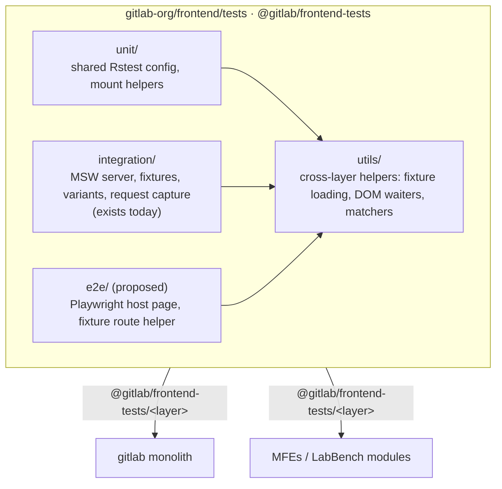

## 背景 {#context}

すべてのマイクロフロントエンド（MFE）アプリケーションは、自身のパッケージ内でテストできる必要があります。そのため、現在のテストのセットアップの大部分はアプリ間で共有し、どのパッケージも同じテスト戦略を再構築したりコピー＆ペーストしたりする必要がないようにします。大枠として、次の 3 つのテストレベルを、どのパッケージからも簡単に利用できる必要があります。

- ユニットテスト
- 統合テスト
- ブラウザー駆動テスト

このドキュメントでは、すべての GitLab フロントエンドパッケージ向けの共有セットアップとユーティリティを保持する、単一のテストパッケージ `@gitlab/frontend-tests` を提案します。リポジトリには、テスト層ごとに 1 つの `src/` ディレクトリと、共有の `utils/` ディレクトリを設け、MFE アプリのテストに必要な初期設定とユーティリティを提供します。

提案する構造:



### 要件 {#requirements}

テストのセットアップ自体は、考慮すべきことの 1 つにすぎません。各層は、MFE アプリを完全にテストするために必要なすべてのツールも提供する必要があります。MFE アプリケーションは GitLab Rails API に直接アクセスできなくなるため、公開される API とテストの整合性を保つ有効な手段がないまま、完全に分離されてしまう可能性があります。

したがって、要件は次のとおりです。

1. ユニット、統合、E2E の各層を、どの MFE アプリでも簡単にセットアップできます。
1. GitLab Rails モノリスへの依存をできる限り抑えつつ、MFE アプリケーションを包括的にテストできます。
1. 意味的に適切なモックデータを利用できます。

## 層ごとの選択肢 {#options-per-layer}

### ユニットテスト {#unit-tests}

#### ツール {#tools}

現在、モノリスはテスト環境として、jsdom を活用する Jest を使用しています。しかし、**設定**に関しては、Jest には Babel トランスフォーマーに関わる多くのロジックが必要です。そのため、多数の MFE アプリケーションへ展開するには適していません。各アプリが、Jest の変換から除外するモジュールの一覧を独自に管理する必要があり、時間がかかるうえ、依存関係の変化に伴う保守が困難です。

提案する解決策は、再利用可能なテストセットアップに Rstest を使用することです。Rstest は Jest と互換性のある API を持つため、既存のテスト知識を活かせるうえ、jsdom もサポートしています。`@rstest/adapter-rspack` により Rspack 設定を再利用するため、ビルドとテストで 1 つのツールチェーンを共有できます。Module Federation プラグインを使うと、後述の [Module Federation の互換性](#module-federation-compatibility)で説明する MFE の互換性をテストできます。Rstest はまだ 1.0 未満で、Vitest より成熟していませんが、私たちはそのトレードオフを受け入れます。

GitLab モノリスのユニットテスト用の Jest 設定は、大部分（~90%）がそのプロジェクト固有のものなので、セットアップ、エイリアス、その他のツールをテストパッケージに移植する必要はおそらくありません。新しいアプリケーションは、最初からより軽量な Rstest 設定の恩恵を受けられます。

#### 新しい仕組み {#new-systems}

MFE のユニットテストで予想される最も大きな問題の 1 つは、利用側が関心を持つすべての API モックを再定義する必要があることと、定義されたスキーマからずれる可能性があることです。これは以前から存在した問題ですが、外部パッケージに移ると、より顕著になり（検出も難しくなり）ます。

考えられる解決策は、次の 4 層で構築するモックデータジェネレーターをテストパッケージに用意することです。

1. モノリスから GraphQL スキーマを取得します。
1. User、WorkItem、MergeRequest、Pipeline など、スキーマの中核となる型について、型とジェネレーターの対応表を作成します。
1. FakerJS を使用してデータを生成します。
1. GraphQL オペレーションをスキーマの形状と照合し、適切なモックを出力します。

ジェネレーターに必要なのは公開されたスキーマだけで、モノリス自体は必要ありません。後に GraphQL または REST API が個別のバックエンドモジュールに移動した場合も、ダウンロードの手順で新しい公開元を指定するだけで、他は何も変わりません。

最終的な結果は、スキーマからデータを生成して適切なオペレーションで利用する、[スキーマに基づくモック生成の概念実証マージリクエスト](https://gitlab.com/gitlab-org/gitlab/-/merge_requests/257929)に似ています。スキーマが変更されたら、リポジトリはモックをすばやく再生成できます。その結果テストが失敗しても、モノリスに届く前に、同じマージリクエスト内で対応できます。

#### 動作の仕組み {#how-it-would-work}

これがおおよその POC の動作です。テストパッケージには、モノリスの CI がすでにすべての `master` パイプラインで公開しているパッケージから GraphQL スキーマをダウンロードするスクリプトがあるため、Rails 環境は不要です。その後、テストは実際の `.graphql` クエリを `generateOperationResponse` ヘルパーに渡し、エイリアスやフラグメントを含むクエリの形状に一致するレスポンスを受け取ります。

最初にクエリをスキーマと照合するため、スキーマが変更されてクエリが合わなくなった場合は、古いデータで成功するのではなく、その場でテストが失敗します。値自体は、FakerJS にいくつかの GitLab のルールを加えて生成します。ID は `gid://gitlab/<Type>/<n>` のような形になり、日付は実際の日付で、列挙値はスキーマに由来し、`name`、`title`、`webUrl` などのフィールドには実物らしい値を設定します。同じクエリには常に同じデータを返すため、テストは安定します。

テストで特定の値が必要な場合は、レスポンスと同じ形の上書きオブジェクトを渡します。存在しないフィールドを指定して上書きすると、例外が発生します。データはスキーマに適合しますが、バックエンドを通過していないため、権限やライセンスに関する知識はありません。統合層で引き続き記録済みのフィクスチャを使用するのは、このためです。

ユニットテストで記録済みの Rails フィクスチャを使用しても問題なく、私たちはそれを控えるよう求めていません。マージリクエストとそのパイプライン、承認のように、複数のエンティティ間の現実的で複雑な関係が必要なテストに役立ちます。ジェネレーターでは、それぞれを独立して模擬してしまいます。統合層で使用するものと同じダウンロードスクリプトで、これらのフィクスチャを提供します。

#### REST {#rest}

ジェネレーターは、スキーマがすでに存在する GraphQL を最初の対象にします。REST もサポートし、使用を控えるよう求めてはいません。REST のモックデータには、次の選択肢があります。

1. 統合層と同じダウンロードスクリプトを使い、記録済みの Rails フィクスチャを再利用します。新しいデータを必要とする単純なユニットテストにはコストが高いものの、中核のフィクスチャですでにケースをカバーしている場合は低コストです。
1. 単純な手書きのモックを使います。地味ですが、ユニットテストには有効で、最初のバージョンでは負担も小さくなります。
1. 既知のすべてのエンドポイントを一覧化する Rails のエンドポイントヘルパーから REST スキーマを生成し、その上に GraphQL と同じ方法でジェネレーターを構築します。

最初のイテレーションでは、選択肢 1 と 2 を標準でサポートします。選択肢 3 は、REST の利用側が多くなってからでなければ意味がありません。

#### 未解決の問い {#open-questions}

- スキーマに基づく REST 生成（選択肢 3）を構築する価値があるか。

### 統合テスト {#integration-tests}

#### ツール {#tools-1}

統合テストは非常に新しく、すでにさまざまな利用側による再利用を念頭に構築されています。Mock Service Worker（MSW）を使って API 呼び出しをインターセプトし、フィクスチャデータを返します。現在は Rails が生成したフィクスチャに依存していますが、Rails から最新のフィクスチャを取得する再利用可能なダウンロードスクリプトを通じて、引き続き利用できます。

ユニットテスト向けに提案した生成モックと比べて、フィクスチャの非常に大きな利点は、認証と認可が本質的に反映されていることです。フィクスチャは、guest、developer、maintainer、admin など、どのユーザーロールでも生成できます。各ロールが異なるペイロードを返すため、それぞれに対して UI をテストし、そのロールの権限に一致することを確認できます。権限が変更されると、最新のフィクスチャでテストが失敗するため、リグレッションを早期に検出できます。

#### 新しい仕組み {#new-systems-1}

- CI も含めて、Rails から最新のフィクスチャをダウンロードする機能です。モノリスへの小さな依存が生じますが、現時点では、モックを使ったり、実際のデータと切り離されたデータを生成したりするより適切です。

#### 未解決の問い {#open-questions-1}

- 現時点ではありません。

### Module Federation の互換性 {#module-federation-compatibility}

#### ツール {#tools-2}

Rstest 用の Module Federation プラグイン、`@module-federation/rstest`。[Rstest 0.12 の発表](https://rstest.rs/blog/announcing-0-12#module-federation)を参照してください。

#### 動作の仕組み {#how-it-would-work-1}

MFE はバンドルにビルドされ、ホスト（モノリス）が実行時に読み込みます。これを機能させるには、双方でいくつかの事項を一致させる必要があります。Vue や `@gitlab/ui` など、どのライブラリを共有するか、そしてホストが MFE をどのようにマウントするかです。一致しない場合、MFE は何も描画しないか、ページ上に Vue が 2 つ存在することになります。現在、これに気付けるのはブラウザー内か本番環境だけです。

Rstest には、この隔たりを埋める Module Federation プラグインがあります。jsdom のテストで、同じ共有ライブラリを宣言したうえで、ホストと同じ方法で MFE の実際のビルド済みバンドルを読み込めます。そのため、通常のユニットテストで MFE をインポートし、マウントし、描画されたことを確認できます。ブラウザーは不要で、高速です。

これを双方で実行します。MFE のパイプラインでは、バンドルをビルドし、モノリスが期待する内容（共有ライブラリのバージョンとマウント契約）をモノリスの CI 出力からダウンロードして、そのビルドに対してテストを実行します。GraphQL スキーマや Rails フィクスチャと同じ考え方です。モノリスをチェックアウトせずに、ビルドの破損やバージョンの不一致を、それを引き起こした MR で検出できます。モノリス側では、MFE のバージョンを更新したときと `master` 上で、公開された MFE パッケージに対して同じテストを実行します。これにより、MFE が依存していたものをモノリスが変更した場合に検出できます。

```ts
// rstest.config.ts
import { defineConfig } from '@rstest/core';
import { federation } from '@module-federation/rstest';

export default defineConfig({
  testEnvironment: 'jsdom',
  plugins: [
    federation({
      remotes: { 'work-items-app': 'work-items-app@https://example.com/remoteEntry.js' },
      shared: { vue: { singleton: true }, '@gitlab/ui': { singleton: true } },
    }),
  ],
});

// work_items_app.test.ts
it('exposes a mount function', async () => {
  const { mount } = await import('work-items-app/WorkItemsApp');
  expect(mount).toBeInstanceOf(Function);
});
```

#### 新しい仕組み {#new-systems-2}

- モノリスは、MFE に期待する内容（共有ライブラリのバージョンとマウント方法）を、GraphQL スキーマと並べて CI アーティファクトとして公開します。
- テストパッケージは、そのファイルを読み取って Rstest のフェデレーションプラグインを設定するプリセットを提供するため、MFE が手動で設定を書く必要はありません。
- 双方に CI ジョブを設けます。MFE は自身のビルドに対してテストし、モノリスは最新の公開済みパッケージに対してテストします。

#### 未解決の問い {#open-questions-2}

- MFE の MR で、実物をテストするためにモノリスのパイプラインも起動するべきでしょうか。最も忠実な確認になりますが、MFE の MR ごとにモノリスのパイプライン全体を実行するコストが生じ、2 つの CI セットアップが結合します。
- MFE は、モノリスの期待する内容のうち、最新の `master` とタグ付きバージョンのどちらに対してテストするべきでしょうか。

### ブラウザー駆動テスト {#browser-driven-tests}

#### ツール {#tools-3}

GitLab モノリスでは現在、機能テストと E2E テストと呼んでいるテストの実行に Capybara を使用しています。どちらも「ブラウザー駆動」テストです（技術的には[グラフィカルユーザーインターフェースのテスト](https://en.wikipedia.org/wiki/Graphical_user_interface_testing)）。MFE は既存の Capybara テストにアクセスできないため、私たち独自の解決策を提供することに意味があります。GitLab モノリス側でも、パッケージを利用したときに意図したとおり機能するかを、引き続きテストする必要があるでしょう。

提案するツールは Playwright です。

#### 統合テストに加えてブラウザー層が提供するもの {#what-a-browser-layer-adds-over-integration-tests}

パッケージ内のブラウザー駆動テストでは、統合層と同じ Rails GraphQL フィクスチャを再生します。違いはデータではありません。jsdom では確認できないのは、次の点です。

- 実際のチャンク読み込み: フェデレーションのスモークテストは jsdom 内でリモートエントリーと共有シングルトンをカバーするため、ブラウザーでは、ブラウザー自身のモジュールローダーでネットワーク越しにチャンクを読み込むテストが加わります。
- レイアウト: jsdom にはボックスモデルがないため、仮想スクロール、固定ヘッダー、オーバーフロー、レスポンシブのブレークポイントはテストされません。
- jsdom がスタブに置き換えるブラウザー API: `IntersectionObserver`、`ResizeObserver`、クリップボード、ドラッグ＆ドロップ、ファイル入力、フォーカストラップ。
- 実際のブラウザーでのビジュアルリグレッションとアクセシビリティのチェック。

それ以外（Apollo、ルーティング、権限を反映したフィクスチャ、ユーザーフロー）は、統合層がすでに、より高速にカバーしています。そのため、パッケージ内のブラウザー層は、スモークテスト層に範囲を絞るのが最適です。ビルド済みバンドルを実際のブラウザーに読み込み、マウントし、描画して、axe を実行します。実際のレイアウトやブラウザー API が必要なアプリは、追加のテストを選択します。

#### 動作の仕組み {#how-it-would-work-2}

Playwright は、jsdom 内の MSW と同様に、`page.route` でブラウザー内の API をインターセプトします。フィクスチャのユーティリティ（`loadFixturesMap`、`matchFixture`、バリアント）は通常の TypeScript であり、Playwright の Node 側で実行できるため、そのまま再利用します。置き換えるのは MSW に結び付いた `buildHandlers` と `createServer` だけです。

```ts
import { test, expect } from '@playwright/test';
import { loadFixturesMap, getActiveVariant } from '@gitlab/frontend-tests/integration';

const fixtures = loadFixturesMap('./tmp/fixtures/graphql');

test('renders work item list', async ({ page }) => {
  await page.route('**/api/graphql', async (route) => {
    const { operationName } = route.request().postDataJSON();
    const fixture = getActiveVariant(operationName) ?? fixtures[operationName];
    if (!fixture) return route.fulfill({ status: 400 });
    await route.fulfill({ json: fixture });
  });

  await page.goto('/host.html?remote=/dist/remoteEntry.js&module=./WorkItemsApp');

  await expect(page.getByRole('heading', { name: 'Work items' })).toBeVisible();
});
```

`host.html` は、パッケージが提供する静的ページです。マウント要素、基本の `@gitlab/ui` CSS、フェデレーションのリモートを読み込み、注入された設定でマウント関数を呼び出すスクリプトを含みます。モノリスと LabBench モジュールも実装するホストのマウント契約（マウント要素、注入される設定、発行されるイベント、共有依存関係、基本の CSS）を実装します。

#### 新しい仕組み {#new-systems-3}

1. MFE アプリをマウントするホストページと、`page.route` をダウンロード済みの Rails フィクスチャに接続する Playwright フィクスチャ。
1. 場合によっては、既存の契約から生成する GitLab の骨組み。

#### 未解決の問い {#open-questions-3}

**そもそもブラウザー駆動テストをパッケージ内に置くべきでしょうか？** 代替案は、統合層だけに依存し、ブラウザーを使ったテストはホストが所有することです。パッケージ内に置く根拠は、上記の一覧（バンドル、レイアウト、ブラウザー API）と、LabBench モジュールには Capybara がないため、ブラウザーテストを置ける場所がパッケージ内に限られることです。反対する根拠は、統合層ですでに検証しているデータのために、保守する層がもう 1 つ増えることです。

**MFE を何にマウントするのでしょうか？** 選択肢:

1. マウント契約を実装した空のホストページで、自分たちのアプリケーションだけをテストします。
1. ナビゲーションといくつかの骨組み要素を含む GitLab モノリスのシェルで、統合のスモークテストを行います。
1. リポジトリの CI 出力から取得または生成した完全な GitLab ページ。

最初はおそらく選択肢 1 で十分です。それ以上は、早い段階でツールを増やしすぎるリスクがあります。パッケージが連携して機能することをテストする責任は、GitLab モノリスが引き続き担えます。

## 決定 {#decision}

1. ユニットテスト環境に Rstest を使用し、インポートして使う共有の Rstest 設定を提供します。
1. テストパッケージに、GraphQL スキーマに基づくモックデータジェネレーターを提供させます。
1. Rstest を使って双方で Module Federation の互換性のスモークテストを行います。MFE は自身のビルドに対して、ホストは公開済みパッケージに対してテストし、jsdom 内で各 MFE の公開モジュールを、実際にビルドされたリモートエントリーからインポートします。
1. 統合テストには MSW を維持し、最新の Rails フィクスチャをダウンロードする再利用可能なスクリプトを追加します。
1. 統合層を、MFE の動作をテストする主要な層とします。
1. パッケージでブラウザー駆動テストを提供する場合は、Playwright を使用します。

**未決定**: スキーマに基づく REST 生成、MFE の MR でモノリスのパイプラインを起動するべきか、MFE がモノリスの期待する内容のどのバージョンに対してテストするか、ブラウザー駆動テストをパッケージ内に置くべきか、MFE を何にマウントするか。

## 結果 {#consequences}

- `gitlab-org/frontend/tests` リポジトリに、既存の `integration/` に加え、`unit/`、`utils/`、場合によっては `e2e/` を設けます。
- 各層をサブパス `@gitlab/frontend-tests/<layer>` として公開し、モノリス、MFE、LabBench モジュールが同様に利用します。
- テストパッケージは、CI も含め、GraphQL スキーマ、Rails フィクスチャ、ホスト契約について、ビルド時にモノリスに依存します。
- ホスト（モノリス、LabBench モジュール）は、公開済みパッケージに対するブラウザーのスモークテストを MFE ごとに 1 つ維持します。
