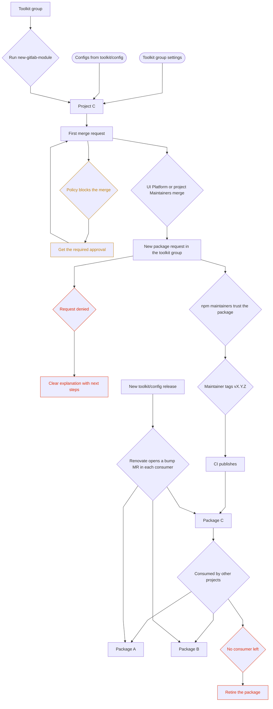

## 背景 {#context}

モジュール化への取り組みを始めるにあたり、小規模なリポジトリに分けるポリレポ方式は、大きな速度向上をもたらします。ただし、長期的にすべてのパッケージの整合性を維持し、保守を最小限に抑えるには、ツールとガードレールの整備が不可欠です。

[ADR-001](./001_tooling_repository_strategy.md#decision) の決定に基づき、独立したユーティリティパッケージはポリレポとし、それぞれが他のパッケージからある程度独立する一方、eslint、TSconfig、CI 設定ヘルパーなど、密接に依存するツールは単一のパッケージに置くことが、すでに合意されています。

この ADR は、これらのパッケージの内容、配置場所、作成方法、見つけやすさの維持方法、保守方法を明確にすることを目的とします。

ADR-001 では、密接に結合したツールを pnpm ワークスペースと呼んでいました。これらの設定は常に一緒に変更されるため、代わりに単一のパッケージ `@gitlab/frontend-config` とし、設定ごとにサブパス（`@gitlab/frontend-config/eslint`、`@gitlab/frontend-config/tsconfig`）を設け、CI テンプレートは `ci/` 配下に置きます。こうすることで、npm の依存関係と CI の `include` に同じバージョンを使用できます。[パッケージの同期をどう維持するか](#how-do-we-keep-packages-in-sync)を参照してください。`@gitlab/eslint-config`、`@gitlab/tsconfig`、`@gitlab/ci-templates` を別々のパッケージにする案も検討しましたが、利用側ごとに 3 回のバージョン更新が必要となり、見合いません。将来、独立したバージョンが必要になった場合は、サブパスをワークスペースのパッケージに変更できます。

## パッケージのライフサイクル {#package-lifecycle}

以下のフローは、パッケージの作成から利用まで、この ADR 全体を 1 枚の図にまとめたものです。各ステップの詳細は、それぞれのセクションで説明します。



## パッケージをどこに置くか？ {#where-do-packages-live}

再利用可能と考えるすべてのパッケージを保持する、中央のグループが必要です。最初に作成された 2 つのパッケージは `gitlab-org/frontend/` に置かれました。適切な配置先ではありますが、目的が単一ではありません。このグループ内の多くのプロジェクトは、新しい UI プラットフォームの取り組みとは無関係です。そのため、すべてのパッケージを一覧できる場所がなく、見通しが悪くなります。

### 決定事項 {#decisions}

1. `gitlab-org/frontend/toolkit` という新しいグループを作成します（`packages` は、`utils` と同様に何でも持ち込まれやすい名前であるため、避けました）。
1. `@gitlab/frontend-utils` と `@gitlab/frontend-tests` の両方を、この新しいグループに移行します。
1. 共有のセットアップを保持し、`@gitlab/frontend-config` を公開する新しいプロジェクト `gitlab-org/frontend/toolkit/config` を作成します。グループ内のプロジェクトには、公開するものに基づいて名前を付けます（`tests`、`utils`）。そのため、CI テンプレートや初期設定スクリプトも提供しますが、名前は `config` とします。
1. ここに追加する新しいプロジェクトは再利用可能なパッケージにすることを意図していると、グループの説明に明記します。
1. これらのパッケージが、引き続き私たちの npm レジストリに公開されるようにします。

### 既存のパッケージの移行 {#migrating-the-existing-packages}

`@gitlab/frontend-utils` と `@gitlab/frontend-tests` は、プロジェクトとして移管するため、履歴、Issue、MR も一緒に移動します。各パッケージについて、次を行います。

1. 一般設定から、プロジェクトを `gitlab-org/frontend/toolkit` に移管します。他のプロジェクトが旧パスを使用しない限り、GitLab が旧パスからリダイレクトします。
1. npmjs の trusted publisher を新しいプロジェクトパスに更新します。更新しなければ、次のリリースが失敗します。
1. [このグループに必要なルール](#what-rules-does-this-group-need)のグループ設定が継承され、残存するプロジェクトレベルの設定が競合していないことを確認します。
1. 旧パスを使用する CI の `include` やリンクを置き換え、リリースを行って公開が機能することを確認します。

npm パッケージ名は変わらないため、利用側への影響はありません。

## このグループにどのようなルールが必要か？ {#what-rules-does-this-group-need}

すべてのパッケージが継承するべき共通設定があります。新しいパッケージの作成者が、自分で確認する必要はなく、都合に合わせて無効化することもできないようにします。自己承認を禁止し、レビューを必須とし、`main` へのプッシュを禁止します。パッケージに適した設定を見つけるために、ドキュメントを読まなければならない状態にすべきではありません。速度やイテレーションを理由に、10 万行のコードを作成してレビューなしでマージし、後から私たちの基準を有効にできるようにすべきでもありません。

### 決定事項 {#decisions-1}

GitLab は、将来作成するものも含めて、グループからすべてのプロジェクトに設定を適用できます。私たちは 4 つの層を使用します。

1. プロジェクトが上書きできないグループ設定。
   - `main` に対するグループレベルの保護ブランチ。誰もプッシュできず、Maintainer はマージでき、コードオーナーの承認を必須とします。
   - グループのプッシュルール。未署名のコミットを拒否し、コミット作成者が GitLab ユーザーであることを必須とします。
   - デフォルトのブランチ保護を完全保護に設定し、新しいプロジェクトが最初から適切な設定で始まるようにします。
   - マージリクエストの承認設定はトップレベルグループにしか存在しないため、以下のポリシーで対応します。
1. セキュリティポリシープロジェクト `toolkit/security-policies` に、すべてのプロジェクトのすべての MR を対象とする 1 つのマージリクエスト承認ポリシーを設けます。Maintainer 1 名の承認を必須とし、自分の MR やコミットの承認を禁止し、新しいコミットで承認をリセットし、保護ブランチへのプッシュや編集を禁止します。プロジェクトは無効化できません。どの Maintainer を承認者として認めるかは、各パッケージの CODEOWNERS で定めます。[メンテナーをどう定義するか](#how-do-we-define-maintainers)を参照してください。
1. コンプライアンスフレームワーク `frontend-compliance` を、グループ内のすべてのプロジェクトにデフォルトで適用します。Compliance Center は、各プロジェクトと、それが上記のルールを引き続き守っているかどうかを表示します。
1. 残りは初期設定スクリプトで対応します。保護タグ `v*` はプロジェクトレベルの設定であるため、`new-gitlab-module` がプロジェクトを作成するときに設定します。ツール用のプロジェクトのスケジュールジョブが、すべてのプロジェクトをこの基準と比較し、乖離があれば Issue を作成します。

既存のリポジトリを履歴ごとインポートすることは防げません。できるのは、インポートされた瞬間から `main` を保護し、その後のすべての変更にポリシーに基づく承認を求め、[パッケージをどう公開するか](#how-do-we-publish-packages)の申請が承認されてから公開することです。この申請時に、持ち込まれた内容を実際に確認します。

### 検討のうえ却下した案 {#considered-and-rejected}

グループ内のすべてのパイプラインに `ci/base.yml` を挿入するパイプライン実行ポリシーです。プロジェクトが include を削除しても基底のジョブの実行を保証できますが、グループ全体で 1 つの `ref` に固定されてしまいます。私たちは、各パッケージが適切と考えるタイミングでバージョンを更新できるようにしたいと考えています。`.gitlab-ci.yml` に CODEOWNERS を設定しておけば、include の削除もレビューを受ける変更になります。

## 新しいパッケージをどう作成するか？ {#how-do-we-create-new-packages}

AI だけにひな形生成を頼らず、新しいパッケージの初期設定をすばやく行えるべきです。理想としては、次のような開発者体験を目指します。

1. 開発者が、新しい再利用可能なパッケージを作成する必要が生じます。
1. `npx new-gitlab-module` を実行します。
1. このスクリプトが TUI を通じて、パッケージ名、目的、スタックなどをいくつか質問します。
1. スクリプトは、最新の Eslint、TSConfig、CI などを含む `@gitlab/frontend-config` パッケージから、設定を動的に読み込みます
1. `.gitlab-ci.yml`、`eslint.config.js`、`tsconfig.json` を、`@gitlab/frontend-config` の基底の設定を `include` や `extends` で参照するよう接続した状態で、リポジトリを作成します。[パッケージの同期をどう維持するか](#how-do-we-keep-packages-in-sync)を参照してください

こうすることで、TUI のセットアップを通じて、新しいパッケージの作成が容易かつ制御されたものになります。パッケージのデフォルト設定を追加すると、その選択肢が TUI に現れます。

これは、`@gitlab/frontend-config` に含まれ、`npx` で実行する Node スクリプトであるため、他にインストールするものはありません。ファイルの生成に加え、グループ内にプロジェクトを作成し、保護タグ `v*` を設定します。[このグループに必要なルール](#what-rules-does-this-group-need)を参照してください。

LabBench モジュールは、ひな形生成に Python のテンプレートツール `copier` を使用します。フロントエンド部分ではこれを再利用しません。すべてのパッケージとパイプラインに Python を持ち込むことになるうえ、更新機能が、[パッケージの同期をどう維持するか](#how-do-we-keep-packages-in-sync)で却下するコピーして差分を比較する方式だからです。代わりに、LabBench テンプレートは UI 向けに `new-gitlab-module` を呼び出し、あらゆる場所で 1 つのスクリプトがフロントエンドのセットアップを管理するようにします。

## パッケージの同期をどう維持するか？ {#how-do-we-keep-packages-in-sync}

パッケージを作成した時点で、実質的に私たちのコード規約やベストプラクティスによる制約から離れることになります。理想としては、共有のセットアップをパッケージ内にコピーせず、参照するだけで済むよう、各利用側を `@gitlab/frontend-config` を利用する構成にします。

1. CI はリモートで管理します。パッケージの `.gitlab-ci.yml` は小さなスタブとし、ツール用プロジェクトの基底のファイルを、固定した `ref` で `include` し、その下に独自のジョブを追加します。ツールのリポジトリで基底の設定を変更して新しいタグを作成すれば、各利用側は次にバージョンを更新したときに取り込めます。
1. 設定ファイルは拡張します。`eslint.config.js` は `@gitlab/frontend-config/eslint` から基底の設定をインポートして展開し、`tsconfig.json` は `extends` を使用します。パッケージは独自のファイルでいくつかのルールを上書きするため、上書きした設定が基底の設定と競合することはありません。

実際には、パッケージが保持するのは 3 つの小さなファイルで、共有のセットアップから他に持ち込むものはありません。

```yaml
# .gitlab-ci.yml
include:
  - project: gitlab-org/frontend/toolkit/config
    ref: v1.4.0
    file: ci/base.yml

package-specific-job:
  script: pnpm run some-extra-check
```

```js
// eslint.config.js
import base from '@gitlab/frontend-config/eslint';

export default [
  ...base,
  {
    files: ['src/**/*.vue'],
    rules: { 'vue/multi-word-component-names': 'off' },
  },
];
```

```json
// tsconfig.json
{
  "extends": "@gitlab/frontend-config/tsconfig",
  "include": ["src"]
}
```

npm の依存関係と CI の `ref` は同じリリースを指すため、更新はバージョンを上げるだけです。パッケージのメンテナーが、適切と考えるタイミングで MR を通じて更新します。Renovate がその MR を作成することもできます。`npm` マネージャーが依存関係を更新し、`gitlabci-include` マネージャーが `ref` を更新し、それらをまとめます。

### 検討のうえ却下した案 {#considered-and-rejected-1}

Shadcn スタイルの更新を検討しました。パッケージが設定ファイルの元のバージョンを保持して独自にイテレーションし、`update-gitlab-module` スクリプトが新しいソースを取得してローカルのコピーとの差分を比較する方式です。これは私たちのニーズには複雑すぎます。パッケージで何を変更したかを追跡し、アップストリームの変更とマージし、`extends` と `include` ならすでに分離しておけるファイルの競合を解消する必要があります。更新スクリプトは採用しません。引き続きコピーするのは `.gitignore` と `.tool-versions` だけです。これらは変更がまれで、手動で更新できるほど小さいためです。

## frontend-config パッケージに何を含めるか？ {#what-does-the-frontend-config-package-include}

1. Eslint 設定
1. TsConfig
1. 基底の `gitlab-ci.yml` テンプレート
1. 基底の `package.json` スクリプトと依存関係。[基底のスクリプト](#base-scripts)を参照してください
1. [ADR-002](./002_reusable_testing_approach.md) の `@gitlab/frontend-tests` に接続するテストのセットアップ。デフォルトのフレームワークには Rstest を使用します
1. セットアップ用の再利用可能なスクリプト `new-gitlab-module`（名前は未定）
1. 一般的な JS/Vue リポジトリ用の `.gitignore`。
1. `mise` 用の `.tool-versions`。ツール管理ツールを変更する場合は、それに相当するものを用意します。
1. （確度は低め）フロントエンド全体の指示を含む .claude ディレクトリ。これは、フロントエンドのドキュメントから抽出した要点をこのパッケージに移し、モノリスがフロントエンド全体の指示を継承しつつ、必要に応じて上書きできるようにすることを意味します。

### デフォルトのテストフレームワーク {#default-test-framework}

ADR-001 は Vitest を例として挙げていました。ADR-002 では、Rspack と整合し、Module Federation のリモートをテストできることから、`@gitlab/frontend-tests` に Rstest を採用しました。toolkit では Rstest をデフォルトにします。`new-gitlab-module` は `@gitlab/frontend-tests/unit` と、それを実行する `test` スクリプトを追加します。パッケージは TUI でオプトアウトし、独自のフレームワークを導入できますが、そのセットアップを自分たちで保守する必要があり、共有のマウントヘルパーも利用できなくなります。別の方式を採用する理由を、パッケージの README に記載すべきです。

### 基底のスクリプト {#base-scripts}

基底の CI テンプレートは名前でスクリプトを呼び出すため、すべてのパッケージに同じエントリーポイントが必要です。toolkit は `package.json` の断片を提供し、`new-gitlab-module` が新しいパッケージにマージします。

```json
{
  "scripts": {
    "build": "rslib build",
    "test": "rstest",
    "fixtures:download": "frontend-tests fixtures download",
    "test:integration": "rstest -c rstest.integration.config.ts",
    "lint": "eslint .",
    "typecheck": "vue-tsc --noEmit"
  },
  "devDependencies": {
    "@gitlab/frontend-config": "^1.4.0",
    "@gitlab/frontend-tests": "^2.0.0"
  }
}
```

`test:integration` は、`@gitlab/frontend-tests/integration` を拡張する設定で、[ADR-002](./002_reusable_testing_approach.md#how-a-package-consumes-it) の統合層を実行します。この設定は MSW サーバーを起動し、`tmp/fixtures/` 配下の Rails フィクスチャを提供します。`fixtures:download` はそのディレクトリにフィクスチャを取得します。開発者はローカルで一度だけ実行し、`ci/base.yml` は最新のフィクスチャに対してテストするため、すべての統合テストジョブの前に実行できるよう、別のスクリプトにしています。パッケージは、CI を記述せずにユニットテストと統合テストのジョブを利用できます。

ビルドツールとその設定も、これに含まれます。`ci/base.yml` は `pnpm run build` を実行するため、toolkit は、ESLint や TSConfig と同じ `extends` 方式の基底のビルド設定として、`@gitlab/frontend-config/rslib` を公開します。`.gitignore` や `.tool-versions` などの参照用ファイルを拡張可能な設定と混在させることは、当面許容します。コピーしたファイルを使用しないパッケージが多くなった場合は、TUI の質問で選択する形にするか、toolkit から除外します。

## パッケージをどう公開するか？ {#how-do-we-publish-packages}

現時点では、新しいパッケージを作成するたびにバージョンを作り、プロジェクトのネームスペースと CI ファイルを GitLab の npm trusted publish リストに設定するよう、アクセス権を持つ誰かに依頼する必要があります。現在、アクセスできる人はほとんど、またはまったくいないため、新しいパッケージを体系的にレビューし、パッケージの必要性を判断して承認し、レジストリからの公開を許可できる所有者の一覧を整備するため、より正式なプロセスが必要です。

実際の承認の関門となるのは、レジストリです。`@gitlab` スコープへのアクセス権を持つ人がいなければ、npmjs には何も公開できず、その権限を持つのは承認者だけです。そのため、誰でもグループ内にプロジェクトを作成してイテレーションできますが、申請が承認されるまでは公開しません。CI による制御は不要で、プロジェクト作成を制限する必要もありません。

### 新しいパッケージの申請 {#new-package-request}

`gitlab-org/frontend/toolkit` で、`New package request` テンプレートを使用して作業アイテムを作成します。次の情報を含める必要があります。

1. パッケージに取り組む開発者とメンテナーの一覧。
1. このパッケージの利用側と、なぜ、どのように再利用するかの説明。
1. 今後 6 か月の計画と、パッケージをどのように発展させる見込みか。
1. 一定の規模を超えるパッケージ（閾値は未定）については、公開前にコードがレビューされたことの証拠。レビューなしでマージされた大きなパッケージを、今なら都合がよいという理由で公開することは認めません。

却下はまれであるべきで、UI Platform のメンテナーが、明確な理由を必ず Issue に記載します。最も多いと予想する理由は、「これはパッケージではなく、モノリスのユーティリティである」というものです。利用側が 1 つだけで再利用の計画がないコードは、モノリスに置くべきです。もう 1 つ想定する理由は、既存のパッケージがすでにそのニーズを満たしている場合で、その場合は、提案をそのパッケージへのコントリビュートに変更します。

### 決定事項 {#decisions-2}

1. 目的、所有者、既存パッケージとの重複確認を記録する `New package request` の Issue テンプレートと、[パッケージをどう廃止するか](#how-do-we-retire-packages)で使用する `Deprecate package` テンプレートを、`gitlab-org/frontend/toolkit` に追加します。
1. 承認者は、UI Platform のメンテナーと Frontend Foundations のチームメンバー数名であり、これらの人々が `@gitlab` npm スコープのメンテナー権限も持ちます。
1. 承認後、承認者が自身の npm アカウント、またはマスクされた CI 変数に設定して後で削除する短期トークンを使用して、最初の公開を行います。その後、プロジェクトを trusted publisher として設定し、以降のすべてのリリースを CI から公開できるようにします。

### バージョンをどうリリースするか？ {#how-are-versions-cut}

現在の `@gitlab/frontend-tests` と同じ方法で、タグからリリースします。`ci/base.yml` がそのジョブを提供します。

1. パッケージの Maintainer が、Releases ページまたは `git tag` で `main` 上に `vX.Y.Z` タグを作成し、リリースの説明またはタグメッセージにリリースノートを書きます。コミットは作成せず、`package.json` は `0.0.0-dev` などのプレースホルダーバージョンを維持します。
1. タグのパイプラインが `publish` ジョブを実行します。このジョブは、ジョブのワークスペース内でタグからバージョンを設定し、trusted publishing を通じて来歴情報付きで npmjs に公開し、ノートを含む GitLab Release を作成します。
1. 保護タグ `v*` は、プロジェクトの Maintainer と UI Platform チームが作成できます。

```yaml
publish:
  stage: publish
  id_tokens:
    NPM_ID_TOKEN:
      aud: npm
  rules:
    - if: $CI_COMMIT_TAG =~ /^v\d+\.\d+\.\d+/
  script:
    - pnpm version "${CI_COMMIT_TAG#v}" --no-git-tag-version   # workspace only, nothing is committed
    - pnpm publish --provenance --access public --no-git-checks
    - release-cli create --tag-name "$CI_COMMIT_TAG" --description "$CI_COMMIT_TAG_MESSAGE"
```

たとえば、Maintainer が `v1.3.0` をタグ付けすると、npmjs にはパイプラインを指す来歴情報のバッジ付きで `1.3.0` が表示され、GitLab Release にはノートが含まれます。リリースの頻度は、各パッケージが決めます。

### 検討のうえ却下した案 {#considered-and-rejected-2}

1. ADR-001 で言及した Changesets。各 MR に changeset ファイルを追加し、リリースジョブがそれらをバージョン更新、`CHANGELOG.md`、および Maintainer がリリースしたいときにマージするリリース MR に変換します。コードと一緒にバージョンをどの程度上げるかをレビューできますが、リリース用の bot、リリースごとのリリース MR、MR ごとの changeset ファイルが必要です。タグによるフローなら、より少ない仕組みで同じタイミング制御を実現できます。
1. コミットの接頭辞からバージョンを導出する、Conventional commits と semantic-release。スカッシュマージやモノリスのコミットスタイルでは接頭辞の信頼性が低く、レビュー時にバージョン更新が見えません。
1. `@gitlab/*` にスコープを限定した単一の細分化トークンを、グループレベルの CI 変数に保存する方式。パッケージごとの管理作業はなくなりますが、グループ内のすべてのプロジェクトがそのトークンで公開でき、上記のレビューを迂回します。また、来歴情報のない長期的なシークレットにもなります。
1. npmjs の代わりにグループの GitLab パッケージレジストリに公開する方式。公開には `CI_JOB_TOKEN` だけが必要になりますが、`.npmrc` では npm スコープが単一のレジストリに対応付けられ、`@gitlab/*` はモノリス向けにすでに npmjs に存在するため、新しいスコープかプロキシが必要です。

## パッケージをどう廃止するか？ {#how-do-we-retire-packages}

利用者のいないパッケージにも、レビュー、依存関係の更新、セキュリティ修正のコストがかかります。2 つの状況に対応するプロセスが必要です。

### 未使用のパッケージ {#unused-package}

モノリスとグループ内の他のパッケージを対象に逆依存関係を検索し、利用側が見つからない場合、そのパッケージは未使用です。npm のダウンロード数は CI のミラーによって増えるため、補助的な指標にすぎません。[このグループに必要なルール](#what-rules-does-this-group-need)の乖離検出ジョブが、両方を報告します。

1. パッケージが未使用と判定されたら、気付かないうちに公開されないよう、直ちに npm の trusted publisher を削除します。また、`Deprecate package` テンプレートから Issue を作成し、再び公開するには申請プロセスをやり直す必要があると記載します。既存のバージョンは引き続きインストールできます。
1. 6 か月間活動がなく、引き続き未使用の場合は、`#frontend` と Issue に投稿してすべてのメンテナーにメンションし、`toolkit` から移動する前に、2 週間の引き取り手募集期間を設けます。
1. 誰からも返答がなければ、プロジェクトを `gitlab-org/frontend/archive` に移動してアーカイブし、履歴と URL リダイレクトを保った読み取り専用の状態にします。コードが小さく、まだ役立つ場合は、代わりに `@gitlab/frontend-utils` に統合します。モノリスだけが利用していた場合は、モノリスに戻します。
1. いずれの 3 ケースでも、理由を添えて `npm deprecate` で npm 上のパッケージを非推奨にし、古いインストール時に警告が出るようにします。

`toolkit` 内でそのままアーカイブする案も検討しました。そのほうが単純ですが、このグループは稼働中のパッケージを一覧できる場所として存在しており、アーカイブ済みのプロジェクトも引き続き表示されてしまいます。プロジェクトを削除すると、npm のバージョンは結局残る一方で、履歴は失われます。

### 利用中だが保守されていないパッケージ {#used-but-unmaintained-package}

[メンテナーをどう定義するか](#how-do-we-define-maintainers)で説明するとおり、UI Platform チームはすべてのプロジェクトに参加するため、メンテナーがゼロになるパッケージはありません。一覧にあるメンテナーが離任するか、応答しなくなった場合は、`#frontend` に投稿し、パッケージを利用しているチームにメンションして、新しい所有者を探します。どのチームも引き受けない場合は、利用側が引き受けるか、そのパッケージが未使用になるまで、UI Platform チームがセキュリティ修正と依存関係の更新のみを行う保守モードで維持します。

## メンテナーをどう定義するか？ {#how-do-we-define-maintainers}

これらのパッケージには、それぞれアクティブなメンテナーの一覧が必要です。モノリスの既存の @frontend-maintainers グループを再利用して全員にマージ権限を与える方法、特定のレビュアーによるレビューを必須にする CODEOWNERS のルールを設ける方法、ツールパッケージ向けに小規模なメンテナーの集団を作る方法があります。ルールはプロジェクトごとに異なる場合もあります。

### 選択肢 1: すべてのパッケージを Frontend のメンテナーが保守する {#option-1-frontend-maintainers-for-all-packages}

モノリスの frontend のメンテナーグループを、`gitlab-org/frontend/toolkit` のメンテナーにも指定し、追加の制御が必要だと考える場合は、各パッケージが CODEOWNERS のルールを定義できるようにします。

#### 利点 {#pros}

1. メンテナーの候補が多く、レビューを依頼したりマージしたりしやすくなります。
1. 最初から自己マージ禁止などの安全策を強制でき、作成者の作業を妨げません。
1. 社内全体に知識が広く行き渡ります。

#### 欠点 {#cons}

1. 誰がコントリビュートできるかの制御が弱まります。パッケージは影響範囲が広いため、誰でもマージできるようにするとリスクが大幅に高まります。
1. モノリスで「全員」をメンテナーにしようとする動きの中で、専門知識が保証されません。
1. AI は、私たちが内容を選別するより速く作業できます。パッケージのマージとリリースを許可された人は、短期間でパッケージのスコープを逸脱させてしまう可能性があります。

### 選択肢 2: UI Platform のメンテナーと各パッケージの追加の専門家 {#option-2-ui-platform-maintainers--each-package-additional-domain-experts}

すべてのツールパッケージを UI Platform チームが所有し、各パッケージへの積極的なコントリビュートがある場合に、そのパッケージのメンテナーを増やすことができます。

### 選択肢 3: 各パッケージが独自のメンテナーを定義する {#option-3-each-package-define-its-own-maintainers}

前提を置かず、各パッケージがマージ権限を持つ人を定義します。

注意: CODEOWNERS は、どの選択肢にも組み込めます。モノリスのすべての Frontend メンテナーにパッケージも所有させながら、UI Platform チームの CODEOWNERS を必須にすることもできます。

### 決定 {#decision}

選択肢 2 を採用し、どのパッケージもグループのルールを下回れないように設定します。

1. UI Platform チームを、他のメンテナーグループと同じ規約に従う `gitlab-org/maintainers/frontend-toolkit` グループとします。グループ設定に必要なため、`gitlab-org/frontend/toolkit` の Owner とします。このチームがグループ設定を所有し、新しいパッケージを承認し、パッケージが独自のメンテナーを持つまではデフォルトのメンテナーになります。継承されたメンバーシップはプロジェクトレベルで削除できないため、パッケージがこのチームを締め出すことはできません。
1. モノリスの frontend のメンテナーは、`gitlab-org/frontend` から Maintainer を継承し、サブグループでその権限を下げることはできません。そのため、マージすることは可能であり、基準を維持するのはロールではなく、承認ポリシーと CODEOWNERS です。
1. 各パッケージは、その分野の専門家をプロジェクトの Maintainer として追加します。プロジェクトはメンバーを追加できますが、継承したメンバーは削除できません。
1. `new-gitlab-module` は、デフォルトとして `* @gitlab-org/maintainers/frontend-toolkit` を設定した CODEOWNERS を生成し、共有ファイルごとに同じグループの行を追加します。対象は `.gitlab/CODEOWNERS`、`.gitlab-ci.yml`、`package.json`、`tsconfig.json`、`eslint.config.js` です。パッケージが独自のメンテナーを持ったら、デフォルトの行を変更し、共有ファイルの行は残します。`main` ではコードオーナーの承認が有効なため、これらの指定が強制されます。
1. 保護タグ `v*` は、プロジェクトの Maintainer と UI Platform チームが作成できます。[バージョンをどうリリースするか](#how-are-versions-cut)を参照してください。
1. グループの承認設定はサブグループに適用されないため、自己承認の禁止と承認ルールの編集禁止は、[このグループに必要なルール](#what-rules-does-this-group-need)のポリシーから適用します。

選択肢 1 は、AI が私たちの選別より速く作業でき、モノリスで全員をメンテナーにしようとする動きにより、この集団のパッケージ作業への適性が確認されていないため、却下します。選択肢 3 は、基準がなければ作成者が自分の作業を承認できてしまうため、却下します。

結果として、UI Platform チームは、グループ内のすべてのパッケージに対する最後のレビュー担当になります。グループが小さいうちは問題ありませんが、大きくなったら再検討すべきです。

## 決定 {#decision-1}

1. 再利用可能なパッケージは `gitlab-org/frontend/toolkit` に置きます。`@gitlab/frontend-utils` と `@gitlab/frontend-tests` はそこに移動します。
1. `@gitlab/frontend-config` は、ESLint 設定、TSConfig、CI テンプレート、初期設定スクリプトを保持し、サブパスエクスポートを持つ単一のパッケージです。
1. パッケージは、固定バージョンの `include` と `extends` を通じて共有のセットアップを参照します。Renovate がバージョン更新の MR を作成します。
1. グループ設定、マージリクエスト承認ポリシー、コンプライアンスフレームワークにより、将来のものも含むすべてのプロジェクトで、レビュー、保護された `main`、自己承認の禁止を強制します。
1. 公開には、UI Platform のメンテナーと、`@gitlab` npm スコープの権限も持つ Frontend Foundations のチームメンバー数名による申請 Issue のレビューを必須とします。最初の公開後は、パッケージの Maintainer が `v*` タグを作成すれば、残りを CI が行います。
1. UI Platform チームは、グループの Owner である `gitlab-org/maintainers/frontend-toolkit` です。設定を所有し、新しいパッケージを承認し、パッケージが独自のメンテナーを持つまではデフォルトのメンテナーになります。モノリスの frontend のメンテナーは `gitlab-org/frontend` から Maintainer を継承します。CODEOWNERS が共有ファイルを保護します。
1. 未使用のパッケージは trusted publishing を直ちに無効にし、6 か月間の活動停止と `#frontend` での引き取り手募集への応答がない場合、`gitlab-org/frontend/archive` に移動します。利用中だが保守されていないパッケージは、新しい所有者が見つかるまで UI Platform チームが引き受けます。

## 影響 {#consequences}

1. UI Platform チームは、すべてのパッケージに対する最後のレビュー担当であり、すべての新しいパッケージの承認者です。グループが小さいうちは機能しますが、大きくなったら再検討すべきです。
1. すべてのパッケージは、共有ファイルを変更するときに CODEOWNERS の承認を必要とし、リリースはパッケージの Maintainer による 1 つのタグで行います。
1. チーム外への一度限りの依頼が 2 つあります。`gitlab-org/maintainers` の Owner が `maintainers/frontend-toolkit` を作成し、`gitlab-org` の Owner がコンプライアンスフレームワークを作成します。残りは UI Platform チームが行います。
1. `gitlab-org/frontend` から継承された Owner は、引き続きグループ設定の変更やポリシープロジェクトの関連付け解除が可能です。コンプライアンスダッシュボードはそれを表示しますが、ブロックはしません。
1. ADR-001 のツール用 pnpm ワークスペースは単一のパッケージに変わり、changesets の記載はタグを起点とするリリースに変わります。ADR-001 の他の部分は引き続き適用されます。

## 未解決の問い {#open-questions}

レビューのため、ここにまとめます。各セクションですでに答えている問いは、参照先を残します。

1. 関係のないパッケージが作成されるのを防ぐため、プロジェクト作成を何らかの形で制限できるでしょうか。[パッケージをどう公開するか](#how-do-we-publish-packages)で回答しています。作成は自由とし、公開を承認の対象にします。
1. このリポジトリの利用状況を監査し、使われていないパッケージがないことをどう確認できるでしょうか。[パッケージをどう廃止するか](#how-do-we-retire-packages)で回答しています。
1. これらの設定をデフォルトでどう強制できるでしょうか。[このグループに必要なルール](#what-rules-does-this-group-need)で回答しています。
1. ユーザーがこれらのルールを無効化できないことを、どう保証できるでしょうか。同じセクションで、ロックされたグループ設定と承認ポリシーによる対応を説明しています。
1. ルールを迂回するため、既存のリポジトリからパッケージをクローンしてこのグループに持ち込めないことを、どう保証できるでしょうか。一部回答しています。インポートは防げないため、公開の承認が制御になります。
1. 最初の公開前にコードレビュー済みである証拠を求める、パッケージの規模の閾値はいくつでしょうか。
1. `gitlab-org/frontend/*` では、Renovate がすでに設定されているでしょうか。それとも、この ADR で設定を依頼する必要があるでしょうか。
1. CODEOWNERS と保護タグで UI Platform チームを表す GitLab グループはどれでしょうか。[メンテナーをどう定義するか](#how-do-we-define-maintainers)で回答しています。`gitlab-org/maintainers/frontend-toolkit` です。
1. `@gitlab/frontend-config` は `.claude` ディレクトリも提供するのでしょうか。提供する場合、拡張できないディレクトリへの変更を、利用側はどう取り込むのでしょうか。
