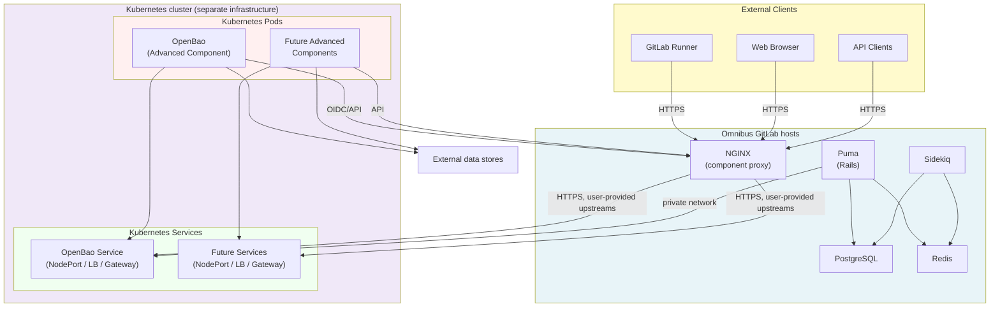

<!--
Document statuses you can use:

- "proposed"
- "accepted"
- "ongoing"
- "implemented"
- "postponed"
- "rejected"

-->

<!-- Design Documents often contain forward-looking statements -->
<!-- vale gitlab.FutureTense = NO -->



## サマリー

Omnibus-Adjacent Kubernetes（OAK）は、従来の Omnibus GitLab デプロイとクラウドネイティブ GitLab を橋渡しする過渡的アーキテクチャです。セルフマネージドのお客様は、別のインフラストラクチャで稼働する Kubernetes クラスターと並行して GitLab Omnibus を実行できます。これにより、完全なクラウドネイティブデプロイを行わなくても、シークレット管理用の OpenBao などのクラウドネイティブコンポーネントを活用できます。

この設計ドキュメントは、私たちの調査フェーズで得た結果を出発点としています。調査では、k3s、k0s、microk8s の 3 つの軽量 Kubernetes ディストリビューションを、単一ノード上で Omnibus GitLab と統合できることを確認しました。Kubernetes 上に OpenBao（シークレット管理ソリューション）をデプロイし、Omnibus GitLab のシークレットマネージャー機能と統合して、エンドツーエンドで動作することを実証しました。

OAK は、[Segmentation 提案](../selfmanaged_segmentation/_index.md)のステッピングストーンとして機能し、Omnibus の運用上のシンプルさを維持しながら、クラウドネイティブコンポーネントを必要とする高度な機能を Early Self-Managed 顧客が採用できるようにします。
また、新機能をモジュール化されたサービスとして構築し、[Theseus プラットフォーム](/handbook/engineering/architecture/design-documents/theseus_platform_vision/)を通じてすべてのデプロイ先に提供するという既定の方針も支えます。

**注記:** [ADR-007](decisions/007_external_kubernetes_clusters_only.md)で、調査フェーズで検証した同一ホスト構成を置き換えました。
OAK は、Omnibus ホストの外部で稼働する Kubernetes クラスターのみをサポートします。
Omnibus は Helm values の生成や NGINX のクラスターネットワークへのバインドを行わず、高度なコンポーネントへの各接続では、設定、
シークレット、NGINX コンポーネントプロキシ、内部トラフィックのうち、Omnibus 側の処理のみを担当します。
[ADR-008](decisions/008_no_omnibus_managed_data_stores.md)では、高度なコンポーネントのデータストアを Omnibus の外部に移します。
このドキュメントには両方の決定を反映しています。

## 動機

### 問題提起

GitLab のプロダクトロードマップには、クラウドネイティブデプロイのために設計されている高度な機能 (ネイティブシークレット管理など) が含まれています。しかし、多くのセルフマネージド顧客は、運用の複雑さ、コスト、またはインフラの制約により、フルクラウドネイティブセットアップへの移行の準備ができていません。これにより、顧客がフルアーキテクチャ全面刷新なしにこれらの高度な機能にアクセスできないギャップが生まれます。

さらに、Segmentation 提案では、Early Self-Managed Advanced コンポーネントティアのお客様向けに移行期の選択肢が必要です。OAK は、Omnibus を Kubernetes クラスターと並行して実行できるようにすることでこの移行パスを提供し、クラウドネイティブコンポーネントの段階的な採用を可能にします。

### 目標

- **セルフマネージド顧客向けに高度な機能を有効にする**: フルクラウドネイティブデプロイを必要とせずに、顧客がクラウドネイティブ GitLab 機能 (シークレット管理など) を使用できるようにします。
- **明確な移行パスを提供する**: OAK を将来のクラウドネイティブ採用へのステッピングストーンとして確立し、移行を検討している顧客の摩擦を減らします。Omnibus コアコンポーネントは、クラウドプロバイダーへの最終的な移行の前に OAK で実行することもできます。
- **運用パターンを確立する**: 将来の実装を導くことができる、サービス相互接続、ネットワーク設定、デプロイ手順の実証済みパターンを文書化します。
- **Segmentation 提案をサポートする**: フルクラウドネイティブデプロイを行いたくない Omnibus ユーザー向けに実行可能なデプロイアーキテクチャを提供することで、Early Self-Managed Advanced ティアの提供を可能にします。

## 意思決定

- [ADR-001: Kubernetes ディストリビューションをパッケージ化または承認しない](./decisions/001_dont_package_or_bless_kubernetes_distros.md)
- [ADR-002: OAK テストと統合オーナーシップ](./decisions/002_oak_testing_and_integration_ownership.md)
- [ADR-003: Omnibus は Kubernetes サービス公開方法に依存しない](./decisions/003_omnibus_agnostic_k8s_service_exposure.md)
- [ADR-004: OAK でのマルチノード Omnibus サポート](decisions/004_multi_node_omnibus_support.md)
- [ADR-005: ゼロダウンタイムアップグレード](decisions/005_zero_downtime_upgrades.md)
- [ADR-006: OAK コンポーネントのデータベース準備を自動化しない](decisions/006_no_automated_database_preparation.md)
- [ADR-007: Omnibus ホストの外部で稼働する Kubernetes クラスターのみをサポートする](decisions/007_external_kubernetes_clusters_only.md)
- [ADR-008: Omnibus は高度なコンポーネントのデータストアを管理しない](decisions/008_no_omnibus_managed_data_stores.md)

## 提案

### アーキテクチャ概要

OAK は以下のコンポーネントで構成されます:

1. **Omnibus GitLab**: 1 台以上のホストで稼働し、コア GitLab アプリケーション、PostgreSQL、Redis などのサービスを提供します。
2. **Kubernetes クラスター**: 専用ノードやマネージド Kubernetes サービスなど、別のインフラストラクチャで稼働し、クラウドネイティブコンポーネント用のコンテナオーケストレーションプラットフォームを提供します。Omnibus ホストでクラスターを稼働させる構成はサポート対象外です（[ADR-007](decisions/007_external_kubernetes_clusters_only.md)）。
   - ユーザーがデプロイと運用を行います。
3. **クラウドネイティブコンポーネント**: Kubernetes 上にデプロイされる OpenBao などのサービスで、明確に定義された API を通じて Omnibus と統合されます。
4. **外部データストア**: Omnibus デプロイの外部にある、クラウドネイティブコンポーネント用のデータストアです（[ADR-008](decisions/008_no_omnibus_managed_data_stores.md)）。
5. **プライベートネットワーク**: Omnibus ホストとクラスターは、お客様が設計したプライベートネットワークを介して相互に通信します。

### 検証された Kubernetes ディストリビューション

私たちの発見作業に基づき、3 つの小規模 Kubernetes ディストリビューション (`k0s`、`k3s`、`microk8s`) がこの目的のために機能することを検証しました。

それぞれの調査結果の詳細については、[OAK マイルストーン 1 のエピック](https://gitlab.com/groups/gitlab-com/gl-infra/software-delivery/-/work_items/30) を参照してください。

調査フェーズでは、これらのディストリビューションを Omnibus と同じホスト上で検証しました。[ADR-007](decisions/007_external_kubernetes_clusters_only.md)以降、これらを特別に扱うことはありません。Omnibus ホストの外部で稼働する Kubernetes クラスターであれば利用できます。GitLab はディストリビューションのパッケージ化や推奨を行いません（[ADR-001](decisions/001_dont_package_or_bless_kubernetes_distros.md)）。

### サービス相互接続パターン

高度なコンポーネントへの各接続は、Omnibus とクラスターがそれぞれの側を担当します（[ADR-007](decisions/007_external_kubernetes_clusters_only.md)）。

1. **データストア**: 高度なコンポーネントは、Omnibus 管理下の PostgreSQL や Redis を使わず、外部データストアを使用します（[ADR-008](decisions/008_no_omnibus_managed_data_stores.md)）。
2. **サービスへのアクセス**: Omnibus は Kubernetes サービスの公開方法に依存しません。ユーザーは、NodePort、LoadBalancer IP、Gateway など、Omnibus ホストからサービスに到達できるアドレス（IP、ホスト名、または `IP:port`）を指定します。[ADR-003](./decisions/003_omnibus_agnostic_k8s_service_exposure.md)を参照してください。
3. **設定とシークレット**: コンポーネントを利用する Omnibus サービスは、`gitlab_rails['openbao']` など、各サービスの名前空間で設定します。Omnibus は自らが所有するシークレットのみを生成して保存し、コンポーネントと共有するシークレット値をエクスポートまたはインポートできます。
4. **NGINX コンポーネントプロキシ**: GitLab ホストを唯一の公開エントリーポイントにする必要がある場合、Omnibus NGINX は `nginx['component_proxy']` の設定に従って、ランナーなどの外部クライアントからのトラフィックをコンポーネントに転送します。
5. **認証**: OpenBao などのサービスは、GitLab を ID プロバイダーとする OIDC/JWT 認証を使用します。

### ネットワークセキュリティモデル

- **クラスターを外部に公開する必要はありません**: NGINX コンポーネントプロキシを通じて GitLab ホストを唯一の外部エントリーポイントとし、クラスターを非公開にできます。お客様が希望する場合は、クラスターからコンポーネントを直接公開することもできます。OAK はクラスターで Gateway または Ingress コントローラーが稼働していることを前提としません。
- **トラフィックはホストをまたぎます**: Omnibus ホストとクラスターの間のトラフィックは双方向でネットワークを通過するため、暗号化が必要です。Omnibus サービスは、コンポーネントから必要とされる場合にのみプライベートネットワークでリッスンし、各コンポーネントのドキュメントに従ってトークンとファイアウォールルールを使用します。
- **Kubernetes API の外部公開は不要です**: Kubernetes API サーバーを外部に公開する必要はありません。
- **TLS**: NGINX コンポーネントプロキシは、OpenBao と通信するランナーなど外部クライアントの TLS を、GitLab の証明書を使うか、[Let's Encrypt 証明書](https://docs.gitlab.com/omnibus/settings/ssl)にホスト名を追加して終端します。クラスターへのトラフィックを再暗号化し、デフォルトでアップストリームの証明書を検証します。

### マルチノード Omnibus サポート

OAK はマルチノード Omnibus デプロイをサポートします。ネットワーク設定とサービスの公開は顧客の責任です。Beta フェーズで計画されている自動化と、既存の Omnibus 設定を組み合わせることで、顧客が稼働するために必要なものをカバーします。それを超えるものはスコープ外です。Omnibus は自分自身のノードのみを管理し、デプロイの他のノードの知識や制御を持ちません。

マルチノード Omnibus デプロイは、既存の Omnibus ZDU 手順に従ってゼロダウンタイムアップグレードを可能にします。OAK の ZDU 戦略の詳細については、[ADR-005: ゼロダウンタイムアップグレード](decisions/005_zero_downtime_upgrades.md) を参照してください。

マルチノード Omnibus サポートの詳細については、[ADR-004: OAK でのマルチノード Omnibus サポート](decisions/004_multi_node_omnibus_support.md) を参照してください。

### オフラインインストール

OAK は Omnibus レベルで新しいオフラインデプロイ要件を導入しません。[オフライン](https://docs.gitlab.com/topics/offline/) Omnibus インストールとオフライン Helm チャート インストールは、既存のメカニズムを通じてすでにサポートされています。顧客は Omnibus と高度なコンポーネントが通信できるように独自のネットワークを設計し、このシナリオに対して Omnibus レベルの変更は期待されません。

### FIPS コンプライアンス

OAK は Omnibus レベルで新しい FIPS コンプライアンス要件を導入しません。Omnibus はすでに FIPS をサポートしており、OAK の一部として Omnibus に新しいコンポーネントは追加されていません。クラスタ内にデプロイされた高度なコンポーネント、およびクラスタ自体は、FIPS 要件を独立して満たす必要があります。

### Kubernetes ツール配布

OAK は `helm` や `kubectl` などの Kubernetes ツールを配布または管理しません。顧客はこれらのツールのインストールと管理に責任を持ちます。ツールの配布を導入すると、Omnibus がオーケストレーションロールに移行することになり、これは意図されたスコープ外です。

### Helm 自動化レベル

OAK は Helm チャートのインストールを自動化せず、Omnibus は Helm values を生成しません（[ADR-007](decisions/007_external_kubernetes_clusters_only.md)）。お客様は、チャートのドキュメントに沿って values を記述し、チャートを手動でインストールします。`helm install` を自動化すると Omnibus がオーケストレーションレイヤーの役割まで担い、チャートのライフサイクル管理も暗黙のサポート対象になります。いずれも意図した範囲外です。

### サイジングガイダンス

OAK は独自のサイジングガイドラインを定めません。Omnibus には既存のサイジング推奨事項が適用され、Kubernetes クラスターはデプロイする高度なコンポーネントのリソース要件を満たす必要があります。クラスターとコンポーネントのデータストアは別のインフラストラクチャで稼働するため、Omnibus とは別にサイジングを行います。

### モニタリングとロギング

OAK デプロイのモニタリングとロギングは、既存のインフラパターンを通じて顧客が管理します。Omnibus レベルの変更は必要ありません。
既存の GitLab 設定と標準ツールにより、ユーザーは自分のインフラに合うソリューションを設計するための十分な柔軟性があります。

**モニタリング**: ユーザーは Omnibus の既存の `prometheus['scrape_configs']` を活用して、高度なコンポーネントのメトリクスを集約できます。高度なコンポーネントは Prometheus 互換のメトリクスを公開します（たとえば、OpenBao は `/v1/sys/metrics` でメトリクスを公開します）。ユーザーはメトリクスを外部に公開し（NodePort、LoadBalancer）、`prometheus['scrape_configs']` でスクレイプするか、Kubernetes ネイティブのパターン（PodMonitor、Prometheus Operator）を使用できます。

**ロギング**: GitLab はすでにロギング機能を提供しています。ユーザーは、インフラのニーズに基づいて、ログ集約ソリューション (Filebeat、Fluent Bit、ELK、Loki などのツールを選択) を設定する責任があります。Omnibus ログと Kubernetes ポッドログの両方は、標準の shipper/agent パターン (Kubernetes 用 DaemonSet、Omnibus 用 VM 上のエージェントなど) を使用して収集できます。

## Beta 実装提案

チームとの議論に基づき、以下は OAK の提案された Beta 実装を表しています。この Beta フェーズは、単一ノード顧客が高度なコンポーネントを採用できるようにする最小限の実行可能プロダクトを確立することに焦点を当てており、最終的にクラウドネイティブアーキテクチャへの移行を促すために意図的にいくつかの摩擦を導入しています。

### Beta 目標

- **高度なコンポーネントの採用を可能にする**: 単一ノード Omnibus 顧客が高度なクラウドネイティブコンポーネント (OpenBao のシークレット管理など) をデプロイして使用できるようにします。
- **運用パターンを確立する**: 実際の顧客でサービス相互接続パターンとデプロイワークフローを検証します。
- **顧客フィードバックを収集する**: 顧客の悩みのポイントと自動化レベルの好みを理解します。

### Beta スコープ: 含まれるもの

#### 1. Omnibus 自動化

Omnibus は、高度なコンポーネントへの**各接続の Omnibus 側**を担当します（[ADR-007](decisions/007_external_kubernetes_clusters_only.md)）。各機能は、最初のコンポーネントで必要になった時点で実装します。

- **設定**は、コンポーネントを利用する Omnibus サービスの名前空間に置きます。たとえば `gitlab_rails['openbao']` や `gitlab_rails['orbit_*']` です。
- **シークレット**: Omnibus は自らが所有するシークレットを生成して保存します。`gitlab-ctl` コマンドでコンポーネントと共有するシークレット値をエクスポートおよびインポートできます。
- **NGINX コンポーネントプロキシ**: `nginx['component_proxy']` のエントリに従い、外部クライアントからのトラフィックを GitLab ホスト経由でクラスター内のコンポーネントに転送します。
- **内部トラフィックの Omnibus 側**を担当します。GitLab サービスとコンポーネントの間の双方向の通信が対象です。

Omnibus は Helm values やその他の Kubernetes 設定を生成せず、自身の PostgreSQL や Redis をクラスターに公開しません（[ADR-008](decisions/008_no_omnibus_managed_data_stores.md)）。

#### 2. デプロイワークフロー (順序付きステップ)

Beta 実装は、最小限の摩擦を導入しながら関心の明確な分離を維持する意図的な 3 ステップワークフローに従います:

**ステップ 1: ユーザーが Kubernetes クラスターとデータストアを用意します**

- ユーザーは、マネージド Kubernetes サービスや専用ノード上のクラスターなど、Omnibus ホストの外部で稼働する Kubernetes クラスターを用意します。クラスターは Omnibus ホストから到達できるプライベートネットワークに配置します。
- ユーザーは、コンポーネントが必要とする外部データストアを用意します（[ADR-008](decisions/008_no_omnibus_managed_data_stores.md)）。
- このステップは意図的に手動で行います。ADR 001 で、私たちは Kubernetes を配布しないと決めているためです。

**ステップ 2: ユーザーが Helm チャートを手動でインストールします**

- ユーザーはコンポーネントとチャートのドキュメントに沿ってチャートの values を記述し、チャートをインストールします。
- 例: `helm install openbao gitlab/openbao -f openbao-values.yaml`
- このステップは、以下を目的として意図的に手動で行います。
  - 最終的なクラウドネイティブへの移行に必要な Helm の基礎をユーザーが学べるようにする
  - Omnibus と Kubernetes の管理を明確に分ける
  - 当初は Helm の自動化を暗黙のサポート対象にすることを避ける。将来の自動化の候補として検討する

**ステップ 3: ユーザーが Omnibus を再設定します**

- ユーザーは、コンポーネントを利用する Omnibus サービスに `gitlab_rails['openbao']` などのコンポーネント設定を追加し、必要に応じて `nginx['component_proxy']` エントリを設定します。
- ユーザーは `gitlab-ctl reconfigure` を実行します。

#### 3. Beta でのサービス相互接続

Beta では、サービス相互接続は以下のパターンに従います:

- **データストアへのアクセス**: コンポーネントは、それぞれの外部データストアに接続します。
- **GitLab からコンポーネントへのアクセス**: Rails と Sidekiq は、クラスターがプライベートネットワーク上に公開するアドレスでコンポーネントを呼び出します。このアドレスは呼び出し元サービスの設定で指定します。
- **外部クライアントからのアクセス**: ランナーなどの外部クライアントは、NGINX コンポーネントプロキシを通じて、またはクラスター経由で直接コンポーネントにアクセスします。Omnibus は Kubernetes でのサービスの公開方法（NodePort、LoadBalancer、Gateway）に依存しません。
- **コンポーネントから GitLab へのアクセス**: OIDC などで GitLab への折り返し通信が必要な OpenBao などのコンポーネントでは、チャートの values に GitLab URL を設定します。

##### アーキテクチャ図

**主要なアーキテクチャ上のポイント:**

- **別のインフラストラクチャ**: Kubernetes クラスターは Omnibus ホストの外部で稼働します
- **エントリーポイントの一本化は任意**: 外部クライアントは NGINX コンポーネントプロキシ経由でコンポーネントにアクセスできるため、クラスターを非公開にできます
- **外部データストア**: コンポーネントは Omnibus 管理下の PostgreSQL や Redis を使いません
- **双方向通信**: 高度なコンポーネントは、認証や API 呼び出しのために GitLab に折り返し通信できます

#### 4. NGINX コンポーネントプロキシ

外部クライアントが GitLab ホスト経由でアクセスするコンポーネントごとに、`nginx['component_proxy']` エントリを追加します。
`nginx['component_proxy_defaults']` の共通のデフォルトにより、ほとんどのエントリではホスト名とアップストリームを指定するだけで済みます。

- `openbao.gitlab.example.com` など、コンポーネント固有のホスト名で公開します。
- ユーザーが指定する NodePort、LoadBalancer IP、Gateway などのアップストリームに、HTTP または gRPC で転送します。いずれも TLS の有無を選べます。
- Omnibus の既存の証明書管理を使って TLS を終端し、アップストリームへの通信を再暗号化します。デフォルトでアップストリームの証明書を検証します。
- 固定のリストに含まれるキーだけを上書きでき、任意の NGINX スニペットは使用できません。

設計の詳細については、[ADR-007](decisions/007_external_kubernetes_clusters_only.md)を参照してください。

#### 5. ドキュメントとサポート

Beta ドキュメントには以下が含まれます:

- **ステップバイステップガイド**: OAK を使用して各高度なコンポーネントを有効にする方法について。
- **トラブルシューティングガイド**: 一般的な問題とそれらのデバッグ方法。
- **アーキテクチャ図**: サービス相互接続パターンを示します。
- **Helm チャート ドキュメント**: 各高度なコンポーネントの公式 Helm チャート ドキュメントへのリンク。

#### 6. オブジェクトストレージ要件

OAK にデプロイされた高度なコンポーネントには異なるストレージ要件がある場合があります:

- **ステートレスコンポーネント**（OpenBao など）: これらのコンポーネントは Omnibus デプロイの外部にあるデータベース（PostgreSQL、Redis）に状態を保存します。追加のオブジェクトストレージは不要です。
- **ディスクを必要とするステートフルコンポーネント**: 永続的なディスクストレージ (PostgreSQL/Redis に保存できる範囲を超える) を必要とする高度なコンポーネントは、オブジェクトストレージを使用する必要があります。そのようなコンポーネントをデプロイする Omnibus 管理者は、それ以外でローカルディスクに保存されるすべてのデータをオブジェクトストレージに移行する必要があります。

**主要な原則**: Kubernetes コンポーネントはローカルディスクストレージに依存すべきではありません。代わりに、以下のいずれかを行うべきです:

1. 外部の PostgreSQL または Redis に状態を保存する
2. ファイルベースのデータには、オブジェクトストレージ (S3 互換、GCS、Azure Blob Storage など) を使用する

これにより、コンポーネントが将来適切にスケーリング、バックアップ、移行できるようになります。Omnibus 管理者は、データベースを超える永続的なデータストレージを必要とする高度なコンポーネントをデプロイする際に、オブジェクトストレージの採用を計画する必要があります。

### Beta スコープ: 含まれないもの

以下は明示的に Beta から延期され、将来のフェーズで対処されます:

- **自動 Helm インストール**: Omnibus は `helm install` コマンドを自動的に実行しません。ユーザーはこれを手動で行う必要があります。
- **エアギャップデプロイ**: Beta ではサポート/検証されていません。インターネットアクセスが必要です。
- **自動サービス検出**: サービスアドレスは `gitlab.rb` の値を介して静的に設定されます。
- **相互 TLS**: Omnibus は提供しません。クラスターからのトラフィックに対して Omnibus で相互 TLS を終端する必要があれば、コンポーネントごとに判断します。
- **Kubernetes ツール配布**: ユーザーは Helm、kubectl、その他のツールを自分でインストールする必要があります。

### Beta 成功基準

Beta フェーズは以下が満たされた場合に成功と見なされます:

1. **機能性**: 単一ノード顧客が OAK で少なくとも 1 つの高度なコンポーネント (OpenBao) を正常にデプロイして使用できる。
2. **ドキュメント**: 以下のドキュメント成果物が作成されて公開される:
   - **ランブック**: 外部クラスター上の OpenBao を使用する OAK のステップごとのデプロイガイド
   - **トラブルシューティングガイド**: 一般的な問題、エラーメッセージ、解決手順
   - **録画されたデモ**: エンドツーエンドインストールを示すビデオウォークスルー （Kubernetes クラスター → OpenBao → Omnibus）
3. **顧客フィードバック**: セットアップエクスペリエンスと自動化レベルについて、少なくとも 2-5 名のベータ顧客からフィードバックを得ている。
4. **運用パターン**: サービス相互接続パターンが検証され、文書化されている。
5. **サポート準備**: サポートチームが以下にアクセスできる:
   - ランブックとトラブルシューティングガイド
   - 参考用の録画デモ
   - 顧客の質問に対処するために Beta 期間中にスケジュールされた 2 つの AMA (Ask Me Anything) セッション。オンデマンドでさらに AMA を開催することにオープンであること。
6. **セキュリティレビュー**: AppSec がアーキテクチャと実装をレビュー済みである。

### Beta から GA への移行

GA への道はまだ確定していません。事前に固定された GA スコープにコミットするのではなく、フィードバック駆動のアプローチを選択しました。Beta はアクティブな状態を維持しながら、GA が意味を成すかどうか、そしてどのような形で意味を成すかを判断するための実世界の顧客データを収集します。

#### Beta フィードバック期間

Beta は約 **6 か月** 実行され、その間に以下を目指します:

- **少なくとも 5 名のベータ顧客** からフィードバックを収集する。
- `gitlab.yml` 設定キーの計装を使用して採用を定量化する (たとえば、`oak['enabled']: true` のインスタンスの数をカウント)。
- 公開 Issue を通じて、また CS およびパートナーユーザーに Beta をアナウンスすることで、定性的なフィードバックを収集する。

#### フィードバック期間終了時の決定基準

フィードバック期間の終了時に、以下を評価します:

1. **十分なデータがあるか?** ない場合、Beta をより長く実行する選択肢があります。
2. **機能はよく受け入れられ、重大な改善は必要ないか?** → Beta をそのまま GA に切り替え、リリース前の追加の機能作業はなし。特定された "あれば便利" は将来の改善になります。
3. **GA 前に機能に改善が必要か?** → それらの改善が GA に必要か、または Beta を GA に切り替えてそれらを将来を見据えた作業として扱うかを決定します。
4. **機能はユーザーを引きつけることに失敗したか?** → GA に達する前に Beta から OAK を引退させるオプションを保持します。これにより、機能をきれいに削除する柔軟性が得られます。

#### GA 前にスコープ外

フィードバックがニーズを検証するまで、追加の自動化やインフラ作業に意図的に **投資しません**。元々 GA の前提条件としてスコープに含まれていた次の項目は、フィードバックデータが揃うまで保留されます:

- 自動化の拡張 (自動 Helm インストールなど)。
- Omnibus がすでに提供している以上の高度なエアギャップデプロイサポート。
- Kubernetes 関連ツールの配布。

これらは引き続き有効な将来の改善であり、顧客フィードバックが需要を示した場合に再検討されます。

### Beta アプローチの根拠

Beta アプローチは、いくつかの競合する懸念のバランスを取ります:

- **顧客体験**: Omnibus は NGINX コンポーネントプロキシとシークレットを含め、各接続の Omnibus 側を担当します。そのため、お客様が NGINX 設定を記述したり、シークレットを手動でコピーしたりする必要がありません。
- **メンテナンス負担**: Helm インストールを手動にすることで、継続的なメンテナンスを必要とする複雑な自動化システムを作成することを避けます。
- **学習機会**: 手動の Helm インストールを必要とすることで、顧客が Kubernetes の基本を学ぶことが保証され、最終的なクラウドネイティブ移行に備えることができます。
- **明確な境界**: Omnibus と Kubernetes 管理を分離することで、明確な運用境界を維持し、サポート対象範囲を減らします。
- **フィードバック収集**: 手動ステップは、最も価値のある自動化について顧客がフィードバックを提供できる自然な地点を提供します。

## 次のステップ

### 即時アクション (設計ドキュメントフェーズ)

1. **ステークホルダーの整合**: 公開された質問について整合させるため、この設計ドキュメントをテクニカルリーダー、プロダクトマネージャー、エンジニアリングマネージャーに提示します。
2. **意思決定の文書化**: 公開された各質問について新しい ADR に意思決定を文書化し、それに応じてこの設計ドキュメントを更新します。後続のフォローアップ MR で行えます/行うべきです。これは、作業を分割し、各トピックに対してよりクリーンで焦点を絞った議論を提供するのに役立ちます。
3. **詳細な要件**: 意思決定に基づいて、実装フェーズの詳細な要件を作成します。
4. **アーキテクチャの洗練**: ステークホルダーのフィードバックと意思決定に基づいてアーキテクチャを洗練します。

### 実装フェーズ (設計ドキュメント承認後)

1. **Omnibus 自動化**: Beta 提案で説明されているとおり、OAK セットアップのための Omnibus 設定と自動化を実装します。
2. **NGINX コンポーネントプロキシ**: 最初のコンポーネントで必要になった時点で、`nginx['component_proxy']` 設定を実装します。
3. **シークレットのエクスポートとインポート**: 最初のコンポーネントで必要になった時点で、`gitlab-ctl` コマンドを実装します。
4. **ドキュメント**: OpenBao ドキュメントを拡張して、OAK でデプロイする方法をユーザーにガイドします。
5. **テストと検証**: 自動 CI パイプラインテストを持ちます。
6. **セキュリティレビュー**: アーキテクチャと実装の AppSec レビュー。
7. **Beta リリース**: 早期採用者向けのベータ機能として OAK をリリースします。

## 参考資料

- [親エピック: Omnibus Adjacent Kubernetes（OAK）- Operate の実装](https://gitlab.com/groups/gitlab-com/gl-infra/software-delivery/-/work_items/22)
- [完了した調査フェーズ: マイルストーン 1](https://gitlab.com/groups/gitlab-com/gl-infra/software-delivery/-/work_items/30)
  - [k3s の調査 Issue](https://gitlab.com/gitlab-org/omnibus-gitlab/-/work_items/9525)
    - [k3s のドキュメント](https://docs.k3s.io/)
  - [k0s の調査 Issue](https://gitlab.com/gitlab-org/omnibus-gitlab/-/work_items/9526)
    - [k0s のドキュメント](https://docs.k0sproject.io/)
  - [microk8s の調査 Issue](https://gitlab.com/gitlab-org/omnibus-gitlab/-/work_items/9527)
    - [microk8s のドキュメント](https://canonical.com/microk8s)
- [設計ドキュメントフェーズのエピック](https://gitlab.com/groups/gitlab-com/gl-infra/software-delivery/-/work_items/33)
- [GitLab の Segmentation 提案](../selfmanaged_segmentation/_index.md)
