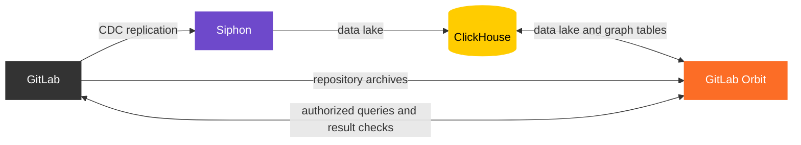



## 概要 {#overview}

GitLab Orbit（旧 GitLab Knowledge Graph）は、GitLab のデータとコードを 1 つのグラフにまとめます。
エージェントや人間はそのグラフにクエリを実行し、多数の GitLab API 呼び出しが必要になるような問いに答えます。

Orbit は GitLab データの**読み取り専用ミラー**です。GitLab の権限を適用しますが、権限そのものをコピーすることはありません。

- **SDLC データ**：[Data Insights Platform](../data_insights_platform/)（DIP）のレプリケーションサービスである [Siphon](../siphon/)が、Orbit に必要な GitLab のテーブルをデータレイクにコピーします。SDLC インデクサーは、それらの行をノードとエッジに変換します。
- **コード**：コードインデクサーは GitLab を通じてリポジトリを取得し、ファイル、定義、およびそれらの間のリンクを追加します。
- **クエリ**：呼び出し元は、MCP、Orbit CLI、REST API、GitLab Duo を通じてグラフクエリを送信します。すべてのリクエストは最初に GitLab を経由します。GitLab は呼び出し元が誰であるか、何を閲覧できるかを確認します。その後、Orbit はそのスコープ内で、制約付きの SQL クエリを 1 つコンパイルします。GitLab は各結果を返す前にもう一度確認します。

結果には、最後のインデックス作成実行時点のグラフが表示されます。

私たちは、Orbit が GitLab の運用負荷を増やさないことを目指しました。Orbit は GitLab のデータベースに接続せず、すべてのクエリを独自のストア上で実行します。
Orbit は GitLab.com、GitLab Dedicated、GitLab Self-Managed で動作します。GitLab とは別に提供されます。

## 設計ドキュメント {#design-documents}

設計ドキュメントは、[knowledge-graph リポジトリ](https://gitlab.com/gitlab-org/orbit/knowledge-graph/-/tree/main/docs/pages/engineering)のコードと同じ場所にあります。
[Orbit のエンジニアリングサイト](https://gitlab-org.gitlab.io/orbit/knowledge-graph/engineering/)で参照してください。

| ページ | 内容 |
|---|---|
| [アーキテクチャ](https://gitlab-org.gitlab.io/orbit/knowledge-graph/engineering/architecture/) | データの取り込み方、問いへの回答の仕組み、Orbit がこのように構築されている理由。 |
| [データモデル](https://gitlab-org.gitlab.io/orbit/knowledge-graph/engineering/architecture/data-model/) | プロパティグラフと、それを定義するオントロジー。 |
| [インデックス作成](https://gitlab-org.gitlab.io/orbit/knowledge-graph/engineering/architecture/indexing/) | SDLC インデックス作成、コードインデックス作成、スキーマの進化、耐障害性。 |
| [コードグラフ](https://gitlab-org.gitlab.io/orbit/knowledge-graph/engineering/architecture/code-graph/) | ソースファイルが、ファイル、定義、およびそれらの間のリンクになる仕組み。 |
| [クエリ](https://gitlab-org.gitlab.io/orbit/knowledge-graph/engineering/architecture/querying/) | クエリのライフサイクルとクエリエンジン。 |
| [セキュリティ](https://gitlab-org.gitlab.io/orbit/knowledge-graph/engineering/architecture/security/) | 各呼び出し元が、GitLab によって許可されたデータだけを閲覧する仕組み。 |
| [Orbit CLI](https://gitlab-org.gitlab.io/orbit/knowledge-graph/engineering/architecture/orbit-cli/) | CLI が Orbit をターミナルや AI エージェントに提供する仕組み。 |
| [アーキテクチャの決定](https://gitlab-org.gitlab.io/orbit/knowledge-graph/engineering/adr/) | アーキテクチャ決定記録（ADR）と、各決定の理由。 |
| [テスト](https://gitlab-org.gitlab.io/orbit/knowledge-graph/engineering/testing/) | 変更をリリースする前に、Orbit がその正しさを検証する方法。 |
| [ランブック](https://gitlab-org.gitlab.io/orbit/knowledge-graph/engineering/runbooks/) | Orbit の運用方法と、災害から復旧する方法。 |
| [開発](https://gitlab-org.gitlab.io/orbit/knowledge-graph/engineering/development/) | コンピューター上で Orbit をセットアップし、変更してテストする方法。 |

このページには、他のステージに関わる決定のみを残しています。

- [提供：Orbit と DIP を独立したチャートとして提供する](decisions/01-delivery.md)

## リソース {#resources}

| リソース | 場所 |
|---|---|
| リポジトリ | [gitlab-org/orbit/knowledge-graph](https://gitlab.com/gitlab-org/orbit/knowledge-graph) |
| ユーザードキュメント | [docs.gitlab.com/orbit](https://docs.gitlab.com/orbit/) |
| ロードマップ | [Orbit ロードマップ](https://gitlab-org.gitlab.io/orbit/knowledge-graph/roadmap/) |
| 動画とデモ | [Orbit コンテンツ](https://gitlab-org.gitlab.io/orbit/knowledge-graph/content/) |
| チーム | [Orbit チーム](https://gitlab-org.gitlab.io/orbit/knowledge-graph/team/) |
| 主要エピック | [Orbit as a Service - GA](https://gitlab.com/groups/gitlab-org/-/work_items/19744) |
| プログラムページ | [社内ハンドブック](https://internal.gitlab.com/handbook/engineering/r-and-d-pmo/programs/knowledge-graph-ga/) |
