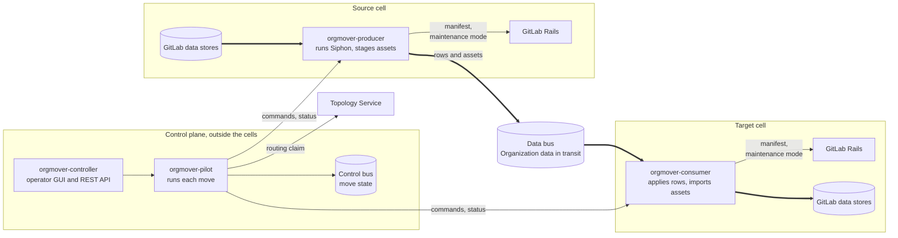

{}
この ADR は [ADR-003：Org Mover コントロールプレーン](003_org_mover_architecture.md)を置き換えます。
ADR-003 の問題定義と却下した代替案は引き続き適用されます。
{}

## 概要 {#summary}

**Org Mover** は GitLab.com の組織をある Cell から別の Cell に移動します。
[ADR-003](003_org_mover_architecture.md)からの主な変更点は次のとおりです：

1. **2 層構成。** セル外のコントロールプレーンがセル内の層、つまり各セル内の Org Mover サービスを制御します。ADR-003 には中央サービスしかありませんでした。
2. **Geo を使用しません。** Org Mover 自体がリポジトリ、オブジェクトストレージ、その他の PostgreSQL 以外のデータをコピーします。ADR-003 ではこれに Geo を再利用していました。

| | |
|---|---|
| **問題** | レガシーセルから移動先セルに組織を移動する自動化がありません。 |
| **アプローチ** | コントロールプレーンが各移動を保存済みのステップとして実行します。移動元と移動先のセル内のサービスがセル内の作業を行います。組織データはセル間を移動し、コントロールプレーンを経由しません。 |
| **状況** | 提案中 |
| **対象範囲** | 任意のセルから任意のセルへの移動。最初の対象は GitLab.com のレガシーセルから移動先セルへの移動です。[対象範囲と対象外の事項](#scope-and-non-goals)を参照してください。 |
| **必要な決定** | Tenant Scale、Siphon、Infrastructure のステークホルダーによる承認。 |
| **実装** | [Org Mover のプロトタイプ](https://gitlab.com/gitlab-org/cells/pocs/poc-orgmover)を基に構築した [`gitlab-org/cells/org-mover/org-mover`](https://gitlab.com/gitlab-org/cells/org-mover/org-mover) |
| **関連情報** | [ADR-002 ロールバック](002_rollback_strategy.md) · [ADR-010 組織のメンテナンスモード](../../organization/decisions/010_organization_maintenance_mode.md) · [組織データ移行のブループリント](../_index.md) |

## 全体構成 {#the-shape}

細い矢印はコマンドと状況を伝達します。太い矢印は組織データを運びます。
セルのサービスは GitLab Rails にマニフェストの取得とメンテナンスモードの適用を要求します。
データをコピーするため、データストアを直接読み書きします。

## 決定事項 {#decisions}

1. **コントロールプレーンとセル内の層の 2 層構成にします。** コントロールプレーンはセルの外で実行します。`orgmover-pilot` が各移動を実行し、`orgmover-controller` がオペレーター用 GUI と REST API を提供します。セル内の層は、各セルに配置するプロデューサーとコンシューマーで構成します。プロデューサーは移動元側を、コンシューマーは移動先側を担当します。Cells が共有のセル内コントロールプレーンを提供する場合は、その上でセル内の層を実行できます。
2. **2 つの分離ルールを設けます。** セル同士は互いについて何も認識せず、コントロールプレーンだけがセルを制御します。組織データはコントロールプレーンを経由しません。コントロールプレーンが扱うのはコマンド、状況、各移動自体の記録です。コントロールプレーンとセル間の接続は、認証と暗号化が必要です。
3. **共有のデータバスがセル間で組織データを運びます。** 両方のセルからアクセスできるため、どちらのセルも他方について認識する必要がありません。オブジェクトストレージについては、移動元が署名付き URL をバスに置き、移動先がその URL でオブジェクトをダウンロードします。コントロールプレーンは、セルからアクセスできない別の制御バスに状態を保存します。両方のバスに接続するプロセスはありません。どちらのバスも NATS JetStream です。
4. **各 GitLab サービスが移動するデータを宣言します。** 各サービスがマニフェストを公開します。マニフェストには、移動するテーブル、各行がどのように組織に属するか、アップロードやリポジトリなどのアセットを参照する列を列挙します。移動を開始する前に、Org Mover は移動元と移動先のマニフェストとスキーマを比較します。どのマニフェストにも宣言されていない種類のデータを Org Mover が移動することはできません。
5. **Siphon が PostgreSQL の行をコピーします。** 移動元のデータベースごとに、プロデューサーが移動のために [Siphon](https://gitlab.com/gitlab-org/analytics-section/siphon)を実行します。Siphon はスナップショットを取得し、その後、その組織の行に絞り込んだ変更データキャプチャ（CDC）をストリーミングします。コンシューマーはそのストリームを移動先のデータベースに適用します。
6. **Org Mover 自体が、Geo を使用せずに PostgreSQL 以外のデータをコピーします。** リポジトリやアップロードなど、GitLab のデータベースが追跡するアセットについては、コンシューマーがアセットを参照する各行を適用する際に、保留中として印を付けます。pilot は、移動元が準備するコピーと、保留中の各行を対応付けます。コンシューマーはコピーをインポートし、印を消します。CDC も新しい行に印を付けるため、移動中に作成されたアセットもコピーします。Secrets Manager やアーティファクトレジストリなど、独自のデータを保持するサービスには、独自のコピー方法が必要です。どの場合も、データのバイト列はセル間を移動し、コントロールプレーンを経由しません。
7. **移動は、保存され、再開できるステップとして実行します。** pilot は、各移動がどのステップにあるかを保存します。再起動後は、そのステップから続行します。各ステップは安全に繰り返せます。
8. **大量のデータは組織が書き込み可能な間に移動します。** メンテナンスウィンドウに残すのは小さな差分だけです。ウィンドウ中は、Rails のメンテナンスモードが、その組織へのすべてのリクエストを読み取りも含めてブロックします（[ADR-010](../../organization/decisions/010_organization_maintenance_mode.md)）。ウィンドウは組織のダウンタイムになるため、短くする必要があります。
9. **切り替え前に検証し、人が承認します。** pilot は、両方のセルの行ごとのチェックサムを比較します。差異がある場合は、データが一致するか、オペレーターがその差異をスキップして理由を記録するまで、移動を保留します。オペレーターが切り替えを承認します。この承認は将来、自動化できます。
10. **Topology Service がルーティングを管理します。** 切り替え時に、pilot は移動先の組織を有効にします。その後、組織のルーティングクレームを移動先セルに移します。
11. **移動は確定するまでロールバックできます。** ロールバックでは、移動先の組織を凍結し、移動元で再び有効にして、ルーティングクレームを移動元セルに戻します。[ADR-002](002_rollback_strategy.md)の切り戻しで認めているとおり、移動先で行った書き込みは失われます。確定後は、変更を進める形で修正します。
12. **1 つのコントロールプレーンが多数の移動を実行します。** 各移動には独自の状態があります。組織は一度に 1 つの移動にしか含められません。

## 影響 {#consequences}

- すべてのセルで Org Mover サービスを実行します。サービスがないセルは、移動元にも移動先にもなれません。
- 新しい種類のデータは、マニフェストで宣言して初めて移動できます。新しい種類のストレージには、コピー方法も必要です。
- 各移動で、移動元の各データベースにレプリケーションスロットを追加します。各スロットはデータベースの WAL 全体を読み取り、キャプチャが遅延または一時停止している間は WAL を保持します。そのため、移動元の各データベースによって、同時に実行できる移動の数が制限されます。
- データバスは転送中の組織データを保持し、すべてのセルからアクセスできます。セルのデータストアと同じ保護が必要です。

## 検討した代替案 {#alternatives-considered}

### PostgreSQL 以外のデータに Geo を再利用する {#reuse-geo-for-non-postgresql-data}

[ADR-003](003_org_mover_architecture.md)では Geo を選択しました。私たちは[プロトタイプを評価し](https://gitlab.com/gitlab-com/gl-infra/tenant-scale/transport/team/-/work_items/15)、Geo を却下しました：

- Geo はセル全体をレプリケーションします。対象を 1 つの組織に絞るには、Geo と Rails に新たな作業が必要でした。
- Geo の非同期レプリケーションは、アクティブな組織では 100% に到達しません。そのため、切り替え前の完全性の確認が難しくなります。Org Mover の保留中の印を使うと、正確な件数を取得でき、その件数はゼロまで減ります。
- Org Mover は、GitLab.com で Geo を有効にせずに、Geo がコピーするものをコピーできます。労力とリスクの大部分は PostgreSQL にあり、Geo はそこを変えません。

### ADR-003 の代替案 {#the-alternatives-in-adr-003}

二重書き込み、Direct Transfer、ファイルベースのエクスポートとインポート、セル全体のコピー、モノリス内からのオーケストレーションは、[ADR-003](003_org_mover_architecture.md#alternatives-considered)に記載した理由により、引き続き却下します。

## 対象範囲と対象外の事項 {#scope-and-non-goals}

対象範囲は任意のセルから任意のセルへの移動ですが、最初の対象は GitLab.com のレガシーセルから移動先セルへの移動です。

次の事項は対象外です：

- Self-managed と GitLab Dedicated の移行オーケストレーション。
- プラットフォーム間の移行（Self-managed から SaaS、または SaaS から Self-managed）。

## 参考資料 {#references}

- [ADR-003：Org Mover コントロールプレーン（置き換え済み）](003_org_mover_architecture.md)
- [ADR-002：ロールバック戦略](002_rollback_strategy.md)
- [ADR-010：組織のメンテナンスモード](../../organization/decisions/010_organization_maintenance_mode.md)
- [組織データ移行のブループリント](../_index.md)
- [Topology Service](../../cells/topology_service.md)
