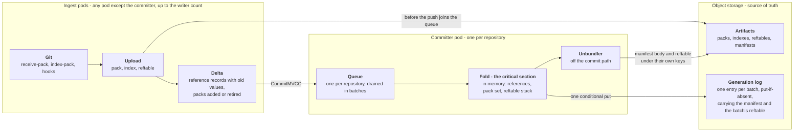
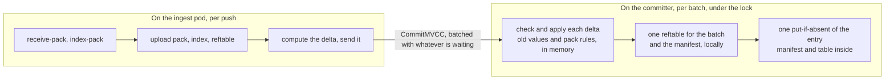

これは、[Git のスケーリング](./_index.md)設計の一部となる提案です。対象は書き込み経路のみです。読み取り、ルーティング、移行、ストレージ形式については親ドキュメントで説明しています。

## 概要 {#summary}

Git のスケーリング設計では、リポジトリをイミュータブルなコンテンツアドレス指定のアーティファクトとして、オブジェクトストレージに保存します。マニフェストはアクティブなアーティファクトの集合を指定し、リポジトリごとのログにある最新の世代オブジェクトはアクティブなマニフェストを指定します。ライターが条件付き PUT で次の世代オブジェクトを作成すると、書き込みが永続化されます。

同じリポジトリへの同時プッシュは、この PUT によって直列化されます。各プッシュはクリティカルセクション内でマージを行い、マージしたマニフェストと reftable をアップロードします。私たちは、クリティカルセクションを条件付き PUT 1 回に縮小し、ほかのすべての処理をクリティカルパスの外に移すことを提案します。

- リポジトリのコミッター以外の任意の Gitaly Pod がプッシュを取り込みます。Git を実行し、そのプッシュのアーティファクトをアップロードしたうえで、参照の変更と追加・廃止されたパックを表す小さな差分を計算します。
- リポジトリごとに 1 つの Pod がコミッターを担当し、すべての Pod が同じコミッターに合意します。PoC ではランデブーハッシングで選びます。親ドキュメントのクラスタリングとルーティングの提案にあるように、コントロールプレーンが選ぶ方式も可能です。コミッターは、コミット済み状態のインメモリコピーに差分を統合し、バッチごとに 1 つの世代を公開します。
- コミッターが書き込む世代オブジェクトを世代エントリと呼びます。このエントリには、マニフェストのハッシュとともに、バッチのマニフェストと reftable が含まれます。コミットは 1 回の書き込みで済み、読み取りは発生しません。
- リポジトリのメンテナンスとコンパクションは、コミッターのみで実行します。ガベージコレクションは、任意の Pod で世代ログをもとに実行します。

## 背景 {#motivation}

親ドキュメントの設計では、書き込み RPC ごとに先頭の世代を解決し、Git を実行して新しいアーティファクトをアップロードし、条件付き PUT でポインターを進めます。同じリポジトリにプッシュが集中すると、競合で先を越されたプッシュはすべて、先頭の世代を再読み取りし、マージしてから再試行します。

待機中のプッシュをまとめて 1 回の PUT でバッチ全体を公開すれば、再試行は不要になります。それでも、そのバッチを保持する Pod は、オブジェクトストレージから先頭のマニフェストと reftable を読み取り、各プッシュをマージし、reftable とマニフェストを書き込んでアップロードした後、ポインターを切り替えます。スループットは、その 1 つの Pod と、バッチごとのオブジェクトストレージとの数回のラウンドトリップによって制約されます。

### 目標 {#goals}

- プッシュが集中するリポジトリでは、プッシュごとに必要な Git の実行とアップロードを取り込み Pod に分散します。各差分のメモリ内処理とバッチごとの PUT 1 回で決まるコミッターの統合処理能力に達するまでは、取り込み Pod を増やすほどスループットが向上します。
- バッチごとにクリティカルセクション内で行う処理には上限があり、その処理量はリポジトリのサイズに応じて増えることはありません。
- 正しさは引き続き世代ログだけで保証し、コミッターのプロセス外でロックを保持しません。
- プッシュの任意の時点でいずれの Pod に障害が発生しても、コミット済みの書き込みが失われたり、二重に適用されたりすることはありません。その時点で処理中のプッシュは、必要に応じて内部で再試行した後に成功するか、失敗としてクライアントに報告されます。コミットされなかったプッシュのアーティファクトは回収します。

### 対象外 {#non-goals}

- Git への変更。Git 側のメンテナンスポリシーとプロセス数の変更は別の設計ドキュメントで扱います。このドキュメントでは、明記した箇所でそれらを前提とします。
- 読み取りトラフィックのルーティングとキャッシュの配置。親ドキュメントの「クラスタリングとルーティング」を参照してください。
- マルチリージョンレプリケーション。
- マニフェストの保持ポリシー。親ドキュメントの「ガベージコレクション」で定めます。このドキュメントでは仕組みの追加のみを扱います。

### 前提 {#assumptions}

- オブジェクトストレージに関する親ドキュメントの前提が成り立ちます。
- 共有されたクラスターメンバー構成をもとに算出する場合も、コントロールプレーンが割り当てる場合も、すべての Pod がリポジトリのコミッターに合意します。切り替えの間、一時的に認識が食い違うことは許容します。
- Pod 間は gRPC で通信できます。

## 提案 {#proposal}

書き込み経路を、どの Gitaly Pod でも担える 2 つのロールに分けます。リポジトリごとのクリティカルセクションを、オブジェクトストレージへの書き込み 1 回に縮小します。1 つの Pod は専用キャッシュを持つ 1 つの Gitaly プロセスです。マシン上で単独で動作するか、ほかの Pod と同居するかは、この設計には影響しません。

- **取り込み Pod。** プッシュのために Git（receive-pack、index-pack、フック）を実行し、パック、インデックス、reftable をアップロードしてから、差分を計算してコミッターに送信します。リポジトリへのプッシュを取り込む Pod の数は設定値で決まります。取り込み Pod は、コミッターとそのリポジトリのリーダーを選ぶときと同じランデブーハッシングの順位に従い、コミッターを除いて次点の候補から選びます。そのため、どの Pod も一部のリポジトリでは取り込みを行いますが、自分がコミッターを担当するリポジトリでは取り込みを行いません。
- **コミッター。** リポジトリごとに 1 つの Pod が担当し、すべての Pod が同じコミッターに合意します。PoC では、クラスターメンバーを対象にランデブーハッシングで選びます。コミッターは、リポジトリのコミット済み状態をメモリに保持し、差分を検証して統合し、バッチごとに 1 つの reftable を書き込んで世代エントリを作成します。コミッター自身はプッシュを受け付けません。
- **展開ワーカー。** コミッターの Pod 上で、コミット経路の外で動作するワーカープールです。コミットごとに、エントリが保持するマニフェストの本体と reftable をそれぞれのキーに書き込み、キーを指定してバケットを読み取るサブシステムからアクセスできるようにします。
- **オブジェクトストレージ。** アーティファクトとログは親ドキュメントの設計どおりです。世代オブジェクトには 2 つ目の形式である世代エントリが加わります。この形式は、マニフェストのハッシュに加え、バッチのマニフェスト本体、reftable、およびバッチが追加した各アーティファクトの取得元とサイズを保持します。リーダーは両方の形式を扱えます。
- **コレクター。** 任意の Pod が担当します。親ドキュメントの「ガベージコレクション」と後述の追加事項に従い、保持中のどの世代からも参照されていないアーティファクトを回収します。

## 設計と実装の詳細 {#design-and-implementation-details}

### 取り込みと差分 {#ingest-and-the-delta}

ルーターが選んだ Pod は、親ドキュメントの設計におけるほかの書き込み RPC と同様に、ローカルキャッシュに対して Git を実行します。プッシュをコミット待ちのキューに入れる前に、Pod はパック、インデックス、reftable をアップロードし、Git が処理の基点とした先頭の世代との差分を計算します。差分には、変更された各参照の旧値と新値、および追加・廃止されたパックが含まれます。続いて、候補のマニフェストを使って pre-receive チェックを実行します。対象の参照の値が変わっていなければ、コミッターは、以降のどの先頭の世代にもその差分を適用できます。これは、プッシュについて Git 自体が定める旧値のルールです。差分は内部 RPC の `CommitMVCC` でネットワークを経由して送信します。

#### コミットリクエスト {#the-commit-request}

リクエストにはプッシュのデータ本体は含まれません。プッシュの基点となった先頭の世代を指定し、変更内容を記述します。

| フィールド | 意味 |
| --- | --- |
| `repository` | 対象のリポジトリ |
| `base_generation`、`base_sha` | セッションの基点となった先頭の世代と、そこで指定されているマニフェスト |
| `uploaded_sha` | セッションでアップロードにより公開したマニフェスト |
| `request_id` | 冪等性キー。レスポンスが失われて再試行した場合は、初回の結果で応答します |
| `delta` | 後述の変更内容。これを含まない場合、先頭の世代が進んでいないときに限り、セッションをそのままコミットできます |
| `origin_address` | セッションのアーティファクトをキャッシュに保持している Pod。ピアが取得できるよう、世代エントリに記録します |

差分は 2 つの部分から成ります。参照側は比較して設定する操作（compare-and-set）です。処理中の値がセッションで確認した旧値と一致する場合、またはすでに更新先の値と一致する場合に、コミッターはレコードを受け入れます。オブジェクト側は、コミット済みのパック一覧に対する集合演算です。

| フィールド | 意味 |
| --- | --- |
| `records` | 変更された参照の新値を名前順に並べたもの。各レコードは参照先、注釈付きタグを解決した先のオブジェクト、およびシンボリック参照か削除かを示す情報を持ちます |
| `old` | 変更された各参照について、セッションで確認した値。存在しなかった参照の場合は空です |
| `added_paths` | セッションで追加したオブジェクトアーティファクト。パックとそのインデックス、マルチパックインデックス、コミットグラフが含まれます |
| `removed_paths` | セッションで廃止したオブジェクトアーティファクト。二重廃止のチェックはこの一覧をもとに実行します |
| `pack_paths` | セッションのパックの完全な一覧。セッションでパックを廃止したか、マルチパックインデックスまたはコミットグラフを変更した場合にのみ含まれます |
| `base_midx`、`base_graph`、`midx`、`graph` | 基点とセッションそれぞれのマルチパックインデックスとコミットグラフのパス。両方でパックの集合が変更された場合に、コミッターがどちらを残すか判断するために使います |
| `ref_stack_paths`、`max_update_index`、`same_stack` | セッションの reftable スタックと、最上位のテーブルの更新インデックスの上限。バッチがセッションのマニフェスト全体をそのまま採用する場合にのみ使用します |

一般的なプッシュには、数件のレコードと同数の `old` 値、追加された 2 つか 3 つのパスが含まれます。サイズの大きな `pack_paths` と `ref_stack_paths` は、再パックとマニフェスト全体を採用するコミットでのみ値が入ります。

レスポンスには、公開が反映された世代と、そこで指定されているマニフェストが含まれます。競合の場合は、取り込み Pod が再試行方法を判断できるよう、競合の種類（変更の重複または比較交換の試行回数の上限到達）、関係する世代とマニフェスト、および拒否したバッチの試行回数とバックオフが返されます。取り込み Pod は、コミッターが応答するまでクライアントとの接続を保持します。コミッターに到達できないか、コミッターが変わった場合は、新しいコミッターに 1 回だけ再送します。それでも処理できない場合は、条件付き PUT を使って取り込み Pod 自身でコミットします。

### コミッターとそのクリティカルセクション {#the-committer-and-its-critical-section}

コミッターはリポジトリごとにコミット済み状態をメモリに保持します。具体的には、直近に公開した先頭の世代の参照、パックの集合、reftable スタックです。リポジトリの差分はキューに追加し、バッチごとに取り出して処理します。バッチのサイズは負荷に応じて増えます。

コミッターは、リポジトリごとのロックを保持した状態で、各差分を処理中の状態と照合します。各参照が旧値のままか、すでに更新先の値になっていること、廃止済みのパックを再度廃止しないこと、既存の参照名の配下に参照を作成しないことを確認します。受け入れた差分を適用し、バッチ用の reftable を 1 つ書き込んで、条件付き PUT で次の世代エントリを作成します。コミット時にはオブジェクトストレージから読み取らず、バッチごとに 1 回だけ書き込みます。拒否した差分には競合を返し、取り込み Pod が新しい先頭の世代を基点に再試行します。

コミッターは直近に自分で書き込んだ先頭の世代を信頼し、条件付き PUT は安全策として残します。クラスターメンバーの入れ替え中は、2 つの Pod が一時的にコミッターとして動作する場合があります。PUT が両者を直列化し、競合で先を越された方は先頭の世代を再読み取りして、バッチを再度統合します。定常時は PUT の競合がほとんど発生しないため、スループットは 1 回のラウンドトリップで処理できる差分の数で決まります。

レスポンスが失われて再送された差分は、最大 1 回しか適用されません。初回のリクエストに応答したコミッターは、`request_id` をキーに初回の結果を参照して再送に応答します。その記録がないコミッターは、ほかの差分と同じように再送を統合します。参照が差分の更新先の値を保持していればチェックに通ります。その後のプッシュで変更された参照や、初回ですでに廃止したパックはチェックに通りません。この場合、初回がコミット済みでも、再送には競合が返されます。プッシュでは、障害パターン表の結果不明の行に該当します。クライアントにはプッシュが失敗したと伝わり、次のプッシュ時にはリポジトリが最新であることがわかります。メンテナンスでは問題になりません。パスはロック取得後に先頭の世代を再読み取りするためです。バッチのリクエスト ID を世代エントリに記録すれば、新しいコミッターがログをもとに再送に応答できますが、この設計には含めません。

#### ライターとクラスターメンバー構成 {#writers-and-membership}

`[elastic]` 設定の `writer_replicas` で、リポジトリへのプッシュを取り込む Pod の数を指定します。コミッターはこの集合から除外し、CPU を統合処理に充てます。ルーターは、取り込み Pod の 2 つの候補のうち、負荷が低い方を優先します。

### バッチ処理と世代エントリ {#batching-and-the-generation-entry}

このセクションの処理はすべてオーケストレーターが担当します。Git は親ドキュメントの設計と同様に、キャッシュから結果を読み取ります。この結果は、パックと reftable スタックを指定するマニフェストです。

親ドキュメントの設計では、世代オブジェクトが指定するアーティファクトはすべて、その世代オブジェクトより先に永続化されます。そのため、コミットでは数回の PUT に続いて、条件付き PUT を 1 回実行します。世代エントリには、マニフェスト本体とバッチが書き込んだ reftable の合計サイズが上限（デフォルトでは 1 MiB）以内の場合、マニフェストの SHA とともにこの 2 つを格納します。これにより、コミットはエントリへの条件付き PUT 1 回で済み、ログを追う Pod は、もともと読み取るエントリと一緒にマニフェストとテーブルを受け取れます。reftable のコンパクション後のように上限を超える場合は、親ドキュメントの設計と同様、エントリより先にそれぞれのキーに書き込みます。世代ログには、いずれの形式の世代オブジェクトも格納できます。

バッチごとに reftable スタックにテーブルを 1 つ追加します。スタックが設定した深さを超えると、コミッターは Git の等比数列のルールを満たさない区間を 1 つのテーブルにまとめます。このコンパクションはクリティカルセクションの外で行います。差分の統合処理がスタックのコピーをもとにバックグラウンドで処理を開始し、その区間内のテーブルを取得して統合し、新しいテーブルをアップロードします。計算の基点となったスタックが現在のスタックの先頭部分と引き続き一致していれば、後続のバッチで結果に差し替えます。この区間のサイズは reftable の 1 ブロックに収まる範囲を上限とします。区間が上限より大きい場合やコンパクションに失敗した場合は、スタックをそのまま残し、Git が次の直接書き込みでコンパクションを行います。

#### マニフェストの差分 {#manifest-deltas}

パックが数千あるリポジトリでは、マニフェストが数百 KB になります。そのリポジトリを提供するすべての Pod が世代ごとにマニフェストを読み取って解析する一方で、2 つの世代間で変わるのは数件のパスだけです。マニフェスト本体が設定可能なサイズ（デフォルトでは 64 KB）以上になると、世代エントリには直前の世代との差分としてマニフェストを格納します。この差分には追加されたパス、削除されたパス、順序どおりに並べた reftable スタックが含まれます。直前のマニフェストを持つリーダーは差分を適用し、結果をエントリが指定する SHA と照合します。32 世代ごとに本体全体を格納し、基点を持たないリーダーがログをさかのぼる範囲に上限を設けます。

#### エントリからの展開 {#unbundling-the-entry}

展開ワーカーはコミット後、エントリに含まれるマニフェスト本体とテーブルをそれぞれのキーに書き込みます。これらは、メタデータ付きの一覧取得、リポジトリツール、コレクターなど、キーでバケットを読み取り、エントリを開かないサブシステムが使用します。再試行回数には上限があり、正常終了時は保留中の書き込みを完了します。コミットはこの処理を待ちません。書き込みが反映されるまでの間、キーでオブジェクトを見つけられなかったリーダーは、先頭の世代から一定数の世代を上限にさかのぼり、そのオブジェクトを含むエントリを探します。リポジトリを引き継いだコミッターは、その範囲内のエントリに含まれるオブジェクトを、提供を開始する前に再度書き込みます。これにより、コミッターの障害で生じた欠落を後任のコミッターが埋めます。

`GITALY_MVCC_EMBED_GENERATIONS=false` を設定すると、親ドキュメントの設計どおり個別にアップロードする経路が維持されます。これにより、リーダーを先にして、クラスターを Pod ごとにアップグレードできます。ディスク上の Git の形式は変わりません。

### ピアからのアーティファクト提供 {#artifacts-served-by-peers}

リポジトリを提供する Pod は、そのリポジトリのランデブーハッシングの順位で上位の候補です。読み取りはリーダーの集合が、プッシュはライターの集合が担当します。そのため、Pod の数は設定で決まり、クラスターの規模に応じて増えることはありません。それぞれの Pod がプッシュで書き込まれた内容をダウンロードするため、プッシュごとに、アーティファクトかつ提供 Pod ごとに 1 回のオブジェクトストアへの GET が必要です。こうして、オブジェクトストアへのリクエストレートが、クラスターが最初に達する上限になります。

コミットリクエストは、差分のアーティファクトをアップロードした Pod（`origin_address`）を指定します。コミッターはその Pod を、世代が追加した各アーティファクトの取得元として、サイズとともに世代エントリに記録します。必要なアーティファクトを持っていない Pod は、まず内部 RPC の `ReadMVCCArtifact` で取得元にリクエストします。取得元はローカルキャッシュからアーティファクトをストリーミングします。受信側ではサイズを照合し、パックとインデックスは末尾のチェックサムも照合します。一致しなければ破棄します。ピアが提供できないアーティファクトは、これまでどおりオブジェクトストアから取得します。アーティファクトはイミュータブルでコンテンツアドレス指定されるため、あるパスでピアが提供する内容は、オブジェクトストアが同じパスに保持する内容と同じです。

Pod がピアに提供するのは、サイズの上限（デフォルトでは 4 MiB）以下のアーティファクトです。Pod が自分を取得元に指定するのも、これらのアーティファクトに限ります。プッシュのパックは小さく、ほかの提供 Pod はそれぞれ 1 回だけ取得すればよいため、1 つの Pod で難なく提供できます。再パックで統合したパックは、すべての提供 Pod が同時に必要とします。1 つの Pod のネットワークインターフェースを通過するデータ量は、パックのサイズと提供 Pod の数を掛け合わせた量になります。そこで、大きなアーティファクトはオブジェクトストアから複数の部分に分けて並列で取得します。

#### 大きなアーティファクトの事前ウォームアップ {#pre-warming-large-artifacts}

世代がピア提供のサイズ上限を超える新しいアーティファクトを指定した場合、実際には再パックやコンパクションで書き込んだパックがこれに当たります。世代が公開された時点で、すべての提供 Pod が、リポジトリに対する次の RPC を実行する前にそのアーティファクトをダウンロードします。その結果、ダウンロードが終わるまで、すべての取り込み Pod のプッシュ処理が止まります。そのようなアーティファクトを公開しようとしている Pod は、すでにオブジェクトストアにアーティファクトを保存しています。そこで、内部 RPC の `PrefetchMVCCArtifacts` を通じて、ほかのすべての提供 Pod に先に取得するよう依頼し、一定時間を上限に待ってから公開処理をキューに入れます。通常どおりパックが上限未満のプッシュはすぐにキューに入ります。パックが上限を超えるプッシュは、取り込み Pod で同様に待機時間に上限のある事前取得を行い、その後キューに入ります。この処理は、再パック、コンパクション、時折発生する大きなプッシュなど、大きなアーティファクトごとに 1 回行います。その間もほかのプッシュは進みます。時間内に応答しなかったピアは、従来どおり公開時にダウンロードします。

### リポジトリのメンテナンス {#repository-maintenance}

ライターの集合全体に分散するのは、プッシュの RPC だけです。メンテナンスを含むほかのすべての変更操作は、リポジトリのランデブーハッシングの順位で 1 位となったコミッターに引き続き固定します。そのため、取り込み Pod はメンテナンスパスと競合しません。メンテナンスパスは、書き込んだ内容をプッシュと同じキューを通じてコミットします。

コミッターはプッシュのパックを書き込む Git を実行しないため、対策がなければ、メンテナンスパスごとに、前回のパスから後のプッシュが追加したものをすべて取得するところから始めることになります。そこでコミッターは、コミットが反映されると、コミット済みエントリが取得元とともに指定しているすべてのアーティファクトを、バックグラウンドで取得元の Pod から取得し、自分のキャッシュに取り込みます。取得できなかったアーティファクトは、メンテナンスパス自身の取得処理に委ねます。後述する単一ライター方式では、ライター自身がその Git を実行するため、キャッシュに取り込むものはありません。

メンテナンスパスは、コミッター上でリポジトリごとのメンテナンスロックを保持して実行します。先頭の世代を読むのは、ロックを取得した後です。ロックを取得するまでにコンパクションがコミットされている可能性があり、古い世代をもとにパスを実行すると、現在の先頭の世代が指定していないパックを廃止することになるためです。`GITALY_MVCC_PASS_MIN_INTERVAL` で、同じリポジトリでメンテナンスパスを実行する最短間隔を設定します。

メンテナンスパスが行える処理は、パスが指定する Git 設定で制限します。`mvcc.maxRollupBytes` は、等比数列のルールに従う 1 回のパスで統合するパックの容量に上限を設定します。`mvcc.heldBackPackLimit` は、その上限を引き上げるまで統合を保留できるパックの数を指定します。`mvcc.midxStaleObjects` と `mvcc.commitGraphStaleCommits` は、パスが書き換えを行うまで、マルチパックインデックスとコミットグラフがそれぞれどれだけ遅れてよいかを指定します。統合の上限がなかったときは、マルチパックインデックスを書き換えるたびに中程度のサイズのパックが統合されて大きくなり続け、ほかのすべての Pod がそのパックをダウンロードしていました。これらのオプションの Git 側の仕様は、別の Git 設計ドキュメントに記載されています。

#### プッシュのパックのコンパクション {#compaction-of-push-packs}

プッシュごとに 1 つのパックができ、すべての Git プロセスとメンテナンスパスで、有効なパックごとに処理コストがかかります。そのため、アクセスが集中するリポジトリでは、メンテナンスパスから次のパスまでの間に有効なパックが数千に達します。コミッター上のオプトインのコンパクター（`GITALY_MVCC_COMPACT`）は、数秒間のプッシュが追加した小さなパックを 1 つに統合し、統合後のパックを指定するマニフェストを公開します。新しいパックだけを格納した一時オブジェクトディレクトリで、それらのパックだけを対象に pack-objects を実行します。保留中のパックが設定数に達したとき、または設定した時間が経過したときに開始します（`GITALY_MVCC_COMPACT_MIN_PACKS`、`GITALY_MVCC_COMPACT_INTERVAL`）。コンパクターもメンテナンスパスも、統合したパックを廃止するため、同じメンテナンスロックを取得します。デフォルトでは無効です。私たちの計測では、この方式でも統合の大半はメンテナンスパスが担い、コンパクション済みのパックからのフルフェッチは遅くなりました。

### ガベージコレクション {#garbage-collection}

親ドキュメントの「ガベージコレクション」では、競合のないプルーニングを規定しています。ハウスキーピングを担当する Pod がマニフェストとアーティファクトを一覧化し、参照されておらず、しきい値より古いものを ETag とともにキューに入れて、それぞれの ETag を条件として削除します。自分でアップロードしていないアーティファクトの参照を開始するライターは、最初にその ETag を更新します。この設計では、その仕組みを維持したうえで以下を追加します。

- **世代ログをルート集合とします。** 保持範囲は世代の範囲で表し、各世代のマニフェストをその世代エントリから再構成します。展開ワーカーが書き込むまではマニフェストが世代エントリにしか存在しないことがあり、バケット内のマニフェスト本体だけをスキャンすると、そのマニフェストを見落として参照先を削除してしまうためです。差分エントリからは、一定数以内のエントリをさかのぼればマニフェスト本体全体にたどり着きます。
- **一覧取得が不要な増分処理を追加します。** 各世代の差分は、その世代で廃止したアーティファクトを指定します。そのため、ログを前回の位置から再生するパスで、ガベージの大半を占める、メンテナンスとコンパクションで廃止されたパックが見つかります。一度もコミットされなかったプッシュのアップロード分には、親ドキュメントで定めた一覧取得パスを引き続き使用します。
- **コレクターは任意の Pod で実行します。** ログとバケットを読み取り、ポインターにもコミッターの状態にも触れません。パスを実行できなくても、ガベージが少し長く残るだけです。
- **しきい値はリーダーへの保証です。** コミットされていない、または置き換えられたアーティファクトを、処理中のプッシュ、ピアのプリフェッチ、古いマニフェストに固定されたリーダーが保持しうる最長時間より、しきい値を長くする必要があります。私たちはこのしきい値から RPC の期限を算出します。
- **削除のペースを調整します。** コンパクションはプッシュと同じペースでパックを廃止します。そのため、1 つのプレフィックスに削除を集中させると、同じプレフィックスを使うプッシュがスロットリングされます。

世代ログ自体の切り詰めは未解決です。コミット経路はログが連続していることを前提としているため、親ドキュメントの保持ポリシーは、コミット経路で読み取れる下限より上の世代に適用します。

### 障害パターン {#failure-modes}

プッシュの経路に永続化を伴うステップは 1 つだけあり、それが条件付き PUT です。それより前の処理はすべて繰り返せます。それより後の処理はすべてエントリから復旧できます。公開処理は、Git がクライアントにステータスを報告する前、かつ post-receive の前に実行します。そのため、世代が存在する前に、プッシュの成功がクライアントに伝わることはありません。

| 障害 | クライアントから見た結果 | 永続化された状態 |
| --- | --- | --- |
| 取り込み Pod がアップロード前に障害を起こす | プッシュは失敗します | 何も書き込まれていません |
| 取り込み Pod がアップロード後、コミットリクエスト前に障害を起こす | プッシュは失敗します | 参照されていないアーティファクトが残り、コレクターが回収します |
| 取り込み Pod がコミットリクエストの送信後に障害を起こす | プッシュは失敗します | コミットされている場合があります。その場合、クライアントは次回のプッシュで最新であることを確認できます。post-receive は実行されていません |
| コミッターがバッチの PUT 前に障害を起こす | 取り込み Pod は新しいコミッターに再送するか、自身でコミットします | アップロード済みのアーティファクトが残ります |
| コミッターが PUT 後、応答前に障害を起こす | 再送した差分を統合しても変更は生じず、プッシュは成功します。後続のプッシュが先に参照を変更していた場合は再送が拒否され、クライアントには失敗が伝わります | 1 回だけコミット済みです |
| コミッターの PUT がタイムアウトし、結果が不明になる | プッシュは失敗します | コミットされている場合があります。その場合、クライアントは次回のプッシュで最新であることを確認できます。post-receive は実行されておらず、エントリは展開ワーカーに渡されていません |
| コミッターが応答後、展開ワーカーがエントリのオブジェクトを書き込む前に障害を起こす | プッシュは成功します | バッチのマニフェストと reftable はエントリ内にのみ存在します |
| クラスターメンバーの入れ替え中にコミッターが 2 つになる | 処理が遅くなります | 条件付き PUT が両者を直列化します。競合で先を越された方は再度統合します |

## 代替案 {#alternative-solutions}

### プッシュごとの条件付き PUT {#per-push-conditional-put}

親ドキュメントの書き込みライフサイクルです。同時書き込みが少ないリポジトリには十分です。プッシュが同時に行われると、ポインターの更新を繰り返し試行することになります。この設計はその方式を包含します。一度にライターが 1 つだけのリポジトリでは、引き続きプッシュごとに 1 つの世代をコミットします。

### リポジトリごとに 1 つのライター {#a-single-writer-per-repository}

あるリポジトリへのすべての書き込みを 1 つの Pod にルーティングすると、取り込みを分離せずに、この設計のバッチ処理を実現できます。クラスタリングとルーティングの提案では、ライター数を 1 に設定すればこのルーティングが可能です。ライターは受信したプッシュをキューに入れ、メモリ内で統合し、バッチごとに 1 つの世代を公開します。コミットリクエスト、差分の形式、取り込み Pod のフォールバックは不要です。ライターのキャッシュには書き込んだ内容がすでに揃っているので、メンテナンスのためにキャッシュへ取得する処理も不要です。

その Pod に残るプッシュごとの処理は、Git 自体の実行、つまり receive-pack、index-pack、フックと、パックのアップロードです。このコストはバッチ処理では削減できないため、プッシュが集中するリポジトリでは、単一ライターの CPU、メモリ、ネットワークが上限になります。この設計では、単一ライターをコミッターに切り替えます。コミッターはプッシュを受け付けなくなり、手前に別途配置した取り込み Pod がプッシュを受け付けます。キュー、統合処理、世代エントリはそのままです。そのため、デプロイ時は単一ライターから始め、1 つの Pod ではプッシュのレートに対処しきれなくなったリポジトリに取り込み Pod を追加できます。

### オブジェクトストレージへのトランザクションによる書き込み {#transactional-writes-to-object-storage}

オブジェクトストレージには複数キーにまたがるトランザクションがなく、それに近い動作を実現するには、どの方法でもガベージコレクションよりコストがかかります。保留用のプレフィックスにアップロードをステージングし、コミット時に正式な場所に移す場合、この設計で PUT 1 回に縮小した区間内で、アーティファクトごとにコピーが 1 回増えます。コンテンツアドレス指定による重複排除を行う場合、拒否時に削除するのは安全ではありません。別のプッシュがすでにオブジェクトを参照している可能性があるためです。アップロードからコミットまでの間に障害が発生した Pod は、補償処理をまったく実行できません。ガベージの大半を占める、メンテナンスが廃止したパックも、書き込み時に行う方式では回収できません。

### プロセス外の永続的なコミットキュー {#a-durable-out-of-process-commit-queue}

コミッターのキューには、永続化されるものは何もありません。各項目は取り込み Pod からの処理中のリクエストで、アーティファクトはすでにオブジェクトストレージにあり、取り込み Pod はクライアント接続を保持しています。コミッターが失われた場合は、取り込み Pod が再送するか自身でコミットします。Git は同時プッシュ間の順序を保証しないため、到着順序が失われたときのコストは、差分を再統合することだけです。永続的なキューを追加すると、すでに永続化されて再試行の対象にもなっている状態を保護するために、頻繁に使われる経路上でプッシュごとに書き込みが 1 回増えます。

### コミッター上でのガベージコレクション {#garbage-collection-on-the-committer}

コミッターは各バッチで何が廃止されたかを把握していますが、世代ログにもその情報があります。コミッターでコレクターを実行すると、プッシュ経路が依存する唯一の Pod に一覧取得と削除の I/O がかかり、ログにない情報は何も得られません。

## 関連資料 {#further-reading}

- [Git のスケーリング](./_index.md)、親設計ドキュメント
- [Git のスケーリング：クラスタリングとルーティング](./clustering_routing.md)
- ガベージコレクション：gitlab-org/gitaly#7249+
- Git の MVCC ストレージの仕様：gitlab-org/git の `Documentation/technical/mvcc-storage.adoc`
