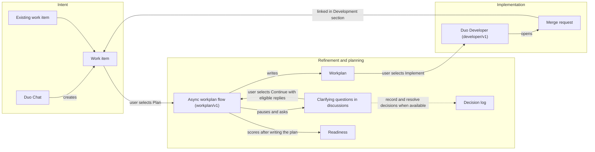

<!-- Design Documents often contain forward-looking statements -->
<!-- vale gitlab.FutureTense = NO -->



## 概要 {#summary}

Spec-Driven Development（SDD）は、意図を捉え、それに基づいてエージェントの作業を進めるためのものです。現在、作業の実行に必要な背景情報は、Issue、コメント、デザインファイル、コード、そして人々の頭の中に分散しています。構造化された入力なしにワークアイテムに取り組むエージェントは、なぜ、どのように、何を行うかという情報が不足しているため、一貫性のない結果を生み出します。

**SDD は、人が主導する作業と自律的な作業を支援します。** 私たちの取り組みは、Software Factory を支援すると同時に、より幅広い顧客ニーズに応えます。多くのお客様は、実行の過程で人が意思決定を導くなど、人による相当な関与を必要としています。Software Factory は自律性を重視しており、Workplan とそれを支える機能は、その方向性にも対応できます。

準備状況のレベルは、実行に向けた準備の程度を示します。将来的には、しきい値を設けて実行の可否を判断し、トークンコストの管理に役立てられる可能性があります。意思決定ログは、ワークアイテムから実行に至るまでの、人と AI の決定を記録するように設計されています。

この設計ドキュメント全体で、次の用語を使用します。

- **仕様**は、ワークアイテムの説明です。なぜ（動機）と何を（要件）を記載します。
- **Workplan** は、ワークアイテム上の独立したアーティファクトです。どのように（実装のアプローチ）を記載し、Duo Developer などの下流のエージェントが使用します。

私たちは、この機能のすべての部分を、エージェントと人の両方が使えるように構築します。SDD は、エージェントによって加速される、ドキュメント中心の開発方法です。

製品の背景情報については、[親エピック](https://gitlab.com/groups/gitlab-org/-/work_items/22445)、[SDD の Wiki](https://gitlab.com/groups/gitlab-org/plan-stage/sdd/-/wikis/_Home)（GitLab チームメンバーのみ）、[Workplan のユーザードキュメント](https://docs.gitlab.com/user/work_items/workplan/)を参照してください。

### 用語 {#terminology}

| 用語 | 意味 |
| ---- | ------- |
| 仕様 | ワークアイテムの説明（なぜ、何を）。 |
| Workplan | どのように行うかを記載する計画のアーティファクトです。1 語で表記します。 |
| Implementation ウィジェット | ワークアイテム上の親ウィジェットです。Workplan のステータス、準備状況のレベル、計画と実装のアクションを表示します。 |
| `AgentPlan` | Workplan の旧コード名です。GraphQL の型、データベース、バックエンドのクラスに今も残っています。バックエンドの名称統一は [Issue 630474](https://gitlab.com/gitlab-org/gitlab/-/work_items/630474)で追跡しています。 |
| 準備状況 | ワークアイテムがエージェントによる実行に向けてどの程度準備できているかを示します。UI には、低、中、高の準備状況レベルを表示します。その基となる 0 〜 100 の準備状況スコアは、UI には表示しません。ユーザーインターフェースでは、以前は信頼度と呼んでいました。名称変更は[マージリクエスト 259555](https://gitlab.com/gitlab-org/gitlab/-/merge_requests/259555)で実装されています。 |

## エンドツーエンドのフロー {#end-to-end-flow}

1. ユーザーは Duo Chat で意図を示すことから始めるか、既存のワークアイテムを開きます。
1. ユーザーがワークアイテムで **Plan** を選択します。これにより、ワークアイテムの AI 計画が有効になり、バックグラウンドで非同期 Workplan フローが始まります。フローの実行中、ユーザーはページを離れられます。
1. フローは、ワークアイテムを詳細化し、プロジェクトを調査します。エージェントが判断すべきではない決定が必要な場合、フローはワークアイテムのディスカッションに明確化のための質問を投稿し、ユーザーに通知して一時停止します。説明が少なすぎて調査できない場合は、代わりにユーザーに説明の追加を求めます。
1. ユーザーは質問に回答してそのスレッドを解決するか、背景情報のリクエストを受けて説明を更新した後、**Continue** を選択します。質問間の移動機能では、スレッドの解決状況を使って未解決の質問を追跡します。再開サービスには、プロジェクトで Guest より上のロールを持つユーザーの返信のみを含めます。再開にスレッドの解決は必要ありません。背景情報のリクエスト後に再開すると、元の目標で調査をやり直します。
1. フローは Workplan を作成し、準備状況のスコアリングが利用可能な場合は、同じフロー内で準備状況を算出します。明確化のための質問は未解決の決定として記録され、意思決定ログが利用可能な場合、ワークアイテムの UI でそのスレッドを解決すると、それらの決定も解決されます。[人の関与](human-in-the-loop.md#relationship-to-the-decision-log)を参照してください。
1. ユーザーは Workplan をレビューし、**Implement** を選択します。Duo Developer は Workplan を主要な仕様として使用し、マージリクエストを作成します。マージリクエストは、ワークアイテムの **Development** セクションにリンクされます。

## ワークストリーム {#workstreams}

作業は、[親エピック](https://gitlab.com/groups/gitlab-org/-/work_items/22445)の下でワークストリームに分かれています。時期と現在の状況については、そのエピックと各ワークストリームのエピックを参照してください。

| ワークストリーム | 対象範囲 | 設計 |
| ---------- | ----- | ------ |
| [WS-2：仕様からコードまでのユーザージャーニーの構築](https://gitlab.com/groups/gitlab-org/-/work_items/22703) | エンドツーエンドのユーザーエクスペリエンス。開始点、オプトイン式の AI 計画、仕様と Workplan の分離、承認手順の削減、実行状況の可視化。 | [Workplan](workplan.md) |
| [WS-3：Workplan の構築](https://gitlab.com/groups/gitlab-org/-/work_items/22702) | エージェントが駆動する非同期 Workplan 生成フロー。ライフサイクル、ツールの承認、単一フローの強制、同時実行、可観測性。 | [非同期 Workplan フロー](workplan-flow.md) |
| [WS-4：HITL と通知](https://gitlab.com/groups/gitlab-org/-/work_items/22772) | ワークアイテムのディスカッションでの明確化のための質問、その回答、通知、フローの再開。 | [人の関与](human-in-the-loop.md) |
| [WS-5：意思決定ログ](https://gitlab.com/groups/gitlab-org/-/work_items/21552) | 人とエージェントのための、ワークアイテムに関する決定の記録。 | [意思決定ログ](decision_log.md) |
| [WS-6：ワークアイテムの準備状況スコア](https://gitlab.com/groups/gitlab-org/-/work_items/23050) | ワークアイテムがエージェントによる実行に向けて準備できているかを示す準備状況のレベル。 | [準備状況](readiness.md) |
| [WS-7：テストとフィードバック](https://gitlab.com/groups/gitlab-org/-/work_items/22773) | QA、バグのトリアージと報告、ドッグフーディング。 | [テストとフィードバック](#testing-and-feedback) |

Duo Developer への引き渡しについては、[下流の利用者](downstream_consumers.md)で説明しています。

### テストとフィードバック {#testing-and-feedback}

[WS-7](https://gitlab.com/groups/gitlab-org/-/work_items/22773)は、[フィードバック用の Issue](https://gitlab.com/gitlab-org/gitlab/-/work_items/630531)を使い、ドッグフーディングでの発見を他のワークストリームの作業につなげます。現在のフォローアップには、実装の進捗の可視化、クローズされたワークアイテムでの動作、[利用状況の指標](https://gitlab.com/gitlab-org/gitlab/-/work_items/631308)が含まれます。

測定では、API を介した Workplan の読み取りと、保存済み Workplan の UI での表示を区別します。計画の保存は、バックエンドでの読み取りとして集計しなくなりました（[マージリクエスト 257324](https://gitlab.com/gitlab-org/gitlab/-/merge_requests/257324)）。また、保存済みの計画の表示は、別のイベントで追跡します（[マージリクエスト 258352](https://gitlab.com/gitlab-org/gitlab/-/merge_requests/258352)）。意思決定ログのパネル表示と決定の解決にも、専用のイベントがあります。[意思決定ログ](decision_log.md#observability)を参照してください。

### 先送りされた設計 {#deferred-designs}

これらの設計は、現在のエピックには含まれません。背景情報として残しています。

| 設計 | 状況 |
| ------ | ------ |
| [下流の利用者](downstream_consumers.md) | Duo Developer への引き渡しは対象範囲に含まれます。Duo Review による検証とマージチェックは先送りされています。 |
| [ワークアイテムとマージリクエストの関係](wi_mr_relationship.md) | 先送りされています。 |

## 制約 {#constraints}

- リアルタイムの共同チャットはありません。ワークアイテムのコメントやスレッドを通じて非同期にコラボレーションします。
- Workplan は Issue とタスクで利用できます。
- 1 つのワークアイテムで同時に実行できる Workplan フローは 1 つだけです。
- そもそも複雑度の低い Issue を見つけるために工数を見積もるバックログのリファインメントループは、対象範囲外です。

## 決定 {#decisions}

| 日付 | 決定 | 決定者 |
| ---- | -------- | --- |
| 2026-03-30 | 短期間使用するアーティファクトは、ワークアイテム上の計画です（独立したものではなく、すべてのワークアイテムタイプをサポートします）。 | ワークショップ |
| 2026-03-31 | 出力は、ワークアイテムテンプレートを使った **Markdown** です。 | @fredericcaplette |
| 2026-03-31 | 現在のフェーズでは、**承認ワークフローは対象範囲外**です。 | @izzychu, @shekharpatnaik |
| 2026-04-09 | ワークアイテム上の AI とのやり取りには、**同期 Duo Chat** を使用します。非同期 Workplan フローによって置き換えられました。 | @vanessaotto, @fredericcaplette |
| 2026-04-09 | 人が読みやすいように、**YAML より Markdown** を使用します。 | @fredericcaplette, @vanessaotto, @timzallmann |
| 2026-08-25 | 親ウィジェットの名称は **Implementation** です（[Issue 612831](https://gitlab.com/gitlab-org/gitlab/-/work_items/612831#note_3734387905)）。 | @nickbrandt |
| 2026-09-08 | 一時停止中の Workplan フローは、明示的なアクションで再開します。スレッドが解決されたときに自動では再開しません（[マージリクエスト 252945](https://gitlab.com/gitlab-org/gitlab/-/merge_requests/252945)）。 | @stefanosxan |
| 2026-09-09 | Implementation ウィジェットは、ユーザーがワークアイテムの AI 計画を有効にした後にのみ表示されます（[Issue 605174](https://gitlab.com/gitlab-org/gitlab/-/work_items/605174)）。 | WS-2 |
| 2026-09-09 | 意思決定ログは、Workplan と AI 計画から独立しています（[Issue 624791](https://gitlab.com/gitlab-org/gitlab/-/work_items/624791)）。 | WS-5 |
| 2026-09-15 | 意思決定ログは Free ティアで提供できますが、優先事項ではありません（[Issue 628417](https://gitlab.com/gitlab-org/gitlab/-/work_items/628417)）。 | @gweaver, @nickbrandt |
| 2026-09-22 | 計画の名称は **Workplan** で、1 語で表記します（[Issue 612831](https://gitlab.com/gitlab-org/gitlab/-/work_items/612831#note_3886070970)）。 | @nickbrandt, @brendan777 |
| 2026-09-23 | **Implement** アクションは、Duo Chat を開く代わりに、Duo Developer を非同期に実行します（[Issue 628801](https://gitlab.com/gitlab-org/gitlab/-/work_items/628801)）。 | WS-7 |

## リンク {#links}

- [親エピック](https://gitlab.com/groups/gitlab-org/-/work_items/22445)
- [以前の親エピック](https://gitlab.com/groups/gitlab-org/-/work_items/21218)
- [SDD の Wiki](https://gitlab.com/groups/gitlab-org/plan-stage/sdd/-/wikis/_Home)（GitLab チームメンバーのみ）
- [SDD のフィーチャーフラグの概要](https://gitlab.com/groups/gitlab-org/plan-stage/sdd/-/wikis/Feature-Flags)：セットアップと展開の詳細（GitLab チームメンバーのみ）。
- [Workplan のユーザードキュメント](https://docs.gitlab.com/user/work_items/workplan/)
- [プロトタイプ](https://plan-sdd-bdc021.gitlab.io/)
- [最新のウォークスルー](https://gitlab.com/groups/gitlab-org/-/work_items/22703#note_3754968901)
- [非同期のリファインメントと Workplan 生成のフィードバック用 Issue](https://gitlab.com/gitlab-org/gitlab/-/work_items/630531)
- [AI パネルのアーキテクチャ](../ai_panel/_index.md)
- [Duo Agent Platform のメモリ設計提案](https://gitlab.com/gitlab-com/content-sites/handbook/-/merge_requests/20409)。メモリと背景情報の投入は、SDD ではなくこちらで設計します。
- [ワークショップのメモ](https://docs.google.com/document/d/1zFs7ziXNBrY7rYvXhhWZvyavWT-j_DAqNwmxbMMTa4o/edit?tab=t.0)
