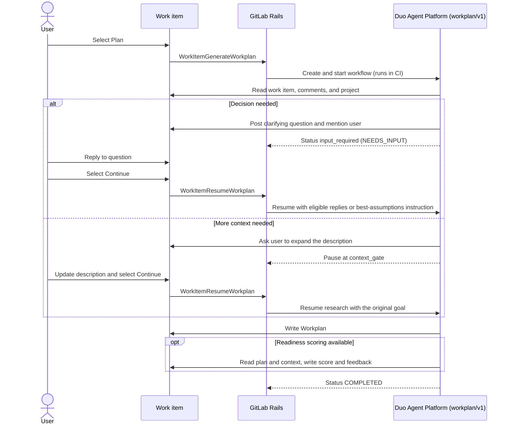

SDD の詳細は、[Spec-Driven Development](_index.md)を参照してください。

**成熟度：定義中**

## 概要 {#summary}

非同期 Workplan フローは、Duo Chat を使わずに、バックグラウンドでワークアイテムを詳細化し、その [Workplan](workplan.md)を生成します。これは、計画を繰り返し改善するための Duo Chat とライブプレビューの UI である、対話型ビルダーの以前の計画に代わるものです。1 人のユーザーがチャットセッションで 1 つの計画を作り込む代わりに、ユーザーは複数のフローを並列に開始し、ページを離れ、フローが入力を必要とするときに戻れます。コラボレーションは、ワークアイテムのディスカッションで行います。[人の関与](human-in-the-loop.md)を参照してください。

エピック：[WS-3：Workplan の構築](https://gitlab.com/groups/gitlab-org/-/work_items/22702)。最初の[作業計画のリファインメントループ](https://gitlab.com/gitlab-org/gitlab/-/work_items/605157)は完了しています。フォローアップは、ワークストリームで継続しています。

## 要件 {#requirements}

1. **エージェントは自ら提案します。** 質問が生じても、フローは最初の不明点で止まりません。質問を一覧にし、それぞれに選択肢を示し、推奨する回答を述べます。これにより、エージェントの推奨を信頼するユーザーと、引き渡す前にレビューして繰り返し改善したいユーザーの両方に対応します。
1. **通知は必須です。** フローが入力を必要とするときは、ユーザーに通知する必要があります。
1. **調査は先に行います。** Workplan には可能な限り多くの調査結果を含め、低コストのモデルが実装でき、人が正確にレビューできるようにします。
1. **並列作業を考慮します。** 別々のサブエージェントが担当すべきタスクがある場合は、Workplan に明記します。

## フロー {#flow}

1. ユーザーが **Plan** を選択します。フロントエンドは、`WorkItemGenerateWorkplan` ミューテーションを呼び出します。
1. `Ai::DuoWorkflows::GenerateWorkplanService` が、ワークアイテムのプロジェクトに対して `workplan/v1` の基盤フローを開始します。フローは、Duo Agent Platform を通じて CI で実行します。目標には、対象のワークアイテムのみを指定します。AI Gateway にあるフローのシステムプロンプトで、計画の形式、曖昧さへの対応、質問するタイミングを定義します。
1. 調査では、GitLab API ツールを通じて要件、コメント、リポジトリの背景情報を収集し、その結果を計画担当に渡します。どちらの段階でも、明確化のための質問を投稿してユーザーにメンションし、`input_required` 状態で一時停止できます。
1. 明確化のための質問には、ユーザーが返信して **Continue** を選択します。フロントエンドは `WorkItemResumeWorkplan` を呼び出し、プロジェクトで Guest より上のロールを持つユーザーからの有効な返信を転送します。質問として含めるのは、質問のペイロードを持つフローノートのみです。進捗ノートや背景情報のリクエストは除外します。再開にスレッドの解決は必要なく、未回答の質問が再開を妨げることもありません。有効な返信がない場合、フローには、最も妥当と考えられる仮定に基づいて続行するよう指示します。
1. 説明に調査に十分な背景情報がない場合、どちらの段階でも `context_gate` に進みます。ユーザーは説明を追加し、**Continue** を選択します。再開サービスは元の目標を送信するため、調査は、返信がないことを推測の許可と見なすのではなく、更新されたワークアイテムを読み取ります。これは、[マージリクエスト 257208](https://gitlab.com/gitlab-org/gitlab/-/merge_requests/257208)で実装されています。
1. 計画担当は Workplan を書き込み、完了のコメントを投稿します。準備状況のスコアリングが利用可能な場合、同じフローが[スコアリング段階](readiness.md#computation)に進み、スコアとフィードバックを書き込みます。

ウィジェットは、`generationStatus` を通じて進捗を表示します。値は、`NOT_STARTED`、`GENERATING`、`NEEDS_INPUT`、`COMPLETED`、`CANCELED`、`FAILED` のいずれかです。キャンセルは失敗と区別します（[マージリクエスト 258021](https://gitlab.com/gitlab-org/gitlab/-/merge_requests/258021)）。実行を開始または再開すると、そのセッションを Duo ドロワーで開きます。

## ライフサイクルと安全性 {#lifecycle-and-safety}

- **ワークアイテムごとに単一のフロー**：1 つのワークアイテムには、終了状態にない Workplan フローを 1 つだけ保持できます。排他的なリースにより、2 つの同時リクエストが両方ともフローを開始することを防ぎます。
- **ワークアイテム間でのフローの同時実行**：異なるワークアイテムのフローは同時に実行できるため、ユーザーは複数のワークアイテムを並列に詳細化できます。
- **権限**：ワークアイテムのミューテーションは `update_work_item` を確認しますが、CI フローの開始には、加えて `create_duo_workflow_for_ci`（現在は Developer 以上）が必要です。再開時には、ワークアイテムの更新権限とプロジェクトでのリモートフローの利用可否を確認し、元のフロー所有者の ID を維持します。これらの境界は、まだ整合していません。ロールポリシーは、[Issue 634208](https://gitlab.com/gitlab-org/gitlab/-/work_items/634208)で追跡しています。
- **回答の資格**：再開サービスは、Guest 以下のロールからの返信を除外し、スレッドの解決状況にかかわらず有効な返信を収集します。これは、スレッドの解決状況を使う質問カウンターとは異なります。Guest による回答について両者を整合させる作業は、[Issue 631546](https://gitlab.com/gitlab-org/gitlab/-/work_items/631546)で追跡しています。
- **プロジェクトのワークアイテムのみ**：フローは CI で実行するため、グループレベルのワークアイテムには対応していません。
- **ツールの承認**：フローが使用するツールは事前に承認する必要があるため、フローはツールの承認のために停止しません。承認するツールを限定するために、専用の Workplan ツールが必要になる可能性があります。
- **人の入力を求めるゲート**：調査、計画、背景情報の各ゲートでは、外部でのやり取りを使います。ユーザーがワークアイテムで操作し、明示的に再開します。これらは、セッションドロワーでのツール呼び出しの承認や却下を求めるリクエストではありません。
- **可観測性**：フローには LangSmith による計測を組み込んでいます。追跡イベントは、[Issue 631134](https://gitlab.com/gitlab-org/gitlab/-/work_items/631134)で追跡しています。生成の実行には、独自のワークフローソースタイプである `work_item_workplan`（GraphQL では `WORK_ITEM_WORKPLAN`）を使います。これはフロートリガーや、`work_item_plan_to_merge_request` で追跡する **Implement** への引き渡しとは別です（[マージリクエスト 263691](https://gitlab.com/gitlab-org/gitlab/-/merge_requests/263691)）。

## 未完了の作業 {#open-work}

- [Workplan の調査を、計画担当が委任するサブエージェントにする](https://gitlab.com/gitlab-org/gitlab/-/work_items/621869)
- [起動時に未解決の質問をフローに渡す](https://gitlab.com/gitlab-org/gitlab/-/work_items/628043)
- [起動したユーザーを目標に含める](https://gitlab.com/gitlab-org/gitlab/-/work_items/628042)
- [Duo Chat で作成したワークアイテムに対して計画を自動的に開始する](https://gitlab.com/gitlab-org/gitlab/-/work_items/630062)
- [フローのコメントを解決可能なディスカッションとして投稿する](https://gitlab.com/gitlab-org/gitlab/-/work_items/633575)。ワークアイテムの UI は、最初の返信前にディスカッションを解決する機能にすでに対応しています（[マージリクエスト 259967](https://gitlab.com/gitlab-org/gitlab/-/merge_requests/259967)、[マージリクエスト 263718](https://gitlab.com/gitlab-org/gitlab/-/merge_requests/263718)）。

## 決定 {#decisions}

| 日付 | 決定 | 決定者 |
| ---- | -------- | --- |
| 2026-09-08 | 一時停止中のフローは、明示的な **Continue** アクションと `WorkItemResumeWorkplan` ミューテーションで再開します。スレッドが解決されたときに自動では再開しません（[マージリクエスト 252945](https://gitlab.com/gitlab-org/gitlab/-/merge_requests/252945)）。 | @stefanosxan |
