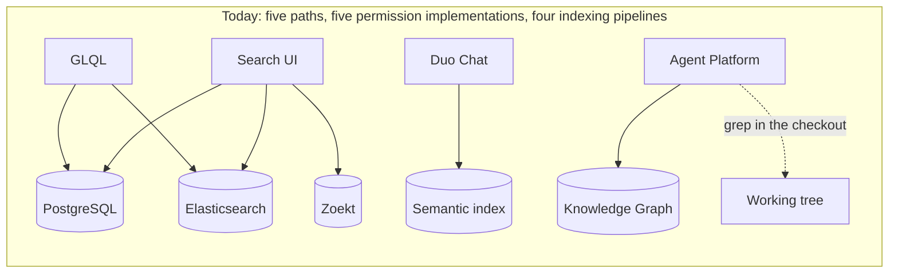
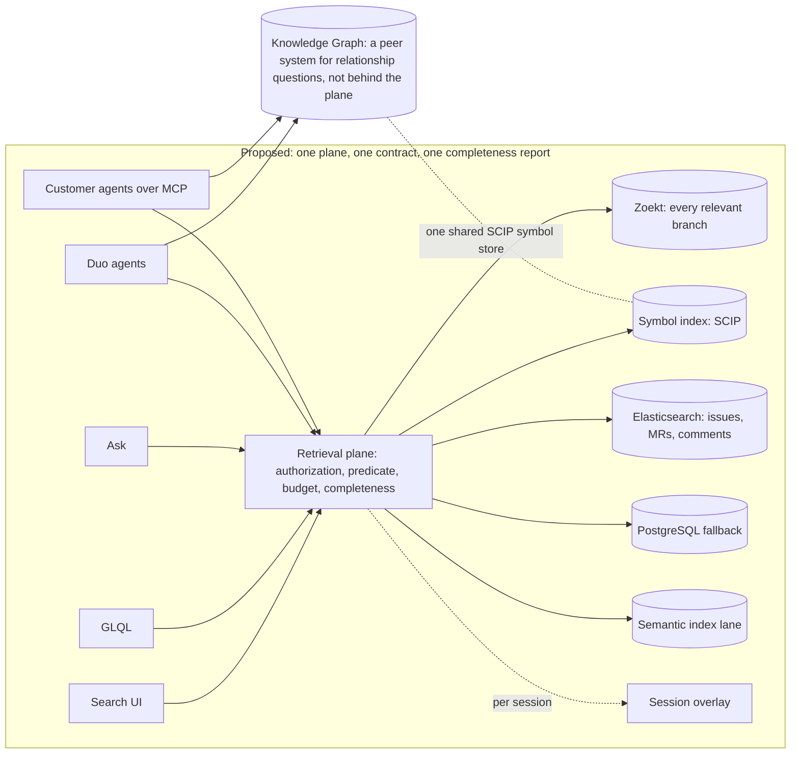

<!-- Design Documents often contain forward-looking statements -->
<!-- vale gitlab.FutureTense = NO -->

<!-- This renders the design document header on the detail page, so don't remove it-->



このページには、今後の製品、機能、および機能性に関する情報が含まれます。ここで示す情報は、情報提供のみを目的としている点に注意してください。購入や計画の目的で、この情報に依拠しないでください。製品、機能、または機能性の開発、リリース、およびその時期は変更または延期される可能性があり、GitLab Inc. の単独の裁量に委ねられます。目標として示すレイテンシーと鮮度の数値はエンジニアリング上の目標であり、契約上のサービスレベル合意ではありません。

エンジニアリングの詳細は [Telescope：技術設計](/handbook/engineering/architecture/design-documents/telescope/technical-design/)にあります。この提案の根拠となる GitLab.com の利用状況、コスト、テレメトリーの数値は、[SAFE フレームワーク](/handbook/legal/safe-framework/)に基づく社内情報であり、[社内エビデンスページ（社内限定）](https://internal.gitlab.com/handbook/engineering/architecture/design-documents/telescope/)に掲載しています。


## 概要 {#summary}

**GitLab 自身のコーディングエージェントは標準で grep を使い、コード検索を利用していません。** Duo エージェントのセッションは、私たちのどちらのコードインデックスにも見えないブランチで作業するため、チェックアウトを総当たりで検索します。会社の検索を使ったことがない新入社員のように動作します。設定を 1 つ変更するよう求められると、正しい行を見つけるまで次々にフォルダーを開き、ファイルを読み、読んだすべてのページが従量課金の対象になります。コードをモデルのコンテキストに読み込む処理が、エージェントのタスクで消費するトークンの大半を占め、その読み込みの多くは、後から無関係だと判明するファイルに費やされます。ごく簡単な変更でも多数のモデル呼び出しが必要で、タスクの規模によって呼び出し回数はほとんど変わりません。つまり、その多くはファイルの特定、読み込み、再読み込みという固定のオーバーヘッドです（現場から報告された例は [gitlab-org/gitlab#607004](https://gitlab.com/gitlab-org/gitlab/-/work_items/607004)です）。これらのトークンは 1 つずつ従量計測され、ラウンドごとに顧客が体感する遅延が増え、検索が見落としても、それに気づく人間は処理の輪にいません。完了しないセッションには、結論に至らず読み込み続ける、長くツール呼び出しの多いセッションが偏って多く見られます。

**私たちが提案するのは、別のエンジンではなく、エンジンの上に位置する層の構築です。** これを検索取得プレーン Telescope と呼びます。あらゆる呼び出し元（検索バー、GLQL、平易な英語の質問、エージェントのツール呼び出し）が共通して使う 1 つの[リクエスト契約](/handbook/engineering/architecture/design-documents/telescope/technical-design/#the-request-contract)、結果のページに適用せずエンジン内に押し込む 1 つの権限チェック、何を検索し何を検索しなかったかを正確に示す、すべての応答に付く 1 つの完全性レポート、そして同じフィードからすべてのインデックスを最新に保つ 1 つの変更ログを提供します。その下では、既存の仕組みを改善します。重要なブランチをすべてインデックス化し、エージェントの未コミットの作業を約 1 秒で重ね合わせます。フォークごとではなく、一意のファイルごとに 1 回だけ保存します。シンボルインデックスを追加して、「これはどこで定義されているか」「誰が呼び出しているか」をミリ秒単位で検索できるようにし、ファイルや差分のすべての識別子をリンクにします。エージェントが 1 往復で、トークン予算に収まる回答を求められるようにします。目標は 30 ラウンドを数ラウンドに減らすことです。具体的には、エージェントが 1 回質問すると、1 時間前に自身のブランチで書いた関数を含む、重要な 4 つの関数を得られます。セキュリティエンジニアは、15,212 プロジェクト中 15,212 プロジェクトのどこにも漏洩したキーがないことを示し、何を検索したかを正確に記録した署名付きの記録を保存します。入社 1 週目のエンジニアは、課金の再試行の仕組みを質問し、8 つの出典を含む 3 段落の回答を得て、その最新の出典は先週のマージリクエストになります。

**GitLab には、そのすべてを構築できる立場があり、他では見たことのない要素も 1 つ含まれます。** [比較表](#positioning-against-peers)の各競合製品は、これらの機能の一部を備えています。GitLab は、コード、作業アイテム、パイプライン、脆弱性、信頼できる唯一の情報源である権限モデル、エージェントを 1 つのシステムに保持しているため、そのすべてを備えられる立場にあります。サードパーティーツールは通常、コードホストの権限のコピーを同期します。同期されたコピーは信頼できる情報源より遅れる可能性があり、エンタープライズ顧客はその遅れについて私たちに問い合わせています。私たちは、同期されたコピーではなく GitLab 自身の権限データに対して認可を評価し、フィルターに還元できるすべてのルールを、返された結果ページではなくエンジン内で適用します。ルールをフィルターに還元できる場合の件数は正確であり、インデックスが保持できないリクエストのコンテキストをルールが必要とする場合は概数として報告します。そのため完全性レポートは、権限をどう評価したかを示し、セキュリティエンジニアが保存できる署名付きカバレッジ記録になります。2026 年 9 月時点で、これを提供する他のコードホストを私たちは把握していません。結果がゼロであることに意味があるのは、エンジンが何を検索したかを示せる場合だけであり、この記録こそ、この計画の中で GitLab が追いつく側ではなく先頭に立つ部分です。セキュリティ部門のリーダーから、その提供を求められています。

**ほかに変わること。** マージリクエスト内での検索取得により、検索バーを一度も開かない開発者も検索を使い始めます。4 つあったものが、1 つのインデックス化パイプライン、1 つの公開される遅延値、1 つのオンコール用ページャーになります。Elasticsearch は得意とするテキストだけに縮小されます。そして初めて、検索のレイテンシー目標を公開します。組織のコード全体で p95 を 500 ms 以下とし、エラーバジェットを設けます。これはエンジニアリング上の目標であり、契約上のサービスレベル合意ではありません。

**投資に見合う理由。** エージェントのタスクで消費するトークンの多くはコンテキストへのコード読み込みに費やされるため、検索取得の改善は、すべてのエージェントタスクのトークン消費を減らし、その効果は従量課金の使用量として顧客に直接見えます。[Google](https://research.google/pubs/pub43835/)、[GitHub](https://github.blog/engineering/architecture-optimization/the-technology-behind-githubs-new-code-search/)、[Meta](https://glean.software/)は、それぞれ独自のコード検索システムを構築し運用しています。もう一方は、[代替ソリューション](#alternative-solutions)の最初に挙げる既定の道筋です。grep のループごとにトークンを費やし続け、顧客のコード上の検索取得層を誰かほかの人に任せることになります。

### 競合製品との位置づけ {#positioning-against-peers}

2026 年 9 月時点で、各製品の公開ドキュメントに記載された機能です。これは文書化された機能の分析であり、ベンチマークでも、製品の品質を論じるものでもありません。公開された出典に基づく訂正は、マージリクエストで歓迎します。

| 機能 | GitHub | Sourcegraph | Cursor および類似の IDE エージェント | 現在の GitLab | この計画実施後の GitLab |
| --- | --- | --- | --- | --- | --- |
| 組織全体の完全一致検索 | 対応。結果は 100 件が上限で、網羅的な検索は非対応、スキップしたファイルの報告なし | 対応。網羅モードを文書化済み | 非対応（開いているワークスペースのみ） | 限定提供。GitLab.com ではグループスコープのみ。デフォルトブランチ。上限の報告なし | 対応。関連するすべてのブランチ。完全、または正直に部分的と明示。証明付き |
| リポジトリを横断する定義と参照 | 部分対応（シンボル定義のみで参照は非対応） | 対応。正確。MCP 経由 | 開いているワークスペース内 | 部分対応（Knowledge Graph：プロジェクト横断の定義とインポート単位の参照。デフォルトブランチのみ） | 対応。正確。MCP 経由および UI 内 |
| 未コミットの作業を認識 | 非対応（デフォルトブランチのみ） | 記載なし | 対応（ローカルワークスペースをインデックス化） | 非対応 | 対応（サーバー側のセッションオーバーレイ） |
| フォークとベンダーコピーの重複排除 | 対応（コンテンツアドレス型インデックス） | 記載なし | 該当なし | 非対応 | 対応。実測した重複率を判断条件とする |
| テキスト一致を超えるランキング | 対応（スコア順に結果を並べる。手法の記載なし） | 対応（BM25F） | 対応（埋め込みベース） | 非対応 | 対応（参照ランクと既製のリランカー。ランキングモデルの学習は対象外。「非目標」を参照） |
| 検索取得パラメーターとしてのトークン予算 | 記載なし | 記載なし | 記載なし | 非対応 | 対応。契約に含む |
| インデックス内での権限評価 | 呼び出し元のリポジトリ集合でクエリを書き換え、クエリ後にも権限をチェック | コードホストから権限を同期 | 該当なし（ローカルファイル） | クエリ内のフィルターと、ページ単位の非表示処理のチェック | ネイティブ。フィルターに還元できるすべてのルールをエンジンに押し込み、評価方法を応答で報告 |
| 取得コンテンツの来歴 | 記載なし | 記載なし | 記載なし | 非対応 | 対応 |
| コード、Issue、MR、脆弱性を 1 つのネイティブな権限チェックで検索可能 | 部分対応（検索タイプは別々） | コード、コミット、差分 | 該当なし | 対応。ただしまとめて検索できない | 対応 |

各セルの根拠となる公開ドキュメントは、[出典](#sources)に列挙しています。

最も重要なのは最後の行です。各競合製品は、これらの機能の一部を備えています。GitLab は、コード、Issue とマージリクエスト、信頼できる唯一の情報源である権限モデル、エージェントを 1 つのシステムに保持しているため、そのすべてを備えられる立場にあります。

## 動機 {#motivation}

### 問題 {#the-problem}

どの改善計画も測定から始まりますが、現在、私たちは検索をエンドツーエンドで測定していません。関連性がどの程度あるか、呼び出し元から見てどの程度速いか、誰がどれほどの頻度で利用しているか、いずれも測定していません。検索には公開された SLO も SLA もありません。

**検索はインフラになりました。** 10 年間、それは少数の開発者が週に数回開く検索バーでした。エージェント時代には、回答の不完全さを判別できない機械によって、すべてのエージェントセッションで何十回も呼び出されます。2026 年 9 月時点で、GitLab.com の検索の大多数は人が検索バーに入力するのではなく API 経由で届き、過去 2 年間の API 検索トラフィックは検索バーの何倍もの速さで増加しました。したがって検索取得層は、エージェントの各タスクが費やすトークン数と、各回答をどこまで信頼できるかを左右します。GitLab では、小規模な 1 つのチームが、それを 5 つの部分に分けて所有しています。情報を見つける方法が 5 つあり、それぞれ独自の権限ロジックを持ち、4 つのインデックス化パイプライン、4 つの非公開の遅延値、4 つのページャーがある一方、エンドツーエンドのレイテンシー目標は一切ありません。どちらのコードインデックスもデフォルトブランチしか認識しません。エージェントがどのブランチで作業したかを記録するシステムがないため、インデックスがそれを認識できない頻度すら数えられません。数万のリポジトリを持つ大企業のセキュリティエンジニアが得るのは、約 5,000 件で打ち切られる一覧であり、一致したリポジトリ数も、何をスキップしたかという通知も、見つけた内容を保存する方法もありません（[gitlab-org/gitlab#624419](https://gitlab.com/gitlab-org/gitlab/-/work_items/624419)）。そのエンジニアは、記録を残せるという理由で、全リポジトリをクローンして grep します。

### 現在対応できていない 6 つの利用体験 {#six-journeys-we-do-not-serve-today}

それぞれの利用体験は、公開 Issue、ユーザーインタビュー、本番トレースを組み合わせたものです。ペルソナは架空です。どれも、その人物は誰か、現在何が起こるか、私たちは何を提案するか、良い成果はどのようなものか、という同じ構成にしています。

#### 利用体験 1：保存できる結果を必要とするセキュリティエンジニア {#journey-1-the-security-engineer-who-needs-a-result-they-can-keep}

**人物。** Priya は、1 つのグループに数万のリポジトリを持つ大企業でアプリケーションセキュリティを担当しています。公開 Issue [gitlab-org/gitlab#624419](https://gitlab.com/gitlab-org/gitlab/-/work_items/624419)で説明されたような環境です。

**現在。** 一般的なライブラリの脆弱性が公開されます。Priya は、そのすべての使用箇所を検索します。得られるのは約 5,000 件で打ち切られる一覧で、一致件数は分かりません。1 メガバイトを超えるファイルをスキップしたことも、ファイル数が多すぎるため 3 プロジェクトをスキップしたことも、パターンの構文エラーでも本当に一致しない場合と同じ空画面になることも伝えられません。見つけた内容をエクスポートできないため、すべてのリポジトリをクローンして grep を実行します。それなら記録を残せるからです。

**提案。** すべての応答に付く**完全性レポート**。一致件数、返した件数、インデックスが何をなぜスキップしたか、エンジンが劣化していたか、インデックスがどの程度古いかを示す小さなブロックです。**網羅モード**は、すべての一致をストリーミングし、インデックスがスキップしたものについては、キューに入れたバックグラウンドジョブで生ファイルをスキャンして、カバレッジを明示的に報告します。**カバレッジ記録**は、何を、どのスコープで、どの時点のインデックスマニフェスト（全プロジェクトのインデックス済みコミットの一覧をダイジェストとして持つもの）に対して検索し、何をスキップしたかを記述した、改ざんを検知できる記録であり、Priya が自身の文書とともに保存できます。（改ざんを検知できるとは、記録にインスタンスの署名があるため、後で変更されれば検知できるという意味です。）権限上安全なエクスポートも提供します。

**理想の成果。** Priya はパターンを入力し、1 秒未満で、15,212 プロジェクト中 15,212 プロジェクトに 12,431 件の一致があり、インデックスがスキップした 254 ファイルを現在スキャン中で、40 秒でスキャンが完了することを確認します。結果をカバレッジ記録とともにエクスポートします。

**最も難しいのはゼロという結果です。** Priya の検索の半分は、何もないことを探しています。廃止された暗号や漏洩したキーがどこにもないことを証明するのです。どのエンジンも結果ゼロを返せますが、それを保証できるのは自分のカバレッジを把握するエンジンだけです。「一致なし、15,212 プロジェクト中 15,212 プロジェクト、スキップしたファイル 0 件、インデックスマニフェスト 9f2c 時点」は、ある時点のインデックスのカバレッジについての表明です。（単一のコミットで 15,212 リポジトリを記述することはできません。9f2c はマニフェストのダイジェストであり、完全な一覧は要求に応じて生成できます。）2026 年 9 月時点で、同等の記録を提供する他のコードホストを私たちは把握していません。


**カバレッジ記録が表すことと、表さないこと。** ある時点のインデックスのスコープとカバレッジを記述します。監査証明でも、検索スコープ外のコンテンツに関する表明でもなく、規制や監査の基準を満たしたと表明するものでもありません。自身のフレームワークが要求する証拠は、顧客が自身の監査人と判断します。


#### 利用体験 2：自分が書いているコードを認識できないコーディングエージェント {#journey-2-the-coding-agent-that-cannot-see-the-code-it-is-writing}

**人物。** サンドボックス（エージェントのチェックアウトが置かれる、GitLab が管理する隔離環境）内の機能ブランチで Issue に取り組む Duo エージェントです。毎日多数が動作し、その数は急増しています。

**現在。** どちらのコードインデックスもデフォルトブランチしか認識しません。エージェントは `feature/payment-retry` を編集していますが、どの検索も `main` に基づいて回答されます。インデックスが把握する限り、エージェントやそのチームメンバーが今週書いた関数は存在しません。そこでチェックアウトに対して grep を繰り返し、タスクごとに何十ラウンド、数百万トークンを使います。その多くは、後から無関係だと判明するファイルの読み込みに費やされます。処理の輪に人間がいないため、不完全な検索は見過ごされます。


**分かりやすく言うと。** インデックスは、デフォルトブランチから印刷したカード目録です。今週ブランチに書かれたものは目録にありません。重要なブランチをインデックス化すると、そのページが追加されます。セッションオーバーレイは、その上に貼る、直近 1 時間で変更したページを列挙した付箋です。トークン予算は、机まで何ページ持ち帰れるかを司書に伝えることです。司書はその範囲に収まる最も関連性の高いページを持ってきて、棚に残したページ数を伝えます。


**提案。** 2 つの層です。まず、**重要なブランチをインデックス化**します。デフォルト、保護、リリースパターン、オープンな MR のソースブランチを、Zoekt のブランチマスクを使って、ブランチ間で同一のファイルは 1 回だけ保存します。（ブランチマスクは、保存する各ファイルバージョンに付ける、それを含むブランチを示す小さなタグです。仕組みは技術設計の[対象ブランチ](/handbook/engineering/architecture/design-documents/telescope/technical-design/#which-branches)で説明します。）次に、**セッションオーバーレイ**です。エージェントの作業ツリーと最も近いインデックス済み ref との差分ファイルだけの小さなインデックスを約 1 秒で構築し、メインインデックスと一緒に検索します。完全性レポートには「あなたの未コミットの変更 37 件を含む」と表示します。作業ツリーの所在によってオーバーレイの作り方が決まります。3 つのトポロジーと、サンドボックスの場合から着手する理由は、[セッションオーバーレイ](/handbook/engineering/architecture/design-documents/telescope/technical-design/#session-overlay)を参照してください。どちらの層もプレーンのリクエスト契約を通して検索します。この契約は、件数と時間の予算とともに、呼び出し元が設定する**トークン予算**を運びます。プレーンは一致を順位づけし、回答を予算内に詰め込み、収まらなかったものを報告します。

**予算をリクエストと一緒に渡す理由。** 残りのコンテキスト量と、1 回の検索にそのどれだけを使う価値があるかを知るのはエージェントだけであり、プレーンには分かりません。そのため予算は呼び出しのフィールドであり、呼び出し元が設定します。質問自体の一部でも、サービス側のデフォルト値でもありません。これがなければ、正しいブランチのインデックス化で解決するのは問題の半分だけです。エージェントは今週のコードを見つけられるようになっても、依然としてファイル全体を返され、それを読むためにコンテキストを費やします。予算があれば、エージェントに何かが届く前に、インデックスで絞り込みます（利用体験 4 ではこれをコンテキストパッキングと呼びます）。この数値は呼び出しごとの調整値であり、見つけられる内容の上限ではありません。エージェントが 6,000 トークンを指定しても、正直な回答にそれ以上が必要なら、プレーンは収まる範囲で上位の結果を返し、「一致する関数 9 件中 4 件を表示」と報告します。エージェントは予算を広げるか、ページを進めるか、より絞った質問をします。現在、不完全な検索は無言で起こります。予算とカバレッジレポートがあれば、明示的で機械可読になります。

**理想の成果。** エージェントは、回答の予算を 6,000 トークンとして「決済の再試行ポリシーはどこで適用されるか」と 1 回質問し、1 時間前にこのブランチで書いたものを含む、重要な 4 つの関数を、順位とカバレッジ報告付きで取得します。収まらなかったものは名前が示されるため、推測する代わりに追加を求めます。30 ラウンドが数ラウンドになります。

**他の事例。** IDE ベースのツールは開発者のワークスペースのコンテンツハッシュツリーを計算し、変更されたファイルだけを再インデックス化します。組織のコーパス全体を対象にした、サーバー側でセッションごとに権限を認識する同等の仕組みを、私たちは把握していません。

#### 利用体験 3：正確な文字列、1 つの定義、その呼び出し元を必要とする開発者 {#journey-3-the-developer-who-needs-the-exact-string-one-definition-and-its-callers}

**人物。** 2,000 プロジェクトにまたがる大規模な Ruby と Go のコードベースを担当するシニアエンジニア、Marco です。また、その 3 時間後、同僚のマージリクエストをレビューする Marco でもあります。

**現在。** Marco は `PaymentProcessor` がどこで定義され、どのファイルが呼び出しているか知りたいと考えています。得られる答えは、応答するエンジン次第です。長年、全文検索エンジンはリテラル文字列ではなく、散在する単語に一致していました（[gitlab-org/gitlab#325234](https://gitlab.com/gitlab-org/gitlab/-/issues/325234)、2021 年から Zoekt に置き換えられるまでオープン）。200 のリポジトリが同じライブラリをベンダリングし、それぞれがコピーを持つため、同じファイルが 200 回表示されます。リポジトリ横断のコンパイラー精度の参照検索はなく、MR のレビュー中に「この MR が変更した 3 つの関数を、ほかに何が呼び出しているか」と質問できません。諦めて、エディターのアシスタントにチェックアウトを grep するよう依頼します。

**提案。** **検索演算子としてのシンボル検索**。`definition:`、`references:`、`implements:` に、SCIP から構築したシンボルインデックスがミリ秒単位で応答し、他の検索と同じ完全性レポートを付けます。**静的ランキング**では、ほかから多く参照されるファイルやシンボルを上位にします。（クエリごとではなく、コード構造から事前にスコアを計算するため「静的」です。）**重複排除**では、一意のファイルごとに 1 コピーとし、「アクセス可能な他の N リポジトリにも存在」という表示を、N 件の結果の代わりに提供します。最初の 90 日間に測定する重複率を判断条件とします。**作業の中での検索**では、すべてのマージリクエストで、MR が変更したシンボルを対象とする `references:` 検索を提供し、すべての脆弱性で「このパターンはほかのどこに現れるか」を提供します。


**分かりやすく言うと：テキスト検索とシンボル検索の違い。** テキストから `PaymentProcessor` を検索すると、それらの文字が現れるすべてのファイルが見つかります。クラス、その呼び出し元、それに触れたコメント、ログメッセージ、無関係な `LegacyPaymentProcessor` も含みます。シンボルインデックスは言語を理解するツールで構築するため、`PaymentProcessor` は 1 か所で定義され、他の 3 か所で直接参照されるクラスだと分かり、似た名前と区別できます。それを返すのが `definition:` と `references:` です。どこにあるか、誰が直接使うかという 1 ホップの問いに答えます。


**すべての識別子がリンクになります。** 同じシンボルインデックスにより、ファイルビューと差分にも機能が加わります。ホバーでシグネチャを表示し、クリックで定義に移動し、もう一度クリックで呼び出し元を表示します。[Google が公開した社内コード検索の事例研究](https://research.google/pubs/pub43835/)では、エンジニアの大半が、主にコードをたどり理解するために毎日利用していると分かりました。習慣になったのは、ランキングが巧みだからではなく、即座に動き、すべての名前がリンクになっているからです。MCP を通して同じ検索をエディターに届けるため、アシスタントはミリ秒単位で検索できる答えを grep で探す必要がなくなります。

**他の事例。** GitHub のコード検索は、[すべてのシャードからスコア上位 100 件の結果を返します](https://github.blog/engineering/architecture-optimization/the-technology-behind-githubs-new-code-search/)。つまり、すべてのコードが 1 つのインデックスに入ると、ユーザーの目に触れるものはランキングが決めます。オープンソースの Aider プロジェクトは、[コードベースの他の部分から参照される頻度でシンボルを順位づけする](https://aider.chat/2023/10/22/repomap.html)ことで、AI が固定予算内で適切なコンテキストを選べると示しました。

#### 利用体験 4：コードベースに質問したい、入社 1 週目のエンジニア {#journey-4-the-engineer-in-their-first-week-who-wants-to-ask-the-codebase-a-question}

**人物。** Wei は 3 日前に入社しました。経験豊富な同僚なら 2 分で答えられる質問を持っています。「ここの課金の再試行はどう動き、最近何が変わったのか」。

**現在。** 検索はファイルの一覧を返します。Duo Chat は 1 リポジトリを意味的に検索できますが、組織全体は検索できず、検索バーよりスコープの狭い別の経路で検索取得します。Wei は Slack で質問し、待ちます。

**提案。** *Ask*。Wei が閲覧可能なすべての範囲のコード、マージリクエスト、Issue を出典として、平易な英語の質問に答えます。検索バーやエージェントと同じ検索取得経路と権限チェックを使い、各文が結果を引用します。その下にあるのが、**コンテキストパッキング**です。プレーンは上位 10 ファイルではなく、質問に答える最小の関数集合を、モデルのトークン予算に合わせて切り出し、その関数が呼ぶヘルパーのシグネチャとともに返すため、読者はそれらをたどれます。（シグネチャは、関数の名前、パラメーター、戻り値の型を示す 1 行の宣言で、本体は含みません。）


**例：6,000 のトークン予算。** Wei の質問は合計 40,000 トークンの 10 ファイルに関係します。コンテキストパッキングは、回答になる 4 つの関数本体（約 3,500 トークン）と、それらが呼ぶ 3 つのヘルパーのシグネチャ（数百トークン）を返し、残りは名前で列挙します。まずアウトライン、本体は要求に応じて返します。


**理想の成果。** 8 つの出典付きの 3 段落で、その最新の出典は再試行のバックオフを変更した先週のマージリクエストです。Slack で誰かの作業を中断することもありません。

**他の事例。** [Sourcegraph](https://sourcegraph.com/blog/the-right-tool-at-the-right-time-using-sourcegraph-search-effectively)と [GitHub](https://docs.github.com/en/copilot/using-github-copilot/copilot-chat/asking-github-copilot-questions-in-github)は、ともにコードを対象とした出典付きの自然言語による質疑応答を提供しています。[Carnegie Mellon University の 2025 年の研究](https://arxiv.org/abs/2506.15655)では、任意の行ではなく関数やクラスの境界でコードを分割すると、検索取得の再現率と最終タスクの成功率が改善すると分かりました。[Sourcegraph の公開評価](https://sourcegraph.com/solutions/agent-effectiveness)では、ローカルの grep の代わりに MCP 経由のサーバー側検索をエージェントに与えると、ファイルの再現率と適合率が大きく向上したと報告しています。

#### 利用体験 5：GitLab 上で独自エージェントを構築するプラットフォームチーム {#journey-5-the-platform-team-building-its-own-agents-on-gitlab}

**人物。** Dana は、800 人の開発者を抱える顧客でプラットフォームチームを率い、GitLab から検索取得する必要がある社内エージェント（変更リスクのレビュアー、オンコールアシスタント）を構築しています。

**現在。** Dana のエージェントは Issue のために REST API を呼び出し、リポジトリをクローンして grep します。「このインシデントに関連するコードを、エージェントのサービスアカウントが閲覧可能なものだけ、8,000 トークンで返して」と要求する方法はありません。完全性のシグナルも、返された内容の来歴（ベンダリングされたファイルか、フォークか、メンバー以外が書いた Issue コメントか）もありません。

**提案。** プレーンの **MCP エンドポイント**で、3 種類の検索取得ツールを公開します。`find`（検索）、トークン予算内での `fetch`、`symbol`（定義または直接参照）です。返すすべての範囲に、完全性レポートと**来歴ラベル**（可視性、ベンダリングまたは生成の別、作成者のメンバー資格、経過時間、オーバーレイ）を付けます。来歴は「このテキストはどこから来て、どの程度信頼すべきか」を意味します。フォークや組織外の人のコメントからのスニペットは、保護ブランチからのものより慎重に扱う必要があります。**クエリのバッチ処理**で、8 回の検索を 1 往復にします。これらのツールは GitLab の MCP カタログ内で Knowledge Graph のツールと並び、どれが情報を見つけ、どれが説明するかをエージェントが推測せずに済む説明を付けます。このエンドポイントの従量計測やパッケージ化は、ここではなく GitLab の標準プロセスで決定します。

**理想の成果。** Dana のオンコールエージェントは、インシデントの説明と予算を付けて `find` を 1 回呼び、順位づけされたコードと同じサービスに触れる 3 つのマージリクエストを得ます。2 つの範囲がフォーク由来、1 つがメンバー以外のコメント由来だと分かり、それに応じて重みづけします。エージェントではなくインデックス内で権限を評価したため、Dana のセキュリティレビューは簡単になります。

#### 利用体験 6：すべてを 2 コピー分運用する費用を負担する運用担当者 {#journey-6-the-operator-who-pays-for-two-copies-of-everything}

**人物。** Sam は GitLab.com の検索インフラを運用しています。Sam には、物語というより、運用するものすべてが 2 コピーずつあります。

**現在。** Elasticsearch は、完全な部分文字列検索をサポートしたことがないトークン化で、デフォルトブランチのコード blob をインデックス化します。（トークン化とは、全文検索エンジンがインデックス化前にテキストを単語へ分割する方法です。`PaymentProcessor.retry` を単語に分割するのは、コードではまさに避けたいことです。）Zoekt も同じコードをデフォルトブランチだけインデックス化し、フォークとベンダーコピーをすべて別の文書として保存します。4 つのインデックス化パイプライン、4 つのオンコール対応箇所、4 つの非公開の遅延値があります。グループのコード検索は 1,000 プロジェクトが上限と文書化されており、GitLab.com にはグローバルコード検索がありません。そこに Cells が到来し、単一の Elasticsearch クラスターをどこに置くかを問います。

**提案。** Exact Code Search の一般提供後に、**GitLab.com で Elasticsearch によるコードのインデックス化を停止**します（提案）。セルフマネージドインスタンスの変更は、GitLab の非推奨化と破壊的変更のプロセスに従います。実測した重複率を判断条件として、リポジトリ横断で**重複排除**し、一意のファイルを 1 回だけインデックス化します。**完成したシャードの永続コピーをオブジェクトストレージに保存**します。これは初日からの確約ではなく、後の判断事項です。インデックス化プールは完成した（コンパクション済みの）シャードをバケットに書き、配信レプリカがそれを取得します。ノードを失っても数日かけて再インデックス化するのではなく、数分でダウンロードでき、新しいレプリカも Gitaly に触れずに起動します。クエリはバケットを読み取らず、ローカル SSD だけを読みます。最新の push によって書かれる小さなシャードは配信レプリカへ直接送ります。**1 つの変更ログ**がすべてのインデックスに供給します。**ローカル SSD 上の配信プールで、名前空間をノード間にシャーディング**し、インデックス化は独自のプールで行うことで、大口顧客のクエリが 1 ノードのコアだけで実行される状態を解消します。増分インデックス化はすでに存在し（push を最後にインデックス化したコミット以降からインデックス化）、この要望には含みません。

**理想の成果。** Elasticsearch は、現在のごく一部のフットプリントで Issue、マージリクエスト、コメントを保持します。Zoekt のインデックスはフォークではなく一意のコンテンツに応じて増えます。Cell の追加は設定変更になります。Sam が持つのは、1 つの遅延値と 1 つのページャーです。

**他の事例。** GitHub のコンテンツアドレス型インデックスは、コンテンツをおよそ 4 分の 1 に減らしました（[今取り組む理由](#why-now)を参照）。GitLab.com の重複率が GitHub の公表値に近ければ、重複排除によって Zoekt のフットプリントとその増加をほぼ半減できます。これは主張ではなく測定であり、最初の 90 日間に行います。

### 今取り組む理由 {#why-now}

**3 つの変化を迫る要因が重なり、そのどれも私たちを待ってくれません。** エージェントによって、検索取得は Duo のトークンの最大の消費要因になり、高速でも適合率が低いリトリーバーはエージェントを悪化させます。そのため、これは速度以前に品質の問題です。Cells は、私たちのいくつかの経路が依存する単一クラスターという前提をなくします。どのみちルーティングは再構築され、選べるのは移行期限に追われながら 4 回作り直すか、1 つの契約の背後で 1 回作り直すかだけです。そして市場が私たちの領域に移ってきました。2026 年 2 月、Sourcegraph は[開発者と AI コーディングエージェントのためのインテリジェンス層へと位置づけを変え](https://sourcegraph.com/blog/a-new-era-for-sourcegraph-the-intelligence-layer-for-ai-coding-agents-and-developers)、GitLab Ultimate と同じ大企業市場に販売しています。エージェントが何を見るかは検索取得層が決めます。顧客のコード上で誰かほかの人がそれを所有すると、GitLab は他者のインテリジェンス層の下にあるストレージ層になるおそれがあります。Glean などのエンタープライズ検索ベンダーは、文書やチャットを対象とする権限を認識した検索取得の[ユーザー単位の価格を公開](https://www.glean.com/pricing)しており、購入者がお金を払うことを示しています。私たちは、それらのツールがコピーするしかないコード、作業アイテム、権限モデルを保持しています。

**エージェントによって、検索取得はトークンの最大の消費要因になりました。** [2026 年 8 月の公開測定](https://arxiv.org/abs/2608.05886)では、300 億パラメーターの OpenHands エージェント（オープンソースのコーディングエージェント）が SWE-bench Verified（実際の GitHub Issue から作られた公開ベンチマーク）で、解決した Issue あたり平均 23 ラウンド、631K トークンを使い、その大半を grep、glob、ファイル表示の呼び出しが占めました。1 つの Issue を修正するエージェントは、時間とトークンの大半を、コードの変更ではなく発見に費やします。同じ論文は、この計画が設計上の制約として扱う結果も報告しています。検索取得が後段のエージェントに役立ったのは、適合率があるしきい値を超えた場合だけでした。BM25 リトリーバー（標準的なキーワードランキング手法）は適合率 0.375 でエージェントを悪化させ、学習済みリトリーバーは 0.677 で役立ちました。適合率とは、リトリーバーが返すもののうち実際に関連するものの割合です。適合率 0.375 のリトリーバーは、エージェントに有用な情報より多くのノイズを渡します。適合率が十分でない高速な検索取得は機能後退です。そのため、プレーンのエージェントゲートは、レイテンシー以前に品質のゲートです。また、いくつかの主要な IDE エージェントが意図的に grep を使う理由でもあります。[想定される質問](#anticipated-questions)では、grep が勝る場面と、通用しなくなる場面を示します。

**私たち自身のエージェントも同じ傾向を示します。** 2026 年 7 月に現場から報告された事例（[gitlab-org/gitlab#607004](https://gitlab.com/gitlab-org/gitlab/-/work_items/607004)）では、Developer flow が 4 ファイルにわたる単一の文字列置換に多数のモデル呼び出しを費やし、はるかに大きな変更でも呼び出しはさほど増えませんでした。タスクの規模で呼び出し回数がほとんど変わらないことは、その多くがファイルの特定、読み込み、再読み込みという固定のオーバーヘッドであることを意味します。検索取得プレーンが取り除くのは、このオーバーヘッドです。コーディングフロー全般で、読み取り、一覧、検索の呼び出しは編集の数倍多く、GitLab 自身の API の呼び出しはまれです。この傾向は完了しないセッションにも見られます。それらは結論に至らず読み続ける、長くツール呼び出しの多いセッションで、件数に比して不釣り合いに多くのトークンを消費します。検索がカバーしなかった範囲を報告すれば、エージェントはループせず、範囲を広げるか停止できます。この段落の根拠となる実測値は、[社内エビデンスページ（社内限定）](https://internal.gitlab.com/handbook/engineering/architecture/design-documents/telescope/)にあります。

**Cells によって、どのみちルーティング層は変わります。** [Cells](/handbook/engineering/architecture/design-documents/cells/) は、GitLab.com を多数の独立した単位に分割し、それぞれが顧客の Organization の集合をホストする GitLab のプログラムです。Cells では、Organization が隔離境界であり、必ず 1 つの Cell に存在します。Advanced Search の単一の Elasticsearch クラスターと、その他のエンジン別ルーティングの前提を、組織を認識するものに変える必要があります。1 つの契約の背後でルーティングを 1 回構築する方が、移行期限に追われて 4 つのパイプラインを修正するより安くなります。

**業界は進みました。** GitHub は[コンテンツアドレス型インデックスでコード検索を再構築](https://github.blog/engineering/architecture-optimization/the-technology-behind-githubs-new-code-search/)しました（いくつのリポジトリに含まれていても、一意のファイルを 1 回だけ保存するものです）。そして 115 TB のコンテンツを重複排除して 25 TB のインデックスにしました。Sourcegraph はテキスト検索用の Zoekt と、[正確なナビゲーション](https://sourcegraph.com/docs/code-navigation/precise_code_navigation)用の SCIP ストアを組み合わせ、双方を [MCP 経由](https://sourcegraph.com/mcp)でエージェントに公開しています。[IDE ベースのエージェントは開発者の作業ツリーをインデックス化](https://docs.cursor.com/context/codebase-indexing)し、未コミットの作業を検索取得で認識します。研究グループやベンダーは、後段のエージェントのためのコード発見だけを役割とする[リトリーバーを学習](https://arxiv.org/abs/2608.05886)しています。GitLab の差別化された立場は、これらの技術のどれか 1 つではありません。GitLab がコード、作業アイテム、パイプライン、権限モデルの記録元システムであり、ここでの検索取得が、同期されたコピーではなく権限の実態に忠実になれることです。

### 現在のコード検索では答えられないこと {#what-todays-code-search-cannot-answer}

以下の 5 つの質問すべてに「はい」と答えるシステムが、包括的な検索エンジンです。

1. 開発者やエージェントが作業しているすべてのブランチを検索しますか、それともデフォルトブランチだけですか。
1. 組織のコード全体に対して 0.5 秒未満で応答し、テールレイテンシーの目標を公開していますか。
1. カバーしなかった範囲を、セキュリティエンジニアが保存できる形式で示しますか。
1. 件数が正確で後処理のフィルタリングが不要になるよう、エンジン内で権限チェックを評価しますか。
1. エージェントは、トークン予算内の回答を 1 往復で要求し、必要なものだけを取得できますか。

現在、5 つすべての答えは「いいえ」です。

### 目標 {#goals}

すべての目標には、目標値を確定する前に測定するベースラインがあります。まだ存在しない場合、最初の成果物はベースラインです。「現在」の列は、2026 年 9 月時点の GitLab.com を説明しています。GitLab.com のテレメトリー由来のベースラインは、[社内エビデンスページ（社内限定）](https://internal.gitlab.com/handbook/engineering/architecture/design-documents/telescope/)に記録しています。

| # | 目標 | 現在（GitLab.com、実測または文書化済み） | 目標値 | 測定方法と判断基準 |
| --- | --- | --- | --- | --- |
| G1 | 作業中のブランチを検索が認識する | Exact Code Search、Advanced Search ともにデフォルトブランチのみ（2023 年からオープン、[gitlab-org/gitlab#403307](https://gitlab.com/gitlab-org/gitlab/-/work_items/403307)）。インデックス化された非デフォルト ref は約 0% で、非デフォルト ref で動作するセッション数は現在どこにも記録されない | デフォルト、保護、リリース、オープン MR の各ブランチに加え、エージェントの未コミットの作業の一時的オーバーレイ。作業 ref がインデックス化またはオーバーレイされる Duo エージェントセッションが ≥ 95% | 作業 ref がインデックス化またはオーバーレイされる Duo エージェントセッションの割合。すべての完全性レポートの `branches_not_indexed` フィールドが、アクティブなブランチについて空に近づく |
| G2 | 対話的なレイテンシー | 検索のエンドツーエンドの目標も測定もない。公開の [GitLab.com ランブック](https://gitlab.com/gitlab-com/runbooks)には 2 つのしきい値がある。Advanced Search から引き継いだ Rails レベルの SLI は 15.52 s、Zoekt サービスの Apdex は満足が 5 s、許容が 10 s | 対話的なコードクエリで p50 ≤ 200 ms、p95 ≤ 500 ms、p99 を公開。ベースラインから設定したスコープと負荷の範囲内で、ゲートウェイにおいてエンドツーエンドで測定 | 組織スコープのコードクエリに対しゲートウェイで測定した p50、p95、p99。エラーバジェット付きの SLO ダッシュボード |
| G3 | 完全性 | 1 MB を超えるファイル、トライグラム上限を超えるファイル、500,000 ファイルを超えるプロジェクト（[文書化された制限](https://docs.gitlab.com/integration/zoekt/)）を通知なしにスキップ。結果一覧に上限がある。「結果なし」と「バックエンドの劣化」「無効なパターン」を区別できない。完全性ブロック付き応答は 0% | すべての応答が一致件数、返却件数、スキップ（理由付き）、劣化したエンジン、インデックスの経過時間を示す。応答の 100%（最初の 90 日間に Zoekt レーン、その後すべてのレーン）。曖昧な空の結果はゼロ | 完全性ブロック付き応答の割合。空の結果のうち曖昧なものの割合 |
| G4 | 権限の実態に忠実な結果 | Rails がリクエストごとに呼び出し元の認可集合を計算し、上位集合フィルターを埋め込み、返されたページを非表示処理する。不一致は未測定 | 定義したルールクラスについて、エンジン内で正確な述語を評価。残余のルールクラスは事後フィルター適用として報告し、決して無言にしない。切り替え前の 30 日間のシャドートラフィックで不一致 0 | シャドートラフィック上の、インデックス評価と Rails 評価による結果の不一致。残余のルールクラスを公開し、応答ごとに報告 |
| G5 | 鮮度と削除 | 4 つのパイプライン、4 つの非公開の遅延。公開された削除遅延なし | 1 つの変更ログ。追加と削除について 1 つの遅延値を公開し、双方で p99 ≤ 60 s。最初の 90 日間で暫定的な遅延値を公開 | push から検索可能になるまでの p99。削除または権限取り消しから消えるまでの p99。レイテンシーと並べて遅延を公開 |
| G6 | 結果の品質 | 未測定。ゴールデンセットもインターリービングもない | 切り替え時の品質後退なし。エージェントのトラフィックをルーティングする前に、エージェントレーンの precision@5 がエージェントゲートを上回る | ゴールデンセットの recall@10 と precision@5。本番のインターリービング。週次品質レポート |
| G7 | エージェントの効率 | 社内で測定済み。ベースライン（社内限定）を参照 | 解決済みタスクで読み込みトークンを −25% | Duo の社内評価ハーネスでの、解決済みタスクあたりの読み込みトークン（新規入力とキャッシュ書き込み）とラウンド数 |
| G8 | 運用 | 4 つのインデックス化パイプライン、公開された遅延値 0 個、4 つのオンコール対応箇所 | 1 / 1 / 1 | インデックス化パイプライン、公開された遅延値、オンコール対応箇所 |
| G9 | フットプリント | 測定する | コンテンツアドレス型レイアウトの判断ゲートであり、目標値ではない。最初の 90 日間に測定 | 一意のコンテンツの増加に対する Zoekt インデックスの増加。blob の 2% サンプルでの重複率 |
| G10 | タスク成功 | 社内で測定済み。現在、大半のフローは成功シグナルを発しない | 最初の 90 日間にすべてのフローで成功シグナルを記録。そのベースラインから目標値を設定 | Duo の評価ハーネスと本番での、検索取得が多いセッションの失敗割合と消費トークン |
| G11 | スコープ | グループのコード検索は [1,000 プロジェクトが上限と文書化済み](https://docs.gitlab.com/user/search/exact_code_search/)。GitLab.com にグローバルコード検索なし | 組織スコープ。Cells では構造上グローバルスコープは対象外 | 該当なし |
| G12 | エージェントインターフェース | なし。エージェントはチェックアウトを grep するか、単一エンジンに結びつく | MCP ツール：`find`、トークン予算内の `fetch`、シンボル検索。バッチ処理。来歴ラベル付き | Duo の評価で、正しいコンテキストを得るまでのトークン数 |

表の読み方：*トライグラム上限*は、異なる 3 文字の断片を過剰に含むファイル（通常は 縮小化されたコードや生成コード）がインデックスを肥大化させるため、それらをスキップします。*認可集合*は、特定ユーザーが読み取り可能なプロジェクトの一覧です。現在は Rails がリクエストごとに計算し、粗いフィルターとしてエンジンに渡し、返されたページを再チェックします。*ゴールデンセット*と*インターリービング*は、検索結果が実際に良いかを測定する 2 つの標準的な方法であり、どちらも技術設計の[ランキングと品質](/handbook/engineering/architecture/design-documents/telescope/technical-design/#ranking-and-quality)で説明しています。Recall@10 は、正解のうち上位 10 件に現れる割合、precision@5 は、上位 5 件のうち正解である割合です。

### 非目標 {#non-goals}

計画が行わないことを示すのは、行うことを示すのと同じく重要です。他のシステムがカバーすると思い込むことが、この作業への資金不足を招く最も早い方法だからです。

- 新しいベクトルデータベース、またはセマンティック検索を主要経路に移すこと。（セマンティック検索は厳密なテキストではなく意味でコードを見つけます。複数のレーンの 1 つとして維持します。）
- 検索を ClickHouse に移すこと。クエリのテレメトリーと分析は既存の[集約エンジンのガイダンス](https://docs.gitlab.com/development/aggregation_engines/)に従いますが、検索自体はそうではありません。
- Issue、マージリクエスト、コメント向けの Advanced Search を書き直すこと。Elasticsearch は得意とするテキストのために残します。
- この計画のスコープ内で検索取得モデルやランキングモデルを学習すること。[プライバシーとデータの取り扱い](/handbook/engineering/architecture/design-documents/telescope/technical-design/#privacy-and-data-handling)を参照してください。そのような作業は、GitLab が公開する [AI データ利用ドキュメント](https://docs.gitlab.com/user/gitlab_duo/data_usage/)に従う別の提案です。
- ソフトウェアライフサイクル全体の関係をモデル化したり、複数ホップの質問（サービス、パイプライン、所有者にまたがる変更の影響範囲）に答えること。それは [Knowledge Graph](/handbook/engineering/architecture/design-documents/orbit/) の仕事であり、この計画はそれに依存せず、変更もルーティングも行いません。
- GitLab.com 上のグローバルで組織を横断するコード検索。Cells では、Organization は設計上隔離されています。
- 履歴検索（「いつから」）。同じ契約の背後で行う次のフェーズの候補です。
- Zoekt の置き換え。[Telescope：下層のエンジン](/handbook/engineering/architecture/design-documents/telescope/engine-underneath/)を参照してください。

## 提案 {#proposal}

### Telescope：検索取得プレーン {#telescope-the-retrieval-plane}

データベースを考えてください。欲しいものを示すクエリを書くと、どのインデックスを使うかはデータベースが決めます。その下のデータ構造を意識することはありません。検索取得プレーンは、検索で同じことをします。各呼び出し元は、検索文字列、GLQL フィルター、平易な英語の質問（利用体験 4 の Ask 画面）、型付きツール呼び出しなど、すでに使っている方法で要求します。すべてを 1 つの[リクエスト契約](/handbook/engineering/architecture/design-documents/telescope/technical-design/#the-request-contract)へ変換します。プレーンは、どのエンジンに問い合わせるかを決め、エンジン内で呼び出し元の権限を 1 回評価し、結果を順位に従ってマージし、呼び出し元の予算に合わせて絞り込み、カバーした範囲を正確に報告します。エンジンは、契約の背後の実装詳細になります。

2 つの図は変更の形を示します。現在、それぞれの問い合わせ方法は固有のエンジンに結線され、各経路が独自の権限チェックを持ちます。提案設計では、すべてがプレーンを通ります。

図 1。現在の 5 つの検索取得経路と、提案する 1 つのプレーン。

### GitLab の既存の仕組みとの関係 {#how-this-fits-with-what-gitlab-already-has}

GitLab には、説明に「検索」や「コンテキスト」を含むものがすでにいくつもあります。そのいずれも、この計画と同じことはしません。表に、それぞれの仕組み、現在の得意分野、できないこと、この計画での扱いを列挙します。

| 既存の仕組み | 現在行うこと | 行わないこと | この計画での扱い |
| --- | --- | --- | --- |
| Basic search（PostgreSQL） | Issue、MR、ユーザー、プロジェクト。1 プロジェクト内のコード | グループや組織を横断するコード検索 | 契約の背後に、常に利用可能なフォールバックエンジンとして残す |
| Advanced Search（Elasticsearch） | Issue、MR、コメント、コミット、デフォルトブランチのコードを対象とする、順位付き全文検索 | コード内の完全な文字列（単語にトークン化するため）。デフォルトブランチ外のすべて | Issue、MR、コメントを維持。Exact Code Search の一般提供後、GitLab.com ではコードのインデックス化を停止。セルフマネージドインスタンスの変更は、GitLab の非推奨化と破壊的変更のプロセスに従う |
| Exact Code Search（[Zoekt](/handbook/engineering/architecture/design-documents/code_search_with_zoekt/)） | デフォルトブランチのコードに対する、厳密な部分文字列検索と正規表現検索 | 他のブランチ。文書化されたサイズ、トライグラム、ファイル数の上限（[目標](#goals)を参照）。スキップしたものの報告。公開されたエンドツーエンドのレイテンシー目標 | 主要コードエンジンとなる。関連する全ブランチ、重複排除、正確な件数、0.5 秒の目標 |
| セマンティックコード検索 | Duo 向けの、1 リポジトリ内のコードチャンクに対する意味ベースの検索取得 | 組織スコープ。短いキーワードクエリ | 優位性のある限定的な用途のレーンとして維持。主要経路にはしない |
| GLQL | 作業アイテム、MR、パイプライン、プロジェクトに対する構造化フィルター。ライブの埋め込みビュー | コード | 作業アイテムの言語として維持。フィルターはエンジンと直接通信せずプレーンの契約にコンパイルし、並べ替えと集約は当面 GLQL に残す。ライブビューにコードの結果を追加 |
| Knowledge Graph（[GitLab Orbit](/handbook/engineering/architecture/design-documents/orbit/)） | ライフサイクル全体の関係をモデル化（どの MR がどの Issue を閉じたか、何が何を呼ぶか）。デフォルトブランチからのプロジェクト横断の定義とインポート単位の参照を保持。MCP 経由でグラフツールを公開 | コードの部分文字列検索や正規表現検索。順位付き全文検索。push ごとの鮮度。ユーザーの権限下での正確な件数 | 変更せず、依存もしない。プレーンとグラフは 1 つの SCIP シンボルストアを利用 |
| Duo Chat と Agent Platform | 質問するエージェント | 独自の検索取得。各ツールは 1 エンジンに結びつく | 1 つの契約を通じた、プレーンの最初で最大の利用者になる |

レーンとは、他のエンジンの結果と混ぜて 1 つの一覧にするのではなく、横に並べて示す、1 エンジンの順位付き結果です。その理由は技術設計の[ランキングと品質](/handbook/engineering/architecture/design-documents/telescope/technical-design/#ranking-and-quality)で説明しています。SCIP は言語ツールが生成するオープンなファイル形式で、コードベースのシンボルを正確に記述します。この位置のこの名前がこのクラスを定義し、別の名前がそれを参照する、といった情報です。

この仕組みを大規模に構築した組織はすべて、検索エンジンと関係グラフを別のシステムとして保ち、製品で組み合わせました。コードの事実を表すグラフの横にトライグラムまたは n-gram インデックスを置き、ユーザーは 1 画面で両方を見ます。この計画は、新しいパターンを考案せず、そのパターンに従います。

## 設計と実装の詳細 {#design-and-implementation-details}

エンジニアリング設計は、独立した [Telescope：技術設計](/handbook/engineering/architecture/design-documents/telescope/technical-design/)のページにあります。リクエストの経路、その後にデータの経路をたどります。

- [リクエスト契約](/handbook/engineering/architecture/design-documents/telescope/technical-design/#the-request-contract)：呼び出し元が送るものと、完全性ブロックおよびカバレッジ記録を含め、すべての応答が持つもの。
- [インデックス内での認可](/handbook/engineering/architecture/design-documents/telescope/technical-design/#authorization-inside-the-index)：3 つのルールクラス、ロケーション単位の評価、30 日間のシャドートラフィック、無言にしないルール。
- [インデックス化ポリシー](/handbook/engineering/architecture/design-documents/telescope/technical-design/#indexing-policy)：対象ブランチ、セッションオーバーレイとその 3 つのトポロジー、重複排除、スキップの計数。
- [シンボル](/handbook/engineering/architecture/design-documents/telescope/technical-design/#symbols)、[鮮度と変更ログ](/handbook/engineering/architecture/design-documents/telescope/technical-design/#freshness-the-change-log-and-removals)、[ランキングと品質](/handbook/engineering/architecture/design-documents/telescope/technical-design/#ranking-and-quality)、[エージェントインターフェース](/handbook/engineering/architecture/design-documents/telescope/technical-design/#agent-interface)。
- [キャパシティ、サイジング、ハードウェア](/handbook/engineering/architecture/design-documents/telescope/technical-design/#capacity-sizing-and-hardware)、[レイテンシー予算](/handbook/engineering/architecture/design-documents/telescope/technical-design/#latency-budget)、[SLO と可観測性](/handbook/engineering/architecture/design-documents/telescope/technical-design/#slos-and-observability)、[セキュリティと脅威モデル](/handbook/engineering/architecture/design-documents/telescope/technical-design/#security-and-threat-model)、[プライバシーとデータの取り扱い](/handbook/engineering/architecture/design-documents/telescope/technical-design/#privacy-and-data-handling)。

法務、プライバシー、セキュリティのレビューは、GitLab の既存のプロセスに従います。[Legal Risk Checklist（社内限定）](https://internal.gitlab.com/handbook/legal-and-corporate-affairs/legal-and-compliance/legal-risk-checklist/)を[製品開発フロー](/handbook/product-development/how-we-work/product-development-flow/)の設計および計画段階で実施すること、クエリログの収集前のプライバシーレビュー、認可の切り替え前のアプリケーションセキュリティレビューと脅威モデルです。アップロード型オーバーレイのトポロジーと、ランキング内でのモデル推論は、それぞれ実装前に独自のレビューを必要とします。

レビュアーには 4 つの判断を求めており、それぞれ技術設計で論じています。

1. SCIP 由来のストアを 2 つ作る代わりに、1 つの所有チームが持つ 1 つの SCIP シンボルストアを、プレーンと Knowledge Graph の双方が利用する。
1. 既存の Zoekt タスクキューを起点にした 1 つの変更ログを、ブランチのインデックス化がドッグフーディングを終える前に、GitLab.com のメインデータベースのプライマリから移す。
1. コンパクション済みシャードの永続コピーをオブジェクトストレージに保存するかを、フェーズ 2 の判断とする（フェーズは[技術設計](/handbook/engineering/architecture/design-documents/telescope/technical-design/#summary)で定義）。復旧と配布のみを目的とし、クエリ時の階層化には決して使わない。
1. コンテンツアドレス型インデックスレイアウトは初日からの確約ではなく、最初の 90 日間に測定した重複率で判断するゲートとする。

## 代替ソリューション {#alternative-solutions}

採用しなかった道とその理由です。最初の行が重要です。この計画に資金が付かなければ、それが既定で起こることだからです。

| 代替案 | 採用しない理由、または今は採用しない理由 |
| --- | --- |
| プレーンを作らず、各エンジン内で増分的に修正 | 症状を 5 か所で修正し、Cells のために配線し直す 5 つの権限経路と 4 つのパイプラインを残す。完全性も契約もエージェントインターフェースもない。これが既定の道筋であり、この文書が存在する理由 |
| Elasticsearch を唯一のエンジンにする | コードの厳密な部分文字列と正規表現、大規模なブランチごとの鮮度、バイトあたりのコストは、単語にトークン化する全文検索エンジンには構造上不向き。2021 年から 2023 年の完全一致の問題の経緯が証拠 |
| Knowledge Graph を検索層にする | グラフストアは関係クエリに答え、テキストインデックスは所在のクエリに答える。一方に他方をさせるのは、別の用途に設計されたデータベース内に検索エンジンを構築することを意味する。両方を大規模に構築した組織はすべて、別々に保ち、製品で組み合わせている |
| 外部のコード検索製品を採用 | 外部製品は通常、信頼できる情報源で権限を評価せずコードホストから同期し、別途統合しなければ GitLab の作業アイテムやパイプラインをコードと並べて認識できず、セルフマネージドおよび Dedicated 向けにパッケージ化する必要がある。採用する価値のある技術（Zoekt、SCIP、MCP 公開）はあるが、製品自体ではない |
| 今すぐコンテンツアドレス型エンジンを構築 | GitHub のエンジンは専任チームが数年かけて構築した。それが解決する 2 つの問題（リポジトリ横断の重複とトライグラムの選択性）は、想定せず最初の 90 日間に測定する。後でエンジンを変えてもプレーンを作り直さずに済むように、契約がある |
| セマンティック（ベクトル）検索取得を主要経路にする | クエリ構成の中心と思われる完全一致やナビゲーションのクエリに弱い。レーンとしては有用。レーンの規模は、90 日間のクエリ構成の測定で決める |
| ClickHouse での検索 | 分析的集約のための設計であり、push ごとの鮮度を持つコードの部分文字列検索や正規表現検索向けではない。ClickHouse の適切な用途は[集約エンジンのガイダンス](https://docs.gitlab.com/development/aggregation_engines/)が扱う |

## 想定される質問 {#anticipated-questions}

### 顧客は、より良いコード検索の構築を求めていますか。 {#are-customers-telling-us-to-build-better-code-search}

顧客は、検索によって妨げられていることの解消を求め、3 年前から文書で要望しています。2026 年 8 月、数万のリポジトリを持つ企業が [Issue を開き](https://gitlab.com/gitlab-org/gitlab/-/work_items/624419)、専用のコード検索製品の代わりとして GitLab のコード検索を信頼したいと述べ、まだできない理由を挙げました。正当な一致が 10,000 件あるのに結果が 5,000 件で打ち切られること、非デフォルトブランチが無効であること、「結果なし」と同じに見えるバックエンド障害です。[非デフォルトブランチの検索](https://gitlab.com/gitlab-org/gitlab/-/work_items/403307)は 2023 年からオープンで、今も動いています。[完全一致検索](https://gitlab.com/gitlab-org/gitlab/-/issues/325234)は、[私たち自身のブログの言葉](https://about.gitlab.com/blog/exact-code-search-find-code-faster-across-repositories/)でも最も要望が多い機能の 1 つであり、[Zoekt ベータ](https://gitlab.com/gitlab-org/gitlab/-/work_items/420920)は参加を望む顧客で埋まりました。GitLab.com の検索利用は急速に増えており、機械だけによるものではありません。数値は[社内エビデンスページ（社内限定）](https://internal.gitlab.com/handbook/engineering/architecture/design-documents/telescope/)にあります。

### 現在のコード検索にユーザーが不満を持つか、把握していますか。 {#do-we-know-if-users-are-unhappy-with-code-search-today}

検索について、ユーザーごとの継続利用率、結果ゼロの割合、関連性を一切測定しておらず、この欠落が計画で最初に解消することです。ただし測定できる利用者が 1 つあり、それは私たち自身のエージェントで、検索を迂回しています。コーディングエージェントは検索取得のために GitLab の API をほとんど呼ばず、代わりにチェックアウトを grep します。エージェントがコードを見つけられないと、顧客は継続利用をためらうと現場チームに伝えており、現場チームは[その懸念を報告](https://gitlab.com/gitlab-org/gitlab/-/work_items/607004)しました。

### 優れたコーディングエージェントは意図的に grep を使うのではありませんか。 {#dont-the-best-coding-agents-grep-on-purpose}

はい。1 つのチェックアウト内では正しい選択です。いくつかの主要エージェントは、意図的にインデックスより grep を選びました。作業ツリーは常に最新で、grep はカバレッジを誤報せず、十分な適合率のないリトリーバーはエージェントを悪化させるからです。それが[今取り組む理由](#why-now)にある 0.375 のしきい値です。それは grep を支持する理由であり、この計画も受け入れています。Grep が不十分になる場面は 4 つあります。大口顧客のコードが存在する 2,000 リポジトリではなく、ディスク上の 1 リポジトリを検索すること。権限を一切知らないため、その上に構築した仕組みは過剰に共有するか、後からすべての結果を再チェックすること。候補ファイルをすべて読まないと「これはどこで定義されているか」「誰が呼んでいるか」に答えられないこと。この読み取りループを、シンボルインデックスは 1 回の検索に置き換えます。そして、すべてのトークンが従量計測される場合、ファイルを読んで無関係だと分かることは、エージェントの最も高コストな処理の 1 つだということです。プレーンはエージェントから grep を取り上げません。エージェントゲートを満たす十分な適合率があり、呼び出し元の閲覧可能範囲に限定され、その予算に収まる最初の呼び出しを与えます。それにより grep は、検索全体ではなくサンドボックス内の最後の仕上げになります。

### Knowledge Graph がすでに同じことをしていませんか。 {#doesnt-the-knowledge-graph-already-do-this}

それは隣接する価値ある仕事をしています。ライフサイクル全体で物事がどうつながるかをモデル化し、デフォルトブランチからのプロジェクト横断の定義とインポート単位の参照を保持します。テキストインデックスではないため、組織のコード全体から厳密な文字列を検索したり、全文を順位づけしたり、ユーザーの権限下で正確な件数を返したり、1 分以内に push を反映したりはできません。シンボルインデックスは、コンパイラーの精度と 1 ホップの速さという点が異なります。そのため、この文書は 2 つではなく、1 つの共有 SCIP ストアを求めています。

### 単なる Elasticsearch のアップグレードではありませんか。 {#isnt-this-just-an-elasticsearch-upgrade}

いいえ。Elasticsearch は得意とするテキストのために残します。現在存在しないのは、すべてのエンジンの上に位置する層です。1 つの契約、インデックス内の 1 つの権限述語、1 つの完全性レポート、エージェント向けの 1 組の型付きツールです。この提案が追加するのは、その層です。

### なぜ Zoekt なのですか。 {#why-zoekt}

購入可能なものにもオープンソースにも、より良いエンジンを見つけていません。Google、GitHub、Meta はそれぞれ独自のコード検索システムを構築しましたが、ライセンスを受けて利用できるものはありません。現在の GitLab コード検索の制約の大半は、Zoekt の設計ではなく、設定、デプロイ、ラッパーの作り方にあります。[Telescope：下層のエンジン](/handbook/engineering/architecture/design-documents/telescope/engine-underneath/)を参照してください。

## 出典 {#sources}

[比較表](#positioning-against-peers)の根拠となる、2026 年 9 月時点の公開ドキュメントです。

- GitHub：[GitHub Code Search について](https://docs.github.com/en/search-github/github-code-search/about-github-code-search)および [GitHub の新しいコード検索を支える技術](https://github.blog/engineering/architecture-optimization/the-technology-behind-githubs-new-code-search/)（2023 年 2 月）。
- Sourcegraph：[コード検索](https://sourcegraph.com/docs/code-search)、[正確なコードナビゲーション](https://sourcegraph.com/docs/code-navigation/precise_code_navigation)、[リポジトリの権限](https://sourcegraph.com/docs/admin/permissions)、[BM25F で堅実さ（と関連性）を保つ](https://sourcegraph.com/blog/keeping-it-boring-and-relevant-with-bm25f)（2025 年 4 月）、[MCP サーバー](https://sourcegraph.com/mcp)。
- Cursor：[コードベースのインデックス化](https://docs.cursor.com/context/codebase-indexing)。
- GitLab：[Exact Code Search](https://docs.gitlab.com/user/search/exact_code_search/)、[Advanced Search](https://docs.gitlab.com/user/search/advanced_search/)、[GitLab Orbit](/handbook/engineering/architecture/design-documents/orbit/) の設計文書。

## 関連する設計文書 {#related-design-documents}

- [コード検索に Zoekt を使用](/handbook/engineering/architecture/design-documents/code_search_with_zoekt/)：この計画が基盤とするエンジン。
- [GitLab Orbit](/handbook/engineering/architecture/design-documents/orbit/)：SCIP シンボルストアを共有する対等なシステムである Knowledge Graph。Orbit チーム自身のコード検索取得の作業は、[orbit-next](https://gitlab.com/gitlab-org/orbit/experiments/orbit-next)と[コードのインデックス化設計](https://gitlab.com/gitlab-org/orbit/knowledge-graph/-/merge_requests/2499)にあります。検索取得のどちらの半分をどのシステムが所有するかは、この文書で断定するのではなく、同チームと決着させる想定の問いです。
- [AI コンテキスト抽象化層](/handbook/engineering/architecture/design-documents/ai_context_abstraction_layer/)と [AI コンテキスト管理](/handbook/engineering/architecture/design-documents/ai_context_management/)：Duo のコンテキスト検索取得に関する先行の取り組み。
- [セルフマネージド上の GitLab Duo のための検索拡張生成](/handbook/engineering/architecture/design-documents/gitlab_duo_rag/)と[チャットのコンテキストとしてのコードベース](/handbook/engineering/architecture/design-documents/codebase_as_chat_context/)。
- [GitLab に検索サービスをパッケージ化](/handbook/engineering/architecture/design-documents/package_a_search_service_with_gitlab/)。
- [Cells](/handbook/engineering/architecture/design-documents/cells/)：プレーンのルーティングが尊重すべき隔離境界。

## 著者、スポンサー、レビュアー {#authors-sponsors-and-reviewers}

- この設計文書の著者：Saurabh Chopra（`@chopras`）。
- エグゼクティブスポンサーと元の提案のレビュアーは、[社内エビデンスページ（社内限定）](https://internal.gitlab.com/handbook/engineering/architecture/design-documents/telescope/)に掲載しています。
