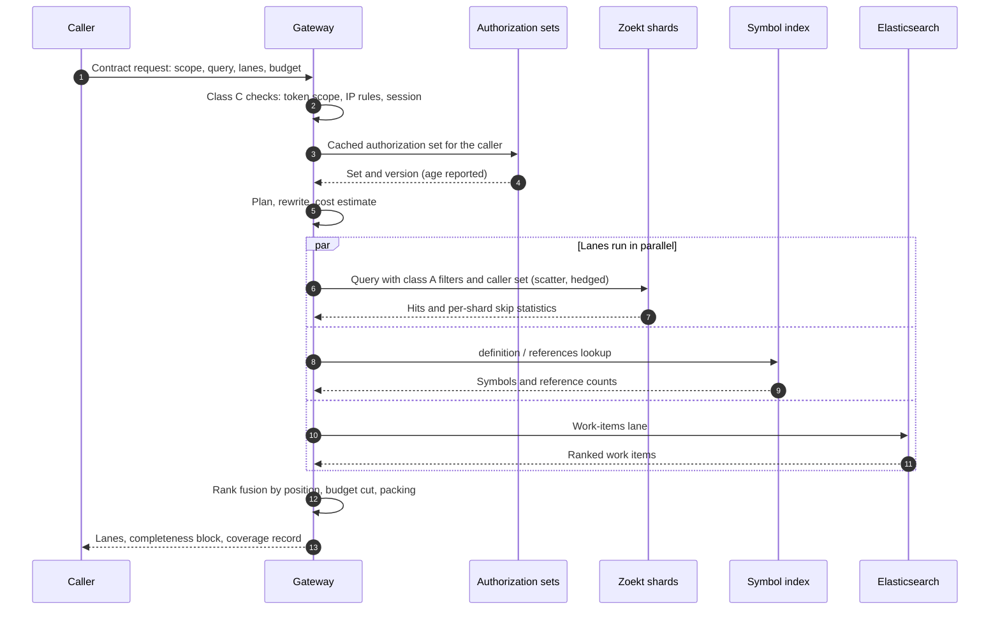
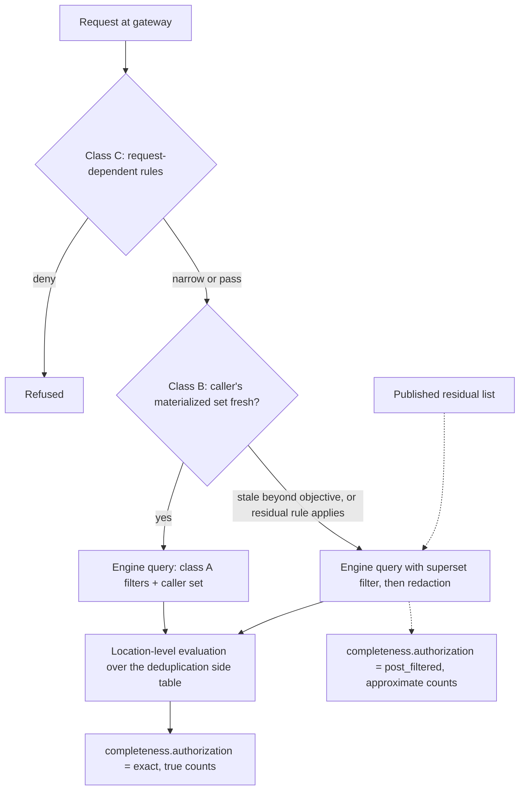
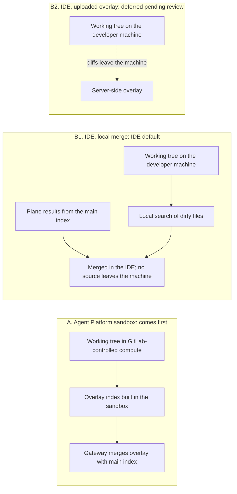
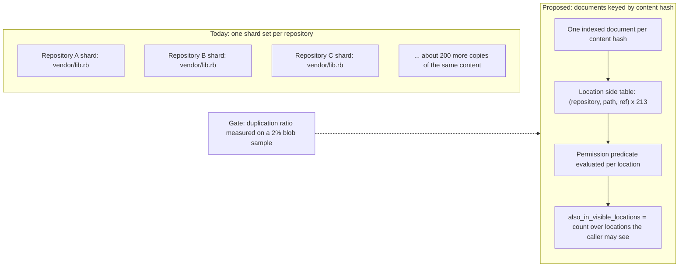
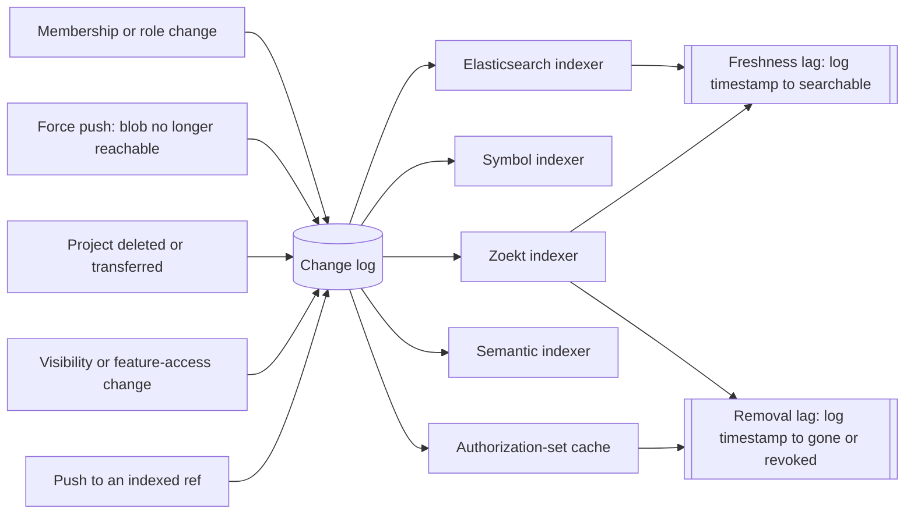
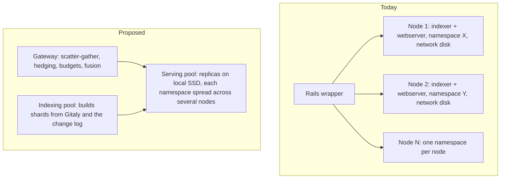

<!-- Design Documents often contain forward-looking statements -->
<!-- vale gitlab.FutureTense = NO -->


このページは、問題の説明、利用体験、目標、提案を記載する設計文書 [Project Telescope：GitLab の次世代コード検索体験、ランキング、検索取得](/handbook/engineering/architecture/design-documents/telescope/)の、エンジニアリング面の補足です。フリートの台数、ノードの構成、コスト、GitLab.com のトラフィック量は、[SAFE フレームワーク](/handbook/legal/safe-framework/)に基づく社内情報であり、[社内エビデンスページ（社内限定）](https://internal.gitlab.com/handbook/engineering/architecture/design-documents/telescope/)に掲載しています。このページの図は、このリポジトリで管理する Mermaid ソースから生成するため、図と本文の同期が保たれます。


## 概要 {#summary}

各セクションは、リクエストの経路、その後にデータの経路をたどります。呼び出し元が送るもの、権限の適用方法、インデックスの内容と最新状態の維持方法、結果を順位づけして人やエージェントに返す方法、そしてフリートのサイズ、予算、測定、保護の方法です。このページでフェーズに言及する場合、最初の 90 日間はベースラインを確立して既存の機能を有効にします。フェーズ 1 は Zoekt レーンの上にプレーンを置き、完全性、インデックス内での認可、ブランチのインデックス化、サンドボックスのオーバーレイを提供します。フェーズ 2 は測定結果を判断条件とする項目（コンテンツアドレス型レイアウト、トゥームストーン、オブジェクトストレージによる永続性、正確な SCIP 層）を決定し、フェーズ 3 は履歴検索とエンジンの確認時点を扱います。用語は[用語集](#glossary)で定義します。番号付きの参考文献は[ページ末尾](#references)に列挙します。エンジン自体と、計画が Zoekt を基盤にする理由には、独立したページ [Telescope：下層のエンジン](/handbook/engineering/architecture/design-documents/telescope/engine-underneath/)があります。

## リクエスト契約 {#the-request-contract}

契約は設計の中心です。その上にあるものはすべて契約へ変換し、その下にあるものはすべて実装詳細です。以下はスキーマではなく概略であり、呼び出し元が送るものと、返されるものを示すのに十分な内容です。

読み方：`principal` は誰が要求するか（人、サービスアカウント、人に代わって動くエージェント）です。`scope` はどこを探すかで、含める ref（git でブランチやタグを指す言葉）も示します。`lanes` は返す結果の種類です。`budget` は、件数、トークン、時間について呼び出し元が使える量です。`pack` は、ファイル全体、個別の関数、アウトラインだけなど、回答の切り出し方を示します。応答側では、`completeness` はすべての応答が持つブロックで、`coverage_record` はセキュリティエンジニアが保存できる署名付きの要約です。

```yaml
request:
  principal:
    type: user | service_account | agent_on_behalf_of_user
    id: ...
    token_scopes: [read_repository, read_api]   # evaluated at the gateway, before any engine is asked
  scope:
    organization: ...
    groups: [...]                # optional narrowing
    projects: [...]
    refs: [default, protected, open_mr, "release/*", "feature/payment-retry"]
    overlay_session: ...         # optional; adds the caller's uncommitted changes
  query:
    kind: literal | regex | glql | question | symbol
    text: "PaymentProcessor"
    operators: { definition: ..., references: ..., implements: ..., lang: ..., path: ... }
  lanes: [code, symbols, work_items, comments]
  mode: interactive | exhaustive
  budget:
    max_results: 50
    max_tokens: 6000
    deadline_ms: 500
    max_index_age_s: 60          # fail loudly, in the completeness block, if the index is older
  pack:
    unit: file | function | outline
    include_signatures: true

response:
  lanes:
    - name: code
      hits:
        - span: ...
          location: { project, path, ref, commit }
          rank: 3
          provenance: { visibility, vendored, generated, author_membership, age, overlay, precision: precise | syntactic }
          also_in_visible_locations: 213
  completeness:
    matched: 12431
    returned: 50
    skipped: [ { reason: file_over_size_limit, count: 201 }, { reason: over_trigram_limit, count: 53 } ]
    engines: [ { name: zoekt, status: ok }, { name: symbols, status: ok } ]
    branches_not_indexed: []
    authorization: exact | post_filtered     # never silent
    index_as_of: { manifest: 9f2c, age_s: 38 }  # digest of (project -> indexed commit, generation) for the scope
    overlay: { included: true, changed_files: 37 }
  coverage_record:
    id: ...
    scope_digest: ...
    as_of: ...                   # index manifest digest; per-project commits available on request
    skipped_summary: ...
    signature: ...               # signed by the instance; tamper-evident, not an audit attestation
  cursor: ...
```

この概略から 2 つのルールが導かれます。第一に、既存の検索 REST API と GraphQL API は引き続き機能し、契約への変換器になります。契約自体はバージョン管理し、GitLab の API 非推奨化プロセスに従います。第二に、PostgreSQL フォールバックからのものも含め、すべての応答で `completeness` の全フィールドを埋めます。フォールバックが把握できないフィールドは省略せず、`unknown` と報告します。

第一のルールから、第三のルールが導かれます。契約に基づく応答では、ゲートウェイが認可を所有し、GraphQL 層は結果を再び非表示処理しません。応答の `authorization` フィールドは、どの経路が結果を生成したかを示します。コード検索の GraphQL 型はすでにこの方式です。結果の取得時に認可を扱うため、型レベルの認可を宣言せず、コードレーンでは現状を記録することになります。ノード型が型レベルの認可を持つレーン、つまり作業アイテム、マージリクエスト、Issue は、ゲートウェイへの委譲と型ごとの非表示処理の維持のどちらを選ぶかを、レーン単位で決定します。免除範囲の拡大は AppSec レビューを経ます。

GLQL は、独自の意味論を持つ唯一の変換器です。そのフィルターは契約へコンパイルしますが、GLQL は並べ替えと集約も行います。一方、契約はランキング、トークン予算、ページネーションを持ち、group-by や集約関数を持ちません。最初のイテレーションでは、GLQL はプレーンの上で、契約の結果に対する並べ替えと集約を引き続き評価します。契約を集約にも拡張すべきかは未解決の問いです。

呼び出し元のリクエストから組み立てられた応答までの、1 つの対話的リクエストのライフサイクルです。中央の 3 つのエンジン呼び出しは同時に実行するため、そのレイテンシーは加算されません（[レイテンシー予算](#latency-budget)を参照）。「Scatter, hedged」は、ゲートウェイがスコープの一部を持つ各シャードにクエリを送り、あるシャードの応答が遅ければ、レプリカに重複リクエストを送って、先に返った方を採用することを意味します。



図 1。1 つの対話的リクエストと、p95 の 500 ms の使い道。

## インデックス内での認可 {#authorization-inside-the-index}

これは計画中で最もリスクの高い変更であり、この文書で最も正確に記述すべき部分です。要件は、単にエンジン内でフィルタリングすることではありません。エンジンが、この呼び出し元について Rails が下す判断と厳密に等価な述語を評価するか、そうしなかったと応答で示すことです。


**分かりやすく言うと：インデックス内のフィルタリングと、その後のフィルタリング。** あなたは、あるグループの 2,000 プロジェクト中 100 プロジェクトを閲覧できます。後でフィルタリングする場合、エンジンは全体で 1,000 件の一致を見つけ、閲覧できない 900 件を私たちが捨てます。その結果、表示した件数は誤り、2 ページ目がなぜか短くなり、捨てる処理に欠陥があればコンテンツが漏れるおそれがあります。内部でフィルタリングする場合、エンジンはあなたの 100 プロジェクトだけを見て、件数は正確で、誤りうる破棄処理はありません。


GitLab の認可ルールはモノリス内にあり、一部はコードで表現され、別の取り組みによって専用サービスへ抽出されつつあります。集合への所属を表すルール（このプロジェクトは読み取り可能なプロジェクト一覧に含まれるか）も、リクエストに依存するルール（どの IP アドレスから来たか、このトークンで何ができるか）も、インデックスに見えない状態に依存するルールもあります。すべてを集合への所属として扱うことが、フィルターの欠陥によるコンテンツ漏洩につながります。そのため設計では、3 つのルールクラスを名づけ、それぞれ異なる方法で扱います。

| クラス | 例 | 評価する場所 | 正確性 |
| --- | --- | --- | --- |
| A。インデックスネイティブ | プロジェクトの可視性レベル。traversal ID によるグループの祖先関係。リポジトリと機能のアクセスレベル。アーカイブと削除待ちの状態 | インデックス化時に書き込み、変更ログで更新するフィールドから、エンジン内のフィルターとして評価 | 正確 |
| B。呼び出し元ごとにマテリアライズ | コード読み取りアクセスを持つ、直接、継承、共有グループのメンバーシップ。GitLab がすでに `project_authorizations` にマテリアライズしているもの | 呼び出し元の認可集合をマテリアライズし、ゲートウェイでコンパクトな集合としてキャッシュしてエンジンのクエリ内に押し込む。認可変更時に、インデックスの削除と同じ 60 s の目標で更新 | 集合が新鮮な間は正確。集合の経過時間を報告 |
| C。リクエストまたはコンテキスト依存 | グループの IP 制限。トークンスコープ。SAML セッションの強制。2FA の強制。禁止またはブロックされたユーザー。管理者モード。細かいコード権限を持つカスタムロール。外部ユーザー | エンジンへ問い合わせる前にゲートウェイで評価。拒否、スコープの縮小、またはマテリアライズ時にマテリアライズ集合へ組み込む | ルールをスコープ変更に還元できる場合は正確。それ以外では上位集合フィルターと非表示処理へ応答を縮退させ、`authorization: post_filtered` を報告 |

表の用語をいくつか説明します。Traversal ID は、GitLab が各グループの祖先関係を保存する方法です。最上位グループから下への ID 一覧であり、「グループ 42 の配下すべて」が、エンジンでフィルターとして適用できる単純な前方一致になります。マテリアライズとは、リクエストごとに求めず、事前に計算して保存することです。GitLab はすでに、どのユーザーがどのプロジェクトにアクセスできるかを示す表（`project_authorizations`）を保持し、プレーンはそれを再利用します。上位集合フィルターは、呼び出し元が閲覧できない結果も一部通す可能性のある、意図的に緩いフィルターであり、そのため後に非表示処理のステップが必要です。

どのクラスにも適合しないと判明したルールは、公開された残余リストに追加します。その対象となる呼び出し元には、常に事後フィルター適用の概数を、その旨を明示して返します。この設計が排除する唯一の失敗形態は、無言にすることです。すべての応答が、権限をどのように評価したかを示します。

以下のフローは、1 リクエストの判断経路を示します。クラス C のルールは、リクエストを完全に拒否したりスコープを縮小したりできるため、ゲートウェイで最初に確認します。その後、ゲートウェイは呼び出し元のマテリアライズ集合が新鮮かを確認します。新鮮で、残余ルールが適用されなければ、エンジンは正確なフィルターを受け取り、応答もそう示します。そうでなければ、応答は緩いフィルターと非表示処理へフォールバックし、そのことも示します。



図 2。インデックス内の権限：3 つのルールクラスと、無言にしないという 1 つのルール。

さらに 4 つの要件があります。

- **ロケーション単位の評価。** コンテンツの重複排除後は、1 つの物理文書が多数の（project、path、ref）ロケーションに対応します。述語はロケーションごとに評価し、あらゆる件数（「他の N リポジトリにも存在」）は、呼び出し元が閲覧できるロケーションだけで計算します。そうしないと、件数を通じて非公開リポジトリの存在が漏れます。
- **切り替え前のシャドー実行。** 少なくとも 30 日間、本番のすべてのクエリで両経路を実行します。いかなる不一致も Severity 1 インシデント（GitLab の最高のインシデント重大度）とし、最初の 2 週間でゼロでない不一致があれば、早期シグナルとします。
- **シャドー実行を超えた差分テスト。** シャドートラフィックがテストするのは、人々が実際に実行するクエリであり、誰も使わないルールクラスは決して実行しません。プロパティベーステストは、ランダムなメンバーシップグラフ（グループ、共有グループ、カスタムロール、IP ルール、トークンスコープ）を生成し、それぞれについてエンジンの答えと Rails の答えを比較します。これにより、誰も列挙しなかったクラス C のルールを発見します。CI で実行し、シャドーハーネスのごく一部の費用で済みます。
- **依存関係であり、阻害要因ではない。** 認可抽出の取り組みは、将来のルール定義の唯一の情報源であり、以下のインターフェースの提供を確約していません。プレーンは、そのインターフェースが提供されれば利用しますが、待ちはしません。それまでは、認可アーキテクチャグループと手作業でクラス C を列挙し、同じシャドーハーネスに対してテストします。

プレーンがその取り組みに求めるのは、呼び出し元とスコープに対するルールをデータとして返す 1 回の呼び出しです。権限、グループ、ユーザーを指定して要求し、除外すべきプロジェクトやクエリを狭めるフラグなど、適用すべき条件を返してもらいます。ここで利用可能な答えにする性質は 3 つあります。エンジンは GitLab のポリシーコードを実行できないため、ルールは実行コードではなくデータとして返します。何を根拠にフィルタリングしたかの経過時間を応答で報告できるよう、答えはバージョンまたは鮮度の印を持ちます。そして、フィルターとして表現できないルールは、そう明示します。プレーンは推測せず、事後フィルタリングへ縮退して報告します。認可グループと Knowledge Graph グループは、このルールをデータで返すインターフェースを AST と呼び、最新の議論である [Knowledge Graph 権限スレッド](https://gitlab.com/gitlab-org/orbit/knowledge-graph/-/work_items/992#note_3888509469)の「Long term」セクションには、関心は記録されていますが確約はありません。この段落はその取り組みへの要請であり、確定済みの計画ではありません。

クラス C のルールの評価は、ゲートウェイからモノリスへのリクエストを意味し、事後フィルター経路の非表示処理も同様です。代替の確約がない以上、これは移行期のコストではなく設計上の恒常的なコストです。クラス C のルールが適用されるすべてのリクエストで同期的な依存が生じるため、[レイテンシー予算](#latency-budget)では、ゲートウェイ自体の時間に吸収せず、クラス C に独自の行を設けています。これから 3 つのことが導かれます。クラス C の評価結果は呼び出し元とスコープごとに短期間キャッシュし、その経過時間はマテリアライズ集合と同様に報告します。事後フィルター経路では非表示処理も負担するため、正確な経路を一般的な場合として維持する必要があります。そして p95 の目標は事後フィルタリングへ縮退する割合が小さいことに依存するため、そのリクエスト割合を公開します。

## インデックス化ポリシー {#indexing-policy}

インデックス化ポリシーは、どのブランチやファイルを入れるか、同一ファイルを複数回保存するか、インデックスがスキップすると決めたコンテンツをどう扱うかなど、インデックスの内容に関する判断の集合です。

### 対象ブランチ {#which-branches}

Zoekt はインデックス化したファイルバージョンごとに 64 ビットのブランチマスクを持つため、各一意のバージョンを 1 回保存しながら、1 リポジトリのインデックスで最大 64 ブランチをカバーします。


**分かりやすく言うと：ブランチマスク。** 保存された各ファイルバージョンは、ブランチごとに 1 つ、合計 64 個のオン・オフのビットを持ちます。`config.rb` が `main`、`release-1.2`、`feature/payment-retry` で同一なら、3 ビットをオンにして 1 回保存します。`feature/payment-retry` にスコープを限定した検索は、そのブランチのビットがオンのバージョンだけを残します。そのため、追加のブランチのインデックス化は、「追加ブランチ数にリポジトリ全体を掛けたもの」よりはるかに少ないコストです。大半のファイルは、大半のブランチで同じだからです。


64 スロットを埋めるポリシーは次のとおりです。

1. デフォルトブランチとすべての保護ブランチを、常に含めます。
1. インスタンスまたはグループで設定可能なリリースパターン（たとえば `release/*`、`stable-*`）に一致するブランチを含めます。
1. オープンなマージリクエストのソースブランチを、最新の活動（コミットまたはパイプライン）順に並べ、残りのスロットを埋めます。
1. 最も長く活動していないものから追い出します。インデックス化されていないブランチは `branches_not_indexed` に名前を示し、それを対象とするクエリはオーバーレイ経路、または網羅モードの生ファイルスキャンで処理します。

同時に数百のブランチがアクティブなリポジトリが、ストレステストになります。GitLab 自身の最大のリポジトリ `gitlab-org/gitlab` がドッグフーディングの対象です（ドッグフーディングは、GitLab が GitLab を使うことです）。常時 1,000 件程度のオープンなマージリクエストがあるため、オープン MR の分類だけで 64 スロットの全予算を超え、追い出しが絶えず起こることになります。そのようなリポジトリでは、そのため、1 リポジトリをブランチグループで分割した複数の論理 Zoekt リポジトリとして表現することを作業上の前提とし、前述の追い出しポリシーを計画そのものではなくフォールバックにします。このレイアウトは無料ではありません。1 つの論理リポジトリ内では、ブランチマスクが依然として一意のファイルバージョンを 1 回保存するため、グループ内の追加ブランチはほぼ無料です。しかしグループ間ではその共有が失われるため、下限はグループごとにそのリポジトリの一意のコンテンツの約 1 コピーであり、ブランチ数ではなくグループ数の倍数になります。ブランチの追い出しはマスクのビットを消します。グループの再構築や再分割は、そのグループのブランチを再インデックス化し、処理範囲はリポジトリ全体ではなくグループに限定されます。このレイアウトの公開事例は把握していないため、[最初の 90 日間のスパイク](https://gitlab.com/gitlab-org/search-team/team-tasks/-/work_items/304)で判断します。測定するのは、グループごとのストレージ倍率、ブランチグループごとのシャード数と常駐メモリー、グループ再構築のコスト、1 クエリをリポジトリの複数グループにファンアウトするコストと結果マージのレイテンシー分布、グループ導入後も追い出しが頻発するかどうかです。どちらにせよ、より大きな問いは負荷への影響です。インデックス済みブランチへのすべての push がインデックス化イベントとなり、活発なモノレポでは MR ブランチへの push はデフォルトブランチへの push の何倍にもなります。90 日間の測定には、イベント倍率、インデクサーのスループット、Gitaly の fetch 負荷（Gitaly は git リポジトリを保存・配信するサービスで、すべてのインデックス化ジョブがそこから取得する必要があります）を含め、ブランチのインデックス化をドッグフーディング以外で有効にする前に、ブランチごとにインデックス化をまとめます（短い時間枠内の複数の push を 1 つのインデックス化ジョブにします）。

### セッションオーバーレイ {#session-overlay}

オーバーレイは、作業ツリーと最も近いインデックス済み ref で異なるファイルだけの一時的なインデックスであり、コンテンツハッシュツリーの差分で見つけ、メインインデックスとともに検索します。


**分かりやすく言うと：コンテンツハッシュツリーの差分。** 各ファイルに指紋を付けます（ハッシュ、つまり同じバイト列なら同じになる短いコードです）。次に、各ディレクトリに子の指紋から作る指紋を付け、ツリー全体の 1 つの指紋まで繰り返します。ルートの指紋が同じ 2 つのツリーは同一です。違う場合は子を比較し、違う部分だけを下ります。100,000 ファイルのワークスペースで変更ファイルを見つけるには、100,000 回ではなく数百回の比較で済み、そのためオーバーレイを約 1 秒で構築できます。


作業ツリーがどこにあるかでデータフローのすべてが変わるため、設計ではトポロジーを明示的に名づけます。

- **A。Agent Platform サンドボックス。** 作業ツリーはすでに GitLab 管理下の計算環境にあります。オーバーレイはその境界内で構築・検索し、セッション後まで永続化せず、セッション終了時に破棄します。新たなデータフローがないため、最初に取り組みます。
- **B1。IDE、ローカルマージ。** 開発者の作業ツリーは自身のマシンにあります。IDE 拡張や言語サーバーが未コミットの変更のあるファイルをローカルで検索し、その一致をクライアント側でプレーンの結果とマージします。ソースはマシンから出ません。IDE 画面ではこれをデフォルトにします。
- **B2。IDE、アップロード型オーバーレイ。** 未コミットの変更のあるファイルの差分をアップロードし、サーバー側のオーバーレイを構築します。これは顧客のデバイスから GitLab への新たなデータフローであり、プライバシー、法務、データ所在地のレビューを完了し、明示的なオプトインを設けるまで対象外です。A や B1 に暗黙に含まれると思われないよう、ここに列挙しています。

どのトポロジーでも、オーバーレイはプレーンが扱う最も機密性の高いコンテンツとして扱います。未コミットの作業には、認証情報や作成途中のシークレットが存在するからです。オーバーレイの内容は永続インデックスに決して書かず、Duo がすでに適用するのと同じシークレット検出による非表示処理を適用し、いかなるログにも含めません。



図 3。セッションオーバーレイ：作業ツリーの所在がデータフローを決める。

### 重複排除 {#deduplication}

Zoekt のシャードはリポジトリごとなので、200 リポジトリにベンダリングされたライブラリは 200 回インデックス化し、ブランチマスクはリポジトリ間には役立ちません。重複排除は、コンテンツハッシュをキーとする文書と、そのコンテンツが現れるすべての（repository、path、ref）を記録する補助テーブルを持つ、コンテンツアドレス型レイアウトを意味します。


**分かりやすく言うと：重複排除。** 200 のリポジトリがそれぞれ同じライブラリのコピーを持つため、現在は同じファイルを 200 回インデックス化し、200 回表示します。重複排除は、各ファイルの内容から指紋を作り、指紋ごとに 1 コピーを保存し、どのリポジトリ、パス、ブランチにその指紋が現れるかを補助テーブルに保持します。検索はファイルに 1 回一致し、結果は「他の 213 リポジトリにも存在」と示します。その補助テーブルでは、権限チェックが、その場所のどれかが呼び出し元の閲覧可能なものかを低コストで問い合わせることもできます。




図 4。インデックスレイアウト：リポジトリごとのシャードと、コンテンツアドレス型文書。

これはインデックス形式の変更であり、事実上、upstream にない Zoekt インデックスレイアウトのフォークです。補助テーブルで権限述語を評価するため、ロケーション単位の認可と一緒に設計する必要があります。最初の 90 日間に blob の 2% サンプルで測定する重複率を、判断条件とします。重複は塊で現れ（フォーク、ベンダーディレクトリ）、blob 全体から均一に抽出すると見逃したり過大評価したりする可能性があるため、サンプルは blob から均一にではなくプロジェクトを横断して抽出し、信頼区間付きで結果を報告します。GitHub は、115 TB のコンテンツのうち一意のコンテンツが 28 TB、約 4 対 1 と公表しました \[8\]。GitLab.com の比率がそれに近ければ、レイアウトに資金を付け、upstream とオープンに構築します。1 に近ければ、ディスクを購入し、毎年見直します。

### スキップの計数 {#skip-accounting}

1 MB のファイル上限、20,000 のトライグラム上限、500,000 ファイルのプロジェクト上限は設定であり、引き上げは無料ではありません。非常に大きいファイルやエントロピーの高いファイル（縮小化された JavaScript、生成コード、データファイル、異なる 3 文字の断片を異常に多く含むもの）は、インデックスを肥大化させ、すべてのクエリを遅くします。何をスキップしたかの報告は無料です。Upstream の Zoekt はインデックス化時にスキップ理由を記録し、検索ごとの統計を返します。GitLab の Zoekt ビルドと検索 API がそれを公開するかの確認は 90 日間の項目であり、完全性レポートはその上に構築します。

## シンボル {#symbols}

シンボルインデックスは、SCIP 出力から構築する検索テーブルです \[1\]。各シンボルの定義箇所と直接参照されるすべての場所を保持し、`definition:`、`references:`、`implements:` に 1 ホップで答えます。グラフではなく、直接参照を超える関係をモデル化しません。（「1 ホップ」は 1 ステップ、つまりこれはどこにあるか、誰が直接使うかを意味します。その先へサービス、パイプライン、所有者をたどるのは複数ホップの問いであり、Knowledge Graph の担当です。）

難しいのは検索ではなく、SCIP データの供給です。正確なインデクサーは言語ごとに必要で、通常はプロジェクトの依存関係を解決する必要があります。つまりプロジェクトごとの CI ジョブと、実際の計算資源や不安定さが伴います。デフォルトで有効になる経路がなければ、カバレッジはほぼゼロになります。そのため設計では 3 つの供給元を設け、すべてのシンボル結果が、その精度層を来歴に持ちます。

1. すでに生成しているプロジェクトでは、CI からアップロードされる既存のコードインテリジェンス成果物。
1. 対象言語群のインデックス済みコンテンツに対しサーバー側で実行し、ビルドなしで SCIP を生成する構文インデックス化。精度は低いものの設定不要で、すべての識別子をリンクにし、静的ランキングの参照件数を計算するには十分です。（構文とは、インデクサーがコンパイルせずコードの構造を読むことです。定義と使用を区別できますが、パッケージをまたぐ同名の 2 つのものを混同する場合があります。正確なインデクサーは名前を完全に解決します。）
1. プロジェクトがオプトインし、精度層を引き上げる CI テンプレートによる正確なインデクサー。

Knowledge Graph はすでに、デフォルトブランチからのプロジェクト横断の定義とインポート単位の参照を保持しています。2 チームが 2 つの SCIP 由来のストアを保守するのは、望ましくない結果です。この文書が求める判断は、1 つの所有チームが持つ単一の SCIP シンボルストアを、プレーン（1 ホップ検索、push ごとの鮮度、すべてのインデックス済みブランチ）とグラフ（関係クエリ）の双方が利用することです。そのストアに対するプレーンの要件は、push ごとの鮮度、ブランチの認識、ロケーション単位の権限評価です。共有ストアが満たせなければ、プレーンがホストし、グラフの利用向けに公開します。

## 鮮度、変更ログ、削除 {#freshness-the-change-log-and-removals}

インデックスは push されたすべてのものの第 2 のコピーであるため、追加と同じくらい削除が重要です。リポジトリの削除、プロジェクトの非公開化、漏洩したキーを取り除く force push、メンバーシップの取り消しなどです。現在、削除は 4 つの独立したスケジュールで伝播し、削除遅延は公開されていません。（ここで遅延とは、push などのイベントから、検索がそれを反映する時点までの時間です。）

変更ログは、インデックス関連イベント（インデックス済み ref への push、ref の作成や削除、可視性や機能アクセスの変更、プロジェクトの削除や移管、force push 後に blob が到達不能になること、認可変更）の順序付き永続記録で、すべてのインデクサーと認可集合キャッシュが利用します。4 つのインデックスが独自の方法で変更を監視する代わりに、すべてのインデックスが読む 1 つの共有やることリストだと考えてください。

実装は、既存の Zoekt タスクキューを一般化したものです。GitLab.com のメインプライマリではなく、Zoekt オーケストレーター自身の PostgreSQL データベースに置く順序付き outbox です。（オーケストレーターは、Zoekt フリートのインデックス化作業をスケジュールする GitLab のコンポーネントです。Outbox は、他のコンポーネントが読むイベントを順序どおりに記録する、通常のデータベーステーブルで、動作に新しいソフトウェアは不要です。）このキューは現在メインプライマリ上にあり、毎秒約 24 回の挿入と 50 回の更新、約 2,700 万行を持ちます \[2\]。ブランチのインデックス化は、この書き込み率を実測のイベント倍率分増やすため、ドッグフーディングを終える前に、キューをメインプライマリから移すことと、Database チームとの協議が前提になります。ログには 3 つの性質が必要で、現在は 3 つともありません \[2\]。

- すべてのタスクがインデックス化すべきコミットを持ち、インデックス化を「タスク実行時にリポジトリにあるもの」ではなく、冪等でコンテンツアドレス型にします。
- すべてのタスクがレーンを持ちます。対話的な作業は一括作業より先に実行し、一括作業も決して処理されない状態にしないため、階層全体にファンアウトするグループ名変更の後ろに、開発者の push が並ぶことを防ぎます。
- 同じリポジトリへのリクエストは、キュー内の 1 タスクにまとめますが、最新のリクエストが求めた時刻より実行を遅らせることはありません。

追加と削除には同じ p99 60 s の目標を設け、両方の遅延をレイテンシーと並べて公開し、カバレッジ記録にも両方を示します。削除経路自体は最初の 90 日間に測定します。force push で取り除いた blob が、コンパクションで差分シャードを統合する前に結果から消えるかどうかです。（push が数ファイルを変更すると、インデクサーはそのファイルだけの小さな差分シャードを書き、既存のものに重ねます。後のコンパクションが層を 1 シャードに戻します。どちらも[キャパシティ、サイジング、ハードウェア](#capacity-sizing-and-hardware)で説明します。）削除した blob がコンパクションまで残るなら、差分シャード内で「このファイルはなくなった」と示すマーカーであるファイル単位のトゥームストーンを、フェーズ 2 の形式変更にします。2 つではなく 1 つのフォーク要因にするため、コンテンツアドレス型レイアウトと一緒に設計します。



図 5。1 つの変更ログ、1 つの鮮度の遅延、1 つの削除遅延。

## ランキングと品質 {#ranking-and-quality}

大規模に構築された連携検索システムには、共通のルールがあります。異なるエンジンのスコアは比較できず、混ぜると誰も信頼しない一覧になります。


**分かりやすく言うと：生のスコアを混ぜられない理由。** Zoekt は一致に 0.92、シンボルインデックスは 17.3、Elasticsearch は 4.1 のスコアを付けるかもしれません。これらの数値は異なる尺度に属し、並べても意味がありません。逆順位融合は、スコアを無視して順位を使います。ある結果が一方の一覧で 1 位、他方で 3 位なら 1/(60+1) + 1/(60+3) を得て、マージした一覧をその合計で並べます。粗い方法ですが、エンジン間で公平であり、プランナー以外で計画が許す唯一の混合法です。


プレーンは、それぞれ固有のエンジンで順位づけしたレーン（コード、シンボル、作業アイテム）を返します。融合は厳密に 2 か所で行います。1 つの一覧が避けられない場合には、生のスコアを決して使わず、順位（逆順位融合）で行います。そして、人がクエリを入力したのではなく質問をした場合には、プランナーで行います。ゲートウェイのマージ処理は、予算を持つルーターであり、採点モデルではありません。

1 つの任意の段階は、そのルールの外、対話的な予算の外に置きます。Duo エージェントレーンの `kind: question` クエリでは、既存の（事前学習済みの）クロスエンコーダーのリランカー（クエリと 1 候補を一緒に読み、一致の良さを採点するモデル）で、上位 50 候補を並べ直せます。Duo のモデルがすでに動く場所で実行し、対話的な 500 ms の予算ではなく、エージェントレーン独自の期限に従い、実測の precision@5 向上を条件とします。AI ゲートウェイ（モデル呼び出しを仲介する GitLab のサービス）がデプロイされていない場所では利用できません。これは Duo の既存の条件下での推論であり、学習ではありません。

コードレーン内では、2 つのシグナルを追加します。Upstream の Zoekt が 2025 年からサポートし \[3\]、GitLab の Zoekt ビルド内での有無と状態を 90 日間で設定確認する BM25F と、シンボルインデックスが持つ参照件数からの静的ランクです。（BM25 は、テキストクエリに対して文書を順位づけする標準式です。語が文書内に頻繁に現れ、コーパス全体では珍しく、文書が短いほど、その語の重みが大きくなります。F はフィールド別を意味し、ファイル名やシンボル名への一致は、本文の奥にある一致より重く扱います。）記録元システムだけが利用可能なシグナル（最近のマージ活動、CODEOWNERS の所有権、インシデントを解決した変更、検索したブランチのパイプライン状態）は、後続フェーズの候補であり、そのデータを保持できるよう列挙しています。

何かをリリースする前に、品質を測定します。

- 手作業で正解を付けた数百の実際のクエリのゴールデンセット。GitLab 自身の公開リポジトリ、合成クエリ、署名済み合意下のデザインパートナーのデータから構築し、ラベル付け担当者が権利のない顧客コードを決して見ないようにします。
- レーンごとに recall@10 と precision@5 を毎週評価し、品質後退がないことを切り替え条件とします。
- ランキング変更の本番インターリービング。（インターリービングは、同じユーザーに対して 2 つのランキング手法の結果を混ぜ、どちらの結果が使われるかを数えます。各手法をユーザーの半分ずつに見せるより、ランキングの小さな差をはるかに速く検出します。）
- エージェントゲート。適合率が基準未満の検索取得はエージェントを悪化させるため \[4\]、エージェントのトラフィックをルーティングする前に、Duo の評価ハーネスでエージェントレーンの precision@5 がしきい値を超える必要があります。しきい値はベースラインから設定し、評価とともに公開します。

## エージェントインターフェース {#agent-interface}

プレーンは 3 つの MCP ツール、`find`、`fetch`、`symbol` を公開します。複数の検索を 1 往復にするバッチ処理と、すべての呼び出しにトークン予算を設けます。説明は、このカタログと Knowledge Graph のカタログから選ぶエージェント向けに記述します。こちらのツールは情報を見つけ、あちらはつながりを説明します。すべての範囲が来歴を持ち、返す際に「指示のようなコンテンツ」フラグを付けます。プレーンはエージェントが読むすべてが通過する唯一の要所であり、そこでの検査は安価ですが、個々のエージェント内での検査はそうではないからです。（このフラグは、コードというよりモデルへの指示のように読めるテキスト、すなわちプロンプトインジェクション攻撃の材料に印を付け、エージェントが警戒して扱えるようにします。）

エージェントは人より悪いクエリを書き（リテラルのない正規表現では、トライグラムインデックスに絞り込む手がかりがなく、エンジンはすべての文書をスキャンする必要があります）、疲れることもありません。そのためゲートウェイには、呼び出し元ごとの予算、テナントごとの公平な割り当てスケジューリング（ある顧客のエージェントが他の顧客のクエリの処理を奪い尽くすことを防ぐ）、実行前のクエリコスト見積もりと高コストな形式の書き換えや拒否、サービスアカウントのクエリに対する監査イベントを設けます。網羅モードを対話的に利用できるようには決してしません。

## 網羅モード {#exhaustive-mode}

網羅モードは、生ファイルに触れる唯一の経路です。名前空間ごとの同時実行制限と明示的な Gitaly fetch 予算を持つ、キューに入れたバックグラウンドジョブとして動作します。カバレッジ記録を添付したエクスポート成果物に結果を書き、進捗と見積もりを報告し、キャンセルできます。インスタンス管理者はそのスコープに上限を設定できます。最初にインデックス内のすべての一致をストリーミングし、次にスキップしたファイルをスキャンするため、完了前にも部分的な結果が役立ちます。

ジョブはワーカーが失われても存続する必要があります。GitLab が現在利用するバックグラウンドキュー Sidekiq はクラッシュに安全ではないため、ワーカーの消失がスキャンの消失となり、カバレッジ記録が本来より少ない内容を無言で示すことになります。そのため要件はフレームワークではなくジョブに課します。スコープの単位ごとに進捗のチェックポイントを保存し、再起動時に停止箇所から再開し、チケットにジョブの状態を示し、完了できないジョブは消える代わりに未完了と報告します。永続的で再開可能なバックグラウンドフレームワークがあればチェックポイントテーブルを置き換えられます（NATS を使う Data Insights Platform が候補の 1 つです）。それが存在するまでは、チェックポイントテーブルが役割を果たします。

## キャパシティ、サイジング、ハードウェア {#capacity-sizing-and-hardware}

公開情報の数値だけを示します。フリートの台数、ノード構成、コスト、トラフィック量は、[社内エビデンスページ（社内限定）](https://internal.gitlab.com/handbook/engineering/architecture/design-documents/telescope/)にあります。このセクションは、すべてのレビュアーが問うべきことに答えます。設計のサイズは、保有するデータ、購入できるハードウェア、想定すべき成長に見合っているか、という問いです。GitLab.com の現状から始め、その分野を代表するシステムと比較し、結論を導きます。


**分かりやすく言うと：以下で使うストレージとメモリーの言葉。** シャードは、ディスク上のインデックスの 1 ファイルです。メモリーマップとは、オペレーティングシステムが必要に応じてその一部を RAM に読み込み、頻繁に使う部分を保持することです。そのため「ホット」なシャードはメモリー内にあるように振る舞い、「コールド」なシャードはディスク読み取りを必要とします。ネットワーク接続ディスク（Google Cloud の `pd-balanced`）はネットワーク経由で到達するストレージです。ローカル SSD はマシン内に物理的にあるドライブで、インデックスが行う小さなランダム読み取りでは何倍も高速です。IOPS は 1 秒あたりの入出力操作数であり、その小さな読み取りをディスクが何回処理できるかの尺度です。ページフォールト経路とは、クエリが RAM にないインデックスの一部を必要とし、ディスクを待つ瞬間を指します。


**GitLab.com の現状。** Exact Code Search は、Google のマネージド Kubernetes サービス GKE 上の Zoekt ノードのフリートで動作します。各ノードは、ネットワーク接続ストレージ（`pd-balanced`）上の固定サイズの永続ボリュームを持つ StatefulSet の pod（安定した識別情報と専用ディスクを持つ pod）であり、1 つの Zoekt バイナリーを実行します。プライマリノードはインデックス化と配信の両方を行い、レプリカは配信だけを行います \[5\]。名前空間は 1 ノードに割り当てられ、単一の名前空間をノード間でシャーディングすることは、まだサポートされていません \[5\]\[6\]。観測されたインデックスサイズは、リポジトリの git サイズの約 0.4〜0.5 倍です（最悪の場合は非バイナリーテキストの 2.8 倍）\[5\]\[7\]。ゼロからの完全な再インデックス化には、大半のリポジトリで約 48 時間、それに加えて数日の長いテールが必要です。ランブックは、現在のフリートの完全な再インデックス化でも Gitaly に過負荷をかけないと記載しています \[5\]。検索結果は 5 分間キャッシュします \[7\]。

**フリートが現在行っていること。** 最近の 7 日間では、Rails から Zoekt への各呼び出しは約 2.23 回のシャード検索にファンアウトしました。ウェブサーバー自体の検索時間は p50 119 ms、p95 1,206 ms、p99 2,262 ms で、グループスコープの p50 は 1,176 ms、プロジェクトスコープは 358 ms でした。Zoekt が処理する検索のエンドツーエンド時間を測る指標はありません。書き込み側では、インデックス化タスクキューは GitLab.com のメインデータベースのプライマリ上で、毎秒約 24 回の挿入と 50 回の更新を受け、約 2,700 万行を保持します。厳密な先入れ先出しで処理され、タスクはコミット識別子を持ちません \[2\]。リクエスト量は社内エビデンスページにあります。

**比較の基準点。** GitHub（2023 年）：115 TB のコンテンツが、64 コアの 32 ホスト上で 25 TB のインデックスになりました（一意のコンテンツは 28 TB）。シャードごとの p99 は約 100 ms。クエリは 1 コアを約 100 ms 占有するため、ホストごとに毎秒約 640 クエリが上限です。取り込みは毎秒 120,000 文書。完全な再インデックス化は約 36 時間、差分インデックス化ありでは 18 時間です \[8\]。GitHub はその後、1 億 8,000 万を超えるリポジトリ全体で 480 TB を超えるコーパスについて説明しています \[9\]。Sourcegraph のガイダンスでは、Zoekt インデックス全体を RAM に保持するには、非バイナリーテキスト全体のサイズの約 2.7 倍を割り当て、それ以外はページキャッシュと高速 SSD に頼るとしています \[10\]。GitLab.com が動作するプラットフォームの現在のストレージ最適化クラウドハードウェアは、VM ごとに最大 176 vCPU、1.4 TB の RAM、36 TiB のローカル SSD、ベアメタルでは 72 TiB を提供し、IOPS は数百万です \[11\]。

図は、現在のノードモデルと提案モデルを比較します。現在、1 ノードが割り当てられた名前空間のすべてを行います。提案では、配信専用レプリカのプールがクエリに応答し、各名前空間は複数ノードに分散し、インデックス化は専用プールで行います。



図 6。フリートのトポロジー：制約はハードウェアではなく、トポロジーにある。

**数値が示すこと。**

1. **制約はハードウェアではなく、トポロジーです。** 現在のインデックス全体は、少数のストレージ最適化ノードに、2 レプリカ分の余裕を持って収まります。そのようなフリート全体の RAM は、実測されるアクセス頻度から妥当に想定できるどのホットセットよりも大きなものを保持できます。CPU の余裕はより少なく、シャード検索あたりのコア時間の実測平均 248 ms（GitHub の公表値は約 100 ms）では、16 コアノードは毎秒約 60 回のシャード検索で飽和します。フリート全体の能力は現在の負荷を大きく上回りますが、1 ノードに固定した名前空間はそのノードの 60 回で飽和し、そこにまさにエージェントのトラフィックが集中します \[2\]。決定的な制約はアーキテクチャにあります。ページフォールト経路のネットワーク接続ストレージ、単一ノードに固定された名前空間、同一ノード上のインデックス化と配信、Rails ラッパーです。
1. **単一ノードの名前空間がテール改善の限界になります。** 大企業の名前空間のすべてのクエリは 1 ノードで動き、その顧客のエージェントもそこに集中します。ゲートウェイの scatter-gather（名前空間の一部を持つ各ノードにクエリを送り、回答を集める）とともに、名前空間を複数ノードにシャーディングすることが、組織スコープでの p95 目標とテナントごとの公平な割り当ての前提です。そのため、[目標 G2](/handbook/engineering/architecture/design-documents/telescope/#goals) は、中央値ではなく最大の名前空間で測定します。フェーズ 1 の配置単位は、複数ノードに分散した名前空間のシャード集合であり、フェーズ 2 のレイアウト判断でキーが変わりうるため、ゲートウェイのルーティングテーブル内で抽象化します（[設計と実装の詳細](/handbook/engineering/architecture/design-documents/telescope/#design-and-implementation-details)で求める判断を参照）。アクセスの集中が 1 リポジトリにあると範囲による分割は役立たないため、[対象ブランチ](#which-branches)ですでに検討しているとおり、活発なモノレポには、どのみちリポジトリ内並列化またはブランチグループ分割が必要です。
1. **読み取りと書き込みを分離します。** ブランチのインデックス化はインデックス化イベントを増やします。クエリは配信専用レプリカだけから提供し、インデックス化は専用プールで動作してシャードを公開します。ホットな名前空間には少なくとも 2 つの配信レプリカを割り当て、ヘッジリクエストの送信先も確保します。
1. **配信にはローカル SSD、永続性と配布にはオブジェクトストレージを使い、クエリ時の階層化には決して使いません。** 混同しやすい 2 つの問いがあります。シャードの永続コピーをどこに置くか、コールドシャードをクエリ時に安価なストレージから読むべきか、です。後者の答えは「いいえ」です（[引き継いだ教訓の第 7 項](#appendix-lessons-carried-in)）。前者はフェーズ 2 での判断要請です。現在、失われたノードは再割り当てし、Gitaly から再インデックス化しますが、48 時間の再構築と 60 秒の削除目標との相性が悪いです。オブジェクトストレージのバケットにコンパクション済みシャード（完成したシャード。第 7 項を参照）があれば、ノード消失から数分のダウンロードで復旧し、新しいレプリカにも Gitaly トラフィックは不要です。新鮮な差分セグメント（直近の push 用に書く小さなシャード）は、バケットを経由せず配信レプリカに直接送る必要があります。そうしないと、push から検索可能になるまでにアップロードとダウンロードのコストが加わります。これは Zoekt の周囲の配置ロジックであって形式変更ではないため、フォークを増やしません。セルフマネージドでは、オブジェクトストレージはすでに任意の GitLab 依存要素（成果物、LFS、アップロード）であり、ローカルディスクモードをデフォルトに保ちます。Dedicated ではリージョン内のバケットです。
1. **時刻ではなくインデックス世代でキャッシュします。** 5 分の結果キャッシュは、60 秒の鮮度目標と共存できません。ゲートウェイは（query、scope、authorization-set version、index generation）でキャッシュし、インデックス化イベントで無効化し、完全性ブロックに `cache_age` を報告します。（インデックス世代は、インデックスが変わるたびに進むカウンターで、キャッシュされた回答は、その元のインデックスが最新である間だけ再利用します。）
1. **再構築時間を目標にします。** 大規模リポジトリ内の並列化と、明示的な Gitaly 予算による処理の制限により、大半のリポジトリは 24 時間、長いテールは 72 時間とします。増分的な復旧は変更ログの再生で処理し、完全な再構築をまれにします。
1. **コンパクションを決定的にします。** メモリーマップされたシャードハンドルを制限するための確率的な強制再インデックス化を、リポジトリごとの最大差分シャード数と、スケジュールされたコンパクションに置き換え、ハンドル数を測定します。ブランチのインデックス化がシャードの入れ替わりを増やすためです。（push が数ファイルを変更すると、インデクサーはすべてを再構築する代わりに、そのファイルの小さな新規シャードを書き、古いものに重ねます。層が蓄積するとクエリが遅くなるため、定期的なコンパクションで 1 シャードに戻します。現在はインデックス化タスクごとに無作為にサイコロを振って行っています。計画ではサイコロをルールに置き換え、リポジトリごとの未処理差分シャード数というコンパクション負債の尺度を、SLO 表に加えます。）

**サイジングモデル。** パラメーターは最初の 90 日間に測定します。測定値を当てはめる先があるよう、モデルを示します。

| 量 | モデル | 測定する入力 |
| --- | --- | --- |
| インデックスサイズ | I = r × G。G はインデックス済みリポジトリの git サイズ、r の観測値は 0.4〜0.5。ブランチのインデックス化で I × (1 + b)、重複排除で I × (1 − d) | リポジトリのサイズ分類ごとの r。b（予想は 0.05〜0.15）。2% の blob サンプルからの d |
| 配信プールの RAM | ≥ H ÷ 0.8。H はホットセット（24 時間に触れたインデックスのバイト数） | シャードのアクセス頻度の測定から得る H |
| クエリ処理能力 | QPS ≈ cores ÷ t。t はシャード検索ごとのコア時間。GitLab.com の実測平均は 248 ms（GitHub の公表値は約 100 ms）。1 ノードに固定された名前空間では、そのノードのコア数が顧客の QPS を制限し、16 コアノードで毎秒約 60 回 | シャーディングとローカル SSD 導入後の t。ノードごとの CPU の偏り。ファンアウト比率（現在はリクエストごとに 2.23 回のシャード検索） |
| エージェント負荷 | Q = 1 日あたりのタスク数 × タスクあたりの検索数 × ピーク係数 | Duo のタスク量。トレースからのタスクあたりの検索数（契約に予算が入ると減る見込み）。トラフィック測定からのピーク係数 |
| インデックス化イベント | E = デフォルトブランチへの push × ブランチのインデックス化による倍率 m。ブランチごとにまとめる | リポジトリのサイズ分類ごとの m |

**成長。** 業界のコーパスは急増しています。GitHub が説明するコーパスは、2023 年の 115 TB から 2026 年の 480 TB 超へ増え \[8\]\[9\]、AI 支援の開発もコミット量を増やしています。計画では 3 シナリオを使います。値は現在のインデックスに対する倍率であり、絶対数は社内エビデンスページに記載します。

| シナリオ | 1 年 | 3 年 | 5 年 | ブランチのインデックス化（b = 0.10）と重複排除（d = 0.40）を含む 5 年 |
| --- | --- | --- | --- | --- |
| 年 25% | 1.25× | 1.95× | 3.05× | 2.0× |
| 年 40% | 1.40× | 2.74× | 5.38× | 3.55× |
| 年 60% | 1.60× | 4.10× | 10.5× | 6.9× |

GitHub では、コンテンツが数百テラバイトでトライグラムの選択性が低下しました \[8\]。（選択性は、トライグラムが検索をどれほど絞り込むかです。`the` や `for` のような一般的な断片はほぼすべてのファイルに現れるため、コーパスが十分大きくなると検索リストが巨大になり、その積集合を取ってもほとんど絞れず、インデックスが役割を果たさなくなります。）重複排除なしの年 60% のシナリオでは、GitLab.com のインデックスは約 5 年でその規模に近づきます。重複排除があれば、計画の時間範囲を超えてもそこに達しません。エンジンの確認時点をフェーズ 3 に置き、重複排除を測定で判断するのはそのためです。

## ゲートウェイ {#the-gateway}

ゲートウェイは、Rails モノリス内のコードではなく、配信プールとともにデプロイする独立サービスです。すべてのリクエストで行うのは、[リクエストのライフサイクル](#the-request-contract)に示すループです。リクエスト依存の認可ルールを評価し、スコープを保持するシャード全体にクエリを送り、遅いものにはヘッジリクエストを送り、予算内でレーンをマージします。このループを Rails 内で動かすと、[レイテンシー予算](#latency-budget)で保護する経路に、モノリス自身のリクエストごとのコストを加えることになります。予算ではモノリスへの呼び出しを高コストのホップとして扱い、それが整合するのはゲートウェイ自体がモノリスでない場合だけです。

パッケージ化では、ゲートウェイを GitLab がすでに配布する検索スタックと同じデプロイ単位で提供します。セルフマネージドでは `gitlab-zoekt` チャートとオペレーター、Dedicated でも同じ単位です。検索スタックを動かすかがホスティングの判断であり、別途インストールやサイズ設定する第 2 のサービスはありません。

ゲートウェイは、ほかの場所から再構築できない状態を所有しません。

- **結果キャッシュ：構造上、一時的。** キーは（query、scope、authorization-set version、index generation）です。そのため再起動するとキャッシュが空になり、しばらく回答が遅くなるだけで、復旧や移行は一切不要です。
- **ルーティングテーブル：情報源ではなく投影。** 名前空間とシャードの配置の正式な記録はインデックス化制御プレーンが所有し、インデックスメタデータとともに保存します。ゲートウェイはそこから自身のコピーを更新します。
- **予算とカウンター：レート制限がすでに使うストア。** 制限自体は引き続きモノリスで定義し、ゲートウェイはデータとして利用します。制限を読み、再定義はしません。
- **網羅モードのキュー：ゲートウェイのものではない。** 網羅リクエストは配信側の既存のバックグラウンド処理に入れます。ゲートウェイはジョブをキューに入れ、チケットを返します。[網羅モード](#exhaustive-mode)で説明したとおり、ジョブはチェックポイントを保存し再開できます。

2 つの連携も同じパターンに従います。認可では、[インデックス内での認可](#authorization-inside-the-index)に記載のとおり、クラス C の評価と非表示処理はモノリスを呼び出し、代替の確約はなく、レイテンシー予算にそのホップを独立した行で計上します。課金では、ゲートウェイが呼び出し元ごと、レーンごとの使用量イベントを既存の使用量データパイプラインへ送ります。従量計測を行い、課金ロジックは所有しません。

## レイテンシー予算 {#latency-budget}

p95 の目標が信頼に足るのは予算を割り当てる場合だけであり、この目標は現在満たされていません。Zoekt ウェブサーバー内だけで p95 は 1,206 ms、シャード検索ごとの平均コア時間は 248 ms です。そのため以下のコードレーンの割り当ては、テールを計上する前の現在の平均より約 2.5 倍厳しいものです \[2\]。したがって、表は 2 つのことを示します。各段階に許す時間と、数値が存在する場合の現在の実測値です。右端の列は各差を埋める変更を示し、最大の名前空間で測定する G2 ゲートが、実際に埋めたかを判断します。同時に実行する段階は 1 回だけ記載し、合計に加算しません。この枠はゲートウェイで測定します。現在の検索 UI や GLQL のように Rails 経由で到達する呼び出し元は、プレーンが制御せず、この表の外にある Rails のホップを追加します。それも、時間をかけてそれらの画面を契約に直接接続したい理由の 1 つです。対話的なコードクエリ、組織スコープ、ゲートウェイで測定する場合は次のとおりです。

| 段階 | 予算（ms） | 現在の実測値 | 差を埋めるもの |
| --- | --- | --- | --- |
| 入口、TLS、所有する Cell へのルーティング | 30 | エンドツーエンドでは未測定 | プレーンではなく Cells ルーター |
| クラス C の認可チェック（モノリスへの呼び出し。代替の確約なし）と、キャッシュされた認可集合の検索 | 10 | Rails が呼び出しごとに平均で少なくとも 141 ms を加え、大半はリクエストごとの認可計算 \[2\] | ゲートウェイにキャッシュする、マテリアライズ済みでバージョン付きの認可集合。集合を非同期更新し、経過時間を報告。ウォーム経路のみ。コールドなゲートウェイや無効化直後の集合は、モノリスに対するマテリアライズのコストを負担し、「SLO と可観測性」で扱う |
| 計画、書き換え、コスト見積もり | 10 | 現在は存在しない | 高コストな形式をここで拒否 |
| コードレーン：名前空間のシャード間の scatter-gather、ヘッジあり | 250 | ウェブサーバーはシャード検索ごとに平均 248 ms、p95 1,206 ms。グループスコープの p50 は 1,176 ms、プロジェクトスコープは 358 ms。リクエストあたり 2.23 回のシャード検索。Rails クライアントの接続確立とタイムアウト処理がテールを増やす \[2\] | 名前空間のシャーディングで、1 クエリのシャードを複数ノードで並列実行。ページフォールト経路からネットワークディスクを外すローカル SSD。接続プール。シャードごとに 100 ms の期限。60 ms でレプリカにヘッジ。ノードごとのサーキットブレーカー。コストベースの受付制御 |
| シンボルレーンと作業アイテムレーン | 並列実行 | 存在せず、未測定 | 30 ms と 150 ms。加算しない |
| 逆順位融合、予算に合わせた絞り込み、パッキング、完全性 | 30 | 現在は Rails の非表示処理とレンダリング。上記 141 ms に含む | 逆順位融合のみ。この経路にモデルは置かない |
| シリアライズと応答 | 20 | 現在は 1 つの実体化した JSON 本体 | 呼び出し元が対応する場合はストリーミング |
| テール効果への予備 | 150 | | コールドページ、GC 停止、レプリカのフェイルオーバー |
| 合計 | 500 | 現在のウェブサーバーのみの p95：1,206 ms | |

## SLO と可観測性 {#slos-and-observability}

SLI（サービスレベル指標）は測定するもの、SLO（サービスレベル目標）はそれに対して守る目標値です。以下の目標は、前の 2 セクションのサイジングとレイテンシー予算から導かれます。これらはエンジニアリング上の目標であり、契約上のサービスレベル合意ではありません。表に、各指標、測定箇所、設計上の意味を示します。コールドスタートと一括無効化は、エラーバジェットから除外せず、その消費として計上します。結果キャッシュは構造上、一時的なので、コールドなゲートウェイは正しく、より遅く回答します。殺到を防がなければならないのは認可集合であり、呼び出し元ごとに実行中の更新を 1 つにして非同期更新します。

| SLI | 測定箇所 | 目標 | 注記 |
| --- | --- | --- | --- |
| 対話的なレイテンシー | ゲートウェイ、レーンごと、組織スコープ | p50 ≤ 200 ms、p95 ≤ 500 ms。p99 を公開 | 90 日間のベースラインから定義するスコープと負荷の範囲内。テールに対してレプリカへヘッジリクエスト。ウェブサーバー内のベースラインは p50 119 ms、p95 1,206 ms、p99 2,262 ms \[2\] |
| 鮮度の遅延 | push の受け付けからインデックス済み ref 上で検索可能になるまで | p99 ≤ 60 s | 変更ログができるまではエンジンごと、その後は 1 つの値を公開 |
| 削除遅延 | 削除、可視性変更、force push から消えるまで。認可変更から集合の更新まで | p99 ≤ 60 s | 両方をカバレッジ記録に示す |
| 可用性 | ゲートウェイの対話的リクエストの成功率 | GitLab.com が公開する可用性目標に合わせる | 劣化をエンジンごとに報告し、決して無言にしない |
| 完全性 | すべて埋めた完全性ブロックを持つ応答の割合 | 100% | 正しさの不変条件。フィールドの欠落はバグ |
| 認可の不一致 | シャドー比較。インデックス評価と Rails の比較 | 0 | いかなる不一致も Severity 1 |
| 結果の品質 | レーンごとのゴールデンセットの recall@10 と precision@5 | 切り替え時の品質後退なし。エージェントトラフィックの前にエージェントゲート | 週次レポート |
| エージェントの効率 | Duo の評価で正しいコンテキストを得るまでのトークン数とラウンド数 | 解決済みタスクのトークン数を −25% | フェーズ 1 の完了条件 |
| 再構築時間 | ゼロからの完全な再インデックス化 | 測定し公開。変更ログからの再生で数時間にする | 現在は約 48 時間と長いテール。オブジェクトストレージからのダウンロードにより、ノード消失時にそれを不要にする |
| コンパクション負債 | リポジトリごとの未処理の差分シャード | リポジトリごとの最大値で制限し、公開 | クエリレイテンシーより先に上昇 |
| クエリ構成 | ナビゲーション、探索、構造の各クエリの割合 | 測定する | 投資先を決める。大半がナビゲーションなら 1 結果への即座の移動、大半が探索ならランキング品質 |
| コールドまたは古い認可集合 | 呼び出し元の集合をマテリアライズする前、または鮮度目標を超えた集合で処理する対話的リクエストの割合 | 測定し公開 | コールドスタートと一括無効化で増える。呼び出し元ごとに実行中の更新を 1 つにすれば十分かを示す値 |

## セキュリティと脅威モデル {#security-and-threat-model}

脅威モデルは、システムが攻撃されたり、データを漏洩させる形で失敗したりする方法、それぞれを防ぐもの、保護が機能するかの確認方法を列挙します。軽減策は、提案するシステムの設計要件であり、現在の動作の説明ではありません。

| 脅威 | 軽減策 | 検証 |
| --- | --- | --- |
| フィルターの欠陥による認可回避 | 公開された残余リストを持つ 3 つのルールクラス。ロケーション単位の評価。30 日間のシャドー比較。不一致は Severity 1 | 本番のシャドーハーネス。切り替え前の AppSec レビュー |
| 重複排除を通じたテナント横断の推測（件数やハッシュにより、非公開リポジトリが既知のコンテンツを含むと判明） | 可視ロケーションだけで件数を計算。ハッシュは決して公開しない。エンジン内で補助テーブルを評価 | 可視性が混在するフィクスチャのテストスイート |
| 取得コンテンツを通じたプロンプトインジェクション | 来歴ラベル（フォーク、メンバー以外の作成者、生成、ベンダリング、オーバーレイ）と、各範囲の指示のようなコンテンツのフラグ | 評価ハーネス内のレッドチーム用セット |
| 病的なクエリ（リテラルのない正規表現、破滅的なバックトラッキング） | 実行前のコスト見積もり。書き換えまたは拒否。クエリごとのタイムアウト。ヘッジでは高コストな形式を決して再試行しない | エージェント生成のクエリログを使う負荷テスト |
| MCP や網羅モードによる資源枯渇 | 呼び出し元ごとの予算。テナントごとの公平な割り当て。Gitaly 予算と同時実行上限を持つキュー化された網羅モード | 90 日間のエージェントトラフィック測定からの負荷モデル |
| オーバーレイとログ内のシークレット | オーバーレイは一時的で、転送時も保存時も暗号化し、永続的にはインデックス化せず、ログにも記録しない。既存のシークレット検出による非表示処理を適用。クエリログは GitLab のデータ分類基準で分類し、保持と非表示処理もそれに合わせる | 収集前のログ設計のプライバシーとセキュリティのレビュー |
| 古い認可 | 60 s の目標内で認可集合を更新。完全性に集合の経過時間を報告 | 削除遅延 SLI |
| 信頼できない SCIP 成果物 | CI 生成の成果物は、生成したプロジェクトに対してのみ信頼。サーバー側の構文インデックス化はインデックス済みコンテンツだけで実行 | 来歴に精度層と供給元を記録 |
| サービスアカウントによる MCP ツールの不正利用 | ゲートウェイでトークンスコープを評価。監査イベント。予算 | 監査イベントのカバレッジテスト |

## プライバシーとデータの取り扱い {#privacy-and-data-handling}

この計画は、AI データ利用に関して GitLab が公開する立場を変更しません。そこには、GitLab は生成 AI モデルを学習しないことと、Duo が入力と出力を保持し保護する方法が記載されています \[12\]。具体的には、次のとおりです。

- モデルの学習は一切対象に含めません。将来、検索取得モデルやランキングモデルを学習する提案を行う場合は、別の設計文書とし、その目的での収集前に公開 AI データ利用ドキュメントを更新する必要があり、先にプライバシーと法務のレビューを完了します。この計画では、それを一切前提にしません。
- 品質測定には、GitLab に使用する権利のあるデータを使います。GitLab 自身が顧客であるドッグフーディングデータ、既存のテレメトリー経路と既存の管理策による集約済みまたは匿名化された利用指標、そして顧客が Agent Platform ワークフローの既存の拡張ログを有効にしているか、署名済みのデザインパートナー契約がある場合に限った顧客データです。
- クエリログはコードを含みます。[データ分類基準](/handbook/security/policies_and_standards/data-classification-standard/)に従って分類し、保持もその基準に従い、シークレットを非表示処理し、収集開始前に Privacy と Security がログ設計をレビューします。
- オーバーレイは前述のトポロジーのルールに従います。アップロード型オーバーレイ経路（B2）は、レビューされるまで対象外です。
- 来歴ラベルは分類であって、決して識別情報ではなく、呼び出し元がすでに閲覧できないことは何も明かしません。
- データ所在地。3 つすべてのデプロイトポロジーで、プレーンの各コンポーネントは、そのデータを所有するインスタンスのデータ所在地の境界内で動作します。
- 法務レビュー。[Legal Risk Checklist（社内限定）](https://internal.gitlab.com/handbook/legal-and-corporate-affairs/legal-and-compliance/legal-risk-checklist/)を、[製品開発フロー](/handbook/product-development/how-we-work/product-development-flow/)の設計および計画段階で完了します。アップロード型オーバーレイのトポロジー（B2）、クエリログの収集、作成者のメンバーシップの来歴ラベル付け、任意のリランカー推論は、それぞれ個人データ、顧客コンテンツ、または AI 機能に関わるため、実装前にそこで取り上げます。

## 用語集 {#glossary}

- **インデックスマニフェスト。** スコープの背後にある（project、indexed commit、generation）の一覧です。単一のコミットでは多数のリポジトリ全体のカバレッジを記述できないため、`index_as_of` とカバレッジ記録が持つのは、そのダイジェストです。
- **レーン。** 1 エンジンの順位付き結果（コード、シンボル、作業アイテム、コメント）で、スコアで混ぜず、並べて返します。
- **逆順位融合。** エンジン間で比較できない生のスコアではなく、順位（各一覧から結果に 1/(k + rank) を与える）によって一覧をマージすることです。
- **Zoekt。** GitLab の完全一致コード検索エンジンです。ポスティングリスト、ローカルディスク上のメモリーマップされたシャード、ファイルバージョンごとの 64 ビットのブランチマスク、ctags 由来のシンボルを持つトライグラムインデックス（各ファイル内のすべての 3 文字の並び）です。ポスティングリストは、あるトライグラムが現れるファイルと位置の一覧です。ctags はソースファイルから関数、クラス、メソッドの名前を抽出するツールです。
- **トライグラム上限、サイズ上限、ファイル数上限。** 異なるトライグラムを過剰に含むファイル（縮小化されたコードや生成コード）、サイズのしきい値を超えるファイル、ファイル数のしきい値を超えるプロジェクトをスキップする Zoekt の設定です。この計画では、無言にせず報告します。
- **ブランチマスク。** 各インデックス済みファイルバージョンにある、それを含むブランチを示す 64 ビットのフィールドです。1 リポジトリのインデックスで、バージョンを重複保存せずに最大 64 ブランチをカバーする仕組みです。
- **コンテンツアドレス型インデックス。** コンテンツのハッシュをキーとする文書と、それが現れるすべての（repository、path、ref）の補助テーブルです。リポジトリを横断して、同一ファイルを 1 回保存します。
- **セッションオーバーレイ。** エージェントや開発者が変更したものの、まだコミットしていないファイルの一時的なインデックスで、メインインデックスとともに検索します。
- **コンテンツハッシュツリーの差分。** 各ファイルをハッシュ化し、次に各ディレクトリの子のハッシュを、1 つのルートハッシュまでハッシュ化します。ハッシュが異なるサブツリーだけを下ります。オーバーレイがファイルごとに比較せず、数百回の比較で変更ファイルを見つける方法です。
- **SCIP。** コードベースのシンボルを正確に記述するために言語ツールが出力するオープンな形式です。シンボルインデックスは、それから構築する検索テーブルです \[1\]。
- **シンボルインデックス。** すべてのシンボルの定義箇所と、直接参照されるすべての場所です。`definition:`、`references:`、`implements:` に 1 ホップで答えます。グラフではありません。
- **精度層。** シンボル結果が正確な（ビルドを認識する）インデクサー由来か、構文インデクサー由来かで、来歴に記録します。
- **Traversal ID。** ルートから下への ID 一覧として保存するグループの祖先関係です。「グループ 42 の配下すべて」が、エンジンがフィルターとして評価できる前方一致になります。
- **認可集合。** GitLab がすでに管理している、呼び出し元がコードを読み取れるプロジェクトのマテリアライズ集合です。ゲートウェイにキャッシュし、エンジンのクエリ内に押し込みます。
- **変更ログ。** すべてのインデクサーと認可キャッシュが利用する、インデックス関連イベントの順序付き永続記録です。
- **Zoekt オーケストレーター。** Zoekt フリートのインデックス化作業をスケジュールする GitLab コンポーネントです。そのタスクキューが変更ログの起点です。
- **差分シャードとコンパクション。** push が数ファイルを変更すると、インデクサーはそのファイルだけの小さなシャードを書き、既存のものに重ねます。コンパクションは、定期的に層を 1 シャードに戻します。コンパクション負債は、待機中の層の数です。
- **トゥームストーン。** ファイルがなくなったと示す、差分シャード内のマーカーです。コンパクションがシャードを再構築する前に、検索から非表示にします。
- **ゴールデンセット。** 手作業で正解を付けた数百の実際のクエリで、リリース前の関連性の測定に使います。
- **インターリービング。** 同じユーザーに対する 2 つのランキング手法の結果を混ぜ、どちらが使われるかを数えることです。分割テストより速く、ランキングの小さな変化を検出します。
- **ヘッジリクエスト。** 最初のリクエストが所定時間内に応答しなければ、別のレプリカに重複リクエストを送り、先に応答した方を採用することです。テールレイテンシーの標準的な手法です \[13\]。
- **完全性ブロック。** 何が一致し、何を返し、何をなぜスキップし、どのエンジンが劣化し、権限をどう評価し、インデックスがどの程度古いかを示す、各応答の一部です。
- **カバレッジ記録。** ある時点の検索スコープとカバレッジを示す、署名付きで改ざんを検知できる要約です。監査証明ではありません。
- **トークン予算。** 応答が消費できるトークン数を制限する、呼び出し元が設定するリクエストのフィールドです。プレーンは収まるように回答を詰め込み、収まらなかったものを報告します。
- **コンテキストパッキング。** 質問に答える最小の関数集合を、トークン予算に合わせて切り出し、それらが呼ぶヘルパーのシグネチャとともに返すことです。
- **来歴。** 返すすべての範囲のラベルです。可視性、ベンダリングまたは生成の別、作成者のメンバーシップ、経過時間、オーバーレイ、シンボル精度層です。

## 付録：引き継いだ教訓 {#appendix-lessons-carried-in}

この計画が提案するものの大半は、ほかで試されており、失敗から学ぶことがあります。これらは設計に取り込んだ教訓であり、前述の選択の根拠が見えるように、ここにまとめて記録します。

1. **2 秒ではなく 0.5 秒。** およそ 400 ms を下回ると、人は要求をまとめるのをやめ、探索を始めます \[16\]。コード検索には、さらに 1 つのルールがあります。開発者自身の grep より速くなければ、開発者は grep を使います。p95 0.5 秒は、挑戦的な目標ではなくしきい値です。
1. **再構築時間を把握します。** 破損したシャード形式、不適切なインデクサーのリリース、スキーマ変更。いつか完全な再インデックス化が必要になります。それを測り、鮮度と並べて公開し、変更ログの再生によって数時間にします。
1. **順位づけの前に構成を測定します。** クエリログは、ナビゲーションクエリ（ファイル名、シンボル、プロジェクトなど、ユーザーが即座に 1 つの正確な結果を求めるもの）が大きな中心部分を占め、ランキングが重要な探索クエリが長いテールを成します。どのような製品にするかはその構成に依存しますが、測定されたことはありません。
1. **プレーンはエージェントの免疫系です。** エージェントが読むすべては 1 つの要所を通過します。そこでフォーク、メンバー以外、生成、ベンダリング、指示のようなコンテンツにラベルを付けます。ゲートウェイでは安価で、個々のエージェント内に後付けするのは困難です。
1. **「どこ」の次は「いつから」です。** あらゆるセキュリティインシデントで第 2 の質問になるのは、脆弱なバージョンがいつ入り、出荷されたかです。Zoekt は現在のツリーをインデックス化します。履歴検索はフェーズ 3 です。それまでは網羅モードの git pickaxe が、低速ですが完全な経路です。
1. **エージェントが求めるのは本体ではなくアウトラインです。** 予算に合わせた 200 ファイルのアウトラインは数千トークンに収まりますが、200 の本体はまったく収まりません \[17\]。標準はアウトライン、本体は要求に応じて返します。
1. **コールドストレージはテールと相反します。** コールドシャードに触れるクエリにはオブジェクトストレージへの往復が加わり、0.5 秒の目標は持ちこたえられません。実測したアクセス頻度からホットセットのサイズを決め、コールドシャードは非同期に読み込み、完全性ブロックでそう伝えます。
1. **生のスコアは混ぜられません。** Zoekt の 0.92、シンボルインデックスの 17.3、Elasticsearch の 4.1 は、並べても意味がありません。順位で融合するか、融合を行わないかです。
1. **適合率にはしきい値があります。** 高速でも適合率の低い検索取得は、何も取得しないよりエージェントを悪化させます \[4\]。レイテンシーだけでなく、実測した適合率をエージェントトラフィックの条件にします。

## 参考文献 {#references}

1. コードインテリジェンスプロトコル SCIP：[sourcegraph/scip](https://github.com/sourcegraph/scip)。
1. GitLab Search チームの仕様と 7 日間の本番測定、2026 年 9 月：[gitlab-org/search-team/artifacts、`specs/`](https://gitlab.com/gitlab-org/search-team/artifacts/-/tree/main/specs)（`zoekt-query-authorization-api`、`zoekt-query-grpc-contract`、`zoekt-query-traffic-drain`、`zoekt-indexing-priority-lanes`、`zoekt-index-task-coalescing`、`zoekt-orchestrator-task-state`、`zoekt-index-freshness-metrics`）および[エピック gitlab-org&23581](https://gitlab.com/groups/gitlab-org/-/epics/23581)。ウェブサーバーのレイテンシー、Rails のオーバーヘッド、ファンアウト、タスクキューの数値の出典。
1. Sourcegraph、[BM25F で堅実さ（と関連性）を保つ](https://sourcegraph.com/blog/keeping-it-boring-and-relevant-with-bm25f)、2025 年 4 月。
1. Chen, W., Yang, Y., Cao, Y., Lin, Y. [CodeGrep：LLM コーディングエージェントのための強化学習で訓練した検索取得エージェント](https://arxiv.org/abs/2608.05886)。arXiv:2608.05886、2026 年 8 月。631K トークン、23 ラウンドの数値と適合率のしきい値の発見の出典。
1. GitLab ランブック、[Exact Code Search サービス](https://runbooks.gitlab.com/zoekt/)：ノードモデル、名前空間とノードの割り当て、実測したインデックス比率、再インデックス化の時間、Gitaly への影響。
1. Zoekt のシャーディングとレプリケーションに関する GitLab のエピック：[gitlab-org&11382](https://gitlab.com/groups/gitlab-org/-/epics/11382)。
1. GitLab ドキュメント、[Zoekt](https://docs.gitlab.com/integration/zoekt/)：ストレージ見積もり、`pd-balanced` ストレージクラス、5 分間の結果キャッシュ、インデックス化設定。
1. GitHub Engineering、[GitHub の新しいコード検索を支える技術](https://github.blog/engineering/architecture-optimization/the-technology-behind-githubs-new-code-search/)、2023 年 2 月。115 TB、25 TB、一意の 28 TB、32 台という数値の出典。
1. GitHub Engineering、[早く止めない：メモリー速度でのソースコードの大文字小文字の正規化](https://github.blog/engineering/architecture-optimization/dont-stop-early-case-folding-source-code-at-memory-speed/)、2026 年 7 月。480 TB と 1 億 8,000 万リポジトリという数値の出典。
1. インデックス検索のスケーリングと Zoekt メモリーについての Sourcegraph ドキュメント：[検索管理](https://sourcegraph.com/docs/admin/search)と [Kubernetes のスケーリング](https://sourcegraph.com/docs/self-hosted/deploy/kubernetes/scale)。
1. Google Cloud、[ストレージ最適化（Z3）マシンファミリー](https://docs.cloud.google.com/compute/docs/storage-optimized-machines)。
1. GitLab ドキュメント、[GitLab Duo のデータ利用](https://docs.gitlab.com/user/gitlab_duo/data_usage/)：保持、サブプロセッサー、および GitLab は生成 AI モデルを学習しないという記述。
1. Dean, J., Barroso, L. A. 大規模環境でのテール。Communications of the ACM、2013 年。
1. Zoekt の upstream リポジトリ、[sourcegraph/zoekt](https://github.com/sourcegraph/zoekt)、および GitLab の [gitlab-zoekt-indexer](https://gitlab.com/gitlab-org/gitlab-zoekt-indexer)。
1. Sourcegraph ドキュメント：[コード検索](https://sourcegraph.com/docs/code-search)、[正確なコードナビゲーション](https://sourcegraph.com/docs/code-navigation/precise_code_navigation)、[MCP サーバー](https://sourcegraph.com/mcp)。
1. Doherty, W. J., Thadani, A. J. 高速な応答時間の経済的価値。IBM、1982 年。
1. Aider、[tree-sitter でより良いリポジトリマップを構築](https://aider.chat/2023/10/22/repomap.html)。
