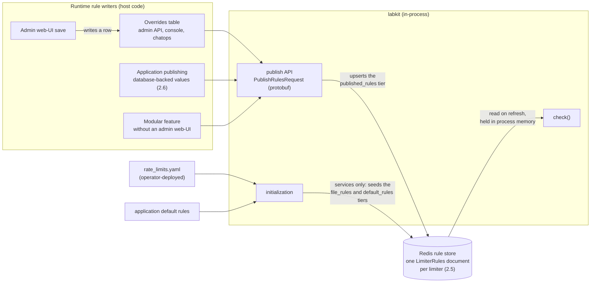
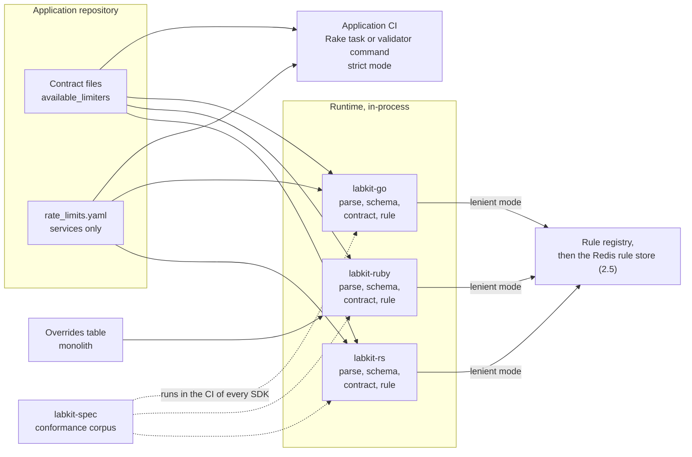

<!-- vale gitlab.FutureTense = NO -->



## 概要 {#summary}

GitLab のアプリケーションレベルのレート制限には、すべての実装（RackAttack、ApplicationRateLimiter、将来のサービス）で機能する単一の設定モデルが必要です。このドキュメントでは、共有 SDK として [labkit](https://gitlab.com/gitlab-org/labkit)を使用し、3 つのフェーズでそこに到達する方法を説明します。

1. 既存のレート制限（RackAttack、ApplicationRateLimiter）を、破壊的変更なしに labkit 経由にします。設定は引き続きデータベースから取得するか、アプリケーションから渡されます。
2. labkit が読み込む設定として、デフォルト用の契約ファイルと、ホストがデータベーステーブルまたはファイルから提供する上書きを追加します。上書きはアプリケーションのデフォルトを置き換えます。フォーマットは [LabKit 設定管理](../labkit_configuration/)の protobuf スキーマに従います。この段階でプランごと、名前空間ごとのルールが可能になります。
3. 識別子に基づいて、リクエストごとにルールを返す外部サービスを追加します。これにより、顧客ごとのカスタマイズと、デプロイなしでのルール変更が可能になります。

これは[次世代レート制限アーキテクチャ](../rate_limiting/)のブループリントと、[レート制限設定の簡素化](../rate_limiting_simplification/)デザインドキュメントを土台にしています。実装は[レート制限: プラットフォームとフレームワークの提供](https://gitlab.com/groups/gitlab-com/gl-infra/-/epics/1534)で追跡し、各フェーズに 1 つの子エピックを設けています（[追跡](#tracking)）。

## モチベーション {#motivation}

GitLab アプリケーションのレート制限は、RackAttack、ApplicationRateLimiter、いくつかの小さな実装に分散しています。それぞれが独自の設定メカニズム、独自のカウント、独自の可観測性を持っています。実際には、すべてのレート制限を同じ方法で設定できないこと、ドライランやバイパスの挙動がばらつくこと、新しいエンドポイントが制限なしでリリースされること、インシデント時に何がなぜ制限されているのかを誰もすばやく判断できないことを意味します。

[レート制限設定の簡素化](../rate_limiting_simplification/)ドキュメントは、以前の段階的なアプローチを説明しています。そこではエッジネットワークが Phase 1 であり、すでに完了しています。このドキュメントでは独自にフェーズを番号付けします。Phase 1 はアプリケーションレベルの統一、Phase 2 は外部化された設定、Phase 3 は動的な外部サービスです。

## Phase 1: アプリケーションレベルの統一 {#phase-1-application-level-unification}

すべてのアプリケーションレート制限は、`labkit-ruby` の単一 API を通ります。呼び出し元（Rack ミドルウェアまたはアプリケーションコード）は識別子を構築し、一連のルールとともに labkit に渡し、結果を受け取ります。既存の設定（ApplicationSettings、環境変数、ハードコードされたデフォルト）はそのまま機能します。呼び出し元は自身の設定を解決し、それを渡します。

*可能になること:* アプリケーション全体で制限を定義し、観測する一貫した方法。ルールの追加や変更には引き続きコード変更とデプロイが必要ですが、すべての制限が同じ方法で動作し、同じ方法で計装されるようになります。古い制限は移行され、新しい制限は自動的に同じ利点を得ます。

### 1.1 labkit レート制限 API {#11-the-labkit-rate-limiting-api}

`Labkit::RateLimit::Limiter` がメインのエントリーポイントです。レート制限チェックポイントごとに 1 つ（リクエストごとではなく起動時に）構築し、再利用します。内部の `Evaluator` はキャッシュされます。

```ruby
limiter = Labkit::RateLimit::Limiter.new(
  name: "rack_request",
  rules: [...]
)

result = limiter.check(identifier)
```

この API は 3 つの操作で構成されます。`check` はカウントして判定を返し、`peek` はカウントせずに同じ判定を返し、`clear` は 1 つの識別子に対するリミッターの状態を破棄します（[1.5](#15-action-semantics)を参照）。

`name` はすべての Redis カウンターキーの先頭に付与されるため、1 つのサービス内の異なるリミッターがカウンターを共有することはありません。リミッター名はアプリケーションごとの静的設定で、そのサービスの `available_limiters`（Phase 2）で宣言されるため、同じサービス内の 2 つのリミッターが誤って衝突することはありません。

名前はサービスをまたいで繰り返せます。`rack_request` が複数のサービスに存在しても問題ありません。各サービスは自身の Redis ストレージ（GitLab Rails の場合は専用のレート制限 Redis）でカウントするため、共有された名前が共有カウンターを意味することはありません。

### 1.2 言語 SDK {#12-language-sdks}

SDK は Ruby 固有ではありません。サポート対象の各言語は、同じモデルのネイティブ SDK を持ちます。リミッターを一度構築し、リクエストごとに識別子を構築し、`check` を呼び出し、結果に基づいて動作します。このドキュメントの例では簡潔さのために Ruby を使用しますが、Go API もそれに対応する必要があります。両方の SDK は同じ設定ファイル（Phase 2）を読み込み、同じ外部サービス（Phase 3）と通信するため、一度定義されたルールは、どの言語から呼び出されても同じことを行います。

<table>
<thead>
<tr><th width="50%">Ruby (<code>labkit-ruby</code>)</th><th width="50%">Go (<code>labkit/v2/ratelimit</code>)</th></tr>
</thead>
<tbody>
<tr>
<td>

```ruby
limiter = Labkit::RateLimit::Limiter.new(
  name: "rack_request",
  rules: [
    Labkit::RateLimit::Rule.new(
      name: "authenticated_api",
      characteristics: [:user],
      limit: 200,
      period_s: 60,
      action: :limit
    )
  ]
)

result = limiter.check(
  user: "user:123",
  request_type: "api"
)

case result.action
when :block then render_429
when :allow then # proceed
end
```

Ruby SDK には、アプリケーションの境界にあるミドルウェアに `429` のレンダリングを任せたい呼び出し箇所のために、例外を発生させる `check!` という便利メソッドもあります。最初の Rails イテレーションでは、呼び出し箇所側で結果とレスポンスコードを処理し（[1.6](#16-result-object)を参照）、呼び出し箇所が許すところで `check!` を採用します。

</td>
<td>

```go
limiter := ratelimit.New(ratelimit.Config{
    Name: "rack_request",
    Rules: []ratelimit.Rule{
        {
            Name:            "authenticated_api",
            Characteristics: []string{"user"},
            Limit:           200,
            Period:          60 * time.Second,
            Action:          ratelimit.ActionLimit,
        },
    },
})

result, err := limiter.Check(ctx, ratelimit.Identifier{
    "user":         "user:123",
    "request_type": "api",
})

switch result.Action {
case ratelimit.ActionBlock:
    renderTooManyRequests(w)
case ratelimit.ActionAllow:
    // proceed
}
```

</td>
</tr>
</tbody>
</table>

設定ではなくプログラムでルールを定義することは、原則ではなく例外であるべきです。ただし、このサポートは必要です。これがないと、この用途のためにデータベースに設定を持っている可能性がある Self-Managed 設定を壊してしまうためです。

### 1.3 識別子 {#13-identifier}

識別子は、呼び出し元がリクエストについて知っている情報で構築するキーと値のハッシュです。リミッターごとに異なる形を持ちます。

**Rack ミドルウェア:**

```ruby
{
  request_type: "api",
  user: "user:123",        # or "<anonymous>" for unauthenticated
  ip: "203.0.113.42",
  path: "/api/v4/projects/1/merge_requests",
  namespace: 345,
  namespace_plan: "premium",
  endpoint: "GET /api/v4/:id/merge_requests"
}
```

**ApplicationRateLimiter:**

```ruby
{
  user_id: 42,
  project_id: 789,
  namespace_id: 345
}
```

`<anonymous>` は山括弧を使用するため、実際のユーザー名と衝突できません。未認証ルールは `user: "<anonymous>"` にマッチし、`[:ip]` でカウントします。認証済みルールはこの値にマッチしないため、フォールバックとして動作し、`[:user]` でカウントします。

### 1.4 ルールとマッチング {#14-rules-and-matching}

各ルールは以下を持ちます。

- **`name`** — Redis キー、ログ、メトリクスで使用される安定した識別子
- **`match`** — ルールを適用するために識別子にすべて存在している必要があるキーと値の組。等価マッチングと、`Matcher` オブジェクトを介した正規表現マッチングをサポートします（[#28855](https://gitlab.com/gitlab-com/gl-infra/production-engineering/-/work_items/28855)）。Matcher の設計では、言語をまたいで YAML を往復変換できるよう、明示的な演算子（`{ eq: ... }`、`{ re: ... }`）を使用します（[2.3](#matching)）。
- **`characteristics`** — Redis カウンターキーの導出に使用される識別子キー。リミッター名は常に先頭に付与されます。
- **`limit`** — 閾値。静的な整数、またはデータベース由来の値のための呼び出し可能オブジェクト（チェック時に解決）にできます。
- **`period_s`** — 秒単位の時間窓。これも呼び出し可能オブジェクトにできます。
- **`action`** — ルールが何をするか。`limit`、`log`、`skip` のいずれかです（[1.5](#15-action-semantics)を参照）。
- **`ban_for_s`** — オプション。カウントするルールで、制限を超えた後にブロックを継続する時間です（[1.5](#15-action-semantics)を参照）。

### 1.5 アクションのセマンティクス {#15-action-semantics}

各ルールは、それが何をするかを説明する `action` を持ちます。呼び出し元に返される結果は、その結果、つまり呼び出し元が何をすべきかを説明します。

| ルールのアクション | 何をするか | 超過? | 結果のアクション | 終端? |
|---|---|---|---|---|
| `limit` | 制限に対してカウントする | いいえ | `allow` | いいえ — 次のルールへ継続 |
| `limit` | 制限に対してカウントする | はい | `block` | はい — 評価を停止 |
| `log` | 制限に対してカウントする（可観測性のみ） | いいえ | `allow` | いいえ — 継続 |
| `log` | 制限に対してカウントする（可観測性のみ） | はい | `allow` | いいえ — 継続 |
| `skip` | カウントしない（回避） | 該当なし | `allow` | はい — 評価を停止 |

終端アクションはルール評価を停止します。非終端アクションは次にマッチするルールへ継続します。

単一のリミッター内に複数の `:limit` ルールがある場合、リクエストを通すにはそれらすべてが成功する必要があります（例: 組織ごとの制限とユーザーごとの制限）。`:log` ルールは、その後の `:limit` ルールに影響を与えずに、低い閾値をシャドーテストできます。リストの先頭にある `:skip` ルールは回避を処理します。

ルールは順序どおりに評価されます。より具体的なルールを、より一般的なルールより前に置いてください。

#### 禁止: 時間窓より長いブロック {#bans-blocking-for-longer-than-the-window}

一部の制限では、時間窓より大きな代償を課す必要があります。繰り返される認証失敗が典型例です。1 分間に 10 回パスワードを間違えたからといって、次の 1 分間に新しい許容量を得られるべきではありません。

ルールは `limit` と `period_s` に加えて `ban_for_s` を持てます。これは独立したアクションではなく、カウントするアクションの修飾子であるため、他のすべてと同じ方法で `limit` および `log` と組み合わせられます。

| ルールのアクション | `ban_for_s` を使用する場合 | 超過? | 結果のアクション | 終端? |
|---|---|---|---|---|
| `limit` | 禁止がすでに有効でない限りカウントし、制限を超えたら禁止を開始する | はい、または禁止が有効 | `block` | はい — 評価を停止 |
| `log` | 禁止の書き込みも含め、`limit` と同じようにカウントする | はい | `allow` | いいえ — 継続 |

禁止はカウンターとは別の状態であり、独自の有効期間を持ちます。一度開始すると、カウントの時間窓が期限切れになってカウンターが消えた後も、呼び出し元は `ban_for_s` 秒間ブロックされます。これが目的です。カウンターは「直近 1 分間に何回か」に答え、禁止は「さらに次の 15 分間は利用できない」に答えます。

明記しておくべき結果が 3 つあります。

- **禁止はカウントを抑制します。** 禁止が有効な間、ルールは値を増加させずにブロックするため、呼び出し元は再試行を続けて自身の禁止を延長できず、禁止は予測可能な時刻に解除されます。
- **`reset_at` は時間窓ではなく禁止の期限を報告します。** 禁止中は、その時刻になれば呼び出し元が有効に再試行できます。
- **禁止が有効でもカウントが制限を下回ることがあります。** 時間窓が期限切れになるとカウンターは消えますが禁止は残るため、`exceeded` はカウントではなく禁止に従います。

禁止は、リミッターが保持する状態のうち、呼び出し元が早期に終了させる必要のある最初のものです。ログインが成功したら、その前の失敗を破棄するべきです。それ以外のカウンターは時間窓の期限が切れたときにのみ消えるため、SDK は `clear(identifier)` を公開します。これは、シャドー禁止を含む 1 つの識別子に対するリミッターのカウンターと禁止を破棄します。成功後に状態を消去する呼び出し元が知っているのは誰が成功したかであり、途中でどのルールにマッチしたかではないため、単一のルールではなくリミッターと識別子をスコープにします。

**シャドーは実際のカウントを行います。** `ban_for_s` を持つ `log` ルールは、`limit` 版とまったく同じようにカウントし、独自の禁止を書き込み、その禁止が有効な間はカウントを停止します。省略するのはブロックだけです。そのため、生成される数値は概算ではなく、強制時に生成されるはずの数値になります。

シャドーデータを読む際に知っておくべき相違点が 1 つあります。成功時には `clear` が呼ばれてシャドー禁止が破棄されますが、強制時には呼び出し元が拒否されるため、その成功は起こり得ません。したがって、同じ識別子の背後にいる誰かが認証に成功するとシャドー禁止は早く終了します。これは共有アドレスで特に重要です。強制時には正当なユーザーがロックアウトされますが、シャドーは静かに自身を解除します。シャドーは影響を過大ではなく過小に評価します。

### 1.6 結果オブジェクト {#16-result-object}

結果には判定と解決済みの値が含まれます。

```ruby
result = limiter.check(identifier)

result.action               # :allow or :block — what the caller should do
result.exceeded?            # whether the count exceeded the limit
result.rule                 # the most constraining evaluated Rule
result.error?               # true if Redis was unavailable (fail-open)
result.info.resolved_limit  # the resolved limit as Integer
result.info.resolved_period # the resolved period in seconds as Integer
result.info.reset_at        # when the caller may retry
```

解決済みの値は `info` 配下にあり、`skip` やエラーなど、カウンターを持たない結果では `nil` です。

`reset_at` はカウント時間窓の終了時刻ですが、禁止が有効な間は禁止の有効期限です。これは呼び出し元が待つべき時刻であり、`Retry-After` ヘッダーはこの値から構築するべきです。

呼び出し元は結果を処理する責任があります。例を示します。

```ruby
result = limiter.check(identifier)
case result.action
when :block then render_429
when :allow then # proceed
end
```

最終的には、labkit が一般的なケース向けのデフォルトハンドラーを提供するべきです。`RateLimit-*` ヘッダーを付けて 429 を返す Rack ミドルウェア、gRPC インターセプター、Sidekiq ミドルウェアなどです。これらは、エンドポイントごとの調整なしに暴走する消費を防ぐ、汎用的なリソース単位の制限（例: ユーザーごとの db_duration_s、ユーザーごとの Gitaly スコア）を置く自然な場所でもあります。それまでは、呼び出し元が結果を自分で処理します。

### 1.7 設定のパススルー {#17-configuration-passthrough}

Self-Managed インストールを壊すことはできません。そのため、設定は呼び出し箇所で渡されます。呼び出し元は既存のソース（ApplicationSettings、環境変数、ハードコードされたデフォルト）から制限を解決し、ルールとして labkit に渡します。

ルール上の `limit` と `period_s` は呼び出し可能オブジェクトにできます。これにより、データベース由来の設定を、ルールオブジェクトを再構築せずにチェック時に解決できます。

```ruby
Rule.new(
  name: "authenticated_api",
  limit: -> { ApplicationSetting.current.throttle_authenticated_api_requests_per_period },
  period_s: -> { ApplicationSetting.current.throttle_authenticated_api_period_in_seconds },
  characteristics: [:user],
  action: :limit
)
```

Self-Managed と GitLab.com は引き続き機能します。呼び出し可能オブジェクトはこれまでと同じ設定を読み取ります。誰かが明示的に再設定しない限り、制限は変わりません。

呼び出し可能オブジェクトは Phase 1 の互換性を確保する一時的な基盤であり、最終状態ではありません。ホットパスで labkit がホストコードを呼び出し、対応する各言語で「呼び出し可能オブジェクト」という概念を持つ必要がありますが、これは Ruby 以外へうまく移植できません。[2.6](#26-dynamic-limits)では、これを置き換えるものと既存の呼び出し可能オブジェクトを廃止する方法を説明します。

計画では、`ApplicationRateLimiter` の現在の `rate_limits` ハッシュを、唯一の信頼できる情報源としての静的な labkit `Limiter` オブジェクトに置き換えます（[#29054](https://gitlab.com/gitlab-com/gl-infra/production-engineering/-/work_items/29054)）。

最終状態では、データベースはレート制限のホットパスから外れますが、管理者用 Web UI は維持します。クリック操作を好む管理者は引き続き利用できます。変わるのは UI の書き込み先です。リミッターがすべてのリクエストで読む `ApplicationSettings` 行ではなく、UI は上書きテーブルに行を書き込み、その行は公開 API を通じて labkit の Redis ルールストアに届きます（[2.4](#24-redis-backed-rules-web-ui-configuration)を参照）。すべてのデプロイ形態に上書きテーブルを提供し（[2.7](#27-deployment)）、管理者用 Web UI はそのテーブルのフォームとして後から提供します。GitLab.com は外部サービスも利用します。設定由来の値はカラムを維持し、公開 API を通じてストアに届きます（[2.6](#26-dynamic-limits)）。

より広い設定の進化は [#28853](https://gitlab.com/gitlab-com/gl-infra/production-engineering/-/work_items/28853)で追跡されています。

### 1.8 移行: ApplicationRateLimiter（ステージ 2a） {#18-migration-applicationratelimiter-stage-2a}

フィーチャーフラグの背後で、`ApplicationRateLimiter.throttled?` は内部のカウント戦略ではなく labkit の `Limiter` に委譲します。公開 API は変わりません。コントローラーとサービスはこれまでどおり `.throttled?` を呼び出し続けます。

5 〜 10 個のレート制限キーからなるコホートごとに移行します。各キーには 2 つのフィーチャーフラグを用意します。`_use_labkit_<key>`（シャドーモード）と `_<key>_enforce`（強制適用）です。強制適用に切り替える前に、シャドー検証は 24 時間で判定の相違が 0.5% 未満という条件を満たす必要があります。

- [#28808](https://gitlab.com/gitlab-com/gl-infra/production-engineering/-/work_items/28808) — 反復可能なプロセスを含む全体の移行 Issue
- [#28803](https://gitlab.com/gitlab-com/gl-infra/production-engineering/-/work_items/28803) — コホート 1（5 個のキー: `pipelines_create`、`notes_create`、`search_rate_limit`、`users_get_by_id`、`user_sign_in`）
- [#28809](https://gitlab.com/gitlab-com/gl-infra/production-engineering/-/work_items/28809) — コホート 2（残りの IncrementPerAction キー）
- [#28810](https://gitlab.com/gitlab-com/gl-infra/production-engineering/-/work_items/28810) — コホート 3（`.peek` の呼び出し元、labkit の `Limiter#peek` 待ち）
- [#28811](https://gitlab.com/gitlab-com/gl-infra/production-engineering/-/work_items/28811) — コホート 4（IncrementPerActionedResource、Set 戦略待ち）
- [#28812](https://gitlab.com/gitlab-com/gl-infra/production-engineering/-/work_items/28812) — コホート 5（IncrementResourceUsagePerAction、浮動小数点コスト戦略待ち）
- [#28876](https://gitlab.com/gitlab-com/gl-infra/production-engineering/-/work_items/28876) — ロールアウト後のフィーチャーフラグ整理
- [#29054](https://gitlab.com/gitlab-com/gl-infra/production-engineering/-/work_items/29054) — `rate_limits` ハッシュを静的な labkit リミッターオブジェクトに置き換える

### 1.9 移行: RackAttack（ステージ 2b） {#19-migration-rackattack-stage-2b}

新しいミドルウェアは既存の RackAttack ミドルウェアと並行して実行されます。RackAttack は強制適用を継続します。新しいミドルウェアはログモードから始めて、並行して実行されます。

リミッターは次の 2 つです。

1. **`rack_request`** — すべての一般的なレート制限（API、Web、Git、パッケージ）。認証済みと未認証の区別は、`<anonymous>` センチネルと異なる特性（`[:ip]` と `[:user]`）を使い、ルール内で処理されます。
2. **`rack_request_protected_paths`** — 保護されたパスのレート制限のみ。 これらは一般的なレート制限と重なります（保護された API パスへの POST は両方を発火します）ので、別のリミッターによる独立したカウンターが必要です。

4 つではなく 2 つのリミッターにする理由は次のとおりです。

- 認証済み／未認証の区別は特性（何でカウントするか）であり、リミッターの境界ではありません
- Git レート制限は API／Web レート制限と相互排他的です
- フィーチャーフラグが少なくなります（8 ではなく 4）
- 豊かな識別子を持つ汎用リミッターにより、後で外部設定を注入しやすくなります（[#28853](https://gitlab.com/gitlab-com/gl-infra/production-engineering/-/work_items/28853)）

[#28852](https://gitlab.com/gitlab-com/gl-infra/production-engineering/-/work_items/28852)で追跡されています。

### 1.10 可観測性 {#110-observability}

**Prometheus メトリクス** — カウンターメトリクスは、非終端ルールチェーンをカバーするために 2 つの粒度に分割されます。

| メトリクス | 型 | ラベル | 目的 |
|---|---|---|---|
| `gitlab_labkit_rate_limiter_checks_total` | カウンター | `rate_limiter`, `action`, `matched`, `error` | フェイルオープンになる呼び出しを含め、`check` の呼び出しごとに正確に 1 回増加。`action` は呼び出し元向けの判定（`allow`\|`block`）、`matched` と `error` は真偽値フラグです。カーディナリティは低く、レート制限全体の健全性を示します。 |
| `gitlab_labkit_rate_limiter_rule_evaluations_total` | カウンター | `rate_limiter`, `rule`, `action`, `result` | 評価されたルールごとに 1 回増加。非終端チェーン内のすべてのルールを捕捉します。`action` は設定されたルールアクション（`limit`\|`log`\|`skip`）、`result` は評価で決定された内容（`allow`\|`block`\|`log`\|`skip`\|`banned` — 超過した `log` ルールは `result="log"` と報告し、禁止が有効なルールはアクションにかかわらず `result="banned"` と報告するため、個別の `exceeded` ラベルは不要です）。 |
| `gitlab_labkit_rate_limiter_peeks_total` | カウンター | `rate_limiter`, `error` | フェイルオープンになる呼び出しを含め、`peek` の呼び出しごとに正確に 1 回増加。`error` は真偽値フラグです。 |
| `gitlab_labkit_rate_limiter_limit` | ゲージ (`:max`) | `rate_limiter`, `rule` | 設定された閾値。 |
| `gitlab_labkit_rate_limiter_period_seconds` | ゲージ (`:max`) | `rate_limiter`, `rule` | 設定された期間。 |

> **実装メモ:** メトリクスの分割は
> [#29519](https://gitlab.com/gitlab-com/gl-infra/production-engineering/-/work_items/29519)で実装し、
> [#29052](https://gitlab.com/gitlab-com/gl-infra/production-engineering/-/work_items/29052)の提案を改良しています。
> チェックごとのカウンターは、`calls_total` の形を変えたものではなく、
> 新しいメトリクス（`checks_total`）です。prometheus-client-mmap は
> メトリクス名ごとに 1 つのラベルシグネチャしか許可しません。
> 旧形と新形を同時に出力できないため、新しい名前によって
> 追加的なロールアウトを維持します。分割前のカウンター `calls_total` と
> `errors_total`（[#28798](https://gitlab.com/gitlab-com/gl-infra/production-engineering/-/work_items/28798)）は、
> 新しいカウンターとともに 1 リリースの間出力し、ランブックの移行
> （SLI、ダッシュボード、アラート）が完了して動作を確認した後、
> 破壊的変更を含む labkit リリースで削除しました。
> `peeks_total` も同じリリースで追加しました。`peek` は
> `checks_total` を出力しないため、`errors_total` を削除すると、
> `peek` のエラーメトリクスがなくなるからです。
> `clear` は引き続きログのみです。

**追加の可観測性作業:**

- [#28799](https://gitlab.com/gitlab-com/gl-infra/production-engineering/-/work_items/28799) — 既存のリクエストごとのログメッセージにレート制限状態を含める
- [#28831](https://gitlab.com/gitlab-com/gl-infra/production-engineering/-/work_items/28831) — Rate Limiting Overview ダッシュボードを更新する
- [#28832](https://gitlab.com/gitlab-com/gl-infra/production-engineering/-/work_items/28832) — デフォルト SLI アラートのためにメトリクスカタログに登録する
- [#28807](https://gitlab.com/gitlab-com/gl-infra/production-engineering/-/work_items/28807) — 移行のための Redis クラスターの余裕を調査する
- [#28827](https://gitlab.com/gitlab-com/gl-infra/production-engineering/-/work_items/28827) — Redis 操作を単一の Lua EVAL 呼び出しに統合する

### 1.11 コストを考慮したレート制限 {#111-cost-aware-rate-limiting}

`GET /api/v4/user` と複雑な GraphQL クエリは同じものではありませんが、単純なリクエストカウンターはそれらを同等に扱います。`check` の `cost:` パラメーターにより、実際のリソース消費量に基づいてカウントできます:

```ruby
result = limiter.check(identifier)                         # default cost: 1
result = limiter.check(identifier, cost: db_duration_s)    # cost = actual DB time
```

Rack ミドルウェアはこれを使って、ルート名前空間ごとのデータベース時間を制限できます。各リクエストの完了後に、実際にかかったコストを加算します。

```ruby
limiter = RESOURCE_LIMITERS[:db_utilization]
result = limiter.check(
  { root_namespace: request.root_namespace, user: request.user },
  cost: request.db_duration_s
)
```

以下のようなルールを使います。

```ruby
Rule.new(
  name: "db_seconds_per_namespace",
  characteristics: [:root_namespace],
  limit: 300,      # 300 seconds of DB time per period
  period_s: 60,
  action: :limit
)
```

特性はスコープ（ユーザーごと、プロジェクトごと、名前空間ごと）を選びます。コストは何を測定するかを選びます。同じパターンは、Gitaly 呼び出し時間、オブジェクトストレージのバイト数、Sidekiq ジョブの重みにも適用できます。

作業を行う前にコストがわからない場合は、まず `peek` します。

```ruby
result = limiter.peek(identifier)
if result.action == :block
  return error("rate limited, retry after #{result.reset_at}")
end

cost = do_expensive_work

limiter.check(identifier, cost: cost)
```

これにより、追加の操作が 1 つ通る可能性があります（peek は「問題なし」と判定したものの、コストは想定より大きかった場合です）。その後の次のリクエストはブロックされます。

`cost:` と `ban_for_s` を組み合わせる際は注意してください。1 回の高コストな呼び出しが単独で制限を超える可能性があり、禁止が付いている場合、呼び出し元には 1 回のリクエスト拒否ではなく禁止の全期間が課されます。上記の、先に peek してから check するパターンにも同じエッジケースがあります。意図的に通す操作が禁止を開始するには十分なのです。禁止は、可変コストのリソース制限よりも、不正な資格情報など個別の失敗をカウントする場合に適しています。

内部的には、`cost:` は Lua EVAL 内で `INCRBYFLOAT` を使用します（[#28827](https://gitlab.com/gitlab-com/gl-infra/production-engineering/-/work_items/28827)）。`1` を指定した `INCRBYFLOAT` は `INCR` と同じように振る舞うため、整数コストと浮動小数点コストのために別々のカウント戦略はありません。

## Phase 2: 外部化された設定 {#phase-2-externalized-configuration}

Labkit は、アプリケーションが提供するデフォルトを上書きする設定を読み込みます。
フォーマットは [LabKit 設定管理](../labkit_configuration/)デザインドキュメントに従います。protobuf スキーマが構造を定義し、YAML がシリアライズ形式になります。
スキーマが共有されるため、同じファイルは `labkit-ruby`、`labkit-go`、`labkit-rs`、それを利用するサービスで同じように読み込まれます。
適合性コーパスで、すべての SDK がこのとおりに動くことを検証します（[2.8.2](#282-validation)）。

*可能になること:* 設定を通じたルールの追加と変更。
ルール変更はコードではなく YAML の変更になります。
プランごと、名前空間ごとの閾値は、識別子のプロパティにマッチするルールになります。

Phase 2 はこの順序でリリースします。
[gl-infra&2113](https://gitlab.com/groups/gitlab-com/gl-infra/-/work_items/2113)で作業を追跡しています。

1. スキーマ（[2.2](#22-available-limiters)、[2.3](#23-rate-limits)）と適合性コーパス（[2.8.2](#282-validation)）。
1. `labkit-ruby`、`labkit-go`、`labkit-rs` のファイルローダー。各ローダーは、リミッターごとのルールを保持するプロセス内レジストリにデータを投入します。
1. GitLab モノリスが静的なデフォルトルールを `available_limiters` ファイルに移します（[2.8](#28-gitlab-monolith-flow)）。
1. モノリスが上書きをテーブルに保存し、公開 API を通じて公開します（[2.4](#24-redis-backed-rules-web-ui-configuration)、[2.8](#28-gitlab-monolith-flow)）。
1. Redis ルールストアが公開済みルールをすべてのプロセスに届けます（[2.5](#25-rule-sources-and-precedence)）。

管理者用 Web UI（[2.4](#24-redis-backed-rules-web-ui-configuration)）と、公開 API による設定由来の制限の廃止（[2.6](#26-dynamic-limits)）は、ルールストアを土台にします。
これらは上記の手順の後に行う別の作業です。

手順 4 は手順 5 より先にリリースしてテストできますが、効果があるのは手順 5 が加わってからです。
ストアが存在するまでは、公開した内容はコールバックを実行したプロセスのプロセス内レジストリだけに届きます。
そのため、ストアが行をすべてのプロセスに届けるようになるまで、手順 4 の管理 API はフィーチャーフラグの背後に置きます。

### 2.1 2 種類の設定 {#21-two-kinds-of-configuration}

2 つの設定ドキュメントがあります。

1. **利用可能なリミッター**は契約です。存在するレートリミッター、ルールがマッチやカウントに使用できる識別子のプロパティ、各リミッターのデフォルトルールを一覧にします。アプリケーション開発者は、自分たちのコードが公開するリミッターを宣言し、デフォルトを提案します。リミッターを所有するチームが、その契約ファイルを所有します。契約ファイルはアプリケーションとともに同梱され、他のツールも読み取れます。
1. **レート制限**は、デフォルトを置き換えたり追加したりする上書きルールの形式です。上書きの保存先はホストによって異なります（[2.7](#27-deployment)）。GitLab モノリスはデータベーステーブルに保持し、ルールストアに公開します（[2.4](#24-redis-backed-rules-web-ui-configuration)）。データベースを持たないサービスは、コードとともに `rate_limits.yaml` を同梱します。

モノリスは、所有グループごとに 1 つずつ、複数の契約ファイルを `config/rate_limits/` と `ee/config/rate_limits/` 配下に同梱します。
Labkit はこれらを 1 つの契約に統合します。
リミッターは、説明とともに、ただ 1 つのファイルで宣言します。
後続のファイルは、`available_properties`、`default_rules`、`protected_rules` だけを指定して同じリミッターを記載し、追加できます。2 つ目の説明は契約ステップで拒否します。
ファイルが保護できるのは自身が宣言したデフォルトルールだけであり、スキーマがこれを確認します。すべてのファイルのリストは和集合として統合します。
スキーマは `description` を必須にしないため、後続のファイルも単独でスキーマステップに合格します。
ルール名はすべてのファイルで一意です。
EE ファイルは CE リミッターにルールを追加できますが、ルールを再定義できません。
CODEOWNERS はファイルごとに 1 つのセクションを持つため、チームは自身のリミッターの変更だけを承認します。
CI はすべての契約ファイルを厳格モードで検証します（[2.8.2](#282-validation)）。

Labkit は上書きを契約に照らして検証します。
ルールは存在するリミッターだけを対象にできます。
ルールは、そのリミッターに記載されたプロパティだけをマッチやカウントに使用できます。

上書きは 2 種類のルールを保持します。
運用者は、Rack ミドルウェアや gRPC インターセプターなど、アプリケーションが共有するリミッター向けのグローバルルールを設定します。
サービス所有者は、自身のサービスにあるリミッターのルールを調整します。
チームは、オンコールで担当するサービスの制限を管理する自由を持ちます。
Infrastructure は、共有 Redis や下流サービスへの負荷増加など、横断的な影響がある変更に意見を出します。
1 つのソース内では、ドキュメントの順序が評価順序になります（[2.5](#25-rule-sources-and-precedence)）。

上書きは、同じ名前のデフォルトルールを置き換えられるため、リミッター全体の制限を上げ下げできます。
契約ファイルは `protected_rules` にルール名を記載できます。`force` の有無にかかわらず、保護されたルールを上書きで置き換えることはできず、その制限は契約ファイルでのみ変更できます。
すべての SDK が契約ステップでこれを強制します（[2.8.2](#282-validation)）。保護された名前を持つファイルルールや公開済みルールは、厳格モードでは失敗となり、寛容モードでは警告とともに除外されます。
名前を保護する契約変更には、その名前を持つ既存の行を取り消すデータマイグレーションを同梱します（[2.4](#24-redis-backed-rules-web-ui-configuration)）。
階層に対応したプランルールは、顧客が支払うプランに制限が結び付いているため保護します。
1 つの名前空間だけ扱いを変えるには、運用者が新しい名前で、その名前空間に `match` する、より小さい `position` を持つルールを追加し、その後にその名前空間向けの `skip` を追加します。どちらもデフォルトより先に実行されるため、その名前空間が保護されたルールに到達することはありません。
1 つの名前空間など、トラフィックの一部だけを対象とするルールは、マッチするすべてのルールがカウントするため、より厳しい制限しか追加できません。
トラフィックの一部だけ制限を上げる唯一の方法は、新しいルールの後に、そのトラフィック向けの `skip` ルールを置くことです。
その `skip` は、そのトラフィックに対する他のすべてのデフォルトも回避するため、他の回避と同じレビューを受けます。

チームはリミッターを自由に回避できません。
Phase 1 では既存の回避を維持する必要があるため、フレームワークは `skip` ルールを許可しますが、回避は追加したチーム以外にも影響します。
モノリスでは、`skip` は [2.8](#28-gitlab-monolith-flow)における緩和変更であり、`force` フラグとそれに伴うレビューが必要です。
サービスリポジトリでは、上書きファイルの CODEOWNERS が同じレビューを担います。

バイパスヘッダーやユーザー許可リストなど、アプリケーション自体に必要な回避は、どの設定にも含めません。
これらはコード内のガードルールです。
ガードルールは設定されたすべてのルールより先に実行されるため、設定から削除したり、その前にルールを置いたりできません（[2.5](#25-rule-sources-and-precedence)）。

### 2.2 利用可能なリミッター {#22-available-limiters}

このドキュメントは、各リミッターが何をいつ適用するかと、そのデフォルトルールを宣言します。
この例のリミッター、プロパティ、値は説明用です。

```yaml
# available_limiters.yaml: ships with the application
available_limiters:
  pipelines_create:
    description: "Rate limit enforced before a pipeline is allowed to be created"
    available_properties: # identifier keys that match, characteristics and count_distinct can use
      - project_path
      - username
      - root_namespace_path
      - root_namespace_plan
      - sha
    default_rules: # optional: the in-application defaults
      - name: limit_pipelines_created_by_project_user_sha
        action: ACTION_LIMIT
        characteristics: [username, project_path, sha]
        limit: 10
        period_s: 60
  user_sign_in:
    description: "Enforced before a session is created for a specific user"
    available_properties:
      - ip
      - username
    default_rules:
      - name: limit_user_sign_ins_by_username
        action: ACTION_LIMIT
        characteristics: [username]
        limit: 5
        period_s: 600
        ban_for_s: 900 # the shipped default is itself a ban
  rack_request:
    description: "Enforced in the Rack middleware, for every web, API and Git request"
    available_properties:
      - ip
      - path
      - request_type
    default_rules:
      - name: limit_sign_in_attempts_by_ip
        action: ACTION_LIMIT
        characteristics: [ip]
        limit: 20
        period_s: 60
        match:
          path: { eq: /users/sign_in }
      - name: limit_rack_requests_by_ip # no match: every request the middleware sees
        action: ACTION_LIMIT
        characteristics: [ip]
        limit: 1000
        period_s: 60
```

`default_rules` は、アプリケーションがデフォルトで適用する内容を保持します。
デフォルトルールは、レート制限ルールと同じ `Rule` メッセージを、`match` も含めて使用します（[2.3](#23-rate-limits)）。
`match` のないデフォルトルールは、リミッターが受け取るすべてのリクエストに適用されます。
`user_sign_in` のように単一のチェックポイントを保護するリミッターには、それで十分です。
汎用リミッターには、さらに設定が必要です。
`rack_request` はサービスが処理するすべてのリクエストを受け取るため、単一の包括的な数値は適切なデフォルトではありません。
各デフォルトには、対象トラフィックにルールのスコープを絞るための `match` を持たせます。たとえば、他のすべてのリクエストよりも `/users/sign_in` に厳しい制限を設けます。

`name` はルールの識別子であるため必須です。
Labkit はこれを Redis カウンターキーのセグメントとして使用し、同じ名前を持つ優先順位の高いルールが、このルールを置き換えます（[2.5](#25-rule-sources-and-precedence)）。
名前を変更するとルールのカウンターは放棄され、この名前が上書きの対象になります。

アプリケーションは、基本ファイルとエディション固有ファイルなど、複数の契約ファイルを同梱できます。
後続のファイルは、リミッターの追加、リミッターへのプロパティの追加、デフォルトルールの追加、デフォルトルールの保護ができます。
後続のファイルでルール名を再定義することはできません。

Rack ミドルウェアや gRPC インターセプターなどにある汎用リミッターのデフォルトは、copier テンプレートに置けます。
これを変更するときは、利用する各サービスが次に `copier update` を実行したときに更新する [copier マイグレーション](https://copier.readthedocs.io)を提供します。
新しい共有リミッターはテンプレートからデフォルトを取得し、各サービスが個別に書く必要はありません。
テンプレートは `rate_limits` ファイルも生成します。

スキーマは [`gitlab-org/protos`](https://gitlab.com/gitlab-org/protos)に、`gitlab.infrastructure.v1` と並ぶパッケージ `gitlab.ratelimit.config.v1` として置きます。
これは、この設計の最初のバージョンで指定したパッケージであり、Dynamic Rate Limits 設計がすでにインポートしているパッケージです。
protos は Go と Ruby のコードを生成し、各モジュールをリリースします。`labkit-rs` は同じ proto から Rust コードを生成します（[2.8.1](#281-generation-and-publishing)）。
以下がスキーマの契約部分です。

```proto
syntax = "proto3";

package gitlab.ratelimit.config.v1;

import "buf/validate/validate.proto";

message AvailableLimiters {
  map<string, LimiterSpec> available_limiters = 1 [
    (buf.validate.field).map.min_pairs = 1,
    (buf.validate.field).map.keys.string.pattern = "^[a-z0-9_]{1,64}$"
  ];
}

message LimiterSpec {
  string description = 1; // set in exactly one file per limiter; the contract step enforces it
  repeated string available_properties = 2 [
    (buf.validate.field).repeated.unique = true,
    (buf.validate.field).repeated.max_items = 100,
    (buf.validate.field).repeated.items.string.pattern = "^[a-z0-9_]{1,64}$"
  ];
  repeated Rule default_rules = 3 [(buf.validate.field).repeated.max_items = 200]; // the same Rule message as in RateLimits (2.3)
  // Names of default rules of this file that no override may replace (2.8).
  repeated string protected_rules = 4 [
    (buf.validate.field).repeated.unique = true,
    (buf.validate.field).repeated.max_items = 200,
    (buf.validate.field).repeated.items.string.pattern = "^[a-z0-9_]{1,64}$"
  ];

  option (buf.validate.message).cel = {
    id: "limiter_spec.protected_rules_declared"
    message: "every protected rule must be a default rule of this limiter"
    expression: "this.protected_rules.all(n, this.default_rules.exists(r, r.name == n))"
  };

  option (buf.validate.message).cel = {
    id: "limiter_spec.unique_default_names"
    message: "default rule names must be unique within a limiter"
    expression: "this.default_rules.map(r, r.name).unique()"
  };

  // Default rules keep document order, so a position has no meaning there.
  option (buf.validate.message).cel = {
    id: "limiter_spec.no_position_in_defaults"
    message: "position is not allowed on a default rule"
    expression: "this.default_rules.all(r, !has(r.position))"
  };
}
```

### 2.3 レート制限 {#23-rate-limits}

運用者とサービス所有者は、このドキュメントでルールを設定します。
各ルールは、適用先のリミッター、対象リクエストを選択する `match`、実行するアクションを指定します。
この例は、モノリスのリミッターを使用してファイル形式を示しています。
モノリスでは同じルールが上書きテーブルの行になり（[2.8](#28-gitlab-monolith-flow)）、サービスではファイルに書き込みます。

```yaml
# rate_limits.yaml: global rules from operators, service-scoped rules from service owners
rate_limits:
  pipelines_create:
    rules:
      - name: pipelines_create_free_plan
        description: "pipelines per project per 10 minutes for free users"
        action: ACTION_LIMIT
        characteristics: [project_path]
        limit: 100
        period_s: 600
        match:
          root_namespace_plan: { eq: free }
      - name: pipelines_create_ultimate_plan
        description: "pipelines per project per 10 minutes for ultimate users"
        action: ACTION_LIMIT
        characteristics: [project_path]
        limit: 1000
        period_s: 600
        match:
          root_namespace_plan: { eq: ultimate }
      - name: pipelines_create_per_user_hourly
        description: "limit pipelines a single user can create per hour"
        action: ACTION_LIMIT
        characteristics: [username]
        limit: 60
        period_s: 3600
      - name: pipelines_create_skip_app_defaults
        description: "skip any application-defined rules"
        action: ACTION_SKIP
  user_sign_in:
    rules:
      - name: user_sign_in_distinct_users_per_ip
        description: "distinct users attempting to sign in from a single IP"
        action: ACTION_LIMIT
        characteristics: [ip]
        count_distinct: username
        limit: 10
        period_s: 3600
      - name: user_sign_in_ban_ip_after_failures
        description: "ban an IP for 15 minutes after 10 failed sign-ins in a minute"
        action: ACTION_LIMIT
        characteristics: [ip]
        limit: 10
        period_s: 60
        ban_for_s: 900
```

ファイル内のルールは、アプリケーションのガードルールより**後**、デフォルトルールより**前**に実行されます（[2.5](#25-rule-sources-and-precedence)）。
`match` のない末尾の `skip` ルールは、すべてのリクエストにマッチします。
これにより、ファイルがリミッターの唯一の信頼できる情報源になります。`skip` に到達したリクエストは、アプリケーションデフォルトに到達しません。
この順序における Phase 3 サービスのルールの位置は、[3.1](#31-service-design)で定義します。

`name` はリミッター内で一意でなければなりません。
アプリケーションデフォルトと同じ名前のルールは、そのデフォルトを*置き換え*ます。
新しい名前のルールは*追加*されます。
どちらになるかは、選んだ名前だけで決まります（[2.5](#25-rule-sources-and-precedence)）。
上記のルールはすべて新しい名前を使用するため、アプリケーションが同梱するルールに追加されます。

上書きは、設定したフィールドだけでなく、デフォルトルール全体を置き換えます。
デフォルトにある `match` キーを上書きで再指定しないと、上書きはデフォルトより多くのリクエストに適用されます。
上書きによってデフォルトの `match` キーがなくなると、Labkit は警告をログに記録します。

必須フィールドは `action` で決まります。
`limit` または `log` ルールには `limit` と `period_s` が必要です。
`skip` ルールにはどちらも必要ありません。
`ban_for_s` は `limit` と `log` ルールでは任意で、`skip` ルールでは許可されません。
proto の CEL 制約がこれを強制します。

```proto
message RateLimits {
  map<string, RuleList> rate_limits = 1 [(buf.validate.field).map.keys.string.pattern = "^[a-z0-9_]{1,64}$"];
}

// A protobuf map cannot hold a repeated value, so each limiter wraps its rules.
// In YAML this is the `rules:` key under each limiter.
message RuleList {
  repeated Rule rules = 1 [(buf.validate.field).repeated.max_items = 200];

  // The name is the rule's identity and a segment of the counter key.
  option (buf.validate.message).cel = {
    id: "rule_list.unique_names"
    message: "rule names must be unique within a limiter"
    expression: "this.rules.map(r, r.name).unique()"
  };
}

message Rule {
  // Rule identity: part of the Redis counter key, and what an override targets.
  string name = 1 [(buf.validate.field).string.pattern = "^[a-z0-9_]{1,64}$"];
  string description = 2;
  Action action = 3 [
    (buf.validate.field).required = true,
    (buf.validate.field).enum.defined_only = true
  ];
  repeated string characteristics = 4 [
    (buf.validate.field).repeated.unique = true,
    (buf.validate.field).repeated.max_items = 10,
    (buf.validate.field).repeated.items.string.pattern = "^[a-z0-9_]{1,64}$"
  ];
  map<string, Matcher> match = 5 [       // every entry must match; empty matches every request
    (buf.validate.field).map.max_pairs = 20,
    (buf.validate.field).map.keys.string.pattern = "^[a-z0-9_]{1,64}$"
  ];
  optional uint32 limit = 6 [(buf.validate.field).uint32 = { gte: 1, lte: 1000000 }];
  optional uint32 period_s = 7 [(buf.validate.field).uint32 = { in: [1, 15, 30, 60, 180, 300, 600, 900, 1800, 3600, 28800, 86400] }];
  string count_distinct = 8 [          // count unique values of this property
    (buf.validate.field).string.pattern = "^[a-z0-9_]{1,64}$",
    (buf.validate.field).ignore = IGNORE_IF_ZERO_VALUE
  ];
  optional uint32 ban_for_s = 9 [(buf.validate.field).uint32 = { gte: 1, lte: 86400 }];
  // Order within the published tier: lower runs first, ties break on name; a
  // rule without a position sorts after every rule that has one, then by name (2.5).
  // In a file and in default_rules document order applies: LimiterSpec rejects
  // it on a default rule at the schema step in both modes; a file rule fails the
  // contract step in strict mode and lenient mode ignores it (2.8.2).
  optional uint32 position = 10;

  // limit and period_s are required unless the rule only skips (ACTION_SKIP = 3).
  option (buf.validate.message).cel = {
    id: "rule.limit_requires_threshold"
    message: "limit and period_s are required unless action is skip"
    expression: "this.action == 3 || (has(this.limit) && has(this.period_s))"
  };

  // Banning on a distinct-value counter is not defined, so the two do not mix.
  option (buf.validate.message).cel = {
    id: "rule.ban_excludes_count_distinct"
    message: "ban_for_s cannot be combined with count_distinct"
    expression: "!has(this.ban_for_s) || this.count_distinct == ''"
  };

  // A skip rule has no limit to cross.
  option (buf.validate.message).cel = {
    id: "rule.ban_not_on_skip"
    message: "ban_for_s is not allowed on a skip rule"
    expression: "!has(this.ban_for_s) || this.action != 3"
  };
}

enum Action {
  ACTION_UNSPECIFIED = 0;
  ACTION_LIMIT = 1;
  ACTION_LOG = 2;
  ACTION_SKIP = 3;
}

// The labkit matcher vocabulary. Exactly one operator is set.
message Matcher {
  oneof op {
    option (buf.validate.oneof).required = true;
    string eq = 1;
    string ne = 2;
    string re = 3;
    string nre = 4;
    StringList one_of = 5;
    StringList none_of = 6;
    MatcherList all = 7;
  }
}

message StringList {
  repeated string values = 1 [(buf.validate.field).repeated = { min_items: 1, max_items: 100 }];
}

// Bounded per level; the parse step bounds the nesting depth.
message MatcherList {
  repeated Matcher matchers = 1 [(buf.validate.field).repeated = { min_items: 1, max_items: 20 }];
}
```

**ガードレール。** スキーマは、運用者が入力できるすべての値に制限を設けます。
`period_s` は 1、15、30、60、180、300、600、900、1800、3600、28800、86400 秒のいずれかでなければなりません。
これらは、モノリスのコードが現在使用する期間のすべてです。
`limit` は最大 1,000,000、`ban_for_s` は最大 86,400 で、1 つの `RuleList` が保持できるのは最大 200 ルールです。
すべてのリストに上限があります。デフォルトルール、保護ルール、削除対象の名前は 200、プロパティと `one_of` の値は 100、`match` キーと階層ごとの Matcher は 20、特性は 10 です。
すべての SDK がスキーマステップでこれを強制するため、タイプミスによってアドレスが 1 年間禁止されたり、1 つのリミッターに数千のルールが読み込まれたりすることはありません。
リストに期間を追加するには protos のリリースが必要です。
`throttle_authenticated_api_period_in_seconds` などの管理者設定は、現在は任意の正の整数を受け付けるため、インスタンスにリスト外の値が保持されている可能性があります。
これらの設定は、[2.6](#26-dynamic-limits)を通じてラムダが廃止されるまで Ruby に残ります。その廃止には、既存の値を最も近いプリセットに丸め、設定の検証にリストを追加するデータマイグレーションを同梱します。

#### マッチング {#matching}

`match` は、`labkit-ruby`、`labkit-go`、`labkit-rs` のすべてが持つ labkit `Matcher` の演算子を使用します。
すべての演算子は明示的です。

| YAML | 識別子の値が次の場合にマッチ |
|---|---|
| `{ eq: free }` | その文字列と等しい |
| `{ ne: free }` | その文字列と等しくない |
| `{ re: "^/api/" }` | RE2 パターンにマッチする |
| `{ nre: "^/api/" }` | RE2 パターンにマッチしない |
| `{ one_of: { values: [premium, ultimate] } }` | いずれかの文字列に等しい |
| `{ none_of: { values: [premium, ultimate] } }` | どの文字列にも等しくない |
| `{ all: { matchers: [{ re: "^/api/" }, { nre: "/usage_data/" }] } }` | リスト内のすべての Matcher を満たす |

- `match` のすべてのエントリを満たす必要があります。空または未指定の `match` は、すべてのリクエストにマッチします。
- YAML アンカーとエイリアスはノード全体でサポートするため、2 つのルールで共有する `match` は一度だけ記述し、エイリアスで参照します。すべての SDK がスキーマステップの前にエイリアスを解決し、コーパスの `aliased_match` ケースでこれを検証します。マージキー（`<<:`）はキーの優先順位を変え、どの SDK にも必要ないため、すべての SDK が解析ステップで拒否します。Psych はデフォルトでマージキーを解決し、`yaml.v3` のノードツリーはリテラルの `<<` キーとして保持するため、各 SDK はこれを明示的に確認し、コーパスの `merge_key` ケースで検証します。
- `all` のネストは最大 4 階層です。スキーマは各リストに上限を設けますが、深さには設けないため、すべての SDK が解析ステップでそれより深い Matcher を拒否し、コーパスにも対応するケースがあります。
- マッピングキーが重複するドキュメントは、すべての SDK が解析ステップで拒否します。Psych と `yaml.v3` のノードツリーはどちらも重複キーを保持するため、`labkit-ruby` と `labkit-go` はこれを明示的に確認します。`serde-saphyr` はデフォルトで拒否します。コーパスの `duplicate_yaml_key` ケースが 3 つすべてを検証します。
- フィールド名は `period_s` や `one_of` など、proto 内の名前である snake_case です。Protojson は `periodS` や `oneOf` などの camelCase 形式も読み込みます。ファイルでは snake_case を使用しなければなりません。
- `root_namespace_plan: free` のような単純な値は、protojson が明示的な形式を必要とするため受け付けません。アクションには、`ACTION_LIMIT` などの列挙名を使用します。`limit` のような小文字の名前は読み込めません。Protojson は `1` などの列挙値の数値も受け付けます。読み込めますが、正規の形式ではありません。
- Labkit は識別子の値を文字列として比較します。真偽値のファクトは `{ eq: "true" }` または `{ eq: "false" }` にマッチします。識別子に含まれないキーは空文字列として読み取ります。
- 正規表現の構文は、すべての SDK で RE2 です。`labkit-go` はすでに RE2 でコンパイルします。`labkit-rs` は RE2 のセマンティクスに従う `regex` クレートを使用し、他の SDK がサポートしない構文も拒否します。`labkit-ruby` は、Ruby の `Regexp` ではなく `re2` gem を通じて RE2 でファイルルールのパターンをコンパイルし、マッチさせます。Ruby の `Regexp` は、両方のエンジンが受け付けるパターンでも異なるセマンティクスを持ちます。Ruby では `^` と `$` が各改行でマッチしますが、RE2 ではテキストの先頭と末尾でのみマッチします。

RE2 には先読みも後読みもありません。
パスクラスでこれらが必要な場合、アプリケーションがそのパスクラスを真偽値のファクトとして計算し、たとえば `git_operation_continuation` として識別子に追加します。
ルールはパスではなくファクトにマッチします。

```yaml
match:
  requester_plan: { eq: free }
  git_operation_continuation: { eq: "false" }
```

正規表現はアプリケーション内の 1 か所にとどまり、ルールの読みやすさを維持できます。

上記の `rate_limits.yaml` が読み込まれると、プランごとの `pipelines_create` ルールがアプリケーションのデフォルトルールより先に実行されます。
Free プランのプロジェクトは 10 分間に 100 個のパイプラインを利用でき、Ultimate プランのプロジェクトは 1000 個になります。
末尾の `skip` により、ファイルが存在する間はアプリケーションデフォルトが適用されません。

### 2.4 Redis ベースのルール（Web UI 設定） {#24-redis-backed-rules-web-ui-configuration}

Self-Managed の一部の管理者は、管理者用 Web UI からレート制限を編集し続けたいと考えており、運用者はデプロイなしでルール変更を反映したいと考えています。
どちらも同じストアへの書き込み元です。データベースをホットパスに戻さず、これをサポートします。[2.3](#23-rate-limits)と同じルールスキーマを使用し、実行時に管理するルールを Redis に保存します。

**上書きテーブル。** GitLab モノリスは、フィーチャーフラグをモデルにして、運用者の上書きをデータベーステーブルに保持します。定義はリポジトリに同梱し、状態はデータベースに置き、すべてのデプロイ形態で同じ仕組みによって変更します。
行には、リミッター、protojson 形式のルール、位置、作成者、理由、作成時と取消時のタイムスタンプを保持します。
位置は、リミッターの公開済みルール内での行の順序を決めます（[2.5](#25-rule-sources-and-precedence)）。
テーブルは運用者の上書きだけを保持します。設定由来の値は、[2.6](#26-dynamic-limits)の登録と公開の経路を通ります。
登録済み設定が公開する名前を持つ行は拒否するため、2 つの書き込み元が同じ名前を共有することはありません。設定由来の制限を厳しくするには、運用者が新しい名前でルールを追加します。
この確認は行の書き込み時に行うため、ラムダを廃止してその名前を登録する MR には、その名前を持つ有効な行をすべて取り消すデータマイグレーションを同梱します（[2.8](#28-gitlab-monolith-flow)）。

**書き込み元。** 書き込み元は、管理 API、Rails コンソールヘルパー、GitLab.com の chatops コマンドです。
チームには本番環境へのアクセス権がないため、SRE が変更リクエストに基づいてこれらを実行します。
Chatops はフィーチャーフラグの場合と同様に、すべての Cell に展開します。
どれも Redis とは通信しません。モデルのコールバックが、後述する公開 API を通じて行を公開します。
ルール名は呼び出し元が指定し、フリート全体で上書きを識別します。
行 ID は Cell ごとに異なり、同じ変更に対して各 Cell で異なる名前、カウンター、ヘッダーが割り当てられてしまうため使用できません。
運用者が名前を指定しない場合、chatops が一度だけ生成し、同じ名前をすべての Cell に渡します。
名前には顧客識別子を含めないため、`RateLimit-Name` ヘッダーから情報が漏れることはありません。
デフォルトを置き換える上書きは、デフォルトの名前を維持します。

**取消。** 取消は、行 ID ではなく、必ずリミッターと名前で行います。
有効な行がすでにある名前を設定すると、1 つのトランザクションで古い行を取り消し、新しい行を挿入します。
取り消した行も保持するため、テーブルには自身が所有する名前の記録が残ります。
リミッターやプロパティを削除する契約変更、または名前を保護する契約変更には、ラムダの廃止と同様に、それを使用する行を取り消すデータマイグレーションを同梱します（[2.8](#28-gitlab-monolith-flow)）。

**照合ジョブ。** 定期ジョブがテーブルを再公開し、フラッシュされたストアも修復します。
有効なすべての行を再公開し、過去 24 時間に取り消され、有効な行がないすべての名前の削除を公開します。削除は最大 200 個の名前ずつ、有効な行とは別のリクエストで行います。
取消コールバックがすでに削除を公開しており、それより前に取り消された名前には、フラッシュ後であっても削除すべき公開済みルールが残っていないため、この時間窓で十分です。
リミッターごとに 1 つのリクエストを公開し、その前に各行を現在の契約に照らして検証します。
契約変更で使用中のプロパティが削除された場合など、検証に失敗した行はエラーログとアラートを出してスキップします。これにより、古い行が 1 つあるために、フラッシュ後に他の上書きまで無効なままになることを防ぎます。
第 2 の保護策として、ジョブと取消経路は、公開元レジストリが所有する名前の削除を決して公開しません。
コールバックとジョブは、テーブルの読み取りから公開までを対象とする 1 つの排他リースを保持します。
リースを取得できないコールバックは、リースを待ってから公開する再試行をキューに追加します。そのため、照合の読み取り中に発生した取消も、次回実行時ではなく数秒以内にストアに届きます。
ジョブは公開の直前にも、リースの下で各行の `revoked_at` を再度読み取るため、読み取り中に取り消された行を再公開することはありません。
ジョブは 5 分ごとに実行し、インシデント中は chatops コマンドで必要に応じて実行します。
フラッシュ後、上書きは次回実行まで無効になるため、インシデント対応の厳格化が無効なままでいられる時間の上限を、この間隔が決めます。
5 分という値は出発点です。実装時に長所と短所を分析して見直します。

モノリスでは、管理者用 Web UI は上書きテーブルのフォームです。保存すると行が書き込まれ、その行のコールバックが公開します。
UI は公開済み階層の第 2 の書き込み元ではないため、UI での保存とテーブル行が同じ名前を保持することはありません。
どちらも Redis とは通信しません。[2.6](#26-dynamic-limits)で定義する公開用 protobuf は labkit を通り、labkit がルールストア内のリミッターごとのキーにシリアライズします（[2.5](#25-rule-sources-and-precedence)）。これは labkit がカウンターにすでに使用している同じ Redis インスタンスです。

Labkit はチェックごとにそのキーを読みません。ルールは人間の時間尺度（管理者が行を保存する、サービスがファイルをデプロイする）で変わるため、リクエストごとに読むと、何時間も前に変わった内容を再確認するために往復処理を費やすことになります。各プロセスはデシリアライズされたドキュメントをメモリに保持します。短い間隔でストア全体に共通のバージョンキーを 1 つ読み取り、バージョンが変わった場合に限り、すべてのドキュメントを 1 回のバッチ往復処理で読み取ります（[2.5](#25-rule-sources-and-precedence)）。1 回の変更で各プロセスがすべてのドキュメントを一度読み取ることになりますが、この頻度では低コストです。

すべての書き込み元は同じ labkit の公開 API を通り、Redis キーに触れるのは labkit だけです。この公開 API はこのフェーズで新たに追加します。現在の labkit には実行時ルールストアはありません（[2.6](#26-dynamic-limits)）。ストアごとに 1 つのバイナリバージョンを使用するホストは、初期化時にファイル階層とデフォルト階層を投入します。モノリスはこれらをプロセス内に保持します（[2.5](#25-rule-sources-and-precedence)）。



管理者用 Web UI を持たない新しいモジュール式の機能も、UI と同じ方法でこれを使用します。設定モデルのコールバック、バックグラウンドジョブ、マイグレーションなど、設定が変わる場所から公開 API を呼び出します。[2.6](#26-dynamic-limits)は、ホストのためにこれをまとめる `register`/`publish_all!` パターンを定義します。実行時の設定がまったくない機能は何も公開しません。デフォルトを同梱し、運用者は引き続き上書きによって変更できます（[2.3](#23-rate-limits)）。

これらのルールはアプリケーションデフォルトの上に積み重なるのではなく、それを置き換えます。アプリケーションデフォルトと名前を共有する公開済みルールはそれを上書きし、誰もルールを公開していないリミッターはデフォルトを維持します。いずれも [2.5](#25-rule-sources-and-precedence)の階層の順序を通じて行われます。すべてのリミッターはアプリケーションから設定可能なままで、何も設定されていない場合はデフォルトがフォールバックです。

レートリミッターを完全に無効化するには、デフォルトより優先順位の高い階層に skip ルールを追加できます。

Labkit は公開済みルールをファイルと同じスキーマステップと契約ステップで厳格モードにより検証し（[2.8.2](#282-validation)）、いずれかが失敗すると公開を拒否します。
ストアは任意です。
実行時の書き込み元を持たないホストは、ルールをプロセス内に投入し、Redis を使用しません。

これは Phase 3 外部サービスのローカル版です。同じ「このリクエストのルールを返す」という考え方を、リモートサービスではなく Redis キーをバックエンドとして実現します。Self-Managed に提供したいものですが、Phase 3 をブロックするものではなく、両者は独立してリリースできます。

**データベースからの移行。** 運用者はすでに設定済みの制限を再入力する必要があるべきではありません。ロールアウト時のバックフィルはスキーママイグレーションではなく、冪等な `publish_all!` 照合ジョブ（[2.6](#26-dynamic-limits)）の最初の実行です。これは登録済みの `ApplicationSetting` 由来の値をすべて読み取り、それぞれを `Rule` に変換して同じ契約から公開します。Redis に書き込むマイグレーションは、失敗が Postgres とトランザクション処理されず、ロールバックもできないアップグレード経路に Redis を置くことになります。リミッターの値がストアに入ると、そのリミッターの [1.7](#17-configuration-passthrough)の呼び出し元にある呼び出し可能オブジェクトは廃止でき、ストアが値を最新に保ちます（[2.6](#26-dynamic-limits)）。

### 2.5 ルールソースと優先順位 {#25-rule-sources-and-precedence}

ルールは 5 か所から取得します。

- アプリケーションがコード内でガードルールを構築します。
- アプリケーションがデフォルトルールを同梱します。
- 運用者が上書きを書き込みます。モノリスではテーブルの行、サービスでは設定ファイルです。
- 管理者 UI が変更を保存します。
- Phase 3 では、[3.1](#31-service-design)で定義するように、リモートサービスがルールを提供します。

ガードルールと Phase 3 サービスは、チェック時にも別に扱います（[3.1](#31-service-design)）。
それ以外はすべて 1 つの実行時ストアに集約します。labkit は Redis からルールを読み取り、他のすべての仕組みは、そのストアへの*書き込み元*です。

- **初期化時**に、ストアごとに 1 つのバイナリバージョンを使用するホストは、設定ファイルとアプリケーションデフォルトをストアに投入できます。モノリスは投入しません。canary と main が 1 つの Redis を共有するため、契約とコードのデフォルトはプロセス内に保持し、ストアからは `published_rules` だけを読み取ります。
- **実行時**に、ホストは labkit の公開 API を呼び出します。管理者 UI（[2.4](#24-redis-backed-rules-web-ui-configuration)）と、データベース由来の値を公開するアプリケーション（[2.6](#26-dynamic-limits)）は、同じ呼び出しを行います。

公開契約は、[2.6](#26-dynamic-limits)で定義する protobuf メッセージです。
Redis 自体が API になることはありません。キーの配置は labkit の非公開の実装詳細であり、キーに書き込むのは labkit だけです。
Labkit は、ドキュメントを持つリミッターのインデックスも保持します。
これにより、labkit はストアを列挙し、アプリケーションが削除したリミッターをガベージコレクションできます（[2.6](#26-dynamic-limits)）。

優先順位は、ルールを読み込んだコード経路ではなく、保存されたドキュメント内のルールの位置で決まります。
各リミッターのドキュメントは階層ごとに 1 つのスロットを保持し、書き込み元は自身の階層だけを置き換えます。

```proto
// The per-limiter document labkit keeps in the rule store.
message LimiterRules {
  RuleList file_rules = 1;       // init: from rate_limits.yaml
  RuleList published_rules = 2;  // runtime: via the publish API
  RuleList default_rules = 3;    // init: from the application defaults
}
```

```plaintext
┌─────────────────────────────────┐
│ guard rules (always first)      │  ← Built in code by the application, never stored
├─────────────────────────────────┤
│ file_rules                      │  ← Written at init from a config file (services)
├─────────────────────────────────┤
│ published_rules                 │  ← Overrides table, admin web-UI, or the app (2.6)
├─────────────────────────────────┤
│ default_rules (fallback)        │  ← Written at init from the application
└─────────────────────────────────┘
```

ガードルールは、バイパスヘッダーやユーザー許可リストなど、アプリケーションが常に維持しなければならない `skip` ルールです。
アプリケーションがコード内で構築し、保存される階層には含めません。
常に最初に実行されるため、設定から削除したり、その前にルールを置いたりできません。

1 つのリミッターは、契約とコードの 2 か所からデフォルトルールを取得できます。
Phase 2 の後、モノリスの `rack_request` は両方を持ちます。プランルールは契約に移り、設定由来のレート制限は Ruby に残ります。
ホストが必要な順序でデフォルトリストを組み立て、labkit は契約ルールとコードルールの間の順序を規定しません。
コードのデフォルトの一部は、リクエストをそのレート制限の対象として確定させる終端 `skip` ルールで終わるため、順序が重要です。
モノリスの保護されたパスとインシデント管理のレート制限はこの方法でリクエストを自身の対象にするため、ホストは現在のコードと同様に、これらを契約のプランルールより前に置きます。

チェック時に、labkit はプロセス内の複製からリミッターのドキュメントを取得します（[2.4](#24-redis-backed-rules-web-ui-configuration)）。
Labkit はその複製を短い間隔で更新し、リクエストごとに Redis を読み取りません。
各間隔でバージョンキーを 1 つ読み取り、バージョンが変わった場合に限り、1 回のバッチ往復処理でドキュメントを読み取ります。
更新時は、ファイルと同様に保存済みドキュメントを寛容モードで読み込みます（[2.8.2](#282-validation)）。このバイナリが知らないリミッター、プロパティ、Matcher 演算子を使用するルール、または契約で保護された名前を持つルールは、警告とともに除外し、ドキュメントの残りを読み込みます。
更新時には、スキーマステップに失敗するルールも警告とともに除外します。たとえば、新しいバイナリが公開した、このバイナリが知らない `period_s` プリセットや `Action` 値を持つルールです。
更新時にドキュメント全体を拒否することはありません。CI 内のファイルは厳格モードを維持します（[2.8.2](#282-validation)）。
公開元は自身の契約バージョンに照らして厳格モードで検証しており、canary と main は 1 つのストアを読むため、読み取り側は新しいバイナリ向けに書かれたルールを許容しなければなりません。
Labkit はガードルールを最初に置き、次に階層を順序どおりに連結するため、上位階層のルールが先に実行されます。

公開済み階層内では、labkit は `position`、次に `name` の順にルールを並べます。
1 つの変更に含まれるルールをまとめる場合など、複数のルールが同じ位置を共有できます。同じ位置では `name` で並べます。
`position` のないルールは、指定のあるすべてのルールの後に並び、同順位では `name` 順になります。そのため、`register` が公開するルール（[2.6](#26-dynamic-limits)）はデフォルトのように振る舞い、運用者はそれらを変更せずに、その前に上書きを配置できます。
適合性コーパスはこの順序を検証します。
位置は公開ごとに `Rule` に含めて渡すため、書き込み元の公開順にかかわらず、どの Cell でも、ストアのフラッシュ後でも順序は同じです。
モノリスは上書き行に位置を保存し、chatops は同じ位置をすべての Cell に渡します。
ファイルと `default_rules` では、ドキュメントの順序を適用します。
デフォルトルールの `position` は、両モードでスキーマステップの失敗になります。契約ファイルはアプリケーション自身のものであり、スキーマの失敗は寛容モードで除外して許容するケースではないためです。
ファイルルールの `position` は、厳格モードでは契約ステップで失敗し、寛容モードでは無視します。
位置は [2.8](#28-gitlab-monolith-flow)の分類に含めません。順序が結果を変えるのは `skip` ルールが関与する場合だけであり、`skip` ルールには常に `force` が必要だからです。

2 つの階層が同じ `name` のルールを含む場合、上位階層のルールを優先し、labkit はもう一方を除外します。
名前は Redis カウンターキーの一部であるため、上書きはそのカウンターを継承します。
制限を下げても、リクエストをすでにカウントしている時間窓はリセットされません。
異なる名前のルールは、下位階層のルールを置き換えず、その隣に追加されます。

ファイル階層は公開済み階層より上位です。
サービスでは、公開済みルールと同じ名前のファイルルールが、そのルールを置き換えます。
モノリスは `file_rules` を書き込まないため、その上書きは公開済み階層になります。
ホストは自身が持つ階層にデータを投入します。サービスはファイルから `file_rules` を投入し、実行時の書き込み元がある場合だけ `published_rules` を投入します（[2.6](#26-dynamic-limits)）。モノリスは `published_rules` だけを投入します。空の階層は何も変えないため、順序はすべての SDK で同じです。
ファイルルール、公開済みルール、デフォルトが同じ名前を共有する場合、ファイルルール、公開済みルール、デフォルトの順に優先され、優先されたルールは自身の階層で実行されます。

各書き込み元は自身の階層内で名前を所有するため、書き込みが互いを上書きすることはありません。テーブルは登録済み設定が公開する名前を拒否し、公開は 1 つのアトミックなスクリプトで行い、保存されたバイト列が変わった場合に限りバージョンキーを増加させます。
起動時にファイル階層とデフォルト階層を投入しても、UI やアプリケーションが公開した内容には触れません。
UI での保存は、運用者のファイルルールを置き換えられません。
公開済み階層では、公開によってルールの `name` ごとに挿入または更新し、更新はルールとその位置を置き換えます。
ルールを削除するには、書き込み元が明示的に削除しなければなりません。後の公開でそのルールを省略しても削除されません。

更新に失敗した場合、labkit は更新期限を過ぎても、すでに持っている複製を保持します。
何も提供しなければ設定済みルールがすべてなくなり、短い Redis 障害がフリート全体の気付かれない制限変更になります。
一度もストアを読み取れていないプロセスは、プロセスにコンパイルされたアプリケーションデフォルトを使用します。
これは Redis の停止中にプロセスが起動すると発生します。
ドキュメントのないリミッターでも発生します。たとえば、ストアのフラッシュ後、[2.6](#26-dynamic-limits)の照合ジョブが再投入するまでの間です。
その場合、上書きが無効になるのは、最大で照合間隔に labkit の更新期間を加えた時間です。

ルールストアが存在するまでは、labkit は同じ階層をプロセス内に保持します。
起動時に、ローダーがファイルからプロセス内レジストリのファイル階層とデフォルト階層にデータを投入します。
公開済み階層は、公開 API が存在するまで空のままです。
評価順序はストアがある場合と同じであるため、ストアは動作を変えずにレジストリを置き換えられます。

つまり、次のようになります。

- GitLab.com は、アプリケーションデフォルトを上書きするプラットフォームレベルのルールを上書きテーブルに保持し、サービスは設定ファイルに保持します。
- Web UI の導入後、Self-Managed 管理者はそこからルールを管理できます。それらのルールは、対象とするリミッターのアプリケーションデフォルトを置き換えます。
- ファイルを同梱せず何も公開しない Self-Managed インストールは、アプリケーションデフォルトを維持するため、動作は変わりません。
- プランや名前空間にマッチするプラットフォームルールは、コード変更なしで、そのトラフィックにより厳しい制限を追加します。
- サービス所有者のルールと運用者のグローバルルールは、1 つの上書きソースを共有します。そのドキュメント内の順序が実行順序を決めます（[2.1](#21-two-kinds-of-configuration)）。
- `skip` ルールは、上位階層が下位階層を回避できるようにするため、追加にはガードレールを設けます（[2.1](#21-two-kinds-of-configuration)）。`skip` ルールはガードルールを回避できません。

### 2.6 動的な制限 {#26-dynamic-limits}

静的な YAML ファイルは数値を保持できます。「300、ただし管理者が変更した場合を除く」は保持できません。モノリスの制限の多くはまさにこれです。2026-10-29 時点の CE と EE の `ApplicationRateLimiter` レジストリにある 242 ルールのうち、104 は呼び出し可能オブジェクトによる制限を持ち、そのうち 70 は均一な形で `ApplicationSetting` カラムを読み取ります。

```ruby
limit: -> { Gitlab::CurrentSettings.current_application_settings.autocomplete_users_limit }
```

Labkit は現在、呼び出し可能オブジェクトを受け入れ、チェックごとにそれを呼び出すことでこれをサポートしています（[1.7](#17-configuration-passthrough)）。これは機能しますが、他の labkit 実装やモノリス以外の形をしたアプリケーションにはスケールしません。

1. **Ruby の形をしています。** `labkit-ruby` はダックタイピングによりこれらを解決します。値が `call` に応答するかを確認します。Go には引数数の内省がないため、同等の機能は言語ごとに異なる API になります。
2. **ホストの形を仮定します。** モノリスは最初の利用者であり、唯一ではありません。`CurrentSettings` やデータベースカラムの名前付きレジストリを切り出すものは、次の利用者が使用できない仕組みです。

設定が変わると、アプリケーションは数値を解決してルールを公開します。Labkit はすでに持っているストアから通常の整数を読み、それらがどこから来たかを知りません。ホストが送るものはすべて protobuf で定義され、labkit が保存します。同じバイト列はすべての SDK で同じ意味を持ちます。

```proto
message PublishRulesRequest {
  map<string, RuleList> rate_limits = 1 [
    (buf.validate.field).map.keys.string.pattern = "^[a-z0-9_]{1,64}$"
  ];
  // Rule names to remove from the published tier, per limiter.
  map<string, RuleNames> remove = 2 [
    (buf.validate.field).map.keys.string.pattern = "^[a-z0-9_]{1,64}$"
  ];

  // One request cannot both publish and remove a name.
  option (buf.validate.message).cel = {
    id: "publish.name_in_both"
    message: "a rule name cannot be in both rate_limits and remove for one limiter"
    expression: "this.rate_limits.all(k, !(k in this.remove) || this.rate_limits[k].rules.all(r, !(r.name in this.remove[k].names)))"
  };
}

message RuleNames {
  repeated string names = 1 [
    (buf.validate.field).repeated.min_items = 1,
    (buf.validate.field).repeated.max_items = 200,
    (buf.validate.field).repeated.unique = true,
    (buf.validate.field).repeated.items.string.pattern = "^[a-z0-9_]{1,64}$"
  ];
}
```

削除は明示的です。
公開でルールを省略してもそのまま残り、`remove` に名前を指定して公開すると公開済み階層から削除します。
上書きテーブルの行を取り消すと、削除を公開します。

ペイロードをリミッターからルールへのマップとして保持することで、単一の変更とフリート全体の `publish_all!` は、エントリが 1 つか 70 かの同じメッセージになります。バッチに*含まれない*リミッターは消去されず、そのままです。[2.5](#25-rule-sources-and-precedence)の、削除は省略ではなく明示的であるというルールは、リミッターレベルにも適用されます。そうでなければ、起動時の `publish_all!` は、アプリケーションが登録しないリミッター向けに管理者 UI（[2.4](#24-redis-backed-rules-web-ui-configuration)）が公開したすべてのルールを消去してしまいます。Labkit はバッチを 1 つの操作として適用し、その背後にあるリミッターごとのキー配置は labkit の非公開の実装詳細のままです。

Ruby では、`Labkit::RateLimit::Rule` とリクエストは生成された protobuf クラスなので、メッセージの構築は通常のホストコードのように見えます。

```ruby
class ApplicationSetting < ApplicationRecord
  after_commit :publish_rate_limits

  def publish_rate_limits
    Labkit::RateLimit.rule_store.publish(
      Labkit::RateLimit::PublishRulesRequest.new(
        rate_limits: {
          "autocomplete_users" => Labkit::RateLimit::RuleList.new(rules: [
            Labkit::RateLimit::Rule.new(
              name: "limit_user_autocompletes_by_user",
              characteristics: ["user"],
              limit: autocomplete_users_limit,
              period_s: 60,
              action: :ACTION_LIMIT
            )
          ])
        }
      )
    )
  end
end
```

公開済みルールはアプリケーションデフォルトのルール名を再利用するため、[2.5](#25-rule-sources-and-precedence)の上書き動作を通じてそのデフォルトを置き換え、呼び出し可能オブジェクトには到達できなくなります。これが、設定由来の 70 個の呼び出し可能オブジェクトの廃止経路です。公開し、検証し、次にラムダを削除します。

**書き込まれるもの。** リミッターごとに 1 つの Redis キーがあり、[2.5](#25-rule-sources-and-precedence)の `LimiterRules` 文書のみを保持します。リミッター名がキーです。上記の公開により、文書の公開済み階層にデータが追加または更新されます。

```yaml
# key:  labkit:ratelimit:rules:autocomplete_users <= this is the limiter name
# the stored LimiterRules document, shown as YAML for readability
published_rules:                                 # written by the publish above
  rules:
    - name: limit_user_autocompletes_by_user     # same name as the default (limit 300) it shadows
      action: ACTION_LIMIT
      characteristics: [user]
      limit: 25
      period_s: 60
```

モノリスのドキュメントは `published_rules` 階層だけを保持します。
同じ名前で制限が 300 のデフォルトは、契約を読み込んだプロセス内に残り、Redis には届きません（[2.5](#25-rule-sources-and-precedence)）。
サービスのドキュメントは、初期化時に投入された `file_rules` と `default_rules` も保持します。

機械が書き込み、機械が読むため、protojson として保存します。

```json
{"publishedRules":{"rules":[{"name":"limit_user_autocompletes_by_user","action":"ACTION_LIMIT","characteristics":["user"],"limit":25,"periodS":60}]}}
```

設定ファイル、公開ペイロード、保存された文書は、1 つのスキーマをシリアライズしたものです。ファイルと `PublishRulesRequest` はどちらもリミッターからルールへのマップであり、`LimiterRules` の各階層は正確に `RuleList` です。新しいメッセージは保存されたエンベロープだけで、`Rule` 自体は共有されます。これにより、管理者 UI が書き込んだルール、アプリケーションが公開したルール、ファイルでデプロイされたルールはすべて、各 SDK の 1 つのコード経路を通じてデシリアライズされます。

**リミッターの廃止。** ルールキーには有効期限がないため、アプリケーションから削除されたリミッターは文書を永久に残します。そのため Labkit は、文書自体と同じ操作で書き込まれる、文書を持つリミッター名のインデックスを保持します。

起動時に labkit は、そのインデックスと統合された契約（[2.2](#22-available-limiters)）の差分を求めます。契約はアプリケーションが持つものの正式な一覧であり、比較の唯一の正しい基準です。サービスが初期化時に投入した内容は基準になりません。そこでは `default_rules` が任意であるため、デフォルトを同梱せずファイルルールもないリミッターは初期データを投入されませんが、書き込み元が公開したドキュメントを持つことはあります。モノリスは何も投入しないため、そのインデックスには公開済みルールを持つリミッターだけが含まれます。

文書を削除すると回復不能な設定が破壊されるため、スイープは意図的に慎重に実行します。

- リミッター一覧が存在しないか読み取れない場合、GC はまったく実行されません。
- 孤立エントリには初回検出時のタイムスタンプが記録され、デプロイとロールバックを合わせた期間より長い時間窓の後にのみスイープされます。

**各利用者ではなく Labkit が公開を担います。** ホストが委譲できないのは対応付けです。Labkit には、`autocomplete_users_limit` が特定ルールの制限であることを知る方法がありません。そのためホストがそれを一度宣言し、labkit が残りを行います。

```ruby
Labkit::RateLimit.publisher.register(
  limiter: "autocomplete_users",
  name: "limit_user_autocompletes_by_user",
  characteristics: ["user"],
  period_s: 60,
  action: :ACTION_LIMIT,
  limit: -> { ApplicationSetting.current.autocomplete_users_limit }
)

Labkit::RateLimit.publisher.publish_all!
```

`publish_all!` は冪等に実装するべきです。

現在は、0 に解決される設定はその制限を無効にします。`ApplicationRateLimiter` は、閾値または間隔が 0 の場合、レート制限されていないと報告します。
`limit` の下限は 1 であるため、そのような設定に対して `publish_all!` は登録された名前で `ACTION_SKIP` ルールを公開します。
削除すると契約のデフォルトが復元されますが、それは設定の無効化が意味する動作ではありません。
`position` を持つ上書きは、指定のないルールがその後に並ぶため、この skip より先に実行されます（[2.5](#25-rule-sources-and-precedence)）。`position` のない上書きは、その名前が登録名より後に並ぶ場合、スキップされます。

**このコスト:**

- **ホストは公開のトリガーを覚えておく必要があります。** モデルのコールバックは一括更新や直接 SQL で見落としやすいため、`publish_all!` を呼び出す定期的な照合ジョブは、書き込みフックと並べて配置し、代わりにはしません。その最初の実行は、[2.4](#24-redis-backed-rules-web-ui-configuration)で説明したロールアウト時のバックフィルでもあります。運用者は、すでに設定した制限を再入力せずに維持できます。
- **アプリケーション設定と上書きテーブルは永続的な記録として残ります。** 照合ジョブは、labkit がチェック時に呼び出し可能オブジェクトを一切呼び出さなくても、実行ごとに登録済みの呼び出し可能オブジェクトを解決し、テーブルを再公開します。これによってフラッシュされたストアを再投入でき、このフェーズが Postgres をシステムからではなくホットパスから外す理由でもあります（[2.4](#24-redis-backed-rules-web-ui-configuration)）。
- **Redis キーは設定を保持するため、有効期限を持ちません。** ルールキーに有効期限があると、制限が変わったことを示すログを一切残さずに、リミッターがアプリケーションデフォルトに戻ってしまいます。これは、レート制限用 Redis がキャッシュではなく永続ストアとして運用されるため機能します。ドキュメントのプロセスローカルな複製は期限切れになりますが（[2.4](#24-redis-backed-rules-web-ui-configuration)）、その有効期限は再読み取りの契機になるだけです。消えてはならないのは保存されたドキュメントです。

### 2.7 デプロイ {#27-deployment}

| デプロイ形態 | 契約 | 上書き |
|---|---|---|
| GitLab.com と Cells | イメージ内の契約ファイル | Production Engineering が chatops を通じて変更する上書きテーブル。同じ変更がすべての Cell に届きます |
| Dedicated | イメージ内の契約ファイル | Dedicated 運用者が管理 API またはコンソールを通じて変更する上書きテーブル |
| Self-Managed | アプリケーションに同梱する契約ファイル | 管理者が管理 API またはコンソールを通じて変更する上書きテーブル |
| Runway 上の Theseus サービスなど、copier テンプレートから構築したサービス | サービスリポジトリ内の契約ファイル | サービスとともに配置し、CODEOWNERS を通じてレビューし、デプロイで適用する `rate_limits.yaml` |

サービスは初期化時に上書きファイルを `file_rules` 階層に読み込みます。この階層は `published_rules` より上位です（[2.5](#25-rule-sources-and-precedence)）。ストアを持つサービスはこの階層をストアに投入し、実行時の書き込み元を持たないサービスはプロセス内に保持します。サービスには、実行時の書き込み元のために永続的な記録を保持するデータベース、コンソール、管理者 UI がないため、CODEOWNERS を通じてレビューしたファイルがその記録になります。後から管理ページや登録済み設定などの実行時の書き込み元が加わったサービスは、公開 API を通じて公開済み階層に書き込みます。階層は分離されたままなので、同じ名前のファイルルールが引き続き優先され、ストアもローダーも変わりません。Phase 3 サービスはこのような書き込み元ではありません。labkit がチェック時に照会し、どの階層にも書き込みません（[3.1](#31-service-design)）。
すべてのデプロイ形態で、契約ファイルはアプリケーションのリリースに含まれます。
ソースからのインストールで契約ファイルを編集すると、上書きではなくアプリケーションを変更するため、分類と `force` は適用されません。
モノリスの上書きは、どのデプロイ形態でも、デプロイなしで 1 回の更新間隔以内に反映されます。
サービスにはデータベースもコンソールもないため、サービスの上書きはサービスとともに同梱します。
その動的な経路は、Cell ごとに 1 つ置く Phase 3 サービスです。
この違いは意図的です。labkit のインターフェースは 1 つで、ホストが上書きルールを提供し、labkit はそれがテーブル由来かファイル由来かを知りません。

### 2.8 GitLab モノリスのフロー {#28-gitlab-monolith-flow}

GitLab Rails モノリスは、`labkit-ruby` を通じて Phase 2 を最初に利用します。

- **契約ファイル。** CE は所有グループごとに 1 つのファイルを `config/rate_limits/` 配下に同梱し、EE は `ee/config/rate_limits/` 配下に独自のファイルを追加します。Labkit がこれらを統合します。リミッターはただ 1 つのファイルで宣言し、ルール名はファイルをまたいで一意であり、EE ファイルは CE リミッターにルールを追加できますが、再定義はできません。CODEOWNERS はファイルごとに 1 つのセクションを持ちます。ファイル全体で、モノリスが構築するすべてのリミッターと、各リミッターが送信する識別子のプロパティを一覧にします。
- **静的なデフォルトは契約に移します。** 固定の制限と期間を持つルールは、Ruby から `default_rules` に移します。対象は `rack_request` のプランルールと静的な `ApplicationRateLimiter` キーです。移行はフィーチャーフラグで保護し、古いルールと新しいルールが同じリクエストに同じ順序でマッチすることを spec で確認します。
- **パスクラスはファクトにします。** プランルールは、先読みを使用する正規表現で Git 操作を除外しています。アプリケーションがそのパスクラスをファクトとして計算し、契約のルールがそのファクトにマッチします（[2.3](#matching)）。
- **設定由来のルールはコードに残します。** 制限が `ApplicationSetting`、`PlanLimits`、呼び出し箇所の `threshold:` を読み取るルールは、公開 API を通じて廃止されるまで Ruby の呼び出し可能オブジェクトとして残します（[2.6](#26-dynamic-limits)）。ラムダが Ruby にある間、契約には `default_rules` なしでそのリミッターを記載するため、上書きは引き続きそれを対象にできます。ラムダを廃止する MR は、同梱するデフォルトを契約に追加し、既存の設定をプリセットの期間と上限に丸め（[2.3](#23-rate-limits)）、登録する名前を持つ有効な上書き行をすべて取り消すデータマイグレーションを同梱します（[2.4](#24-redis-backed-rules-web-ui-configuration)）。
- **上書き。** モノリスは上書きテーブルに上書きを保持し（[2.4](#24-redis-backed-rules-web-ui-configuration)）、上書きファイルを読み取りません。管理 API、コンソールヘルパー、GitLab.com では chatops コマンドが行を書き込みます。API は、契約の `protected_rules` に記載された名前を置き換える行を、`force` の有無にかかわらず拒否します。`rack_request` のプランルールはそこに記載します。それ以外の各行について、API は、契約またはコード由来の、同じ名前で実際に適用されるデフォルトルールに照らして変更を分類します。デフォルトの置き換えが厳格化となるのは、次のすべてを満たす場合だけです。アクションが limit であること、`match` がデフォルトと同一であること、`characteristics` と `count_distinct` がデフォルトと同一であること、`limit` がデフォルト以下で、レート `limit / period_s` もデフォルト以下であること、そしてデフォルトに `ban_for_s` がなければ上書きにもなく、デフォルトにあれば上書きにもあり、その値がデフォルト以上であることです。同じレートでも長い時間窓ではより大きいバーストを許すため、制限とレートの両方を満たす必要があります。1 時間あたり 3600 と 1 分あたり 60 は同じレートですが、バーストは 60 倍です。`characteristics` と `count_distinct` はカウンターキーの構成要素であり、どちらかを変えるとカウンターが分割され、緩和にしかならないため、API はそのような行を無条件で拒否します。新しい名前の log アクションのルールは、ログ行を追加するだけなので厳格化です。新しい名前の limit アクションのルールは、リミッターに記載されたプロパティに対する `eq` または `one_of` のエントリが `match` に少なくとも 1 つあり、`ban_for_s` を設定しない場合に厳格化となります。`ne`、`nre`、`re`、`none_of` だけを使用する `match` は、`path: { re: ".*" }` のようにすべてのリクエストを対象にできるため、範囲を限定したとはみなしません。そのようなエントリのない新しい limit ルールや、禁止を持つ新しい limit ルールは、影響範囲が限定されないため `force` が必要です。`force` を使わない経路は、まず log ルールとして追加することです。それ以外はすべて緩和です。制限やレートの引き上げ、`match` の変更、デフォルトの名前に対する log や skip アクション、禁止のないデフォルトへの禁止の追加、禁止の削除や短縮、新しい `skip` ルール、デフォルト自体が `skip` である場合の置き換えが該当します。厳格化は 1 回の承認で適用します。緩和には `force` フラグが必要です。GitLab.com では chatops が SRE グループのメンバーに対してのみこれを渡し、Dedicated と Self-Managed では管理者が運用者です。行の取消はデフォルトに戻すため、常に許可します。行が置き換えられるすべてのデフォルトは RE2 の `match` を持ちます。このフェーズ後は静的なデフォルトが契約内にあり、残るコードのデフォルトは、行がその名前を使用できないガードルールか、`match` が単純なプロパティ比較である設定由来のルールのいずれかだからです。同じ検証がヘッダーの秘匿も強制します。`rack_request` の 2 つの匿名リクエスト向け IP ごとのルールは、匿名リクエストが有料の名前空間に到達したかどうかをレスポンスヘッダーから判別できないよう、1 つの `RateLimit-Name` を共有するため（`ee/lib/ee/gitlab/rate_limit/plan_rules.rb` の `concealed_rules` を参照）、同じ期間を維持します。両方とも保護されるため、どの上書きも置き換えられず、匿名リクエストへのマッチと `target_namespace_plan` へのマッチを組み合わせる上書き行も許可しません。誰が何を承認するかはランブックに記載します。
- **すべての Rails プロセスが起動時に契約を読み込み**、ルールストアから上書きを更新します。`ApplicationRateLimiter` は両方で実行されるため、webservice と Sidekiq も含まれます。

#### 2.8.1 生成と公開 {#281-generation-and-publishing}

```text
gitlab-org/protos  (single source of truth)
|
+-- proto/ratelimit/gitlab/ratelimit/config/v1/config.proto
|
|   task generate  ->  generated code committed in protos, released per module
|
+-- gen/go/gitlab/ratelimit/config ---->  gitlab-org/labkit (Go)   go.mod dependency
|
+-- gen/ruby/gitlab/ratelimit/config/v1 ->  labkit-ruby              vendored copy, checked in CI
|
+-- proto source at a pinned tag   ---->  labkit-rs                prost code generated in labkit-rs, checked in CI
```

`labkit-go` はリリース済みの Go モジュールに依存します。
公開された gem は Git リポジトリの gem に依存できないため、`labkit-ruby` は生成された Ruby ファイルのコピーを保持します。
`labkit-ruby` の CI ジョブは、固定した protos タグからファイルを再生成し、コピーと異なれば失敗します。
protos はまだ Rust コードを生成しません。
`labkit-rs` は、現在の `labkit-config` が自身の protos を生成するのと同じ方法で、固定した protos タグの proto から prost コードを生成し、コミットします。
`labkit-rs` の CI ジョブは、生成されたコードが最新でなければ失敗します。
protos に Rust ジェネレーターが追加されたら、`labkit-rs` は代わりにそれに依存できます。

#### 2.8.2 検証 {#282-validation}

すべての SDK がファイルを自力で検証します。
同じ 4 つのステップを同じ順序で実行し、ファイルを拒否したステップを報告します。
1 つのメッセージで表現できる確認はすべてスキーマに含めるため、protovalidate を実行する SDK は仕組み上結果が一致し、`labkit-ruby` はコードで同じ確認を行います。契約など別のドキュメントが必要な確認は、契約ステップに含めます。
コーパスにはスキーマ制約ごとに 1 つのケースがあるため、手書きの Ruby の確認にずれが生じると CI が失敗します。

1. **解析。** YAML を proto メッセージに変換します。`labkit-go` は `labkit/v2/config` を通じて protoyaml を使用し、`labkit-rs` は `labkit-config` の YAML 解析を使用します。`labkit-ruby` は protoyaml と同様に、各 YAML スカラーを格納先フィールドの型に従って変換します。文字列フィールドにはスカラーのテキストを格納するため、`off`、`True`、`9970` は文字列のままで、整数フィールドや列挙型フィールドには整数を格納します。YAML の null は、protojson のマッピングと同じく、フィールドの未指定を意味します。protoyaml は null を拒否するため、`labkit-go` はデコード前に null エントリを削除します。
1. **スキーマ。** proto の制約です。`labkit-go` は protovalidate を使用し、`labkit-rs` は CEL とともに `prost-protovalidate` を使用します。`labkit-ruby` には protovalidate がないため、コードで同じ制約を確認します。
1. **契約。** レート制限ドキュメントが指定するのは、契約内のリミッターだけです。すべての `match` キー、特性、`count_distinct` が、リミッターの `available_properties` に含まれます。契約ファイル全体で、各リミッターはただ 1 つのファイルに `description` を持ち、デフォルトルール名は各リミッター内でファイルをまたいで一意です。1 つのファイル内の重複はスキーマがすでに拒否します。上書きがデフォルトを置き換える仕組みであるため、階層間では名前が重複してもかまいません。ファイル内や公開済み階層のルールは、`protected_rules` に記載された名前を持たず、ファイルルールは `position` を持ちません。
1. **ルール。** 各パターンの正規表現確認など、SDK 独自のルール検証です。`labkit-ruby` はすべての環境でルール名を確認します。

すべての SDK が完全な検証を行う理由は、最初の概念実証で、同じファイルを Go と Ruby で読み込んだ結果にあります。
両 SDK は同じルールを構築しましたが、無効な 23 ファイルのうち 5 つで結果が異なりました。
原因は RE2 と Onigmo の正規表現の違い、Ruby の YAML 1.1 の値、開発とテスト環境でしか実行しない Ruby のルール名確認でした。
CI で確認するだけでは、すべての SDK で同じようにファイルを読み込めるようにはなりません。

2 回目の概念実証では、このセクションに記載するとおりの 4 ステップと寛容モードを、`labkit-go`、`labkit-ruby`、`labkit-rs` に実装しました。
プローブ識別子を持つ有効なファイル、各ステップで無効になるファイル、寛容モード、YAML の境界的な値、正規表現のエッジケースを含む 43 ケースを実行しました。
3 つの SDK すべてが、各ケースで同じ結果を返しました。拒否する場合は同じステップで拒否し、読み込めるファイルではルール、プローブのマッチ結果、警告が一致しました。
このセクションのルールのうち 2 つは、その実行結果に由来します。
すべてのスカラーを文字列にすると `action: 1` が無効な列挙名になったため、Ruby はフィールドの型に従ってスカラーを変換します。
protoyaml は null を拒否し、Ruby と Rust は未指定として扱っていたため、YAML の null は未指定を意味することにしました。

[labkit-spec](https://gitlab.com/gitlab-org/quality/tooling/labkit-spec/)の適合性コーパスは、有効なファイルと無効なファイルを、それぞれの期待結果とともに保持します。
有効なファイルの結果は、各リミッターの実効ルールです。
無効なファイルの結果は、それを拒否するステップです。
すべての SDK が CI でコーパスを実行するため、SDK 間にずれが生じると CI が失敗します。

CI は厳格モードで検証し、本番環境は寛容モードで読み込みます。

- 厳格モードでは、いずれかの失敗でファイルを拒否します。未知のフィールドは失敗です。デフォルトルールの `position` はスキーマステップで失敗し、ファイルルールの `position` は契約ステップで失敗します。
- 寛容モードでは未知のフィールドを無視するため、古いバイナリにロールバックしても新しいファイルを読み込めます。以下のルールは警告とともに除外し、ファイルの残りを読み込みます。
  - バイナリが知らないリミッターのルール。
  - リミッターに記載されていないプロパティを使用するルール。
  - バイナリが知る演算子を 1 つも持たない Matcher を含むルール。古いバイナリは新しい演算子を未知のフィールドとして無視するため、Matcher が空になります。この除外処理は `all.matchers` 内にも適用するため、ネストされた未知の演算子によってもルールが除外されます。
  - `protected_rules` に記載された名前を持つルール。たとえば、契約変更でその名前が保護される前に書き込まれた行です。

  寛容モードは、解析ステップの後、スキーマステップの前にこれらのルールを削除します。そうしなければ、スキーマステップが空の Matcher を受け取り、必須の `oneof` によって拒否されます。それ以外の失敗は、ファイル全体を拒否します。保存済みドキュメントは例外です。スキーマステップに失敗するルールは警告とともに除外し、ドキュメントを読み込みます（[2.5](#25-rule-sources-and-precedence)）。
  `labkit-go` と `labkit-rs` の設定ローダーは読み込みの一環として検証し、間にステップを挟みません。そのため、レート制限ローダーはパーサーと protovalidate を自身で呼び出し、その間に除外処理を行います。
  厳格モードでは、未知の演算子は未知のフィールドであるため、解析ステップでファイルを拒否します。

  契約ステップの失敗のうち、ルールを除外しないものが 1 つあります。ファイルルールの `position` です。位置はファイル内では効果がなく、ルールを除外すると何も作用しないフィールドのために制限がなくなるので、寛容モードはルールを読み込み、位置を無視します。コーパスにも対応するケースがあります。

labkit がファイルを拒否すると、拒否をログに記録し、アプリケーションにコンパイルされたデフォルトを使用します。
リクエスト処理にエラーを送出することはありません。

新しいフィールドは、古いバイナリが無視しても安全でなければなりません。
ルールがマッチするリクエストを絞る変更を、新しい任意フィールドとして追加することはできません。古いバイナリがフィールドを無視し、より多くのトラフィックにルールを適用してしまうためです。
そのような変更には、新しいパッケージバージョン `gitlab.ratelimit.config.v2` が必要です。
新しい `period_s` プリセットや新しい `Action` 値は `v1` で許可します。古いバイナリはストアを読む際にそれを使用するルールを除外し、CI はバイナリを更新するまでファイル内での使用を拒否します。
新しい Matcher 演算子や新しいプロパティは、古いバイナリがルール全体を除外するため、`v1` で許可します。
除外によってルールが削除され、同じ名前の下位階層のルールがあれば復元され、なければ制限がなくなります。
復元されたデフォルトは、除外された上書きより厳しい場合があります。制限を引き上げ、新しい演算子を使用した上書きは、ロールバック時に除外され、すべてのバイナリがその演算子を認識するまで、そのトラフィックは低いデフォルトで制限されます。
`skip` ルールの場合、除外は回避を取り除くため、すべてのバイナリが認識するまで、`skip` ルールに新しい演算子や新しいプロパティを使用しないでください。
同じルールを保存済みドキュメントにも適用します。読み取り側は寛容モードで読み込み、知らないものを除外します（[2.5](#25-rule-sources-and-precedence)）。

モノリスの CI は、変更のたびにすべての契約ファイルに対して、`labkit-ruby` を通じて Rake タスク `gitlab:rate_limits:validate` を厳格モードで実行します。
サービスは `labkit-go` のコマンド `ratelimit-validate` を実行します。このコマンドは契約ファイルと上書きファイルに対し、同じ 4 ステップを厳格モードで実行します。
公開される上書きも、公開時に同じ方法で検証します（[2.4](#24-redis-backed-rules-web-ui-configuration)）。



## Phase 3: 動的外部サービス {#phase-3-dynamic-external-service}

外部サービスは、リクエスト識別子に基づいてレート制限ルールを動的に提供します。これにより、それぞれのケースに静的な設定ファイルを維持せずに、顧客ごと、階層ごと、名前空間ごとのカスタマイズを実現できます。

*可能になること:* 顧客ごとに異なるルールと、デプロイなしのほぼ即時の変更の展開。

### 3.1 サービス設計 {#31-service-design}

サービスは Phase 1 の識別子を受け取り、そのリクエストのルールを返します。これらはローカルルールストアのすべての階層より前に評価されます（[2.5](#25-rule-sources-and-precedence)）。

```plaintext
┌─────────────────────────────────────┐
│ Guard rules (always first)          │  ← Built in code by the application
├─────────────────────────────────────┤
│ External service rules              │  ← Dynamic, per-request
├─────────────────────────────────────┤
│ Redis rule store (one doc/limiter)  │
│   file_rules                        │  ← Written at init from the config file
│   published_rules                   │  ← Overrides table / published by the app
│   default_rules (fallback)          │  ← Written at init from the application
└─────────────────────────────────────┘
```

サービスはレートリミッター名と識別子を受け取ります。この 2 つにより、サービスが判断に必要とするすべての情報、つまりレート制限チェックポイント、リクエストタイプ、ユーザー、名前空間、プラン、エンドポイントが渡されます。

サービスはリミッター名をキーにするため、同じ名前が異なるサービスでは異なる意味を持つことを考慮する必要があります。これは、`rack_request` が意図的にあらゆる場所で再利用される汎用リミッター（Rack ミドルウェア、gRPC インターセプター）で特に重要です。サービスは、呼び出し元サービスとリミッター名の両方でルールのスコープを絞るため、あるサービス向けの動的ルールが、たまたま同じ名前を共有する別のサービスに漏れることはありません。

### 3.2 機能 {#32-capabilities}

名前空間ごと、プランごとの閾値は、設定ファイルを通じて Phase 2 ですでに可能です。ルールは、リミッターが契約に記載するプランや名前空間のプロパティにマッチします。たとえば、モノリスの `rack_request` リミッターの `requester_plan` や `target_root_namespace_id` です。外部サービスは、静的設定では提供できない機能を追加します。

- 現在の負荷や不正利用パターンに基づく動的な調整
- GitLab 外で管理される契約や利用資格に結び付いた顧客ごとの制限
- 設定ファイルを再デプロイせずに変更されるルール
- Terraform 経由で設定でき、アプリケーションのレート制限を Cloudflare や他のエッジルールと同じリポジトリに保持できること

### 3.3 フェイルオープンとキャッシュ {#33-fail-open-and-caching}

サービスに到達できない場合、labkit はローカルルールストアにフォールバックします。ファイル階層、次に公開済み階層、次にアプリケーションデフォルトの順です（フェイルオープン）。識別子ごと、名前空間ごと、プランごとにキャッシュすることで、リクエストごとのオーバーヘッドを減らします。

ルールはメモリにキャッシュされるため、変更は実行された瞬間ではなくキャッシュ期間内に伝播します。その期間が、新しいルールの展開速度の実質的な上限です。何時間ではなく、数分です。正確な値は実装時のチューニングで決定します。

ローカルルールストアもメモリにキャッシュされます（[2.4](#24-redis-backed-rules-web-ui-configuration)）。異なるのは粒度です。サービスキャッシュはリクエストの形（識別子ごと、名前空間ごと、プランごと）をキーにするため、プロセスが見たすべての形に対するエントリを保持します。ローカルストアはリミッターごとに 1 文書で、タイマーで更新されるプロセスごとの少数のエントリです。どちらも即時ではありませんが、ローカルの間隔はより短く固定されているため、緊急の変更はサービスではなくファイルまたは公開に属します。

### 3.4 GATE との関係 {#34-relationship-to-gate}

識別子は拡張可能です。[GATE](../new_auth_stack/)は `workload_identity` と `ambient_credential` の識別子タイプを導入しますが、これらは識別子内の新しいキーにすぎません。外部サービスは labkit 自体を変更せずにそれらを使用できます。

## 主な設計判断 {#key-design-decisions}

| 決定 | 根拠 | 参照 |
|---|---|---|
| 非終端 `:log` によるルール評価 | 強制適用を妨げずに新しい閾値をシャドーテストする | [#28890](https://gitlab.com/gitlab-com/gl-infra/production-engineering/-/work_items/28890) |
| アクションモデル: `limit`/`log`/`skip` | 強制適用、可観測性、回避のセマンティクスを明確に分離する | [#29052](https://gitlab.com/gitlab-com/gl-infra/production-engineering/-/work_items/29052) |
| 結果の `action` が結果であり、呼び出し元が処理する | Labkit はライブラリであってフレームワークではありません — 呼び出し元が応答方法を決めます | — |
| 未認証リクエストの `<anonymous>` センチネル | 山括弧のないセンチネルが実際のユーザー名と衝突することを避け、ルールレベルの認証済み／未認証の区別を可能にする | [#28852](https://gitlab.com/gitlab-com/gl-infra/production-engineering/-/work_items/28852) |
| TTL ベースの固定時間窓（クロックに合わせた divmod との比較） | 未決定 — TTL はより単純で境界でのバーストを避けます。divmod は現在の ApplicationRateLimiter と一致します | [#28830](https://gitlab.com/gitlab-com/gl-infra/production-engineering/-/work_items/28830) |
| Redis プールの `.with` インターフェース | Puma のマルチスレッドワーカーで接続プールを適切に使用する | — |
| RackAttack に 4 つではなく 2 つのリミッター | 認証済み／未認証は特性であってリミッターの境界ではありません。フラグが少なく、将来の外部設定に備えられます | [#28852](https://gitlab.com/gitlab-com/gl-infra/production-engineering/-/work_items/28852) |
| Redis 操作の Lua EVAL | INCR + EXPIRE + TTL を 1 回の往復処理で行います。アトミックで Ruby のオーバーヘッドが少ないです | [#28827](https://gitlab.com/gitlab-com/gl-infra/production-engineering/-/work_items/28827) |
| パターンマッチングの Matcher オブジェクト | 明示的な演算子（`eq`、`ne`、`re`、`nre`、`one_of`、`none_of`、`all`）を通じて YAML と互換性を持ち、言語をまたいで利用できます | [#28855](https://gitlab.com/gitlab-com/gl-infra/production-engineering/-/work_items/28855) |
| `rate_limits` ハッシュを置き換える静的なリミッターオブジェクト | 唯一の信頼できる情報源。リクエストごとの割り当てはありません。呼び出し可能オブジェクトは Phase 1 のみでデータベース由来の値を運びます（以下を参照） | [#29054](https://gitlab.com/gitlab-com/gl-infra/production-engineering/-/work_items/29054) |
| Redis は単一の実行時ルールストアであり、他のすべてのソースはそこに書き込む | ソースごとではなく SDK ごとに 1 つの読み取り経路。サービスは初期化時にファイルとアプリケーションデフォルトを投入し、モノリスはそれらをプロセス内に保持し、テーブルとホストは実行時に公開します。Phase 3 サービスだけはチェック時に別途照会します | — |
| 公開契約は言語 API ではなく protobuf メッセージ | ホストは `PublishRulesRequest` を送信し、labkit が Redis の配置を所有するため、Redis が API になることはありません。保存される `LimiterRules` の階層ごとのスロットは書き込み元同士が互いを上書きするのを防ぎます | — |
| 高い優先順位のルールはルール名で上書きする | ルールの Redis カウンターキーを再利用するため、制限を変更しても実行中の時間窓はリセットされません。新しい名前で追加すると、既存ルールに重ねて適用されます。ローダーで置換か追記かの意味を持たせる必要がなくなります | — |
| `name` はすべてのルールで必須かつ安定したフィールド | これはルールの識別子です。Redis カウンターキーのセグメントであり、上書きの対象です。名前の変更は実行中のカウンターを放棄するため、位置や説明から導出できません | — |
| 契約、ファイル、公開ペイロード、ストアに共通のルールスキーマ | `LimiterSpec.default_rules` と `RuleList` は同じ `Rule` メッセージを保持します。ファイルは `RateLimits`（リミッター → ルール）、公開は `RuleList` を運び、保存した `LimiterRules` の各階層は `RuleList` です。ファイル、管理者 UI、アプリケーションのルールは、SDK ごとに 1 つのコード経路でデシリアライズされます | [gl-infra&2113](https://gitlab.com/groups/gitlab-com/gl-infra/-/work_items/2113) |
| すべての SDK がファイルを完全に検証し、共有の適合性コーパスで結果の一致を検証する | 最初の概念実証では、1 つのスキーマから Go と Ruby が同じルールを構築しましたが、無効な 23 ファイルのうち 5 つで結果が異なりました。CI の確認だけでは、CI に合格したファイルが 1 つの SDK で失敗することを防げません。この設計の 2 回目の概念実証では、Go、Ruby、Rust が全 43 ケースで一致しました | [gl-infra&2113](https://gitlab.com/groups/gitlab-com/gl-infra/-/work_items/2113) |
| 正規表現はすべての SDK で RE2 とし、Ruby は `re2` gem でファイルルールをマッチさせる。先読みや後読みが必要なパスクラスは、アプリケーションのファクトにする | Go と Rust はすでに RE2 に従います。Ruby の `Regexp` は RE2 が拒否するパターンを受け付け、`^` と `$` が改行でマッチするため、同じパターンが一方の SDK では読み込めても、他方では失敗する可能性があります。ファクトにすることで、正規表現をアプリケーション内の 1 か所に保ち、ルールの読みやすさを維持します | [gl-infra&2113](https://gitlab.com/groups/gitlab-com/gl-infra/-/work_items/2113) |
| コード内で構築したガードルールが、設定されたすべての階層より先に実行される | バイパスヘッダーやユーザー許可リストなど、アプリケーションが維持すべき回避は、設定から削除したり、その前にルールを置いたりできません | [gl-infra&2113](https://gitlab.com/groups/gitlab-com/gl-infra/-/work_items/2113) |
| 上書きはルール全体を置き換える | 1 つのルールの意味は 1 か所に由来します。上書きが置き換え対象のデフォルトの `match` キーをなくすと、Labkit は警告します | [gl-infra&2113](https://gitlab.com/groups/gitlab-com/gl-infra/-/work_items/2113) |
| 本番環境は寛容モードで読み込み、適用できないルールだけを除外する。未知のリミッター、プロパティ、Matcher 演算子、保護された名前、および保存済みドキュメントでスキーマに失敗するルールが該当する | 別のバージョン向けに書いた設定ファイルによって、すべての上書きが除外されることを防ぎます。CI は厳格モードで検証します | [gl-infra&2113](https://gitlab.com/groups/gitlab-com/gl-infra/-/work_items/2113) |
| モノリスの上書きはデータベーステーブルに保持し、公開 API を通じて labkit に届ける | フィーチャーフラグと同じ形の仕組みを、GitLab.com、Cells、Dedicated、Self-Managed で共通に使用します。変更はデプロイなしで更新間隔以内に反映されます。テーブルは Redis ストアに必要な永続的な記録であり、ConfigMap やコンソールからの公開にはない監査証跡でもあります | [gl-infra&2113](https://gitlab.com/groups/gitlab-com/gl-infra/-/work_items/2113) |
| 期間、制限、禁止の値をスキーマで制限する | `period_s` はプリセットリストから選び、`limit` と `ban_for_s` には上限があり、`RuleList` は最大 200 ルールです。すべての SDK がこれを強制するため、タイプミスによってアドレスが 1 年間禁止されることはありません。範囲外の設定は、ラムダの廃止時に移行します | [gl-infra&2113](https://gitlab.com/groups/gitlab-com/gl-infra/-/work_items/2113) |
| ホストがデフォルトリストを組み立てる | モノリスの保護されたパスとインシデント管理のレート制限は、終端 `skip` でリクエストを自身の対象とし、Ruby に残るため、契約のプランルールより先に実行する必要があります。契約、次にコードという固定順序では表現できません | [gl-infra&2113](https://gitlab.com/groups/gitlab-com/gl-infra/-/work_items/2113) |
| 上書き名は呼び出し元が指定し、フリート全体で共通にする | 行 ID は Cell ごとに異なるため、同じ変更に各 Cell で異なる名前、カウンター、`RateLimit-Name` ヘッダーが割り当てられてしまいます。Chatops が名前を 1 つ生成し、すべての Cell に渡します | [gl-infra&2113](https://gitlab.com/groups/gitlab-com/gl-infra/-/work_items/2113) |
| データベース由来の制限は labkit が取得するのではなくホストがプッシュする | Labkit は利用者の設定の形を仮定できず、呼び出し可能オブジェクトの解決は Ruby を超えて移植できません。ホストは書き込み時に解決して静的なルールを公開し、labkit は整数を読みます | — |
| リクエストごとの値はルールソースではなく `rule_context` から届く | リクエストごとに異なる値（PlanLimits 由来の Webhook 制限）には設定する単一の値がありません。コールバックとは異なり、呼び出し箇所の単純なマップは言語に依存しません | — |
| Prometheus ゲージのマルチプロセスモード `:max` | Puma ワーカー下で N 個の重複した複製を避けます。すべてのワーカーが同じ設定値をセットします | [#28798](https://gitlab.com/gitlab-com/gl-infra/production-engineering/-/work_items/28798) |
| 設定の進化: 呼び出し可能オブジェクト → 設定ファイル → 外部サービス | 後方互換性のあるマイグレーション経路。どのフェーズでも Self-Managed に破壊的変更はありません | [#28853](https://gitlab.com/gitlab-com/gl-infra/production-engineering/-/work_items/28853) |
| ルールを短い更新間隔でプロセスメモリに保持する | ルールは人間の時間尺度で変わるため、チェックごとの Redis 読み取りに利点はありません。間隔ごとにプロセスがバージョンキーを 1 回読み取り、バージョンが変わった場合だけドキュメントをバッチで読み取ることで、伝播をその間隔以内に収めます。カウンターは変えず、引き続きチェックごとに Redis にアクセスします | — |
| 管理者用 Web UI は上書きテーブルのフォームであり、第 2 の書き込み元ではない | データベースをホットパスから外しながら、Self-Managed のクリック操作を維持します。保存によって行を書き込み、その行が他のすべての実行時変更と同じ契約を通じて公開し、公開済み階層の各名前を 1 つの書き込み元が所有します | — |
| 所有チームが自身の契約ファイルを所有し、運用者が共有リミッター、所有者のいないファイル、すべての上書きを所有する | チームはオンコールで担当するサービスの制限を管理する自律性を持ち、横断的な変更にはインフラストラクチャが意見を出します。回避には引き続きガードレールを設けます | — |
| 時間窓ごとに 1 つの平坦な `Rule` エントリを使用し、期間ごとのブロックを設けない | `plan_rules.rb` にある持続レートとバーストの 7 組のうち、ブロックが適合するのは 3 組です。識別子は時間窓ごと（カウンターキー、上書き対象、ヘッダー）であり、公開リクエストとストアは平坦なままにします。YAML アンカーで、ファイル内の繰り返しの `match` を省けます。ファイル専用のブロック構文糖衣は MVP 後の対応とし、移動したルールは名前を維持します | — |

## 参考文献 {#references}

### デザインドキュメント {#design-documents}

- [次世代レート制限アーキテクチャ](../rate_limiting/) — 制限を定義して強制適用するフレームワークのための、元の 2022 年の設計図
- [レート制限設定の簡素化](../rate_limiting_simplification/) — フェーズ化されたロードマップ（Phase 1: エッジネットワーク、Phase 2: アプリケーション、Phase 3: インターフェース）
- [LabKit 設定管理](../labkit_configuration/) — labkit サービスのための protobuf 優先の設定スキーマ

### 外部参考資料 {#external-references}

- [Cloudflare のレート制限ルール — サポートされるアクション](https://developers.cloudflare.com/ruleset-engine/rules-language/actions/#supported-actions) — アクションのセマンティクスモデルの着想元

### 追跡 {#tracking}

- [レート制限: プラットフォームとフレームワークの提供](https://gitlab.com/groups/gitlab-com/gl-infra/-/epics/1534): すべての実装作業の親エピック
- [Phase 1: アプリケーションの統一](https://gitlab.com/groups/gitlab-com/gl-infra/-/work_items/2021)
- [Phase 2: 外部化された設定](https://gitlab.com/groups/gitlab-com/gl-infra/-/work_items/2113)
- [Phase 3: 動的な外部サービス](https://gitlab.com/groups/gitlab-com/gl-infra/-/work_items/2212)
- [設定の進化](https://gitlab.com/gitlab-com/gl-infra/production-engineering/-/work_items/28853) — 呼び出し可能オブジェクト、優先順位、静的設定に関する設計上の議論