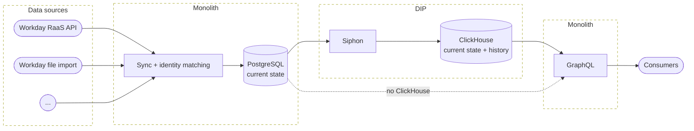

<!-- vale gitlab.FutureTense = NO -->



## 概要 {#summary}

顧客は Workday などの HR システムで人員を組織化しています。GitLab のグループはその構造と一致しないため、
GitLab は、どのユーザーが顧客の組織のどの部分に属しているかを把握できません。

この統合は、顧客のワークフォースユニットとそのメンバーを GitLab にインポートします。日次同期により、
現在の状態を PostgreSQL に保存します。Siphon がそれを ClickHouse に複製し、ClickHouse が履歴を保持します。GraphQL API は、
現在と過去の状態を ClickHouse から読み取ります。ClickHouse がない場合は、現在の状態を PostgreSQL から読み取ります。

階層は読み取り専用の参照データです。アクセス権は付与しません。

このドキュメントは、一般提供時の目標状態を説明します。それ以降の変更には、個別の決定記録を作成します。

## ステータス {#status}

GitLab.com で予定している社内向けリリース（V1）では、サブセットを実装します。対象は `gitlab-org` ルートグループ、
Workday RaaS API、`supervisory` ユニットタイプ、メールアドレスによる照合、PostgreSQL のみのストレージ、および GraphQL API です。

追跡：[エピック 23251](https://gitlab.com/groups/gitlab-org/-/work_items/23251)。

## 目標 {#goals}

- セットアップ後は手作業なしで、テナントの階層を HR ソースから同期します。
- モデルをベンダーに依存しないものに保ちます。新しいソースを追加しても、テーブルや API を変更しません。
- HR 上の人物を GitLab ユーザーに関連付け、管理者による上書きにも対応します。
- GraphQL と再利用可能なサービスを通じて階層を公開します。
- GitLab.com、Self-Managed、Dedicated、およびエアギャップ環境のインスタンスをサポートします。

## 対象外 {#non-goals}

- メトリクス、ダッシュボード、集計エンジン、GLQL。これらは階層を利用する側です。
- アクセス制御。権限チェックが階層を読み取ることはありません。
- HR システムへの書き戻し、または役職、所在地、報酬などの HR 属性。
- グループや Teams の置き換え。

## 提案 {#proposal}

| 決定事項 | 選択 |
| --- | --- |
| 目的 | ワークフォース階層は読み取り専用の参照データとします。プリンシパルでもコンテナーでもなく、グループや [Teams](../teams/_index.md)とは分離しておきます |
| テナント | GitLab.com ではルートグループ、Self-Managed と Dedicated では組織をテナントとします。GitLab.com も後に組織に移行します（[ワークアイテム 634509](https://gitlab.com/gitlab-org/gitlab/-/work_items/634509)）。各テナントは 1 つのソースを持ち、ユニットタイプごとに最大 1 つの階層を持ちます |
| モデル | 各階層は、1 つのユニットタイプに属するユニットの 1 本のツリーとします。人物はタイプごとに最大 1 つのユニットに所属します。ユニットは最大 1 人のマネージャーを持ちます |
| ソース | すべてのソースは、ベンダーに依存しない共通の契約を実装します。最初のソースは Workday RaaS API です。2 番目のソースは Workday RaaS ファイルのインポートです |
| 同期 | 同期は毎日完全なスナップショットを取得し、書き込み前に検証します。変更された行のみを書き込みます |
| ID | ID の照合には差し替え可能な戦略を使用し、最初の戦略はメールアドレスによる照合とします。管理者による上書きは、同期をまたいで保持します |
| ストレージ | PostgreSQL は現在の状態を保持します。Siphon がそれを ClickHouse に複製し、ClickHouse が履歴を保持します |
| 読み取り API | GraphQL API は再利用可能なサービスの上に構築し、ClickHouse から読み取ります。ClickHouse がない場合は、PostgreSQL の現在の状態にフォールバックします |
| 命名 | コードは `Workforce` 名前空間を使用します。[Organizations](../organization/_index.md)との混同を避けるため、「organization」という名前は使用しません |

## 設計の詳細 {#design-details}

### データモデル {#data-model}

テーブルは `gitlab_main_org` 内で `workforce_` プレフィックスを使用し、テナントをシャーディングキーとします。

| エンティティ | 属性 |
| --- | --- |
| 階層 | テナント、統合、ユニットタイプ、最終同期のステータスと日時 |
| ユニット | 外部 ID、名前、タイプ、親、祖先パス、マネージャーの外部 ID、マネージャーのユーザー |
| 人物 | 外部 ID、氏名、照合されたユーザー |
| ユニットのメンバーシップ | 人物、ユニット、タイプ |
| 不備 | 対象種別、理由、ロケーター。最新の実行分のみ |
| ID の上書き | 人物の外部 ID、ユーザー |

- ユニットタイプは自由記述です。コストセンターなどの新しいタイプを追加しても、スキーマの変更は不要です。
- 階層は、1 つのユニットタイプに属するユニットを保持します。テナントは、ユニットタイプごとに最大 1 つの階層を持ちます。
- テナントは 1 つのソースを持つため、1 回の同期実行でテナントのすべての階層を更新します。
- ユニットの親は同じタイプです。バッチの合間も含め、ストアに循環が存在することはありません。
- 祖先パスは [`traversal_ids`](https://docs.gitlab.com/development/namespaces/)と同様に機能し、サブツリーを
  1 回の範囲スキャンで取得できます。
- 人物のマネージャーは保存しません。マネージャーを持つのはユニットのみです。
- ユーザーを削除すると、関連付けを解除し、そのユーザーの ID の上書きを削除します。人物とメンバーシップは残ります。
- ID の上書きは、人物の行ではなく、人物の外部 ID を参照します。人物がスナップショットに含まれなくなっても残り、
  その人物が再び現れたときに適用します。

### ソース {#sources}

ソースは、ユニット（ID、名前、親 ID、マネージャー ID）と人物（ID、名前、業務用メールアドレス、タイプごとのユニット ID）を返します。

- **Workday RaaS API。** 顧客が作成する 2 つのレポートです。Integration System User の OAuth 2.0 リフレッシュトークンを使用します。
  顧客は、レポートで公開する列を制御します。
- **Workday RaaS ファイル。** エアギャップ環境のインスタンス向けに、同じレポートをアップロードします。ファイル形式はプロバイダーによって異なるため、
  各ファイルインポートは特定のプロバイダーに結び付きます。
- 統合はテナントレベルでのみ設定します。サブグループやプロジェクトには伝播しません。

### 同期 {#sync}

- 日次で実行し、手動トリガーにも対応します。テナントごとに同時に実行できるのは 1 回です。GitLab.com のみ、手動実行に 30 分のクールダウン期間を設けます。
- 最初に完全なスナップショットを取得して検証します。失敗した場合は何も変更しません。
- ソースが信頼できる唯一の情報源です。完全かつ有効なスナップショットは、人物やユニットの大部分を削除する場合でも、
  受け取ったとおりに適用します。誤ったスナップショットから復旧するには、ソースを修正して手動同期を開始します。
- 最大 5,000 行のバッチで適用し、ユニットをルートからリーフの順に処理した後、人物、メンバーシップの順に処理します。削除は最後に行います。
  スナップショット全体にまたがるトランザクションはありません。実行を再開すると、同じ状態に収束します。
- 変更のない行は書き込まないため、Siphon はその行に関するイベントを受け取りません。
- 無効な行は、下の表のとおり不備として記録します。実行自体は成功します。
- ログには、テナントと実行の識別子、および件数を記録します。個人データは記録しません。
- 目標は、テナントごとに 50,000 人と 10,000 ユニットです。

| 無効な行 | 結果 |
| --- | --- |
| ID が欠落または重複している人物やユニット | その行を除外します |
| 親が不明、または親子関係が循環しているユニット | ユニットは親を持たない状態で残り、ルートになります |
| マネージャーが人物データに存在しないユニット | ユニットはマネージャーを持たない状態で残ります |
| ユニットが空か、不明なユニットが指定された人物 | 人物は、そのタイプのメンバーシップを持たない状態で残ります |
| 別の人物と同じ業務用メールアドレスを持つ人物 | 人物は未照合のまま残ります |

不備は読み取り結果に表示しません。スナップショットが検証に合格してから前回の不備を消去し、
実行終了時に今回の不備を書き込みます。

#### 同期ワークフロー {#sync-workflow}

以下の図は、あるテナントでの 1 回の同期実行を示しています。

<!-- To edit, open the SVG in Excalidraw. The scene is embedded in the file. -->

### ID の照合 {#identity-matching}

- 候補は、テナントのユーザーのみです。GitLab.com ではルートグループ階層のメンバー、それ以外では
  組織のアクティブなユーザーです。
- 最初の戦略は、業務用メールアドレスと GitLab の確認済みメールアドレスの照合です。メールアドレスは永続化もログへの記録もしません。
- 上書きは人物の外部 ID をキーとして保存し、戦略より優先します。
- 未照合は正常な状態であり、不備ではありません。

### ストレージと履歴 {#storage-and-history}

- PostgreSQL は現在の状態を保持します。取り込みは引き続き Rails で行います。
- Siphon がテーブルを ClickHouse に複製します。第 2 のエクスポート経路は設けません。
- ClickHouse が履歴を構築します。方法はまだ定義していません。後に別の決定で、
  たとえば 緩やかに変化するディメンション（SCD）の仕組みを使う方法を定義できます。

### 読み取り API {#read-api}

GraphQL はユニットごとに、名前、タイプ、親、マネージャーのユーザー（未照合の場合は `null`）、直接のメンバー、および
子孫を含むメンバーを返します。メンバーは GitLab ユーザーです。

- 任意で時点を指定すると、過去の状態を選択できます。デフォルトは現在の状態です。
- ClickHouse がある場合、すべての読み取りに ClickHouse を使用します。現在の状態は、Siphon のレプリケーション遅延の分だけ PostgreSQL より遅れます。
- ClickHouse がない場合、PostgreSQL の現在の状態を読み取ります。特定時点の読み取りはエラーを返します。
- リゾルバーは再利用可能なサービスを呼び出します。ほかの機能からも、そのサービスを直接利用できます。
- すべての読み取りで認可を行います。
- HR の識別子、HR 上の人物名、メールアドレス、未照合の人物は返しません。
- 読み取り専用です。目標規模において、メンバーを含むサブツリーを 1 ページあたり 100 ms 未満で取得します。

### データ保護 {#data-protection}

- 保存する HR 属性は、[データモデル](#data-model)にあるものだけです。
- 統合は、OAuth 2.0 リフレッシュトークンなど、ソースの設定と認証情報を保存します。
  認証情報は保存時に暗号化します。
- 統合を削除すると、テナントのすべての階層データをバッチで削除します。無効化した場合はデータを保持します。
- 統合と上書きの変更は監査します。
- 履歴の保持と消去は、履歴に関する別の決定で定義します。

## 代替案 {#alternative-solutions}

- **マネージャーを介して関連付けた人物のツリー**（概念実証、
  [MR 261107](https://gitlab.com/gitlab-org/gitlab/-/merge_requests/261107)）。不採用です。指揮命令系統は頻繁に変わります。
  ユニットは安定しており、複数の階層タイプをサポートします。
- **ClickHouse に先に取り込む。** 不採用です。Rails は PostgreSQL 内の現在の状態を必要とし、第 2 の経路は
  Siphon と重複します。
- **PostgreSQL に履歴を保存する。** 不採用です。履歴の読み取りは ClickHouse が処理し、Siphon がすべての変更を配信します。
- **差分同期。** 不採用です。HR レポートは完全なスナップショットであり、完全なスナップショットにより各実行で自己修復できます。
- **Teams やグループをストレージとして使用する。** 不採用です。どちらもアクセス権に関する意味を持ちます。
- **[Integration Factory](https://gitlab.com/gitlab-org/orbit/experiments/glintf-design)** は、サードパーティーシステム向けの宣言的エクストラクターを共有する
  フレームワークです。現時点では採用しません。実験段階であり、これを使用して稼働している本番統合はありません。
  ワークフォース階層向けに、後で再評価できます。

## 決定記録 {#decisions}

| 決定記録 | 要約 |
| --- | --- |
| [ADR-001: ワークフォース階層のアーキテクチャ](decisions/001-workforce_hierarchy_architecture.md) | 日次の完全なスナップショットにより、読み取り専用のユニットを PostgreSQL にインポートし、Siphon を通じて ClickHouse に履歴を保持します |

## 参考資料 {#references}

- [Data Insights Platform (DIP)](../data_insights_platform/_index.md)
