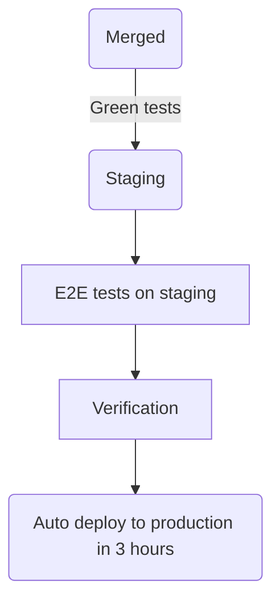

## ミッション {#mission}

購入フロー、課金エンジン、それらを支えるために必要なインフラストラクチャ、インテグレーション、コンプライアンス機能を網羅する、スケーラブルな収益化プラットフォームを通じて、お客様が GitLab の製品・サービスを評価、購入、管理できるようにします。

Monetization セクションと Fulfillment セクションは、2026 年 8 月に単一の Fulfillment セクションから分かれました。Monetization は [CustomersDot](https://gitlab.com/gitlab-org/customers-gitlab-com)とその運用を担当します。[Fulfillment セクション](/handbook/engineering/development/fulfillment/)は、利用権限、シート、使用量を担当します。両セクションは共通の[業務の進め方](/handbook/engineering/development/fulfillment-monetization/)に従います。

## チーム {#teams}

| チーム | 役割 | EM | PM | ラベル |
|------|---------|----|----|-------|
| セクション | 上記のミッションを参照 | James Lopez | Courtney Meddaugh | `devops::monetization` |
| Purchase | GitLab のすべての製品の購入体験全体を担当します。新規購入、アドオン、アップグレード、セルフサービスのプロモーション割引、Flex の年間コミットメントの購入、およびあらゆる取引形態の基盤となる統一購入フローが含まれます。 | Diana Zubova | Tatyana Golubeva | `group::purchase` |
| Subscription Lifecycle | 購入後のサブスクリプション体験を担当します。手動更新、自動更新、QSR、請求アカウント管理、サブスクリプションの可視性、製品内の更新 CTA、および Flex の予算と予約の管理が含まれます。 | Diana Zubova | Tatyana Golubeva | `group::subscription lifecycle` |
| Billing Engine | 既存および新たに収益化する製品・サービスについて、製品の消費量を正確で監査可能かつスケーラブルな請求結果に変換する、中核的な従量課金機能を担当します。 | Bishwa Hang Rai | TBH | `group::billing engine` |
| Monetization Platform | GitLab の収益化システムを最新化し、運用リスクを軽減し、課金とフルフィルメント全体の提供を加速する、プラットフォームの基盤、抽象化、信頼性の改善を担当します。 | Bishwa Hang Rai | TBH | `group::monetization platform` |
| Observability, Monitoring, and Integrations | 製品、課金、パートナーのニーズが拡大する中でも収益化システムの運用、デバッグ、拡張を可能にする、監視、アラート、診断、インテグレーション機能を担当します。 | Sinclair Machado | TBH | `group::monetization observability` |
| Compliance | 収益化とフルフィルメントのシステムの監査、レポーティング、統制要件を担当します。コンプライアンスに準拠したワークフロー、証跡とレポーティングの自動化、およびプラットフォームの進化に伴う信頼の維持が含まれます。 | James Lopez | TBH | `group::monetization compliance` |

Vitaly Slobodin（Senior Staff Fullstack Engineer）はセクション全体を横断して業務を行います。

安定したカウンターパートは、[共通の業務の進め方のページ](/handbook/engineering/development/fulfillment-monetization/#stable-counterparts)に掲載しています。

## CustomersDot のエンジニアリング {#customersdot-engineering}

### 承認とマージ {#approving-and-merging}

CustomersDot の `main` を対象とするすべての MR には、作成者以外の人による承認が少なくとも 1 件必要です。

- 少なくとも 2 名のレビュアーが必要で、そのうち 1 名はメンテナーとします。ロジックの変更がない軽微な MR（依存関係のバージョン更新、テスト修正、単純な差し戻し）に必要なレビュアーは 1 名です。
- メンテナーによるレビューが必要です。
- [Danger bot](https://docs.gitlab.com/ee/development/dangerbot.html)の提案に従ってください。データベースの変更にはデータベースレビュー、セキュリティに関わる変更には [Security レビュー](/handbook/security/product-security/security-platforms-architecture/application-security/appsec-reviews/#adding-features-to-the-queue--requesting-a-security-review)、Salesforce API の変更には [Sales Systems](/handbook/sales/field-operations/sales-systems/)、Zuora API の変更には [Enterprise Applications](/handbook/business-technology/enterprise-applications/)、ユーザー体験の変更には [UX レビュー](/handbook/upstream-studios/product-design/workflow/mr-reviews/)が必要です。

### テスト {#testing}

CustomersDot では、Lint、ユニット、インテグレーション、フロントエンド、E2E のテストを実行します。`VCR` フラグはデフォルトで Zuora の呼び出しをモック化し、[毎日スケジュール実行するパイプライン](https://gitlab.com/gitlab-org/customers-gitlab-com/pipeline_schedules)は Zuora のサンドボックスに対して実行して API の変更を検出します。失敗すると、ステージングと本番環境へのデプロイメントがブロックされます。

エンドツーエンドテストは、[GitLab](https://gitlab.com/gitlab-org/gitlab/-/tree/master/qa/qa/specs/features/ee/browser_ui/11_fulfillment)と [CustomersDot](https://gitlab.com/gitlab-org/customers-gitlab-com/-/tree/main/qa)にあります。CustomersDot は、テストに CustomersDot ポータルが必要な場合にのみ使用してください。[CustomersDot E2E ガイド](https://gitlab.com/gitlab-org/customers-gitlab-com/-/blob/main/qa/doc/beginners_guide.md)を参照してください。

### デプロイメント {#deployment}

CustomersDot は継続的デプロイメントを採用しています。`staging` にマージするとステージング環境にデプロイし、E2E テストを実行して、3 時間後に本番環境へ自動デプロイします。

- 本番環境へのデプロイを停止するには、`production::blocker` ラベルを付けた機密でない Issue を作成します。
- ブロッカーがある間に修正を急ぐ場合は、本番ジョブのスケジュールを解除し、ラベルを削除した後に手動で実行します。
- 重要な変更には[フィーチャーフラグ](https://gitlab.com/gitlab-org/customers-gitlab-com/#feature-flags-unleash)を使用してください。
- 機能凍結期間は GitLab の他の部分と同じで、マイルストーンが終了する金曜日からリリース日までです。
- [Production Change Lock](/handbook/engineering/infrastructure-platforms/change-management/#production-change-lock-pcl)の期間中は、[PCL テンプレート](https://gitlab.com/gitlab-org/customers-gitlab-com/-/tree/main/.gitlab/issue_templates/Pcl.md)を使って、`production::blocker` の追加と削除の DRI および時刻を記載した Issue を作成します。
- Zuora には、変更リクエストに追加の承認が必要な[変更制限期間](/handbook/business-technology/enterprise-applications/pmo/#release-calendar)があります。

### 収益に影響する変更 {#revenue-impacting-changes}

私たちの変更は、収益に直接影響することがあります。リスクの高い変更では PM が DRI を務め、Sales、Enterprise Applications、Marketing、Finance、Support から意見を集めます。

リスクの高い例には、価格設定、課金、有料機能のリリースや廃止、利用規約の変更、消費量の計算方法や表示方法の変更があります。リスクの低い例には、フロントエンドでまだ使用していないバックエンドの変更や、フィーチャーフラグの背後にある変更、ベータや実験的と表示された変更があります。

リスクの高い変更では、次のようにします：

- 機能のドキュメントを更新し、ステークホルダーと共有します。
- 機密の Issue と通常の MR プロセスを使用します。
- フィーチャーフラグの背後で提供し、リリース日に向けた[ロールアウト Issue](https://gitlab.com/gitlab-org/gitlab/-/issues/299068)を作成します。
- 最初に一部のお客様に対して有効にすることを検討します。

### アクセスレビュー {#access-review}

EM とセクションのリーダーシップは、[アクセスレビュープロセス](/handbook/security/security-assurance/security-compliance/access-reviews/)に従い、役割と部署に基づいて四半期ごとに CustomersDot へのアクセス権をレビューします。Sales は読み取り専用アクセスを維持します。AppSec、Billing、Monetization および Fulfillment のチームメンバー、IT Helpdesk、Support は書き込みアクセスを維持します。判断に迷う場合は却下してください。アクセス権は[アクセスリクエスト](/handbook/eta/corporate-it/end-user-services/access-requests/access-requests/)を通じて復元できます。

### 運用監視 {#operational-monitoring}

定期的な監視業務は、各マイルストーンの計画 Issue で DRI に割り当て、キャパシティに算入します：

- [Provision Tracking System の障害監視](https://gitlab.com/gitlab-org/customers-gitlab-com/-/blob/main/doc/provision_tracking_system/failure_monitoring.md)
- [Salesforce と Zuora の Sentry 監視](https://gitlab.com/gitlab-org/customers-gitlab-com/-/blob/main/doc/process/salesforce_and_zuora_sentry_issue_monitor.md)

### トライアル {#trials}

Growth はトライアルの入口を担当します。Monetization と Fulfillment は、トライアルの内部コードベースと、CustomersDot のすべての運用サポートを担当します。[トライアルのオーナーシップとコラボレーションのフレームワーク](/handbook/engineering/development/growth/trials-ownership/)を参照してください。

### アーキテクチャレビュー {#architecture-review}

毎週のアーキテクチャレビューでは、グループ横断のプロジェクト、CustomersDot のアーキテクチャ、Zuora とのインテグレーションを扱います。誰でも参加できます。少なくとも 1 日前までに[議題](https://docs.google.com/document/d/1_YbxNCo3KXK1-KdIZTgSvmU9kIslYjQnFZAmmu1DSqQ/edit#heading=h.jfvrioc0vg6)を追加してください。議題がない場合、ミーティングは中止します。

## インシデント管理 {#incident-management}

### インシデントや障害のエスカレーションプロセス {#escalation-process-for-incidents-or-outages}

Monetization は [Tier 2 SME のオンコールローテーション](/handbook/engineering/infrastructure-platforms/incident-management/on-call/tier-2/)を運用しています。Engineer on Call は incident.io を通じてエスカレーションします：

1. **レベル 1**：現在オンコールの SME（EMEA、AMER、または APAC）。
1. **レベル 2**：レベル 1 が 15 分以内に確認応答しない場合、ローテーションの全メンバーにラウンドロビンで通知します。
1. **レベル 3**：[James Lopez](https://gitlab.com/jameslopez)。

障害が発生すると、[#customersdot_errors](https://gitlab.slack.com/app_redirect?channel=customersdot_errors)に通知され、James Lopez と [Vitaly Slobodin](https://gitlab.com/vitallium)が自動的に呼び出されます。オンコールの SRE は、Slack で `@fulfillment-engineering` に支援を求めることができます。

### 緊急の修正 {#urgent-fixes}

本番環境に不具合がある場合は、[Rapid Engineering Response](/handbook/engineering/workflow/#rapid-engineering-response)が適用されるかを確認してください。メンテナーは手動デプロイにより、ステージングから本番環境への 3 時間の待機を省略できます。エスカレーションを説明する Issue を作成し、[#fulfillment_monetization_engineering](https://gitlab.slack.com/app_redirect?channel=fulfillment_monetization_engineering)で告知します。

### 調査 {#investigation}

- 例外：[Sentry](https://sentry.gitlab.net/gitlab/customersdot/)
- ログ：[Kibana](https://log.gprd.gitlab.net/)
- ヘルスチェック：[CustomersDot health](https://customersdot.us.to/dashboard)、認証情報は 1Password の _Subscription portal_ 保管庫にあります
- 本番環境の障害やデプロイの失敗については、[インシデントを宣言](/handbook/engineering/infrastructure-platforms/incident-management/#report-an-incident-via-slack)します。

### お客様に関するエスカレーション {#customer-escalations}

Support や Sales からのライセンスに関するエスカレーションは、Slack ではなく[サポート内部リクエストプロセス](/handbook/support/internal-support/#internal-requests)を通じて行います。リーダーは `License Issue High ARR` ラベルを購読します。

## Slack {#slack}

| チャンネル | 目的 |
|---------|---------|
| [#s_monetization](https://gitlab.slack.com/app_redirect?channel=s_monetization) | セクションの拠点 |
| [#g_purchase](https://gitlab.slack.com/app_redirect?channel=g_purchase), [#g_subscription_lifecycle](https://gitlab.slack.com/app_redirect?channel=g_subscription_lifecycle), [#g_billing_engine](https://gitlab.slack.com/app_redirect?channel=g_billing_engine), [#g_monetization_platform](https://gitlab.slack.com/app_redirect?channel=g_monetization_platform) | グループのチャンネル |
| [#customersdot_errors](https://gitlab.slack.com/app_redirect?channel=customersdot_errors), [#customersdot_health](https://gitlab.slack.com/app_redirect?channel=customersdot_health), [#customersdot_job_alerts](https://gitlab.slack.com/app_redirect?channel=customersdot_job_alerts), [#customersdot_nonprod](https://gitlab.slack.com/app_redirect?channel=customersdot_nonprod) | CustomersDot のアラート |

共通のチャンネルは、[業務の進め方のページ](/handbook/engineering/development/fulfillment-monetization/#shared-slack-channels)に掲載しています。

## リンク {#links}

- [共通の業務の進め方](/handbook/engineering/development/fulfillment-monetization/)
- [Fulfillment ガイド](/handbook/product/groups/fulfillment/)（CustomersDot の管理とプロセスのドキュメント）
- [CustomersDot の参考動画](https://gitlab.com/gitlab-org/customers-gitlab-com/-/blob/staging/doc/resource_videos.md)
- [パフォーマンス指標](https://internal.gitlab.com/handbook/company/performance-indicators/product/fulfillment-section/)と[エンジニアリングダッシュボード](/handbook/product/groups/product-analysis/engineering/dashboards/)
