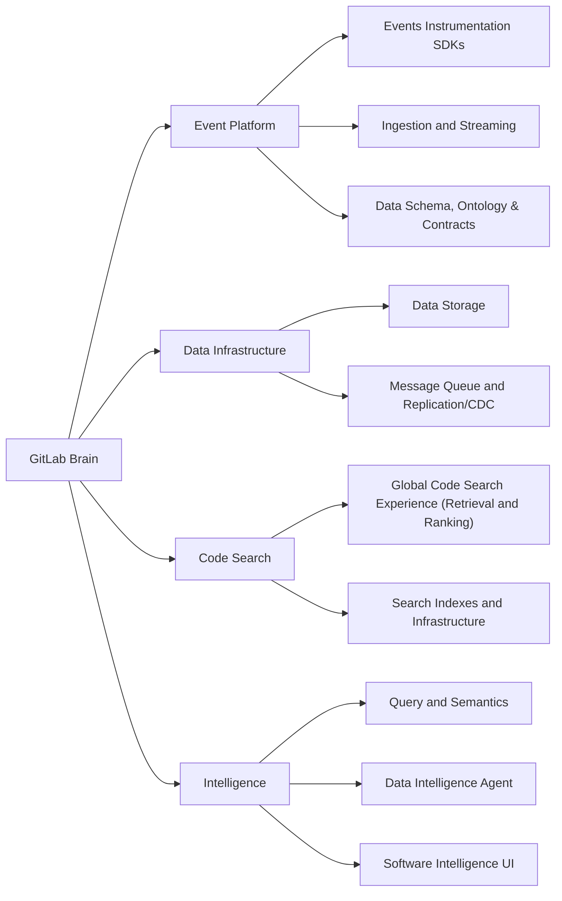

## ミッション {#mission}

私たちは GitLab のインテリジェンスを支えます — 構築に携わるすべての人とエージェントのために。

## 組織構造 {#organization-structure}

各グループが脳の機能を 1 つずつ担います。Event Platform は観測し、Data Infrastructure は処理して記憶し、Code Search は記憶を呼び出し、Intelligence は推論します。

## 私たちの働き方 {#how-we-work}

- [四半期計画](/handbook/engineering/data-engineering/quarterly-planning/): 四半期の計画方法です。キャパシティの上限内で、優先順位を付け、適切な規模に調整した施策を計画し、14 日ごとに 20 分間のレビューを実施します。入れ替えと優先順位引き下げのルール、および四半期末の say/do スコアも扱います。
- [優先事項トラッカーのガイド](/handbook/engineering/data-engineering/priorities-tracker/): トラッカースプレッドシートの補足リファレンスです。タブ、2 ページ資料、各行の列、キャパシティの計算方法、および計画確定前に各行が満たす必要のあるチェック項目を説明します。
- [リリースのプレモーテム](/handbook/engineering/data-engineering/pre-mortems/): 出荷日前にリリース固有のリスクを洗い出すための、任意の 45 分間の取り組みです。実施するかどうかはリリースの DRI が判断します。
