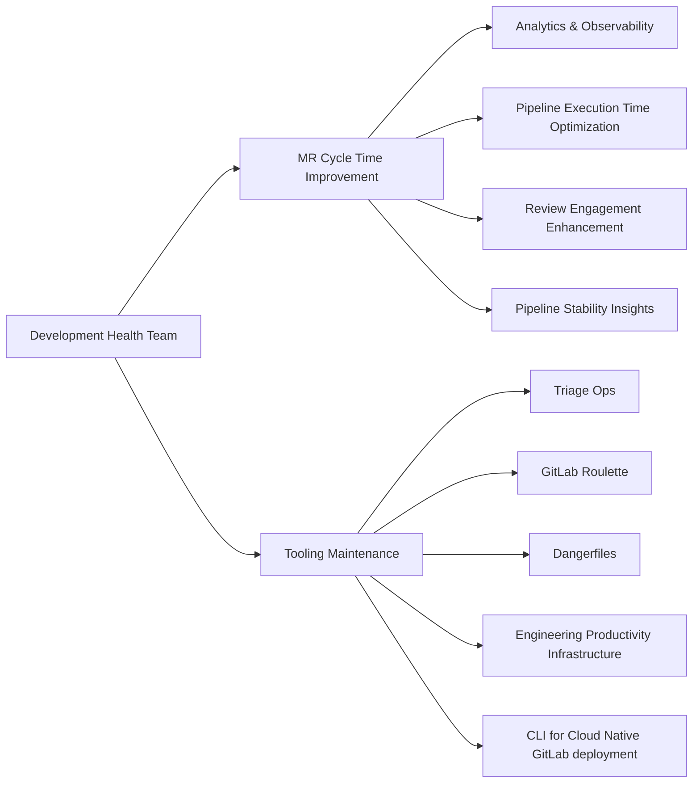

## 戦略 {#strategy}

### ビジョン {#vision}

すべての GitLab プロジェクトは、カスタムの計測を一切行わずに、開発の健全性スコアをすぐに取得できます。SDLC の摩擦、潜在的なボトルネック、実行可能なシグナルをリアルタイムかつセルフサービスで可視化します。GitLab 自身のエンジニアリングで実証したパターンは、GitLab を利用するすべてのチームが利用できる標準テレメトリになります。

### ミッション {#mission}

SDLC 全体の開発健全性シグナルを明らかにし、そのシグナルを所有するチームに見える形で提供します。私たちは Customer Zero です。まず GitLab 自身の Engineering でパターンを実証し、その後、製品チームに影響を与え協力してすべての顧客に届けます。GitLab モノリスと Modular Components の両方を第一級の対象として扱います。各イニシアチブでは適切なプラットフォームに焦点を当てますが、両方を念頭に置きます。

### 戦略的な柱 {#strategic-pillars}

#### 開発健全性シグナルプラットフォーム {#development-health-signal-platform}

GitLab Engineering 向けの SDLC シグナルレイヤー全体を担い、モノリスと Modular Components の両方を対象とします。開発健全性データを製品に取り込み、ユーザー、AI エージェント、ダッシュボードで利用できるようにします。エンジニアから VP レベルまでのスコアカードを提供します。

#### Customer Zero から製品への展開 {#customer-zero---product-influence}

GitLab Engineering に組み込まれた社内ラボとして運用します。開発健全性のギャップを特定し、それを表面化するための軽量なシグナルまたは計測を構築して、モノリスと Modular Components の両方にわたる実際の Engineering 作業でその価値を検証します。その後、製品チームと連携してそのシグナルを GitLab にネイティブに組み込み、カスタム計測なしですべての顧客が利用できるようにします。

#### ツールの維持管理 {#tooling-stewardship}

Triage Ops、Roulette、Dangerfiles、EP Infrastructure など、GitLab エンジニアリングが依存するツールを維持します。カスタムツールを並行して運用するのではなく、段階的に製品へ移行します。現在人間またはスクリプトが行っている L1 自動化作業は、AI エージェントが引き継ぎます。

## ロードマップ {#roadmap}

社内で何を構築する場合でも、私たちは製品を念頭に置いて構築します。Customer Zero とは、まず GitLab 内でシグナルパターンを検証し、その後、すべての GitLab 顧客が恩恵を受けられるよう製品に取り込むことです。

今四半期と次四半期に取り組むイニシアチブについては、[Development Health のロードマップ Issue](https://gitlab.com/gitlab-org/quality/analytics/team/-/work_items/921)を参照してください。

## 働き方 {#how-we-work}

### 内部ローテーションとサポートリクエスト {#internal-rotation--support-requests}

#### 内部ローテーション {#internal-rotation}

サポートリクエストやその他のチームメンテナンスタスクのために[内部ローテーション](https://gitlab.com/gitlab-org/quality/analytics/internal-rotation#process)を使用しています。これにより、チームの他のエンジニアが計画された作業に集中できる時間が確保されます。

#### サポートリクエスト {#support-requests}

- バグを発見したり、支援が必要な場合、または改善の機会を特定した場合は、`~"group::development health"` と `~"development-health::support-request"` ラベルを使用してサポートリクエストを提出してください。緊急の場合は、指定された Slack チャンネル - [`#g_development_health`](https://gitlab.enterprise.slack.com/archives/C064M4D2V37) にエスカレーションしてください。
- リクエストが最初に Slack 経由で来た場合は、リクエスト者または `group::development health` メンバーが適切なラベルで Issue を開いて、適切なトラッキングとトリアージを確保してください。
- チームは[サポートリクエストボード](https://gitlab.com/groups/gitlab-org/-/boards/9098093?label_name%5B%5D=development-health%3A%3Asupport-request)をレビューし、それに応じて優先順位を付けます。一般的に、チームはサポートタスクに週次時間の約 20% を確保していますが、現在の優先事項によって異なる場合があります。

### ツール/リポジトリのメンテナンス {#toolsrepository-maintenance}

- チームはグループが所有する各リポジトリに作成されたすべての新しい Issue を自動的に監視しているわけではありません — 可視性を確保するためにグループラベルを使用するか、Slack でエスカレーションしてください。
- セルフサービスのマージリクエストを強く推奨します。すでに修正や改善を特定している場合は、より迅速なターンアラウンドのために MR を開くことを推奨します。`~group::development health` のメンテナーが適宜レビューしてマージします。
- 機能作業とバグ修正はチームの現在の優先事項に従います。
- `~group::development health` が所有するリポジトリのバージョン管理に関する慣習を参照してください:

| リポジトリ                             | リリースプロセス                                                                                 |
|----------------------------------------|-------------------------------------------------------------------------------------------------|
| **gitlab-roulette**                    | バージョン更新は設定されたスケジュールでは行われません。バージョン更新 MR が提出されると随時リリースが行えます。 |
| **gitlab-dangerfiles**                 | 上記と同じ — 定期的なスケジュールはなく、バージョン更新 MR によってリリースがトリガーされます。                     |
| **triage-ops**                         | デフォルトブランチに新しいコミットがマージされた後に新しいリリースが開始されます。                            |
| **engineering-productivity-infrastructure** | 依存関係更新 MR は Renovate ボットによって生成されます。                                            |

## チームメンバー {#team-members}



## コア責任範囲 {#core-responsibilities}

## ダッシュボード {#dashboards}

Development Health のダッシュボードは [Developer Experience ダッシュボードページ](/handbook/engineering/infrastructure-platforms/developer-experience/dashboards)に掲載されています。

[Test Health](/handbook/engineering/infrastructure-platforms/developer-experience/development-health/test-health) ページでは、グループごとのテストスイート健全性スコア（Flaky、Quarantine、Slow の各ピラー）と、それらへの対応方法を説明しています。

## 共通リンク {#common-links}

| **カテゴリ**            | **ハンドル**                                                                                                                 |
|-------------------------|----------------------------------------------------------------------------------------------------------------------------|
| **GitLab グループハンドル** | [`@gl-dx/development-health`](https://gitlab.com/gl-dx/development-health)                                           |
| **Slack チャンネル**       | [`#g_development_health`](https://gitlab.enterprise.slack.com/archives/C064M4D2V37)                                     |
| **Slack ハンドル**        | `@dx-development-health`                                                                                                |
| **チームボード**         | [`チーム Issue ボード`](https://gitlab.com/groups/gitlab-org/-/boards/8966549?label_name%5B%5D=group::development%20health), [`チームエピックボード`](https://gitlab.com/groups/gitlab-org/-/epic_boards/2068920?label_name[]=group%3A%3Adevelopment%20health), [`サポートリクエスト`](https://gitlab.com/groups/gitlab-org/-/boards/9098093?label_name%5B%5D=development-health::support-request)                                           |
| **Issue トラッカー**       | [`Development Health の Issue`](https://gitlab.com/gitlab-org/quality/analytics/-/issues)                       |
| **チームリポジトリ** | [Development Health](https://gitlab.com/gitlab-org/quality/analytics)                                                   |
