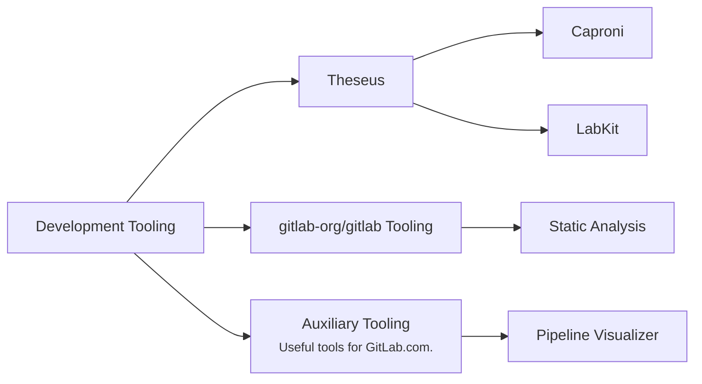

## ミッション

- [Theseus](https://theseus.gitlab.net/) プラットフォームを通じて、GitLab でのモジュール型サービス開発を可能にします。
- チームメンバーとより広いコミュニティが、私たちのツールとプロダクトに効率的にコントリビュートできるようにします。
- 重要なものを測定する: 開発者体験、効率性、トイル削減における改善を、定量的および定性的なメトリクスの両方を使って測定します。

## ビジョン

GitLab で新しいモジュール型サービスを出荷するには、チームがビジネスロジックを書き始めるまでに数週間かかります。私たちのビジョンは、[Theseus のビジョン](https://theseus.gitlab.net/overview/vision/)の一環として、この期間を数時間に短縮することです。開発者のノート PC から、デプロイ済みで運用可能なサービスまでの道筋を整備します。

- LabKit は、最初のコミットから、すべてのサービスに共通のロギング、メトリクス、トレーシングを提供します。
- Caproni は、すべてのコントリビューターに、ローカルと CI で本番環境に近い開発環境を提供します。

## 責任の領域

チームは [Theseus](https://theseus.gitlab.net/)に注力し、その構成要素である LabKit と Caproni を提供します。

### GitLab Development Kit (GDK)

私たちは、[GitLab Development Kit](https://gitlab.com/gitlab-org/gitlab-development-kit/)にはもはや注力していません。Caproni は現在、[GitLab の戦略的な開発プラットフォーム](https://theseus.gitlab.net/changelog/2026-09-03-caproni-strategic-development-platform/)であり、今後の数四半期にわたって、チームメンバー、[Co-Create Program](https://about.gitlab.com/community/co-create/)のお客様、コミュニティコントリビューターを含む、すべての GitLab コントリビューター向けに GDK を置き換えていきます。

- GDK での作業は、主に重大なバグの修正に限定します。
- 本番環境に近い開発環境を必要とする新しいサービスは、今から Caproni を使用してください。
- GDK 上で開発しているチームは Caproni への移行を計画し、[Caproni ドキュメント](https://gitlab-org.gitlab.io/caproni/)を読んでください。

Caproni についての質問は、[`#proj_caproni`](https://gitlab.enterprise.slack.com/archives/C0ACPMUMETZ) Slack チャンネルまたは [Caproni Issue トラッカー](https://gitlab.com/gitlab-org/caproni)へお寄せください。

## チーム体制



## ロードマップ

継続的ロードマップ作成の一部として、私たちは四半期ごとにロードマップをレビューし、アプローチを検証または改良し、新しい優先順位を反映するためにそれを更新します。

### 現在 {#now}

**フォーカス:** Caproni と LabKit を通じて Theseus の採用を可能にする

Caproni の採用状況は、[Caproni ダッシュボード](https://dashboards.gitlab.net/d/development-tooling-caproni/development-tooling3a-caproni)（社内）で追跡します。

### 次 {#next}

未定

### 将来 {#later}

未定

### 稼働維持（KTLO） {#keeping-the-lights-on-ktlo}

計画された作業に加えて、私たちのチームは、依存関係のアップグレード、セキュリティ脆弱性、重要なバグ修正など、共有ツールの機能性とインフラストラクチャに影響する継続的な保守とサポートも担当します。

## 私たちとの連携

問題、機能リクエスト、機能強化について: **[Issue を作成](https://gitlab.com/gitlab-org/quality/request-for-help/-/issues/new?description_template=developer_experience_request)** してください。作成先は私たちの [RFH リポジトリ](https://gitlab.com/gitlab-org/quality/request-for-help#developer-experience---request-for-help)です。あるいは、`#g_development_tooling` で私たちに連絡することもできます。

個別の質問については、GitLab.com で直接チームメンバーに言及するか、私たちの Slack チャンネルを通じてチームに連絡してください。

### コミュニケーション

| 説明            | リンク                                                                                                                                         |
| ---------------------- | -------------------------------------------------------------------------------------------------------------------------------------------- |
| **GitLab チームハンドル** | [`@gl-dx/development-tooling`](https://gitlab.com/gl-dx/development-tooling)                                                                     |
| **Slack チャンネル**      | [`#g_development_tooling`](https://gitlab.enterprise.slack.com/archives/C07UW7F3FL2)                                                           |
| **チーム Issue ボード**   | [チーム Issue ボード](https://gitlab.com/groups/gitlab-org/-/boards/8974136?label_name%5B%5D=group%3A%3Adevelopment+tooling&iteration_id=Current) |
| **Issue トラッカー**      | [`gitlab-org/dx/tooling/team`](https://gitlab.com/gitlab-org/quality/tooling/team/-/issues/)                                                 |

## 私たちの働き方

私たちは AMER と EMEA の地域に地理的に分散しており、デフォルトで非同期で作業します。

### ミーティング

私たちはチーム全体で週に 1 回同期的に集まり、進行中のトピックについて議論します。生産的な議論のために、週の初めまでにトピックをアジェンダに記入してください。

### プロジェクト管理

私たちは [Infrastructure Platforms 部門](/handbook/engineering/infrastructure-platforms/project-management/)のプロジェクト管理プロセスに従います。

現在のプロジェクトの詳細については、私たちの [親エピック](https://gitlab.com/groups/gitlab-org/quality/-/epics/114)を参照してください。
