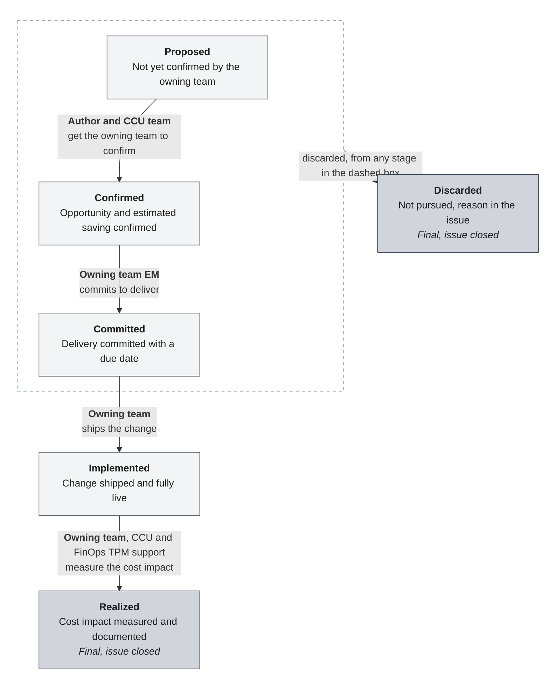

## 概要 {#overview}

GitLab 全体のすべてのコストと効率の改善機会は、どのチームが作成したかにかかわらず、その状況とともに 1 か所で確認できるようにします。各改善機会を GitLab の Issue で追跡し、Issue のラベルで段階を示します。

追跡そのものが目的ではありません。改善機会がどこで行き詰まっているかを明らかにし、障害を取り除いて変更を実現できるようにします。

このページは 2 つの部分で構成されています：

- [改善機会の追跡](#track-an-opportunity)では、Issue の作成からクローズまでのプロセスを順に説明します。
- [プロセスのリファレンス](#process-reference)では、段階、担当者、ラベル、状況メモの形式を定義します。

このページにコストの数値は記載しません。数値は Issue の内部メモにのみ記録します。[コミュニケーションと機密性](communication.md)を参照してください。

## 改善機会に該当するもの {#what-counts-as-an-opportunity}

私たちは、継続的な支出の削減だけでなく価値を追跡します。同じ支出でより多くを提供できるようにする変更も、請求額が減らなくても対象になります。

改善機会は、次のいずれかです：

- **継続的な支出の削減**：適正なサイズへの変更、未使用リソースの削除、より安価なストレージクラスなど、クラウドの請求額が減ること。
- **効率化**：既存のノードプールの利用率向上など、同じ支出でより多くを提供すること。
- **予防**：デフォルトのライフサイクルポリシーや CI チェックなど、無駄の発生を防ぐガードレールや自動化。

改善機会の発見元は 2 つあり、どちらも同じプロセスに従います：

- CCU チーム。コスト分析、および将来的には自動検出（GCP Recommender など）により発見します。
- Engineering チーム。担当するサービスで最適化の方法を発見します。

## 役割 {#roles}

- **作成者**：CCU チームメンバーや担当チームのエンジニアなど、改善機会の Issue を作成した人。
- **担当チーム**：改善機会の対象となるインフラリソースを所有するチーム（サービスを所有するチーム）。その Engineering Manager（EM）がデリバリーを約束します。
- **Cloud Cost Utilization（CCU）チーム**：フレームワーク、プロセス、改善機会を提案する自動化を担当します。作成者が担当チームと連携するのを支援します。
- **FinOps TPM**：FinOps プログラムを統括します。

## 改善機会の追跡 {#track-an-opportunity}

ここでは、1 つの改善機会をアイデアから Issue のクローズまで順に追います。各ステップで誰が行動するかを示します。正式な定義は[段階](#stages)を参照してください。

### Issue の作成とラベル付け {#open-and-label-the-issue}

作成者として、次の手順を実施します：

1. 変更を担当するチームのプロジェクトで、そのプロジェクトの通常のテンプレートを使用して Issue を作成します。
1. コストの数値を含めずに改善機会を説明します。[Issue の説明](#issue-description)の各項目を含めます。
1. `FinOps::Cost-Optimization` と `FinOps::Opportunity::Proposed` ラベルを追加します。
1. 担当チームが通常使用するグループとカテゴリのラベルを追加し、そのチームのボードにも Issue が表示されるようにします。
1. 内部メモとして[状況メモ](#status-note-format)を投稿し、見積もりがあれば含めます。

### 改善機会を次の段階へ進める {#move-the-opportunity-through-its-stages}

Issue を新しい段階へ進める人が、その段階ラベルを変更し、新しい状況メモを投稿します。

1. **Proposed ⟶ Confirmed**：作成者と CCU チームが担当チームと連携します。担当チームが改善機会と削減見積もりを確認したら、ラベルを `FinOps::Opportunity::Confirmed` に変更します。
1. **Confirmed ⟶ Committed**：担当チームの EM が、期限までに変更をデリバリーすることを約束します。ラベルを `FinOps::Opportunity::Committed` に変更します。
1. **Committed ⟶ Implemented**：担当チームが変更をリリースします。完全に本番稼働したら、ラベルを `FinOps::Opportunity::Implemented` に変更します。
1. **Implemented ⟶ Realized**：担当チームが、CCU チームと FinOps TPM の支援を受けてコストへの影響を測定し、文書化します。ラベルを `FinOps::Opportunity::Realized` に変更し、最終の状況メモを投稿して、Issue をクローズします。

Implemented に達する前に、何らかの理由（実現不可、削減につながらないなど）で改善機会を追求しないと決めた場合は、ラベルを `FinOps::Opportunity::Discarded` に変更し、理由を Issue に説明してクローズします。

## プロセスのリファレンス {#process-reference}

### 段階 {#stages}

改善機会は、常に 1 つの段階にのみ属します。通常は Proposed から Realized へ進みます。各矢印は、その移行を担当する人を示します。



| 段階 | 意味 | 次に進む条件 | 次の移行の担当者 |
|---|---|---|---|
| Proposed | 提案済みだが、担当チームによるレビューや確認はまだ行われていない。 | 担当チームが改善機会を確認する。 | 担当チームと連携する作成者と CCU チーム |
| Confirmed | 担当チームが改善機会と削減見積もりを確認した。 | 担当チームがデリバリーを約束する。 | 担当チームの EM |
| Committed | 担当チームが、期限までに変更をデリバリーすることを約束した。 | 変更をリリースする。 | 担当チーム |
| Implemented | 変更がリリースされ、完全に本番稼働している。 | コストへの影響が測定可能になる。 | CCU チームと FinOps TPM の支援を受ける担当チーム |
| Realized | コストへの影響が測定され、文書化された。 | 最終段階：Issue をクローズする。 | 該当なし |
| Discarded | 実現不可、削減につながらないなど、何らかの理由で追求しない。Issue に理由が記載されている。 | 最終段階：Issue をクローズする。 | 該当なし |

### ラベル {#labels}

`gitlab-com` と `gitlab-org` の両グループで [FinOps の Issue ラベル](https://gitlab.com/groups/gitlab-com/-/labels?subscribed=&archived=false&sort=relevance&search=finops#)を使用します。すべての改善機会の Issue には次のラベルを付けます：

- 段階にかかわらずコスト改善機会であることを示す `FinOps::Cost-Optimization`。
- 現在の段階を示す `FinOps::Opportunity::<Stage>` スコープ付きラベルを必ず 1 つ。例：`FinOps::Opportunity::Confirmed`。スコープ付きラベルのため、新しい段階ラベルを追加すると前のラベルが削除されます。
- 担当チームが通常使用するグループとカテゴリのラベル。

### 状況メモの形式 {#status-note-format}

状況メモには、改善機会の現在の状況と見積もりを記録します。段階または見積もりが変わるたびに、**内部メモ**として投稿します。コメントは `/internal_note` で始めます：

````markdown
/internal_note

## FinOps status

```yaml
status: "<one line on where this stands>"
estimated_annual_saving: 120000
basis: "<how it was measured or estimated>"
```
````

| フィールド | 形式 | 内容 |
|---|---|---|
| `status` | 引用符で囲んだテキスト | 改善機会の現在の状況を 1 行で記載。 |
| `estimated_annual_saving` | 年間の米ドル額を整数で、数字のみ。例：`120000` | この改善機会による予想削減額。 |
| `basis` | 引用符で囲んだテキスト | 数値が測定値か見積もりか、およびその方法。効率化や予防の改善機会については、得られる価値を説明。 |

ツールがメモを読み取れるように、次のルールに従ってください：

- `## FinOps status` の見出しとフィールド名を、示されているとおり正確に保持します。
- コロンや `#` を含むテキストも解析できるように、`status` と `basis` を囲む引用符を保持します。
- まだわからない値は、行全体を削除します。不明な値を `0` と記載しないでください。
- 古いメモを編集せず、新しいメモを投稿します。最新のメモが現在の状況で、それ以前のメモは履歴です。

{}
コストの数値は[コミュニケーションと機密性](communication.md)に基づく**社内限定**の情報であり、チームメンバーには公開しますが、一般には公開しません。

改善機会の Issue の多くは公開プロジェクトにあります。内部メモはチームメンバーだけが閲覧できるため、Issue 自体を公開したまま数値を社内に限定できます。
公開の説明やコメントには、数値を絶対に記載しないでください。
プロジェクトで内部メモを作成できない場合は、そこに数値を投稿しないでください。
{}

### Issue の説明 {#issue-description}

Issue の説明では、数値を含めずに改善機会を説明します：

- **対象と場所**：サービス（`gl_service`）、クラウドプロバイダーとプロジェクトまたはアカウント、影響を受けるリソース。
- **ベースライン**：クエリやダッシュボードへのリンクなど、現在のコストや使用量を測定した方法。数値は状況メモに記載します。
- **見積もり**：削減額の見積もり方法と前提条件。数値は状況メモに記載します。
- **担当者**：担当チームの DRI。
- **機密性**：Issue は公開のままにし、数値は内部の状況メモにのみ記載します。公開プロジェクトの説明にすでに数値が含まれる場合は、その Issue を非公開にします。

## 改善機会を確認する場所 {#where-to-see-opportunities}

- Issue ボード：[gitlab-com](https://gitlab.com/groups/gitlab-com/-/boards/11673784)と [gitlab-org](https://gitlab.com/groups/gitlab-org/-/boards/11673799)。オープンの Issue のみ表示します。
- Teamdeck：クローズした Issue と履歴を含むコスト改善機会のペインを計画しています（[Teamdeck ペインの Issue](https://gitlab.com/gitlab-com/gl-infra/finops/team/-/work_items/526)を参照、社内向け）。
