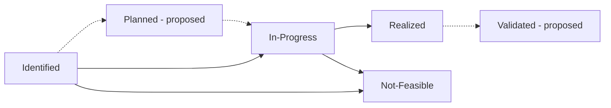

## 概要 {#overview}

GitLab 全体のすべての効率改善機会は、どのチームが作成したかにかかわらず、その状況とともに 1 か所で確認できるようにします。

追跡そのものが目的ではありません。改善機会がどこで行き詰まっているかを明らかにし、障害を取り除いて変更を実現できるようにします。

このページではプロセスを説明します。コストの数値は記載しません。数値は Issue の内部メモにのみ記録し、計画中の [Teamdeck](_index.md#teamdeck) ペインで表示します。[コミュニケーションと機密性](communication.md)を参照してください。

## 改善機会に該当するもの {#what-counts-as-an-opportunity}

私たちは、継続的な支出の削減だけでなく価値を追跡します。同じ支出でより多くを提供できるようにする変更も、請求額が減らなくても対象になります。

改善機会は、次のいずれかです：

- **継続的な支出の削減**：適正なサイズへの変更、未使用リソースの削除、より安価なストレージクラスなど、クラウドの請求額が減ること。
- **効率化**：既存のノードプールの利用率向上など、同じ支出でより多くを提供すること。
- **予防**：デフォルトのライフサイクルポリシーや CI チェックなど、無駄の発生を防ぐガードレールや自動化。

改善機会の発見元は 2 つあります：

- CCU チーム。コスト分析、および将来的には自動検出（GCP Recommender など）により発見します。
- Engineering チーム。担当するサービスで最適化の方法を発見します。

どちらも以下の同じプロセスに従います。

## ライフサイクル {#lifecycle}



| 段階 | ラベル | 意味 | 次に進む条件 | 設定する人 |
|---|---|---|---|---|
| 特定済み | `FinOps::Opportunity::Identified` | 改善機会を文書化し、状況メモに最初の見積もりを記載している。 | 担当チームが実施に合意し、作業を開始する。 | Issue を作成した人 |
| 計画済み | `FinOps::Opportunity::Planned`（提案中） | 受け入れられ、予定が決まっているが、実装作業はまだ始まっていない。 | 作業を開始する。 | 担当チームの DRI または EM |
| 進行中 | `FinOps::Opportunity::In-Progress` | 変更を実装している。請求額はまだ減っていない。 | 変更が完全に本番稼働する。 | 担当チームの DRI |
| 実現済み | `FinOps::Opportunity::Realized` | 変更が本番稼働し、コストがベースラインよりも測定可能な形で減っているか、効率の向上を測定している。 | 「検証済み」が導入されるまでは最終段階。 | 担当チームの DRI。CCU が請求を確認する |
| 検証済み | `FinOps::Opportunity::Validated`（提案中） | Finance または FinOps TPM が計算と前提条件を確認し、経営層への報告に使用することを承認している。 | 最終段階。 | Finance または FinOps TPM |
| 実現不可 | `FinOps::Opportunity::Not-Feasible` | 調査の結果、実施する価値がないか、削減につながらない。理由を Issue に記載する。 | 最終段階。状況が変わった場合は「特定済み」として再開する。 | 担当チームの DRI または CCU |

破線の段階は提案中で、まだラベルがありません。これらは[削減プロセスのフロー](https://gitlab.com/gitlab-com/gl-infra/infra-mgmt/-/merge_requests/3359#note_3976813876)（社内向け）に対応しています。特定、伝達、調査は「特定済み」の中で行い、受け入れ済みと計画済みは「計画済み」に、削減にならないものは「実現不可」に対応します。

`FinOps::Opportunity::*` はスコープ付きラベルのため、一度に適用できるのは 1 つだけです。

Issue をクローズしても追跡は終わりません。「実現済み」「検証済み」「実現不可」の Issue は通常クローズしますが、引き続き集計に含めます。

## 使用するラベル {#labels-to-use}

1. `FinOps::Opportunity::*` の段階ラベルを必ず 1 つ追加します。
1. Issue に `FinOps::Cost-Optimization` がすでに付いている場合は、そのまま残します。
1. 担当チームが通常使用するグループとカテゴリのラベルを追加し、そのチームのボードにも Issue が引き続き表示されるようにします。

`FinOps::Cost-Optimization` は段階ラベルができる前から使用されており、状況を表しません。`FinOps::Cost-Optimization` が付いていて段階ラベルがない Issue には、段階ラベルを追加する必要があります。[gitlab-com](https://gitlab.com/groups/gitlab-com/-/issues/?label_name%5B%5D=FinOps%3A%3ACost-Optimization&not%5Blabel_name%5D%5B%5D=FinOps%3A%3AOpportunity%3A%3AIdentified&not%5Blabel_name%5D%5B%5D=FinOps%3A%3AOpportunity%3A%3AIn-Progress&not%5Blabel_name%5D%5B%5D=FinOps%3A%3AOpportunity%3A%3ARealized&not%5Blabel_name%5D%5B%5D=FinOps%3A%3AOpportunity%3A%3ANot-Feasible&state=all)と [gitlab-org](https://gitlab.com/groups/gitlab-org/-/issues/?label_name%5B%5D=FinOps%3A%3ACost-Optimization&not%5Blabel_name%5D%5B%5D=FinOps%3A%3AOpportunity%3A%3AIdentified&not%5Blabel_name%5D%5B%5D=FinOps%3A%3AOpportunity%3A%3AIn-Progress&not%5Blabel_name%5D%5B%5D=FinOps%3A%3AOpportunity%3A%3ARealized&not%5Blabel_name%5D%5B%5D=FinOps%3A%3AOpportunity%3A%3ANot-Feasible&state=all)の一覧を参照してください。Teamdeck では、これらを **Needs stage** 列に表示します。段階ラベルが常に優先されるため、各 Issue は 1 回だけ表示されます。

今後の計画では、`FinOps::Cost-Optimization` を追加するだけでプロセスに入れるようにします。自動化によって `FinOps::Opportunity::Identified` を追加し、以下の状況メモの記載を求めます。

## 状況の更新 {#status-updates}

段階が変わるか、見積もりの精度が上がるたびに、Issue の**内部メモ**として状況を投稿します。コメントは `/internal_note` で始めます：

````markdown
/internal_note

## FinOps status

```yaml
status: "<one line on where this stands>"
estimated_annual_saving: 120000
cost_annual_baseline: 400000
basis: "<how it was measured or estimated>"
```
````

- `estimated_annual_saving`：予想削減額。`cost_annual_baseline`：変更前の現在の年間コスト。どちらも年間の米ドル額を整数で、数字のみで記載します。カンマや `$` は使用しません。上記の値は例です。
- まだわからない値は、行全体を削除します。不明な値を 0 と記載しないでください。
- コロンや `#` を含むテキストも解析できるように、`status` と `basis` を囲む引用符を保持します。
- `basis`：測定値か見積もりか、およびその方法。効率化や予防については、得られる価値をここで説明します。
- 段階のフィールドはありません。段階ラベルが唯一の情報源です。

内部メモを使用する理由：コストの数値は[コミュニケーションと機密性](communication.md)に基づく**社内限定**の情報であり、チームメンバーには公開しますが、一般には公開しません。改善機会の Issue の多くは公開プロジェクトにあります。内部メモは Planner 以上のロールを持つプロジェクトメンバーだけが閲覧でき、実際にはすべてのチームメンバーが該当するため、Issue 自体を公開したまま数値を社内に限定できます。公開の説明やコメントには、数値を絶対に記載しないでください。プロジェクトで内部メモを作成できない場合は、そこに数値を投稿しないでください。

`## FinOps status` の見出しとフィールド名はそのままにします。Teamdeck が読み取るためです。最新のメモが現在の状況で、それ以前のメモは履歴になるため、古いメモを編集せず、新しいメモを投稿します。

## Issue に記載する内容 {#what-to-put-in-the-issue}

変更を担当するチームのプロジェクトで、通常のテンプレートを使用して Issue を作成します。説明では、数値を含めずに改善機会を説明します：

- **対象と場所**：サービス（`gl_service`）、クラウドプロバイダーとプロジェクトまたはアカウント、影響を受けるリソース。
- **ベースライン**：クエリやダッシュボードへのリンクなど、現在のコストや使用量を測定した方法。数値は状況メモに記載します。
- **見積もり**：削減額の見積もり方法と前提条件。数値は状況メモに記載します。
- **担当者**：担当チームの DRI。
- **機密性**：Issue は公開のままにします。数値は内部の状況メモにのみ記載します。公開プロジェクトの説明にすでに数値が含まれる場合は、その Issue を非公開にします。

## 改善機会を確認する場所 {#where-to-see-opportunities}

- Issue ボード：[gitlab-com](https://gitlab.com/groups/gitlab-com/-/boards/11673784)と [gitlab-org](https://gitlab.com/groups/gitlab-org/-/boards/11673799)。オープンの Issue のみ表示します。
- Teamdeck：クローズした Issue と履歴を含むコスト改善機会のペインを計画しています（[finops/team#526](https://gitlab.com/gitlab-com/gl-infra/finops/team/-/work_items/526)、社内向け）。
