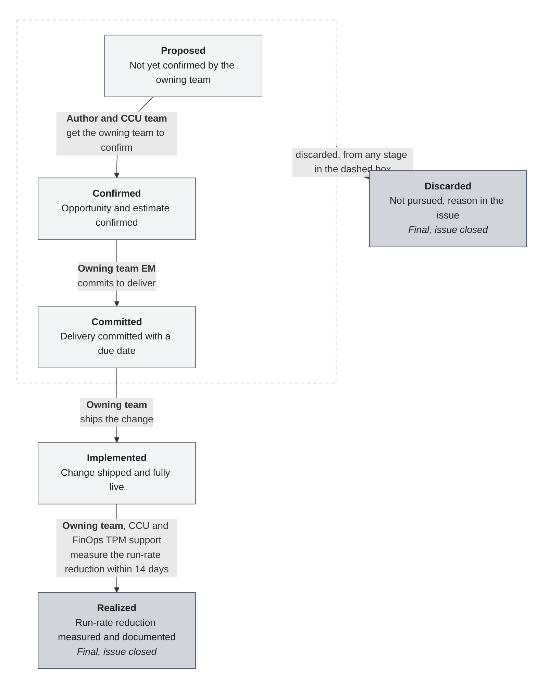

## 概要 {#overview}

GitLab 全体のすべての FinOps の機会は、どのチームが作成したかに関係なく、ステータスとともに 1 か所で確認できるようにする必要があります。FinOps の機会とは、私たちのクラウドコストを削減する、またはそのコストからより多くの価値を得るあらゆる変更です。この名称は `FinOps::Opportunity` ラベルに由来します。各機会を GitLab Issue で追跡し、Issue のラベルでステージを示します。

成果について述べるときは、コスト節約ではなく**ランレート削減**と表現します。[ランレート削減、節約額、コスト回避](#run-rate-reduction-savings-and-cost-avoidance)を参照してください。

追跡自体が目標ではありません。機会がどこで滞っているかを示すことで、障害を取り除いて変更を実現できます。

このページの大部分は、次の 2 つの部分で構成されます。

- [機会を追跡する](#track-an-opportunity)では、Issue の作成からクローズまでのプロセスを順に説明します。
- [プロセスの参照情報](#process-reference)では、ステージ、担当者、ラベル、ステータスノートの形式を定義します。

このページにはコストの金額を記載しません。金額は Issue の社内ノートにのみ記載します。[コミュニケーションと機密性](communication.md)を参照してください。

## 機会に該当するもの {#what-counts-as-an-opportunity}

私たちはランレート削減だけでなく、価値を追跡します。請求額が下がらなくても、同じ支出でより多くのサービスを提供できる変更は該当します。

機会は、次のいずれかです。

- **ランレート削減**：リソースの適正化、アイドルリソースの削除、より安価なストレージクラスへの変更など、クラウドの請求額が下がることです。
- **効率化**：既存のノードプールの利用率向上など、同じ支出でより多くのサービスを提供することです。
- **コスト回避**：デフォルトのライフサイクルポリシーや CI チェックなど、コストが請求に至るのを防ぐガードレールや自動化です。

機会には次の 2 つの発生源があり、どちらも同じプロセスに従います。

- コスト分析から、また今後は自動検出された事項（GCP Recommender など）から機会を見つける CCU チームです。
- 自分たちが所有するサービスの最適化を見つけるエンジニアリングチームです。

### ランレート削減、節約額、コスト回避 {#run-rate-reduction-savings-and-cost-avoidance}

私たちは節約額ではなく、ランレート削減によって機会を追跡します。これらの用語は異なるものを測定しています。

- **ランレート削減**はエンジニアリング上の数値です。検証済みのサービス月額コスト削減額を 12 倍したものです。担当チームが機会の Issue に記録し、FinOps が請求データから検証します。変更ごとに総額で計上し、削減効果を後退させる増加分は併記します。
- **節約額**は財務上の数値です。年間事業計画（AOP）から実際のコストを差し引き、月次決算時に一度だけ計上します。それまでは見積節約額です。節約額には比較対象となる予算が必要です。ランレートを削減しても、最終的に AOP を超過する場合があります。
- **コスト回避**は、私たちが先に対策したために、請求に至らなかったコストです。独立した項目で計上し、ランレート削減の目標には決して算入しません。請求額には、比較対象となる「対策前」がないためです。

節約はすべてランレート削減ですが、ランレート削減のすべてが節約になるわけではありません。迷う場合は、ランレート削減と表現してください。

## 役割 {#roles}

- **作成者**：CCU のチームメンバーや担当チームのエンジニアなど、機会の Issue を作成した人です。
- **担当チーム**：機会の対象となるインフラストラクチャリソースを所有するチーム（サービス所有チーム）です。その Engineering Manager（EM）が実施を約束します。
- **Cloud Cost Utilization（CCU）チーム**：フレームワーク、プロセス、機会を提案する自動化を担当します。作成者が担当チームと連携するのを支援します。
- **FinOps TPM**：FinOps プログラムを統括します。

## 機会を追跡する {#track-an-opportunity}

この手順では、1 つの機会がアイデアから Issue のクローズに至るまでを追います。各ステップで誰が行動するかを示します。正式な定義については、[ステージ](#stages)を参照してください。

### Issue を作成し、ラベルを付ける {#open-and-label-the-issue}

作成者として、次の手順を実行してください。

1. 変更を担当するチームのプロジェクトで、そのプロジェクトの通常のテンプレートを使って Issue を作成してください。
1. コストの金額を記載せずに、機会を説明してください。[Issue の説明](#issue-description)の各項目を含めてください。
1. `FinOps::Cost-Optimization` と `FinOps::Opportunity::Proposed` のラベルを追加してください。
1. 担当チームの `group::<group>` ラベルを追加し、該当する場合は影響を受けるサービスの `Service::<service>` ラベルも追加してください。[ラベル](#labels)を参照してください。担当グループがまだわからない場合は、機会が Proposed の間に特定してください。Confirmed になる前に設定する必要があります。
1. カテゴリラベルなど、担当チームが通常使うほかのラベルを追加し、チームのボードにも Issue が表示されるようにしてください。
1. [ステータスノート](#status-note-format)を社内ノートとして投稿し、見積もりがある場合は含めてください。

機会が Proposed の間に、作成者は担当グループ、該当する場合の影響を受けるサービス、ランレート削減の見積もりの 3 点を明らかにします。

### 機会のステージを進める {#move-the-opportunity-through-its-stages}

Issue を新しいステージに進める人が、ステージラベルを変更し、新しいステータスノートを投稿します。

1. **Proposed ⟶ Confirmed**：作成者と CCU チームが担当チームと連携します。担当チームが機会とランレート削減の見積もりを確認したら、Issue に担当チームの `group::<group>` ラベル（該当する場合は `Service::<service>` ラベルも）が付いていることを確認し、ラベルを `FinOps::Opportunity::Confirmed` に変更してください。
1. **Confirmed ⟶ Committed**：担当チームの EM が期日までに変更を実施することを約束します。Issue に期日を設定し、ラベルを `FinOps::Opportunity::Committed` に変更してください。
1. **Committed ⟶ Implemented**：担当チームが変更をリリースします。完全に稼働したら、ラベルを `FinOps::Opportunity::Implemented` に変更してください。
1. **Implemented ⟶ Realized**：14 日以内に、担当チームが CCU チームと FinOps TPM の支援を受け、ランレート削減を測定して文書化します。ラベルを `FinOps::Opportunity::Realized` に変更し、最後のステータスノートを投稿して、Issue をクローズしてください。

Implemented に達する前に、実現不可能、コストが削減されないなど、何らかの理由で機会に取り組まないと決めた場合は、ラベルを `FinOps::Opportunity::Discarded` に変更し、Issue に理由を説明してクローズしてください。

Committed と Implemented には、機会がそのステージに留まる期間についての[サービスレベル目標](#service-level-objectives)があります。Proposed と Confirmed の SLO は、まだ定義されていません。

## プロセスの参照情報 {#process-reference}

### ステージ {#stages}

機会は常に、いずれか 1 つのステージにのみ属します。通常の経路は Proposed から Realized までです。各矢印には、その移行の担当者を示しています。



| ステージ | 意味 | 次に進む条件 | 次の移行の担当者 | SLO |
|---|---|---|---|---|
| Proposed | 提案済みですが、担当チームがまだレビューまたは確認していません。 | 担当チームが機会を確認し、Issue に担当チームの `group::` ラベルが付いている。 | 担当チームと連携する作成者と CCU チーム | 未定義 |
| Confirmed | 担当チームが機会とランレート削減の見積もりを確認済みです。Issue に担当チームの `group::` ラベルが付いています。 | 担当チームが実施を約束する。 | 担当チームの EM | 未定義 |
| Committed | 担当チームが期日までに変更を実施することを約束済みです。 | 変更をリリースする。 | 担当チーム | 約束した期日 |
| Implemented | 変更をリリースし、完全に稼働しています。 | ランレート削減を測定する。 | CCU チームと FinOps TPM の支援を受ける担当チーム | 14 日 |
| Realized | ランレート削減を測定し、文書化済みです。 | 最終ステージ：Issue をクローズする。 | 該当なし | 該当なし |
| Discarded | 実現不可能、コストが削減されないなど、何らかの理由で取り組まないことにしました。Issue に理由を記載します。 | 最終ステージ：Issue をクローズする。 | 該当なし | 該当なし |

### サービスレベル目標 {#service-level-objectives}

ステージのサービスレベル目標（SLO）は、機会が次のステージに進むまでに、そのステージに留まることのできる最大期間です。Issue の期日は、現在のステージの SLO がいつ期限を迎えるかを示します。

- **Committed**：担当チームの EM が、変更の実施を約束するときに期日を設定します。
- **Implemented**：機会が Implemented に移ると、自動化によって期日を 14 日後に設定し、担当チームにランレート削減の測定を促すリマインダーを送信します。

### ラベル {#labels}

`gitlab-com` と `gitlab-org` の両グループで [FinOps の Issue ラベル](https://gitlab.com/groups/gitlab-com/-/labels?subscribed=&archived=false&sort=relevance&search=finops#)を使用します。すべての機会の Issue に、次のラベルを付けます。

- `FinOps::Cost-Optimization` は、ステージに関係なく FinOps の機会であることを示します。
- 現在のステージを示す `FinOps::Opportunity::<Stage>` スコープ付きラベルを、必ず 1 つだけ付けます。たとえば `FinOps::Opportunity::Confirmed` です。スコープ付きラベルのため、新しいステージラベルを追加すると、以前のラベルが削除されます。
- 担当チームを示す、`group::gitaly` などの担当チームの `group::<group>` ラベルを付けます。Confirmed 以降では必須であり、Issue の作成時に追加することを推奨します。
- 機会が特定のサービスに影響する場合は、`Service::Gitaly` などの `Service::<service>` ラベルを付けます。これは任意です。請求モデルの変更など、単一のサービスに影響するものではない機会もあります。`Service::` ラベルは `gitlab-com` グループにのみ存在します。
- カテゴリラベルなど、担当チームが通常使うほかのラベルを付けます。

### ステータスノートの形式 {#status-note-format}

ステータスノートは、機会の現在のステータスと見積もりを記録します。ステージまたは見積もりが変わるたびに、**社内ノート**として投稿してください。コメントは `/internal_note` で始めてください。

````markdown
/internal_note

## FinOps status

Status: <Where does this stand at the moment?>

```yaml
estimated_annual_run_rate_reduction: 120000
```

Estimation basis: <How can we estimate (and later measure) the run-rate reduction in billing data?>
````

| 部分 | 形式 | 内容 |
|---|---|---|
| `Status:` | ラベルの後に続くテキスト | 機会の現在の状況。 |
| `estimated_annual_run_rate_reduction` | 年間の米ドル額を整数で、数字のみで記載。たとえば `120000` | この機会によるランレート削減額。月額コスト削減額の 12 倍です。ランレート削減の機会にのみ使用します。 |
| `Estimation basis:` | ラベルの後に続くテキスト | ランレート削減の見積もり方法と、後から請求データで測定する方法。数値が実測値か見積もりかを明記してください。効率化やコスト回避の機会では、代わりに得られる価値をここで説明してください。 |

ツールがノートを読み取れるよう、次のルールに従ってください。

- `## FinOps status` 見出し、`Status:` と `Estimation basis:` のラベル、`estimated_annual_run_rate_reduction` フィールド名は、表示されているとおりに保持してください。
- 金額は `yaml` ブロック内に、数字のみで記載してください。
- 見積もりがまだ不明の場合は、`yaml` ブロックを省略してください。不明な値に `0` を記載してはいけません。
- 効率化とコスト回避の機会では、`yaml` ブロックを省略してください。これらはランレートを削減しないため、そこに金額を記載するとランレート削減に算入されてしまいます。
- 古いノートを編集せず、新しいノートを投稿してください。最新のノートが現在のステータスであり、それ以前のノートが履歴になります。

{}
コストの金額は、[コミュニケーションと機密性](communication.md)における**社内情報**であり、チームメンバーには表示されますが、一般には公開しません。

機会の Issue の多くは、公開プロジェクト内にあります。社内ノートはチームメンバーにのみ表示されるため、Issue 自体は公開のまま、金額を社内に留められます。
公開の説明やコメントには、決して金額を記載しないでください。
プロジェクトで社内ノートを作成できない場合は、そこに金額を投稿しないでください。
{}

### Issue の説明 {#issue-description}

Issue の説明では、金額を記載せずに機会を説明します。

- **対象と場所**：サービス（`gl_service`。該当する場合は `Service::` ラベルも使用）、クラウドプロバイダーとプロジェクトまたはアカウント、影響を受けるリソース。
- **ベースライン**：クエリやダッシュボードへのリンクなど、現在のコストまたは使用量の測定方法。ベースラインの金額自体は記録しません。
- **見積もり**：ランレート削減の見積もり方法と前提。金額はステータスノートに記載します。
- **担当者**：担当チーム内の DRI。
- **機密性**：Issue は公開し、金額は社内ステータスノートにのみ記載してください。公開プロジェクトの説明にすでに金額が含まれている場合は、Issue を機密に設定してください。

## 機会を確認できる場所 {#where-to-see-opportunities}

FY27 Q4 には、Engineering Portal のサービスページやチームページなどで、リーダーシップやチームが FinOps の機会をより把握しやすくする取り組みを進めています。[Backstage の FinOps の機会に関するエピック](https://gitlab.com/groups/gitlab-com/gl-infra/finops/-/work_items/136)を参照してください。

- Issue ボード：[gitlab-com](https://gitlab.com/groups/gitlab-com/-/boards/11673784) と [gitlab-org](https://gitlab.com/groups/gitlab-org/-/boards/11673799) です。未完了の Issue のみを表示します。
- Teamdeck：[FinOps の機会ペイン](https://gitlab-com.gitlab.io/gl-infra/finops/teamdeck/opportunities)（社内用）は、未完了とクローズ済みの Issue を、ステージ別に履歴とともに表示します。
