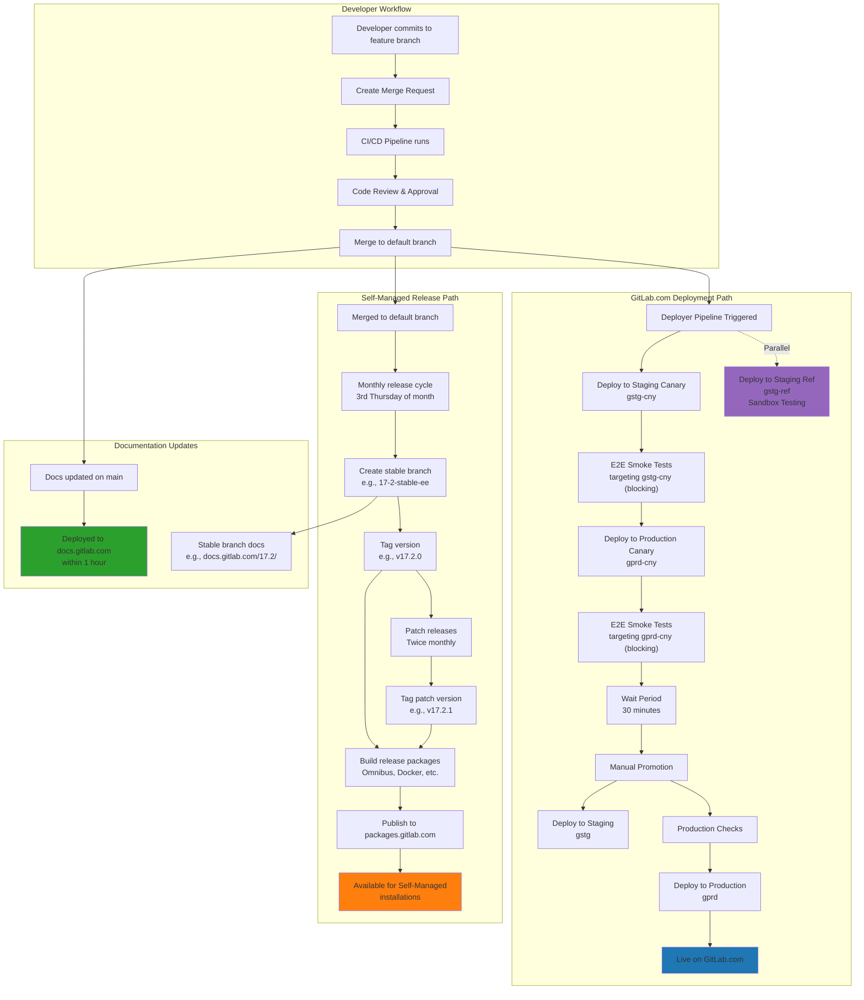

## GitLab のデプロイワークフロー {#gitlab-deployment-workflow}

以下の図は、開発者のコミットから GitLab.com への本番デプロイおよびセルフマネージドリリースまでの完全なデプロイワークフローを示しています。

## デプロイ後のマイグレーション {#post-deployment-migrations}

デプロイ後のマイグレーションには専用のワークフローがあり、特定の時間枠内に実行されることは保証されません。通常は 1 日に約 1 回実行されますが、デプロイチームが実行を延期する場合もあります。たとえば、[パッチウィンドウ](/handbook/engineering/releases/patch-releases/#patch-window)、月次リリースウィンドウ、デプロイを妨げるインシデントの発生中などです。

詳細については、デプロイハンドブックの[デプロイ後マイグレーション（PDM）の実行](/handbook/engineering/deployments-and-releases/deployments/#post-deploy-migration-pdm-execution)セクションを参照してください。

## 関連ドキュメント {#related-documentation}

デプロイプロセスの追加コンテキストについては、デプロイとリリースハンドブックの[パッケージのデプロイ](/handbook/engineering/deployments-and-releases/deployments/#deploying-packages)セクションを参照してください。
