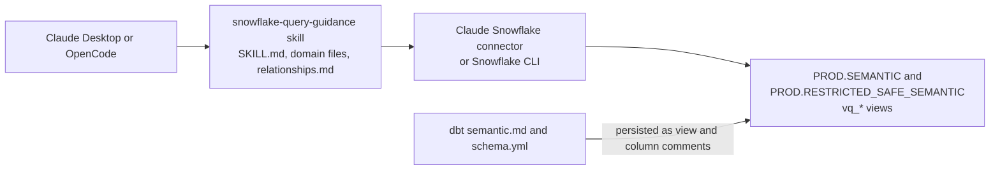
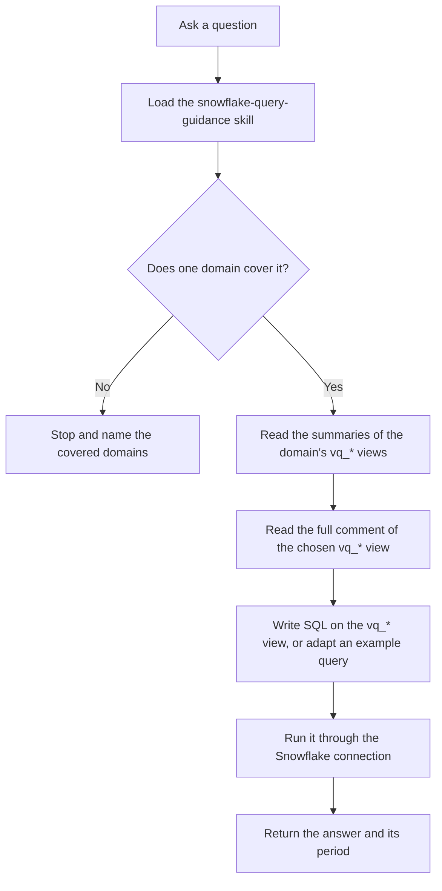

## 目的 {#purpose}

AI Context Layer により、チームメンバーは Claude や OpenCode などの AI ツールから自然言語でビジネス上の質問をし、ガバナンスの適用された GitLab データに基づく回答を得られます。

汎用モデルは、GitLab の会計カレンダー、指標の管理された定義を格納するテーブル、クエリに必須のフィルターを知りません。その文脈がなければ推測に頼り、自信に満ちた誤答は回答がないことよりも悪い結果をもたらします。AI Context Layer は、ガバナンスの適用された GitLab 固有の文脈をモデルに与え、適切なデータを見つけて正しい方法でクエリを実行できるようにします。

Context Layer は、[AI ビジョンと戦略](/handbook/enterprise-data/ai/ai-vision-and-strategy/)の原則に従います。AI は実現手段であり、データ品質とデータ基盤が最優先です。すべてのドメインは認定済みデータに基づいて構築し、dbt で文書化して、リリース前にテストします。

## 仕組み {#how-it-works}

### 構成要素 {#components}

Context Layer には、エージェントとともに読み込む 2 つの構成要素があります。

1. **`snowflake-query-guidance` スキル。** GitLab データの意味と格納場所を説明する Markdown ファイル群です。このスキルは、何を扱うか、なぜそうするかをモデルに伝えます。
   1. `SKILL.md` は、スキルの実行時に毎回読み込みます。ルーティングテーブル、すべてのクエリを制約するルール、会計カレンダーなどの GitLab 全体の規約を格納します。
   1. `references/domains/<domain>.md` は、1 つのビジネス領域を格納します。モデルは、質問に必要なドメインだけを読み込みます。[利用可能なドメイン](#available-domains)を参照してください。
   1. `references/relationships.md` は、標準のキーと結合経路を格納します。モデルは、テーブルをまたぐ質問のときだけ読み込みます。
   1. `references/CONTRIBUTING.md` は、貢献者向けの執筆規約です。モデルはクエリの実行時には使用しません。
1. **Snowflake 接続とセマンティックスキーマ。** Claude は Claude Snowflake コネクターを使用し、OpenCode は Snowflake CLI を使用します。どちらもあなた自身の Snowflake ロールを使い、あなたとしてクエリを実行します。クエリの対象は、データウェアハウス内の [AI セマンティックスキーマ](/handbook/enterprise-data/platform/edw/#ai-semantic-schemas)である `PROD.SEMANTIC` と `PROD.RESTRICTED_SAFE_SEMANTIC` にある、文書化された `vq_*` 検証済みクエリビューです。dbt で記述する各ビューの Snowflake コメントには、粒度、必須フィルター、具体的なクエリ例を文書化します。これらのビューは、正しい答えを得るためのテスト済みの例をモデルに提供します。

スキルの唯一の情報源は [analytics リポジトリ](https://gitlab.com/gitlab-data/analytics/-/tree/master/marketplace-sync/snowflake-query-guidance)です。[`gitlab-com/marketplace`](https://gitlab.com/gitlab-com/marketplace) リポジトリへ自動的に同期するため、すべての変更は analytics リポジトリで行い、marketplace 側のコピーを編集しないでください。



### 実行時の流れ {#runtime-flow}

1. チームメンバーが質問します。
1. エージェントがスキルを読み込み、GitLab 全体の規約を適用します。
1. エージェントは、ルーティングテーブルとドメインの `**Scope:**` 行を使い、質問をちょうど 1 つのドメインに振り分けます。適合するドメインがない場合は停止し、質問が文書化されたドメインの範囲外であることを伝え、対象ドメインを列挙します。ウェアハウスを探索することはありません。
1. エージェントは、ドメインの `vq_*` ビューの要約を読み、選択した 1 つのビューのコメント全文を `INFORMATION_SCHEMA` から読み取ります。
1. エージェントは、通常はビューのクエリ例の 1 つを調整し、`vq_*` ビューに対する SQL を作成して、Snowflake 接続を通じて実行します。
1. エージェントは回答を返し、各数値の対象期間を明示します。

このスキルは、現在のセッションでコメント全文を読んでいない `vq_*` ビューに対して SQL を書くことを禁じています。コメントには必須フィルターが記載されているため、これを飛ばすと誤答につながります。`SKILL.md` でのコメントの読み取りは次のようになります:

```sql
SELECT comment FROM PROD.INFORMATION_SCHEMA.TABLES
WHERE table_schema = 'SEMANTIC' AND table_name = 'VQ_A';
```



### dbt のビューコメントに文脈を格納する理由 {#why-context-lives-in-dbt-view-comments}

テーブルとカラムの詳細は、スキルファイルではなく `vq_*` ビューのコメントに格納します。

1. **段階的な開示。** モデルは、必要なビューだけを必要なときに読みます。すべてのテーブルのドキュメントを最初に読み込むと、コンテキストウィンドウが埋まり、トークンコストが増え、精度が下がります。文脈が増えるとモデルの性能が落ちるためです。
1. **変換層に隣接したバージョン管理。** コメントは dbt（`semantic.md` と `schema.yml`）で記述し、Snowflake に永続化します。変更は MR でレビュー、テストし、説明対象のモデルとともにリリースします。
1. **保守の一元化。** ドメインファイルは短く保ち、GitLab でそのビジネス領域がどのように機能するかを説明します。データモデルとともに変わるテーブルの情報は、そのモデルの隣の 1 か所で保守します。
1. **技術的な文脈をデータとして扱います。** 物理的な製品が説明書なしでは完成しないのと同様に、データを正しくクエリし、結果を解釈するために必要な情報は、変換自体の一部です。

### 薄い `SELECT *` ビューを使う理由 {#why-thin-select--views}

各 `vq_*` ビューは、通常、既存のガバナンスの適用されたテーブルに対する薄い `SELECT *` です。既存のテーブルには、すでに豊富なドキュメントがあることも多いですが、AI の利用を想定して書かれたものではありません。ビューを使えば、基盤となるモデルを作り直したり、既存の利用者に影響を与えたりせずに、データのクエリ方法と結果の解釈方法の両方を網羅した、モデル向けのドキュメントをチームが記述できます。

薄い `SELECT *` ビューはラッパーであり、クエリが遅くなるはずはありません。回答が遅い場合、通常の原因は会話の開始時の文脈収集か、基盤となるテーブルの性能です。

### アクセスとセキュリティ {#access-and-security}

1. **Snowflake のアクセス権が必要です。** [Lumos](/handbook/security/corporate/systems/lumos/ar/)から申請し、**Analyst** ロールを選んでください。[SAFE](/handbook/enterprise-data/platform/safe-data/) データが必要な場合は **Analyst Safe** を選びます。Analyst Safe を使用すると、[指定インサイダー](/handbook/legal/publiccompanyresources/#designated-insiders)になります。
1. **アクセスを制御するのはスキルではなく Snowflake ロールです。** `PROD.RESTRICTED_SAFE_SEMANTIC` のビューは、SAFE データと重要な未公開データを格納し、すでにそのアクセス権を持つロールだけが読み取れます。Snowflake を管理する権限は、Context Layer にも適用されます。
1. **行レベルセキュリティはビュー内に実装します。** ドメインに行レベルセキュリティが必要な場合は、`vq_*` ビューに組み込みます。スキル自体が行をフィルターしたり、結果をあなたのアカウントの範囲に限定したりすることはありません。
1. **アクセス権が不足する場合は、回避せずに報告します。** 使用中のロールにビューへのアクセス権がない場合、エージェントはその旨を伝え、Lumos を案内します。別のオブジェクトで再試行することはありません。

## 利点 {#benefits}

1. **正確で、ガバナンスの適用された回答。** 回答は認定済みデータと文書化された定義に基づきます。モデルによる GitLab のスキーマの推測には基づきません。
1. **メタデータの保守の一元化。** ビジネス上の意味は短いドメインファイルに、テーブルの詳細はモデルに隣接する dbt に格納します。
1. **リリース前のテスト。** すべてのドメインには、変更のマージ前に[評価ハーネス](/handbook/enterprise-data/ai/context-layer/add-a-domain/eval-harness/)が実行するテストケースを同梱します。
1. **MR で回帰を検出。** 1 つのドメインへの変更を関連ドメインに対してテストするため、ほかの場所の回答を気づかないうちに壊すことを防ぎます。
1. **どのチームでも貢献できます。** 各チームが自分たちのビジネス領域のドメインを追加し、Analytics Engineering チームは analytics リポジトリを通じて共有スキルを保守します。

## 利用可能なドメイン {#available-domains}

ドメインは analytics リポジトリへの MR を通じて追加、変更するため、このページには列挙しません。代わりに次の情報源を確認してください。

1. **ドメインファイル。** [`marketplace-sync/snowflake-query-guidance/references/domains/`](https://gitlab.com/gitlab-data/analytics/-/tree/master/marketplace-sync/snowflake-query-guidance/references/domains)の各ファイルが 1 つのドメインです。`**Scope:**` 行に対象となる主題を列挙しています。
1. **ルーティングテーブル。** ドメインは、[`SKILL.md`](https://gitlab.com/gitlab-data/analytics/-/blob/master/marketplace-sync/snowflake-query-guidance/SKILL.md)のルーティングテーブルに行がある場合に限り有効です。ルーティング行のないドメインファイルは使用しません。
1. **テストケース。** [`agents/evals/snowflake_query_guidance/test_cases/`](https://gitlab.com/gitlab-data/analytics/-/tree/master/agents/evals/snowflake_query_guidance/test_cases)の各ファイルは、ドメインのテストケースを格納します。そのドメインが答える質問の良い例にもなります。
1. **検証済みクエリビュー。** 次のクエリは、使用中のロールから見えるすべての `vq_*` ビューと、コメントの要約を一覧表示します:

   ```sql
   SELECT table_schema,
          table_name,
          TRIM(SPLIT_PART(comment, '---', 1)) AS summary,
          last_altered
   FROM PROD.INFORMATION_SCHEMA.TABLES
   WHERE table_schema IN ('SEMANTIC', 'RESTRICTED_SAFE_SEMANTIC')
     AND STARTSWITH(table_name, 'VQ_')
   ORDER BY table_schema, table_name;
   ```

   要約は、ビューのコメント内の `---` 区切りより上のテキストです。ビューが何を格納し、どの質問がそこへ振り分けられるかを説明します。ビューのドキュメント全文を読むには、その 1 つのビューの `comment` を選択してください。

対象ドメインをエージェントに尋ねることもできます。

## 所有と貢献のモデル {#ownership-and-contribution-model}

1. **Analytics Engineering チームがスキルを保守します。** 同チームは、共有ルーティングの窓口（`SKILL.md` と `relationships.md`）を含むスキルを analytics リポジトリで所有し、すべての変更をレビューします。承認は、analytics リポジトリの [`CODEOWNERS`](https://gitlab.com/gitlab-data/analytics/-/blob/master/CODEOWNERS) ファイルに記載された Semantic Layer コードオーナーが行います。
1. **誰でも貢献できます。** [ドメイン追加ガイド](/handbook/enterprise-data/ai/context-layer/add-a-domain/)に従い、[`semantic_layer_changes`](https://gitlab.com/gitlab-data/analytics/-/blob/master/.gitlab/merge_request_templates/semantic_layer_changes.md) テンプレートを使って MR を作成してください。
1. **共有ドメインは共有のまま維持します。** 複数のチームが 1 つのドメインに貢献できます。特定のチームだけに属するドメインファイルはありません。
1. **レビューで重複を検出します。** GitLab Duo は、すべての Context Layer の MR を執筆規約に照らしてレビューし、別のドメインやビューにすでに存在する定義を指摘します。評価ハーネスのルーティングチェックにより、新しいドメインが既存のドメインから質問を奪う場合を検出します。
1. **定義には定まった格納場所があります。** ビジネス上の定義はドメインファイルに、技術的な定義はビューのドキュメントに格納します。Context Layer は、管理された指標の定義を見つける場所です。ビジネスチームが定義を変更した場合、ハンドブックと同様に、MR を通じてドメインファイルを更新する必要があります。

## 用語集 {#glossary}

| 用語 | 意味 |
|---|---|
| コンテキスト層 | `snowflake-query-guidance` スキルと、Snowflake 内の文書化された `vq_*` ビューを合わせたもの。貢献者は、ドメインファイルと検証済みクエリビューを追加して拡張します |
| ドメイン | Context Layer が質問に答えられる 1 つのビジネス領域。[利用可能なドメイン](#available-domains)を参照してください |
| ドメインファイル（ドメインガイド） | `references/domains/<domain>.md`。ドメインの対象範囲、`vq_*` ビューの一覧、語彙、除外事項、曖昧さを解消する質問、ビュー横断のルールを格納します |
| 評価ハーネス | `agents/evals/snowflake_query_guidance/` にある自動テストフレームワーク。スキルに対してテストケースを実行し、回答を採点します |
| 実行精度 | エージェントの SQL が、そのケースの参照クエリと同じ結果セットを返したかどうか。全体評価の主要指標です |
| 全体評価 | ルーティング、実行精度、判定チェックを採点する評価の実行。デフォルトではケースごとに 3 回実行します |
| ゴールデンクエリ | エージェントがそのまま実行または調整できる、検証済みの具体的な SQL クエリ。各ビューの `## Example Queries` セクションに格納します |
| 判定チェック | LLM 判定モデルが回答を採点する基準となる、文書化された検証可能な表明。回答の拒否や対象期間の欠落など、実行精度では捉えられないものを検出します |
| 参照クエリ | テストケースに対する、正しいと分かっている SQL。ハーネスはこれを実際に実行し、その結果セットをエージェントのものと比較します |
| `relationships.md` | 標準のキー、結合の連鎖、粒度から導けないカーディナリティの情報を定義するスキルファイル |
| ルーティング | 質問に対して、どのドメインファイルと `vq_*` ビューを読むかをエージェントが選ぶ方法 |
| ルーティングチェック | エージェントが正しいドキュメントを開いたかどうかだけを採点する、高速な評価の実行。回答用のクエリは実行しません |
| `schema.yml` | 各 `vq_*` ビューを登録し、すべてのカラムを説明する dbt ファイル。カラムコメントとして Snowflake に永続化します |
| セマンティックスキーマ | `PROD.SEMANTIC` または `PROD.RESTRICTED_SAFE_SEMANTIC`。`vq_*` ビューを格納する、ガバナンスの適用された Snowflake スキーマ。[AI セマンティックスキーマ](/handbook/enterprise-data/platform/edw/#ai-semantic-schemas)を参照してください |
| `semantic.md` ドキュメントブロック | 1 つのビューの要約、ユースケース、必須フィルター、キー、範囲のルール、クエリ例を文書化する dbt の `` ブロック。ビューのコメントとして永続化します |
| スキル | タスクが該当する場合にエージェントが読み込む、パッケージ化された指示群。Context Layer のスキルは `snowflake-query-guidance` です |
| `SKILL.md` | スキルのエントリーファイル。ルーティングテーブル、全体のルール、GitLab 全体の規約を格納します |
| テストケース | `test_cases/<domain>.yaml` 内の 1 つの質問と、振り分け先のドキュメント、参照クエリ、判定チェック、またはその両方 |
| 検証済みクエリ（VQ、`vq_*`） | セマンティックスキーマにある、文書化された `vq_` 接頭辞付きのビュー。ガバナンスの適用されたテスト済みのデータへの経路をエージェントに提供します |

## 次のステップ {#next-steps}

1. 質問を始めるには、[Context Layer のセットアップ](setup.md)に従ってください。
1. ビジネス領域を追加するには、[ドメイン追加ガイド](/handbook/enterprise-data/ai/context-layer/add-a-domain/)に従ってください。
1. 変更をテストするには、[評価ハーネス](/handbook/enterprise-data/ai/context-layer/add-a-domain/eval-harness/)を参照してください。
