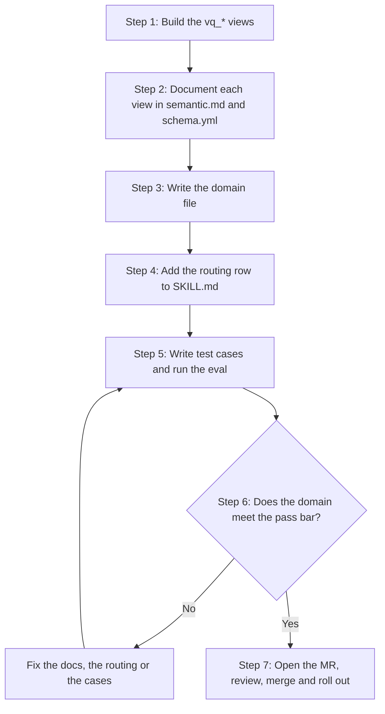

## 対象読者 {#who-this-is-for}

このガイドは、自分の業務領域に関する質問に [AI Context Layer](/handbook/enterprise-data/ai/context-layer/)で回答できるようにしたいアナリスト、アナリティクスエンジニア、データサイエンティスト向けです。ドメインは 1 つの業務領域で、2 つの部分から成ります。Snowflake 内のドキュメント化された `vq_*` 検証済みクエリビューと、質問をそれらのビューに振り分ける `snowflake-query-guidance` スキル内の短いドメインファイルです。Analytics Engineering チームは analytics リポジトリを通じてこのスキルを保守し、レビュー時に協力して、新しいドメインが既存のドメインと重複しないことを確認します。

## 開始前に {#before-you-start}

### 前提条件 {#prerequisites}

1. [analytics リポジトリ](https://gitlab.com/gitlab-data/analytics)に変更をコミットし、MR を開く手段。最新の `master` をローカルにクローンするのが最も簡単です。
1. ドメインのデータに必要なロールでの Snowflake アクセス（[Context Layer のセットアップ](/handbook/enterprise-data/ai/context-layer/setup/#prerequisites)を参照）。
1. 新しいビューの場合、analytics リポジトリでの dbt モデル構築に関する知識。[dbt ガイド](/handbook/enterprise-data/platform/dbt-guide/)を参照してください。

推奨：[エージェントのセットアップ](/handbook/enterprise-data/ai/agent-setup/)に従って Claude Code または OpenCode を設定し、[`contextlayer-setup-assistance`](#using-the-contextlayer-setup-assistance-skill) スキルを利用できるようにします。このスキルは各ステップを効率化しますが、必須ではありません。すべてのファイル形式とルールは [`CONTRIBUTING.md`](https://gitlab.com/gitlab-data/analytics/-/blob/master/marketplace-sync/snowflake-query-guidance/references/CONTRIBUTING.md)と [`TESTING.md`](https://gitlab.com/gitlab-data/analytics/-/blob/master/agents/evals/snowflake_query_guidance/TESTING.md)に記載されているため、手作業でも実施できます。

### アイデアの見つけ方 {#where-to-find-ideas}

ドメインの有力な候補には、通常、次の特徴があります。

1. **繰り返し寄せられる質問。** チームメンバーが、Slack、Issue、またはデータチームへの問い合わせで、その領域について同じ質問をしています。
1. **利用頻度の高いレポート。** その領域の Tableau ダッシュボードが頻繁に使われています。これは需要があることを示し、テスト用の質問と期待される回答の材料になります。
1. **管理されたソース。** データがすでに 1 つの信頼できるテーブルにあるか、1 つに統合できます。
1. **レビューできるオーナー。** ドメインオーナーやパワーユーザーが、テストケースの作成と回答の確認を支援できます。

[データソース一覧](/handbook/enterprise-data/platform/#data-sources)で、すでにウェアハウスにあるデータを確認できます。

## スキルの知識の構成 {#how-the-skills-knowledge-is-organized}

各ファイルは、1 種類の事実を管理します。それぞれの事実を 1 つの適切な場所に置くことで、スキルの正確性を保ち、実行コストを抑えます。この表は、すべての MR のレビュー基準となる作成規約の [`CONTRIBUTING.md`](https://gitlab.com/gitlab-data/analytics/-/blob/master/marketplace-sync/snowflake-query-guidance/references/CONTRIBUTING.md)に従っています。

| ファイル | 場所 | 含める内容 | 含めてはいけない内容 |
|---|---|---|---|
| `SKILL.md` | `marketplace-sync/snowflake-query-guidance/` | ルーティングテーブル、グローバルルール、`vq_*` コメントの読み取り順序、会計カレンダーや月粒度の日付など、ウェアハウス全体の規約 | 単一テーブルまたは単一ドメインに固有の事実 |
| `domains/<domain>.md` | `marketplace-sync/snowflake-query-guidance/references/domains/` | スコープ、`vq_*` ビューの一覧、用語、除外事項、曖昧さを解消する質問、ビュー間のルールと結合形式、カバレッジの不足、ダッシュボード | カラムに関する事実、フィルター、クエリ例、カーディナリティ、コピーしたコメント文、他のドメインファイルへの参照 |
| `semantic.md` のドキュメントブロック | `transform/snowflake-dbt/models/semantic/` または `semantic/restricted_safe/` | ビューごとに 1 つの `` ブロック：粒度、必須フィルターと内訳用フィルター、ユースケース、クエリ例、指標の計算方法。ビューのコメントとして永続化 | 別の `vq_*` ビューに関する事実 |
| `schema.yml` | `.sql` と同じフォルダー | 各ビューの登録と全カラムの説明：意味、NULL、値、大文字・小文字の扱い、ディメンションとの結合。カラムコメントとして永続化 | 必須フィルター、ビュー間の結合ルール |
| `vq_<name>.sql` | `transform/snowflake-dbt/models/semantic/` または `semantic/restricted_safe/` | ビュー自体。通常は、既存テーブルに対する単純な `SELECT *` | 説明文、業務上の定義、カラムの説明 |
| `relationships.md` | `marketplace-sync/snowflake-query-guidance/references/` | キーが特定する対象の正式な定義と曖昧さの解消、キーの連鎖、2 つの粒度から導出できないカーディナリティ | 用語の定義、粒度の再記述、導出可能なカーディナリティ |

エージェントは SQL を書く前にビューのドキュメントブロック全体を読みますが、カラムコメントは結合やカラムについて必要なときだけ読みます。必須フィルターはドキュメントブロックに記載してください。カラムコメントやドメインファイルに書いたフィルターは、まったく読まれない可能性があります。

## ワークフロー {#the-workflow}

まずビューを構築します。ビューより先にドメインファイルを書くと、ビューに置くべき事実をドメインファイルが管理することになります。



### ステップ 1：検証済みビューを構築する {#step-1-build-the-verified-views}

1. ドメインに必要なテーブルごとに `vq_*` ビューを 1 つ作成します。すべてのビューに `vq_` プレフィックスを付けます。
1. テーブルがすでに存在する場合、そのテーブルに対する単純な `SELECT *` のビューを作成します。ソーステーブルと、その既存の利用側は変更しません。
1. テーブルがまだ存在しない場合、ビューと同じフォルダーに構築します。
1. ドメイン内に同じデータのソースが重複している場合は、先に統合します。統一された 1 つのソースは、重複する複数のテーブルより正確かつ効率的です。

単純なパススルービューは次のようになります。

```sql
-- Verified Query: <domain>, <grain>.
-- Pass-through view over <source model>. No filtering, no renaming, no derived columns.

SELECT *
FROM {{ ref('<source_model>') }}
```

ビューが公開するデータに応じてフォルダーを選びます。データウェアハウスのハンドブックの [AI セマンティックスキーマ](/handbook/enterprise-data/platform/edw/#ai-semantic-schemas)のセクションで、両方のスキーマを説明しています。`transform/snowflake-dbt/dbt_project.yml` の `semantic` 設定が、各フォルダーを対応するスキーマにマッピングします。

| フォルダー | Snowflake スキーマ | 用途 |
|---|---|---|
| `transform/snowflake-dbt/models/semantic/` | `PROD.SEMANTIC` | 社内で広く利用するために整備されたビュー |
| `transform/snowflake-dbt/models/semantic/restricted_safe/` | `PROD.RESTRICTED_SAFE_SEMANTIC` | 重要な非公開データへのアクセス権を持つロール向けの、SAFE によって制限されたビュー。ソーステーブルが `PROD.RESTRICTED_SAFE_*` スキーマにある場合は、このフォルダーを使います |

`.sql` ファイル、対応するドキュメントブロック、`schema.yml` のエントリは同じフォルダーに置きます。`dq_*` ビューやワークスペーススキーマ内のビューを検証済みクエリとして列挙してはいけません。

ドメインを構築するときは、このクエリで既存の管理済みビューを一覧表示できます。

```sql
SELECT table_schema, table_name, LEFT(comment, 200) AS summary
FROM PROD.INFORMATION_SCHEMA.TABLES
WHERE table_schema IN ('SEMANTIC', 'RESTRICTED_SAFE_SEMANTIC') AND table_name ILIKE 'vq%';
```

### ステップ 2：各ビューをドキュメント化する {#step-2-document-each-view}

フォルダーの `semantic.md` にビューごとのドキュメントブロックを書き、`schema.yml` にすべてのカラムを記述します。どちらも Snowflake にコメントとして永続化されるため、モデルとそのドキュメントを 1 つの dbt MR で提供できます。

ドキュメントブロックは、`CONTRIBUTING.md` の次のテンプレートに従います。

```text

<Summary: the grain, what routes here, what routes away. Nothing else.>

---

## Agent Use Cases              task → filters/columns → valid aggregation. A table when there are many.
## Must-apply filters           always applied, or the answer is wrong.
## User-query specific filters  what a given breakdown needs. Prefer a named flag over date logic.
## Keys and join conditions     key columns, what they identify, nullability, joins to dimensions.
## Breakdown & Scope Rules      double-counting traps; ALL/NULL buckets; casing; measures not covered;
                                data-quality defects with their date window. `###` sub-sections for
                                large value lists or dated defects.
## Example Queries              numbered and runnable: primary use case, secondary, non-obvious comparisons.

```

1. **サマリーは、対象と対象外の両方向を振り分けます。** `---` より上のテキストには、何をこのビューへ振り分け、何を対象外とするかを記載します。エージェントはサマリーだけからビューを選びます。
1. **`schema.yml` にビューを登録します。** `description: '{{ doc("vq_<name>") }}'` を指定し、全カラムについて意味、NULL、値、サポートするディメンション結合を記述します。
1. **既存の説明を再利用します。** ソーステーブルやカラムにドキュメントブロックがすでにある場合は、コピーせずに検証済みクエリブロックの後ろに追加します。エージェント向けガイダンスがビューの主目的なので、先に置きます。

   ```yaml
   description: |
     {{ doc("vq_<name>") }}

     {{ doc("<source_table>") }}
   ```

1. **書く前に検証します。** テーブル、カラム、粒度に関する記述、フィルターをすべて実際のウェアハウスと照合します。すべてのクエリ例を記載どおりに実行します。検証できないものは事実として述べず、**NEEDS DATA-TEAM INPUT** と記します。
1. **証拠ではなく事実を書きます。** 行数、割合、「verified:」という注記、出典の引用は省きます。会計期間の境界やしきい値など、定義に関わる数値は残します。

実例として、[`semantic/semantic.md`](https://gitlab.com/gitlab-data/analytics/-/blob/master/transform/snowflake-dbt/models/semantic/semantic.md)と [`semantic/restricted_safe/semantic.md`](https://gitlab.com/gitlab-data/analytics/-/blob/master/transform/snowflake-dbt/models/semantic/restricted_safe/semantic.md)の既存のドキュメントブロックを読んでください。上記のテンプレートに従うブロックを手本にします。

### ステップ 3：ドメインファイルを書く {#step-3-write-the-domain-file}

`CONTRIBUTING.md` の次のテンプレートから、`marketplace-sync/snowflake-query-guidance/references/domains/<domain>.md` を作成します。セクション名と順序に従い、該当しないセクションは省きます。

```text
**Scope:** <keyword list the routing row matches>
# <Domain title>                what the domain tracks and answers; one line on its boundary.
## Verified queries             bare list of fully-qualified vq_* names.
## Definitions                  | term | means | not to be confused with |
## Not in this domain           subjects people ask here that it can't answer. No destinations.
## Ask before answering         numbered; one per fork the views can't resolve. Bold question, then options.
## Rules this domain forces     what holds between views: join shapes, comparison shape, period anchoring.
## Needs data-team input — do not answer without confirmation
                                optional: coverage gaps; claims no single view can make.
## Dashboards                   optional: | dashboard | description | link |. A fallback, never the answer.
```

1. **`**Scope:**` はキーワードのリストで、** 文ではありません。含めるのは肯定的なキーワードだけです。スコープ行に除外事項を記すと、ルーターは除外するはずの対象に一致してしまいます。
1. **`## Verified queries` は完全修飾名のみのリストです。** たとえば `PROD.SEMANTIC.vq_<name>` です。ビューに関するそれ以外のすべての情報は、そのビューのコメントを唯一の情報源とします。
1. **ユーザーに見える用語はすべて `## Definitions` の行に記載し、** ドキュメント上の名称に対応付けます。Snowflake のコメントにしかない用語は、エージェントにとってスコープ外に見えます。
1. **ドメインファイルに別のドメインファイル名は記載しません。** ルーティングは `SKILL.md` が行います。
1. **2 つのビューを結合するクエリは、ドメインファイルにテンプレートとして置き、** 各ビューのフィルターはプレースホルダーのままにします。

実例として、[`references/domains/`](https://gitlab.com/gitlab-data/analytics/-/tree/master/marketplace-sync/snowflake-query-guidance/references/domains)の既存ファイルを読んでください。上記のテンプレートに従うファイルを手本にします。

### ステップ 4：ルーティング行を登録する {#step-4-register-the-routing-row}

ドメインファイルは、`SKILL.md` から振り分けられるまでエージェントから見えません。[`SKILL.md`](https://gitlab.com/gitlab-data/analytics/-/blob/master/marketplace-sync/snowflake-query-guidance/SKILL.md)のルーティングテーブルに 1 行追加します。

1. **行のキーワードを、ドメインの `**Scope:**` 行と一致させます。**
1. **最初に衝突を検索します。** キーワードを既存の行と照合して検索します。同じキーワードが 2 行にあると、ルーティングが非決定的になり、どちらのオーナーのテストケースでも検出できません。
1. **大きな分類を表す語より、具体的な用語を優先します。** 大きな分類の語は、より具体的なドメインに属する質問を奪います。
1. **行を編集せずに追加します。** 既存行の編集や範囲の縮小は、他のドメインを壊す原因になります。既存行の変更が必要な場合は、別の MR で行い、スイート全体を実行します（[`SKILL.md` または `relationships.md` の変更](eval-harness.md#changes-to-skillmd-or-relationshipsmd)を参照）。

### ステップ 5：テストケースを書き、評価を実行する {#step-5-write-test-cases-and-run-the-eval}

すべてのドメインは、変更のマージ前に[評価ハーネス](eval-harness.md)で実行するテストケースとともに提供します。良いケースを書くことが品質に最も影響するステップなので、開始前に[テストケースの作成](eval-harness.md#writing-test-cases)を読んでください。

1. ドメインオーナーやパワーユーザーとともに現実的な質問を集めます。複数のオーナーで共同作業する場合は、[テストケーステンプレート](eval-harness.md#convert-the-google-sheet-to-yaml)に基づく Google Sheet が便利です。それ以外の場合は、YAML を直接書きます。
1. `contextlayer-setup-assistance` スキルに、シートを YAML に変換するよう依頼します（リンクを渡します）。ファイルは `agents/evals/snowflake_query_guidance/test_cases/<domain>.yaml` に配置されます。
1. スキルに、自分のドメインのテストケースを実行するよう依頼します。まずルーティングチェックを実行し、次に全件評価を実行します。
1. 自分のドメイン全体と、スコープの重なりが最も近い 2 つのドメインをテストします。その 2 つのドメイン名と選んだ理由を MR の説明に記載します。

スキルを使わない場合は、[ケース YAML スキーマ](eval-harness.md#case-yaml-schema)に従って手作業で YAML を書き、[CI での実行](eval-harness.md#running-in-ci)または[ローカルでの実行](eval-harness.md#running-locally)に従って評価を実行します。[評価ハーネス](eval-harness.md)のページでは、ケースの形式とレポートの読み方を説明しています。

### ステップ 6：合格基準を満たすまでイテレーションする {#step-6-iterate-to-the-pass-bar}

レポートを使って、ルールの不足、定義の曖昧さ、誤ったファイルに到達するルーティングなどの不備を見つけます。ビュー、ドメインファイル、またはケースを更新して再実行し、これを繰り返します。ドメインは、次の[合格基準](eval-harness.md#pass-bar)を満たすと準備完了です。

1. ドメインごとに判定して、実行精度が 80% 以上であること。
1. 想定される拒否を 1 つ含む、少なくとも 5 つのケースがあること。上限はありません。ドメインの複雑さに応じて必要なだけ書きます。
1. 合否判定用の実行では、ケースごとに 3 回実行すること。
1. 全体のスコアが 80% を超えていても、失敗したすべてのケースをレビューして理解していること。

### ステップ 7：MR を開いて展開する {#step-7-open-the-mr-and-roll-out}

1. analytics リポジトリで [`semantic_layer_changes`](https://gitlab.com/gitlab-data/analytics/-/blob/master/.gitlab/merge_request_templates/semantic_layer_changes.md) テンプレートを使って MR を開き、作成者チェックリストを完了します。
1. 新しいドメインのコンテンツを追加する MR には、既存行へのルーティング変更を含めません。これにより、精度の低下をどちらか一方に追跡できます。
1. GitLab Duo のすべてのレビュースレッドを解決するか、回答します。Duo は作成規約とテスト範囲に照らして MR をチェックし、別のドメインやビューにすでに存在する定義を指摘します。
1. [`CODEOWNERS`](https://gitlab.com/gitlab-data/analytics/-/blob/master/CODEOWNERS)に記載された Semantic Layer コードオーナーから承認を得ます。
1. マージします。スキルはマーケットプレイスへ自動的に同期されるので、2 つ目の MR は不要です。
1. ドメインに合う計画で展開します。
   1. ドメインの精度を共有する説明セッション。
   1. テストケースと独自の質問を使った、パワーユーザーによるテスト。
   1. Data DRI と Business DRI による最終承認。
   1. ユーザー受け入れテストのチェックリスト。

## `contextlayer-setup-assistance` スキルの使用 {#using-the-contextlayer-setup-assistance-skill}

[`contextlayer-setup-assistance`](https://gitlab.com/gitlab-data/analytics/-/blob/master/agents/evals/contextlayer-setup-assistance/SKILL.md) スキルは、Claude Code または OpenCode から各ステップを案内します。analytics リポジトリでエージェントを起動し、`/contextlayer-setup-assistance` に続けて希望する内容を入力するか、自然な言葉でタスクを説明します。

| タスク | プロンプトの例 | 実行内容 |
|---|---|---|
| 新しいドメインのひな形を作る | `/contextlayer-setup-assistance get started <domain>`、または「新しいドメインガイドの作成を手伝ってください」 | テンプレートの全セクションと各セクションの短いコメントを含むドメインファイルを作成し、`SKILL.md` のルーティングテーブルにマーカーを置きます。次に `vq_*` ビュー名を尋ね、各ビューについて、まだ存在しない `.sql`、`semantic.md` ブロック、`schema.yml` エントリのひな形を作成します |
| 事実の配置をレビューする | `/contextlayer-setup-assistance review my docs for <domain>`、または「私のドメインでは、すべて適切なファイルに配置されていますか？」 | ファイルと場所、構造、コンテンツの配置、ケース、実行結果を 1 つずつチェックします。合格、失敗、警告を番号付きの表で返します |
| 文体をレビューする | `/contextlayer-setup-assistance review writing style for <domain>`、または `/contextlayer-setup-assistance review writing style for semantic for <vq_view>` | 記述ルールに違反するものだけを、ルール別にまとめて P0（重大）から P3（見た目）のタグを付け、各行へのリンクと貼り付け可能な短い書き換え案とともに報告します |
| 事実を書く場所を尋ねる | `/contextlayer-setup-assistance where should I document <fact>?`、または「必須フィルターはドメインファイルとビューのどちらに記載しますか？」 | 事実を書くべきファイルとセクション、および他の場所に書いてはいけない内容を示します |
| SME の Google Sheet をテストケースに変換する | `/contextlayer-setup-assistance <Google Sheet URL> <domain>`、または「このシートから私のドメイン用のテストケースを作成してください」 | シートを読み、そのドメインだけの `test_cases/<domain>.yaml` を作成して検証します |
| 評価を実行する | `/contextlayer-setup-assistance run <domain>`、または「私のドメインのスモークテストを行ってください」 | 環境を確認し、ルーティングチェックとスモークケースを実行してコストを示した後、全件評価を実行して結果を報告します |

スキルが行わないこと：

1. 事実は書きません。プレースホルダーのひな形を作成し、ビューのマージ前に、すべてのプレースホルダーとカラムの説明をあなたが置き換えます。
1. dbt は実行しません。`dbt run --select vq_<name>` は、あなたが実施するチェックです。
1. レビュー指摘を独断で反映しません。どの指摘を反映するか指定した後にのみ編集します。
1. 評価ハーネス、その `config.yaml`、`pyproject.toml`、他のドメインのテストケースは決して編集しません。実行に設定変更が必要な場合は、変更すべき内容を伝えます。

## 記述ガイダンスと得られた教訓 {#writing-guidance-and-lessons-learned}

1. **ドメインファイルをできるだけ小さく保ちます。** 各行を精査し、削除すると結果が変わるかを考えます。SQL と回答が変わらなければ、その行を削除します。コンテキストを減らすと、ドメインの合格率が改善した実績があります。
1. **テーブルの詳細は dbt ドキュメントに移します。** 粒度、フィルター、カラムの動作、クエリ例はビューに置き、モデルとともに最新の状態を保ちます。
1. **統一されたデータソースを優先します。** 対象ごとに 1 つのテーブルを使う方が、重複する複数のテーブルより正確かつ効率的です。
1. **各定義を適切な場所に置きます。** 業務上の定義はドメインファイルに置きます。技術的な定義はビューのドキュメントに置きます。
1. **モデルがすでに知っていることは教えません。** Google Analytics データのような一般的な概念はすでに理解しています。GitLab のデータで特有な点と、GitLab がそれをどう測定するかを記述します。
1. **トークン予算を守ります。** ビューのドキュメントブロックは、そのビューが回答するすべての質問で全文が読まれるため、どの行もクエリのたびにトークンを消費します。約 1,500 語を超える `vq_*` ドキュメントブロックや、約 1,000 語を超えるドメインファイルには注意を促し、超過する場合は MR に理由を記載します。
1. **エージェントが書いたものを読みます。** AI を使ってドメインファイルの草案を作った場合は、MR を開く前にすべての行を自分で読み、簡潔になるよう編集します。
1. **1 つの事実に、1 つの場所。** 用語を追加する前に、ドメインファイルとビュードキュメントで検索します。2 つのドメインが同じ用語を異なる形で定義する問題は、他の手段では検出できません。

## MR の例 {#example-mrs}

| MR | 内容 |
|---|---|
| [analytics!14284](https://gitlab.com/gitlab-data/analytics/-/merge_requests/14284) | 新しいドメインへの検証済みクエリビューの追加 |
| [analytics!14392](https://gitlab.com/gitlab-data/analytics/-/merge_requests/14392) | スキルの Markdown のみの変更：2 つのドメインファイルへの新しいセクションと、`SKILL.md` への新しいルールの追加 |
| [analytics!14589](https://gitlab.com/gitlab-data/analytics/-/merge_requests/14589) | ビューのドキュメント変更をテストするデモ（マージせずクローズ） |

## トレーニングの録画 {#training-recording}

2026 年 10 月に録画されたトレーニングセッション [GitLab の Context Layer への新しいドメインの追加](https://youtu.be/vhtuoUGoq2c)では、Context Layer、`contextlayer-setup-assistance` スキルによるドメイン追加、評価ハーネスについて説明しています。録画内のコマンドやパスは、録画後に変わっている可能性があります。異なる場合は、このガイドと analytics リポジトリに従ってください。
