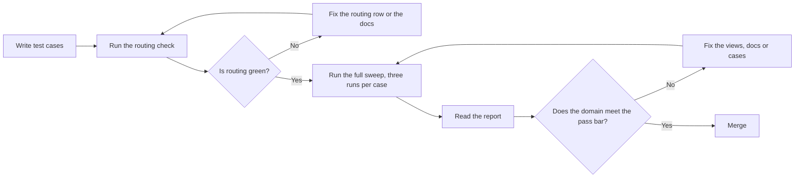

評価ハーネスは、[AI Context Layer](/handbook/enterprise-data/ai/context-layer/)の自動テストフレームワークです。`snowflake-query-guidance` スキルを読み込んだエージェントに各テスト質問を提示し、エージェントがどこを参照し、何を回答したかを採点します。analytics リポジトリの [`agents/evals/snowflake_query_guidance/`](https://gitlab.com/gitlab-data/analytics/-/tree/master/agents/evals/snowflake_query_guidance)にあります。新しいドメインだけでなく、Context Layer のすべての変更に使ってください。

元となる文書は、[`TESTING.md`](https://gitlab.com/gitlab-data/analytics/-/blob/master/agents/evals/snowflake_query_guidance/TESTING.md)（テスト対象と方法）と、ハーネスの [`README.md`](https://gitlab.com/gitlab-data/analytics/-/blob/master/agents/evals/snowflake_query_guidance/README.md)（仕組み）です。このページはその要約です。このページと異なる場合は、リポジトリを優先します。

## テストする理由 {#why-we-test}

1. **正確な回答。** 目的は、正しそうに見えるだけの回答ではなく、データに照らして正しい回答です。
1. **各変更の客観的な測定。** Context Layer のすべての変更で、期待どおりに回答するかを示すテスト結果を MR に記載します。
1. **他のドメインのリグレッション。** 自分の質問では動く変更でも、まったく触れていない業務領域の回答を壊すことがあります。テストはマージ前にそれを検出します。

すべてのドメインは、正しい回答がすでに分かっている質問セットとともに提供し、そのドメインのすべての変更を、マージ前にそのセットに照らして実行します。



## すべてのテストケースで確認すること {#what-every-test-case-checks}

1. **ルーティング。** エージェントは正しいドキュメントを開いたか。ケースは、必要な参照ファイルと `vq_*` ビューを、`[domains/<domain>, vq_<name>]` のように `expects_routing` に列挙します。列挙されたすべてのファイルを開き、列挙されたすべてのビューのコメント全文を読むと、その実行のルーティングは合格です。
1. **実行精度。** エージェントは正しい数値を得たか。回答が数値の場合、ハーネスはエージェントの SQL とケースの `reference_query` をウェアハウスに対して実行し、結果セットを比較します。SQL が一致する必要はなく、結果だけが一致すれば十分です。データは時間の経過とともに再修正されるため、期待する数値をハードコードすることはありません。
1. **判定チェック。** エージェントは正しく振る舞ったか。LLM 判定者が、記述された `judge_checks` に照らして回答を採点します。数値は正しいが説明の仕方が誤っている、対象期間が欠けている、本来は拒否すべき回答をしている、といった実行精度では捉えられないものを検出します。

拒否や確認質問を返すことで合格するケースもあります。あるドメインの指標を、どのドメインでも扱っていない指標と比較する質問では、そこで止まり、2 つ目の指標は対象外であると伝えるべきです。「週次成長の全体像を教えてください」のような曖昧な質問では、数値を返す前に、何を意味するのかを尋ねるべきです。これらのケースには参照クエリはなく、判定チェックだけがあります。常に回答するエージェントを目指しているわけではありません。

## テストケースの作成 {#writing-test-cases}

### 質問を集める {#gather-the-questions}

ドメインオーナーやパワーユーザーとともに、実際のユーザーが尋ねる言い方で質問を書きます。ドキュメント独自の用語で書いたケースでは、エージェントがファイルを読み返せるかしかテストできません。

次の質問タイプを網羅します。

1. 単純な指標の照会。
1. 指標とディメンションによる切り分け。
1. QTD、YTD、前年との比較など、時間に基づくもの。
1. 同義語、表現の違い、曖昧な質問。
1. エージェントが何かを特定してから測定する、2 段階の分析。
1. 追加質問を伴う 2 段階の分析。
1. 失敗する局面での対応をテストする、エージェントが回答できるべきではない質問。
1. 定義に関する説明的な質問。
1. 複数テーブルにまたがる質問。

各ケースを、単一指標の照会なら **L1**、比較、複数のステップ、曖昧さの解釈が必要なら **L2** と評価します。

ケース数は固定されていません。小さなドメインなら 10 件未満、複雑なドメインなら 25 件以上が必要な場合があります。想定される拒否を 1 つ含めて、少なくとも 5 件を書き、次を網羅します。

1. **そのドメインに寄せられる各質問形式：** 単純な指標の照会、ディメンション別の指標、時間の比較、同義語や曖昧な表現、2 段階の質問、想定される拒否。
1. **`## Rules this domain forces` の各項目。** エージェントがそのルールを無視すると失敗するケースを用意します。ルールに従った場合と無視した場合を区別するケースを書けなければ、そのルールは十分に明確ではありません。
1. **隣接ドメインが管理する各用語。** [隣接ドメインを守る](#guard-the-neighboring-domains)を参照してください。

他のケースでは得られない情報を得られる場合にだけ、そのケースを残します。

ケースの作成ルール：

1. **`judge_checks` は確認可能なものにします。** 「今会計四半期と前年の同じ四半期の数値を、合計ではなく別々の 2 つの値として返す」は確認できます。「回答が正確で、適切な形式になっている」は確認できません。
1. **安定したデータだけを使います。** 期待する結果が毎日変わるケースは、変更と無関係な理由で失敗します。
1. **すべてのケースに `expects_routing` を設定し、** 各エントリがスキルの `references/` 配下の参照ファイル、または管理されたセマンティックスキーマ内の `vq_*` ビューに解決できるようにします。ビューには `vq_<name>` を使います。全件評価は実行前にすべてのエントリをチェックし、解決できないものがあれば中断します。
1. 利用する前に、実際のウェアハウスに対して**すべての参照クエリを検証します。**
1. ドメインの `SKILL.md` ルーティング行ができるまでは、**草案を `test_cases/` に置きません。** このフォルダーのすべてのファイルは、スイート全体を実行するたびに対象になります。

### 確認可能な判定チェックを書く {#write-checkable-judge-checks}

判定チェックは、LLM 判定者が回答だけから真偽を判定できる、1 つの検証項目です。

| 弱い例 | 強い例 |
|---|---|
| 回答が正確で、適切な形式になっている | 今会計四半期と前年の同じ四半期の数値を、合計ではなく別々の 2 つの値として返す |
| 正しいフィルターを使う | ビューの必須フィルターを適用し、テストアカウントを除外する |
| 質問に適切に対処する | 各数値が対象とする会計期間を明記する |
| 適切に拒否する | 要求された指標はこのドメインの対象外であると述べ、その数値を捏造しない |

1. **1 チェックにつき、1 つの検証項目にします。** 2 つの条件をまとめたチェックでは、合否の理由が不明確になります。
1. **品質ではなく、動作を指定します。** 回答に何を含め、何を述べ、何を避ける必要があるかを書きます。
1. **実行精度で捉えられないものを網羅します。** 対象期間の明示、数値の説明の仕方、エージェントが行ってはいけないことなどです。

### 参照クエリを書く {#write-the-reference-query}

1. 可能な場合は、**`vq_*` ビューではなくソーステーブルをクエリします。** これにより、ケースが構造上当然一致するだけでなく、ビューのドキュメントを独立してチェックできます。
1. **相対日付を使います。** `DATE_TRUNC(MONTH, CURRENT_DATE())` などを使い、古くなって使えなくなる固定の期間は使いません。
1. ケースをコミットする前に、実際のウェアハウスで**記載どおりに実行し、** ドメインオーナーと結果を確認します。
1. **質問が求めるものだけを返します。** 余分なカラムや行があると、エージェントと無関係な理由で結果セットの比較に失敗します。

### 隣接ドメインを守る {#guard-the-neighboring-domains}

自分のドメインを変更すると、別のドメインに属する質問にも回答し始める可能性があります。別のドメインが管理する近い用語について自分のドメインに尋ね、拒否が正しい動作となるケースを追加します。これらのケースは、自分のドメインのテストファイルに置きます。そうすれば、後のドメインファイルの変更で、他ドメインの指標を気付かないうちに引き受けることを防げます。

拒否ケースには参照クエリはなく、判定チェックだけがあります。このテンプレートの各プレースホルダーを、自分のドメインの値に置き換えます。

```yaml
  - id: <prefix>-<NN>-<slug>
    section: "Synonyms / wording variations / ambiguous questions"
    difficulty: L2
    question: "How does <your metric> compare against <metric owned elsewhere>?"
    type: decline
    expected_behavior: decline
    expects_routing: [domains/<domain>]
    reference_query: null
    judge_checks:
      - "Answer states that '<metric owned elsewhere>' is not covered by the <domain> domain."
      - "Answer names the metrics it can compare <your metric> against rather than guessing at another source."
      - "Answer does not fabricate a number or invent a table to join against."
    tags: [<domain>, scope, judge_only]
```

### Google Sheet を YAML に変換する {#convert-the-google-sheet-to-yaml}

ドメインオーナーは通常、[テストケーステンプレート](https://docs.google.com/spreadsheets/d/1erc725DjArdez9SGo9f8W-FleNzgDNDwcguVn6FkN-I/edit)（社内向け）に基づく Google Sheet にケースを書きます。シートは受付フォームにすぎません。ハーネスは `agents/evals/snowflake_query_guidance/test_cases/<domain>.yaml` を読み取って採点するため、シートをそのファイルに変換する必要があります。

最も簡単なのは、`contextlayer-setup-assistance` スキルを使う方法です。analytics リポジトリで起動した Claude Code または OpenCode から、次を実行します。

```text
/contextlayer-setup-assistance <Google Sheet URL> <domain>
```

1. シートはリンク共有にする必要があります。そうでない場合は、CSV としてエクスポートし、スキルにファイルパスを渡します。
1. 既存のドメインファイル名があれば、スキルはその名前を再利用するため、再生成すると同じファイルを上書きします。
1. 各ケースの `id` はシートから機械的に導出するので、再生成しても ID は安定します。手作業で名前を変更しないでください。
1. ファイルを返す前に、ハーネスのローダーで検証します。

上記のケース作成ルールの確認は、引き続きあなたの責任です。

### ケース YAML スキーマ {#case-yaml-schema}

ドメインごとに `test_cases/<domain>.yaml` を 1 ファイル作成し、トップレベルのキーは `cases:` だけにします。ドメインはファイル名です。ローダーがエラーを返すため、**ケースに `domain:` キーを追加してはいけません。** 仕様は `harness/loader.py`、作成規約は [`reference.md` のケース YAML スキーマ](https://gitlab.com/gitlab-data/analytics/-/blob/master/agents/evals/contextlayer-setup-assistance/references/reference.md#case-yaml-schema)です。

| フィールド | 規約上の必須項目か | 値 |
|---|---|---|
| `id` | はい。ローダーが必須とする唯一のフィールド | `<prefix>-<NN>-<slug>`：ドメインの頭文字、2 桁にゼロ埋めしたシートの行番号、質問の最初の 6 語。たとえば `ab-02-break-down-last-months-orders-by`。ファイル内で一意 |
| `section` | いいえ | シートの質問タイプ |
| `difficulty` | いいえ | `L1` または `L2` |
| `question` | はい | ユーザーが実際に尋ねる言い方での質問 |
| `type` | はい | `answer`、`decline`、`clarify`、`descriptive`。デフォルトは `answer` |
| `expected_behavior` | はい | `answer`、`decline`、`clarify`。デフォルトは `answer` |
| `expects_routing` | はい | エージェントが参照する必要のある参照ファイルとビュー。たとえば `[domains/<domain>, vq_<name>]`。これがないケースではルーティングを採点しません |
| `reference_query` | いいえ | 正解となる SQL。これがなければ実行精度を評価しません |
| `judge_checks` | いいえ | 確認可能な検証項目のリスト。これがなければ判定者スコアはありません |
| `tags` | はい | `[<domain>, <section_slug>, <tier>]`。ティアは、マージ前の合否判定セットなら `core`、それ以外は `judge_only`。ハーネス自体はタグを読みません |
| `notes` | いいえ | 自由記述 |
| `agent_timeout_s` | いいえ | ケースごとのタイムアウト秒数。処理の遅い L2 ケース専用。デフォルトは 180 |
| `reference_shape` | いいえ | 想定する結果の形式の説明。設定することはまれです |

ケースには `reference_query` または `judge_checks` が必要で、両方あるのが最善です。どちらもなければ何も採点しません。`# <verify>` マーカーで始まる `reference_query` は、存在しないものとして扱います。

このテンプレートは `answer` ケースの形式を示しています。各プレースホルダーを、自分のドメインの値に置き換えます。完全で動作するケースについては、[`test_cases/`](https://gitlab.com/gitlab-data/analytics/-/tree/master/agents/evals/snowflake_query_guidance/test_cases) 内の任意のファイルを開いてください。

```yaml
  - id: <prefix>-<NN>-<slug>
    section: "[Metric + dimension slicing]"
    difficulty: L2
    question: Break down last month's <metric> by <dimension>
    type: answer
    expected_behavior: answer
    expects_routing: [domains/<domain>, vq_<name>]
    reference_query: SELECT <dimension>, COUNT(DISTINCT <key>) AS <metric>
      FROM PROD.<schema>.<source_table>
      WHERE <date_column> >= DATEADD(MONTH, -1, DATE_TRUNC(MONTH, CURRENT_DATE()))
        AND <date_column> < DATE_TRUNC(MONTH, CURRENT_DATE())
        AND <must apply filter>
      GROUP BY ALL
      ORDER BY <metric> DESC;
    judge_checks:
    - Uses <dimension> on the <source> table.
    - Returns every <dimension> value present, not only the largest ones.
    - States the month.
    tags: [<domain>, metric_dimension_slicing, core]
```

参照クエリは `vq_*` ビューではなくソーステーブルを読むため、ビューのドキュメントを独立してチェックできます。

## ルーティングチェックと全件評価の比較 {#routing-check-vs-full-sweep}

| | ルーティングチェック | 全件評価 |
|---|---|---|
| 採点対象 | ルーティングのみ | ルーティング、実行精度、判定チェック |
| SQL の実行 | なし。エージェントは回答クエリの前で停止します | あり。ウェアハウスに対して実行します |
| ケースごとの実行回数 | デフォルトで 1 回 | デフォルトで 3 回 |
| 使うタイミング | イテレーション中、プッシュ前 | マージ前、リグレッションの合否判定として |

まずルーティングを合格にします。エージェントがファイルを見つけられなければ、全件評価でも合格につながりません。ルーティングチェックなら、完全な実行に比べて数分で済みます。全件評価のコストをかけるのは、ルーティングが合格してからにします。

## テスト対象 {#what-to-test}

変更に必要なスコープで実行します。

| 変更したもの | 必須の評価範囲 |
|---|---|
| 新しい `references/domains/<x>.md` と、そのルーティング行 | `<x>` 全体と、スコープの重なりが最も近い 2 つのドメイン。名前と選んだ理由を MR に記載します |
| 既存ドメインの定義、ルール、クエリ例 | そのドメイン |
| `vq_*` モデル、その `semantic.md` ドキュメントブロック、または `schema.yml` | そのビューを列挙しているすべてのドメイン |
| その他の `SKILL.md` の変更、または `references/relationships.md` | スイート全体。[`SKILL.md` または `relationships.md` の変更](#changes-to-skillmd-or-relationshipsmd)を参照してください |
| 意味の変更を伴わない、文章だけの変更 | なし。MR に「no semantic change」と記載します |

エージェントは、`semantic.md` ではなく、永続化された Snowflake コメントからビューのドキュメントを読みます。ドキュメントの変更が評価に反映されるのは、評価が読み取るデータベース内で dbt がビューを再構築した後です。そうしなければ、実行は合格しても何もテストしていません。

| 変更内容 | 実行場所 | データベース |
|---|---|---|
| スキルの Markdown のみ（`SKILL.md`、`domains/`、`relationships.md`） | CI またはローカル | `PROD`。CI では `target_db` を `PROD` に設定します |
| `vq_*` モデル、`semantic.md`、`schema.yml` | CI（推奨） | MR ごとのクローン `<BRANCH>_PROD`。`target_db` は空にします |
| 同上をローカルで実行 | ローカル | `--database <USER>_PROD` を指定した開発用データベース |

## CI での実行 {#running-in-ci}

CI で実行する場合、ローカルへのインストールは不要です。ジョブは手動なので、**この順序で**実行します。`🔬sqg-eval` はクローンが存在する前でも実行できるため、順序の管理はあなたの責任です。

1. **`📈❗️clone_prod_real`** が MR ごとのクローンデータベース `<BRANCH>_PROD` を作成します。
1. **`.sql`、ドキュメントブロック、カラムが変更されたすべてのビューを再構築します。**

   | 変更内容 | CI ジョブ | 入力 |
   |---|---|---|
   | ビューの `.sql` | `🏗️🏭build_changes` | なし |
   | `schema.yml`（`semantic.md` の変更有無を問わず） | `🏗️🏭build_changes` | `selection`：`vq_<name> vq_<name2>` |
   | `semantic.md` のみ | `🎛️custom_invocation` | `statement`：`run --select vq_<name> --defer --state reference_state` |

   ドキュメントブロックやカラムが変更されたすべてのビューを列挙します。省いたビューはクローン内に古いコメントを保持し、評価は警告なしに古いドキュメントをテストします。

1. **`run_grants_eval_harness`** が、評価用サービスアカウントの読み取り権限をクローンへコピーします。省略すると、クエリは権限エラーとなり、実行率が 0 になります。
1. **`🔬sqg-eval`** が評価を実行します。入力を、変更に必要なスコープに設定します。
1. **`sqg-eval-comment`** が自動実行され、MR にサマリーを投稿します。

スキルの Markdown のみの変更では、ステップ 1 から 3 を省略し、`target_db` を `PROD` に設定します。

[`sqg-eval-ci.yml`](https://gitlab.com/gitlab-data/analytics/-/blob/master/agents/evals/snowflake_query_guidance/sqg-eval-ci.yml)にある `🔬sqg-eval` の入力：

| 入力 | デフォルト | 動作 |
|---|---|---|
| `mode` | `full` | `full` は評価全体を実行します。`routing` は、判定者と参照クエリを使わず、ケースごとに 1 回、ルーティングチェックだけを実行します |
| `models` | `sqg-eval-ci.yml` で設定 | 全件評価に使うエージェントモデルをカンマ区切りで指定 |
| `domain` | 空。すべてのドメインを実行 | 対象のドメインを、`test_cases/<domain>.yaml` に対応する名前でカンマ区切りで指定 |
| `cases` | 空 | 特定のケース ID をカンマ区切りで指定。`domain` 内の実行対象を絞ります |
| `workers` | `10` | 並列ワーカープールのサイズ |
| `runs` | 空 | ケースごとの実行回数。空の場合、`full` は 3 回、`routing` は 1 回 |
| `target_db` | 空 | 空の場合、MR ごとのクローンを読みます。`PROD` は、先行ジョブを必要とせず、本番を直接読みます |
| `no_baseline` | `true` | スキルなしのベースライン実行群を省略します。`mode` が `routing` の場合は無視します |

`sqg-eval-comment` ジョブは、MR 上の 1 つの継続更新されるノートに投稿します。実行精度の合格率、判定者スコアの平均、ルーティング合格率、気付かれにくい誤答の件数、テスト対象スキルのコミット、完全な HTML レポートへのリンクを表示します。投稿するのは集計指標だけです。

<!-- TODO: screenshot eval-mr-comment.png -->

> **注：** 評価はマージをブロックしません。`🔬sqg-eval` は失敗が許容されているため、評価が失敗してもパイプラインに印が付くだけで、何も止まりません。失敗した評価は、自分でマージを止める条件として扱ってください。

## ローカルでの実行 {#running-locally}

集中的にイテレーションし、短いサイクルで進めたい場合はローカルで実行します。ハーネスは独自の Snowflake MCP サーバーを起動するため、OpenCode の設定に追加する必要はありません。

マシンごとに一度必要な前提条件：

| 必要なもの | 確認 | 不足する場合 |
|---|---|---|
| `uv` | `uv --version` | `brew install uv` |
| `opencode` CLI | `opencode --version` | インストールします。`sqg-eval-ci.yml` に固定されたバージョンに合わせます |
| GitLab Duo モデル | `opencode models \| grep duo-chat` | GitLab Duo プロバイダーに対して `opencode auth login` |
| Snowflake プロファイル | `grep dev_l ~/.dbt/profiles.yml` | `gitlab-snowflake` プロファイルに `authenticator: externalbrowser` を指定した `dev_l` ターゲットを追加します |
| Snowflake 権限 | なし | セマンティックスキーマ、およびドメインの参照クエリが読むすべてのスキーマに対する `SELECT` |

リポジトリのルートから事前確認スクリプトを実行して、環境を確認します。仮想環境を構築し、依存関係をインストールし、各阻害要因とその解決策を表示します。

```bash
bash agents/evals/contextlayer-setup-assistance/scripts/preflight.sh --workers 10
```

次に、ステップを順に実行します。これらのコマンドは `TESTING.md` にあり、リポジトリのルートから実行できます。

```bash
H=agents/evals/snowflake_query_guidance                                  # eval root, from the repo root
D=my_domain                                                               # your domain, matching test_cases/<domain>.yaml
C=my-case-id                                                              # one case id, from --list-cases

uv sync --frozen --python 3.12 --directory $H                             # venv and deps, once

ls $H/test_cases/                                                         # domains, one yaml each
uv run --directory $H python -m harness.sweep --domain $D --list-cases    # case ids in a domain

# 1. routing only
uv run --directory $H python -m harness.routing_check --domain $D

# 2. plan only: no Snowflake, no model calls (always prints workers=1, by design)
uv run --directory $H python -m harness.sweep --domain $D --runs 1 --dry-run

# 3. smoke: one case, once, to prove auth and the MCP path
uv run --directory $H python -m harness.sweep --cases $C --runs 1 --no-baseline

# 4. one domain (add --database <USER>_PROD for a dbt change)
uv run --directory $H python -m harness.sweep --domain $D --runs 1 --no-baseline

#    long run in the background, streaming to a log
PYTHONUNBUFFERED=1 uv run --directory $H python -m harness.sweep --domain $D --no-baseline \
  > $H/results/$D.log 2>&1 &
tail -f $H/results/$D.log

# 5. report: latest results, or named result files to compare
uv run --directory $H python -m harness.report
uv run --directory $H python -m harness.report results/A.json results/B.json
```

| フラグ | 動作 |
|---|---|
| `--domain` | 1 つ以上のドメインのケースを実行します |
| `--cases` | 特定のケース ID をカンマ区切りで指定して実行します |
| `--runs` | ケースごとの実行回数。合否判定用の実行では 3 回にします |
| `--no-baseline` | スキルなしのベースライン実行群を省略します。通常は指定します |
| `--dry-run` | Snowflake クエリもモデル呼び出しも行わず、計画を表示します |
| `--list-cases` | `--cases` に渡せるケース ID を列挙します |
| `--database` | dbt 変更時の開発用データベースなど、別のデータベースを読みます |

1. **正常なスモーク実行**では、`[EA] All N reference queries valid`、`[mcp] healthy -> http://…`、`EA✓`、`[mcp] sweep totals: queries=N errors=0` が表示されます。`errors` が 0 でないか、`queries=0` の場合は、追加の実行を行う前に止めて修正します。
1. **コスト**は、ケースごとの実行回数 × ケース数 × モデル数に、`--no-baseline` を指定しない場合は 1 つのベースライン実行群を加えたものです。
1. **レポート**は `results/report_matrix_<timestamp>.html` に出力されます。

`contextlayer-setup-assistance` スキルは、Claude Code または OpenCode から、これらすべてを代わりに進められます。事前確認、ルーティングチェック、スモークケースを実行し、コストを示した後、バックグラウンドで全件評価を実行して結果を報告します。

```text
/contextlayer-setup-assistance run <domain>
```

| 症状 | 考えられる原因 |
|---|---|
| `config.skill_path resolved to '...' which does not exist` | 古い `SQG_SKILL_PATH` のエクスポート設定。`unset SQG_SKILL_PATH` を実行します |
| 回答なしで即座に実行が終了する | モデルへのアクセス。`opencode auth login` を再実行し、`duo-chat` モデルが列挙されることを確認します |
| Snowflake 認証エラー | 古い Snowflake 環境変数、または `dev_l` ターゲットや `gitlab-snowflake` プロファイルの欠落 |
| `Execute rate: 0/N` | エージェントが SQL をまったく実行していないため、すべての実行精度の数値が無効です |
| dbt の変更後、ドメイン全体が失敗する | ケースが読み取るテーブルを持たない開発用データベースを指定して実行しました |

その他の解決策は、[`reference.md` › トラブルシューティング](https://gitlab.com/gitlab-data/analytics/-/blob/master/agents/evals/contextlayer-setup-assistance/references/reference.md#troubleshooting)にあります。

## レポートの読み方 {#reading-the-report}

各実行は HTML レポートを出力します。CI では、MR コメントのリンクから開きます。ローカルでは、`results/report_matrix_<timestamp>.html` をブラウザーで開きます。

<!-- TODO: screenshot eval-report-overview.png -->

指標は次の順番で読みます。

| 指標 | 内容 | 読み方 |
|---|---|---|
| **Execute rate** | 実際に SQL を実行した実行 | 最初に確認します。**0 は、すべての実行精度の数値に意味がないことを示します。** ハーネスがエージェントの最終 SQL ブロックを自ら再実行するため、エージェントがツールを一度も呼び出さなくても合格し得るからです |
| **Execution accuracy (pass rate)** | SQL が参照クエリと同じ結果セットを返した実行 | 重要な数値です。集計値ではなく、必ずドメインごとに判断します |
| **Judge score (1 to 5)** | ケースの `judge_checks` に照らした LLM 判定者のスコア | 記録のみです。確認はしますが、平均して意思決定に組み込みません |
| **Routing pass rate** | `expects_routing` 内の全ドキュメントを参照した実行 | LLM が関与しない、決定的な指標です。記録のみなので、これによって CI が失敗することはありません |
| **Silently wrong** | 判定者が回答を 4 以上と評価した一方、実行精度が不合格だった実行 | 自信に満ちた、もっともらしい誤答という最悪の結果です。該当するケースと実行に印が付きます |
| **Token usage** | 実行全体で使用したトークン | 記録のみです。変更の 2 つのバージョン間でコストを比較するために使います |

次に、詳細を掘り下げます。

1. **ドメインごと。** 各ドメインの行は、採点された実行における合格率を示します。
1. **ケースごと。** 各ケースの行は、実行精度、判定者スコア、ルーティングを `R matched/expected`、たとえば `R 1/2` の形で示します。`+n` は、エージェントが余分なドキュメントを `n` 件読んだことを表し、セルは黄橙色になります。セルを選択すると、そのケースの実行へ移動します。
1. **実行ごと。** 各実行の履歴は、スキルの読み込み、ドメインファイルの表示、ビューコメントの読み取り、SQL 実行という、エージェントが行った内容を順に示します。**Routing** セクションには、期待されたドキュメント、一致したもの、不足したもの、余分なものが列挙されます。

<!-- TODO: screenshot eval-report-case-detail.png -->

ルーティングが外れた場合、履歴から理由が分かります。

1. **不足があり、余分なものはない。** エージェントは何も参照しませんでした。ルーティングの失敗です。
1. **不足があり、加えて無関係な余分な読み取りがある。** エージェントは別の場所へ進んだため、スキルのルーティングが誤った方向を示しています。
1. **不足と余分の両方に同じ名前がある。** エージェントは正しいドキュメントを開きましたが、採点側が一致と認識しませんでした。そのため、誤っているのはエージェントではなく、ケースの `expects_routing` エントリです。

ビューコメントの `---` より上のサマリーだけを読むことは、そのビューを参照したとは数えません。サマリーはビューを対象外と判断するには十分ですが、使うためには決して十分ではありません。

> **注：** 実行に多くの失敗がある場合は、HTML レポートを Claude に渡し、失敗パターンの要約を依頼します。次にドメインファイルやビューのドキュメントを修正し、再実行します。

## 合格基準 {#pass-bar}

ドメインは、次のすべてを満たすと展開の準備完了です。

1. **実行精度が 80% 以上。** ドメイン間の集計値ではなく、必ずドメインごとに判断します。
1. ドメインを提供済みと数える前に、**拒否を含めて、少なくとも 5 件のケースがあること。** ケースがそれより少ないと、80% の基準は 0% または 100% にしかなりません。
1. **ドメインを網羅するのに十分なケースがあること。** 単純な質問と難しい質問をバランスよく含めます。上限はありません。
1. **合否判定用の実行では、ケースごとに 3 回実行すること。** モデルは非決定的なので、1 回だけでは偶然に合格または失敗する可能性があります。
1. **失敗したすべてのケースをレビューして理解していること。** 全体のスコアが 80% を超えていても必要です。失敗したケースは、誰かがその質問をして誤った回答を得るということです。修正するか、失敗する理由を説明します。

## `SKILL.md` または `relationships.md` の変更 {#changes-to-skillmd-or-relationshipsmd}

このセクションは、単一の新しいルーティング行以外の `SKILL.md` の変更、または `relationships.md` の変更にだけ適用します。ドメインの変更にスイート全体は不要です。[テスト対象](#what-to-test)のスコープで実行します。

すべての質問は `SKILL.md` を通り、`relationships.md` はすべてのドメインで共有されるため、どちらの誤りも、全ドメインを同時に劣化させます。これらの変更には、ドメインオーナーだけでなく、`CODEOWNERS` に記載された共有ルーティング部分のオーナーによるレビューが必要です。

ハーネスはドメインごとのベースラインを保存しないため、同じセッション内で作成します。

1. `master` 上で `--runs 3` を指定してスイート全体を実行します。HTML と JSON のレポートを保存します。
1. 変更を適用し、再度 `--runs 3` を指定してスイート全体を実行します。
1. **ドメインごとに**率を比較します。集計値がどう変わっても、低下したドメインが 1 つでもあれば、変更をブロックします。触れていないドメインでの上昇も、理解する価値があります。
1. 両方のレポートを MR にリンクします。

精度の低下をどちらか一方に追跡できるよう、ルーティング変更と新しいドメインのコンテンツを 1 つの MR にまとめないでください。

## 対話形式のテスト {#conversational-testing}

ハーネスは、質問を 1 つずつテストします。追加質問や双方向の会話はテストしません。対話的な動作をテストするには、analytics リポジトリで自分のブランチをチェックアウトし、そこで OpenCode または Claude Code を起動して、質問と追加質問を手作業で行います。これは評価に併用する手動チェックとして扱い、評価の代替にはしません。
